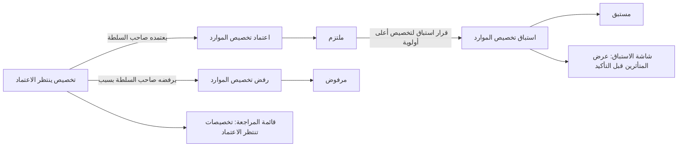
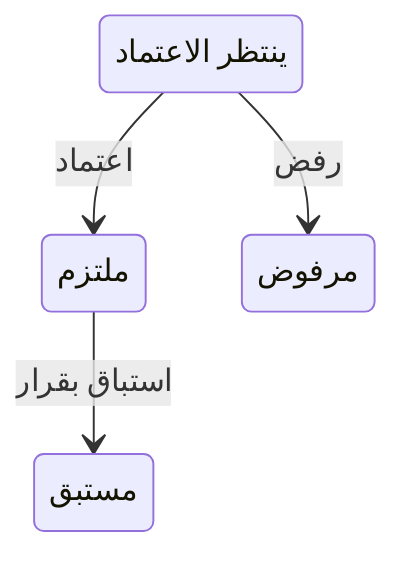

# اعتماد التخصيص وأولويته

<!-- BEGIN GENERATED: doc -->
| البند | القيمة |
|---|---|
| المعرّف | FEAT-RES-ALLOCATION-APPROVAL |
| الإصدار | 0.2 |
| الحالة | مسودة |
| القدرة | CAP-08 الموارد والجاهزية |
| القدرة الفرعية | CAP-08.02 تخصيص الموارد (R2) |
| الأدوار | صاحب السلطة أو المعتمِد الثاني؛ النظام |
| الشاشات | SCR-41 المجمعات والتخصيص والجدول الزمني للسعة، SCR-06 قوائم المراجعة |
| حالات الاستخدام | UC-054 |
| القصص | 6: 4 من المواصفة، و2 جديدة |
<!-- END GENERATED: doc -->

## 1. نظرة عامة

### 1.1 القيمة

تعتمد سلطة التخصيص الطلبات التي تحتاج موافقة وتحسم التنافس بإعطاء الأولوية للأهم مع إشعار المتأثرين.

### 1.2 النطاق

| البند | القيمة |
|---|---|
| المستخدمون | صاحب سلطة التخصيص على نطاق المجمع (اعتماد، رفض، استباق) |
| الشاشات | SCR-06 قوائم المراجعة، SCR-41 المجمعات والتخصيص والجدول الزمني للسعة |
| حالات الاستخدام | اعتماد تخصيص ينتظر الموافقة؛ رفضه بسبب؛ استباقه لتخصيص أعلى أولوية بقرار؛ انتقال النظام إلى انتظار الاعتماد؛ عرض التخصيصات المنتظرة وعرض المتأثرين بالاستباق |
| المتطلبات | فصل المهام بين طالب التخصيص ومعتمِده؛ حجز السعة مؤقتًا ساعة واحدة بانتظار الاعتماد؛ استباق لا يتم إلا بقرار سلطة نطاق المجمع وإشعار المتأثرين |
| خارج النطاق | طلب التخصيص نفسه وفحوصه التلقائية (ميزة طلب تخصيص الموارد)، وتسجيل الاستهلاك وتحريره (ميزتا أخريان) |

### 1.3 خريطة الميزة

**الشكل 1: مسار اعتماد تخصيص الموارد**



**الشكل 2: رحلة تخصيص الموارد في هذه الميزة**



## 2. القواعد المشتركة

تنطبق على كل قصص الميزة، فلا تتكرر داخل القصص. وكل قصة تذكر ما يخصها فقط.

### 2.1 السياق المشترك

كل قصة تبدأ من ثلاثة شروط: مستأجر نشط، وحزمة السياسات الأساسية مفعّلة، ومستخدم مسجّل الدخول ومخوَّل. وتشير إليها القصص بخطوة واحدة: «بفرض السياق المشترك للميزة».

### 2.2 الصلاحية وعدم الإفصاح

- من لا يحق له رؤية العنصر يتلقى ردًا بشكل «غير متاح» تمامًا، فلا يعرف أنه موجود.
- من يرى العنصر ولا يحق له الإجراء يتلقى «لا تملك صلاحية هذا الإجراء».

### 2.3 أوامر تغيير الحالة

- **منع التكرار:** يُرسل كل أمر بمفتاح فريد، فإعادة الطلب نفسه لا تُنفَّذ مرتين.
- **حماية التعديل المتزامن:** يُرسل كل أمر بإصدار البيانات الذي يراه المستخدم. فإن عدّلها غيره في الأثناء، يُرفض الأمر.
- **السجل:** إن نجح الأمر، يُكتب حدثه وسجل التدقيق في المعاملة نفسها.

### 2.4 الرفض المشترك

```gherkin
# language: ar
خاصية: الرفض المشترك لأوامر الميزة

  سيناريو مخطط: رفض مشترك لكل أمر في الميزة
    بفرض السياق المشترك للميزة
    و <الحالة>
    عندما يُرسل المستخدم أي أمر من أوامر الميزة
    اذاً يُرفض برمز <الرمز> ويرى "<الرسالة>"
    و لا يتغير شيء

    امثلة:
      | الحالة                                  | الرمز                  | الرسالة                                                 |
      | العنصر خارج صلاحياته                    | NOT_FOUND              | غير متاح                                                |
      | العنصر مرئي له ولا يحق له الإجراء       | AUTHZ_DENIED           | لا تملك صلاحية هذا الإجراء                              |
      | غيره عدّل العنصر بعد أن فتحه            | VERSION_CONFLICT       | تغيّرت البيانات منذ فتحتها. راجع التغييرات ثم أعد المحاولة |
      | أعاد مفتاح منع التكرار بمحتوى مختلف     | IDEMPOTENCY_KEY_REUSED | طلب مكرر بمحتوى مختلف                                   |
      | البيانات ناقصة أو غير صحيحة             | VALIDATION_FAILED      | بعض البيانات ناقصة أو غير صحيحة. راجع الحقول المعلَّمة      |

  سيناريو: إعادة الطلب نفسه لا تُنفَّذ مرتين
    بفرض السياق المشترك للميزة
    و أمر نجح بمفتاح منع تكرار
    عندما يُعاد الطلب نفسه بالمفتاح نفسه
    اذاً تُعاد النتيجة الأولى ولا يُكتب حدث ثانٍ
```

## 3. الجودة وتعريف الاكتمال

### 3.1 متطلبات الجودة

<!-- BEGIN GENERATED: quality -->
| المرجع | الموقف | المطلوب |
|---|---|---|
| QAS-RES-001 | 100 concurrent allocation requests on one pool | 0 over-commitment; deterministic priority order |
<!-- END GENERATED: quality -->

### 3.2 تعريف الاكتمال

القصة مكتملة حين تتحقق الشروط الخمسة:

1. سيناريوهاتها والقواعد المشتركة تمر في الاختبار الآلي.
2. فحوص البنية المعمارية تمر.
3. نصوص الواجهة والرسائل موجودة بالعربية والإنجليزية.
4. مراجعة الكود مكتملة.
5. ما تضيفه القصة نفسها في قسم «القواعد» تحقق.

## 4. فهرس القصص

<!-- BEGIN GENERATED: story-index -->
| المعرّف | القصة | النوع | الحالة |
|---|---|---|---|
| `US-BC05-ALC-APPROVE` | اعتماد تخصيص الموارد | أمر | مسودة |
| `US-BC05-ALC-PREEMPT` | استباق تخصيص الموارد بأولوية أعلى | أمر | مسودة |
| `US-BC05-ALC-REJECT` | رفض تخصيص الموارد | أمر | مسودة |
| `US-BC05-S-ALLOCATION-02` | تلقائي: checks passed, policy requires approval (تخصيص الموارد) | نظام | مسودة |
| `US-UI-SCR06-ALLOCATION-APPROVAL` | تخصيصات تنتظر اعتمادي في قائمة المراجعة | واجهة | مسودة |
| `US-UI-SCR41-PREEMPT` | الاستباق بقرار مع عرض المتأثرين قبل التأكيد | واجهة | مسودة |
<!-- END GENERATED: story-index -->

## 5. القصص

### 5.1 US-BC05-ALC-APPROVE — اعتماد تخصيص الموارد

| النوع | الإصدار | الأولوية | دون اتصال | الحالة |
|---|---|---|---|---|
| أمر | R2 | Must | لا | مسودة |

> **كـ** صاحب سلطة التخصيص على نطاق المجمع، **أريد** اعتماد تخصيص موارد ينتظر موافقتي، **حتى** تُلتزم السعة المطلوبة للمهمة أو النشاط رسميًا.

**باختصار:** يعتمد صاحب السلطة تخصيصًا "ينتظر الاعتماد" فيصير "ملتزمًا"، على ألا يكون هو نفسه من طلبه (فصل المهام)، وبشرط أن تبقى السعة المطلوبة متاحة.

#### القواعد

- **متى يُسمح:** التخصيص في حالة «ينتظر الاعتماد»، والسعة المطلوبة ما زالت متاحة.
- **من يُسمح له:** صاحب سلطة التخصيص على نطاق المجمع، ولا يجوز أن يكون المعتمِد هو طالب التخصيص نفسه (فصل المهام).
- **الأثر:** تصبح حالة التخصيص «ملتزمًا»، ويصل حدث الالتزام إلى دفتر السعة وإشعار المهمة ومتابعة تقدم الخطة.

#### معايير القبول

```gherkin
# language: ar
خاصية: اعتماد تخصيص الموارد

  سيناريو: اعتماد تخصيص ينتظر الاعتماد
    بفرض السياق المشترك للميزة
    و تخصيص موارد "ينتظر الاعتماد" والسعة المطلوبة متاحة
    عندما يعتمده صاحب سلطة ليس طالب التخصيص
    اذاً تصبح حالته "ملتزمًا"
    و يُسجَّل حدث "التزم تخصيص الموارد"

  سيناريو مخطط: رفض خاص باعتماد التخصيص
    بفرض السياق المشترك للميزة
    و <الحالة>
    عندما يحاول اعتماد التخصيص
    اذاً يُرفض برمز <الرمز> ويرى "<الرسالة>"

    امثلة:
      | الحالة                                | الرمز                                | الرسالة                                              |
      | التخصيص ليس في حالة "ينتظر الاعتماد" | ALLOCATION_INVALID_STATE_TRANSITION | الوضع الحالي لتخصيص الموارد لا يسمح بهذا الإجراء    |
      | السعة المطلوبة لم تعد متاحة           | CAPACITY_UNAVAILABLE                | السعة المطلوبة لم تعد متاحة                          |
      | المعتمِد هو طالب التخصيص نفسه         | SEGREGATION_OF_DUTIES               | لا يجوز أن يعتمد الشخص نفسه ما قدّمه أو طلبه         |
```

<details><summary>المراجع التقنية والتتبع</summary>

<!-- BEGIN GENERATED: refs US-BC05-ALC-APPROVE -->
| البند | المعرّف | المعنى |
|---|---|---|
| الواجهة البرمجية | `POST /api/v1/readiness/allocations/{id}/actions/approve` | — |
| الأمر | `CMD-ALC-APPROVE` | اعتماد تخصيص الموارد |
| السياسة | `POL-ALC-APPROVE` | Planner (request, release) · allocation authority (approve, reject, pre-empt) · task assignee (consumption)؛… |
| الحدث | `EVT-ALC-COMMITTED` | يصل إلى: Capacity ledger; Task (SLC-03) notifications; Plan progress (SLC-08) |
| الكيان | `AGG-ALLOCATION` | تخصيص الموارد |
| الجدول | `readiness.allocations` | الجدول الرئيسي لتخصيص الموارد |
| وحدة النشر | DU-14 | — |
| المتطلبات | REQ-RES-007، REQ-RES-008، REQ-RES-009، REQ-RES-010، REQ-RES-011، REQ-RES-012 | معانيها في القسم 6. التتبع |
| حالة الاستخدام | UC-054 | Allocate Resource |
| الاختبار | TST-ALLOCATION-SM، TST-SLC09-INVARIANTS | دورة حالات تخصيص الموارد، وثوابت الشريحة SLC-09 |
<!-- END GENERATED: refs US-BC05-ALC-APPROVE -->

</details>

### 5.2 US-BC05-ALC-PREEMPT — استباق تخصيص الموارد بأولوية أعلى

| النوع | الإصدار | الأولوية | دون اتصال | الحالة |
|---|---|---|---|---|
| أمر | R2 | Must | لا | مسودة |

> **كـ** صاحب سلطة التخصيص على نطاق المجمع، **أريد** استباق تخصيص ملتزم بتخصيص آخر أعلى أولوية، **حتى** تحصل المهمة الأهم على السعة التي تحتاجها.

**باختصار:** بعد قرار استباق من سلطة نطاق المجمع، يُستبق التخصيص الملتزم الأدنى أولوية فيصير «مستبقًا»، ويُبلَّغ مالك المهمة المتأثرة.

#### القواعد

- **متى يُسمح:** التخصيص «ملتزم»، ويوجد قرار استباق صادر عن صاحب سلطة نطاق المجمع يخص تخصيصًا أعلى أولوية (REQ-RES-009). لا استباق آلي.
- **من يُسمح له:** صاحب سلطة التخصيص على نطاق المجمع.
- **البيانات:** مرجع القرار، ومرجع التخصيص الأعلى أولوية الذي يستفيد من الاستباق.
- **الأثر:** تصبح حالة التخصيص «مستبقًا»، ويُبلَّغ مالك المهمة المتأثرة، ويصل الحدث إلى دفتر السعة ومتابعة تقدم الخطة.

#### معايير القبول

```gherkin
# language: ar
خاصية: استباق تخصيص الموارد بأولوية أعلى

  سيناريو: استباق تخصيص ملتزم بقرار
    بفرض السياق المشترك للميزة
    و تخصيص موارد "ملتزم" وقرار استباق صادر عن سلطة نطاق المجمع لتخصيص أعلى أولوية
    عندما يستبقه صاحب السلطة
    اذاً تصبح حالته "مستبقًا"
    و يُسجَّل حدث "استُبق تخصيص الموارد"
    و يُبلَّغ مالك المهمة المتأثرة

  سيناريو مخطط: رفض خاص باستباق التخصيص
    بفرض السياق المشترك للميزة
    و <الحالة>
    عندما يحاول استباق التخصيص
    اذاً يُرفض برمز <الرمز> ويرى "<الرسالة>"

    امثلة:
      | الحالة                                      | الرمز                                | الرسالة                                           |
      | التخصيص ليس في حالة "ملتزم"                | ALLOCATION_INVALID_STATE_TRANSITION | الوضع الحالي لتخصيص الموارد لا يسمح بهذا الإجراء |
      | لا يوجد قرار استباق من سلطة نطاق المجمع    | AUTHORITY_REQUIRED                  | لا تملك السلطة اللازمة لهذا الإجراء               |
```

<details><summary>المراجع التقنية والتتبع</summary>

<!-- BEGIN GENERATED: refs US-BC05-ALC-PREEMPT -->
| البند | المعرّف | المعنى |
|---|---|---|
| الواجهة البرمجية | `POST /api/v1/readiness/allocations/{id}/actions/preempt` | — |
| الأمر | `CMD-ALC-PREEMPT` | استباق تخصيص الموارد بأولوية أعلى |
| السياسة | `POL-ALC-PREEMPT` | Planner (request, release) · allocation authority (approve, reject, pre-empt) · task assignee (consumption)؛… |
| الحدث | `EVT-ALC-PREEMPTED` | يصل إلى: Capacity ledger; Task (SLC-03) notifications; Plan progress (SLC-08) |
| الكيان | `AGG-ALLOCATION` | تخصيص الموارد |
| الجدول | `readiness.allocations` | الجدول الرئيسي لتخصيص الموارد |
| وحدة النشر | DU-14 | — |
| المتطلبات | REQ-RES-007، REQ-RES-008، REQ-RES-009، REQ-RES-010، REQ-RES-011، REQ-RES-012 | معانيها في القسم 6. التتبع |
| حالة الاستخدام | UC-054 | Allocate Resource |
| الاختبار | TST-ALLOCATION-SM، TST-SLC09-INVARIANTS | دورة حالات تخصيص الموارد، وثوابت الشريحة SLC-09 |
<!-- END GENERATED: refs US-BC05-ALC-PREEMPT -->

</details>

### 5.3 US-BC05-ALC-REJECT — رفض تخصيص الموارد

| النوع | الإصدار | الأولوية | دون اتصال | الحالة |
|---|---|---|---|---|
| أمر | R2 | Must | لا | مسودة |

> **كـ** صاحب سلطة التخصيص على نطاق المجمع، **أريد** رفض تخصيص ينتظر الاعتماد بسبب، **حتى** يعرف الطالب أن طلبه لم يُلب ولماذا.

**باختصار:** يرفض صاحب السلطة تخصيصًا «ينتظر الاعتماد» بذكر سبب، فتصير حالته «مرفوضًا» وتُحرَّر السعة المحجوزة له مؤقتًا.

#### القواعد

- **متى يُسمح:** التخصيص في حالة «ينتظر الاعتماد».
- **من يُسمح له:** صاحب سلطة التخصيص على نطاق المجمع.
- **البيانات:** سبب الرفض (إلزامي).
- **الأثر:** تصبح حالة التخصيص «مرفوضًا»، وتُحرَّر السعة المحجوزة له، ويصل الحدث إلى دفتر السعة وإشعار الطالب ومتابعة تقدم الخطة.

#### معايير القبول

```gherkin
# language: ar
خاصية: رفض تخصيص الموارد

  سيناريو: رفض تخصيص ينتظر الاعتماد بسبب
    بفرض السياق المشترك للميزة
    و تخصيص موارد "ينتظر الاعتماد"
    عندما يرفضه صاحب السلطة بسبب
    اذاً تصبح حالته "مرفوضًا"
    و تُحرَّر السعة المحجوزة له
    و يُسجَّل حدث "رُفض تخصيص الموارد"

  سيناريو مخطط: رفض خاص برفض التخصيص
    بفرض السياق المشترك للميزة
    و <الحالة>
    عندما يحاول رفض التخصيص
    اذاً يُرفض برمز <الرمز> ويرى "<الرسالة>"

    امثلة:
      | الحالة                                | الرمز                                | الرسالة                                           |
      | التخصيص ليس في حالة "ينتظر الاعتماد" | ALLOCATION_INVALID_STATE_TRANSITION | الوضع الحالي لتخصيص الموارد لا يسمح بهذا الإجراء |
      | السبب فارغ                            | REASON_REQUIRED                     | اذكر السبب                                         |
```

<details><summary>المراجع التقنية والتتبع</summary>

<!-- BEGIN GENERATED: refs US-BC05-ALC-REJECT -->
| البند | المعرّف | المعنى |
|---|---|---|
| الواجهة البرمجية | `POST /api/v1/readiness/allocations/{id}/actions/reject` | — |
| الأمر | `CMD-ALC-REJECT` | رفض تخصيص الموارد |
| السياسة | `POL-ALC-REJECT` | Planner (request, release) · allocation authority (approve, reject, pre-empt) · task assignee (consumption)؛… |
| الحدث | `EVT-ALC-REJECTED` | يصل إلى: Capacity ledger; Task (SLC-03) notifications; Plan progress (SLC-08) |
| الكيان | `AGG-ALLOCATION` | تخصيص الموارد |
| الجدول | `readiness.allocations` | الجدول الرئيسي لتخصيص الموارد |
| وحدة النشر | DU-14 | — |
| المتطلبات | REQ-RES-007، REQ-RES-008، REQ-RES-009، REQ-RES-010، REQ-RES-011، REQ-RES-012 | معانيها في القسم 6. التتبع |
| حالة الاستخدام | UC-054 | Allocate Resource |
| الاختبار | TST-ALLOCATION-SM، TST-SLC09-INVARIANTS | دورة حالات تخصيص الموارد، وثوابت الشريحة SLC-09 |
<!-- END GENERATED: refs US-BC05-ALC-REJECT -->

</details>

### 5.4 US-BC05-S-ALLOCATION-02 — تلقائي: checks passed, policy requires approval (تخصيص الموارد)

| النوع | الإصدار | الأولوية | دون اتصال | الحالة |
|---|---|---|---|---|
| نظام | R2 | Must | لا ينطبق | مسودة |

> **كـ** النظام، **أريد** نقل تخصيص الموارد المطلوب حديثًا إلى «ينتظر الاعتماد» حين تنجح كل فحوصه وتوجب سياسة المستأجر اعتمادًا، **حتى** يحسم صاحب السلطة الطلبات التي تحتاج موافقته.

**باختصار:** بعد نجاح فحوص التخصيص السبعة، إن أوجبت سياسة المستأجر اعتمادًا (REQUIRE_APPROVAL)، يحجز النظام السعة مؤقتًا لمدة ساعة واحدة وينقل التخصيص إلى «ينتظر الاعتماد» بانتظار صاحب السلطة.

#### القواعد

- **الشرط:** نجحت فحوص التخصيص السبعة (الصلاحية، النوع، حالة المجمع، النافذة، الجغرافيا، السياسة، السعة)، وأوجبت سياسة المستأجر اعتمادًا.
- **الأثر:** تصبح حالة التخصيص «ينتظر الاعتماد»، وتُحجز السعة المطلوبة مؤقتًا لمدة ساعة واحدة، ويصل حدث الحاجة إلى اعتماد إلى دفتر السعة وإشعار المهمة ومتابعة تقدم الخطة.

#### معايير القبول

```gherkin
# language: ar
خاصية: انتقال تخصيص الموارد إلى انتظار الاعتماد

  سيناريو: نجحت الفحوص وتوجب السياسة اعتمادًا
    بفرض تخصيص موارد "مطلوب" نجحت كل فحوصه
    عندما تُلزم سياسة المستأجر الطلب باعتماد
    اذاً تصبح حالته "ينتظر الاعتماد"
    و تُحجز السعة المطلوبة مؤقتًا لمدة ساعة واحدة
    و يُسجَّل حدث "يحتاج التخصيص اعتمادًا" وسجل تدقيق بهوية النظام

  سيناريو: نجحت الفحوص ولا توجب السياسة اعتمادًا
    بفرض تخصيص موارد "مطلوب" نجحت كل فحوصه
    عندما لا تُلزم سياسة المستأجر الطلب باعتماد
    اذاً لا ينتقل إلى "ينتظر الاعتماد"
```

<details><summary>المراجع التقنية والتتبع</summary>

<!-- BEGIN GENERATED: refs US-BC05-S-ALLOCATION-02 -->
| البند | المعرّف | المعنى |
|---|---|---|
| المحفِّز | `SYS:checks passed, policy requires approval` | PDP obligation REQUIRE_APPROVAL; capacity provisionally held ≤ 1 h |
| الانتقال | REQUESTED ← PENDING_APPROVAL | — |
| الحدث | `EVT-ALC-APPROVAL-REQUIRED` | يصل إلى: Capacity ledger; Task (SLC-03) notifications; Plan progress (SLC-08) |
| الكيان | `AGG-ALLOCATION` | تخصيص الموارد |
| الجدول | `readiness.allocations` | الجدول الرئيسي لتخصيص الموارد |
| وحدة النشر | DU-14 | — |
| المتطلبات | REQ-RES-007، REQ-RES-008، REQ-RES-009، REQ-RES-010، REQ-RES-011، REQ-RES-012 | معانيها في القسم 6. التتبع |
| حالة الاستخدام | UC-054 | Allocate Resource |
| الاختبار | TST-ALLOCATION-SM، TST-SLC09-INVARIANTS | دورة حالات تخصيص الموارد، وثوابت الشريحة SLC-09 |
<!-- END GENERATED: refs US-BC05-S-ALLOCATION-02 -->

</details>

### 5.5 US-UI-SCR06-ALLOCATION-APPROVAL — تخصيصات تنتظر اعتمادي في قائمة المراجعة

| النوع | الإصدار | الأولوية | دون اتصال | الحالة |
|---|---|---|---|---|
| واجهة | R2 | Must | لا | مسودة |

> **كـ** صاحب سلطة التخصيص على نطاق المجمع، **أريد** أن أرى تخصيصات الموارد التي تنتظر اعتمادي في قائمة مراجعتي، **حتى** أعتمدها أو أرفضها من مكان واحد دون أن تفوتني.

**باختصار:** تُدرَج التخصيصات «ينتظر الاعتماد» الموجهة إلى صاحب السلطة في شاشة قوائم المراجعة، وتختفي من القائمة فور اعتمادها أو رفضها.

#### القواعد

- **من يُسمح له:** يرى صاحب السلطة في قائمة مراجعته التخصيصات «ينتظر الاعتماد» ضمن نطاق مجمعه فقط.

#### معايير القبول

```gherkin
# language: ar
خاصية: تخصيصات تنتظر اعتمادي في قائمة المراجعة

  سيناريو: تظهر التخصيصات المنتظرة في قائمة المراجعة
    بفرض السياق المشترك للميزة
    و تخصيصات موارد "تنتظر الاعتماد" ضمن نطاق صاحب السلطة
    عندما يفتح قائمة المراجعة
    اذاً تظهر هذه التخصيصات ضمن قائمته

  سيناريو: التخصيص المحسوم يختفي من القائمة
    بفرض السياق المشترك للميزة
    و تخصيصًا كان "ينتظر الاعتماد" ثم اعتُمد أو رُفض
    عندما يفتح قائمة المراجعة
    اذاً لا يظهر ذلك التخصيص فيها
```

<details><summary>المراجع التقنية والتتبع</summary>

<!-- BEGIN GENERATED: refs US-UI-SCR06-ALLOCATION-APPROVAL -->
| البند | المعرّف | المعنى |
|---|---|---|
| الشاشة | SCR-06 | شاشة قوائم المراجعة |
| المصدر | `17-security-design.md §12.4` | — |
| المصدر | `[Derived]` | — |
| المتطلب | REQ-RES-008 | If two allocation requests compete for the same capacity, then the system shall commit at most the available… |
| حالة الاستخدام | UC-054 | Allocate Resource |
<!-- END GENERATED: refs US-UI-SCR06-ALLOCATION-APPROVAL -->

</details>

### 5.6 US-UI-SCR41-PREEMPT — الاستباق بقرار مع عرض المتأثرين قبل التأكيد

| النوع | الإصدار | الأولوية | دون اتصال | الحالة |
|---|---|---|---|---|
| واجهة | R2 | Must | لا | مسودة |

> **كـ** صاحب سلطة التخصيص على نطاق المجمع، **أريد** أن أرى من يتأثر بالاستباق قبل تأكيده، **حتى** أقرر بعلم بمن سيفقد السعة.

**باختصار:** قبل تأكيد الاستباق، تعرض الشاشة التخصيصات الأدنى أولوية التي ستفقد سعتها ومالكي مهامها المتأثرة، ولا يُنفَّذ الاستباق إلا بعد تأكيد صريح. **[Derived]** شكل العرض وخطوة التأكيد، إذ لا يحدد المصدر إلا وجوب إشعار المتأثرين (REQ-RES-009).

#### القواعد

- **الأثر:** الاستباق لا يُنفَّذ إلا بعد تأكيد صريح من صاحب السلطة، بعد أن يرى التخصيصات المتأثرة ومالكي مهامها.

#### معايير القبول

```gherkin
# language: ar
خاصية: الاستباق بقرار مع عرض المتأثرين قبل التأكيد

  سيناريو: عرض المتأثرين قبل التأكيد
    بفرض السياق المشترك للميزة
    و تخصيصًا أعلى أولوية لا يجد سعة بسبب تخصيصات أدنى أولوية ملتزمة
    عندما يفتح صاحب السلطة شاشة الاستباق
    اذاً تُعرض التخصيصات المتأثرة ومالكو مهامها

  سيناريو: لا يُنفَّذ الاستباق دون تأكيد
    بفرض السياق المشترك للميزة
    و عرض المتأثرين بالاستباق
    عندما يغلق صاحب السلطة الشاشة دون تأكيد
    اذاً لا يُستبق أي تخصيص
```

<details><summary>المراجع التقنية والتتبع</summary>

<!-- BEGIN GENERATED: refs US-UI-SCR41-PREEMPT -->
| البند | المعرّف | المعنى |
|---|---|---|
| الشاشة | SCR-41 | شاشة المجمعات والتخصيص والجدول الزمني للسعة |
| حالة الاستخدام | UC-054 | Allocate Resource |
| المصدر | `[Derived]` | — |
| المتطلب | REQ-RES-009 | When a higher-priority allocation needs capacity already committed at lower priority, the system shall requir… |
| حالة الاستخدام | UC-054 | Allocate Resource |
<!-- END GENERATED: refs US-UI-SCR41-PREEMPT -->

</details>

## 6. التتبع

<!-- BEGIN GENERATED: trace -->
| المتطلب | المعنى | القصص | الاختبار |
|---|---|---|---|
| REQ-RES-007 | When a resource allocation is requested, the system shall verify authorization, type, availability, capacity,… | كل قصص الميزة المأخوذة من المواصفة (4) | TST-ALLOCATION-SM، TST-SLC09-INVARIANTS |
| REQ-RES-008 | If two allocation requests compete for the same capacity, then the system shall commit at most the available… | `US-BC05-ALC-APPROVE`، `US-BC05-ALC-PREEMPT`، `US-BC05-ALC-REJECT`، `US-BC05-S-ALLOCATION-02`، `US-UI-SCR06-ALLOCATION-APPROVAL` | TST-ALLOCATION-SM، TST-SLC09-INVARIANTS |
| REQ-RES-009 | When a higher-priority allocation needs capacity already committed at lower priority, the system shall requir… | `US-BC05-ALC-APPROVE`، `US-BC05-ALC-PREEMPT`، `US-BC05-ALC-REJECT`، `US-BC05-S-ALLOCATION-02`، `US-UI-SCR41-PREEMPT` | TST-ALLOCATION-SM، TST-SLC09-INVARIANTS |
| REQ-RES-010 | The system shall record resource consumption against allocations with quantity, unit and time. | كل قصص الميزة المأخوذة من المواصفة (4) | TST-ALLOCATION-SM، TST-SLC09-INVARIANTS |
| REQ-RES-011 | When a task linked to an allocation reaches a terminal state, the system shall release the unused allocation. | كل قصص الميزة المأخوذة من المواصفة (4) | TST-ALLOCATION-SM، TST-SLC09-INVARIANTS |
| REQ-RES-012 | The system shall link resources and assets to tasks as structured references, replacing the text-only resourc… | كل قصص الميزة المأخوذة من المواصفة (4) | TST-ALLOCATION-SM، TST-ASSET-ASSIGNMENT-SM، TST-SLC09-INVARIANTS |
<!-- END GENERATED: trace -->

## 7. سجل التغييرات

| الإصدار | التاريخ | التغيير |
|---|---|---|
| 0.1 | — | هيكل مولَّد من خريطة الميزات |
| 0.2 | 2026-10-13 | كتابة القصص كاملة بمعيار القصص |
