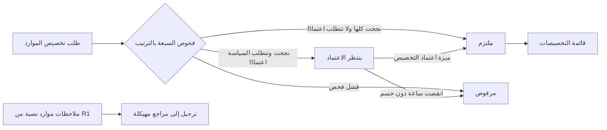
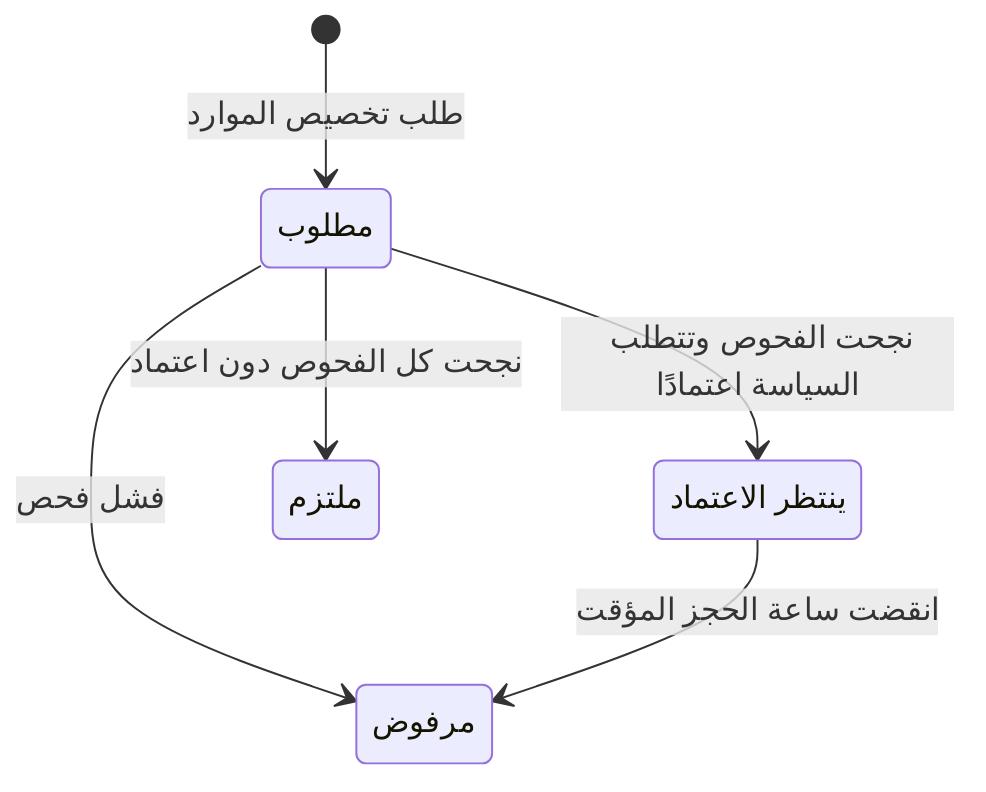

# طلب تخصيص الموارد

<!-- BEGIN GENERATED: doc -->
| البند | القيمة |
|---|---|
| المعرّف | FEAT-RES-ALLOCATION-REQUEST |
| الإصدار | 0.1 |
| الحالة | مسودة |
| القدرة | CAP-08 الموارد والجاهزية |
| القدرة الفرعية | CAP-08.02 تخصيص الموارد (R2) |
| الأدوار | المخطِّط؛ النظام |
| الشاشات | SCR-41 المجمعات والتخصيص والجدول الزمني للسعة |
| حالات الاستخدام | UC-054 |
| القصص | 9: 5 من المواصفة، و4 جديدة |
<!-- END GENERATED: doc -->

## 1. نظرة عامة

### 1.1 القيمة

يطلب المخطط كمية من الموارد لمهمة أو خطة، فيتحقق النظام من التوفر والسعة والسياسة ويلتزم بها أو يبين سبب الرفض.

### 1.2 النطاق

| البند | القيمة |
|---|---|
| المستخدمون | المخطِّط (طلب التخصيص، وعرض قائمته)؛ النظام (فحص الطلب والتزامه أو رفضه) |
| الشاشات | SCR-41 المجمعات والتخصيص والجدول الزمني للسعة |
| حالات الاستخدام | طلب تخصيص كمية من مجمع لمهمة أو نشاط أو طلب إمداد؛ عرض قائمة التخصيصات حسب المجمع أو المهمة أو الخطة أو الحالة؛ فحص الطلب تلقائيًا وإلزامه أو إيقافه لاعتماد أو رفضه؛ رفض الطلب المنتظر للاعتماد بعد انقضاء ساعة؛ ضمان عدم تجاوز السعة تحت التنافس؛ ترحيل ملاحظات الموارد النصية من الإصدار الأول |
| المتطلبات | فحص الصلاحية والنوع والتوفر والسعة والنافذة والجغرافيا والأولوية والالتزامات والسياسة قبل الالتزام؛ حل التنافس بالأولوية ثم وقت الطلب دون تجاوز السعة؛ ربط الموارد والأصول بالمهام بمراجع مهيكلة بدل الملاحظات النصية |
| خارج النطاق | اعتماد التخصيص المنتظر أو رفضه أو استباقه (ميزة اعتماد التخصيص)، وتسجيل الاستهلاك وتحرير التخصيص (ميزتان أخريان) |

### 1.3 خريطة الميزة

**الشكل 1: مسار طلب تخصيص الموارد**



**الشكل 2: رحلة تخصيص الموارد في هذه الميزة**



## 2. القواعد المشتركة

تنطبق على كل قصص الميزة، فلا تتكرر داخل القصص. وكل قصة تذكر ما يخصها فقط.

### 2.1 السياق المشترك

كل قصة تبدأ من ثلاثة شروط: مستأجر نشط، وحزمة السياسات الأساسية مفعّلة، ومستخدم مسجّل الدخول ومخوَّل. وتشير إليها القصص بخطوة واحدة: «بفرض السياق المشترك للميزة».

### 2.2 الصلاحية وعدم الإفصاح

- من لا يحق له رؤية العنصر يتلقى ردًا بشكل «غير متاح» تمامًا، فلا يعرف أنه موجود.
- من يرى العنصر ولا يحق له الإجراء يتلقى «لا تملك صلاحية هذا الإجراء».

### 2.3 أوامر تغيير الحالة

- **منع التكرار:** يُرسل كل أمر بمفتاح فريد، فإعادة الطلب نفسه لا تُنفَّذ مرتين.
- **حماية التعديل المتزامن:** يُرسل كل أمر بإصدار البيانات الذي يراه المستخدم. فإن عدّلها غيره في الأثناء، يُرفض الأمر.
- **السجل:** إن نجح الأمر، يُكتب حدثه وسجل التدقيق في المعاملة نفسها.

### 2.4 الرفض المشترك

```gherkin
# language: ar
خاصية: الرفض المشترك لأوامر الميزة

  سيناريو مخطط: رفض مشترك لكل أمر في الميزة
    بفرض السياق المشترك للميزة
    و <الحالة>
    عندما يُرسل المستخدم أي أمر من أوامر الميزة
    اذاً يُرفض برمز <الرمز> ويرى "<الرسالة>"
    و لا يتغير شيء

    امثلة:
      | الحالة                                  | الرمز                  | الرسالة                                                 |
      | العنصر خارج صلاحياته                    | NOT_FOUND              | غير متاح                                                |
      | العنصر مرئي له ولا يحق له الإجراء       | AUTHZ_DENIED           | لا تملك صلاحية هذا الإجراء                              |
      | غيره عدّل العنصر بعد أن فتحه            | VERSION_CONFLICT       | تغيّرت البيانات منذ فتحتها. راجع التغييرات ثم أعد المحاولة |
      | أعاد مفتاح منع التكرار بمحتوى مختلف     | IDEMPOTENCY_KEY_REUSED | طلب مكرر بمحتوى مختلف                                   |
      | البيانات ناقصة أو غير صحيحة             | VALIDATION_FAILED      | بعض البيانات ناقصة أو غير صحيحة. راجع الحقول المعلَّمة      |

  سيناريو: إعادة الطلب نفسه لا تُنفَّذ مرتين
    بفرض السياق المشترك للميزة
    و أمر نجح بمفتاح منع تكرار
    عندما يُعاد الطلب نفسه بالمفتاح نفسه
    اذاً تُعاد النتيجة الأولى ولا يُكتب حدث ثانٍ
```

## 3. الجودة وتعريف الاكتمال

### 3.1 متطلبات الجودة

<!-- BEGIN GENERATED: quality -->
| المرجع | الموقف | المطلوب |
|---|---|---|
| QAS-RES-001 | 100 concurrent allocation requests on one pool | 0 over-commitment; deterministic priority order |
<!-- END GENERATED: quality -->

### 3.2 تعريف الاكتمال

القصة مكتملة حين تتحقق الشروط الخمسة:

1. سيناريوهاتها والقواعد المشتركة تمر في الاختبار الآلي.
2. فحوص البنية المعمارية تمر.
3. نصوص الواجهة والرسائل موجودة بالعربية والإنجليزية.
4. مراجعة الكود مكتملة.
5. ما تضيفه القصة نفسها في قسم «القواعد» تحقق.

## 4. فهرس القصص

<!-- BEGIN GENERATED: story-index -->
| المعرّف | القصة | النوع | الحالة |
|---|---|---|---|
| `US-BC05-ALC-REQUEST` | طلب تخصيص الموارد | أمر | مسودة |
| `US-BC05-Q-ALC-LIST` | جلب: Allocations by pool, task, plan, state | جلب | مسودة |
| `US-BC05-S-ALLOCATION-01` | تلقائي: all checks passed (تخصيص الموارد) | نظام | مسودة |
| `US-BC05-S-ALLOCATION-03` | تلقائي: a check failed (تخصيص الموارد) | نظام | مسودة |
| `US-BC05-S-ALLOCATION-04` | تلقائي: provisional hold (1 h) elapsed (تخصيص الموارد) | نظام | مسودة |
| `US-UI-SCR41-ALLOCATION-LIST` | قائمة التخصيصات مجمّعة حسب الحالة | واجهة | مسودة |
| `US-UI-SCR41-ALLOCATION-REQUEST` | طلب تخصيص يبين سبب كل فحص فاشل | واجهة | مسودة |
| `US-PLT-ALC-CONTENTION` | لا التزام فوق السعة مع الطلبات المتزامنة | منصة | مسودة |
| `US-OPS-RES-NOTES-MIGRATION` | ترحيل ملاحظات الموارد النصية إلى مراجع | تشغيل | مسودة |
<!-- END GENERATED: story-index -->

## 5. القصص

### 5.1 US-BC05-ALC-REQUEST — طلب تخصيص الموارد

| النوع | الإصدار | الأولوية | دون اتصال | الحالة |
|---|---|---|---|---|
| أمر | R2 | Must | لا | مسودة |

> **كـ** المخطِّط، **أريد** أن أطلب تخصيص كمية من مجمع موارد لمهمة أو نشاط أو طلب إمداد ضمن نافذة زمنية، **حتى** أؤمّن الموارد التي يحتاجها عملي قبل أن أعتمد عليها.

**باختصار:** يطلب المخطط كمية من مجمع نشط لهدف محدد خلال نافذة زمنية بأولوية من 1 إلى 5، فيُسجَّل الطلب ويبدأ النظام فحصه فورًا.

#### القواعد

- **متى يُسمح:** المجمع المطلوب «نشط»، والكمية بوحدة المجمع أكبر من صفر، والنافذة والأولوية صحيحتان، والهدف محدد.
- **من يُسمح له:** المخطِّط.
- **البيانات:** المجمع، والكمية، والنافذة الزمنية، والأولوية (من 1 إلى 5)، والهدف (مهمة أو نشاط أو طلب إمداد)، وتبرير اختياري.
- **الأثر:** يُسجَّل تخصيص جديد بحالة «مطلوب»، ويبدأ فحصه تلقائيًا (القصة 5.3).

#### معايير القبول

```gherkin
# language: ar
خاصية: طلب تخصيص الموارد

  سيناريو: طلب تخصيص صحيح
    بفرض السياق المشترك للميزة
    و مجمع موارد "نشط" وكمية بوحدته أكبر من صفر
    عندما يطلب المخطط تخصيصًا لهدفه بنافذة زمنية وأولوية
    اذاً يُسجَّل التخصيص بحالة "مطلوب"
    و يُسجَّل حدث "طُلب تخصيص الموارد"

  سيناريو مخطط: رفض خاص بطلب التخصيص
    بفرض السياق المشترك للميزة
    و <الحالة>
    عندما يطلب التخصيص
    اذاً يُرفض برمز <الرمز> ويرى "<الرسالة>"

    امثلة:
      | الحالة                                                                  | الرمز             | الرسالة                           |
      | المجمع غير نشط، أو الكمية صفر أو أقل، أو النافذة أو الأولوية غير صحيحة، أو الهدف غير محدد | ALLOCATION_INVALID | بيانات طلب التخصيص غير صحيحة |
```

<details><summary>المراجع التقنية والتتبع</summary>

<!-- BEGIN GENERATED: refs US-BC05-ALC-REQUEST -->
| البند | المعرّف | المعنى |
|---|---|---|
| الواجهة البرمجية | `POST /api/v1/readiness/allocations` | — |
| الأمر | `CMD-ALC-REQUEST` | طلب تخصيص الموارد |
| السياسة | `POL-ALC-REQUEST` | Planner (request, release) · allocation authority (approve, reject, pre-empt) · task assignee (consumption)؛… |
| الحدث | `EVT-ALC-REQUESTED` | يصل إلى: Capacity ledger; Task (SLC-03) notifications; Plan progress (SLC-08) |
| الكيان | `AGG-ALLOCATION` | تخصيص الموارد |
| الجدول | `readiness.allocations` | الجدول الرئيسي لتخصيص الموارد |
| وحدة النشر | DU-14 | — |
| المتطلبات | REQ-RES-007، REQ-RES-008، REQ-RES-009، REQ-RES-010، REQ-RES-011، REQ-RES-012 | معانيها في القسم 6. التتبع |
| حالة الاستخدام | UC-054 | Allocate Resource |
| الاختبار | TST-ALLOCATION-SM، TST-SLC09-INVARIANTS | دورة حالات تخصيص الموارد، وثوابت الشريحة SLC-09 |
<!-- END GENERATED: refs US-BC05-ALC-REQUEST -->

</details>

### 5.2 US-BC05-Q-ALC-LIST — جلب: Allocations by pool, task, plan, state

| النوع | الإصدار | الأولوية | دون اتصال | الحالة |
|---|---|---|---|---|
| جلب | R2 | Must | لا | مسودة |

> **كـ** المخطِّط، **أريد** قائمة التخصيصات حسب المجمع أو المهمة أو الخطة أو الحالة، **حتى** أتابع ما طلبته وما التزم به.

**باختصار:** تُعاد التخصيصات التي يحق للمستخدم رؤيتها فقط، صفحة بعد صفحة بالمؤشر، ولا يكشف عددها وجود تخصيصات محجوبة.

**المرشحات:** المجمع · المهمة · الخطة · الحالة · المؤشر والحد.

#### القواعد

- **من يُسمح له:** المخطِّط، وأي مستخدم مخوَّل ضمن نطاقه.

#### معايير القبول

```gherkin
# language: ar
خاصية: جلب التخصيصات حسب المجمع والمهمة والخطة والحالة

  سيناريو: يرى المستخدم تخصيصاته فقط
    بفرض السياق المشترك للميزة
    و تخصيصات داخل نطاقه وأخرى خارجه
    عندما يطلب قائمة التخصيصات
    اذاً تُعاد التخصيصات داخل نطاقه فقط
    و لا يكشف أي عدد أو اقتراح وجود تخصيص محجوب

  سيناريو: الصفحة التالية
    بفرض السياق المشترك للميزة
    و تخصيصاته أكثر من صفحة
    عندما يطلب الصفحة التالية بالمؤشر
    اذاً تُعاد التخصيصات التالية دون تكرار ولا فجوة
```

<details><summary>المراجع التقنية والتتبع</summary>

<!-- BEGIN GENERATED: refs US-BC05-Q-ALC-LIST -->
| البند | المعرّف | المعنى |
|---|---|---|
| الواجهة البرمجية | `GET /api/v1/readiness/allocations` | — |
| الاستعلام | `QRY-ALC-LIST` | Allocations by pool, task, plan, state |
| السياسة | `POL-ALC-LIST` | scope |
| الكيان | `AGG-ALLOCATION` | تخصيص الموارد |
| الجدول | `readiness.allocations` | الجدول الرئيسي لتخصيص الموارد |
| وحدة النشر | DU-14 | — |
| المتطلب | REQ-RES-007 | When a resource allocation is requested, the system shall verify authorization, type, availability, capacity,… |
| حالة الاستخدام | UC-054 | Allocate Resource |
| الاختبار | TST-ALLOCATION-SM، TST-SLC09-INVARIANTS | دورة حالات تخصيص الموارد، وثوابت الشريحة SLC-09 |
<!-- END GENERATED: refs US-BC05-Q-ALC-LIST -->

</details>

### 5.3 US-BC05-S-ALLOCATION-01 — تلقائي: all checks passed (تخصيص الموارد)

| النوع | الإصدار | الأولوية | دون اتصال | الحالة |
|---|---|---|---|---|
| نظام | R2 | Must | لا ينطبق | مسودة |

> **كـ** النظام، **أريد** أن ألتزم بتخصيص الموارد حين تنجح كل فحوصه ولا تتطلب سياسة المستأجر اعتمادًا، **حتى** تُحجز السعة للمهمة فورًا دون انتظار.

**باختصار:** يفحص النظام التخصيص المطلوب بالترتيب: الصلاحية، ونوع المورد، وحالة المجمع، والنافذة، والجغرافيا، والسياسة، والسعة. فإن نجحت كلها دون حاجة لاعتماد، يحجز السعة بترتيب الأولوية ثم وقت الطلب ويلتزم بالتخصيص فورًا.

#### القواعد

- **الشرط:** نجحت فحوص التخصيص السبعة بالترتيب، ولا توجب سياسة المستأجر اعتمادًا.
- **الأثر:** تصبح حالة التخصيص «ملتزمًا»، وتُحجز السعة المطلوبة في دفتر السعة بترتيب الأولوية ثم وقت الطلب (REQ-RES-008)، ويصل الحدث إلى دفتر السعة وإشعار المهمة ومتابعة تقدم الخطة.

#### معايير القبول

```gherkin
# language: ar
خاصية: التزام تخصيص الموارد بعد نجاح الفحوص

  سيناريو: نجاح كل الفحوص دون حاجة لاعتماد
    بفرض تخصيص موارد "مطلوب"
    عندما تنجح فحوص الصلاحية والنوع والحالة والنافذة والجغرافيا والسياسة والسعة، ولا توجب السياسة اعتمادًا
    اذاً تصبح حالته "ملتزمًا"
    و تُحجز السعة المطلوبة بترتيب الأولوية ثم وقت الطلب
    و يُسجَّل حدث "التزم تخصيص الموارد" وسجل تدقيق بهوية النظام

  سيناريو: التخصيص يحتاج اعتمادًا فلا يُلتزم به مباشرة
    بفرض تخصيص موارد "مطلوب" نجحت كل فحوصه
    عندما توجب سياسة المستأجر اعتمادًا
    اذاً لا يصبح ملتزمًا بهذا الانتقال
```

<details><summary>المراجع التقنية والتتبع</summary>

<!-- BEGIN GENERATED: refs US-BC05-S-ALLOCATION-01 -->
| البند | المعرّف | المعنى |
|---|---|---|
| المحفِّز | `SYS:all checks passed` | SPEC-ALLOCATION §1 checks + capacity ledger reserve in priority order (§2) |
| الانتقال | REQUESTED ← COMMITTED | — |
| الحدث | `EVT-ALC-COMMITTED` | يصل إلى: Capacity ledger; Task (SLC-03) notifications; Plan progress (SLC-08) |
| الكيان | `AGG-ALLOCATION` | تخصيص الموارد |
| الجدول | `readiness.allocations` | الجدول الرئيسي لتخصيص الموارد |
| وحدة النشر | DU-14 | — |
| المتطلبات | REQ-RES-007، REQ-RES-008، REQ-RES-009، REQ-RES-010، REQ-RES-011، REQ-RES-012 | معانيها في القسم 6. التتبع |
| حالة الاستخدام | UC-054 | Allocate Resource |
| الاختبار | TST-ALLOCATION-SM، TST-SLC09-INVARIANTS | دورة حالات تخصيص الموارد، وثوابت الشريحة SLC-09 |
<!-- END GENERATED: refs US-BC05-S-ALLOCATION-01 -->

</details>

### 5.4 US-BC05-S-ALLOCATION-03 — تلقائي: a check failed (تخصيص الموارد)

| النوع | الإصدار | الأولوية | دون اتصال | الحالة |
|---|---|---|---|---|
| نظام | R2 | Must | لا ينطبق | مسودة |

> **كـ** النظام، **أريد** أن أرفض تخصيص الموارد حين يفشل أحد فحوصه، **حتى** يعرف الطالب سبب الرفض بدقة.

**باختصار:** لكل فحص من فحوص التخصيص السبعة رمز فشل خاص به. فإن فشل أحدها يرفض النظام التخصيص فورًا بسبب ذلك الفحص وحده.

#### القواعد

- **الشرط:** فشل أحد فحوص التخصيص السبعة (الصلاحية، النوع، حالة المجمع، النافذة، الجغرافيا، السياسة، السعة).
- **الأثر:** تصبح حالة التخصيص «مرفوضًا» بسبب الفحص الذي فشل، ويصل الحدث إلى دفتر السعة وإشعار الطالب.

#### معايير القبول

```gherkin
# language: ar
خاصية: رفض تخصيص الموارد عند فشل أحد الفحوص

  سيناريو: فشل فحص يرفض التخصيص
    بفرض تخصيص موارد "مطلوب"
    عندما يفشل أحد فحوص التخصيص السبعة
    اذاً تصبح حالته "مرفوضًا" بسبب ذلك الفحص وحده
    و يُسجَّل حدث "رُفض تخصيص الموارد" وسجل تدقيق بهوية النظام

  سيناريو: نجاح كل الفحوص لا يرفض التخصيص
    بفرض تخصيص موارد "مطلوب"
    عندما تنجح كل الفحوص
    اذاً لا يُرفض التخصيص بهذا الانتقال
```

<details><summary>المراجع التقنية والتتبع</summary>

<!-- BEGIN GENERATED: refs US-BC05-S-ALLOCATION-03 -->
| البند | المعرّف | المعنى |
|---|---|---|
| المحفِّز | `SYS:a check failed` | reason codes per failed check |
| الانتقال | REQUESTED ← REJECTED | — |
| الحدث | `EVT-ALC-REJECTED` | يصل إلى: Capacity ledger; Task (SLC-03) notifications; Plan progress (SLC-08) |
| الكيان | `AGG-ALLOCATION` | تخصيص الموارد |
| الجدول | `readiness.allocations` | الجدول الرئيسي لتخصيص الموارد |
| وحدة النشر | DU-14 | — |
| المتطلبات | REQ-RES-007، REQ-RES-008، REQ-RES-009، REQ-RES-010، REQ-RES-011، REQ-RES-012 | معانيها في القسم 6. التتبع |
| حالة الاستخدام | UC-054 | Allocate Resource |
| الاختبار | TST-ALLOCATION-SM، TST-SLC09-INVARIANTS | دورة حالات تخصيص الموارد، وثوابت الشريحة SLC-09 |
<!-- END GENERATED: refs US-BC05-S-ALLOCATION-03 -->

</details>

### 5.5 US-BC05-S-ALLOCATION-04 — تلقائي: provisional hold (1 h) elapsed (تخصيص الموارد)

| النوع | الإصدار | الأولوية | دون اتصال | الحالة |
|---|---|---|---|---|
| نظام | R2 | Must | لا ينطبق | مسودة |

> **كـ** النظام، **أريد** أن أرفض تخصيص الموارد الذي انتظر اعتمادًا أكثر من ساعة، **حتى** تُحرَّر السعة المحجوزة له لغيره.

**باختصار:** يحجز النظام السعة مؤقتًا لمدة ساعة واحدة حين يحتاج التخصيص اعتمادًا. فإن انقضت الساعة دون اعتماد أو رفض، يرفض النظام التخصيص تلقائيًا ويحرر السعة.

#### القواعد

- **الشرط:** انقضت ساعة الحجز المؤقت على تخصيص «ينتظر الاعتماد» دون اعتماد أو رفض.
- **الأثر:** تصبح حالة التخصيص «مرفوضًا»، وتُحرَّر السعة المحجوزة له، ويصل الحدث إلى دفتر السعة وإشعار الطالب.

#### معايير القبول

```gherkin
# language: ar
خاصية: رفض تخصيص الموارد بعد انقضاء ساعة الانتظار

  سيناريو: انقضاء ساعة الحجز المؤقت دون حسم
    بفرض تخصيص موارد "ينتظر الاعتماد" منذ ساعة كاملة دون اعتماد أو رفض
    عندما يحين وقت فحص المجدول
    اذاً تصبح حالته "مرفوضًا"
    و تُحرَّر السعة المحجوزة له
    و يُسجَّل حدث "رُفض تخصيص الموارد" وسجل تدقيق بهوية النظام

  سيناريو: الاعتماد قبل انقضاء الساعة لا يُرفض
    بفرض تخصيص موارد "ينتظر الاعتماد" اعتُمد قبل انقضاء ساعة الحجز
    عندما يحين وقت فحص المجدول
    اذاً لا يُرفض ذلك التخصيص
```

<details><summary>المراجع التقنية والتتبع</summary>

<!-- BEGIN GENERATED: refs US-BC05-S-ALLOCATION-04 -->
| البند | المعرّف | المعنى |
|---|---|---|
| المحفِّز | `SYS:provisional hold (1 h) elapsed` | capacity released |
| الانتقال | PENDING_APPROVAL ← REJECTED | — |
| الحدث | `EVT-ALC-REJECTED` | يصل إلى: Capacity ledger; Task (SLC-03) notifications; Plan progress (SLC-08) |
| الكيان | `AGG-ALLOCATION` | تخصيص الموارد |
| الجدول | `readiness.allocations` | الجدول الرئيسي لتخصيص الموارد |
| وحدة النشر | DU-14 | — |
| المتطلبات | REQ-RES-007، REQ-RES-008، REQ-RES-009، REQ-RES-010، REQ-RES-011، REQ-RES-012 | معانيها في القسم 6. التتبع |
| حالة الاستخدام | UC-054 | Allocate Resource |
| الاختبار | TST-ALLOCATION-SM، TST-SLC09-INVARIANTS | دورة حالات تخصيص الموارد، وثوابت الشريحة SLC-09 |
<!-- END GENERATED: refs US-BC05-S-ALLOCATION-04 -->

</details>

### 5.6 US-UI-SCR41-ALLOCATION-LIST — قائمة التخصيصات مجمّعة حسب الحالة

| النوع | الإصدار | الأولوية | دون اتصال | الحالة |
|---|---|---|---|---|
| واجهة | R2 | Must | لا | مسودة |

> **كـ** مدير الموارد أو المخطِّط، **أريد** قائمة التخصيصات مجمّعة حسب حالتها، **حتى** أتابع ما يحتاج اعتمادًا وما التزم به وما رُفض من مكان واحد.

**باختصار:** تُعرض التخصيصات في شاشة المجمعات والتخصيص مجمّعة حسب حالتها، مع إمكان التصفية بالمجمع أو المهمة أو الخطة. **[Derived]** التجميع حسب الحالة تحديدًا شكل العرض، إذ المصدر يحدد الاستعلام والشاشة دون شكل العرض.

#### القواعد

- **من يُسمح له:** مدير الموارد أو المخطِّط، لما يقع ضمن نطاقهما.

#### معايير القبول

```gherkin
# language: ar
خاصية: قائمة التخصيصات مجمّعة حسب الحالة

  سيناريو: عرض التخصيصات مجمَّعة حسب الحالة
    بفرض السياق المشترك للميزة
    و تخصيصات موارد بحالات مختلفة ضمن نطاقه
    عندما يفتح شاشة المجمعات والتخصيص
    اذاً تُعرض التخصيصات مجمَّعة حسب حالتها

  سيناريو: تصفية التخصيصات بالمجمع
    بفرض السياق المشترك للميزة
    و تخصيصات لأكثر من مجمع
    عندما يختار مجمعًا واحدًا
    اذاً تُعرض تخصيصات هذا المجمع فقط
```

<details><summary>المراجع التقنية والتتبع</summary>

<!-- BEGIN GENERATED: refs US-UI-SCR41-ALLOCATION-LIST -->
| البند | المعرّف | المعنى |
|---|---|---|
| الشاشة | SCR-41 | شاشة المجمعات والتخصيص والجدول الزمني للسعة |
| المصدر | `[Derived]` | — |
| المتطلب | REQ-RES-007 | When a resource allocation is requested, the system shall verify authorization, type, availability, capacity,… |
| حالة الاستخدام | UC-054 | Allocate Resource |
<!-- END GENERATED: refs US-UI-SCR41-ALLOCATION-LIST -->

</details>

### 5.7 US-UI-SCR41-ALLOCATION-REQUEST — طلب تخصيص يبين سبب كل فحص فاشل

| النوع | الإصدار | الأولوية | دون اتصال | الحالة |
|---|---|---|---|---|
| واجهة | R2 | Must | لا | مسودة |

> **كـ** المخطِّط، **أريد** أن يبين لي طلب التخصيص سبب كل فحص فاشل، **حتى** أصحح طلبي بدل أن أعيد المحاولة بلا معرفة السبب.

**باختصار:** حين يفشل أحد فحوص التخصيص السبعة، تعرض الشاشة رمز الفحص الذي فشل ورسالته، لا رفضًا عامًا واحدًا (21-ui-design.md §6.2).

#### القواعد

- **الأثر:** يرى المخطط سبب فشل الفحص الواحد الذي أوقف طلبه، لا رسالة عامة.

#### معايير القبول

```gherkin
# language: ar
خاصية: طلب تخصيص يبين سبب كل فحص فاشل

  سيناريو: عرض سبب الفحص الفاشل
    بفرض السياق المشترك للميزة
    و طلب تخصيص فشل أحد فحوصه
    عندما يفتح المخطط نتيجة الطلب
    اذاً يرى سبب ذلك الفحص وحده

  سيناريو: عرض نجاح الطلب
    بفرض السياق المشترك للميزة
    و طلب تخصيص نجحت كل فحوصه
    عندما يفتح المخطط نتيجة الطلب
    اذاً يرى حالته الجديدة دون أي سبب رفض
```

<details><summary>المراجع التقنية والتتبع</summary>

<!-- BEGIN GENERATED: refs US-UI-SCR41-ALLOCATION-REQUEST -->
| البند | المعرّف | المعنى |
|---|---|---|
| الشاشة | SCR-41 | شاشة المجمعات والتخصيص والجدول الزمني للسعة |
| المصدر | `21-ui-design.md §6.2` | — |
| المتطلب | REQ-RES-007 | When a resource allocation is requested, the system shall verify authorization, type, availability, capacity,… |
| حالة الاستخدام | UC-054 | Allocate Resource |
<!-- END GENERATED: refs US-UI-SCR41-ALLOCATION-REQUEST -->

</details>

### 5.8 US-PLT-ALC-CONTENTION — لا التزام فوق السعة مع الطلبات المتزامنة

| النوع | الإصدار | الأولوية | دون اتصال | الحالة |
|---|---|---|---|---|
| منصة | R2 | Must | لا ينطبق | مسودة |

> **كـ** فريق المنصة، **أريد** أن يحسم دفتر السعة تنافس طلبات التخصيص على المجمع نفسه بترتيب حتمي بالأولوية ثم الوقت دون أي التزام فوق السعة، **حتى** تبقى الموارد صحيحة تحت الحمل العالي (QAS-RES-001).

**باختصار:** تُجمع طلبات المجمع نفسه في نافذة 250 ميلي ثانية، وتُرتَّب بالأولوية ثم وقت الطلب، وتُلتزم واحدة تلو الأخرى دون أن يتجاوز المجموع سعة أي ساعة (23-crosscutting.md §5).

#### معايير القبول

```gherkin
# language: ar
خاصية: أداء دفتر السعة تحت التنافس

  سيناريو: مئة طلب متزامن على مجمع واحد
    بفرض حمل بمئة طلب تخصيص متزامن على مجمع واحد
    عندما تُحسم الطلبات
    اذاً لا يتجاوز الملتزم سعة أي ساعة
    و يكون ترتيب الالتزام حتميًا بالأولوية ثم وقت الطلب

  سيناريو: دفتر السعة يعزل المستأجرين
    عندما يُفحص مخطط قاعدة البيانات
    اذاً تكون سعة كل ساعة مرتبطة بمستأجر ومجمع واحدين
```

<details><summary>المراجع التقنية والتتبع</summary>

<!-- BEGIN GENERATED: refs US-PLT-ALC-CONTENTION -->
| البند | المعرّف | المعنى |
|---|---|---|
| الجودة | QAS-RES-001 | 100 concurrent allocation requests on one pool → 0 over-commitment; deterministic priority order |
| المصدر | `23-crosscutting.md §5` | — |
| المتطلب | REQ-RES-008 | If two allocation requests compete for the same capacity, then the system shall commit at most the available… |
| حالة الاستخدام | UC-054 | Allocate Resource |
<!-- END GENERATED: refs US-PLT-ALC-CONTENTION -->

</details>

### 5.9 US-OPS-RES-NOTES-MIGRATION — ترحيل ملاحظات الموارد النصية إلى مراجع

| النوع | الإصدار | الأولوية | دون اتصال | الحالة |
|---|---|---|---|---|
| تشغيل | R2 | Must | لا ينطبق | مسودة |

> **كـ** فريق التشغيل، **أريد** أن أرحّل ملاحظات الموارد النصية من الإصدار الأول إلى مراجع مهيكلة، **حتى** يتحقق النظام من السعة والتوفر لما كان نصًا فقط من قبل (إغلاق الدين الفني DEBT-001).

**باختصار:** يحاول النظام مطابقة أسماء الأصول والمجمعات في الملاحظات النصية القديمة آليًا ويقترح مراجع، ثم يقبل المخطط الاقتراح أو يرفضه. وما لا يُطابَق يبقى ملاحظة موسومة «قديمة» دون حذف الأصل، مع تقرير ترحيل لكل مستأجر (SPEC-ALLOCATION §6).

#### القواعد

- **الأثر:** الملاحظة المطابقة والمقبولة تصبح مرجعًا مهيكلًا؛ وغير المطابقة تبقى ملاحظة نصية موسومة «قديمة»، ولا تُحذف الملاحظة الأصلية في الحالتين. يُسجَّل كل ذلك في تقرير ترحيل لكل مستأجر.

#### معايير القبول

```gherkin
# language: ar
خاصية: ترحيل ملاحظات الموارد النصية إلى مراجع

  سيناريو: ترحيل ملاحظة تطابقت آليًا
    بفرض ملاحظة موارد نصية من الإصدار الأول تطابقت آليًا مع أصل أو مجمع
    عندما يقبل المخطط الاقتراح
    اذاً تصبح الملاحظة مرجعًا مهيكلًا
    و تُسجَّل في تقرير الترحيل

  سيناريو: ملاحظة لم تُطابَق
    بفرض ملاحظة موارد نصية لم تُطابَق آليًا
    عندما يُشغَّل الترحيل
    اذاً تبقى ملاحظة نصية موسومة "قديمة" ولا تُحذف
    و تُسجَّل في تقرير الترحيل
```

<details><summary>المراجع التقنية والتتبع</summary>

<!-- BEGIN GENERATED: refs US-OPS-RES-NOTES-MIGRATION -->
| البند | المعرّف | المعنى |
|---|---|---|
| المصدر | `DEBT-001` | — |
| المتطلب | REQ-RES-012 | The system shall link resources and assets to tasks as structured references, replacing the text-only resourc… |
| حالة الاستخدام | UC-054 | Allocate Resource |
<!-- END GENERATED: refs US-OPS-RES-NOTES-MIGRATION -->

</details>

## 6. التتبع

<!-- BEGIN GENERATED: trace -->
| المتطلب | المعنى | القصص | الاختبار |
|---|---|---|---|
| REQ-RES-007 | When a resource allocation is requested, the system shall verify authorization, type, availability, capacity,… | `US-BC05-ALC-REQUEST`، `US-BC05-Q-ALC-LIST`، `US-BC05-S-ALLOCATION-01`، `US-BC05-S-ALLOCATION-03`، `US-BC05-S-ALLOCATION-04`، `US-UI-SCR41-ALLOCATION-LIST`، `US-UI-SCR41-ALLOCATION-REQUEST` | TST-ALLOCATION-SM، TST-SLC09-INVARIANTS |
| REQ-RES-008 | If two allocation requests compete for the same capacity, then the system shall commit at most the available… | `US-BC05-ALC-REQUEST`، `US-BC05-S-ALLOCATION-01`، `US-BC05-S-ALLOCATION-03`، `US-BC05-S-ALLOCATION-04`، `US-PLT-ALC-CONTENTION` | TST-ALLOCATION-SM، TST-SLC09-INVARIANTS |
| REQ-RES-009 | When a higher-priority allocation needs capacity already committed at lower priority, the system shall requir… | كل قصص الأوامر والنظام في الميزة (4) | TST-ALLOCATION-SM، TST-SLC09-INVARIANTS |
| REQ-RES-010 | The system shall record resource consumption against allocations with quantity, unit and time. | كل قصص الأوامر والنظام في الميزة (4) | TST-ALLOCATION-SM، TST-SLC09-INVARIANTS |
| REQ-RES-011 | When a task linked to an allocation reaches a terminal state, the system shall release the unused allocation. | كل قصص الأوامر والنظام في الميزة (4) | TST-ALLOCATION-SM، TST-SLC09-INVARIANTS |
| REQ-RES-012 | The system shall link resources and assets to tasks as structured references, replacing the text-only resourc… | `US-BC05-ALC-REQUEST`، `US-BC05-S-ALLOCATION-01`، `US-BC05-S-ALLOCATION-03`، `US-BC05-S-ALLOCATION-04`، `US-OPS-RES-NOTES-MIGRATION` | TST-ALLOCATION-SM، TST-ASSET-ASSIGNMENT-SM، TST-SLC09-INVARIANTS |
<!-- END GENERATED: trace -->

## 7. سجل التغييرات

| الإصدار | التاريخ | التغيير |
|---|---|---|
| 0.1 | — | هيكل مولَّد من خريطة الميزات |
| 0.2 | 2026-10-13 | كتابة القصص كاملة بمعيار القصص |
