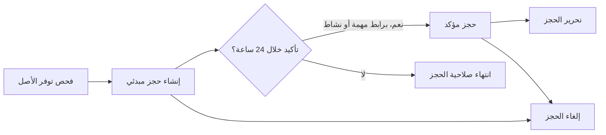
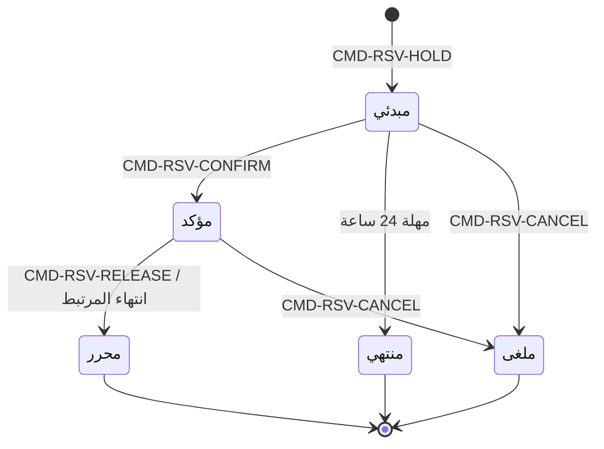

# حجز الأصول وتوفرها

<!-- BEGIN GENERATED: doc -->
| البند | القيمة |
|---|---|
| المعرّف | FEAT-RES-ASSET-BOOKING |
| الإصدار | 0.2 |
| الحالة | مسودة |
| القدرة | CAP-08 الموارد والجاهزية |
| القدرة الفرعية | CAP-08.01 إدارة الأصول (R2) |
| الأدوار | المخطِّط؛ مدير الموارد؛ النظام |
| الشاشات | SCR-40 الأصول وتوفرها والصيانة |
| حالات الاستخدام | UC-051، UC-052 |
| القصص | 11: 7 من المواصفة، و4 جديدة |
<!-- END GENERATED: doc -->

## 1. نظرة عامة

### 1.1 القيمة

يرى المخطط الأصول المتاحة في نافذة زمنية ويحجزها مسبقًا دون تعارض مع حجوزات أخرى.

### 1.2 النطاق

| البند | القيمة |
|---|---|
| المستخدمون | المخطِّط؛ مدير الموارد؛ النظام |
| الشاشات | SCR-40 الأصول وتوفرها والصيانة |
| حالات الاستخدام | فحص توفر الأصل في نافذة زمنية؛ حجز الأصل مبدئيًا ثم تأكيده |
| المتطلبات | لا يُحجز أصل محجوز لنافذة زمنية لغير من حجزه خلالها |
| خارج النطاق | تسجيل الأصل نفسه وتغيير حالته الفنية وصيانته (ميزة صيانة الأصول)؛ إسناد الأصل الفعلي لمهمة أو وحدة (إسناد الأصل) |

### 1.3 خريطة الميزة

**الشكل 1: مسار حجز الأصل**



**الشكل 2: حالات حجز الأصل**



## 2. القواعد المشتركة

تنطبق على كل قصص الميزة، فلا تتكرر داخل القصص. وكل قصة تذكر ما يخصها فقط.

### 2.1 السياق المشترك

كل قصة تبدأ من ثلاثة شروط: مستأجر نشط، وحزمة السياسات الأساسية مفعّلة، ومستخدم مسجّل الدخول ومخوَّل. وتشير إليها القصص بخطوة واحدة: «بفرض السياق المشترك للميزة».

### 2.2 الصلاحية وعدم الإفصاح

- من لا يحق له رؤية العنصر يتلقى ردًا بشكل «غير متاح» تمامًا، فلا يعرف أنه موجود.
- من يرى العنصر ولا يحق له الإجراء يتلقى «لا تملك صلاحية هذا الإجراء».

### 2.3 أوامر تغيير الحالة

- **منع التكرار:** يُرسل كل أمر بمفتاح فريد، فإعادة الطلب نفسه لا تُنفَّذ مرتين.
- **حماية التعديل المتزامن:** يُرسل كل أمر بإصدار البيانات الذي يراه المستخدم. فإن عدّلها غيره في الأثناء، يُرفض الأمر.
- **السجل:** إن نجح الأمر، يُكتب حدثه وسجل التدقيق في المعاملة نفسها.

### 2.4 الرفض المشترك

```gherkin
# language: ar
خاصية: الرفض المشترك لأوامر الميزة

  سيناريو مخطط: رفض مشترك لكل أمر في الميزة
    بفرض السياق المشترك للميزة
    و <الحالة>
    عندما يُرسل المستخدم أي أمر من أوامر الميزة
    اذاً يُرفض برمز <الرمز> ويرى "<الرسالة>"
    و لا يتغير شيء

    امثلة:
      | الحالة                                  | الرمز                  | الرسالة                                                 |
      | العنصر خارج صلاحياته                    | NOT_FOUND              | غير متاح                                                |
      | العنصر مرئي له ولا يحق له الإجراء       | AUTHZ_DENIED           | لا تملك صلاحية هذا الإجراء                              |
      | غيره عدّل العنصر بعد أن فتحه            | VERSION_CONFLICT       | تغيّرت البيانات منذ فتحتها. راجع التغييرات ثم أعد المحاولة |
      | أعاد مفتاح منع التكرار بمحتوى مختلف     | IDEMPOTENCY_KEY_REUSED | طلب مكرر بمحتوى مختلف                                   |
      | البيانات ناقصة أو غير صحيحة             | VALIDATION_FAILED      | بعض البيانات ناقصة أو غير صحيحة. راجع الحقول المعلَّمة      |

  سيناريو: إعادة الطلب نفسه لا تُنفَّذ مرتين
    بفرض السياق المشترك للميزة
    و أمر نجح بمفتاح منع تكرار
    عندما يُعاد الطلب نفسه بالمفتاح نفسه
    اذاً تُعاد النتيجة الأولى ولا يُكتب حدث ثانٍ
```

## 3. الجودة وتعريف الاكتمال

### 3.1 متطلبات الجودة

<!-- BEGIN GENERATED: quality -->
| المرجع | الموقف | المطلوب |
|---|---|---|
| QAS-RES-001 | 100 concurrent allocation requests on one pool | 0 over-commitment; deterministic priority order |
| QAS-RES-002 | availability query for 1,000 assets over 30 days | p95 ≤ 1 s |
<!-- END GENERATED: quality -->

### 3.2 تعريف الاكتمال

القصة مكتملة حين تتحقق الشروط الخمسة:

1. سيناريوهاتها والقواعد المشتركة تمر في الاختبار الآلي.
2. فحوص البنية المعمارية تمر.
3. نصوص الواجهة والرسائل موجودة بالعربية والإنجليزية.
4. مراجعة الكود مكتملة.
5. ما تضيفه القصة نفسها في قسم «القواعد» تحقق.

## 4. فهرس القصص

<!-- BEGIN GENERATED: story-index -->
| المعرّف | القصة | النوع | الحالة |
|---|---|---|---|
| `US-BC05-RSV-CANCEL` | إلغاء حجز الأصل | أمر | مسودة |
| `US-BC05-RSV-CONFIRM` | تأكيد حجز الأصل | أمر | مسودة |
| `US-BC05-RSV-HOLD` | إنشاء حجز الأصل مبدئيًا | أمر | مسودة |
| `US-BC05-RSV-RELEASE` | تحرير حجز الأصل | أمر | مسودة |
| `US-BC05-Q-AST-AVAILABILITY` | جلب توفر الأصول في نافذة زمنية | جلب | مسودة |
| `US-BC05-S-ASSET-RESERVATION-01` | انتهاء صلاحية الحجز المبدئي بعد 24 ساعة | نظام | مسودة |
| `US-BC05-S-ASSET-RESERVATION-02` | تحرير الحجز عند انتهاء المهمة أو الخطة المرتبطة | نظام | مسودة |
| `US-UI-SCR40-AVAILABILITY` | عرض توفر الأصول في نافذة زمنية | واجهة | مسودة |
| `US-UI-SCR40-RESERVE-HOLD` | الحجز المبدئي ومهلته ورسالة التعارض | واجهة | مسودة |
| `US-PLT-AST-AVAILABILITY-PERF` | استعلام توفر ألف أصل خلال ثانية | منصة | مسودة |
| `US-PLT-AST-EXCLUSION` | منع تداخل حجوزات الأصل تحت التزامن | منصة | مسودة |
<!-- END GENERATED: story-index -->

## 5. القصص

### 5.1 US-BC05-RSV-CANCEL — إلغاء حجز الأصل

| النوع | الإصدار | الأولوية | دون اتصال | الحالة |
|---|---|---|---|---|
| أمر | R2 | Must | لا | مسودة |

> **كـ** المخطِّط أو مدير الموارد، **أريد** إلغاء حجز أصل لم يعد يحتاجه، **حتى** يصبح الأصل متاحًا لغيره دون انتظار.

**باختصار:** يلغي طالب الحجز أو مالك الأصل حجزًا مبدئيًا أو مؤكدًا بسبب، فيتوقف عن حجب توفر الأصل فورًا.

#### القواعد

- **متى يُسمح:** الحجز في حالة «مبدئي» أو «مؤكد».
- **من يُسمح له:** طالب الحجز، أو مالك الأصل، بصفة المخطِّط أو مدير الموارد.
- **البيانات:** سبب الإلغاء (إلزامي).
- **الأثر:** حدث «أُلغي حجز الأصل» يصل إلى عرض التوفر، فيتحرر الأصل من حجبه فورًا.

#### معايير القبول

```gherkin
# language: ar
خاصية: إلغاء حجز الأصل

  سيناريو: إلغاء حجز مبدئي بسبب
    بفرض السياق المشترك للميزة
    و حجز أصل لطالبه في حالة "مبدئي"
    عندما يلغيه مع ذكر السبب
    اذاً تصبح حالته "ملغى"
    و يُسجَّل حدث "أُلغي حجز الأصل"

  سيناريو مخطط: رفض خاص بإلغاء حجز الأصل
    بفرض السياق المشترك للميزة
    و <الحالة>
    عندما يحاول إلغاء الحجز
    اذاً يُرفض برمز <الرمز> ويرى <الرسالة>

    امثلة:
      | الحالة                                   | الرمز                                      | الرسالة                                       |
      | الحجز في حالة "محرر" أو "منتهي" أو "ملغى" من قبل | ASSET_RESERVATION_INVALID_STATE_TRANSITION | الوضع الحالي لحجز الأصل لا يسمح بهذا الإجراء |
      | سبب الإلغاء غير مذكور                    | REASON_REQUIRED                            | اذكر السبب                                    |
```

<details><summary>المراجع التقنية والتتبع</summary>

<!-- BEGIN GENERATED: refs US-BC05-RSV-CANCEL -->
| البند | المعرّف | المعنى |
|---|---|---|
| الواجهة البرمجية | `POST /api/v1/readiness/asset-reservations/{id}/actions/cancel` | — |
| الأمر | `CMD-RSV-CANCEL` | إلغاء حجز الأصل |
| السياسة | `POL-RSV-CANCEL` | Planner / Resource Manager؛ tenant match; object visible; owner/pool scope |
| الحدث | `EVT-RSV-CANCELLED` | يصل إلى: Availability view |
| الكيان | `AGG-ASSET-RESERVATION` | حجز الأصل |
| الجدول | `readiness.asset_reservations` | الجدول الرئيسي لحجز الأصل |
| وحدة النشر | DU-14 | — |
| المتطلب | REQ-RES-014 | When an asset is reserved for a time window, the system shall reject any other reservation or assignment of t… |
| حالة الاستخدام | UC-052 | Reserve Asset |
| الاختبار | TST-ASSET-RESERVATION-SM، TST-SLC09-INVARIANTS | دورة حالات حجز الأصل، وثوابت الشريحة SLC-09 |
<!-- END GENERATED: refs US-BC05-RSV-CANCEL -->

</details>

### 5.2 US-BC05-RSV-CONFIRM — تأكيد حجز الأصل

| النوع | الإصدار | الأولوية | دون اتصال | الحالة |
|---|---|---|---|---|
| أمر | R2 | Must | لا | مسودة |

> **كـ** المخطِّط أو مدير الموارد، **أريد** تأكيد الحجز المبدئي بربطه بمهمة أو نشاط خطة، **حتى** يصير الأصل محجوزًا فعليًا دون أن تنتهي صلاحية حجزه.

**باختصار:** يربط المخطط الحجز «المبدئي» بمهمة أو نشاط خطة فيصير «مؤكدًا»، ويتوقف عداد مهلة الأربع وعشرين ساعة.

#### القواعد

- **متى يُسمح:** الحجز في حالة «مبدئي».
- **من يُسمح له:** طالب الحجز، أو مالك الأصل، بصفة المخطِّط أو مدير الموارد.
- **البيانات:** المهمة أو نشاط الخطة المرتبط (إلزامي).
- **الأثر:** حدث «تأكد حجز الأصل» يصل إلى عرض التوفر.

#### معايير القبول

```gherkin
# language: ar
خاصية: تأكيد حجز الأصل

  سيناريو: تأكيد حجز مبدئي بربطه بمهمة
    بفرض السياق المشترك للميزة
    و حجز أصل في حالة "مبدئي"
    عندما يربطه المستخدم بمهمة أو نشاط خطة ويؤكده
    اذاً تصبح حالته "مؤكد"
    و يُسجَّل حدث "تأكد حجز الأصل"

  سيناريو مخطط: رفض خاص بتأكيد حجز الأصل
    بفرض السياق المشترك للميزة
    و <الحالة>
    عندما يحاول تأكيد الحجز
    اذاً يُرفض برمز <الرمز> ويرى <الرسالة>

    امثلة:
      | الحالة                                       | الرمز                                      | الرسالة                                       |
      | الحجز ليس في حالة "مبدئي"                    | ASSET_RESERVATION_INVALID_STATE_TRANSITION | الوضع الحالي لحجز الأصل لا يسمح بهذا الإجراء |
      | لم يُربط الحجز بمهمة أو نشاط خطة             | LINK_REQUIRED                              | اربط الحجز بمهمة أو نشاط                      |
```

<details><summary>المراجع التقنية والتتبع</summary>

<!-- BEGIN GENERATED: refs US-BC05-RSV-CONFIRM -->
| البند | المعرّف | المعنى |
|---|---|---|
| الواجهة البرمجية | `POST /api/v1/readiness/asset-reservations/{id}/actions/confirm` | — |
| الأمر | `CMD-RSV-CONFIRM` | تأكيد حجز الأصل |
| السياسة | `POL-RSV-CONFIRM` | Planner / Resource Manager؛ tenant match; object visible; owner/pool scope |
| الحدث | `EVT-RSV-CONFIRMED` | يصل إلى: Availability view |
| الكيان | `AGG-ASSET-RESERVATION` | حجز الأصل |
| الجدول | `readiness.asset_reservations` | الجدول الرئيسي لحجز الأصل |
| وحدة النشر | DU-14 | — |
| المتطلب | REQ-RES-014 | When an asset is reserved for a time window, the system shall reject any other reservation or assignment of t… |
| حالة الاستخدام | UC-052 | Reserve Asset |
| الاختبار | TST-ASSET-RESERVATION-SM، TST-SLC09-INVARIANTS | دورة حالات حجز الأصل، وثوابت الشريحة SLC-09 |
<!-- END GENERATED: refs US-BC05-RSV-CONFIRM -->

</details>

### 5.3 US-BC05-RSV-HOLD — إنشاء حجز الأصل مبدئيًا

| النوع | الإصدار | الأولوية | دون اتصال | الحالة |
|---|---|---|---|---|
| أمر | R2 | Must | لا | مسودة |

> **كـ** المخطِّط أو مدير الموارد، **أريد** حجز أصل لنافذة زمنية مبدئيًا، **حتى** أضمن توفره قبل أن أربطه بمهمة أو نشاط.

**باختصار:** يحجز المخطط أصلًا متاحًا لنافذة زمنية بغرض محدد، فيصير «مبدئيًا» لمدة 24 ساعة قبل أن يُؤكَّد أو تنتهي صلاحيته.

#### القواعد

- **متى يُسمح:** لا حجز «مبدئي» أو «مؤكد» آخر للأصل نفسه يتداخل مع النافذة الزمنية المطلوبة.
- **من يُسمح له:** المخطِّط أو مدير الموارد المخوَّل في نطاق مالك الأصل.
- **البيانات:** الأصل، النافذة الزمنية، الغرض، وتصنيف الحجز (إلزامية).
- **الأثر:** حدث «أُنشئ حجز الأصل مبدئيًا» يصل إلى عرض التوفر، فيحجب الأصل عن غيره طوال النافذة.

#### معايير القبول

```gherkin
# language: ar
خاصية: إنشاء حجز الأصل مبدئيًا

  سيناريو: حجز أصل متاح لنافذة زمنية
    بفرض السياق المشترك للميزة
    و أصل لا حجز آخر له يتداخل مع النافذة المطلوبة
    عندما يحجزه المستخدم مبدئيًا بغرض وتصنيف
    اذاً يُنشأ حجز في حالة "مبدئي"
    و يُسجَّل حدث "أُنشئ حجز الأصل مبدئيًا"

  سيناريو مخطط: رفض خاص بالحجز المبدئي
    بفرض السياق المشترك للميزة
    و <الحالة>
    عندما يحاول حجز الأصل
    اذاً يُرفض برمز <الرمز> ويرى <الرسالة>

    امثلة:
      | الحالة                                           | الرمز          | الرسالة                     |
      | الأصل له حجز "مبدئي" أو "مؤكد" آخر في نفس النافذة | ASSET_RESERVED | الأصل محجوز في هذه الفترة   |
```

<details><summary>المراجع التقنية والتتبع</summary>

<!-- BEGIN GENERATED: refs US-BC05-RSV-HOLD -->
| البند | المعرّف | المعنى |
|---|---|---|
| الواجهة البرمجية | `POST /api/v1/readiness/asset-reservations` | — |
| الأمر | `CMD-RSV-HOLD` | إنشاء حجز الأصل مبدئيًا |
| السياسة | `POL-RSV-HOLD` | Planner / Resource Manager؛ tenant match; object visible; owner/pool scope |
| الحدث | `EVT-RSV-HELD` | يصل إلى: Availability view |
| الكيان | `AGG-ASSET-RESERVATION` | حجز الأصل |
| الجدول | `readiness.asset_reservations` | الجدول الرئيسي لحجز الأصل |
| وحدة النشر | DU-14 | — |
| المتطلب | REQ-RES-014 | When an asset is reserved for a time window, the system shall reject any other reservation or assignment of t… |
| حالة الاستخدام | UC-052 | Reserve Asset |
| الاختبار | TST-ASSET-RESERVATION-SM، TST-SLC09-INVARIANTS | دورة حالات حجز الأصل، وثوابت الشريحة SLC-09 |
<!-- END GENERATED: refs US-BC05-RSV-HOLD -->

</details>

### 5.4 US-BC05-RSV-RELEASE — تحرير حجز الأصل

| النوع | الإصدار | الأولوية | دون اتصال | الحالة |
|---|---|---|---|---|
| أمر | R2 | Must | لا | مسودة |

> **كـ** المخطِّط أو مدير الموارد، **أريد** تحرير الحجز المؤكد بعد انتهاء الحاجة إليه، **حتى** يعود الأصل متاحًا لحجوزات أخرى.

**باختصار:** يحرر طالب الحجز الحجز «المؤكد» بعد أن تنتهي حاجته إليه، فيصبح «محررًا» ويتاح الأصل من جديد.

#### القواعد

- **متى يُسمح:** الحجز في حالة «مؤكد».
- **من يُسمح له:** طالب الحجز، أو مالك الأصل، بصفة المخطِّط أو مدير الموارد.
- **البيانات:** ملاحظة التحرير (اختيارية).
- **الأثر:** حدث «حُرِّر حجز الأصل» يصل إلى عرض التوفر، فيتاح الأصل من جديد.

#### معايير القبول

```gherkin
# language: ar
خاصية: تحرير حجز الأصل

  سيناريو: تحرير حجز مؤكد لم تعد الحاجة إليه قائمة
    بفرض السياق المشترك للميزة
    و حجز أصل لطالبه في حالة "مؤكد"
    عندما يحرره
    اذاً تصبح حالته "محرر"
    و يُسجَّل حدث "حُرِّر حجز الأصل"

  سيناريو مخطط: رفض خاص بتحرير حجز الأصل
    بفرض السياق المشترك للميزة
    و <الحالة>
    عندما يحاول تحرير الحجز
    اذاً يُرفض برمز <الرمز> ويرى <الرسالة>

    امثلة:
      | الحالة                                     | الرمز                                      | الرسالة                                       |
      | الحجز ليس في حالة "مؤكد"                   | ASSET_RESERVATION_INVALID_STATE_TRANSITION | الوضع الحالي لحجز الأصل لا يسمح بهذا الإجراء |
```

<details><summary>المراجع التقنية والتتبع</summary>

<!-- BEGIN GENERATED: refs US-BC05-RSV-RELEASE -->
| البند | المعرّف | المعنى |
|---|---|---|
| الواجهة البرمجية | `POST /api/v1/readiness/asset-reservations/{id}/actions/release` | — |
| الأمر | `CMD-RSV-RELEASE` | تحرير حجز الأصل |
| السياسة | `POL-RSV-RELEASE` | Planner / Resource Manager؛ tenant match; object visible; owner/pool scope |
| الحدث | `EVT-RSV-RELEASED` | يصل إلى: Availability view |
| الكيان | `AGG-ASSET-RESERVATION` | حجز الأصل |
| الجدول | `readiness.asset_reservations` | الجدول الرئيسي لحجز الأصل |
| وحدة النشر | DU-14 | — |
| المتطلب | REQ-RES-014 | When an asset is reserved for a time window, the system shall reject any other reservation or assignment of t… |
| حالة الاستخدام | UC-052 | Reserve Asset |
| الاختبار | TST-ASSET-RESERVATION-SM، TST-SLC09-INVARIANTS | دورة حالات حجز الأصل، وثوابت الشريحة SLC-09 |
<!-- END GENERATED: refs US-BC05-RSV-RELEASE -->

</details>

### 5.5 US-BC05-Q-AST-AVAILABILITY — جلب توفر الأصول في نافذة زمنية

| النوع | الإصدار | الأولوية | دون اتصال | الحالة |
|---|---|---|---|---|
| جلب | R2 | Must | لا | مسودة |

> **كـ** المخطِّط أو مدير الموارد، **أريد** معرفة الأصول المتاحة من نوع أو قدرة معيَّنة ضمن نافذة زمنية، **حتى** أختار الأصل المناسب قبل حجزه.

**باختصار:** يعيد الاستعلام الأصول المتاحة ضمن النافذة المطلوبة فقط، مع سبب حجب كل أصل آخر يحق للمستخدم رؤيته.

#### القواعد

- **من يرى ماذا:** الأصول ضمن النطاق المسموح للمستخدم فقط؛ وسبب حجب أصل غير متاح لا يظهر إلا لمن يحق له رؤية ذلك الأصل.
- **البيانات (المرشحات):** نوع الأصل، القدرة، النافذة الزمنية (إلزامية)، والموقع الجغرافي (اختياري).

#### معايير القبول

```gherkin
# language: ar
خاصية: جلب توفر الأصول في نافذة زمنية

  سيناريو: الأصول المتاحة فقط مع سبب حجب الباقي
    بفرض السياق المشترك للميزة
    و أصول متاحة وأصول محجوبة بحجز أو صيانة ضمن نطاق المستخدم، وأصول خارج نطاقه
    عندما يطلب توفر الأصول لنوع وقدرة ونافذة زمنية
    اذاً تُعاد الأصول المتاحة، ولكل أصل محجوب ضمن نطاقه سبب حجبه
    و لا يظهر أي أصل خارج نطاقه ولا سبب حجبه

  سيناريو: لا يحق له الاستعلام
    بفرض السياق المشترك للميزة
    و السياسة ترفض المستخدم هذا الاستعلام تمامًا
    عندما يطلب توفر الأصول
    اذاً يأتي الرد بشكل العنصر غير الموجود
```

<details><summary>المراجع التقنية والتتبع</summary>

<!-- BEGIN GENERATED: refs US-BC05-Q-AST-AVAILABILITY -->
| البند | المعرّف | المعنى |
|---|---|---|
| الواجهة البرمجية | `POST /api/v1/readiness/asset-availability-queries` | — |
| الاستعلام | `QRY-AST-AVAILABILITY` | Assets of type/capability available in a window (and optional bbox), with blocking reasons for others visible… |
| السياسة | `POL-AST-AVAILABILITY` | allowed_scope |
| الكيان | `AGG-ASSET` | الأصل |
| الجدول | `readiness.assets` | الجدول الرئيسي للأصل |
| وحدة النشر | DU-14 | — |
| المتطلب | REQ-RES-003 | When an asset's certification expires or its condition becomes unserviceable, the system shall make it unavai… |
| حالة الاستخدام | UC-051 | Check Availability |
| الاختبار | TST-ASSET-SM، TST-SLC09-INVARIANTS | دورة حالات الأصل، وثوابت الشريحة SLC-09 |
<!-- END GENERATED: refs US-BC05-Q-AST-AVAILABILITY -->

</details>

### 5.6 US-BC05-S-ASSET-RESERVATION-01 — انتهاء صلاحية الحجز المبدئي بعد 24 ساعة

| النوع | الإصدار | الأولوية | دون اتصال | الحالة |
|---|---|---|---|---|
| نظام | R2 | Must | لا ينطبق | مسودة |

> **كـ** النظام، **أريد** تحويل الحجز المبدئي الذي لم يُؤكَّد إلى «منتهي» بعد 24 ساعة، **حتى** لا يحجب أصلًا متاحًا لمن يحتاجه.

**باختصار:** يفحص المجدول الحجوزات المبدئية، وما تجاوز 24 ساعة دون تأكيد يصير «منتهيًا» تلقائيًا فيتحرر الأصل.

#### القواعد

- **متى يحدث:** حجز في حالة «مبدئي» تجاوز 24 ساعة دون تأكيد.
- **الأثر:** حدث «انتهت صلاحية حجز الأصل» وسجل تدقيق بهوية النظام.

#### معايير القبول

```gherkin
# language: ar
خاصية: انتهاء صلاحية الحجز المبدئي

  سيناريو: حجز مبدئي بلا تأكيد يتجاوز 24 ساعة
    بفرض حجز أصل في حالة "مبدئي" منذ أكثر من 24 ساعة دون تأكيد
    عندما يحين وقت فحص المجدول
    اذاً تصبح حالته "منتهي"
    و يُسجَّل حدث "انتهت صلاحية حجز الأصل" وسجل تدقيق بهوية النظام

  سيناريو: حجز مؤكد لا تنتهي صلاحيته
    بفرض حجز أصل في حالة "مؤكد"
    عندما يحين وقت فحص المجدول
    اذاً لا يتغير شيء
```

<details><summary>المراجع التقنية والتتبع</summary>

<!-- BEGIN GENERATED: refs US-BC05-S-ASSET-RESERVATION-01 -->
| البند | المعرّف | المعنى |
|---|---|---|
| المحفِّز | `SYS:hold expiry (24 h) reached` | scheduler |
| الانتقال | HELD ← EXPIRED | — |
| الحدث | `EVT-RSV-EXPIRED` | يصل إلى: Availability view |
| الكيان | `AGG-ASSET-RESERVATION` | حجز الأصل |
| الجدول | `readiness.asset_reservations` | الجدول الرئيسي لحجز الأصل |
| وحدة النشر | DU-14 | — |
| المتطلب | REQ-RES-014 | When an asset is reserved for a time window, the system shall reject any other reservation or assignment of t… |
| حالة الاستخدام | UC-052 | Reserve Asset |
| الاختبار | TST-ASSET-RESERVATION-SM، TST-SLC09-INVARIANTS | دورة حالات حجز الأصل، وثوابت الشريحة SLC-09 |
<!-- END GENERATED: refs US-BC05-S-ASSET-RESERVATION-01 -->

</details>

### 5.7 US-BC05-S-ASSET-RESERVATION-02 — تحرير الحجز عند انتهاء المهمة أو الخطة المرتبطة

| النوع | الإصدار | الأولوية | دون اتصال | الحالة |
|---|---|---|---|---|
| نظام | R2 | Must | لا ينطبق | مسودة |

> **كـ** النظام، **أريد** تحرير الحجز المؤكد حين تصل المهمة أو نشاط الخطة المرتبط به إلى حالة نهائية، **حتى** يعود الأصل متاحًا دون انتظار تحرير يدوي.

**باختصار:** عند إغلاق المهمة أو النشاط المرتبط بحجز «مؤكد»، يحرره النظام تلقائيًا فيصير «محررًا».

#### القواعد

- **متى يحدث:** حجز في حالة «مؤكد» مرتبط بمهمة أو نشاط خطة وصل إلى حالة نهائية.
- **الأثر:** حدث «حُرِّر حجز الأصل» وسجل تدقيق بهوية النظام.

#### معايير القبول

```gherkin
# language: ar
خاصية: تحرير الحجز عند انتهاء المرتبط

  سيناريو: انتهت المهمة المرتبطة بالحجز
    بفرض حجز أصل في حالة "مؤكد" مرتبط بمهمة
    عندما تصل المهمة إلى حالة نهائية
    اذاً تصبح حالة الحجز "محرر"
    و يُسجَّل حدث "حُرِّر حجز الأصل" وسجل تدقيق بهوية النظام

  سيناريو: المهمة المرتبطة لا تزال مفتوحة
    بفرض حجز أصل في حالة "مؤكد" مرتبط بمهمة لم تصل إلى حالة نهائية
    عندما يصل حدث آخر عن المهمة
    اذاً لا يتغير شيء
```

<details><summary>المراجع التقنية والتتبع</summary>

<!-- BEGIN GENERATED: refs US-BC05-S-ASSET-RESERVATION-02 -->
| البند | المعرّف | المعنى |
|---|---|---|
| المحفِّز | `SYS:linked task or plan terminal` | SLC-03/SLC-08 events |
| الانتقال | CONFIRMED ← RELEASED | — |
| الحدث | `EVT-RSV-RELEASED` | يصل إلى: Availability view |
| الكيان | `AGG-ASSET-RESERVATION` | حجز الأصل |
| الجدول | `readiness.asset_reservations` | الجدول الرئيسي لحجز الأصل |
| وحدة النشر | DU-14 | — |
| المتطلب | REQ-RES-014 | When an asset is reserved for a time window, the system shall reject any other reservation or assignment of t… |
| حالة الاستخدام | UC-052 | Reserve Asset |
| الاختبار | TST-ASSET-RESERVATION-SM، TST-SLC09-INVARIANTS | دورة حالات حجز الأصل، وثوابت الشريحة SLC-09 |
<!-- END GENERATED: refs US-BC05-S-ASSET-RESERVATION-02 -->

</details>

### 5.8 US-UI-SCR40-AVAILABILITY — عرض توفر الأصول في نافذة زمنية

| النوع | الإصدار | الأولوية | دون اتصال | الحالة |
|---|---|---|---|---|
| واجهة | R2 | Must | لا | مسودة |

> **كـ** المستخدم، **أريد** أن أرى توفر الأصول لنافذة زمنية أحددها على شاشة الأصول، **حتى** أختار الأصل المناسب قبل حجزه.

**باختصار:** تعرض شاشة الأصول توفر كل أصل ضمن النافذة المختارة، وتميّز الأصل المحجوز أو قيد الصيانة بسبب حجبه.

#### القواعد

- **البيانات المعروضة:** الأصل، حالة توفره خلال النافذة المختارة، وسبب حجبه إن كان محجوبًا (حجز، أو صيانة).

#### معايير القبول

```gherkin
# language: ar
خاصية: عرض توفر الأصول في نافذة زمنية

  سيناريو: تحديد نافذة زمنية جديدة
    بفرض السياق المشترك للميزة
    و شاشة الأصول مفتوحة على نافذتها الافتراضية
    عندما يحدد المستخدم نافذة زمنية أخرى
    اذاً تُحدَّث قائمة الأصول وتوفرها للنافذة الجديدة

  سيناريو: أصل محجوب بسبب صيانة
    بفرض السياق المشترك للميزة
    و أصل له أمر صيانة يحجب النافذة المختارة
    عندما تُعرض قائمة الأصول
    اذاً يظهر الأصل محجوبًا مع سبب حجبه
```

<details><summary>المراجع التقنية والتتبع</summary>

<!-- BEGIN GENERATED: refs US-UI-SCR40-AVAILABILITY -->
| البند | المعرّف | المعنى |
|---|---|---|
| الشاشة | SCR-40 | شاشة الأصول وتوفرها والصيانة |
| المصدر | `17-security-design.md §12.9` | — |
| المتطلب | REQ-RES-004 | The system shall schedule and record maintenance for assets, and shall mark an asset under maintenance as una… |
| حالة الاستخدام | UC-051 | Check Availability |
<!-- END GENERATED: refs US-UI-SCR40-AVAILABILITY -->

</details>

### 5.9 US-UI-SCR40-RESERVE-HOLD — الحجز المبدئي ومهلته ورسالة التعارض

| النوع | الإصدار | الأولوية | دون اتصال | الحالة |
|---|---|---|---|---|
| واجهة | R2 | Must | لا | مسودة |

> **كـ** المخطِّط أو مدير الموارد، **أريد** أن أرى مهلة الحجز المبدئي المتبقية وسبب رفض الحجز إن تعارض مع غيري، **حتى** أؤكده في وقته أو أتعامل مع التعارض بوضوح. **[Derived]**

**باختصار:** تعرض الشاشة الوقت المتبقي لمهلة الحجز المبدئي قبل انتهائه، وتنقل رسالة الرفض حرفيًا عند تعارض الحجز مع أصل محجوز بالفعل.

#### القواعد

- **البيانات المعروضة:** الوقت المتبقي لمهلة الحجز المبدئي (24 ساعة)؛ ورسالة الرفض عند تعارضه مع حجز قائم للأصل نفسه.

#### معايير القبول

```gherkin
# language: ar
خاصية: الحجز المبدئي ومهلته ورسالة التعارض

  سيناريو: عرض الوقت المتبقي لمهلة الحجز المبدئي
    بفرض السياق المشترك للميزة
    و حجز أصل في حالة "مبدئي" لم تنتهِ مهلته
    عندما يفتح المستخدم تفاصيل الحجز
    اذاً يظهر الوقت المتبقي قبل انتهاء المهلة

  سيناريو: رسالة تعارض عند حجز أصل محجوز
    بفرض السياق المشترك للميزة
    و أصل له حجز قائم يتداخل مع النافذة المطلوبة
    عندما يحاول المستخدم حجزه
    اذاً تظهر له رسالة "الأصل محجوز في هذه الفترة"
```

<details><summary>المراجع التقنية والتتبع</summary>

<!-- BEGIN GENERATED: refs US-UI-SCR40-RESERVE-HOLD -->
| البند | المعرّف | المعنى |
|---|---|---|
| الشاشة | SCR-40 | شاشة الأصول وتوفرها والصيانة |
| حالة الاستخدام | UC-052 | Reserve Asset |
| المصدر | `[Derived]` | — |
| المتطلب | REQ-RES-014 | When an asset is reserved for a time window, the system shall reject any other reservation or assignment of t… |
| حالة الاستخدام | UC-052 | Reserve Asset |
<!-- END GENERATED: refs US-UI-SCR40-RESERVE-HOLD -->

</details>

### 5.10 US-PLT-AST-AVAILABILITY-PERF — استعلام توفر ألف أصل خلال ثانية

| النوع | الإصدار | الأولوية | دون اتصال | الحالة |
|---|---|---|---|---|
| منصة | R2 | Must | لا ينطبق | مسودة |

> **كـ** فريق المنصة، **أريد** أن يعاد استعلام توفر الأصول خلال ثانية واحدة على مستوى المئين 95، **حتى** تبقى شاشة الأصول سريعة الاستجابة حتى مع حجم بيانات التصميم.

**باختصار:** يُفحص استعلام توفر الأصول تحت حمل بحجم ألف أصل ضمن نافذة 30 يومًا، ويبقى زمن استجابته 1 ثانية أو أقل (QAS-RES-002).

#### معايير القبول

```gherkin
# language: ar
خاصية: أداء استعلام توفر الأصول

  سيناريو: الهدف تحت حمل التصميم
    بفرض حمل بألف أصل ونافذة 30 يومًا
    عندما يستعلم المستخدمون عن توفر الأصول
    اذاً يكون زمن الاستجابة ثانية واحدة أو أقل عند المئين 95
```

<details><summary>المراجع التقنية والتتبع</summary>

<!-- BEGIN GENERATED: refs US-PLT-AST-AVAILABILITY-PERF -->
| البند | المعرّف | المعنى |
|---|---|---|
| الجودة | QAS-RES-002 | availability query for 1,000 assets over 30 days → p95 ≤ 1 s |
| المتطلب | REQ-RES-006 | The system shall manage resource pools with type, quantity, unit, capacity and availability over time. |
| حالة الاستخدام | UC-054 | Allocate Resource |
<!-- END GENERATED: refs US-PLT-AST-AVAILABILITY-PERF -->

</details>

### 5.11 US-PLT-AST-EXCLUSION — منع تداخل حجوزات الأصل تحت التزامن

| النوع | الإصدار | الأولوية | دون اتصال | الحالة |
|---|---|---|---|---|
| منصة | R2 | Must | لا ينطبق | مسودة |

> **كـ** فريق المنصة، **أريد** قيدًا على مستوى قاعدة البيانات يمنع تداخل حجزين «مبدئيين» أو «مؤكدين» لنفس الأصل في النافذة نفسها، **حتى** لا يحدث حجز مزدوج تحت تزامن مرتفع.

**باختصار:** يضمن قيد الاستبعاد على (الأصل، النافذة) أن لا تنجح محاولتا حجز متزامنتان لنفس الأصل في نافذة متداخلة معًا، فتنجح واحدة فقط وتُرفض الأخرى.

#### معايير القبول

```gherkin
# language: ar
خاصية: منع تداخل حجوزات الأصل تحت التزامن

  سيناريو: مئة طلب حجز متزامن على أصل واحد
    بفرض مئة طلب حجز متزامن لأصل واحد في نوافذ متداخلة
    عندما تُنفَّذ الطلبات في وقت واحد
    اذاً تنجح الطلبات غير المتداخلة فقط بترتيب أولوية ثابت
    و لا يحدث حجز مزدوج لأي نافذة متداخلة
```

<details><summary>المراجع التقنية والتتبع</summary>

<!-- BEGIN GENERATED: refs US-PLT-AST-EXCLUSION -->
| البند | المعرّف | المعنى |
|---|---|---|
| الجودة | QAS-RES-001 | 100 concurrent allocation requests on one pool → 0 over-commitment; deterministic priority order |
| المصدر | `23-crosscutting.md §5` | — |
| المتطلب | REQ-RES-014 | When an asset is reserved for a time window, the system shall reject any other reservation or assignment of t… |
| حالة الاستخدام | UC-052 | Reserve Asset |
<!-- END GENERATED: refs US-PLT-AST-EXCLUSION -->

</details>

## 6. التتبع

<!-- BEGIN GENERATED: trace -->
| المتطلب | المعنى | القصص | الاختبار |
|---|---|---|---|
| REQ-RES-003 | When an asset's certification expires or its condition becomes unserviceable, the system shall make it unavai… | `US-BC05-Q-AST-AVAILABILITY` | TST-ASSET-ASSIGNMENT-SM، TST-ASSET-SM، TST-SLC09-INVARIANTS |
| REQ-RES-004 | The system shall schedule and record maintenance for assets, and shall mark an asset under maintenance as una… | `US-UI-SCR40-AVAILABILITY` | TST-MAINTENANCE-ORDER-SM، TST-SLC09-INVARIANTS |
| REQ-RES-006 | The system shall manage resource pools with type, quantity, unit, capacity and availability over time. | `US-PLT-AST-AVAILABILITY-PERF` | TST-RESOURCE-POOL-SM، TST-SLC09-INVARIANTS |
| REQ-RES-014 | When an asset is reserved for a time window, the system shall reject any other reservation or assignment of t… | `US-BC05-RSV-CANCEL`، `US-BC05-RSV-CONFIRM`، `US-BC05-RSV-HOLD`، `US-BC05-RSV-RELEASE`، `US-BC05-S-ASSET-RESERVATION-01`، `US-BC05-S-ASSET-RESERVATION-02`، `US-PLT-AST-EXCLUSION`، `US-UI-SCR40-RESERVE-HOLD` | TST-ASSET-RESERVATION-SM، TST-SLC09-INVARIANTS |
<!-- END GENERATED: trace -->

## 7. سجل التغييرات

| الإصدار | التاريخ | التغيير |
|---|---|---|
| 0.1 | — | هيكل مولَّد من خريطة الميزات |
| 0.2 | 2026-10-13 | كتابة القصص كاملة بمعيار القصص |
