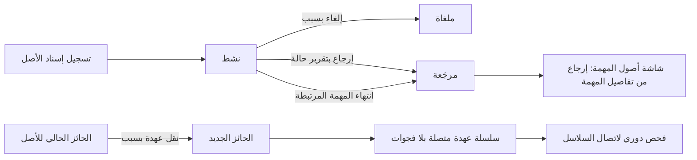
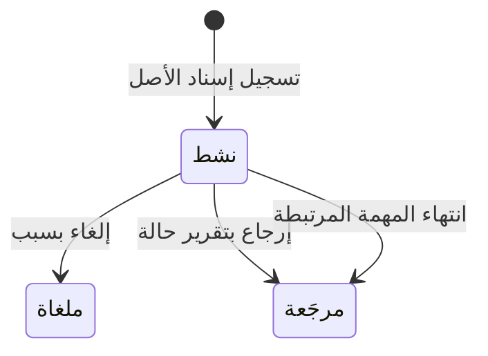

# إسناد الأصول وعهدتها

<!-- BEGIN GENERATED: doc -->
| البند | القيمة |
|---|---|
| المعرّف | FEAT-RES-ASSET-CUSTODY |
| الإصدار | 0.1 |
| الحالة | مسودة |
| القدرة | CAP-08 الموارد والجاهزية |
| القدرة الفرعية | CAP-08.01 إدارة الأصول (R2) |
| الأدوار | مدير الموارد؛ المخطِّط؛ النظام |
| الشاشات | SCR-40 الأصول وتوفرها والصيانة، SCR-02 تفاصيل المهمة وسجلها |
| حالات الاستخدام | UC-053 |
| القصص | 8: 5 من المواصفة، و3 جديدة |
<!-- END GENERATED: doc -->

## 1. نظرة عامة

### 1.1 القيمة

يعرف الجميع من يحمل الأصل الآن ولأي مهمة أُسند، مع سلسلة عهدة متصلة بلا فجوات.

### 1.2 النطاق

| البند | القيمة |
|---|---|
| المستخدمون | مدير الموارد (نقل العهدة)؛ مدير الموارد أو المخطِّط (إسناد الأصل وإلغاؤه وإرجاعه)؛ المستخدم عمومًا (عرض أصول مهمته)؛ النظام؛ فريق التشغيل |
| الشاشات | SCR-40 الأصول وتوفرها والصيانة، SCR-02 تفاصيل المهمة وسجلها |
| حالات الاستخدام | تسجيل إسناد أصل لمهمة أو وحدة؛ إلغاء الإسناد بسبب؛ إرجاع الأصل بتقرير حالة؛ نقل عهدة الأصل بين حائزين؛ إنهاء الإسناد تلقائيًا عند انتهاء المهمة المرتبطة؛ عرض أصول المهمة وإرجاعها من تفاصيلها؛ عرض سلسلة العهدة متصلة؛ فحص دوري لاتصال سلاسل العهدة |
| المتطلبات | توافر الأصل وشهاداته قبل الإسناد؛ سلسلة عهدة متصلة بلا فجوات تسجّل الحائز السابق والجديد والوقت والتفويض؛ ربط الأصل بالمهمة بمرجع مهيكل لا نص حر |
| خارج النطاق | تسجيل الأصل نفسه وصيانته والتخلص منه (ميزات أخرى)، وحجز الأصل قبل الإسناد (ميزة حجز الأصل) |

### 1.3 خريطة الميزة

**الشكل 1: مسار إسناد الأصل وعهدته**



**الشكل 2: رحلة إسناد الأصل**



## 2. القواعد المشتركة

تنطبق على كل قصص الميزة، فلا تتكرر داخل القصص. وكل قصة تذكر ما يخصها فقط.

### 2.1 السياق المشترك

كل قصة تبدأ من ثلاثة شروط: مستأجر نشط، وحزمة السياسات الأساسية مفعّلة، ومستخدم مسجّل الدخول ومخوَّل. وتشير إليها القصص بخطوة واحدة: «بفرض السياق المشترك للميزة».

### 2.2 الصلاحية وعدم الإفصاح

- من لا يحق له رؤية العنصر يتلقى ردًا بشكل «غير متاح» تمامًا، فلا يعرف أنه موجود.
- من يرى العنصر ولا يحق له الإجراء يتلقى «لا تملك صلاحية هذا الإجراء».

### 2.3 أوامر تغيير الحالة

- **منع التكرار:** يُرسل كل أمر بمفتاح فريد، فإعادة الطلب نفسه لا تُنفَّذ مرتين.
- **حماية التعديل المتزامن:** يُرسل كل أمر بإصدار البيانات الذي يراه المستخدم. فإن عدّلها غيره في الأثناء، يُرفض الأمر.
- **السجل:** إن نجح الأمر، يُكتب حدثه وسجل التدقيق في المعاملة نفسها.

### 2.4 الرفض المشترك

```gherkin
# language: ar
خاصية: الرفض المشترك لأوامر الميزة

  سيناريو مخطط: رفض مشترك لكل أمر في الميزة
    بفرض السياق المشترك للميزة
    و <الحالة>
    عندما يُرسل المستخدم أي أمر من أوامر الميزة
    اذاً يُرفض برمز <الرمز> ويرى "<الرسالة>"
    و لا يتغير شيء

    امثلة:
      | الحالة                                  | الرمز                  | الرسالة                                                 |
      | العنصر خارج صلاحياته                    | NOT_FOUND              | غير متاح                                                |
      | العنصر مرئي له ولا يحق له الإجراء       | AUTHZ_DENIED           | لا تملك صلاحية هذا الإجراء                              |
      | غيره عدّل العنصر بعد أن فتحه            | VERSION_CONFLICT       | تغيّرت البيانات منذ فتحتها. راجع التغييرات ثم أعد المحاولة |
      | أعاد مفتاح منع التكرار بمحتوى مختلف     | IDEMPOTENCY_KEY_REUSED | طلب مكرر بمحتوى مختلف                                   |
      | البيانات ناقصة أو غير صحيحة             | VALIDATION_FAILED      | بعض البيانات ناقصة أو غير صحيحة. راجع الحقول المعلَّمة      |

  سيناريو: إعادة الطلب نفسه لا تُنفَّذ مرتين
    بفرض السياق المشترك للميزة
    و أمر نجح بمفتاح منع تكرار
    عندما يُعاد الطلب نفسه بالمفتاح نفسه
    اذاً تُعاد النتيجة الأولى ولا يُكتب حدث ثانٍ
```

## 3. الجودة وتعريف الاكتمال

### 3.1 متطلبات الجودة

<!-- BEGIN GENERATED: quality -->
لا متطلبات جودة مرتبطة بمتطلبات هذه الميزة مباشرة. تنطبق متطلبات المنصة العامة (`FEAT-PLT-*`).
<!-- END GENERATED: quality -->

### 3.2 تعريف الاكتمال

القصة مكتملة حين تتحقق الشروط الخمسة:

1. سيناريوهاتها والقواعد المشتركة تمر في الاختبار الآلي.
2. فحوص البنية المعمارية تمر.
3. نصوص الواجهة والرسائل موجودة بالعربية والإنجليزية.
4. مراجعة الكود مكتملة.
5. ما تضيفه القصة نفسها في قسم «القواعد» تحقق.

## 4. فهرس القصص

<!-- BEGIN GENERATED: story-index -->
| المعرّف | القصة | النوع | الحالة |
|---|---|---|---|
| `US-BC05-ASG-ASSIGN` | تسجيل إسناد الأصل | أمر | مسودة |
| `US-BC05-ASG-CANCEL` | إلغاء إسناد الأصل | أمر | مسودة |
| `US-BC05-ASG-RETURN` | إرجاع الأصل وإنهاء إسناد الأصل | أمر | مسودة |
| `US-BC05-AST-TRANSFER-CUSTODY` | نقل عهدة الأصل | أمر | مسودة |
| `US-BC05-S-ASSET-ASSIGNMENT-01` | تلقائي: linked task terminal (إسناد الأصل) | نظام | مسودة |
| `US-UI-SCR02-TASK-ASSETS` | أصول المهمة المسندة وإرجاعها من تفاصيل المهمة | واجهة | مسودة |
| `US-UI-SCR40-CUSTODY-CHAIN` | سلسلة عهدة الأصل متصلة بلا فجوات | واجهة | مسودة |
| `US-OPS-AST-CUSTODY-CHECK` | فحص دوري لاتصال سلاسل العهدة | تشغيل | مسودة |
<!-- END GENERATED: story-index -->

## 5. القصص

### 5.1 US-BC05-ASG-ASSIGN — تسجيل إسناد الأصل

| النوع | الإصدار | الأولوية | دون اتصال | الحالة |
|---|---|---|---|---|
| أمر | R2 | Must | لا | مسودة |

> **كـ** مدير الموارد أو المخطِّط، **أريد** أن أسجّل إسناد أصل إلى مهمة أو وحدة لنافذة زمنية، **حتى** يُستخدم الأصل فعليًا بعهدة موثّقة.

**باختصار:** يُسند أصل متاح (أو مغطّى بحجز «مؤكَّد» للطالب نفسه) إلى مهمة أو وحدة لنافذة زمنية، بشرط أن تستوفي شهاداته متطلبات نوع المهمة وأن يكون المسنَد إليه مصرَّحًا له بتصنيف الأصل.

#### القواعد

- **متى يُسمح:** الأصل متاح في النافذة المطلوبة، أو مغطّى بحجز «مؤكَّد» للطالب نفسه، وشهاداته تستوفي متطلبات نوع المهمة.
- **من يُسمح له:** مدير الموارد أو المخطِّط.
- **البيانات:** الأصل (إلزامي)، والنافذة الزمنية (إلزامية)، والمهمة أو الوحدة، ومرجع الحجز إن وُجد.
- **الأثر:** يُسجَّل إسناد جديد بحالة «نشط»، ويصل الحدث إلى عرض التوفر والمهمة المرتبطة (REQ-RES-012).

#### معايير القبول

```gherkin
# language: ar
خاصية: تسجيل إسناد الأصل

  سيناريو: إسناد أصل متاح
    بفرض السياق المشترك للميزة
    و أصل متاح في النافذة المطلوبة وشهاداته تستوفي متطلبات المهمة
    عندما يسنده مدير الموارد إلى مهمة لتلك النافذة
    اذاً يُسجَّل الإسناد بحالة "نشط"
    و يُسجَّل حدث "أُسند الأصل"

  سيناريو مخطط: رفض خاص بإسناد الأصل
    بفرض السياق المشترك للميزة
    و <الحالة>
    عندما يحاول إسناد الأصل
    اذاً يُرفض برمز <الرمز> ويرى "<الرسالة>"

    امثلة:
      | الحالة                                                                                    | الرمز               | الرسالة                                                      |
      | الأصل غير متاح في النافذة، أو شهاداته لا تستوفي متطلبات المهمة، أو المسنَد إليه غير مصرَّح له بتصنيفه | ASSET_NOT_AVAILABLE | الأصل غير متاح في هذا الوقت، أو لا تتوفر فيه الشهادات المطلوبة |
```

<details><summary>المراجع التقنية والتتبع</summary>

<!-- BEGIN GENERATED: refs US-BC05-ASG-ASSIGN -->
| البند | المعرّف | المعنى |
|---|---|---|
| الواجهة البرمجية | `POST /api/v1/readiness/asset-assignments` | — |
| الأمر | `CMD-ASG-ASSIGN` | تسجيل إسناد الأصل |
| السياسة | `POL-ASG-ASSIGN` | Resource Manager / Planner؛ tenant match; object visible; owner/pool scope |
| الحدث | `EVT-ASG-ASSIGNED` | يصل إلى: Availability view; Task (SLC-03) |
| الكيان | `AGG-ASSET-ASSIGNMENT` | إسناد الأصل |
| الجدول | `readiness.asset_assignments` | الجدول الرئيسي لإسناد الأصل |
| وحدة النشر | DU-14 | — |
| المتطلب | REQ-RES-003 | When an asset's certification expires or its condition becomes unserviceable, the system shall make it unavai… |
| حالة الاستخدام | UC-053 | Assign Asset |
| الاختبار | TST-ASSET-ASSIGNMENT-SM، TST-SLC09-INVARIANTS | دورة حالات إسناد الأصل، وثوابت الشريحة SLC-09 |
<!-- END GENERATED: refs US-BC05-ASG-ASSIGN -->

</details>

### 5.2 US-BC05-ASG-CANCEL — إلغاء إسناد الأصل

| النوع | الإصدار | الأولوية | دون اتصال | الحالة |
|---|---|---|---|---|
| أمر | R2 | Must | لا | مسودة |

> **كـ** مدير الموارد أو المخطِّط، **أريد** إلغاء إسناد أصل أُسند خطأً، **حتى** يعود متاحًا للغير دون أن يُعامل كأنه استُخدم.

**باختصار:** يُلغى إسناد «نشط» بذكر سبب، فتصبح حالته «ملغاة» ويعود الأصل متاحًا، دون طلب تقرير حالة.

#### القواعد

- **متى يُسمح:** الإسناد في حالة «نشط».
- **من يُسمح له:** مدير الموارد أو المخطِّط.
- **البيانات:** سبب الإلغاء (إلزامي).
- **الأثر:** تصبح حالة الإسناد «ملغاة»، ويعود الأصل متاحًا، ويصل الحدث إلى عرض التوفر والمهمة المرتبطة.

#### معايير القبول

```gherkin
# language: ar
خاصية: إلغاء إسناد الأصل

  سيناريو: إلغاء إسناد نشط بسبب
    بفرض السياق المشترك للميزة
    و إسناد أصل "نشط"
    عندما يلغيه مدير الموارد بسبب
    اذاً تصبح حالته "ملغاة"
    و يُسجَّل حدث "أُلغي إسناد الأصل"

  سيناريو مخطط: رفض خاص بإلغاء الإسناد
    بفرض السياق المشترك للميزة
    و <الحالة>
    عندما يحاول إلغاء الإسناد
    اذاً يُرفض برمز <الرمز> ويرى "<الرسالة>"

    امثلة:
      | الحالة                           | الرمز                                     | الرسالة                                          |
      | الإسناد ليس في حالة "نشط"       | ASSET_ASSIGNMENT_INVALID_STATE_TRANSITION | الوضع الحالي لإسناد الأصل لا يسمح بهذا الإجراء |
      | السبب فارغ                       | REASON_REQUIRED                           | اذكر السبب                                        |
```

<details><summary>المراجع التقنية والتتبع</summary>

<!-- BEGIN GENERATED: refs US-BC05-ASG-CANCEL -->
| البند | المعرّف | المعنى |
|---|---|---|
| الواجهة البرمجية | `POST /api/v1/readiness/asset-assignments/{id}/actions/cancel` | — |
| الأمر | `CMD-ASG-CANCEL` | إلغاء إسناد الأصل |
| السياسة | `POL-ASG-CANCEL` | Resource Manager / Planner؛ tenant match; object visible; owner/pool scope |
| الحدث | `EVT-ASG-CANCELLED` | يصل إلى: Availability view; Task (SLC-03) |
| الكيان | `AGG-ASSET-ASSIGNMENT` | إسناد الأصل |
| الجدول | `readiness.asset_assignments` | الجدول الرئيسي لإسناد الأصل |
| وحدة النشر | DU-14 | — |
| المتطلب | REQ-RES-003 | When an asset's certification expires or its condition becomes unserviceable, the system shall make it unavai… |
| حالة الاستخدام | UC-053 | Assign Asset |
| الاختبار | TST-ASSET-ASSIGNMENT-SM، TST-SLC09-INVARIANTS | دورة حالات إسناد الأصل، وثوابت الشريحة SLC-09 |
<!-- END GENERATED: refs US-BC05-ASG-CANCEL -->

</details>

### 5.3 US-BC05-ASG-RETURN — إرجاع الأصل وإنهاء إسناد الأصل

| النوع | الإصدار | الأولوية | دون اتصال | الحالة |
|---|---|---|---|---|
| أمر | R2 | Must | لا | مسودة |

> **كـ** مدير الموارد أو المخطِّط، **أريد** إرجاع الأصل وإنهاء إسناده مع تقرير حالته، **حتى** تُحدَّث حالة الأصل الفنية بما طرأ عليه فعلًا.

**باختصار:** يُرجَع إسناد «نشط» مع تقرير حالة، فتصبح حالة الإسناد «مرجَعة» وتُحدَّث حالة الأصل الفنية بما ورد في التقرير.

#### القواعد

- **متى يُسمح:** الإسناد في حالة «نشط».
- **من يُسمح له:** مدير الموارد أو المخطِّط.
- **البيانات:** تقرير حالة الأصل عند إرجاعه (إلزامي).
- **الأثر:** تصبح حالة الإسناد «مرجَعة»، وتُحدَّث حالة الأصل الفنية تبعًا للتقرير، ويصل الحدث إلى عرض التوفر والمهمة المرتبطة.

#### معايير القبول

```gherkin
# language: ar
خاصية: إرجاع الأصل وإنهاء إسناده

  سيناريو: إرجاع أصل بتقرير حالة
    بفرض السياق المشترك للميزة
    و إسناد أصل "نشط"
    عندما يرجعه مدير الموارد مع تقرير حالته
    اذاً تصبح حالة الإسناد "مرجَعة"
    و تُحدَّث حالة الأصل الفنية تبعًا للتقرير
    و يُسجَّل حدث "أُرجع الأصل"

  سيناريو مخطط: رفض خاص بالإرجاع
    بفرض السياق المشترك للميزة
    و <الحالة>
    عندما يحاول إرجاع الأصل
    اذاً يُرفض برمز <الرمز> ويرى "<الرسالة>"

    امثلة:
      | الحالة                           | الرمز                                     | الرسالة                                            |
      | الإسناد ليس في حالة "نشط"       | ASSET_ASSIGNMENT_INVALID_STATE_TRANSITION | الوضع الحالي لإسناد الأصل لا يسمح بهذا الإجراء   |
      | تقرير الحالة مفقود                | CONDITION_REPORT_REQUIRED                 | أرفق تقرير حالة الأصل عند إعادته                   |
```

<details><summary>المراجع التقنية والتتبع</summary>

<!-- BEGIN GENERATED: refs US-BC05-ASG-RETURN -->
| البند | المعرّف | المعنى |
|---|---|---|
| الواجهة البرمجية | `POST /api/v1/readiness/asset-assignments/{id}/actions/return` | — |
| الأمر | `CMD-ASG-RETURN` | إرجاع الأصل وإنهاء إسناد الأصل |
| السياسة | `POL-ASG-RETURN` | Resource Manager / Planner؛ tenant match; object visible; owner/pool scope |
| الحدث | `EVT-ASG-RETURNED` | يصل إلى: Availability view; Task (SLC-03) |
| الكيان | `AGG-ASSET-ASSIGNMENT` | إسناد الأصل |
| الجدول | `readiness.asset_assignments` | الجدول الرئيسي لإسناد الأصل |
| وحدة النشر | DU-14 | — |
| المتطلب | REQ-RES-003 | When an asset's certification expires or its condition becomes unserviceable, the system shall make it unavai… |
| حالة الاستخدام | UC-053 | Assign Asset |
| الاختبار | TST-ASSET-ASSIGNMENT-SM، TST-SLC09-INVARIANTS | دورة حالات إسناد الأصل، وثوابت الشريحة SLC-09 |
<!-- END GENERATED: refs US-BC05-ASG-RETURN -->

</details>

### 5.4 US-BC05-AST-TRANSFER-CUSTODY — نقل عهدة الأصل

| النوع | الإصدار | الأولوية | دون اتصال | الحالة |
|---|---|---|---|---|
| أمر | R2 | Must | لا | مسودة |

> **كـ** مدير الموارد، **أريد** نقل عهدة الأصل من حائزه الحالي إلى حائز جديد نشط، **حتى** تبقى سلسلة العهدة متصلة ويُعرف من يحمل الأصل في كل لحظة.

**باختصار:** ينقل الحائز الحالي أو سلطة العهدة حيازة الأصل إلى حائز جديد نشط ضمن النطاق بسبب، دون أن تتغير حالة الأصل، وتُسجَّل الحلقة الجديدة في سلسلة العهدة بلا فجوة.

#### القواعد

- **متى يُسمح:** الأصل في حالة «في الخدمة» أو «غير صالح للخدمة» أو «تحت الصيانة»، والمنفِّذ هو الحائز الحالي أو سلطة العهدة، والحائز الجديد نشط ضمن النطاق.
- **من يُسمح له:** مدير الموارد.
- **البيانات:** الحائز الجديد (إلزامي)، وسبب النقل (إلزامي).
- **الأثر:** تبقى حالة الأصل كما هي، وتُسجَّل حلقة جديدة بالحائز السابق والجديد والوقت والتفويض في سلسلة العهدة بلا فجوة (REQ-RES-002)، ويصل الحدث إلى عرض التوفر وطبقة أصول الموقف ومؤشر البحث وأي حجز أو إسناد قائم.

#### معايير القبول

```gherkin
# language: ar
خاصية: نقل عهدة الأصل

  سيناريو: نقل عهدة أصل إلى حائز جديد نشط
    بفرض السياق المشترك للميزة
    و أصل "في الخدمة" وحائزه الحالي هو من يطلب النقل
    عندما ينقل عهدته إلى حائز جديد نشط بسبب
    اذاً تبقى حالة الأصل كما هي
    و تُسجَّل حلقة جديدة في سلسلة العهدة بالحائز السابق والجديد والوقت
    و يُسجَّل حدث "نُقلت عهدة الأصل"

  سيناريو مخطط: رفض خاص بنقل العهدة
    بفرض السياق المشترك للميزة
    و <الحالة>
    عندما يحاول نقل العهدة
    اذاً يُرفض برمز <الرمز> ويرى "<الرسالة>"

    امثلة:
      | الحالة                                                              | الرمز                       | الرسالة                                                      |
      | الأصل "مُتخلَّص منه" أو "مفقود"                                     | ASSET_INVALID_STATE_TRANSITION | الوضع الحالي للأصل لا يسمح بهذا الإجراء                    |
      | المنفِّذ ليس الحائز الحالي ولا سلطة العهدة، أو لم يُحدَّد حائز جديد | CUSTODY_INVALID              | لا يمكن نقل الحيازة: لست الحائز الحالي أو لم يُحدَّد الحائز الجديد |
```

<details><summary>المراجع التقنية والتتبع</summary>

<!-- BEGIN GENERATED: refs US-BC05-AST-TRANSFER-CUSTODY -->
| البند | المعرّف | المعنى |
|---|---|---|
| الواجهة البرمجية | `POST /api/v1/readiness/assets/{id}/actions/transfer-custody` | — |
| الأمر | `CMD-AST-TRANSFER-CUSTODY` | نقل عهدة الأصل |
| السياسة | `POL-AST-TRANSFER-CUSTODY` | Resource Manager (register, condition, custody, certification, lost) · disposal authority (dispose) · Securit… |
| الحدث | `EVT-AST-CUSTODY-TRANSFERRED` | يصل إلى: Availability view; Situation assets layer (SLC-06); Search projection (SLC-05); Reservations/assignm… |
| الكيان | `AGG-ASSET` | الأصل |
| الجدول | `readiness.assets` | الجدول الرئيسي للأصل |
| وحدة النشر | DU-14 | — |
| المتطلبات | REQ-RES-001، REQ-RES-002، REQ-RES-003، REQ-RES-005 | معانيها في القسم 6. التتبع |
| حالة الاستخدام | UC-053 | Assign Asset |
| الاختبار | TST-ASSET-SM، TST-SLC09-INVARIANTS | دورة حالات الأصل، وثوابت الشريحة SLC-09 |
<!-- END GENERATED: refs US-BC05-AST-TRANSFER-CUSTODY -->

</details>

### 5.5 US-BC05-S-ASSET-ASSIGNMENT-01 — تلقائي: linked task terminal (إسناد الأصل)

| النوع | الإصدار | الأولوية | دون اتصال | الحالة |
|---|---|---|---|---|
| نظام | R2 | Must | لا ينطبق | مسودة |

> **كـ** النظام، **أريد** أن أنهي إسناد الأصل تلقائيًا حين تبلغ المهمة المرتبطة به حالة نهائية، **حتى** لا يبقى الإسناد مفتوحًا بلا داعٍ بعد انتهاء العمل.

**باختصار:** حين تنتهي المهمة المرتبطة بإسناد أصل «نشط»، ينهي النظام الإسناد تلقائيًا بحالة «مرجَعة» وينشئ مهمة متابعة تطلب من آخر حائز تقرير حالة الأصل.

#### القواعد

- **الشرط:** بلغت المهمة المرتبطة بالإسناد «النشط» حالة نهائية.
- **الأثر:** تصبح حالة الإسناد «مرجَعة»، وتُنشأ مهمة متابعة تطلب من آخر حائز تقرير حالة الأصل.

#### معايير القبول

```gherkin
# language: ar
خاصية: إنهاء إسناد الأصل تلقائيًا عند انتهاء مهمته

  سيناريو: انتهاء المهمة المرتبطة بإسناد نشط
    بفرض إسناد أصل "نشط" مرتبط بمهمة بلغت حالة نهائية
    عندما يصل حدث انتهاء المهمة
    اذاً تصبح حالة الإسناد "مرجَعة"
    و تُنشأ مهمة متابعة تطلب من آخر حائز تقرير حالة الأصل
    و يُسجَّل حدث "أُرجع الأصل" وسجل تدقيق بهوية النظام

  سيناريو: مهمة غير مرتبطة لا تؤثر في الإسناد
    بفرض إسناد أصل "نشط" ومهمة أخرى غير مرتبطة به بلغت حالة نهائية
    عندما يصل حدث انتهاء تلك المهمة
    اذاً لا تتغير حالة الإسناد
```

<details><summary>المراجع التقنية والتتبع</summary>

<!-- BEGIN GENERATED: refs US-BC05-S-ASSET-ASSIGNMENT-01 -->
| البند | المعرّف | المعنى |
|---|---|---|
| المحفِّز | `SYS:linked task terminal` | condition report requested from last holder (follow-up task) |
| الانتقال | ACTIVE ← RETURNED | — |
| الحدث | `EVT-ASG-RETURNED` | يصل إلى: Availability view; Task (SLC-03) |
| الكيان | `AGG-ASSET-ASSIGNMENT` | إسناد الأصل |
| الجدول | `readiness.asset_assignments` | الجدول الرئيسي لإسناد الأصل |
| وحدة النشر | DU-14 | — |
| المتطلب | REQ-RES-003 | When an asset's certification expires or its condition becomes unserviceable, the system shall make it unavai… |
| حالة الاستخدام | UC-053 | Assign Asset |
| الاختبار | TST-ASSET-ASSIGNMENT-SM، TST-SLC09-INVARIANTS | دورة حالات إسناد الأصل، وثوابت الشريحة SLC-09 |
<!-- END GENERATED: refs US-BC05-S-ASSET-ASSIGNMENT-01 -->

</details>

### 5.6 US-UI-SCR02-TASK-ASSETS — أصول المهمة المسندة وإرجاعها من تفاصيل المهمة

| النوع | الإصدار | الأولوية | دون اتصال | الحالة |
|---|---|---|---|---|
| واجهة | R2 | Must | لا | مسودة |

> **كـ** المستخدم، **أريد** أن أرى أصول مهمتي المسندة وأرجعها من شاشة تفاصيل المهمة، **حتى** لا أنتقل إلى شاشة أخرى لإنهاء استخدامها.

**باختصار:** تعرض شاشة تفاصيل المهمة الأصول المسندة إليها بمرجع مهيكل لا نص حر (REQ-RES-012)، ويستطيع المستخدم إرجاعها من الشاشة نفسها.

#### القواعد

- **من يُسمح له:** من يحق له رؤية المهمة والتصرف فيها.

#### معايير القبول

```gherkin
# language: ar
خاصية: أصول المهمة المسندة وإرجاعها من تفاصيل المهمة

  سيناريو: عرض أصول المهمة من تفاصيلها
    بفرض السياق المشترك للميزة
    و مهمة لها أصل مسند "نشط"
    عندما يفتح تفاصيل المهمة
    اذاً يرى الأصل المسند كمرجع مهيكل لا كملاحظة نصية

  سيناريو: إرجاع أصل من شاشة المهمة
    بفرض السياق المشترك للميزة
    و مهمة لها أصل مسند "نشط"
    عندما يرجعه من شاشة تفاصيل المهمة مع تقرير حالته
    اذاً تصبح حالة الإسناد "مرجَعة" دون مغادرة الشاشة
```

<details><summary>المراجع التقنية والتتبع</summary>

<!-- BEGIN GENERATED: refs US-UI-SCR02-TASK-ASSETS -->
| البند | المعرّف | المعنى |
|---|---|---|
| الشاشة | SCR-02 | شاشة تفاصيل المهمة وسجلها |
| حالة الاستخدام | UC-053 | Assign Asset |
| المصدر | `[Derived]` | — |
| المتطلب | REQ-RES-012 | The system shall link resources and assets to tasks as structured references, replacing the text-only resourc… |
| حالة الاستخدام | UC-053 | Assign Asset |
<!-- END GENERATED: refs US-UI-SCR02-TASK-ASSETS -->

</details>

### 5.7 US-UI-SCR40-CUSTODY-CHAIN — سلسلة عهدة الأصل متصلة بلا فجوات

| النوع | الإصدار | الأولوية | دون اتصال | الحالة |
|---|---|---|---|---|
| واجهة | R2 | Must | لا | مسودة |

> **كـ** مدير الموارد، **أريد** أن أرى سلسلة عهدة الأصل متصلة بلا فجوات، **حتى** أعرف من حمله في أي وقت دون شك.

**باختصار:** تعرض شاشة الأصل سلسلة حيازاته بالترتيب الزمني، كل حلقة بالحائز السابق والجديد والوقت والتفويض، دون أي فجوة بين حلقة وأخرى (REQ-RES-002).

#### القواعد

- **من يُسمح له:** مدير الموارد، لما يقع ضمن نطاقه.

#### معايير القبول

```gherkin
# language: ar
خاصية: سلسلة عهدة الأصل متصلة بلا فجوات

  سيناريو: عرض سلسلة العهدة متصلة
    بفرض السياق المشترك للميزة
    و أصل انتقلت حيازته أكثر من مرة
    عندما يفتح مدير الموارد سلسلة عهدته
    اذاً تُعرض الحلقات بالترتيب الزمني دون فجوة بين حلقة وأخرى

  سيناريو: تحديد الحائز الحالي
    بفرض السياق المشترك للميزة
    و سلسلة عهدة أصل بأكثر من حلقة
    عندما يفتح مدير الموارد سلسلة عهدته
    اذاً يتبين الحائز الحالي من آخر حلقة فيها
```

<details><summary>المراجع التقنية والتتبع</summary>

<!-- BEGIN GENERATED: refs US-UI-SCR40-CUSTODY-CHAIN -->
| البند | المعرّف | المعنى |
|---|---|---|
| الشاشة | SCR-40 | شاشة الأصول وتوفرها والصيانة |
| المصدر | `17-security-design.md §12.9` | — |
| المتطلب | REQ-RES-002 | When custody of an asset is transferred, the system shall record the previous holder, the new holder, the tim… |
| حالة الاستخدام | UC-053 | Assign Asset |
<!-- END GENERATED: refs US-UI-SCR40-CUSTODY-CHAIN -->

</details>

### 5.8 US-OPS-AST-CUSTODY-CHECK — فحص دوري لاتصال سلاسل العهدة

| النوع | الإصدار | الأولوية | دون اتصال | الحالة |
|---|---|---|---|---|
| تشغيل | R2 | Must | لا ينطبق | مسودة |

> **كـ** فريق التشغيل، **أريد** فحصًا دوريًا لاتصال سلاسل عهدة الأصول، **حتى** أكشف أي فجوة أو تضارب قبل أن يُسأل عنه في تدقيق. **[Derived]** تكرار الفحص وآلية رفع الاستثناء، إذ يحدد المصدر وجوب سلسلة متصلة دون فجوات (REQ-RES-002) دون أن يحدد فحصًا دوريًا بعينه.

**باختصار:** يفحص فريق التشغيل دوريًا أن كل حلقة في سلسلة عهدة كل أصل تبدأ من حيث انتهت الحلقة التي قبلها دون فجوة ولا تداخل، ويرفع تقريرًا بما يخالف ذلك.

#### القواعد

- **الأثر:** يُرفع استثناء في تقرير الفحص لكل أصل تنقطع فيه سلسلة العهدة، ولا يُرفع شيء لما كان متصلًا.

#### معايير القبول

```gherkin
# language: ar
خاصية: فحص دوري لاتصال سلاسل العهدة

  سيناريو: سلسلة متصلة بلا فجوات
    بفرض سلاسل عهدة كل الأصول
    عندما يُشغَّل الفحص الدوري
    اذاً لا يُرفع أي استثناء لما كان متصلًا

  سيناريو: اكتشاف فجوة في سلسلة
    بفرض أصلًا في سلسلة عهدته فجوة بين حلقتين
    عندما يُشغَّل الفحص الدوري
    اذاً يُرفع استثناء بهذا الأصل في تقرير الفحص
```

<details><summary>المراجع التقنية والتتبع</summary>

<!-- BEGIN GENERATED: refs US-OPS-AST-CUSTODY-CHECK -->
| البند | المعرّف | المعنى |
|---|---|---|
| المصدر | `17-security-design.md §12.9` | — |
| المصدر | `[Derived]` | — |
| المتطلب | REQ-RES-002 | When custody of an asset is transferred, the system shall record the previous holder, the new holder, the tim… |
| حالة الاستخدام | UC-053 | Assign Asset |
<!-- END GENERATED: refs US-OPS-AST-CUSTODY-CHECK -->

</details>

## 6. التتبع

<!-- BEGIN GENERATED: trace -->
| المتطلب | المعنى | القصص | الاختبار |
|---|---|---|---|
| REQ-RES-001 | The system shall register each asset with type, ownership, custody holder, status, condition, location, capab… | `US-BC05-AST-TRANSFER-CUSTODY` | TST-ASSET-SM، TST-SLC09-INVARIANTS |
| REQ-RES-002 | When custody of an asset is transferred, the system shall record the previous holder, the new holder, the tim… | `US-BC05-AST-TRANSFER-CUSTODY`، `US-OPS-AST-CUSTODY-CHECK`، `US-UI-SCR40-CUSTODY-CHAIN` | TST-ASSET-SM، TST-SLC09-INVARIANTS |
| REQ-RES-003 | When an asset's certification expires or its condition becomes unserviceable, the system shall make it unavai… | كل قصص الميزة المأخوذة من المواصفة (5) | TST-ASSET-ASSIGNMENT-SM، TST-ASSET-SM، TST-SLC09-INVARIANTS |
| REQ-RES-005 | The system shall keep asset location as bitemporal claims so that the location of an asset at any past time i… | `US-BC05-AST-TRANSFER-CUSTODY` | TST-ASSET-SM، TST-SLC09-INVARIANTS |
| REQ-RES-012 | The system shall link resources and assets to tasks as structured references, replacing the text-only resourc… | `US-UI-SCR02-TASK-ASSETS` | TST-ALLOCATION-SM، TST-ASSET-ASSIGNMENT-SM، TST-SLC09-INVARIANTS |
<!-- END GENERATED: trace -->

## 7. سجل التغييرات

| الإصدار | التاريخ | التغيير |
|---|---|---|
| 0.1 | — | هيكل مولَّد من خريطة الميزات |
| 0.2 | 2026-10-13 | كتابة القصص كاملة بمعيار القصص |
