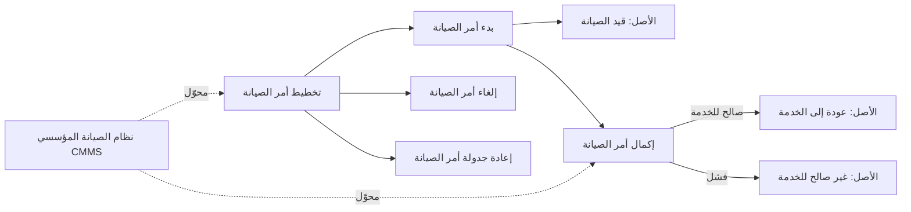
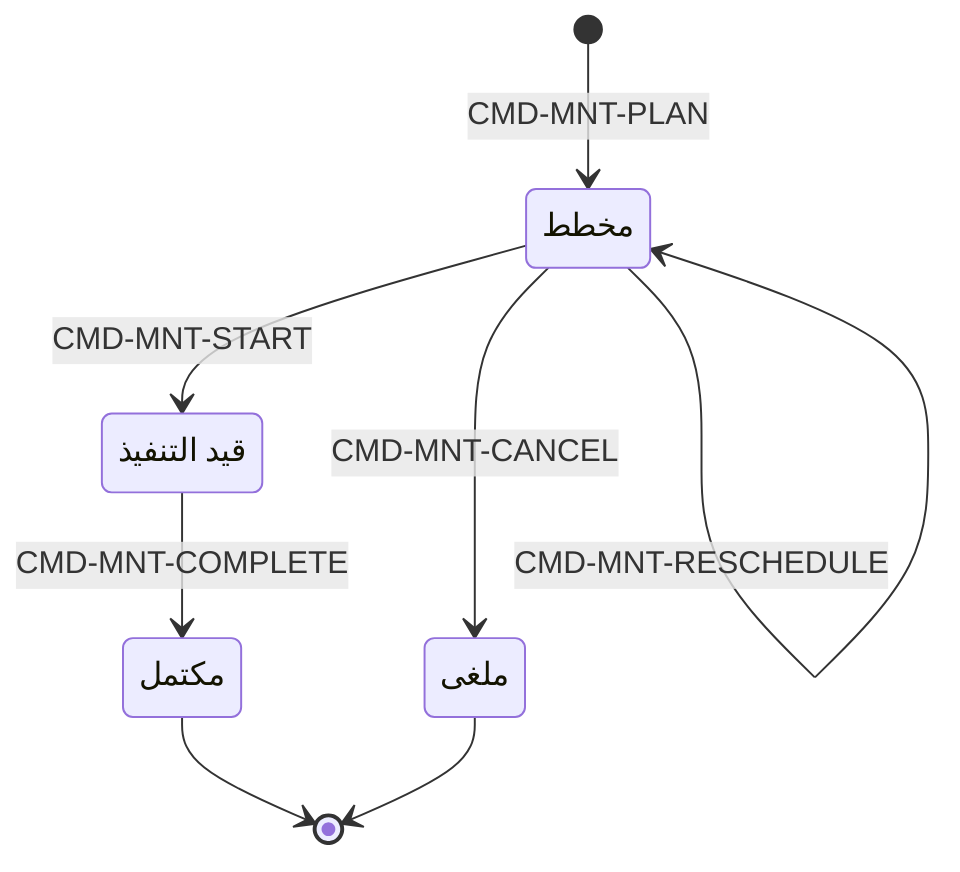

# صيانة الأصول

<!-- BEGIN GENERATED: doc -->
| البند | القيمة |
|---|---|
| المعرّف | FEAT-RES-ASSET-MAINTENANCE |
| الإصدار | 0.1 |
| الحالة | مسودة |
| القدرة | CAP-08 الموارد والجاهزية |
| القدرة الفرعية | CAP-08.01 إدارة الأصول (R2) |
| الأدوار | مدير الموارد؛ الفني |
| الشاشات | SCR-40 الأصول وتوفرها والصيانة |
| حالات الاستخدام | UC-051 |
| القصص | 11: 8 من المواصفة، و3 جديدة |
<!-- END GENERATED: doc -->

## 1. نظرة عامة

### 1.1 القيمة

يخطط مدير الموارد والفني لصيانة الأصول ويتابعونها حتى تعود جاهزة، فلا يُحجز أصل وهو قيد الصيانة.

### 1.2 النطاق

| البند | القيمة |
|---|---|
| المستخدمون | مدير الموارد؛ الفني؛ محوّل نظام الصيانة المؤسسي (CMMS) |
| الشاشات | SCR-40 الأصول وتوفرها والصيانة |
| حالات الاستخدام | جدولة صيانة الأصل ومتابعتها حتى إكمالها (UC-051) |
| المتطلبات | جدولة الصيانة وتسجيلها، وحجب توفر الأصل طوال نافذتها |
| خارج النطاق | حجز الأصل لنافذة زمنية (ميزة حجز الأصول وتوفرها)؛ تسجيل الأصل نفسه وتصنيفه الأمني ونقل عهدته (ميزة الأصول) |

### 1.3 خريطة الميزة

**الشكل 1: مسار أمر الصيانة وأثره على الأصل**



**الشكل 2: حالات أمر الصيانة**



## 2. القواعد المشتركة

تنطبق على كل قصص الميزة، فلا تتكرر داخل القصص. وكل قصة تذكر ما يخصها فقط.

### 2.1 السياق المشترك

كل قصة تبدأ من ثلاثة شروط: مستأجر نشط، وحزمة السياسات الأساسية مفعّلة، ومستخدم مسجّل الدخول ومخوَّل. وتشير إليها القصص بخطوة واحدة: «بفرض السياق المشترك للميزة».

### 2.2 الصلاحية وعدم الإفصاح

- من لا يحق له رؤية العنصر يتلقى ردًا بشكل «غير متاح» تمامًا، فلا يعرف أنه موجود.
- من يرى العنصر ولا يحق له الإجراء يتلقى «لا تملك صلاحية هذا الإجراء».

### 2.3 أوامر تغيير الحالة

- **منع التكرار:** يُرسل كل أمر بمفتاح فريد، فإعادة الطلب نفسه لا تُنفَّذ مرتين.
- **حماية التعديل المتزامن:** يُرسل كل أمر بإصدار البيانات الذي يراه المستخدم. فإن عدّلها غيره في الأثناء، يُرفض الأمر.
- **السجل:** إن نجح الأمر، يُكتب حدثه وسجل التدقيق في المعاملة نفسها.

### 2.4 الرفض المشترك

```gherkin
# language: ar
خاصية: الرفض المشترك لأوامر الميزة

  سيناريو مخطط: رفض مشترك لكل أمر في الميزة
    بفرض السياق المشترك للميزة
    و <الحالة>
    عندما يُرسل المستخدم أي أمر من أوامر الميزة
    اذاً يُرفض برمز <الرمز> ويرى "<الرسالة>"
    و لا يتغير شيء

    امثلة:
      | الحالة                                  | الرمز                  | الرسالة                                                 |
      | العنصر خارج صلاحياته                    | NOT_FOUND              | غير متاح                                                |
      | العنصر مرئي له ولا يحق له الإجراء       | AUTHZ_DENIED           | لا تملك صلاحية هذا الإجراء                              |
      | غيره عدّل العنصر بعد أن فتحه            | VERSION_CONFLICT       | تغيّرت البيانات منذ فتحتها. راجع التغييرات ثم أعد المحاولة |
      | أعاد مفتاح منع التكرار بمحتوى مختلف     | IDEMPOTENCY_KEY_REUSED | طلب مكرر بمحتوى مختلف                                   |
      | البيانات ناقصة أو غير صحيحة             | VALIDATION_FAILED      | بعض البيانات ناقصة أو غير صحيحة. راجع الحقول المعلَّمة      |

  سيناريو: إعادة الطلب نفسه لا تُنفَّذ مرتين
    بفرض السياق المشترك للميزة
    و أمر نجح بمفتاح منع تكرار
    عندما يُعاد الطلب نفسه بالمفتاح نفسه
    اذاً تُعاد النتيجة الأولى ولا يُكتب حدث ثانٍ
```

## 3. الجودة وتعريف الاكتمال

### 3.1 متطلبات الجودة

<!-- BEGIN GENERATED: quality -->
لا متطلبات جودة مرتبطة بمتطلبات هذه الميزة مباشرة. تنطبق متطلبات المنصة العامة (`FEAT-PLT-*`).
<!-- END GENERATED: quality -->

### 3.2 تعريف الاكتمال

القصة مكتملة حين تتحقق الشروط الخمسة:

1. سيناريوهاتها والقواعد المشتركة تمر في الاختبار الآلي.
2. فحوص البنية المعمارية تمر.
3. نصوص الواجهة والرسائل موجودة بالعربية والإنجليزية.
4. مراجعة الكود مكتملة.
5. ما تضيفه القصة نفسها في قسم «القواعد» تحقق.

## 4. فهرس القصص

<!-- BEGIN GENERATED: story-index -->
| المعرّف | القصة | النوع | الحالة |
|---|---|---|---|
| `US-BC05-AST-FAIL-MAINTENANCE` | تسجيل فشل صيانة الأصل | أمر | مسودة |
| `US-BC05-AST-START-MAINTENANCE` | بدء صيانة الأصل | أمر | مسودة |
| `US-BC05-MNT-CANCEL` | إلغاء أمر الصيانة | أمر | مسودة |
| `US-BC05-MNT-COMPLETE` | إكمال أمر الصيانة | أمر | مسودة |
| `US-BC05-MNT-PLAN` | تخطيط أمر الصيانة | أمر | مسودة |
| `US-BC05-MNT-RESCHEDULE` | إعادة جدولة أمر الصيانة | أمر | مسودة |
| `US-BC05-MNT-START` | بدء أمر الصيانة | أمر | مسودة |
| `US-BC05-Q-MNT-SCHEDULE` | جلب: Maintenance orders by asset, window, state | جلب | مسودة |
| `US-UI-SCR40-CMMS-ORIGIN` | تمييز أوامر الصيانة الواردة من نظام الصيانة | واجهة | مسودة |
| `US-UI-SCR40-MAINTENANCE-CALENDAR` | تقويم صيانة الأصول وتعارضها مع الحجوزات | واجهة | مسودة |
| `US-INT-CMMS-MAINTENANCE` | مزامنة أوامر الصيانة مع نظام الصيانة المؤسسي | تكامل | مسودة |
<!-- END GENERATED: story-index -->

## 5. القصص

### 5.1 US-BC05-AST-FAIL-MAINTENANCE — تسجيل فشل صيانة الأصل

| النوع | الإصدار | الأولوية | دون اتصال | الحالة |
|---|---|---|---|---|
| أمر | R2 | Must | لا | مسودة |

> **كـ** مدير الموارد، **أريد** تسجيل فشل صيانة أصل أُكمل أمر صيانته بنتيجة فشل، **حتى** يبقى الأصل غير صالح للخدمة ولا يُحجز أو يُسند خطأً.

**باختصار:** بعد إكمال أمر الصيانة بنتيجة «فشل»، يسجل مدير الموارد الأصل الذي كان «قيد الصيانة» كأصل «غير صالح للخدمة» بسبب واضح.

#### القواعد

- **متى يُسمح:** الأصل في حالة «قيد الصيانة»، وأمر صيانته المرتبط «مكتمل» بنتيجة «فشل».
- **من يُسمح له:** مدير الموارد.
- **البيانات:** أمر الصيانة المرجعي، وسبب الفشل (إلزاميان).
- **الأثر:** حدث «أصبح الأصل غير صالح للخدمة» يصل إلى عرض التوفر وطبقة الموقف والفهرسة وحجوزات الأصل وإسناداته.

#### معايير القبول

```gherkin
# language: ar
خاصية: تسجيل فشل صيانة الأصل

  سيناريو: تسجيل الفشل بعد صيانة غير ناجحة
    بفرض السياق المشترك للميزة
    و أصل في حالة "قيد الصيانة" وأمر صيانته "مكتمل" بنتيجة "فشل"
    عندما يسجل مدير الموارد فشل الصيانة مع السبب
    اذاً تصبح حالة الأصل "غير صالح للخدمة"
    و يُسجَّل حدث "أصبح الأصل غير صالح للخدمة"

  سيناريو مخطط: رفض خاص بتسجيل فشل الصيانة
    بفرض السياق المشترك للميزة
    و <الحالة>
    عندما يحاول تسجيل فشل الصيانة
    اذاً يُرفض برمز <الرمز> ويرى <الرسالة>

    امثلة:
      | الحالة                               | الرمز                          | الرسالة                                     |
      | الأصل ليس في حالة "قيد الصيانة"      | ASSET_INVALID_STATE_TRANSITION | الوضع الحالي للأصل لا يسمح بهذا الإجراء    |
      | سبب الفشل غير مذكور                  | REASON_REQUIRED                | اذكر السبب                                  |
```

<details><summary>المراجع التقنية والتتبع</summary>

<!-- BEGIN GENERATED: refs US-BC05-AST-FAIL-MAINTENANCE -->
| البند | المعرّف | المعنى |
|---|---|---|
| الواجهة البرمجية | `POST /api/v1/readiness/assets/{id}/actions/fail-maintenance` | — |
| الأمر | `CMD-AST-FAIL-MAINTENANCE` | تسجيل فشل صيانة الأصل |
| السياسة | `POL-AST-FAIL-MAINTENANCE` | Resource Manager (fail maintenance)؛ tenant match; object visible; owner/pool scope |
| الحدث | `EVT-AST-UNSERVICEABLE` | يصل إلى: Availability view; Situation assets layer (SLC-06); Search projection (SLC-05); Reservations/assignm… |
| الكيان | `AGG-ASSET` | الأصل |
| الجدول | `readiness.assets` | الجدول الرئيسي للأصل |
| وحدة النشر | DU-14 | — |
| المتطلبات | REQ-RES-001، REQ-RES-002، REQ-RES-003، REQ-RES-005 | معانيها في القسم 6. التتبع |
| حالة الاستخدام | UC-051 | Check Availability |
| الاختبار | TST-ASSET-SM، TST-SLC09-INVARIANTS | دورة حالات الأصل، وثوابت الشريحة SLC-09 |
<!-- END GENERATED: refs US-BC05-AST-FAIL-MAINTENANCE -->

</details>

### 5.2 US-BC05-AST-START-MAINTENANCE — بدء صيانة الأصل

| النوع | الإصدار | الأولوية | دون اتصال | الحالة |
|---|---|---|---|---|
| أمر | R2 | Must | لا | مسودة |

> **كـ** مدير الموارد، **أريد** نقل الأصل إلى حالة «قيد الصيانة» حين يبدأ العمل عليه فعليًا، **حتى** يُحجب عن الحجز والإسناد طوال الصيانة.

**باختصار:** بعد أن يبدأ أمر الصيانة المرتبط، ينقل مدير الموارد الأصل إلى «قيد الصيانة» فيتوقف حجزه أو إسناده حتى اكتمال الصيانة.

#### القواعد

- **متى يُسمح:** الأصل في حالة «في الخدمة» أو «غير صالح للخدمة»، ويوجد أمر صيانة له في حالة «قيد التنفيذ».
- **من يُسمح له:** مدير الموارد.
- **البيانات:** أمر الصيانة المرتبط (إلزامي).
- **الأثر:** حدث «بدأت صيانة الأصل» يصل إلى عرض التوفر وطبقة الموقف والفهرسة وحجوزات الأصل وإسناداته.

> **ملاحظة:** هذا الأمر يتم عادة بسياسة مرتبطة ببدء أمر الصيانة نفسه (القصة 5.7)، ويمكن أيضًا أن يصدره مدير الموارد مباشرة.

#### معايير القبول

```gherkin
# language: ar
خاصية: بدء صيانة الأصل

  سيناريو: نقل الأصل إلى قيد الصيانة لأمر صيانة قيد التنفيذ
    بفرض السياق المشترك للميزة
    و أصل في حالة "في الخدمة" وله أمر صيانة في حالة "قيد التنفيذ"
    عندما ينقل مدير الموارد الأصل إلى الصيانة لهذا الأمر
    اذاً تصبح حالة الأصل "قيد الصيانة"
    و يُسجَّل حدث "بدأت صيانة الأصل"

  سيناريو مخطط: رفض خاص ببدء صيانة الأصل
    بفرض السياق المشترك للميزة
    و <الحالة>
    عندما يحاول نقل الأصل إلى الصيانة
    اذاً يُرفض برمز <الرمز> ويرى <الرسالة>

    امثلة:
      | الحالة                                           | الرمز                          | الرسالة                                    |
      | الأصل "مُتخلص منه" أو "مفقود" أو "قيد الصيانة" من قبل | ASSET_INVALID_STATE_TRANSITION | الوضع الحالي للأصل لا يسمح بهذا الإجراء    |
      | لا يوجد أمر صيانة في حالة "قيد التنفيذ" لهذا الأصل | MAINTENANCE_ORDER_REQUIRED     | يلزم أمر صيانة قيد التنفيذ لهذا الأصل      |
```

<details><summary>المراجع التقنية والتتبع</summary>

<!-- BEGIN GENERATED: refs US-BC05-AST-START-MAINTENANCE -->
| البند | المعرّف | المعنى |
|---|---|---|
| الواجهة البرمجية | `POST /api/v1/readiness/assets/{id}/actions/start-maintenance` | — |
| الأمر | `CMD-AST-START-MAINTENANCE` | بدء صيانة الأصل |
| السياسة | `POL-AST-START-MAINTENANCE` | Resource Manager (start maintenance)؛ tenant match; object visible; owner/pool scope |
| الحدث | `EVT-AST-MAINTENANCE-STARTED` | يصل إلى: Availability view; Situation assets layer (SLC-06); Search projection (SLC-05); Reservations/assignm… |
| الكيان | `AGG-ASSET` | الأصل |
| الجدول | `readiness.assets` | الجدول الرئيسي للأصل |
| وحدة النشر | DU-14 | — |
| المتطلبات | REQ-RES-001، REQ-RES-002، REQ-RES-003، REQ-RES-005 | معانيها في القسم 6. التتبع |
| حالة الاستخدام | UC-051 | Check Availability |
| الاختبار | TST-ASSET-SM، TST-SLC09-INVARIANTS | دورة حالات الأصل، وثوابت الشريحة SLC-09 |
<!-- END GENERATED: refs US-BC05-AST-START-MAINTENANCE -->

</details>

### 5.3 US-BC05-MNT-CANCEL — إلغاء أمر الصيانة

| النوع | الإصدار | الأولوية | دون اتصال | الحالة |
|---|---|---|---|---|
| أمر | R2 | Must | لا | مسودة |

> **كـ** **[للكتابة]**، **أريد** **[للكتابة]**، **حتى** **[للكتابة]**.

**باختصار:** **[للكتابة]**

#### القواعد

**[للكتابة]**

#### معايير القبول

**[للكتابة]**

<details><summary>المراجع التقنية والتتبع</summary>

<!-- BEGIN GENERATED: refs US-BC05-MNT-CANCEL -->
| البند | المعرّف | المعنى |
|---|---|---|
| الواجهة البرمجية | `POST /api/v1/readiness/maintenance-orders/{id}/actions/cancel` | — |
| الأمر | `CMD-MNT-CANCEL` | إلغاء أمر الصيانة |
| السياسة | `POL-MNT-CANCEL` | Resource Manager / technician؛ tenant match; object visible; owner/pool scope |
| الحدث | `EVT-MNT-CANCELLED` | يصل إلى: Asset (start/return via policy); Availability view |
| الكيان | `AGG-MAINTENANCE-ORDER` | أمر الصيانة |
| الجدول | `readiness.maintenance_orders` | الجدول الرئيسي لأمر الصيانة |
| وحدة النشر | DU-14 | — |
| المتطلب | REQ-RES-004 | The system shall schedule and record maintenance for assets, and shall mark an asset under maintenance as una… |
| حالة الاستخدام | UC-051 | Check Availability |
| الاختبار | TST-MAINTENANCE-ORDER-SM، TST-SLC09-INVARIANTS | دورة حالات أمر الصيانة، وثوابت الشريحة SLC-09 |
<!-- END GENERATED: refs US-BC05-MNT-CANCEL -->

</details>

### 5.4 US-BC05-MNT-COMPLETE — إكمال أمر الصيانة

| النوع | الإصدار | الأولوية | دون اتصال | الحالة |
|---|---|---|---|---|
| أمر | R2 | Must | لا | مسودة |

> **كـ** **[للكتابة]**، **أريد** **[للكتابة]**، **حتى** **[للكتابة]**.

**باختصار:** **[للكتابة]**

#### القواعد

**[للكتابة]**

#### معايير القبول

**[للكتابة]**

<details><summary>المراجع التقنية والتتبع</summary>

<!-- BEGIN GENERATED: refs US-BC05-MNT-COMPLETE -->
| البند | المعرّف | المعنى |
|---|---|---|
| الواجهة البرمجية | `POST /api/v1/readiness/maintenance-orders/{id}/actions/complete` | — |
| الأمر | `CMD-MNT-COMPLETE` | إكمال أمر الصيانة |
| السياسة | `POL-MNT-COMPLETE` | Resource Manager / technician؛ tenant match; object visible; owner/pool scope |
| الحدث | `EVT-MNT-COMPLETED` | يصل إلى: Asset (start/return via policy); Availability view |
| الكيان | `AGG-MAINTENANCE-ORDER` | أمر الصيانة |
| الجدول | `readiness.maintenance_orders` | الجدول الرئيسي لأمر الصيانة |
| وحدة النشر | DU-14 | — |
| المتطلب | REQ-RES-004 | The system shall schedule and record maintenance for assets, and shall mark an asset under maintenance as una… |
| حالة الاستخدام | UC-051 | Check Availability |
| الاختبار | TST-MAINTENANCE-ORDER-SM، TST-SLC09-INVARIANTS | دورة حالات أمر الصيانة، وثوابت الشريحة SLC-09 |
<!-- END GENERATED: refs US-BC05-MNT-COMPLETE -->

</details>

### 5.5 US-BC05-MNT-PLAN — تخطيط أمر الصيانة

| النوع | الإصدار | الأولوية | دون اتصال | الحالة |
|---|---|---|---|---|
| أمر | R2 | Must | لا | مسودة |

> **كـ** **[للكتابة]**، **أريد** **[للكتابة]**، **حتى** **[للكتابة]**.

**باختصار:** **[للكتابة]**

#### القواعد

**[للكتابة]**

#### معايير القبول

**[للكتابة]**

<details><summary>المراجع التقنية والتتبع</summary>

<!-- BEGIN GENERATED: refs US-BC05-MNT-PLAN -->
| البند | المعرّف | المعنى |
|---|---|---|
| الواجهة البرمجية | `POST /api/v1/readiness/maintenance-orders` | — |
| الأمر | `CMD-MNT-PLAN` | تخطيط أمر الصيانة |
| السياسة | `POL-MNT-PLAN` | Resource Manager / technician؛ tenant match; object visible; owner/pool scope |
| الحدث | `EVT-MNT-PLANNED` | يصل إلى: Asset (start/return via policy); Availability view |
| الكيان | `AGG-MAINTENANCE-ORDER` | أمر الصيانة |
| الجدول | `readiness.maintenance_orders` | الجدول الرئيسي لأمر الصيانة |
| وحدة النشر | DU-14 | — |
| المتطلب | REQ-RES-004 | The system shall schedule and record maintenance for assets, and shall mark an asset under maintenance as una… |
| حالة الاستخدام | UC-051 | Check Availability |
| الاختبار | TST-MAINTENANCE-ORDER-SM، TST-SLC09-INVARIANTS | دورة حالات أمر الصيانة، وثوابت الشريحة SLC-09 |
<!-- END GENERATED: refs US-BC05-MNT-PLAN -->

</details>

### 5.6 US-BC05-MNT-RESCHEDULE — إعادة جدولة أمر الصيانة

| النوع | الإصدار | الأولوية | دون اتصال | الحالة |
|---|---|---|---|---|
| أمر | R2 | Must | لا | مسودة |

> **كـ** **[للكتابة]**، **أريد** **[للكتابة]**، **حتى** **[للكتابة]**.

**باختصار:** **[للكتابة]**

#### القواعد

**[للكتابة]**

#### معايير القبول

**[للكتابة]**

<details><summary>المراجع التقنية والتتبع</summary>

<!-- BEGIN GENERATED: refs US-BC05-MNT-RESCHEDULE -->
| البند | المعرّف | المعنى |
|---|---|---|
| الواجهة البرمجية | `POST /api/v1/readiness/maintenance-orders/{id}/actions/reschedule` | — |
| الأمر | `CMD-MNT-RESCHEDULE` | إعادة جدولة أمر الصيانة |
| السياسة | `POL-MNT-RESCHEDULE` | Resource Manager / technician؛ tenant match; object visible; owner/pool scope |
| الحدث | `EVT-MNT-RESCHEDULED` | يصل إلى: Asset (start/return via policy); Availability view |
| الكيان | `AGG-MAINTENANCE-ORDER` | أمر الصيانة |
| الجدول | `readiness.maintenance_orders` | الجدول الرئيسي لأمر الصيانة |
| وحدة النشر | DU-14 | — |
| المتطلب | REQ-RES-004 | The system shall schedule and record maintenance for assets, and shall mark an asset under maintenance as una… |
| حالة الاستخدام | UC-051 | Check Availability |
| الاختبار | TST-MAINTENANCE-ORDER-SM، TST-SLC09-INVARIANTS | دورة حالات أمر الصيانة، وثوابت الشريحة SLC-09 |
<!-- END GENERATED: refs US-BC05-MNT-RESCHEDULE -->

</details>

### 5.7 US-BC05-MNT-START — بدء أمر الصيانة

| النوع | الإصدار | الأولوية | دون اتصال | الحالة |
|---|---|---|---|---|
| أمر | R2 | Must | لا | مسودة |

> **كـ** **[للكتابة]**، **أريد** **[للكتابة]**، **حتى** **[للكتابة]**.

**باختصار:** **[للكتابة]**

#### القواعد

**[للكتابة]**

#### معايير القبول

**[للكتابة]**

<details><summary>المراجع التقنية والتتبع</summary>

<!-- BEGIN GENERATED: refs US-BC05-MNT-START -->
| البند | المعرّف | المعنى |
|---|---|---|
| الواجهة البرمجية | `POST /api/v1/readiness/maintenance-orders/{id}/actions/start` | — |
| الأمر | `CMD-MNT-START` | بدء أمر الصيانة |
| السياسة | `POL-MNT-START` | Resource Manager / technician؛ tenant match; object visible; owner/pool scope |
| الحدث | `EVT-MNT-STARTED` | يصل إلى: Asset (start/return via policy); Availability view |
| الكيان | `AGG-MAINTENANCE-ORDER` | أمر الصيانة |
| الجدول | `readiness.maintenance_orders` | الجدول الرئيسي لأمر الصيانة |
| وحدة النشر | DU-14 | — |
| المتطلب | REQ-RES-004 | The system shall schedule and record maintenance for assets, and shall mark an asset under maintenance as una… |
| حالة الاستخدام | UC-051 | Check Availability |
| الاختبار | TST-MAINTENANCE-ORDER-SM، TST-SLC09-INVARIANTS | دورة حالات أمر الصيانة، وثوابت الشريحة SLC-09 |
<!-- END GENERATED: refs US-BC05-MNT-START -->

</details>

### 5.8 US-BC05-Q-MNT-SCHEDULE — جلب: Maintenance orders by asset, window, state

| النوع | الإصدار | الأولوية | دون اتصال | الحالة |
|---|---|---|---|---|
| جلب | R2 | Must | لا | مسودة |

> **كـ** **[للكتابة]**، **أريد** **[للكتابة]**، **حتى** **[للكتابة]**.

**باختصار:** **[للكتابة]**

#### القواعد

**[للكتابة]**

#### معايير القبول

**[للكتابة]**

<details><summary>المراجع التقنية والتتبع</summary>

<!-- BEGIN GENERATED: refs US-BC05-Q-MNT-SCHEDULE -->
| البند | المعرّف | المعنى |
|---|---|---|
| الواجهة البرمجية | `GET /api/v1/readiness/maintenance-orders` | — |
| الاستعلام | `QRY-MNT-SCHEDULE` | Maintenance orders by asset, window, state |
| السياسة | `POL-MNT-SCHEDULE` | asset owner scope |
| الكيان | `AGG-MAINTENANCE-ORDER` | أمر الصيانة |
| الجدول | `readiness.maintenance_orders` | الجدول الرئيسي لأمر الصيانة |
| وحدة النشر | DU-14 | — |
| المتطلب | REQ-RES-004 | The system shall schedule and record maintenance for assets, and shall mark an asset under maintenance as una… |
| حالة الاستخدام | UC-051 | Check Availability |
| الاختبار | TST-MAINTENANCE-ORDER-SM، TST-SLC09-INVARIANTS | دورة حالات أمر الصيانة، وثوابت الشريحة SLC-09 |
<!-- END GENERATED: refs US-BC05-Q-MNT-SCHEDULE -->

</details>

### 5.9 US-UI-SCR40-CMMS-ORIGIN — تمييز أوامر الصيانة الواردة من نظام الصيانة

| النوع | الإصدار | الأولوية | دون اتصال | الحالة |
|---|---|---|---|---|
| واجهة | R2 | Should | لا | مسودة |

> **كـ** **[للكتابة]**، **أريد** **[للكتابة]**، **حتى** **[للكتابة]**.

**باختصار:** **[للكتابة]**

#### القواعد

**[للكتابة]**

#### معايير القبول

**[للكتابة]**

<details><summary>المراجع التقنية والتتبع</summary>

<!-- BEGIN GENERATED: refs US-UI-SCR40-CMMS-ORIGIN -->
| البند | المعرّف | المعنى |
|---|---|---|
| الشاشة | SCR-40 | شاشة الأصول وتوفرها والصيانة |
| المصدر | `20-integration-design.md §2` | — |
| المصدر | `[Derived]` | — |
<!-- END GENERATED: refs US-UI-SCR40-CMMS-ORIGIN -->

</details>

### 5.10 US-UI-SCR40-MAINTENANCE-CALENDAR — تقويم صيانة الأصول وتعارضها مع الحجوزات

| النوع | الإصدار | الأولوية | دون اتصال | الحالة |
|---|---|---|---|---|
| واجهة | R2 | Must | لا | مسودة |

> **كـ** **[للكتابة]**، **أريد** **[للكتابة]**، **حتى** **[للكتابة]**.

**باختصار:** **[للكتابة]**

#### القواعد

**[للكتابة]**

#### معايير القبول

**[للكتابة]**

<details><summary>المراجع التقنية والتتبع</summary>

<!-- BEGIN GENERATED: refs US-UI-SCR40-MAINTENANCE-CALENDAR -->
| البند | المعرّف | المعنى |
|---|---|---|
| الشاشة | SCR-40 | شاشة الأصول وتوفرها والصيانة |
| حالة الاستخدام | UC-051 | Check Availability |
| المصدر | `[Derived]` | — |
| المتطلب | REQ-RES-004 | The system shall schedule and record maintenance for assets, and shall mark an asset under maintenance as una… |
| حالة الاستخدام | UC-051 | Check Availability |
<!-- END GENERATED: refs US-UI-SCR40-MAINTENANCE-CALENDAR -->

</details>

### 5.11 US-INT-CMMS-MAINTENANCE — مزامنة أوامر الصيانة مع نظام الصيانة المؤسسي

| النوع | الإصدار | الأولوية | دون اتصال | الحالة |
|---|---|---|---|---|
| تكامل | R2 | Must | لا ينطبق | مسودة |

> **كـ** **[للكتابة]**، **أريد** **[للكتابة]**، **حتى** **[للكتابة]**.

**باختصار:** **[للكتابة]**

#### القواعد

**[للكتابة]**

#### معايير القبول

**[للكتابة]**

<details><summary>المراجع التقنية والتتبع</summary>

<!-- BEGIN GENERATED: refs US-INT-CMMS-MAINTENANCE -->
| البند | المعرّف | المعنى |
|---|---|---|
| المصدر | `20-integration-design.md §2` | — |
| المصدر | `enterprise-integration-spec.md §2` | — |
| المتطلب | REQ-RES-004 | The system shall schedule and record maintenance for assets, and shall mark an asset under maintenance as una… |
| حالة الاستخدام | UC-051 | Check Availability |
<!-- END GENERATED: refs US-INT-CMMS-MAINTENANCE -->

</details>

## 6. التتبع

<!-- BEGIN GENERATED: trace -->
| المتطلب | المعنى | القصص | الاختبار |
|---|---|---|---|
| REQ-RES-001 | The system shall register each asset with type, ownership, custody holder, status, condition, location, capab… | `US-BC05-AST-FAIL-MAINTENANCE`، `US-BC05-AST-START-MAINTENANCE` | TST-ASSET-SM، TST-SLC09-INVARIANTS |
| REQ-RES-002 | When custody of an asset is transferred, the system shall record the previous holder, the new holder, the tim… | `US-BC05-AST-FAIL-MAINTENANCE`، `US-BC05-AST-START-MAINTENANCE` | TST-ASSET-SM، TST-SLC09-INVARIANTS |
| REQ-RES-003 | When an asset's certification expires or its condition becomes unserviceable, the system shall make it unavai… | `US-BC05-AST-FAIL-MAINTENANCE`، `US-BC05-AST-START-MAINTENANCE` | TST-ASSET-ASSIGNMENT-SM، TST-ASSET-SM، TST-SLC09-INVARIANTS |
| REQ-RES-004 | The system shall schedule and record maintenance for assets, and shall mark an asset under maintenance as una… | `US-BC05-MNT-CANCEL`، `US-BC05-MNT-COMPLETE`، `US-BC05-MNT-PLAN`، `US-BC05-MNT-RESCHEDULE`، `US-BC05-MNT-START`، `US-BC05-Q-MNT-SCHEDULE`، `US-INT-CMMS-MAINTENANCE`، `US-UI-SCR40-MAINTENANCE-CALENDAR` | TST-MAINTENANCE-ORDER-SM، TST-SLC09-INVARIANTS |
| REQ-RES-005 | The system shall keep asset location as bitemporal claims so that the location of an asset at any past time i… | `US-BC05-AST-FAIL-MAINTENANCE`، `US-BC05-AST-START-MAINTENANCE` | TST-ASSET-SM، TST-SLC09-INVARIANTS |
<!-- END GENERATED: trace -->

## 7. سجل التغييرات

| الإصدار | التاريخ | التغيير |
|---|---|---|
| 0.1 | — | هيكل مولَّد من خريطة الميزات |
