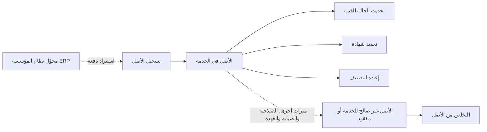
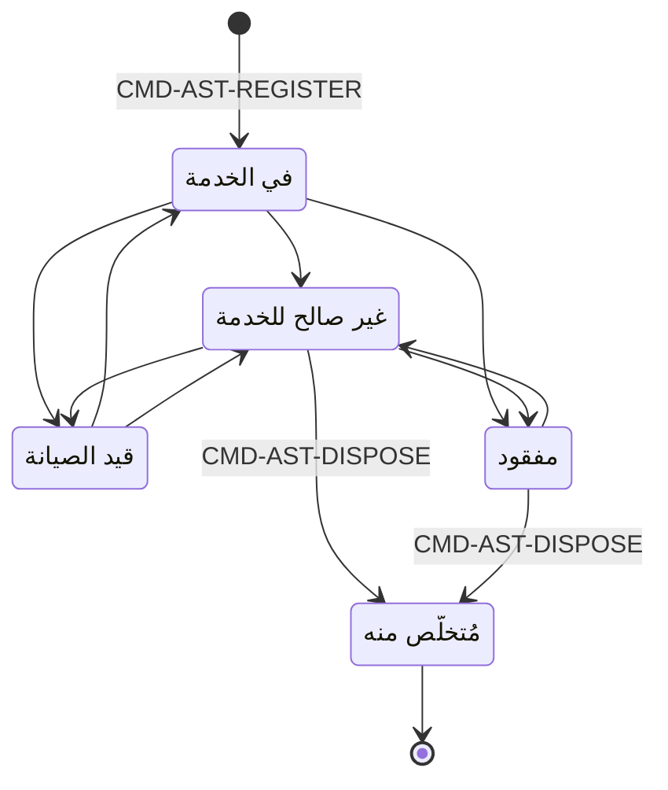

# سجل الأصول

<!-- BEGIN GENERATED: doc -->
| البند | القيمة |
|---|---|
| المعرّف | FEAT-RES-ASSET-REGISTRY |
| الإصدار | 0.1 |
| الحالة | مسودة |
| القدرة | CAP-08 الموارد والجاهزية |
| القدرة الفرعية | CAP-08.01 إدارة الأصول (R2) |
| الأدوار | مدير الموارد؛ مسؤول الأمن؛ صاحب السلطة أو المعتمِد الثاني |
| الشاشات | SCR-40 الأصول وتوفرها والصيانة |
| حالات الاستخدام | UC-050 |
| القصص | 11: 6 من المواصفة، و5 جديدة |
<!-- END GENERATED: doc -->

## 1. نظرة عامة

### 1.1 القيمة

يعرف مدير الموارد كل أصل ونوعه وحالته الفنية وشهاداته وتصنيفه الأمني حتى نهاية عمره والتخلص منه.

### 1.2 النطاق

| البند | القيمة |
|---|---|
| المستخدمون | مدير الموارد؛ مسؤول الأمن؛ صاحب السلطة أو المعتمِد الثاني؛ محوّل نظام المؤسسة (ERP) |
| الشاشات | SCR-40 الأصول وتوفرها والصيانة |
| حالات الاستخدام | تسجيل الأصل وتتبع حالته الفنية وشهاداته وتصنيفه وموقعه حتى التخلص منه (UC-050) |
| المتطلبات | تسجيل الأصل ببياناته الكاملة، وموقعه كادعاءات ثنائية الزمن، واستيراده من نظام المؤسسة |
| خارج النطاق | صلاحية الأصل للخدمة وفقده واستعادته (ميزة صلاحية الأصل وفقده)؛ صيانته (ميزة صيانة الأصول)؛ نقل عهدته (ميزة عهدة الأصل)؛ حجزه وإسناده (ميزتا حجز الأصول وإسنادها) |

### 1.3 خريطة الميزة

**الشكل 1: مسار سجل الأصل من التسجيل إلى التخلص منه**



**الشكل 2: حالات الأصل (الحالات غير المملوكة لهذه الميزة بخط متقطع)**



> **ملاحظة:** هذه الميزة تملك أمري التسجيل والتخلص فقط، وأمر إعادة التصنيف وتحديد الشهادة وتحديث الحالة الفنية اللذين لا يغيّران الحالة. بقية الانتقالات بين «في الخدمة» و«غير صالح للخدمة» و«قيد الصيانة» و«مفقود» تخص ميزتَي صلاحية الأصل وفقده، وصيانة الأصول.

## 2. القواعد المشتركة

تنطبق على كل قصص الميزة، فلا تتكرر داخل القصص. وكل قصة تذكر ما يخصها فقط.

### 2.1 السياق المشترك

كل قصة تبدأ من ثلاثة شروط: مستأجر نشط، وحزمة السياسات الأساسية مفعّلة، ومستخدم مسجّل الدخول ومخوَّل. وتشير إليها القصص بخطوة واحدة: «بفرض السياق المشترك للميزة».

### 2.2 الصلاحية وعدم الإفصاح

- من لا يحق له رؤية العنصر يتلقى ردًا بشكل «غير متاح» تمامًا، فلا يعرف أنه موجود.
- من يرى العنصر ولا يحق له الإجراء يتلقى «لا تملك صلاحية هذا الإجراء».

### 2.3 أوامر تغيير الحالة

- **منع التكرار:** يُرسل كل أمر بمفتاح فريد، فإعادة الطلب نفسه لا تُنفَّذ مرتين.
- **حماية التعديل المتزامن:** يُرسل كل أمر بإصدار البيانات الذي يراه المستخدم. فإن عدّلها غيره في الأثناء، يُرفض الأمر.
- **السجل:** إن نجح الأمر، يُكتب حدثه وسجل التدقيق في المعاملة نفسها.

### 2.4 الرفض المشترك

```gherkin
# language: ar
خاصية: الرفض المشترك لأوامر الميزة

  سيناريو مخطط: رفض مشترك لكل أمر في الميزة
    بفرض السياق المشترك للميزة
    و <الحالة>
    عندما يُرسل المستخدم أي أمر من أوامر الميزة
    اذاً يُرفض برمز <الرمز> ويرى "<الرسالة>"
    و لا يتغير شيء

    امثلة:
      | الحالة                                  | الرمز                  | الرسالة                                                 |
      | العنصر خارج صلاحياته                    | NOT_FOUND              | غير متاح                                                |
      | العنصر مرئي له ولا يحق له الإجراء       | AUTHZ_DENIED           | لا تملك صلاحية هذا الإجراء                              |
      | غيره عدّل العنصر بعد أن فتحه            | VERSION_CONFLICT       | تغيّرت البيانات منذ فتحتها. راجع التغييرات ثم أعد المحاولة |
      | أعاد مفتاح منع التكرار بمحتوى مختلف     | IDEMPOTENCY_KEY_REUSED | طلب مكرر بمحتوى مختلف                                   |
      | البيانات ناقصة أو غير صحيحة             | VALIDATION_FAILED      | بعض البيانات ناقصة أو غير صحيحة. راجع الحقول المعلَّمة      |

  سيناريو: إعادة الطلب نفسه لا تُنفَّذ مرتين
    بفرض السياق المشترك للميزة
    و أمر نجح بمفتاح منع تكرار
    عندما يُعاد الطلب نفسه بالمفتاح نفسه
    اذاً تُعاد النتيجة الأولى ولا يُكتب حدث ثانٍ
```

## 3. الجودة وتعريف الاكتمال

### 3.1 متطلبات الجودة

<!-- BEGIN GENERATED: quality -->
لا متطلبات جودة مرتبطة بمتطلبات هذه الميزة مباشرة. تنطبق متطلبات المنصة العامة (`FEAT-PLT-*`).
<!-- END GENERATED: quality -->

### 3.2 تعريف الاكتمال

القصة مكتملة حين تتحقق الشروط الخمسة:

1. سيناريوهاتها والقواعد المشتركة تمر في الاختبار الآلي.
2. فحوص البنية المعمارية تمر.
3. نصوص الواجهة والرسائل موجودة بالعربية والإنجليزية.
4. مراجعة الكود مكتملة.
5. ما تضيفه القصة نفسها في قسم «القواعد» تحقق.

## 4. فهرس القصص

<!-- BEGIN GENERATED: story-index -->
| المعرّف | القصة | النوع | الحالة |
|---|---|---|---|
| `US-BC05-AST-DISPOSE` | التخلص من الأصل | أمر | مسودة |
| `US-BC05-AST-RECLASSIFY` | إعادة تصنيف الأصل | أمر | مسودة |
| `US-BC05-AST-REGISTER` | تسجيل الأصل | أمر | مسودة |
| `US-BC05-AST-SET-CERTIFICATION` | تحديد شهادة الأصل | أمر | مسودة |
| `US-BC05-AST-UPDATE-CONDITION` | تحديث حالة الأصل الفنية | أمر | مسودة |
| `US-BC05-Q-AST-GET` | جلب: Asset with status, condition, certifications, custody chain, linked entity | جلب | مسودة |
| `US-DOM-AST-LIST` | البحث في سجل الأصول وتصفيته | جلب | مسودة |
| `US-UI-SCR40-ASSET-DETAIL` | تفاصيل الأصل والأفعال المتاحة حسب حالته | واجهة | مسودة |
| `US-UI-SCR40-ASSET-LIST` | قائمة الأصول بحالتها وشهاداتها | واجهة | مسودة |
| `US-UI-SCR40-LOCATION-HISTORY` | موقع الأصل في أي وقت سابق على الخريطة | واجهة | مسودة |
| `US-INT-ERP-ASSET-IMPORT` | تحميل بيانات الأصول من نظام المؤسسة | تكامل | مسودة |
<!-- END GENERATED: story-index -->

## 5. القصص

### 5.1 US-BC05-AST-DISPOSE — التخلص من الأصل

| النوع | الإصدار | الأولوية | دون اتصال | الحالة |
|---|---|---|---|---|
| أمر | R2 | Must | لا | مسودة |

> **كـ** صاحب السلطة أو المعتمِد الثاني، **أريد** التخلص من الأصل «غير صالح للخدمة» أو «مفقود» بقرار معتمد وسبب، **حتى** يُغلق ملفه نهائيًا ولا يُستخدم أو يُحجز بعد ذلك.

**باختصار:** يتخلص صاحب السلطة من أصل «غير صالح للخدمة» أو «مفقود» بقرار من نوع التخلص من الأصل وسبب، فيصبح «مُتخلَّص منه» نهائيًا، شريطة ألا يكون عليه حجز أو إسناد نشط ولا تجميد قانوني.

#### القواعد

- **متى يُسمح:** الأصل «غير صالح للخدمة» أو «مفقود»، ولا يوجد عليه حجز أو إسناد نشط، ولا تجميد قانوني.
- **من يُسمح له:** صاحب السلطة بقرار من نوع التخلص من الأصل، ولا يجوز أن يكون طالب القرار نفسه (فصل المهام).
- **البيانات:** القرار المرجعي، وسبب التخلص (إلزاميان).
- **الأثر:** تصبح حالة الأصل نهائية «مُتخلَّص منه» ولا يقبل أي تغيير بعدها؛ حدث «تم التخلص من الأصل» يصل إلى عرض التوفر وطبقة أصول الموقف والفهرسة وأي حجز أو إسناد.

#### معايير القبول

```gherkin
# language: ar
خاصية: التخلص من الأصل

  سيناريو: التخلص من أصل غير صالح للخدمة بقرار معتمد
    بفرض السياق المشترك للميزة
    و أصل "غير صالح للخدمة" بلا حجز أو إسناد نشط ولا تجميد قانوني
    عندما يتخلص صاحب السلطة منه بقرار وسبب
    اذاً تصبح حالة الأصل "مُتخلَّص منه"
    و يُسجَّل حدث "تم التخلص من الأصل"

  سيناريو مخطط: رفض خاص بالتخلص من الأصل
    بفرض السياق المشترك للميزة
    و <الحالة>
    عندما يحاول التخلص من الأصل
    اذاً يُرفض برمز <الرمز> ويرى <الرسالة>
    و لا يتغير شيء

    امثلة:
      | الحالة                                      | الرمز                  | الرسالة                                         |
      | الأصل "في الخدمة" أو "قيد الصيانة"           | ASSET_INVALID_STATE_TRANSITION | الوضع الحالي للأصل لا يسمح بهذا الإجراء |
      | لا يوجد قرار تخلص معتمد من صاحب سلطة          | AUTHORITY_REQUIRED     | لا تملك السلطة اللازمة لهذا الإجراء             |
      | السبب فارغ                                    | VALIDATION_FAILED      | السبب مطلوب                                     |
```

<details><summary>المراجع التقنية والتتبع</summary>

<!-- BEGIN GENERATED: refs US-BC05-AST-DISPOSE -->
| البند | المعرّف | المعنى |
|---|---|---|
| الواجهة البرمجية | `POST /api/v1/readiness/assets/{id}/actions/dispose` | — |
| الأمر | `CMD-AST-DISPOSE` | التخلص من الأصل |
| السياسة | `POL-AST-DISPOSE` | Resource Manager (register, condition, custody, certification, lost) · disposal authority (dispose) · Securit… |
| الحدث | `EVT-AST-DISPOSED` | يصل إلى: Availability view; Situation assets layer (SLC-06); Search projection (SLC-05); Reservations/assignm… |
| الكيان | `AGG-ASSET` | الأصل |
| الجدول | `readiness.assets` | الجدول الرئيسي للأصل |
| وحدة النشر | DU-14 | — |
| المتطلبات | REQ-RES-001، REQ-RES-002، REQ-RES-003، REQ-RES-005 | معانيها في القسم 6. التتبع |
| حالة الاستخدام | UC-050 | Register Asset |
| الاختبار | TST-ASSET-SM، TST-SLC09-INVARIANTS | دورة حالات الأصل، وثوابت الشريحة SLC-09 |
<!-- END GENERATED: refs US-BC05-AST-DISPOSE -->

</details>

### 5.2 US-BC05-AST-RECLASSIFY — إعادة تصنيف الأصل

| النوع | الإصدار | الأولوية | دون اتصال | الحالة |
|---|---|---|---|---|
| أمر | R2 | Must | لا | مسودة |

> **كـ** مسؤول الأمن، **أريد** إعادة تصنيف الأصل إلى تصنيف أمني جديد بسبب، **حتى** يعكس تصنيفه حساسيته الحالية ويُطبَّق تصريح الرؤية الجديد من لحظة التغيير.

**باختصار:** يغيّر مسؤول الأمن تصنيف أصل قائم -في أي حالة غير «مُتخلَّص منه»- إلى تصنيف جديد بسبب، دون أن تتغير حالته التشغيلية، ويُعاد حساب من يحق له رؤيته من لحظة التغيير.

#### القواعد

- **متى يُسمح:** الأصل في أي حالة غير «مُتخلَّص منه».
- **من يُسمح له:** مسؤول الأمن، وفق سلطته في مخطط التصنيف.
- **البيانات:** التصنيف الجديد، وسبب إعادة التصنيف (إلزاميان).
- **الأثر:** تبقى حالة الأصل كما هي، ويزداد إصدارها بتصنيفها الجديد؛ يُعاد حساب إصدار الأمن فتختفي الرؤية عن من لا يحمل التصريح المطلوب من لحظة التغيير.

#### معايير القبول

```gherkin
# language: ar
خاصية: إعادة تصنيف الأصل

  سيناريو: رفع تصنيف أصل قائم
    بفرض السياق المشترك للميزة
    و أصل "في الخدمة" بتصنيف حالي
    عندما يعيد مسؤول الأمن تصنيفه إلى تصنيف أعلى بسبب
    اذاً تبقى حالة الأصل كما هي
    و يُسجَّل حدث "أعيد تصنيف الأصل"
    و يُعاد حساب من يحق له رؤيته من لحظة التغيير

  سيناريو مخطط: رفض خاص بإعادة التصنيف
    بفرض السياق المشترك للميزة
    و <الحالة>
    عندما يحاول إعادة تصنيف الأصل
    اذاً يُرفض برمز <الرمز> ويرى <الرسالة>
    و لا يتغير شيء

    امثلة:
      | الحالة                                       | الرمز                                 | الرسالة                               |
      | الأصل "مُتخلَّص منه"                         | ASSET_INVALID_STATE_TRANSITION        | الوضع الحالي للأصل لا يسمح بهذا الإجراء |
      | مسؤول الأمن لا يملك سلطة هذا التصنيف          | CLASSIFICATION_CHANGE_NOT_AUTHORIZED  | لا تملك صلاحية تغيير التصنيف           |
      | السبب فارغ                                    | VALIDATION_FAILED                     | السبب مطلوب                           |
```

<details><summary>المراجع التقنية والتتبع</summary>

<!-- BEGIN GENERATED: refs US-BC05-AST-RECLASSIFY -->
| البند | المعرّف | المعنى |
|---|---|---|
| الواجهة البرمجية | `POST /api/v1/readiness/assets/{id}/actions/reclassify` | — |
| الأمر | `CMD-AST-RECLASSIFY` | إعادة تصنيف الأصل |
| السياسة | `POL-AST-RECLASSIFY` | Resource Manager (register, condition, custody, certification, lost) · disposal authority (dispose) · Securit… |
| الحدث | `EVT-AST-RECLASSIFIED` | يصل إلى: Security-version service (EVT-SEC-VERSION-INCREMENTED); PEP decision caches; Projection security-ver… |
| الكيان | `AGG-ASSET` | الأصل |
| الجدول | `readiness.assets` | الجدول الرئيسي للأصل |
| وحدة النشر | DU-14 | — |
| المتطلبات | REQ-RES-001، REQ-RES-002، REQ-RES-003، REQ-RES-005 | معانيها في القسم 6. التتبع |
| حالة الاستخدام | UC-050 | Register Asset |
| الاختبار | TST-ASSET-SM، TST-SLC09-INVARIANTS | دورة حالات الأصل، وثوابت الشريحة SLC-09 |
<!-- END GENERATED: refs US-BC05-AST-RECLASSIFY -->

</details>

### 5.3 US-BC05-AST-REGISTER — تسجيل الأصل

| النوع | الإصدار | الأولوية | دون اتصال | الحالة |
|---|---|---|---|---|
| أمر | R2 | Must | لا | مسودة |

> **كـ** مدير الموارد، **أريد** تسجيل أصل جديد بنوعه ومالكه وحائز عهدته وقدراته وتصنيفه، **حتى** يصبح معروفًا للمنصة وقابلًا للحجز والإسناد.

**باختصار:** يسجل مدير الموارد أصلًا جديدًا بنوع من القائمة المعتمدة، ومالك، وحائز عهدة نشط، وقدرات، وتصنيف، ويربطه بكيان معلوماتي في سجل المعلومات، فيبدأ «في الخدمة».

#### القواعد

- **متى يُسمح:** الأصل غير مسجَّل من قبل (تسجيل جديد).
- **من يُسمح له:** مدير الموارد.
- **البيانات:** نوع الأصل (من القائمة المعتمدة)، والاسم، والمالك، وحائز العهدة النشط، وقدراته، وتصنيفه (إلزامية)؛ الرقم التسلسلي والكيان المعلوماتي المرتبط به (اختياريان).
- **الأثر:** يُسجَّل الأصل بحالة «في الخدمة»؛ حدث «سُجِّل الأصل» يصل إلى عرض التوفر وطبقة أصول الموقف والفهرسة وأي حجز أو إسناد ينتظره.

#### معايير القبول

```gherkin
# language: ar
خاصية: تسجيل الأصل

  سيناريو: تسجيل أصل جديد كامل البيانات
    بفرض السياق المشترك للميزة
    عندما يسجل مدير الموارد أصلًا بنوعه ومالكه وحائزه وقدراته وتصنيفه
    اذاً يُسجَّل الأصل بحالة "في الخدمة"
    و يُسجَّل حدث "سُجِّل الأصل"

  سيناريو مخطط: رفض خاص بتسجيل الأصل
    بفرض السياق المشترك للميزة
    و <الحالة>
    عندما يحاول تسجيل الأصل
    اذاً يُرفض برمز <الرمز> ويرى <الرسالة>
    و لا يتغير شيء

    امثلة:
      | الحالة                                                         | الرمز              | الرسالة                      |
      | نوع الأصل خارج القائمة المعتمدة، أو لا كيان معلوماتي مرتبط به   | ASSET_INVALID      | بيانات الأصل غير صحيحة       |
      | نوع الأصل فارغ                                                 | VALIDATION_FAILED  | نوع الأصل مطلوب              |
      | التصنيف فارغ                                                   | VALIDATION_FAILED  | التصنيف مطلوب                |
```

<details><summary>المراجع التقنية والتتبع</summary>

<!-- BEGIN GENERATED: refs US-BC05-AST-REGISTER -->
| البند | المعرّف | المعنى |
|---|---|---|
| الواجهة البرمجية | `POST /api/v1/readiness/assets` | — |
| الأمر | `CMD-AST-REGISTER` | تسجيل الأصل |
| السياسة | `POL-AST-REGISTER` | Resource Manager (register, condition, custody, certification, lost) · disposal authority (dispose) · Securit… |
| الحدث | `EVT-AST-REGISTERED` | يصل إلى: Availability view; Situation assets layer (SLC-06); Search projection (SLC-05); Reservations/assignm… |
| الكيان | `AGG-ASSET` | الأصل |
| الجدول | `readiness.assets` | الجدول الرئيسي للأصل |
| وحدة النشر | DU-14 | — |
| المتطلبات | REQ-RES-001، REQ-RES-002، REQ-RES-003، REQ-RES-005 | معانيها في القسم 6. التتبع |
| حالة الاستخدام | UC-050 | Register Asset |
| الاختبار | TST-ASSET-SM، TST-SLC09-INVARIANTS | دورة حالات الأصل، وثوابت الشريحة SLC-09 |
<!-- END GENERATED: refs US-BC05-AST-REGISTER -->

</details>

### 5.4 US-BC05-AST-SET-CERTIFICATION — تحديد شهادة الأصل

| النوع | الإصدار | الأولوية | دون اتصال | الحالة |
|---|---|---|---|---|
| أمر | R2 | Must | لا | مسودة |

> **كـ** مدير الموارد، **أريد** تحديد شهادة للأصل برمزها وجهة إصدارها وفترة صلاحيتها، **حتى** يُحجب استخدامه تلقائيًا من لحظة انتهاء شهادته المطلوبة.

**باختصار:** يسجل مدير الموارد شهادة للأصل برمزها وجهة إصدارها وتاريخَي بدايتها ونهايتها ودليلها، فتصبح متاحة لفحص التوفر دون أن تتغير حالة الأصل.

#### القواعد

- **متى يُسمح:** الأصل «في الخدمة» أو «غير صالح للخدمة» أو «قيد الصيانة».
- **من يُسمح له:** مدير الموارد.
- **البيانات:** رمز الشهادة، وجهة الإصدار، وتاريخا البداية والنهاية (إلزامية)؛ دليل الشهادة (اختياري).
- **الأثر:** تبقى حالة الأصل كما هي؛ حدث «حُدِّدت شهادة الأصل» يصل إلى عرض التوفر وطبقة أصول الموقف والفهرسة؛ وانتهاء الشهادة يحجب إسناد الأصل من لحظته (ميزة صلاحية الأصل وفقده).

#### معايير القبول

```gherkin
# language: ar
خاصية: تحديد شهادة الأصل

  سيناريو: تحديد شهادة صالحة لأصل في الخدمة
    بفرض السياق المشترك للميزة
    و أصل "في الخدمة"
    عندما يحدد مدير الموارد شهادة برمزها وجهتها وفترة صلاحيتها
    اذاً تبقى حالة الأصل كما هي
    و يُسجَّل حدث "حُدِّدت شهادة الأصل"

  سيناريو مخطط: رفض خاص بتحديد الشهادة
    بفرض السياق المشترك للميزة
    و <الحالة>
    عندما يحاول تحديد الشهادة
    اذاً يُرفض برمز <الرمز> ويرى <الرسالة>
    و لا يتغير شيء

    امثلة:
      | الحالة                                       | الرمز                  | الرسالة                        |
      | الأصل "مفقود" أو "مُتخلَّص منه"              | ASSET_INVALID_STATE_TRANSITION | الوضع الحالي للأصل لا يسمح بهذا الإجراء |
      | رمز الشهادة أو جهتها أو فترتها غير مكتملة     | CERTIFICATION_INVALID | بيانات الشهادة غير مكتملة      |
      | تاريخ البداية فارغ                            | VALIDATION_FAILED     | تاريخ البداية مطلوب            |
```

<details><summary>المراجع التقنية والتتبع</summary>

<!-- BEGIN GENERATED: refs US-BC05-AST-SET-CERTIFICATION -->
| البند | المعرّف | المعنى |
|---|---|---|
| الواجهة البرمجية | `POST /api/v1/readiness/assets/{id}/actions/set-certification` | — |
| الأمر | `CMD-AST-SET-CERTIFICATION` | تحديد شهادة الأصل |
| السياسة | `POL-AST-SET-CERTIFICATION` | Resource Manager (register, condition, custody, certification, lost) · disposal authority (dispose) · Securit… |
| الحدث | `EVT-AST-CERTIFICATION-SET` | يصل إلى: Availability view; Situation assets layer (SLC-06); Search projection (SLC-05); Reservations/assignm… |
| الكيان | `AGG-ASSET` | الأصل |
| الجدول | `readiness.assets` | الجدول الرئيسي للأصل |
| وحدة النشر | DU-14 | — |
| المتطلبات | REQ-RES-001، REQ-RES-002، REQ-RES-003، REQ-RES-005 | معانيها في القسم 6. التتبع |
| حالة الاستخدام | UC-050 | Register Asset |
| الاختبار | TST-ASSET-SM، TST-SLC09-INVARIANTS | دورة حالات الأصل، وثوابت الشريحة SLC-09 |
<!-- END GENERATED: refs US-BC05-AST-SET-CERTIFICATION -->

</details>

### 5.5 US-BC05-AST-UPDATE-CONDITION — تحديث حالة الأصل الفنية

| النوع | الإصدار | الأولوية | دون اتصال | الحالة |
|---|---|---|---|---|
| أمر | R2 | Must | لا | مسودة |

> **كـ** مدير الموارد، **أريد** تسجيل درجة الحالة الفنية للأصل بعد فحصها مع هوية الفاحص، **حتى** تعكس بيانات الأصل حالته الفعلية.

**باختصار:** يسجل مدير الموارد درجة الحالة الفنية للأصل من قائمة الدرجات المعتمدة مع هوية الفاحص وملاحظاته، دون أن تتغير حالة الأصل التشغيلية.

#### القواعد

- **متى يُسمح:** الأصل «في الخدمة» أو «غير صالح للخدمة» أو «قيد الصيانة».
- **من يُسمح له:** مدير الموارد.
- **البيانات:** درجة الحالة (من القائمة المعتمدة)، وهوية الفاحص (إلزاميان)؛ ملاحظات (اختيارية).
- **الأثر:** تبقى حالة الأصل كما هي؛ حدث «حُدِّثت حالة الأصل الفنية» يصل إلى عرض التوفر وطبقة أصول الموقف والفهرسة.

#### معايير القبول

```gherkin
# language: ar
خاصية: تحديث حالة الأصل الفنية

  سيناريو: تسجيل درجة فحص جديدة
    بفرض السياق المشترك للميزة
    و أصل "في الخدمة"
    عندما يسجل مدير الموارد درجة الحالة وهوية الفاحص
    اذاً تبقى حالة الأصل كما هي
    و يُسجَّل حدث "حُدِّثت حالة الأصل الفنية"

  سيناريو مخطط: رفض خاص بتحديث الحالة الفنية
    بفرض السياق المشترك للميزة
    و <الحالة>
    عندما يحاول تحديث الحالة الفنية
    اذاً يُرفض برمز <الرمز> ويرى <الرسالة>
    و لا يتغير شيء

    امثلة:
      | الحالة                                   | الرمز                  | الرسالة                     |
      | الأصل "مفقود" أو "مُتخلَّص منه"          | ASSET_INVALID_STATE_TRANSITION | الوضع الحالي للأصل لا يسمح بهذا الإجراء |
      | درجة الحالة خارج القائمة المعتمدة        | CONDITION_INVALID      | درجة الحالة غير صحيحة       |
      | الفاحص فارغ                              | VALIDATION_FAILED      | الفاحص مطلوب                |
```

> **ملاحظة:** الدرجة التي تجعل الأصل غير صالح للخدمة تُسجَّل بأمر «تعليم الأصل كغير صالح للخدمة» (ميزة صلاحية الأصل وفقده)، لا بهذا الأمر.

<details><summary>المراجع التقنية والتتبع</summary>

<!-- BEGIN GENERATED: refs US-BC05-AST-UPDATE-CONDITION -->
| البند | المعرّف | المعنى |
|---|---|---|
| الواجهة البرمجية | `POST /api/v1/readiness/assets/{id}/actions/update-condition` | — |
| الأمر | `CMD-AST-UPDATE-CONDITION` | تحديث حالة الأصل الفنية |
| السياسة | `POL-AST-UPDATE-CONDITION` | Resource Manager (register, condition, custody, certification, lost) · disposal authority (dispose) · Securit… |
| الحدث | `EVT-AST-CONDITION-UPDATED` | يصل إلى: Availability view; Situation assets layer (SLC-06); Search projection (SLC-05); Reservations/assignm… |
| الكيان | `AGG-ASSET` | الأصل |
| الجدول | `readiness.assets` | الجدول الرئيسي للأصل |
| وحدة النشر | DU-14 | — |
| المتطلبات | REQ-RES-001، REQ-RES-002، REQ-RES-003، REQ-RES-005 | معانيها في القسم 6. التتبع |
| حالة الاستخدام | UC-050 | Register Asset |
| الاختبار | TST-ASSET-SM، TST-SLC09-INVARIANTS | دورة حالات الأصل، وثوابت الشريحة SLC-09 |
<!-- END GENERATED: refs US-BC05-AST-UPDATE-CONDITION -->

</details>

### 5.6 US-BC05-Q-AST-GET — تفاصيل الأصل

| النوع | الإصدار | الأولوية | دون اتصال | الحالة |
|---|---|---|---|---|
| جلب | R2 | Must | لا | مسودة |

> **كـ** أي مستخدم مخوَّل، **أريد** جلب تفاصيل الأصل بحالته وحالته الفنية وشهاداته وسلسلة عهدته والكيان المرتبط به، **حتى** أتحقق من جاهزيته قبل حجزه أو إسناده.

**باختصار:** تُعاد تفاصيل الأصل بعد إعادة فحص صلاحية رؤيته، أو رد «غير متاح» إن لم يحق له ذلك.

#### القواعد

- **من يرى ماذا:** من له صلاحية على الأصل حسب نطاقه وتصريحه الأمني يرى تفاصيله كاملة؛ ومن لا يحق له لا يعرف بوجوده.

#### معايير القبول

```gherkin
# language: ar
خاصية: تفاصيل الأصل

  سيناريو: جلب تفاصيل أصل مرئي للمستخدم
    بفرض السياق المشترك للميزة
    و أصل داخل نطاقه
    عندما يطلب تفاصيله
    اذاً تُعاد حالته وحالته الفنية وشهاداته وسلسلة عهدته والكيان المرتبط به

  سيناريو: جلب أصل خارج النطاق
    بفرض السياق المشترك للميزة
    و أصل خارج نطاقه
    عندما يطلب تفاصيله
    اذاً يُرد "غير متاح" بلا تمييز بين غير موجود ومحجوب
```

<details><summary>المراجع التقنية والتتبع</summary>

<!-- BEGIN GENERATED: refs US-BC05-Q-AST-GET -->
| البند | المعرّف | المعنى |
|---|---|---|
| الواجهة البرمجية | `GET /api/v1/readiness/assets/{asset_id}` | — |
| الاستعلام | `QRY-AST-GET` | Asset with status, condition, certifications, custody chain, linked entity |
| السياسة | `POL-AST-GET` | label rule |
| الكيان | `AGG-ASSET` | الأصل |
| الجدول | `readiness.assets` | الجدول الرئيسي للأصل |
| وحدة النشر | DU-14 | — |
| المتطلب | REQ-RES-001 | The system shall register each asset with type, ownership, custody holder, status, condition, location, capab… |
| حالة الاستخدام | UC-050 | Register Asset |
| الاختبار | TST-ASSET-SM، TST-SLC09-INVARIANTS | دورة حالات الأصل، وثوابت الشريحة SLC-09 |
<!-- END GENERATED: refs US-BC05-Q-AST-GET -->

</details>

### 5.7 US-DOM-AST-LIST — البحث في سجل الأصول وتصفيته

| النوع | الإصدار | الأولوية | دون اتصال | الحالة |
|---|---|---|---|---|
| جلب | R2 | Must | لا | مسودة |

> **كـ** مدير الموارد، **أريد** البحث في سجل الأصول وتصفيته بنوعها وحالتها وموقعها وتصنيفها، **حتى** أجد الأصل الذي أحتاجه بسرعة بين عدد كبير من الأصول. **[Derived]**

**باختصار:** تُعاد قائمة الأصول المرئية للمستخدم فقط، مرشَّحة بالنوع والحالة والموقع والتصنيف، صفحة بعد صفحة بالمؤشر. **[Derived]:** لا استعلام بحث مستقل في المواصفة لسجل الأصول؛ استُنتج من حاجة الشاشة SCR-40 لعرض قائمة الأصول وتصفيتها.

#### القواعد

- **من يرى ماذا:** الأصول داخل نطاق المستخدم المسموح فقط، وتُفحص صلاحية كل منها عند الإعادة.
- **البيانات (المرشحات):** النوع، والحالة، والموقع أو النطاق الجغرافي، والتصنيف، ونص بحث حر في الاسم أو الرقم التسلسلي.

#### معايير القبول

```gherkin
# language: ar
خاصية: البحث في سجل الأصول وتصفيته

  سيناريو: يرى المستخدم أصوله فقط
    بفرض السياق المشترك للميزة
    و أصول داخل نطاقه وأخرى خارجه
    عندما يبحث في سجل الأصول بمرشح
    اذاً تُعاد الأصول المطابقة داخل نطاقه فقط
    و لا يكشف أي عدد أو اقتراح وجود أصل محجوب

  سيناريو: الصفحة التالية
    بفرض السياق المشترك للميزة
    و نتائج البحث أكثر من صفحة
    عندما يطلب الصفحة التالية بالمؤشر
    اذاً تُعاد الأصول التالية دون تكرار ولا فجوة
```

<details><summary>المراجع التقنية والتتبع</summary>

<!-- BEGIN GENERATED: refs US-DOM-AST-LIST -->
| البند | المعرّف | المعنى |
|---|---|---|
| الشاشة | SCR-40 | شاشة الأصول وتوفرها والصيانة |
| حالة الاستخدام | UC-050 | Register Asset |
| المصدر | `[Derived]` | — |
| المتطلب | REQ-RES-001 | The system shall register each asset with type, ownership, custody holder, status, condition, location, capab… |
| حالة الاستخدام | UC-050 | Register Asset |
<!-- END GENERATED: refs US-DOM-AST-LIST -->

</details>

### 5.8 US-UI-SCR40-ASSET-DETAIL — تفاصيل الأصل والأفعال المتاحة حسب حالته

| النوع | الإصدار | الأولوية | دون اتصال | الحالة |
|---|---|---|---|---|
| واجهة | R2 | Must | لا | مسودة |

> **كـ** مدير الموارد، **أريد** أن أرى تفاصيل الأصل وتُعرض لي الأفعال المتاحة حسب حالته وصلاحياتي فقط، **حتى** لا أحاول فعلًا سيرفضه الخادم.

**باختصار:** تعرض شاشة تفاصيل الأصل حالته وحالته الفنية وشهاداته كشارات، وتُظهر فقط الأفعال التي تسمح بها صلاحيات المستخدم وحالة الأصل المعروضة؛ والقرار الفعلي يبقى للخادم.

#### القواعد

- **البيانات المعروضة:** الحالة والتصنيف شارتان؛ الإصدار الحالي مخزَّن للأمر التالي؛ الأفعال المتاحة تظهر حسب الدور وحالة الأصل (`21-ui-design.md` §6.3).

#### معايير القبول

```gherkin
# language: ar
خاصية: تفاصيل الأصل والأفعال المتاحة

  سيناريو: تظهر الأفعال المسموحة بحالته الحالية فقط
    بفرض السياق المشترك للميزة
    و أصل "غير صالح للخدمة" يحق لمدير الموارد التصرف فيه
    عندما يفتح تفاصيله
    اذاً تظهر حالته وحالته الفنية وشهاداته كشارات
    و يظهر فعل "تحديد شهادة" ولا يظهر فعل "التخلص من الأصل" غير المتاح من هذه الصلاحية

  سيناريو: الخادم يرفض فعلًا ظهر بالخطأ
    بفرض السياق المشترك للميزة
    و حالة الأصل تغيرت على الخادم بعد فتح الشاشة
    عندما يرسل المستخدم فعلًا لا تسمح به الحالة الجديدة
    اذاً يُعاد تحميل الحالة ويُخفى الفعل غير المتاح
```

<details><summary>المراجع التقنية والتتبع</summary>

<!-- BEGIN GENERATED: refs US-UI-SCR40-ASSET-DETAIL -->
| البند | المعرّف | المعنى |
|---|---|---|
| الشاشة | SCR-40 | شاشة الأصول وتوفرها والصيانة |
| المصدر | `21-ui-design.md §6.3` | — |
| المتطلب | REQ-RES-001 | The system shall register each asset with type, ownership, custody holder, status, condition, location, capab… |
| حالة الاستخدام | UC-050 | Register Asset |
<!-- END GENERATED: refs US-UI-SCR40-ASSET-DETAIL -->

</details>

### 5.9 US-UI-SCR40-ASSET-LIST — قائمة الأصول بحالتها وشهاداتها

| النوع | الإصدار | الأولوية | دون اتصال | الحالة |
|---|---|---|---|---|
| واجهة | R2 | Must | لا | مسودة |

> **كـ** مدير الموارد، **أريد** قائمة بالأصول وحالتها وشهاداتها، **حتى** أتابع جاهزية كل أصل من مكان واحد. **[Derived]**

**باختصار:** تعرض قائمة الأصول المرئية للمستخدم بترقيم المؤشر، مع حالة كل أصل وحالته الفنية وتنبيه بصري للشهادة القريبة من الانتهاء.

#### القواعد

- **البيانات المعروضة:** الحالة وحالته الفنية شارتان؛ تنبيه بصري للشهادة التي تنتهي صلاحيتها قريبًا؛ لا عدد إجمالي إلا ما يحسبه الخادم من المرئي.

#### معايير القبول

```gherkin
# language: ar
خاصية: قائمة الأصول

  سيناريو: عرض القائمة بحالاتها
    بفرض السياق المشترك للميزة
    و أصول مرئية للمستخدم بحالات مختلفة
    عندما يفتح قائمة الأصول
    اذاً تظهر حالة كل أصل وحالته الفنية

  سيناريو: تنبيه شهادة قريبة من الانتهاء
    بفرض السياق المشترك للميزة
    و أصل له شهادة تنتهي صلاحيتها قريبًا
    عندما يفتح قائمة الأصول
    اذاً يظهر تنبيه بصري على ذلك الأصل
```

<details><summary>المراجع التقنية والتتبع</summary>

<!-- BEGIN GENERATED: refs US-UI-SCR40-ASSET-LIST -->
| البند | المعرّف | المعنى |
|---|---|---|
| الشاشة | SCR-40 | شاشة الأصول وتوفرها والصيانة |
| المصدر | `21-ui-design.md §6.1` | — |
| المصدر | `[Derived]` | — |
| المتطلب | REQ-RES-001 | The system shall register each asset with type, ownership, custody holder, status, condition, location, capab… |
| حالة الاستخدام | UC-050 | Register Asset |
<!-- END GENERATED: refs US-UI-SCR40-ASSET-LIST -->

</details>

### 5.10 US-UI-SCR40-LOCATION-HISTORY — موقع الأصل في أي وقت سابق على الخريطة

| النوع | الإصدار | الأولوية | دون اتصال | الحالة |
|---|---|---|---|---|
| واجهة | R2 | Must | لا | مسودة |

> **كـ** مدير الموارد، **أريد** أن أرى موقع الأصل في أي وقت سابق على الخريطة، **حتى** أتحقق من مكانه في لحظة معينة سابقة.

**باختصار:** يحرك المستخدم منزلقًا زمنيًا as-of على خريطة تفاصيل الأصل، فتعرض موقعه كما كانت الادعاءات الثنائية الزمن تعرفه في تلك اللحظة (REQ-RES-005).

#### القواعد

- **البيانات المعروضة:** نقطة موقع الأصل على الخريطة عند اللحظة المحددة بالمنزلق، ومصدر الادعاء وزمن تسجيله.

#### معايير القبول

```gherkin
# language: ar
خاصية: موقع الأصل في وقت سابق

  سيناريو: استرجاع موقع سابق بالمنزلق الزمني
    بفرض السياق المشترك للميزة
    و أصل له مواقع مسجَّلة كادعاءات ثنائية الزمن في أوقات مختلفة
    عندما يحرك المستخدم المنزلق الزمني إلى لحظة سابقة
    اذاً يُعرض موقع الأصل كما كان معروفًا في تلك اللحظة

  سيناريو: لا موقع مسجَّل قبل تلك اللحظة
    بفرض السياق المشترك للميزة
    و أصل لم يُسجَّل له موقع قبل اللحظة المحددة
    عندما يحرك المستخدم المنزلق إلى تلك اللحظة
    اذاً لا تظهر نقطة على الخريطة لذلك الأصل
```

<details><summary>المراجع التقنية والتتبع</summary>

<!-- BEGIN GENERATED: refs US-UI-SCR40-LOCATION-HISTORY -->
| البند | المعرّف | المعنى |
|---|---|---|
| الشاشة | SCR-40 | شاشة الأصول وتوفرها والصيانة |
| القرار المعماري | ADR-P01 | Temporal Model |
| المصدر | `21-ui-design.md §7` | — |
| المصدر | `[Derived]` | — |
| المتطلب | REQ-RES-005 | The system shall keep asset location as bitemporal claims so that the location of an asset at any past time i… |
| حالة الاستخدام | UC-050 | Register Asset |
<!-- END GENERATED: refs US-UI-SCR40-LOCATION-HISTORY -->

</details>

### 5.11 US-INT-ERP-ASSET-IMPORT — تحميل بيانات الأصول من نظام المؤسسة

| النوع | الإصدار | الأولوية | دون اتصال | الحالة |
|---|---|---|---|---|
| تكامل | R2 | Must | لا ينطبق | مسودة |

> **كـ** محوّل نظام المؤسسة (ERP)، **أريد** استيراد دفعات بيانات الأصول من نظام المؤسسة بهوية حساب خدمة، **حتى** تُسجَّل الأصول في المنصة دون تكرار يدوي ودون أن يتسرب نموذج النظام الخارجي إلى داخلها.

**باختصار:** يسحب المحوّل دفعة سجلات من نظام المؤسسة، ويترجمها إلى أوامر تسجيل أصل بهوية حساب خدمة، ويربط معرّف كل سجل خارجي بالأصل الداخلي؛ والسجل غير الصالح يُحجز للمراجعة بدل أن يُرفض بصمت.

#### القواعد

- **متى يحدث:** عند سحب دفعة جديدة من نظام المؤسسة بمفتاح دفعة لم يُستخدم من قبل.
- **البيانات (الرسالة المتبادلة):** سجل نظام المؤسسة يُترجم إلى حقول تسجيل الأصل (النوع، والمالك، وحائز العهدة، والقدرات، والتصنيف) قبل إرساله كأمر داخلي.
- **الأثر:** الأمر الداخلي يُطبَّق بالقواعد نفسها لتسجيل الأصل (القصة 5.3)؛ ويُربط معرّف السجل الخارجي بالأصل الداخلي لفترة دون إعادة كتابته لاحقًا.

#### معايير القبول

```gherkin
# language: ar
خاصية: استيراد بيانات الأصول من نظام المؤسسة

  سيناريو: استيراد دفعة سجلات أصول صالحة
    بفرض السياق المشترك للميزة
    و دفعة سجلات أصول جديدة من نظام المؤسسة بمفتاح دفعة لم يُستخدم من قبل
    عندما يترجمها المحوّل إلى أوامر تسجيل أصل بهوية حساب الخدمة
    اذاً تُسجَّل الأصول الصالحة منها بالقواعد نفسها لتسجيل الأصل
    و يُربط معرّف كل سجل خارجي بالأصل الداخلي المناظر

  سيناريو: سجل غير صالح ضمن الدفعة
    بفرض السياق المشترك للميزة
    و دفعة فيها سجل بلا نوع أصل معروف
    عندما يعالج المحوّل الدفعة
    اذاً يُحجز السجل غير الصالح للمراجعة بسببه
    و تُسجَّل بقية سجلات الدفعة الصالحة
```

<details><summary>المراجع التقنية والتتبع</summary>

<!-- BEGIN GENERATED: refs US-INT-ERP-ASSET-IMPORT -->
| البند | المعرّف | المعنى |
|---|---|---|
| المصدر | `20-integration-design.md §2` | — |
| المصدر | `20-integration-design.md §3` | — |
| المصدر | `[Derived]` | — |
| المتطلب | REQ-RES-001 | The system shall register each asset with type, ownership, custody holder, status, condition, location, capab… |
| حالة الاستخدام | UC-050 | Register Asset |
<!-- END GENERATED: refs US-INT-ERP-ASSET-IMPORT -->

</details>

## 6. التتبع

<!-- BEGIN GENERATED: trace -->
| المتطلب | المعنى | القصص | الاختبار |
|---|---|---|---|
| REQ-RES-001 | The system shall register each asset with type, ownership, custody holder, status, condition, location, capab… | `US-BC05-AST-DISPOSE`، `US-BC05-AST-RECLASSIFY`، `US-BC05-AST-REGISTER`، `US-BC05-AST-SET-CERTIFICATION`، `US-BC05-AST-UPDATE-CONDITION`، `US-BC05-Q-AST-GET`، `US-DOM-AST-LIST`، `US-INT-ERP-ASSET-IMPORT`، `US-UI-SCR40-ASSET-DETAIL`، `US-UI-SCR40-ASSET-LIST` | TST-ASSET-SM، TST-SLC09-INVARIANTS |
| REQ-RES-002 | When custody of an asset is transferred, the system shall record the previous holder, the new holder, the tim… | كل قصص الأوامر والنظام في الميزة (5) | TST-ASSET-SM، TST-SLC09-INVARIANTS |
| REQ-RES-003 | When an asset's certification expires or its condition becomes unserviceable, the system shall make it unavai… | كل قصص الأوامر والنظام في الميزة (5) | TST-ASSET-ASSIGNMENT-SM، TST-ASSET-SM، TST-SLC09-INVARIANTS |
| REQ-RES-005 | The system shall keep asset location as bitemporal claims so that the location of an asset at any past time i… | `US-BC05-AST-DISPOSE`، `US-BC05-AST-RECLASSIFY`، `US-BC05-AST-REGISTER`، `US-BC05-AST-SET-CERTIFICATION`، `US-BC05-AST-UPDATE-CONDITION`، `US-UI-SCR40-LOCATION-HISTORY` | TST-ASSET-SM، TST-SLC09-INVARIANTS |
<!-- END GENERATED: trace -->

## 7. سجل التغييرات

| الإصدار | التاريخ | التغيير |
|---|---|---|
| 0.1 | — | هيكل مولَّد من خريطة الميزات |
| 0.2 | 2026-10-13 | كتابة القصص كاملة بمعيار القصص |
