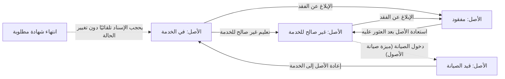

# صلاحية الأصل وفقده

<!-- BEGIN GENERATED: doc -->
| البند | القيمة |
|---|---|
| المعرّف | FEAT-RES-ASSET-SERVICE |
| الإصدار | 0.1 |
| الحالة | مسودة |
| القدرة | CAP-08 الموارد والجاهزية |
| القدرة الفرعية | CAP-08.01 إدارة الأصول (R2) |
| الأدوار | مدير الموارد |
| الشاشات | SCR-40 الأصول وتوفرها والصيانة |
| حالات الاستخدام | UC-051 |
| القصص | 6: 4 من المواصفة، و2 جديدة |
<!-- END GENERATED: doc -->

## 1. نظرة عامة

### 1.1 القيمة

يمنع استخدام أصل معطّل أو مفقود في أي إسناد جديد ويعيده للخدمة عند إصلاحه أو استعادته.

### 1.2 النطاق

| البند | القيمة |
|---|---|
| المستخدمون | مدير الموارد |
| الشاشات | SCR-40 الأصول وتوفرها والصيانة |
| حالات الاستخدام | حجب الأصل غير الصالح للخدمة أو المفقود عن أي إسناد جديد، وإعادته للخدمة بعد إصلاحه أو استعادته (UC-051) |
| المتطلبات | تعليم الأصل غير صالح للخدمة، والإبلاغ عن فقده واستعادته، وإعادته إلى الخدمة بعد الصيانة، وحجب الأصل منتهي الشهادة تلقائيًا من لحظة الانتهاء |
| خارج النطاق | تسجيل الأصل وتصنيفه الأمني (ميزة سجل الأصول)؛ أمر الصيانة نفسه وتخطيطه وإكماله وفشله (ميزة صيانة الأصول)؛ نقل عهدته (ميزة عهدة الأصل) |

### 1.3 خريطة الميزة

**الشكل 1: مسار الأصل بين الخدمة وعدم الصلاحية والفقد**



## 2. القواعد المشتركة

تنطبق على كل قصص الميزة، فلا تتكرر داخل القصص. وكل قصة تذكر ما يخصها فقط.

### 2.1 السياق المشترك

كل قصة تبدأ من ثلاثة شروط: مستأجر نشط، وحزمة السياسات الأساسية مفعّلة، ومستخدم مسجّل الدخول ومخوَّل. وتشير إليها القصص بخطوة واحدة: «بفرض السياق المشترك للميزة».

### 2.2 الصلاحية وعدم الإفصاح

- من لا يحق له رؤية العنصر يتلقى ردًا بشكل «غير متاح» تمامًا، فلا يعرف أنه موجود.
- من يرى العنصر ولا يحق له الإجراء يتلقى «لا تملك صلاحية هذا الإجراء».

### 2.3 أوامر تغيير الحالة

- **منع التكرار:** يُرسل كل أمر بمفتاح فريد، فإعادة الطلب نفسه لا تُنفَّذ مرتين.
- **حماية التعديل المتزامن:** يُرسل كل أمر بإصدار البيانات الذي يراه المستخدم. فإن عدّلها غيره في الأثناء، يُرفض الأمر.
- **السجل:** إن نجح الأمر، يُكتب حدثه وسجل التدقيق في المعاملة نفسها.

### 2.4 الرفض المشترك

```gherkin
# language: ar
خاصية: الرفض المشترك لأوامر الميزة

  سيناريو مخطط: رفض مشترك لكل أمر في الميزة
    بفرض السياق المشترك للميزة
    و <الحالة>
    عندما يُرسل المستخدم أي أمر من أوامر الميزة
    اذاً يُرفض برمز <الرمز> ويرى "<الرسالة>"
    و لا يتغير شيء

    امثلة:
      | الحالة                                  | الرمز                  | الرسالة                                                 |
      | العنصر خارج صلاحياته                    | NOT_FOUND              | غير متاح                                                |
      | العنصر مرئي له ولا يحق له الإجراء       | AUTHZ_DENIED           | لا تملك صلاحية هذا الإجراء                              |
      | غيره عدّل العنصر بعد أن فتحه            | VERSION_CONFLICT       | تغيّرت البيانات منذ فتحتها. راجع التغييرات ثم أعد المحاولة |
      | أعاد مفتاح منع التكرار بمحتوى مختلف     | IDEMPOTENCY_KEY_REUSED | طلب مكرر بمحتوى مختلف                                   |
      | البيانات ناقصة أو غير صحيحة             | VALIDATION_FAILED      | بعض البيانات ناقصة أو غير صحيحة. راجع الحقول المعلَّمة      |

  سيناريو: إعادة الطلب نفسه لا تُنفَّذ مرتين
    بفرض السياق المشترك للميزة
    و أمر نجح بمفتاح منع تكرار
    عندما يُعاد الطلب نفسه بالمفتاح نفسه
    اذاً تُعاد النتيجة الأولى ولا يُكتب حدث ثانٍ
```

## 3. الجودة وتعريف الاكتمال

### 3.1 متطلبات الجودة

<!-- BEGIN GENERATED: quality -->
لا متطلبات جودة مرتبطة بمتطلبات هذه الميزة مباشرة. تنطبق متطلبات المنصة العامة (`FEAT-PLT-*`).
<!-- END GENERATED: quality -->

### 3.2 تعريف الاكتمال

القصة مكتملة حين تتحقق الشروط الخمسة:

1. سيناريوهاتها والقواعد المشتركة تمر في الاختبار الآلي.
2. فحوص البنية المعمارية تمر.
3. نصوص الواجهة والرسائل موجودة بالعربية والإنجليزية.
4. مراجعة الكود مكتملة.
5. ما تضيفه القصة نفسها في قسم «القواعد» تحقق.

## 4. فهرس القصص

<!-- BEGIN GENERATED: story-index -->
| المعرّف | القصة | النوع | الحالة |
|---|---|---|---|
| `US-BC05-AST-MARK-UNSERVICEABLE` | تعليم الأصل كغير صالح للخدمة | أمر | مسودة |
| `US-BC05-AST-RECOVER` | استعادة الأصل | أمر | مسودة |
| `US-BC05-AST-REPORT-LOST` | الإبلاغ عن فقد الأصل | أمر | مسودة |
| `US-BC05-AST-RETURN-TO-SERVICE` | إعادة الأصل إلى الخدمة | أمر | مسودة |
| `US-DOM-AST-CERT-EXPIRY` | الأصل منتهي الشهادة لا يُسند من لحظة الانتهاء | نظام | مسودة |
| `US-UI-SCR40-SERVICE-STATE` | عرض الأصل المعطّل أو المفقود وسبب حالته | واجهة | مسودة |
<!-- END GENERATED: story-index -->

## 5. القصص

### 5.1 US-BC05-AST-MARK-UNSERVICEABLE — تعليم الأصل كغير صالح للخدمة

| النوع | الإصدار | الأولوية | دون اتصال | الحالة |
|---|---|---|---|---|
| أمر | R2 | Must | لا | مسودة |

> **كـ** مدير الموارد، **أريد** تعليم الأصل كغير صالح للخدمة بسبب، **حتى** يُحجب عن أي إسناد أو حجز جديد من لحظة التعليم.

**باختصار:** يعلّم مدير الموارد أصلًا «في الخدمة» كـ«غير صالح للخدمة» بسبب، فتُبلَّغ إسناداته النشطة وتُعلَّم حجوزاته المستقبلية.

#### القواعد

- **متى يُسمح:** الأصل «في الخدمة».
- **من يُسمح له:** مدير الموارد.
- **البيانات:** سبب التعليم (إلزامي).
- **الأثر:** تصبح حالة الأصل «غير صالح للخدمة»؛ تُبلَّغ إسناداته النشطة، وتُعلَّم حجوزاته المستقبلية؛ حدث «أصبح الأصل غير صالح للخدمة» يصل إلى عرض التوفر وطبقة أصول الموقف والفهرسة وحجوزاته وإسناداته.

#### معايير القبول

```gherkin
# language: ar
خاصية: تعليم الأصل كغير صالح للخدمة

  سيناريو: تعليم أصل في الخدمة
    بفرض السياق المشترك للميزة
    و أصل "في الخدمة"
    عندما يعلّمه مدير الموارد كغير صالح للخدمة بسبب
    اذاً تصبح حالته "غير صالح للخدمة"
    و يُسجَّل حدث "أصبح الأصل غير صالح للخدمة"

  سيناريو مخطط: رفض خاص بالتعليم كغير صالح للخدمة
    بفرض السياق المشترك للميزة
    و <الحالة>
    عندما يحاول تعليم الأصل كغير صالح للخدمة
    اذاً يُرفض برمز <الرمز> ويرى <الرسالة>
    و لا يتغير شيء

    امثلة:
      | الحالة                    | الرمز                           | الرسالة                                  |
      | الأصل ليس "في الخدمة"     | ASSET_INVALID_STATE_TRANSITION  | الوضع الحالي للأصل لا يسمح بهذا الإجراء |
      | لم يُذكر السبب            | REASON_REQUIRED                 | اذكر السبب                               |
```

<details><summary>المراجع التقنية والتتبع</summary>

<!-- BEGIN GENERATED: refs US-BC05-AST-MARK-UNSERVICEABLE -->
| البند | المعرّف | المعنى |
|---|---|---|
| الواجهة البرمجية | `POST /api/v1/readiness/assets/{id}/actions/mark-unserviceable` | — |
| الأمر | `CMD-AST-MARK-UNSERVICEABLE` | تعليم الأصل كغير صالح للخدمة |
| السياسة | `POL-AST-MARK-UNSERVICEABLE` | Resource Manager (mark unserviceable)؛ tenant match; object visible; owner/pool scope |
| الحدث | `EVT-AST-UNSERVICEABLE` | يصل إلى: Availability view; Situation assets layer (SLC-06); Search projection (SLC-05); Reservations/assignm… |
| الكيان | `AGG-ASSET` | الأصل |
| الجدول | `readiness.assets` | الجدول الرئيسي للأصل |
| وحدة النشر | DU-14 | — |
| المتطلبات | REQ-RES-001، REQ-RES-002، REQ-RES-003، REQ-RES-005 | معانيها في القسم 6. التتبع |
| حالة الاستخدام | UC-051 | Check Availability |
| الاختبار | TST-ASSET-SM، TST-SLC09-INVARIANTS | دورة حالات الأصل، وثوابت الشريحة SLC-09 |
<!-- END GENERATED: refs US-BC05-AST-MARK-UNSERVICEABLE -->

</details>

### 5.2 US-BC05-AST-RECOVER — استعادة الأصل

| النوع | الإصدار | الأولوية | دون اتصال | الحالة |
|---|---|---|---|---|
| أمر | R2 | Must | لا | مسودة |

> **كـ** مدير الموارد، **أريد** استعادة الأصل بعد العثور عليه، **حتى** يصبح قابلًا للفحص قبل إعادته إلى الخدمة.

**باختصار:** يستعيد مدير الموارد أصلًا «مفقودًا» عُثر عليه، فيصبح «غير صالح للخدمة» بانتظار الفحص قبل أي إسناد جديد.

#### القواعد

- **متى يُسمح:** الأصل «مفقود».
- **من يُسمح له:** مدير الموارد.
- **البيانات:** ملاحظة عن ظروف العثور عليه (اختيارية).
- **الأثر:** تصبح حالة الأصل «غير صالح للخدمة» بانتظار الفحص؛ حدث «استُعيد الأصل» يصل إلى عرض التوفر وطبقة أصول الموقف والفهرسة.

#### معايير القبول

```gherkin
# language: ar
خاصية: استعادة الأصل

  سيناريو: استعادة أصل مفقود عُثر عليه
    بفرض السياق المشترك للميزة
    و أصل "مفقود"
    عندما يستعيده مدير الموارد
    اذاً تصبح حالته "غير صالح للخدمة"
    و يُسجَّل حدث "استُعيد الأصل"

  سيناريو مخطط: رفض خاص بالاستعادة
    بفرض السياق المشترك للميزة
    و <الحالة>
    عندما يحاول استعادة الأصل
    اذاً يُرفض برمز <الرمز> ويرى <الرسالة>
    و لا يتغير شيء

    امثلة:
      | الحالة                  | الرمز                           | الرسالة                                  |
      | الأصل ليس "مفقودًا"     | ASSET_INVALID_STATE_TRANSITION  | الوضع الحالي للأصل لا يسمح بهذا الإجراء |
```

<details><summary>المراجع التقنية والتتبع</summary>

<!-- BEGIN GENERATED: refs US-BC05-AST-RECOVER -->
| البند | المعرّف | المعنى |
|---|---|---|
| الواجهة البرمجية | `POST /api/v1/readiness/assets/{id}/actions/recover` | — |
| الأمر | `CMD-AST-RECOVER` | استعادة الأصل |
| السياسة | `POL-AST-RECOVER` | Resource Manager (recover)؛ tenant match; object visible; owner/pool scope |
| الحدث | `EVT-AST-RECOVERED` | يصل إلى: Availability view; Situation assets layer (SLC-06); Search projection (SLC-05); Reservations/assignm… |
| الكيان | `AGG-ASSET` | الأصل |
| الجدول | `readiness.assets` | الجدول الرئيسي للأصل |
| وحدة النشر | DU-14 | — |
| المتطلبات | REQ-RES-001، REQ-RES-002، REQ-RES-003، REQ-RES-005 | معانيها في القسم 6. التتبع |
| حالة الاستخدام | UC-051 | Check Availability |
| الاختبار | TST-ASSET-SM، TST-SLC09-INVARIANTS | دورة حالات الأصل، وثوابت الشريحة SLC-09 |
<!-- END GENERATED: refs US-BC05-AST-RECOVER -->

</details>

### 5.3 US-BC05-AST-REPORT-LOST — الإبلاغ عن فقد الأصل

| النوع | الإصدار | الأولوية | دون اتصال | الحالة |
|---|---|---|---|---|
| أمر | R2 | Must | لا | مسودة |

> **كـ** مدير الموارد، **أريد** الإبلاغ عن فقد الأصل بسبب، **حتى** تنتهي إسناداته وتُلغى حجوزاته ولا يُستخدم وهو مفقود.

**باختصار:** يبلّغ مدير الموارد عن فقد أصل «في الخدمة» أو «غير صالح للخدمة» بسبب، فتُنهى إسناداته النشطة وتُلغى حجوزاته.

#### القواعد

- **متى يُسمح:** الأصل «في الخدمة» أو «غير صالح للخدمة».
- **من يُسمح له:** مدير الموارد.
- **البيانات:** سبب الفقد (إلزامي).
- **الأثر:** تصبح حالة الأصل «مفقود»؛ تنتهي إسناداته النشطة وتُلغى حجوزاته؛ حدث «أُبلغ عن فقد الأصل» يصل إلى عرض التوفر وطبقة أصول الموقف والفهرسة.

#### معايير القبول

```gherkin
# language: ar
خاصية: الإبلاغ عن فقد الأصل

  سيناريو: الإبلاغ عن فقد أصل في الخدمة
    بفرض السياق المشترك للميزة
    و أصل "في الخدمة"
    عندما يبلّغ مدير الموارد عن فقده بسبب
    اذاً تصبح حالته "مفقود"
    و تنتهي إسناداته النشطة وتُلغى حجوزاته
    و يُسجَّل حدث "أُبلغ عن فقد الأصل"

  سيناريو مخطط: رفض خاص بالإبلاغ عن الفقد
    بفرض السياق المشترك للميزة
    و <الحالة>
    عندما يحاول الإبلاغ عن فقد الأصل
    اذاً يُرفض برمز <الرمز> ويرى <الرسالة>
    و لا يتغير شيء

    امثلة:
      | الحالة                                             | الرمز                           | الرسالة                                  |
      | الأصل "قيد الصيانة" أو "مفقود" أو "مُتخلَّص منه"   | ASSET_INVALID_STATE_TRANSITION  | الوضع الحالي للأصل لا يسمح بهذا الإجراء |
      | لم يُذكر السبب                                     | REASON_REQUIRED                 | اذكر السبب                               |
```

<details><summary>المراجع التقنية والتتبع</summary>

<!-- BEGIN GENERATED: refs US-BC05-AST-REPORT-LOST -->
| البند | المعرّف | المعنى |
|---|---|---|
| الواجهة البرمجية | `POST /api/v1/readiness/assets/{id}/actions/report-lost` | — |
| الأمر | `CMD-AST-REPORT-LOST` | الإبلاغ عن فقد الأصل |
| السياسة | `POL-AST-REPORT-LOST` | Resource Manager (register, condition, custody, certification, lost) · disposal authority (dispose) · Securit… |
| الحدث | `EVT-AST-REPORTED-LOST` | يصل إلى: Availability view; Situation assets layer (SLC-06); Search projection (SLC-05); Reservations/assignm… |
| الكيان | `AGG-ASSET` | الأصل |
| الجدول | `readiness.assets` | الجدول الرئيسي للأصل |
| وحدة النشر | DU-14 | — |
| المتطلبات | REQ-RES-001، REQ-RES-002، REQ-RES-003، REQ-RES-005 | معانيها في القسم 6. التتبع |
| حالة الاستخدام | UC-051 | Check Availability |
| الاختبار | TST-ASSET-SM، TST-SLC09-INVARIANTS | دورة حالات الأصل، وثوابت الشريحة SLC-09 |
<!-- END GENERATED: refs US-BC05-AST-REPORT-LOST -->

</details>

### 5.4 US-BC05-AST-RETURN-TO-SERVICE — إعادة الأصل إلى الخدمة

| النوع | الإصدار | الأولوية | دون اتصال | الحالة |
|---|---|---|---|---|
| أمر | R2 | Must | لا | مسودة |

> **كـ** مدير الموارد، **أريد** إعادة الأصل إلى الخدمة بعد إكمال صيانته بنتيجة صالحة، **حتى** يصبح قابلًا للحجز والإسناد من جديد.

**باختصار:** يعيد مدير الموارد أصلًا «قيد الصيانة» إلى «في الخدمة» بعد أن يكتمل أمر صيانته المرجعي وتصبح حالته الفنية صالحة وشهاداته المطلوبة سارية.

#### القواعد

- **متى يُسمح:** الأصل «قيد الصيانة»، وأمر صيانته المرجعي «مكتمل»، وحالته الفنية صالحة للخدمة، وشهاداته المطلوبة سارية.
- **من يُسمح له:** مدير الموارد.
- **البيانات:** أمر الصيانة المرجعي (إلزامي).
- **الأثر:** تصبح حالة الأصل «في الخدمة»؛ حدث «أُعيد الأصل إلى الخدمة» يصل إلى عرض التوفر وطبقة أصول الموقف والفهرسة.

#### معايير القبول

```gherkin
# language: ar
خاصية: إعادة الأصل إلى الخدمة

  سيناريو: إعادة أصل بعد صيانة ناجحة
    بفرض السياق المشترك للميزة
    و أصل "قيد الصيانة" وأمر صيانته "مكتمل" وحالته الفنية صالحة وشهاداته سارية
    عندما يعيده مدير الموارد إلى الخدمة
    اذاً تصبح حالته "في الخدمة"
    و يُسجَّل حدث "أُعيد الأصل إلى الخدمة"

  سيناريو مخطط: رفض خاص بالإعادة إلى الخدمة
    بفرض السياق المشترك للميزة
    و <الحالة>
    عندما يحاول إعادة الأصل إلى الخدمة
    اذاً يُرفض برمز <الرمز> ويرى <الرسالة>
    و لا يتغير شيء

    امثلة:
      | الحالة                                | الرمز                           | الرسالة                                                            |
      | الأصل ليس "قيد الصيانة"               | ASSET_INVALID_STATE_TRANSITION  | الوضع الحالي للأصل لا يسمح بهذا الإجراء                           |
      | حالته الفنية ليست صالحة للخدمة بعد    | ASSET_NOT_SERVICEABLE           | لا يمكن إعادة الأصل للخدمة قبل إكمال الصيانة وصلاحية شهاداته      |
      | أمر الصيانة فارغ                      | VALIDATION_FAILED               | أمر الصيانة مطلوب                                                  |
```

<details><summary>المراجع التقنية والتتبع</summary>

<!-- BEGIN GENERATED: refs US-BC05-AST-RETURN-TO-SERVICE -->
| البند | المعرّف | المعنى |
|---|---|---|
| الواجهة البرمجية | `POST /api/v1/readiness/assets/{id}/actions/return-to-service` | — |
| الأمر | `CMD-AST-RETURN-TO-SERVICE` | إعادة الأصل إلى الخدمة |
| السياسة | `POL-AST-RETURN-TO-SERVICE` | Resource Manager (return to service)؛ tenant match; object visible; owner/pool scope |
| الحدث | `EVT-AST-RETURNED-TO-SERVICE` | يصل إلى: Availability view; Situation assets layer (SLC-06); Search projection (SLC-05); Reservations/assignm… |
| الكيان | `AGG-ASSET` | الأصل |
| الجدول | `readiness.assets` | الجدول الرئيسي للأصل |
| وحدة النشر | DU-14 | — |
| المتطلبات | REQ-RES-001، REQ-RES-002، REQ-RES-003، REQ-RES-005 | معانيها في القسم 6. التتبع |
| حالة الاستخدام | UC-051 | Check Availability |
| الاختبار | TST-ASSET-SM، TST-SLC09-INVARIANTS | دورة حالات الأصل، وثوابت الشريحة SLC-09 |
<!-- END GENERATED: refs US-BC05-AST-RETURN-TO-SERVICE -->

</details>

### 5.5 US-DOM-AST-CERT-EXPIRY — الأصل منتهي الشهادة لا يُسند من لحظة الانتهاء

| النوع | الإصدار | الأولوية | دون اتصال | الحالة |
|---|---|---|---|---|
| نظام | R2 | Must | لا ينطبق | مسودة |

> **كـ** النظام، **أريد** حجب إسناد الأصل الذي انتهت شهادته المطلوبة من لحظة الانتهاء، **حتى** لا يُستخدم أصل غير مؤهل دون أن يتحرك أحد. **[Derived]**

**باختصار:** الحجب تلقائي عند كل فحص توفر أو إسناد لاحق: تنتهي صلاحية الشهادة وقتها المسجَّل، فيكتشف فحص التوفر ذلك عند القراءة دون أن تتغير حالة الأصل نفسها أو يُسجَّل له حدث مستقل. **[Derived]:** السلوك مُستنتج من REQ-RES-003؛ لا أمر أو حدث مستقل له في المواصفة.

#### القواعد

- **الشرط:** شهادة مطلوبة للأصل تجاوز تاريخها زمن الفحص.
- **الأثر:** يُرد الأصل غير متاح من لحظة انتهاء الشهادة، دون أن تتغير حالته المسجَّلة أو يُكتب له حدث مستقل.

#### معايير القبول

```gherkin
# language: ar
خاصية: حجب إسناد الأصل منتهي الشهادة

  سيناريو: فحص توفر أصل انتهت شهادته المطلوبة
    بفرض أصل "في الخدمة" له شهادة مطلوبة انتهت صلاحيتها
    عندما يُفحص توفره لإسناد أو حجز جديد
    اذاً يُرد غير متاح بسبب انتهاء الشهادة
    و لا تتغير حالة الأصل نفسها

  سيناريو: لا حجب قبل لحظة الانتهاء
    بفرض أصل "في الخدمة" له شهادة مطلوبة سارية
    عندما يُفحص توفره قبل لحظة انتهاء شهادته
    اذاً يبقى متاحًا للإسناد
    و لا يتغير شيء
```

<details><summary>المراجع التقنية والتتبع</summary>

<!-- BEGIN GENERATED: refs US-DOM-AST-CERT-EXPIRY -->
| البند | المعرّف | المعنى |
|---|---|---|
| المصدر | `BRL-007` | — |
| المصدر | `[Derived]` | — |
| المتطلب | REQ-RES-003 | When an asset's certification expires or its condition becomes unserviceable, the system shall make it unavai… |
| حالة الاستخدام | UC-051 | Check Availability |
<!-- END GENERATED: refs US-DOM-AST-CERT-EXPIRY -->

</details>

### 5.6 US-UI-SCR40-SERVICE-STATE — عرض الأصل المعطّل أو المفقود وسبب حالته

| النوع | الإصدار | الأولوية | دون اتصال | الحالة |
|---|---|---|---|---|
| واجهة | R2 | Must | لا | مسودة |

> **كـ** مدير الموارد، **أريد** أن أرى سبب كون الأصل غير صالح للخدمة أو مفقودًا في شاشته، **حتى** أعرف ما يلزم لإعادته إلى الخدمة دون الرجوع إلى سجل منفصل.

**باختصار:** تعرض شاشة تفاصيل الأصل، حين يكون «غير صالح للخدمة» أو «مفقود»، السبب المسجَّل والزمن الذي تغيرت الحالة عنده.

#### القواعد

- **البيانات المعروضة:** سبب التعليم أو الفقد، وزمن التغيير إلى هذه الحالة، وأمر الصيانة المرجعي إن وُجد.

#### معايير القبول

```gherkin
# language: ar
خاصية: عرض سبب حالة الأصل

  سيناريو: عرض سبب أصل غير صالح للخدمة
    بفرض السياق المشترك للميزة
    و أصل "غير صالح للخدمة" بسبب مسجَّل
    عندما يفتح مدير الموارد تفاصيله
    اذاً يظهر السبب وزمن التغيير إلى هذه الحالة

  سيناريو: عرض سبب أصل مفقود
    بفرض السياق المشترك للميزة
    و أصل "مفقود" بسبب مسجَّل
    عندما يفتح تفاصيله
    اذاً يظهر سبب الفقد وزمن الإبلاغ عنه
```

<details><summary>المراجع التقنية والتتبع</summary>

<!-- BEGIN GENERATED: refs US-UI-SCR40-SERVICE-STATE -->
| البند | المعرّف | المعنى |
|---|---|---|
| الشاشة | SCR-40 | شاشة الأصول وتوفرها والصيانة |
| المصدر | `21-ui-design.md §6.2` | — |
| المصدر | `[Derived]` | — |
| المتطلب | REQ-RES-003 | When an asset's certification expires or its condition becomes unserviceable, the system shall make it unavai… |
| حالة الاستخدام | UC-051 | Check Availability |
<!-- END GENERATED: refs US-UI-SCR40-SERVICE-STATE -->

</details>

## 6. التتبع

<!-- BEGIN GENERATED: trace -->
| المتطلب | المعنى | القصص | الاختبار |
|---|---|---|---|
| REQ-RES-001 | The system shall register each asset with type, ownership, custody holder, status, condition, location, capab… | كل قصص الميزة المأخوذة من المواصفة (4) | TST-ASSET-SM، TST-SLC09-INVARIANTS |
| REQ-RES-002 | When custody of an asset is transferred, the system shall record the previous holder, the new holder, the tim… | كل قصص الميزة المأخوذة من المواصفة (4) | TST-ASSET-SM، TST-SLC09-INVARIANTS |
| REQ-RES-003 | When an asset's certification expires or its condition becomes unserviceable, the system shall make it unavai… | `US-BC05-AST-MARK-UNSERVICEABLE`، `US-BC05-AST-RECOVER`، `US-BC05-AST-REPORT-LOST`، `US-BC05-AST-RETURN-TO-SERVICE`، `US-DOM-AST-CERT-EXPIRY`، `US-UI-SCR40-SERVICE-STATE` | TST-ASSET-ASSIGNMENT-SM، TST-ASSET-SM، TST-SLC09-INVARIANTS |
| REQ-RES-005 | The system shall keep asset location as bitemporal claims so that the location of an asset at any past time i… | كل قصص الميزة المأخوذة من المواصفة (4) | TST-ASSET-SM، TST-SLC09-INVARIANTS |
<!-- END GENERATED: trace -->

## 7. سجل التغييرات

| الإصدار | التاريخ | التغيير |
|---|---|---|
| 0.1 | — | هيكل مولَّد من خريطة الميزات |
| 0.2 | 2026-10-13 | كتابة القصص كاملة بمعيار القصص |
