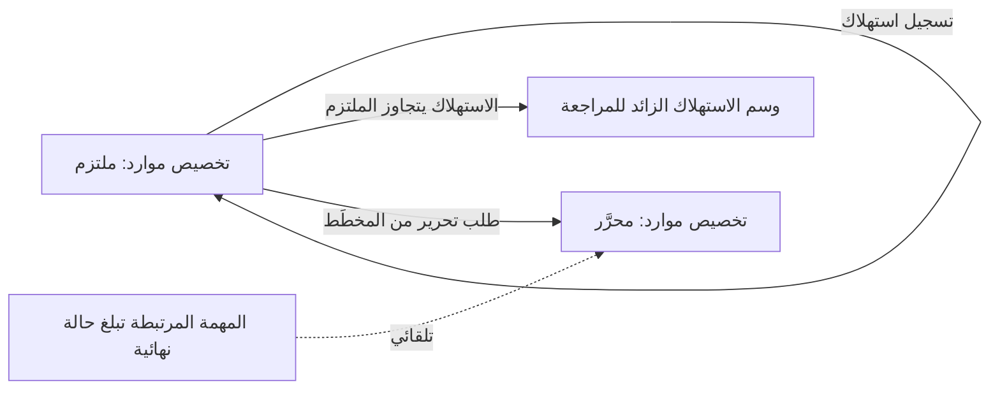

# استهلاك الموارد وتحريرها

<!-- BEGIN GENERATED: doc -->
| البند | القيمة |
|---|---|
| المعرّف | FEAT-RES-CONSUMPTION |
| الإصدار | 0.2 |
| الحالة | مسودة |
| القدرة | CAP-08 الموارد والجاهزية |
| القدرة الفرعية | CAP-08.02 تخصيص الموارد (R2) |
| الأدوار | المسند إليه؛ المخطِّط؛ النظام |
| الشاشات | SCR-41 المجمعات والتخصيص والجدول الزمني للسعة، SCR-02 تفاصيل المهمة وسجلها |
| حالات الاستخدام | UC-055، UC-054 |
| القصص | 6: 3 من المواصفة، و3 جديدة |
<!-- END GENERATED: doc -->

## 1. نظرة عامة

### 1.1 القيمة

يسجل منفذ المهمة ما استهلكه فعلًا، ويُعاد غير المستخدم إلى المجمع عند انتهاء المهمة.

### 1.2 النطاق

| البند | القيمة |
|---|---|
| المستخدمون | المسند إليه؛ المخطِّط؛ النظام |
| الشاشات | SCR-02 تفاصيل المهمة وسجلها، SCR-41 المجمعات والتخصيص والجدول الزمني للسعة |
| حالات الاستخدام | تسجيل ما استُهلك فعلًا من تخصيص الموارد وتحرير ما لم يُستخدم منه (UC-055، UC-054) |
| المتطلبات | تسجيل الاستهلاك بالكمية والوحدة والزمن، ووسم التجاوز للمراجعة بدل رفضه، وتحرير التخصيص عند انتهاء المهمة المرتبطة أو بطلب صاحبه |
| خارج النطاق | طلب التخصيص وفحوصه (ميزة طلب التخصيص)؛ اعتماده أو رفضه أو استباقه (ميزة اعتماد التخصيص وأولويته)؛ إدارة المجمعات نفسها (ميزة مجمعات الموارد) |

### 1.3 خريطة الميزة

**الشكل 1: من الاستهلاك إلى تحرير ما تبقى**



## 2. القواعد المشتركة

تنطبق على كل قصص الميزة، فلا تتكرر داخل القصص. وكل قصة تذكر ما يخصها فقط.

### 2.1 السياق المشترك

كل قصة تبدأ من ثلاثة شروط: مستأجر نشط، وحزمة السياسات الأساسية مفعّلة، ومستخدم مسجّل الدخول ومخوَّل. وتشير إليها القصص بخطوة واحدة: «بفرض السياق المشترك للميزة».

### 2.2 الصلاحية وعدم الإفصاح

- من لا يحق له رؤية العنصر يتلقى ردًا بشكل «غير متاح» تمامًا، فلا يعرف أنه موجود.
- من يرى العنصر ولا يحق له الإجراء يتلقى «لا تملك صلاحية هذا الإجراء».

### 2.3 أوامر تغيير الحالة

- **منع التكرار:** يُرسل كل أمر بمفتاح فريد، فإعادة الطلب نفسه لا تُنفَّذ مرتين.
- **حماية التعديل المتزامن:** يُرسل كل أمر بإصدار البيانات الذي يراه المستخدم. فإن عدّلها غيره في الأثناء، يُرفض الأمر.
- **السجل:** إن نجح الأمر، يُكتب حدثه وسجل التدقيق في المعاملة نفسها.

### 2.4 الرفض المشترك

```gherkin
# language: ar
خاصية: الرفض المشترك لأوامر الميزة

  سيناريو مخطط: رفض مشترك لكل أمر في الميزة
    بفرض السياق المشترك للميزة
    و <الحالة>
    عندما يُرسل المستخدم أي أمر من أوامر الميزة
    اذاً يُرفض برمز <الرمز> ويرى "<الرسالة>"
    و لا يتغير شيء

    امثلة:
      | الحالة                                  | الرمز                  | الرسالة                                                 |
      | العنصر خارج صلاحياته                    | NOT_FOUND              | غير متاح                                                |
      | العنصر مرئي له ولا يحق له الإجراء       | AUTHZ_DENIED           | لا تملك صلاحية هذا الإجراء                              |
      | غيره عدّل العنصر بعد أن فتحه            | VERSION_CONFLICT       | تغيّرت البيانات منذ فتحتها. راجع التغييرات ثم أعد المحاولة |
      | أعاد مفتاح منع التكرار بمحتوى مختلف     | IDEMPOTENCY_KEY_REUSED | طلب مكرر بمحتوى مختلف                                   |
      | البيانات ناقصة أو غير صحيحة             | VALIDATION_FAILED      | بعض البيانات ناقصة أو غير صحيحة. راجع الحقول المعلَّمة      |

  سيناريو: إعادة الطلب نفسه لا تُنفَّذ مرتين
    بفرض السياق المشترك للميزة
    و أمر نجح بمفتاح منع تكرار
    عندما يُعاد الطلب نفسه بالمفتاح نفسه
    اذاً تُعاد النتيجة الأولى ولا يُكتب حدث ثانٍ
```

## 3. الجودة وتعريف الاكتمال

### 3.1 متطلبات الجودة

<!-- BEGIN GENERATED: quality -->
| المرجع | الموقف | المطلوب |
|---|---|---|
| QAS-RES-001 | 100 concurrent allocation requests on one pool | 0 over-commitment; deterministic priority order |
<!-- END GENERATED: quality -->

### 3.2 تعريف الاكتمال

القصة مكتملة حين تتحقق الشروط الخمسة:

1. سيناريوهاتها والقواعد المشتركة تمر في الاختبار الآلي.
2. فحوص البنية المعمارية تمر.
3. نصوص الواجهة والرسائل موجودة بالعربية والإنجليزية.
4. مراجعة الكود مكتملة.
5. ما تضيفه القصة نفسها في قسم «القواعد» تحقق.

## 4. فهرس القصص

<!-- BEGIN GENERATED: story-index -->
| المعرّف | القصة | النوع | الحالة |
|---|---|---|---|
| `US-BC05-ALC-RECORD-CONSUMPTION` | تسجيل استهلاك تخصيص الموارد | أمر | مسودة |
| `US-BC05-ALC-RELEASE` | تحرير تخصيص الموارد | أمر | مسودة |
| `US-BC05-S-ALLOCATION-05` | تحرير التخصيص تلقائيًا عند انتهاء المهمة المرتبطة | نظام | مسودة |
| `US-DOM-ALC-OVERRUN-FLAG` | وسم الاستهلاك الزائد للمراجعة بدل رفضه | نظام | مسودة |
| `US-UI-SCR02-CONSUMPTION` | تسجيل الاستهلاك من تفاصيل المهمة | واجهة | مسودة |
| `US-UI-SCR41-OVERRUN-REVIEW` | مراجعة الاستهلاك المتجاوز للتخصيص | واجهة | مسودة |
<!-- END GENERATED: story-index -->

## 5. القصص

### 5.1 US-BC05-ALC-RECORD-CONSUMPTION — تسجيل استهلاك تخصيص الموارد

| النوع | الإصدار | الأولوية | دون اتصال | الحالة |
|---|---|---|---|---|
| أمر | R2 | Must | لا | مسودة |

> **كـ** المسند إليه، **أريد** تسجيل ما استهلكته فعلًا من تخصيص موارد ملتزم بكميته ووحدته وزمنه، **حتى** تعكس بيانات التخصيص الاستخدام الحقيقي للمورد.

**باختصار:** يسجل المسند إليه كمية الاستهلاك ووحدته وزمنه على تخصيص «ملتزم»، فيُحفظ السجل دون أن تتغير حالة التخصيص؛ والاستهلاك الذي يتجاوز الكمية الملتزمة يُوسَم للمراجعة بدل أن يُرفض.

#### القواعد

- **متى يُسمح:** تخصيص الموارد «ملتزم».
- **من يُسمح له:** المسند إليه مهمة التخصيص.
- **البيانات:** الكمية، والزمن (إلزاميان)؛ ملاحظة (اختيارية).
- **الأثر:** يُسجَّل سجل استهلاك دون تغيير حالة التخصيص؛ الاستهلاك الذي يتجاوز ما التُزم به يُوسَم للمراجعة بدل رفضه (القصة 5.4)؛ حدث «استُهلك جزء من التخصيص» يصل إلى دفتر السعة وإشعار المهمة ومتابعة تقدم الخطة.

#### معايير القبول

```gherkin
# language: ar
خاصية: تسجيل استهلاك تخصيص الموارد

  سيناريو: تسجيل استهلاك ضمن الكمية الملتزمة
    بفرض السياق المشترك للميزة
    و تخصيص موارد "ملتزم" لم يُستهلك منه كل الكمية
    عندما يسجل المسند إليه كمية وزمن الاستهلاك
    اذاً تبقى حالة التخصيص كما هي
    و يُسجَّل حدث "استُهلك جزء من التخصيص"

  سيناريو مخطط: رفض خاص بتسجيل الاستهلاك
    بفرض السياق المشترك للميزة
    و <الحالة>
    عندما يحاول تسجيل الاستهلاك
    اذاً يُرفض برمز <الرمز> ويرى <الرسالة>
    و لا يتغير شيء

    امثلة:
      | الحالة                   | الرمز                                 | الرسالة                                              |
      | التخصيص ليس "ملتزمًا"    | ALLOCATION_INVALID_STATE_TRANSITION   | الوضع الحالي لتخصيص الموارد لا يسمح بهذا الإجراء    |
      | الكمية فارغة              | VALIDATION_FAILED                     | الكمية مطلوبة                                        |
      | زمن الاستهلاك فارغ        | VALIDATION_FAILED                     | الزمن مطلوب                                          |
```

> **ملاحظة [Needs Review]:** يذكر `us-bc05.md` رمز رفض `CONSUMPTION_INVALID` لتجاوز الكمية الملتزمة، بينما تصف مواصفة كيان تخصيص الموارد المصدر نفس الحارس بأنه وسمٌ للمراجعة لا رفض، وتؤكد القصة المشتقة 5.4 أن التجاوز يُسجَّل ويُوسَم لا يُرفض. اتُّبع هنا سلوك الوسم (لا رفض)، والتعارض بين المصدرين مسجَّل في `00-open-questions.md` §6.1 (OQ-US-040) دون حسمه.

<details><summary>المراجع التقنية والتتبع</summary>

<!-- BEGIN GENERATED: refs US-BC05-ALC-RECORD-CONSUMPTION -->
| البند | المعرّف | المعنى |
|---|---|---|
| الواجهة البرمجية | `POST /api/v1/readiness/allocations/{id}/actions/record-consumption` | — |
| الأمر | `CMD-ALC-RECORD-CONSUMPTION` | تسجيل استهلاك تخصيص الموارد |
| السياسة | `POL-ALC-RECORD-CONSUMPTION` | Planner (request, release) · allocation authority (approve, reject, pre-empt) · task assignee (consumption)؛… |
| الحدث | `EVT-ALC-CONSUMED` | يصل إلى: Capacity ledger; Task (SLC-03) notifications; Plan progress (SLC-08) |
| الكيان | `AGG-ALLOCATION` | تخصيص الموارد |
| الجدول | `readiness.allocations` | الجدول الرئيسي لتخصيص الموارد |
| وحدة النشر | DU-14 | — |
| المتطلبات | REQ-RES-007، REQ-RES-008، REQ-RES-009، REQ-RES-010، REQ-RES-011، REQ-RES-012 | معانيها في القسم 6. التتبع |
| حالات الاستخدام | UC-054، UC-055 | Allocate Resource؛ Record Consumption |
| الاختبار | TST-ALLOCATION-SM، TST-SLC09-INVARIANTS | دورة حالات تخصيص الموارد، وثوابت الشريحة SLC-09 |
<!-- END GENERATED: refs US-BC05-ALC-RECORD-CONSUMPTION -->

</details>

### 5.2 US-BC05-ALC-RELEASE — تحرير تخصيص الموارد

| النوع | الإصدار | الأولوية | دون اتصال | الحالة |
|---|---|---|---|---|
| أمر | R2 | Must | لا | مسودة |

> **كـ** المخطِّط، **أريد** تحرير تخصيص موارد لم تعد الحاجة إليه قائمة، **حتى** تعود الكمية غير المستخدمة منه إلى المجمع ليستخدمها غيره.

**باختصار:** يحرر المخطِّط تخصيصًا «ملتزمًا» طلبه هو أو يملك المهمة التي يخدمها، فتعود الكمية غير المستخدمة إلى دفتر السعة فورًا.

#### القواعد

- **متى يُسمح:** تخصيص الموارد «ملتزم».
- **من يُسمح له:** طالب التخصيص أو مالك المهمة التي يخدمها.
- **البيانات:** ملاحظة عن سبب التحرير (اختيارية).
- **الأثر:** تصبح حالة التخصيص «محرَّرًا»، وتعود الكمية غير المستخدمة إلى دفتر السعة فورًا؛ حدث «حُرِّر التخصيص» يصل إلى دفتر السعة وإشعار المهمة ومتابعة تقدم الخطة.

#### معايير القبول

```gherkin
# language: ar
خاصية: تحرير تخصيص الموارد

  سيناريو: تحرير تخصيص لم تعد الحاجة إليه قائمة
    بفرض السياق المشترك للميزة
    و تخصيص موارد "ملتزم" طلبه المخطِّط نفسه
    عندما يحرره
    اذاً تصبح حالته "محرَّرًا"
    و تعود الكمية غير المستخدمة إلى دفتر السعة فورًا
    و يُسجَّل حدث "حُرِّر التخصيص"

  سيناريو مخطط: رفض خاص بالتحرير
    بفرض السياق المشترك للميزة
    و <الحالة>
    عندما يحاول تحرير التخصيص
    اذاً يُرفض برمز <الرمز> ويرى <الرسالة>
    و لا يتغير شيء

    امثلة:
      | الحالة                   | الرمز                                 | الرسالة                                           |
      | التخصيص ليس "ملتزمًا"    | ALLOCATION_INVALID_STATE_TRANSITION   | الوضع الحالي لتخصيص الموارد لا يسمح بهذا الإجراء |
```

<details><summary>المراجع التقنية والتتبع</summary>

<!-- BEGIN GENERATED: refs US-BC05-ALC-RELEASE -->
| البند | المعرّف | المعنى |
|---|---|---|
| الواجهة البرمجية | `POST /api/v1/readiness/allocations/{id}/actions/release` | — |
| الأمر | `CMD-ALC-RELEASE` | تحرير تخصيص الموارد |
| السياسة | `POL-ALC-RELEASE` | Planner (request, release) · allocation authority (approve, reject, pre-empt) · task assignee (consumption)؛… |
| الحدث | `EVT-ALC-RELEASED` | يصل إلى: Capacity ledger; Task (SLC-03) notifications; Plan progress (SLC-08) |
| الكيان | `AGG-ALLOCATION` | تخصيص الموارد |
| الجدول | `readiness.allocations` | الجدول الرئيسي لتخصيص الموارد |
| وحدة النشر | DU-14 | — |
| المتطلبات | REQ-RES-007، REQ-RES-008، REQ-RES-009، REQ-RES-010، REQ-RES-011، REQ-RES-012 | معانيها في القسم 6. التتبع |
| حالات الاستخدام | UC-054، UC-055 | Allocate Resource؛ Record Consumption |
| الاختبار | TST-ALLOCATION-SM، TST-SLC09-INVARIANTS | دورة حالات تخصيص الموارد، وثوابت الشريحة SLC-09 |
<!-- END GENERATED: refs US-BC05-ALC-RELEASE -->

</details>

### 5.3 US-BC05-S-ALLOCATION-05 — تحرير التخصيص تلقائيًا عند انتهاء المهمة المرتبطة

| النوع | الإصدار | الأولوية | دون اتصال | الحالة |
|---|---|---|---|---|
| نظام | R2 | Must | لا ينطبق | مسودة |

> **كـ** النظام، **أريد** تحرير تخصيص الموارد «الملتزم» تلقائيًا حين تبلغ المهمة المرتبطة به حالة نهائية، **حتى** تعود الكمية غير المستخدمة فورًا دون انتظار طلب يدوي.

**باختصار:** عند وصول حدث من دورة حالات المهمة ببلوغها حالة نهائية، يحرر النظام تخصيص الموارد «الملتزم» المرتبط بها تلقائيًا، فتعود الكمية غير المستخدمة إلى دفتر السعة فورًا.

#### القواعد

- **الشرط:** حدث من دورة حالات المهمة ببلوغ المهمة المرتبطة بالتخصيص حالة نهائية.
- **الأثر:** تصبح حالة التخصيص «محرَّرًا»، وتعود الكمية غير المستخدمة إلى دفتر السعة فورًا؛ حدث «حُرِّر التخصيص» يصل إلى دفتر السعة وإشعار المهمة ومتابعة تقدم الخطة.

#### معايير القبول

```gherkin
# language: ar
خاصية: تحرير التخصيص عند انتهاء المهمة المرتبطة

  سيناريو: المهمة المرتبطة تبلغ حالة نهائية
    بفرض تخصيص موارد "ملتزم" مرتبط بمهمة لم تبلغ حالة نهائية بعد
    عندما تبلغ المهمة حالة نهائية
    اذاً تصبح حالة التخصيص "محرَّرًا"
    و تعود الكمية غير المستخدمة إلى دفتر السعة فورًا
    و يُسجَّل حدث "حُرِّر التخصيص" وسجل تدقيق بهوية النظام

  سيناريو: المهمة المرتبطة لا تزال مفتوحة
    بفرض تخصيص موارد "ملتزم" مرتبط بمهمة في حالة غير نهائية
    عندما يحين وقت فحص النظام
    اذاً تبقى حالة التخصيص كما هي
    و لا يتغير شيء
```

<details><summary>المراجع التقنية والتتبع</summary>

<!-- BEGIN GENERATED: refs US-BC05-S-ALLOCATION-05 -->
| البند | المعرّف | المعنى |
|---|---|---|
| المحفِّز | `SYS:linked task terminal` | SLC-03 events (REQ-RES-011) |
| الانتقال | COMMITTED ← RELEASED | — |
| الحدث | `EVT-ALC-RELEASED` | يصل إلى: Capacity ledger; Task (SLC-03) notifications; Plan progress (SLC-08) |
| الكيان | `AGG-ALLOCATION` | تخصيص الموارد |
| الجدول | `readiness.allocations` | الجدول الرئيسي لتخصيص الموارد |
| وحدة النشر | DU-14 | — |
| المتطلبات | REQ-RES-007، REQ-RES-008، REQ-RES-009، REQ-RES-010، REQ-RES-011، REQ-RES-012 | معانيها في القسم 6. التتبع |
| حالات الاستخدام | UC-054، UC-055 | Allocate Resource؛ Record Consumption |
| الاختبار | TST-ALLOCATION-SM، TST-SLC09-INVARIANTS | دورة حالات تخصيص الموارد، وثوابت الشريحة SLC-09 |
<!-- END GENERATED: refs US-BC05-S-ALLOCATION-05 -->

</details>

### 5.4 US-DOM-ALC-OVERRUN-FLAG — وسم الاستهلاك الزائد للمراجعة بدل رفضه

| النوع | الإصدار | الأولوية | دون اتصال | الحالة |
|---|---|---|---|---|
| نظام | R2 | Must | لا ينطبق | مسودة |

> **كـ** النظام، **أريد** وسم سجل الاستهلاك الذي يتجاوز الكمية الملتزمة للمراجعة بدل رفضه، **حتى** يحتفظ السجل بالواقع الفعلي ويراجعه المخطِّط بدل أن يضيع. **[Derived]**

**باختصار:** حين يتجاوز مجموع الاستهلاك المسجَّل الكمية الملتزمة لتخصيص الموارد، يضع النظام على السجل الزائد علامة «يحتاج مراجعة» دون رفضه ودون تغيير حالة التخصيص. **[Derived]:** مُستنتج من REQ-RES-010 (الاستهلاك الذي يتجاوز الالتزام يُوسَم)؛ لا أمر أو حدث مستقل له في المواصفة.

#### القواعد

- **الشرط:** مجموع الاستهلاك المسجَّل على التخصيص يتجاوز كميته الملتزمة.
- **الأثر:** يُسجَّل سجل الاستهلاك الزائد بعلامة «يحتاج مراجعة»، دون رفضه ودون تغيير حالة التخصيص.

#### معايير القبول

```gherkin
# language: ar
خاصية: وسم الاستهلاك الزائد للمراجعة

  سيناريو: استهلاك يتجاوز الكمية الملتزمة
    بفرض تخصيص موارد "ملتزم" استُهلكت منه الكمية كاملة
    عندما يُسجَّل استهلاك إضافي يتجاوز ما التُزم به
    اذاً يُسجَّل السجل بعلامة "يحتاج مراجعة"
    و تبقى حالة التخصيص كما هي

  سيناريو: استهلاك ضمن الكمية الملتزمة
    بفرض تخصيص موارد "ملتزم" لم يُستهلك منه كل الكمية
    عندما يُسجَّل استهلاك ضمن الكمية المتبقية
    اذاً يُسجَّل السجل دون علامة المراجعة
    و لا يتغير شيء آخر
```

<details><summary>المراجع التقنية والتتبع</summary>

<!-- BEGIN GENERATED: refs US-DOM-ALC-OVERRUN-FLAG -->
| البند | المعرّف | المعنى |
|---|---|---|
| حالة الاستخدام | UC-055 | Record Consumption |
| المصدر | `[Derived]` | — |
| المتطلب | REQ-RES-010 | The system shall record resource consumption against allocations with quantity, unit and time. |
| حالة الاستخدام | UC-055 | Record Consumption |
<!-- END GENERATED: refs US-DOM-ALC-OVERRUN-FLAG -->

</details>

### 5.5 US-UI-SCR02-CONSUMPTION — تسجيل الاستهلاك من تفاصيل المهمة

| النوع | الإصدار | الأولوية | دون اتصال | الحالة |
|---|---|---|---|---|
| واجهة | R2 | Must | لا | مسودة |

> **كـ** المسند إليه، **أريد** تسجيل استهلاك المورد من شاشة تفاصيل المهمة نفسها، **حتى** أسجله لحظة استخدامه دون الانتقال إلى شاشة أخرى. **[Derived]**

**باختصار:** تضيف شاشة تفاصيل المهمة نموذجًا مختصرًا لتسجيل كمية الاستهلاك ووحدته عن أي تخصيص مرتبط بالمهمة، فيُرسَل كأمر تسجيل استهلاك عادي.

#### القواعد

- **البيانات المعروضة:** قائمة التخصيصات المرتبطة بالمهمة، وكمياتها الملتزمة والمستهلكة حتى الآن.

#### معايير القبول

```gherkin
# language: ar
خاصية: تسجيل الاستهلاك من تفاصيل المهمة

  سيناريو: تسجيل استهلاك من شاشة المهمة
    بفرض السياق المشترك للميزة
    و مهمة لها تخصيص موارد "ملتزم"
    عندما يسجل المسند إليه كمية الاستهلاك من شاشة تفاصيل المهمة
    اذاً يُرسَل أمر تسجيل استهلاك بالقواعد نفسها لتسجيل الاستهلاك
    و تظهر الكمية المتبقية من التخصيص محدَّثة
```

<details><summary>المراجع التقنية والتتبع</summary>

<!-- BEGIN GENERATED: refs US-UI-SCR02-CONSUMPTION -->
| البند | المعرّف | المعنى |
|---|---|---|
| الشاشة | SCR-02 | شاشة تفاصيل المهمة وسجلها |
| حالة الاستخدام | UC-055 | Record Consumption |
| المصدر | `[Derived]` | — |
| المتطلب | REQ-RES-010 | The system shall record resource consumption against allocations with quantity, unit and time. |
| حالة الاستخدام | UC-055 | Record Consumption |
<!-- END GENERATED: refs US-UI-SCR02-CONSUMPTION -->

</details>

### 5.6 US-UI-SCR41-OVERRUN-REVIEW — مراجعة الاستهلاك المتجاوز للتخصيص

| النوع | الإصدار | الأولوية | دون اتصال | الحالة |
|---|---|---|---|---|
| واجهة | R2 | Must | لا | مسودة |

> **كـ** المخطِّط، **أريد** مراجعة سجلات الاستهلاك الموسومة بتجاوز التخصيص، **حتى** أقرر تسوية الفرق أو تعديل التخصيصات القادمة. **[Derived]**

**باختصار:** تعرض شاشة المجمعات والتخصيص قائمة سجلات الاستهلاك الموسومة «يحتاج مراجعة» مع تخصيصها المرتبط وفرق الكمية.

#### القواعد

- **البيانات المعروضة:** سجل الاستهلاك الموسوم، والتخصيص المرتبط، والكمية الملتزمة والمستهلكة والفرق بينهما.

#### معايير القبول

```gherkin
# language: ar
خاصية: مراجعة الاستهلاك المتجاوز

  سيناريو: عرض سجلات تحتاج مراجعة
    بفرض السياق المشترك للميزة
    و سجلات استهلاك موسومة "يحتاج مراجعة"
    عندما يفتح المخطِّط شاشة المجمعات والتخصيص
    اذاً تظهر قائمة السجلات الموسومة مع فرق الكمية لكل منها

  سيناريو: لا سجلات تحتاج مراجعة
    بفرض السياق المشترك للميزة
    و لا سجلات استهلاك موسومة
    عندما يفتح المخطِّط الشاشة
    اذاً تظهر القائمة فارغة
```

<details><summary>المراجع التقنية والتتبع</summary>

<!-- BEGIN GENERATED: refs US-UI-SCR41-OVERRUN-REVIEW -->
| البند | المعرّف | المعنى |
|---|---|---|
| الشاشة | SCR-41 | شاشة المجمعات والتخصيص والجدول الزمني للسعة |
| المصدر | `[Derived]` | — |
| المتطلب | REQ-RES-010 | The system shall record resource consumption against allocations with quantity, unit and time. |
| حالة الاستخدام | UC-055 | Record Consumption |
<!-- END GENERATED: refs US-UI-SCR41-OVERRUN-REVIEW -->

</details>

## 6. التتبع

<!-- BEGIN GENERATED: trace -->
| المتطلب | المعنى | القصص | الاختبار |
|---|---|---|---|
| REQ-RES-007 | When a resource allocation is requested, the system shall verify authorization, type, availability, capacity,… | كل قصص الميزة المأخوذة من المواصفة (3) | TST-ALLOCATION-SM، TST-SLC09-INVARIANTS |
| REQ-RES-008 | If two allocation requests compete for the same capacity, then the system shall commit at most the available… | كل قصص الميزة المأخوذة من المواصفة (3) | TST-ALLOCATION-SM، TST-SLC09-INVARIANTS |
| REQ-RES-009 | When a higher-priority allocation needs capacity already committed at lower priority, the system shall requir… | كل قصص الميزة المأخوذة من المواصفة (3) | TST-ALLOCATION-SM، TST-SLC09-INVARIANTS |
| REQ-RES-010 | The system shall record resource consumption against allocations with quantity, unit and time. | `US-BC05-ALC-RECORD-CONSUMPTION`، `US-BC05-ALC-RELEASE`، `US-BC05-S-ALLOCATION-05`، `US-DOM-ALC-OVERRUN-FLAG`، `US-UI-SCR02-CONSUMPTION`، `US-UI-SCR41-OVERRUN-REVIEW` | TST-ALLOCATION-SM، TST-SLC09-INVARIANTS |
| REQ-RES-011 | When a task linked to an allocation reaches a terminal state, the system shall release the unused allocation. | كل قصص الميزة المأخوذة من المواصفة (3) | TST-ALLOCATION-SM، TST-SLC09-INVARIANTS |
| REQ-RES-012 | The system shall link resources and assets to tasks as structured references, replacing the text-only resourc… | كل قصص الميزة المأخوذة من المواصفة (3) | TST-ALLOCATION-SM، TST-ASSET-ASSIGNMENT-SM، TST-SLC09-INVARIANTS |
<!-- END GENERATED: trace -->

## 7. سجل التغييرات

| الإصدار | التاريخ | التغيير |
|---|---|---|
| 0.1 | — | هيكل مولَّد من خريطة الميزات |
| 0.2 | 2026-10-13 | كتابة القصص كاملة بمعيار القصص |
| 0.3 | 2026-10-13 | تصحيحات المراجعة المستقلة (الدفعة الأولى) |
