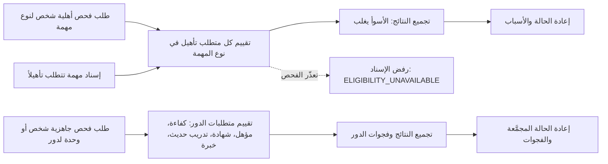

# التحقق من الأهلية والجاهزية

<!-- BEGIN GENERATED: doc -->
| البند | القيمة |
|---|---|
| المعرّف | FEAT-RES-ELIGIBILITY |
| الإصدار | 0.2 |
| الحالة | مسودة |
| القدرة | CAP-08 الموارد والجاهزية |
| القدرة الفرعية | CAP-08.04 الكفاءة والأهلية (R1 (الأهلية فقط)) |
| الأدوار | المخطِّط؛ مدير الموارد؛ مدير التدريب |
| الشاشات | SCR-42 التأهيل والأهلية، SCR-48 التمارين والسيناريوهات والمحاكاة والجاهزية، SCR-02 تفاصيل المهمة وسجلها |
| حالات الاستخدام | UC-102 |
| القصص | 6: 2 من المواصفة، و4 جديدة |
<!-- END GENERATED: doc -->

## 1. نظرة عامة

### 1.1 القيمة

يعرف المخطط ومدير الموارد فورًا هل الشخص أو الوحدة مؤهل لدور أو مهمة في وقت معين، ولماذا.

### 1.2 النطاق

| البند | القيمة |
|---|---|
| المستخدمون | المخطِّط والمدير ضمن نطاقهما؛ مدير التدريب؛ وهوية عبء العمل الداخلية لإسناد المهام (BC04) |
| الشاشات | SCR-42 التأهيل والأهلية؛ SCR-48 التمارين والسيناريوهات والمحاكاة والجاهزية |
| حالات الاستخدام بالكلمات | فحص أهلية شخص لنوع مهمة في وقت معيّن وإعادة الحالة مع أسبابها؛ فحص جاهزية شخص أو وحدة لدور في وقت معيّن مع فجواتها |
| المتطلبات بالكلمات | إعادة نتيجة الأهلية بإحدى حالاتها السبع مع الأسباب عند كل فحص (REQ-RDY-002)؛ تقييم الجاهزية من متطلبات الدور والكفاءات والمؤهلات والشهادات والتدريب الحديث والخبرة والتصريح (REQ-RES-013)؛ رفض إسناد المهمة تلقائيًا إذا تعذّر فحص الأهلية، فلا إسناد دون تحقق (REQ-OPS-007) |
| خارج النطاق | تعريف متطلبات الدور نفسها وتفعيلها وتعديلها (ميزة متطلبات الدور)؛ تسجيل سجلات التأهيل والشهادات وتجديدها وسحبها (ميزة سجل التأهيل)؛ تنفيذ إسناد المهمة نفسه (ميزة المهام) |

### 1.3 خريطة الميزة

**الشكل 1: فحص الأهلية والجاهزية**



## 2. القواعد المشتركة

تنطبق على كل قصص الميزة، فلا تتكرر داخل القصص. وكل قصة تذكر ما يخصها فقط. وهذه ميزة قراءة وعرض وقدرة منصّة فقط، فلا أوامر تغيّر حالة فيها، ولذا تستبدل الفقرتان 2.2 و2.3 عدم الإفصاح في القراءة بدل قواعد الأوامر.

### 2.1 السياق المشترك

كل قصة تبدأ من ثلاثة شروط: مستأجر نشط، وحزمة السياسات الأساسية مفعّلة، ومستخدم مسجّل الدخول ومخوَّل. وتشير إليها القصص بخطوة واحدة: «بفرض السياق المشترك للميزة».

### 2.2 عدم الإفصاح في القراءة

- من لا يحق له رؤية نتيجة الفحص يتلقى ردًا بشكل «غير متاح» تمامًا، فلا يعرف أن الشخص أو الدور موجود أصلاً.
- كل استعلام يعيد فحص صلاحيته على نتيجته بعد حسابها، فلا تظهر لمن فقد صلاحيته في الأثناء.
- لا عدد ولا سبب يكشف وجود بيانات تأهيل أو جاهزية محجوبة عن الطالب.

### 2.3 الرفض المشترك

```gherkin
# language: ar
خاصية: الرفض المشترك لاستعلامات الميزة

  سيناريو مخطط: رفض مشترك لكل استعلام في الميزة
    بفرض السياق المشترك للميزة
    و <الحالة>
    عندما يرسل المستخدم أي استعلام من استعلامات الميزة
    اذاً يُرفض برمز <الرمز> ويرى "<الرسالة>"

    امثلة:
      | الحالة                                  | الرمز              | الرسالة                                                |
      | الشخص أو الدور خارج صلاحياته            | NOT_FOUND          | غير متاح                                               |
      | معاملات الطلب ناقصة أو غير صحيحة       | VALIDATION_FAILED  | بعض البيانات ناقصة أو غير صحيحة. راجع الحقول المعلَّمة |
```

## 3. الجودة وتعريف الاكتمال

### 3.1 متطلبات الجودة

<!-- BEGIN GENERATED: quality -->
لا متطلبات جودة مرتبطة بمتطلبات هذه الميزة مباشرة. تنطبق متطلبات المنصة العامة (`FEAT-PLT-*`).
<!-- END GENERATED: quality -->

### 3.2 تعريف الاكتمال

القصة مكتملة حين تتحقق الشروط الخمسة:

1. سيناريوهاتها والقواعد المشتركة تمر في الاختبار الآلي.
2. فحوص البنية المعمارية تمر.
3. نصوص الواجهة والرسائل موجودة بالعربية والإنجليزية.
4. مراجعة الكود مكتملة.
5. ما تضيفه القصة نفسها في قسم «القواعد» تحقق.

## 4. فهرس القصص

<!-- BEGIN GENERATED: story-index -->
| المعرّف | القصة | النوع | الحالة |
|---|---|---|---|
| `US-BC05-Q-ELIG-CHECK` | فحص أهلية شخص لنوع مهمة في وقت معيّن | جلب | مسودة |
| `US-BC05-Q-READINESS` | فحص جاهزية شخص أو وحدة لدور | جلب | مسودة |
| `US-UI-SCR42-ELIGIBILITY-CHECK` | فحص أهلية شخص مع الأسباب | واجهة | مسودة |
| `US-UI-SCR48-READINESS` | جاهزية الفرد أو الوحدة وفجواتها | واجهة | مسودة |
| `US-PLT-ELIG-FAIL-CLOSED` | لا إسناد إذا تعذر فحص الأهلية | منصة | مسودة |
| `US-PLT-ELIG-ORACLE` | جداول حالات مرجعية لاختبار الأهلية والجاهزية | منصة | مسودة |
<!-- END GENERATED: story-index -->

## 5. القصص

### 5.1 US-BC05-Q-ELIG-CHECK — فحص أهلية شخص لنوع مهمة في وقت معيّن

| النوع | الإصدار | الأولوية | دون اتصال | الحالة |
|---|---|---|---|---|
| جلب | R1 | Must | لا | مسودة |

> **كـ** المخطِّط أو المدير، **أريد** أن أتحقق من أهلية شخص لنوع مهمة في وقت معيّن، **حتى** أعرف هل يصح إسناده وبأي شرط إن لم يكن مؤهلاً تمامًا.

**باختصار:** يُقيَّم كل متطلب تأهيل في نوع المهمة في الوقت المطلوب على حدة، ثم تُجمع النتائج كلها بأسوأ حالة تغلب، فتُعاد حالة واحدة مع أسباب كل متطلب لم يتحقق.

#### القواعد

- **من يرى ماذا:** المخطِّط والمدير ضمن نطاقهما، وهوية عبء العمل الداخلية لإسناد المهام (BC04)، كل منهما لا يرى إلا ما يقع ضمن نطاقه.
- **البيانات:** الشخص، نوع المهمة بإصداره، والوقت المطلوب التقييم عنده.
- **الحساب:** سبع حالات ممكنة لكل متطلب (مؤهل، مؤهل بشرط الإشراف، غير مؤهل، منتهي الصلاحية، يحتاج شهادة، يحتاج تدريبًا، غير معروف)، وتُجمع بأسبقية ثابتة: غير مؤهل، فمنتهي، فيحتاج شهادة، فيحتاج تدريبًا، فغير معروف، فمؤهل بشرط الإشراف، فمؤهل (REQ-RDY-002). نوع مهمة بلا متطلبات تأهيل يُعاد عنه «مؤهل».

#### معايير القبول

```gherkin
# language: ar
خاصية: فحص أهلية شخص لنوع مهمة

  سيناريو: نتيجة مجمَّعة بأسوأ حالة
    بفرض السياق المشترك للميزة
    و شخصًا له سجل منتهي الصلاحية لمتطلب واحد وسجل سارٍ لمتطلب آخر في نوع المهمة
    عندما يطلب المخطِّط فحص أهلية الشخص لنوع المهمة في وقت معيّن
    اذاً تُعاد حالة واحدة هي الأسوأ بين نتائج المتطلبين مع سبب كل منهما

  سيناريو: لا كشف لبيانات خارج النطاق
    بفرض السياق المشترك للميزة
    و الطالب لا يرى بعض سجلات تأهيل الشخص
    عندما يطلب فحص الأهلية
    اذاً تُحسب النتيجة من السجلات المرئية له فقط
    و لا يكشف الرد وجود سجل محجوب
```

<details><summary>المراجع التقنية والتتبع</summary>

<!-- BEGIN GENERATED: refs US-BC05-Q-ELIG-CHECK -->
| البند | المعرّف | المعنى |
|---|---|---|
| الواجهة البرمجية | `POST /api/v1/readiness/eligibility-checks` | — |
| الاستعلام | `QRY-ELIG-CHECK` | EligibilityCheck(person, task_type version, at) → status + reasons |
| السياسة | `POL-ELIG-CHECK` | Planner/Manager in scope; internal BC04 (workload identity) |
| المتطلب | REQ-RDY-002 | When eligibility is checked for a person, role or task at a given time, the system shall return ELIGIBLE, CON… |
| حالة الاستخدام | UC-102 | Check Eligibility |
<!-- END GENERATED: refs US-BC05-Q-ELIG-CHECK -->

</details>

### 5.2 US-BC05-Q-READINESS — فحص جاهزية شخص أو وحدة لدور

| النوع | الإصدار | الأولوية | دون اتصال | الحالة |
|---|---|---|---|---|
| جلب | R1 | Must | لا | مسودة |

> **كـ** المدير أو مدير التدريب، **أريد** أن أعرف جاهزية شخص أو وحدة لدور في وقت معيّن مع فجواتها، **حتى** أحدد من يحتاج تدريبًا أو تأهيلاً قبل التكليف.

**باختصار:** تُوسَّع نتيجة الأهلية (القصة 5.1) بحداثة التدريب الأخير وخبرة أداء الدور، فتُعاد حالة جاهزية مجمَّعة مع قائمة الفجوات لفرد، أو نسبة الأعضاء الجاهزين لدور داخل وحدة.

#### القواعد

- **من يرى ماذا:** المدير ومدير التدريب ضمن نطاقهما، وأي مستخدم يستعلم عن جاهزيته هو نفسه.
- **البيانات:** الفرد أو الوحدة، الدور، والوقت المطلوب التقييم عنده.
- **الحساب:** لكل بند في متطلبات الدور النشطة — كفاءة أو مؤهل أو شهادة كما في الأهلية، زائدًا حداثة التدريب (آخر تدريب ضمن المدى المطلوب) وخبرة أداء الدور من سجل التعيينات (REQ-RES-013). النتيجة حالة مجمَّعة بأسبقية الأهلية نفسها زائدًا قائمة الفجوات، وللوحدة نسبة الأعضاء الجاهزين لكل دور.

#### معايير القبول

```gherkin
# language: ar
خاصية: فحص جاهزية شخص أو وحدة لدور

  سيناريو: جاهزية فرد بفجوة واحدة
    بفرض السياق المشترك للميزة
    و شخصًا يستوفي كفاءات الدور وتدريبه الأخير أقدم من المدى المطلوب
    عندما يطلب المدير جاهزية الشخص لهذا الدور في وقت معيّن
    اذاً تُعاد الحالة المجمَّعة مع فجوة واحدة: حداثة التدريب

  سيناريو: جاهزية وحدة كنسبة
    بفرض السياق المشترك للميزة
    و وحدة فيها أعضاء مرشَّحون لدور واحد، بعضهم جاهز وبعضهم لا
    عندما يطلب المدير جاهزية الوحدة لهذا الدور
    اذاً تُعاد نسبة الأعضاء الجاهزين مع فجوات من لم يكن جاهزًا منهم
```

<details><summary>المراجع التقنية والتتبع</summary>

<!-- BEGIN GENERATED: refs US-BC05-Q-READINESS -->
| البند | المعرّف | المعنى |
|---|---|---|
| الواجهة البرمجية | `POST /api/v1/readiness/readiness-checks` | — |
| الاستعلام | `QRY-READINESS` | Readiness of a person or unit for a role at time t, with gaps |
| السياسة | `POL-READINESS` | Manager / Training Manager in scope; self |
| المتطلب | REQ-RES-013 | The system shall evaluate readiness of a person or unit from role requirements, competencies, qualifications,… |
| حالة الاستخدام | UC-102 | Check Eligibility |
<!-- END GENERATED: refs US-BC05-Q-READINESS -->

</details>

### 5.3 US-UI-SCR42-ELIGIBILITY-CHECK — فحص أهلية شخص مع الأسباب

| النوع | الإصدار | الأولوية | دون اتصال | الحالة |
|---|---|---|---|---|
| واجهة | R1 | Must | لا | مسودة |

> **كـ** مدير الموارد، **أريد** أن أفحص أهلية شخص لنوع مهمة من شاشة التأهيل والأهلية وأرى سبب كل نتيجة بوضوح، **حتى** أقرر إسناده أو أطلب شرطًا إضافيًا دون الرجوع إلى سجلاته واحدًا واحدًا.

**باختصار:** تعرض الشاشة نتيجة فحص الأهلية (القصة 5.1) بلغة المستخدم لا برمزها التقني، مع سبب كل متطلب لم يتحقق.

#### القواعد

- **متى يحدث:** عند طلب المستخدم فحص أهلية شخص لنوع مهمة من شاشة SCR-42.
- **البيانات:** الحالة المجمَّعة وسبب كل متطلب لم يتحقق، بلغة المستخدم.
- **الأثر:** عرض فقط، بلا أثر على بيانات الشخص أو سجلاته.

#### معايير القبول

```gherkin
# language: ar
خاصية: فحص أهلية شخص مع الأسباب

  سيناريو: عرض الحالة والأسباب بلغة واضحة
    بفرض السياق المشترك للميزة
    و شخصًا نتيجة فحصه "يحتاج تدريبًا" لمتطلب واحد
    عندما يفتح مدير الموارد فحص أهلية الشخص لنوع المهمة
    اذاً تُعرض الحالة المجمَّعة بلغة واضحة
    و يُعرض سبب كل متطلب لم يتحقق دون أي رمز تقني
```

<details><summary>المراجع التقنية والتتبع</summary>

<!-- BEGIN GENERATED: refs US-UI-SCR42-ELIGIBILITY-CHECK -->
| البند | المعرّف | المعنى |
|---|---|---|
| الشاشة | SCR-42 | شاشة التأهيل والأهلية |
| المتطلب | REQ-RDY-002 | When eligibility is checked for a person, role or task at a given time, the system shall return ELIGIBLE, CON… |
| حالة الاستخدام | UC-102 | Check Eligibility |
<!-- END GENERATED: refs US-UI-SCR42-ELIGIBILITY-CHECK -->

</details>

### 5.4 US-UI-SCR48-READINESS — جاهزية الفرد أو الوحدة وفجواتها

| النوع | الإصدار | الأولوية | دون اتصال | الحالة |
|---|---|---|---|---|
| واجهة | R1 | Must | لا | مسودة |

> **كـ** مدير التدريب، **أريد** أن أرى جاهزية فرد أو وحدة لدور مع فجواتها من شاشة التمارين والجاهزية، **حتى** أخطط التدريب اللازم لإغلاق الفجوة قبل التكليف.

**باختصار:** تعرض الشاشة نتيجة فحص الجاهزية (القصة 5.2): الحالة المجمَّعة وقائمة الفجوات لفرد، أو نسبة الأعضاء الجاهزين لدور داخل وحدة.

#### القواعد

- **متى يحدث:** عند طلب المستخدم جاهزية فرد أو وحدة لدور من شاشة SCR-48.
- **البيانات:** الحالة المجمَّعة وقائمة الفجوات، أو نسبة الجاهزين وفجوات من تبقّى.
- **الأثر:** عرض فقط، بلا أثر على بيانات الفرد أو الوحدة.

#### معايير القبول

```gherkin
# language: ar
خاصية: جاهزية الفرد أو الوحدة وفجواتها

  سيناريو: عرض فجوات فرد
    بفرض السياق المشترك للميزة
    و فردًا له فجوة واحدة في حداثة التدريب
    عندما يفتح مدير التدريب جاهزيته لدور معيّن
    اذاً تُعرض الحالة المجمَّعة وفجوة حداثة التدريب

  سيناريو: عرض نسبة جاهزية وحدة
    بفرض السياق المشترك للميزة
    و وحدة فيها مرشَّحون لدور واحد
    عندما يفتح مدير التدريب جاهزية الوحدة لهذا الدور
    اذاً تُعرض نسبة الأعضاء الجاهزين وفجوات من تبقّى منهم
```

<details><summary>المراجع التقنية والتتبع</summary>

<!-- BEGIN GENERATED: refs US-UI-SCR48-READINESS -->
| البند | المعرّف | المعنى |
|---|---|---|
| الشاشة | SCR-48 | شاشة التمارين والسيناريوهات والمحاكاة والجاهزية |
| المصدر | `[Derived]` | — |
| المتطلب | REQ-RES-013 | The system shall evaluate readiness of a person or unit from role requirements, competencies, qualifications,… |
| حالة الاستخدام | UC-102 | Check Eligibility |
<!-- END GENERATED: refs US-UI-SCR48-READINESS -->

</details>

### 5.5 US-PLT-ELIG-FAIL-CLOSED — لا إسناد إذا تعذر فحص الأهلية

| النوع | الإصدار | الأولوية | دون اتصال | الحالة |
|---|---|---|---|---|
| منصة | R1 | Must | لا ينطبق | مسودة |

> **كـ** فريق المنصة، **أريد** ألا يتم أي إسناد مهمة حين يتعذر الوصول إلى فحص الأهلية، **حتى** لا يُسند عمل لشخص غير مؤهل بسبب عطل تقني بدل تحقق حقيقي.

**باختصار:** إن تعذّر الوصول إلى فحص الأهلية أثناء إسناد مهمة تتطلب تأهيلاً، يُرفض الإسناد تلقائيًا بدل المضي دون تحقق (REQ-OPS-007).

#### القواعد

- **متى يحدث:** عند إسناد شخص إلى مهمة يُعلن نوعها متطلب تأهيل، وتعذّر الوصول إلى خدمة فحص الأهلية.
- **الأثر:** يُرفض الإسناد كاملاً، ولا يتم جزئيًا ولا يُؤجَّل دون تحقق.

#### معايير القبول

```gherkin
# language: ar
خاصية: لا إسناد دون تحقق من الأهلية

  سيناريو: فحص الأهلية متاح
    بفرض أن فحص الأهلية متاح
    عندما يُسند شخص إلى مهمة تتطلب تأهيلاً
    اذاً يُستوفى شرط الأهلية قبل الإسناد

  سيناريو: فحص الأهلية متعذر
    بفرض أن فحص الأهلية تعذّر الوصول إليه
    عندما يحاول النظام إسناد شخص إلى مهمة تتطلب تأهيلاً
    اذاً يُرفض الإسناد ويظهر "تعذّر التحقق من الأهلية الآن. أعد المحاولة بعد قليل"
    و لا يتم الإسناد جزئيًا أو دون تحقق
```

<details><summary>المراجع التقنية والتتبع</summary>

<!-- BEGIN GENERATED: refs US-PLT-ELIG-FAIL-CLOSED -->
| البند | المعرّف | المعنى |
|---|---|---|
| المصدر | `eligibility-rules.md` | — |
| المتطلب | REQ-OPS-007 | When a task is assigned, the system shall verify the assignee's eligibility wherever the task type declares r… |
| حالة الاستخدام | UC-102 | Check Eligibility |
<!-- END GENERATED: refs US-PLT-ELIG-FAIL-CLOSED -->

</details>

### 5.6 US-PLT-ELIG-ORACLE — جداول حالات مرجعية لاختبار الأهلية والجاهزية

| النوع | الإصدار | الأولوية | دون اتصال | الحالة |
|---|---|---|---|---|
| منصة | R1 | Must | لا ينطبق | مسودة |

> **كـ** فريق المنصة، **أريد** جدولاً مرجعيًا من حالات الأهلية والجاهزية مع نتائجها الصحيحة، **حتى** أختبر حساب الأهلية والجاهزية آليًا وأثق بنتائجه قبل كل إصدار.

**باختصار:** جدول من 40 حالة أهلية و60 حالة جاهزية، نتيجة كل حالة معروفة مسبقًا، يقارَن به ناتج الحساب في الاختبار الآلي (REQ-RDY-002، REQ-RES-013).

#### القواعد

- **البيانات:** 40 حالة تغطي السبع حالات الأهلية؛ 60 حالة تغطي حالات الجاهزية وفجواتها.
- **الأثر:** الاختبار الآلي يقارن ناتج الحساب بالنتيجة المرجعية لكل سطر، ويفشل عند أي خلاف.

#### معايير القبول

```gherkin
# language: ar
خاصية: جداول حالات مرجعية للأهلية والجاهزية

  سيناريو: تطابق نتائج الأهلية مع الجدول المرجعي
    بفرض جدول 40 حالة أهلية مرجعية بنتائجها الصحيحة
    عندما يُشغَّل حساب الأهلية على كل حالة في الجدول
    اذاً تطابق كل نتيجة محسوبة النتيجة المرجعية لها

  سيناريو: تطابق نتائج الجاهزية مع الجدول المرجعي
    بفرض جدول 60 حالة جاهزية مرجعية بنتائجها الصحيحة
    عندما يُشغَّل حساب الجاهزية على كل حالة في الجدول
    اذاً تطابق كل نتيجة محسوبة النتيجة المرجعية لها
```

<details><summary>المراجع التقنية والتتبع</summary>

<!-- BEGIN GENERATED: refs US-PLT-ELIG-ORACLE -->
| البند | المعرّف | المعنى |
|---|---|---|
| المتطلبات | REQ-RDY-002، REQ-RES-013 | معانيها في القسم 6. التتبع |
| حالة الاستخدام | UC-102 | Check Eligibility |
<!-- END GENERATED: refs US-PLT-ELIG-ORACLE -->

</details>

## 6. التتبع

<!-- BEGIN GENERATED: trace -->
| المتطلب | المعنى | القصص | الاختبار |
|---|---|---|---|
| REQ-OPS-007 | When a task is assigned, the system shall verify the assignee's eligibility wherever the task type declares r… | `US-PLT-ELIG-FAIL-CLOSED` | TST-SLC03-INVARIANTS، TST-TASK-SM، TST-TASK-TYPE-SM |
| REQ-RDY-002 | When eligibility is checked for a person, role or task at a given time, the system shall return ELIGIBLE, CON… | `US-BC05-Q-ELIG-CHECK`، `US-PLT-ELIG-ORACLE`، `US-UI-SCR42-ELIGIBILITY-CHECK` | TST-QUALIFICATION-RECORD-SM، TST-SLC03-INVARIANTS |
| REQ-RES-013 | The system shall evaluate readiness of a person or unit from role requirements, competencies, qualifications,… | `US-BC05-Q-READINESS`، `US-PLT-ELIG-ORACLE`، `US-UI-SCR48-READINESS` | TST-ROLE-REQUIREMENT-SM، TST-SLC09-INVARIANTS |
<!-- END GENERATED: trace -->

## 7. سجل التغييرات

| الإصدار | التاريخ | التغيير |
|---|---|---|
| 0.1 | — | هيكل مولَّد من خريطة الميزات |
| 0.2 | 2026-10-13 | كتابة القصص كاملة بمعيار القصص |
