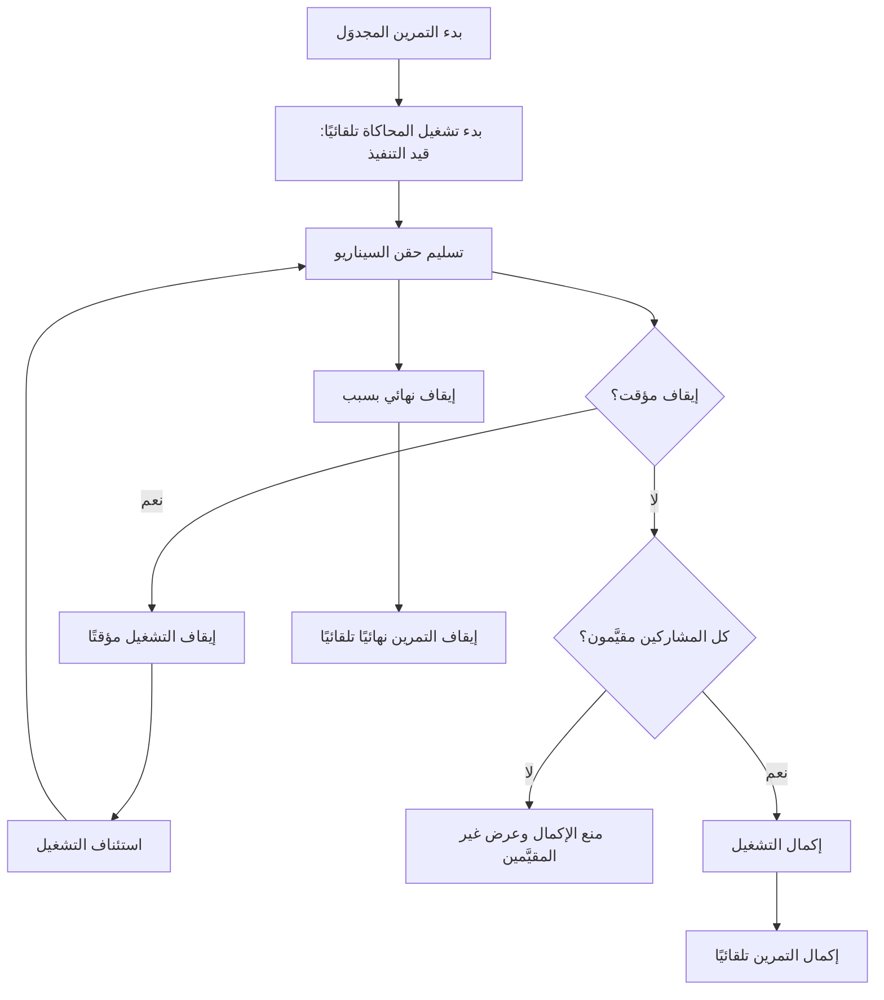
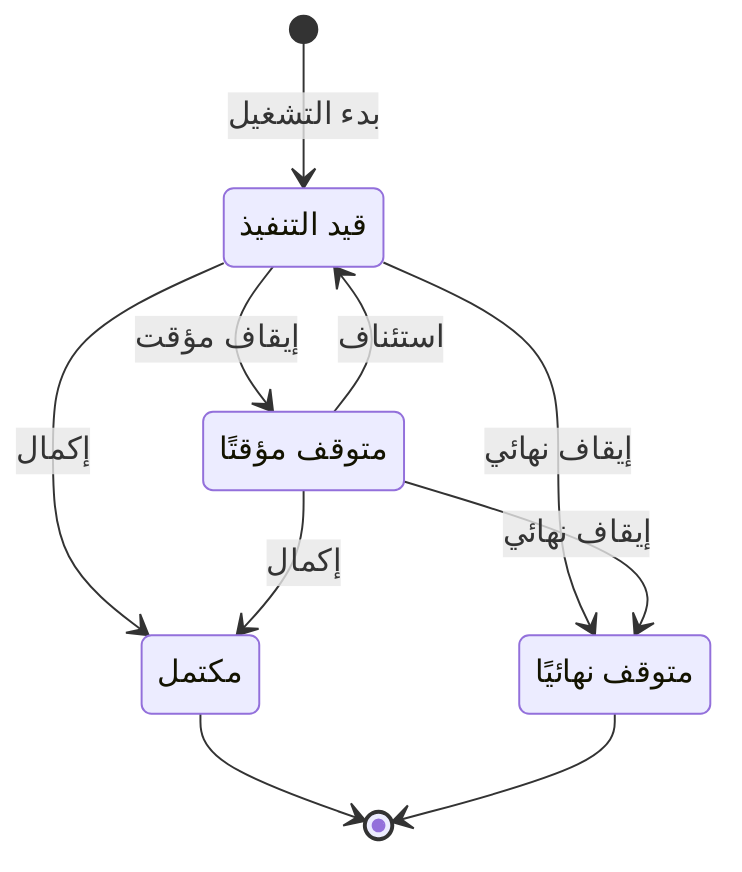

# إدارة تنفيذ التمرين

<!-- BEGIN GENERATED: doc -->
| البند | القيمة |
|---|---|
| المعرّف | FEAT-RES-EXERCISE-CONDUCT |
| الإصدار | 0.3 |
| الحالة | مسودة |
| القدرة | CAP-08 الموارد والجاهزية |
| القدرة الفرعية | CAP-08.05 التدريب والتمارين (R3) |
| الأدوار | مراقب التمرين؛ النظام |
| الشاشات | SCR-48 التمارين والسيناريوهات والمحاكاة والجاهزية |
| حالات الاستخدام | UC-162 |
| القصص | 14: 10 من المواصفة، و4 جديدة |
<!-- END GENERATED: doc -->

## 1. نظرة عامة

### 1.1 القيمة

يدير مراقب التمرين سير التمرين الحي، فيرسل الأحداث ويوقف ويستأنف وينهي، وتُسجل النتيجة النهائية للتمرين تلقائيًا.

### 1.2 النطاق

| البند | القيمة |
|---|---|
| المستخدمون | مراقب التمرين (Exercise Controller)؛ النظام |
| الشاشات | SCR-48 التمارين والسيناريوهات والمحاكاة والجاهزية |
| حالات الاستخدام بالكلمات | تنفيذ تشغيل محاكاة واحد لتمرين: بدؤه تلقائيًا مع بدء التمرين، تسليم حقن السيناريو، الإيقاف المؤقت والاستئناف، الإكمال أو الإيقاف النهائي بسبب؛ عرض حالة التشغيل وقائمته؛ انتقال التمرين نفسه تلقائيًا تبعًا لنتيجة محاكاته |
| المتطلبات بالكلمات | تسجيل تسليم الحقن سجلاً مرتَّبًا زمنيًا لا يُعدَّل ولا يُحذف منه (REQ-TRX-008)؛ لا إكمال قبل تقييم كل مشارك في التمرين المرتبط (REQ-TRX-010)؛ الإيقاف المؤقت والاستئناف والإيقاف النهائي بسبب دون فقد أي سجل سابق (REQ-TRX-011)؛ نتيجة التمرين النهائية (مكتمل أو متوقف نهائيًا) تتبع نتيجة محاكاته وحدها، فلا أمر بشري يحددها مباشرة (REQ-TRX-006) |
| خارج النطاق | تخطيط التمرين وجدولته وبدؤه وإلغاؤه (ميزة تخطيط التمرين)؛ تسجيل تقييم المشاركين وعرض الخط الزمني الكامل المرتَّب لتسليمات الحقن والتقييمات كاستعلام (ميزة تقييم التمرين، FEAT-RES-EXERCISE-EVALUATION) — هذه الميزة تعرض الخط الزمني على الشاشة فقط |

### 1.3 خريطة الميزة

**الشكل 1: تنفيذ تشغيل المحاكاة ضمن التمرين**



**الشكل 2: حالات تشغيل المحاكاة**



## 2. القواعد المشتركة

تنطبق على كل قصص الميزة، فلا تتكرر داخل القصص. وكل قصة تذكر ما يخصها فقط.

### 2.1 السياق المشترك

كل قصة تبدأ من ثلاثة شروط: مستأجر نشط، وحزمة السياسات الأساسية مفعّلة، ومستخدم مسجّل الدخول ومخوَّل. وتشير إليها القصص بخطوة واحدة: «بفرض السياق المشترك للميزة».

### 2.2 الصلاحية وعدم الإفصاح

- من لا يحق له رؤية العنصر يتلقى ردًا بشكل «غير متاح» تمامًا، فلا يعرف أنه موجود.
- من يرى العنصر ولا يحق له الإجراء يتلقى «لا تملك صلاحية هذا الإجراء».

### 2.3 أوامر تغيير الحالة

- **منع التكرار:** يُرسل كل أمر بمفتاح فريد، فإعادة الطلب نفسه لا تُنفَّذ مرتين.
- **حماية التعديل المتزامن:** يُرسل كل أمر بإصدار البيانات الذي يراه المستخدم. فإن عدّلها غيره في الأثناء، يُرفض الأمر.
- **السجل:** إن نجح الأمر، يُكتب حدثه وسجل التدقيق في المعاملة نفسها.

### 2.4 الرفض المشترك

```gherkin
# language: ar
خاصية: الرفض المشترك لأوامر الميزة

  سيناريو مخطط: رفض مشترك لكل أمر في الميزة
    بفرض السياق المشترك للميزة
    و <الحالة>
    عندما يُرسل المستخدم أي أمر من أوامر الميزة
    اذاً يُرفض برمز <الرمز> ويرى "<الرسالة>"
    و لا يتغير شيء

    امثلة:
      | الحالة                                  | الرمز                  | الرسالة                                                 |
      | العنصر خارج صلاحياته                    | NOT_FOUND              | غير متاح                                                |
      | العنصر مرئي له ولا يحق له الإجراء       | AUTHZ_DENIED           | لا تملك صلاحية هذا الإجراء                              |
      | غيره عدّل العنصر بعد أن فتحه            | VERSION_CONFLICT       | تغيّرت البيانات منذ فتحتها. راجع التغييرات ثم أعد المحاولة |
      | أعاد مفتاح منع التكرار بمحتوى مختلف     | IDEMPOTENCY_KEY_REUSED | طلب مكرر بمحتوى مختلف                                   |
      | البيانات ناقصة أو غير صحيحة             | VALIDATION_FAILED      | بعض البيانات ناقصة أو غير صحيحة. راجع الحقول المعلَّمة      |

  سيناريو: إعادة الطلب نفسه لا تُنفَّذ مرتين
    بفرض السياق المشترك للميزة
    و أمر نجح بمفتاح منع تكرار
    عندما يُعاد الطلب نفسه بالمفتاح نفسه
    اذاً تُعاد النتيجة الأولى ولا يُكتب حدث ثانٍ
```

## 3. الجودة وتعريف الاكتمال

### 3.1 متطلبات الجودة

<!-- BEGIN GENERATED: quality -->
| المرجع | الموقف | المطلوب |
|---|---|---|
| QAS-TRX-001 | a simulation run nears completion (CMD-SIM-COMPLETE sent) with at least one exercise participant still unevaluated | 0 simulations reach COMPLETED with a participant lacking at least one recorded evaluation (INV-SIM-02) |
| QAS-TRX-002 | an inject delivered during a live simulation run | 'inject delivery recorded within target latency (tagged: recalibrate after Pilot R1 and R2 — RSK-028)' |
<!-- END GENERATED: quality -->

### 3.2 تعريف الاكتمال

القصة مكتملة حين تتحقق الشروط الخمسة:

1. سيناريوهاتها والقواعد المشتركة تمر في الاختبار الآلي.
2. فحوص البنية المعمارية تمر.
3. نصوص الواجهة والرسائل موجودة بالعربية والإنجليزية.
4. مراجعة الكود مكتملة.
5. ما تضيفه القصة نفسها في قسم «القواعد» تحقق.

## 4. فهرس القصص

<!-- BEGIN GENERATED: story-index -->
| المعرّف | القصة | النوع | الحالة |
|---|---|---|---|
| `US-BC05-SIM-ABORT` | إيقاف تشغيل المحاكاة نهائيًا مع السبب | أمر | مسودة |
| `US-BC05-SIM-COMPLETE` | إكمال تشغيل المحاكاة | أمر | مسودة |
| `US-BC05-SIM-DELIVER-INJECT` | تسليم حقنة سيناريو ضمن تشغيل المحاكاة | أمر | مسودة |
| `US-BC05-SIM-PAUSE` | إيقاف تشغيل المحاكاة مؤقتًا | أمر | مسودة |
| `US-BC05-SIM-RESUME` | استئناف تشغيل المحاكاة | أمر | مسودة |
| `US-BC05-SIM-START` | بدء تشغيل المحاكاة مع بدء التمرين | أمر | مسودة |
| `US-BC05-Q-SIM-GET` | تشغيل المحاكاة بحالته وملخص تقييماته | جلب | مسودة |
| `US-BC05-Q-SIM-LIST` | قائمة تشغيلات المحاكاة مصفَّاة | جلب | مسودة |
| `US-BC05-S-EXERCISE-01` | إكمال التمرين تبعًا لإكمال محاكاته | نظام | مسودة |
| `US-BC05-S-EXERCISE-02` | إيقاف التمرين نهائيًا تبعًا لإيقاف محاكاته | نظام | مسودة |
| `US-UI-SCR48-COMPLETE-GUARD` | عرض المشاركين غير المقيَّمين قبل الإكمال | واجهة | مسودة |
| `US-UI-SCR48-CONTROL-CONSOLE` | لوحة مراقب التمرين لإدارة الأحداث الحية | واجهة | مسودة |
| `US-UI-SCR48-LIVE-TIMELINE` | خط زمني حي للأحداث والتقييمات | واجهة | مسودة |
| `US-PLT-SIM-INJECT-LATENCY` | تسجيل الحدث المرسل خلال الزمن المستهدف | منصة | مسودة |
<!-- END GENERATED: story-index -->

## 5. القصص

### 5.1 US-BC05-SIM-ABORT — إيقاف تشغيل المحاكاة نهائيًا مع السبب

| النوع | الإصدار | الأولوية | دون اتصال | الحالة |
|---|---|---|---|---|
| أمر | R3 | Must | لا | مسودة |

> **كـ** مراقب التمرين، **أريد** أن أوقف تشغيل المحاكاة نهائيًا مع ذكر السبب، **حتى** أنهي التمرين إذا تعذر الاستمرار فيه دون أن يظهر كمكتمل.

**باختصار:** يوقف مراقب التمرين تشغيلاً قيد التنفيذ أو متوقفًا مؤقتًا نهائيًا مع سبب، فيصبح «متوقفًا نهائيًا»، وهذا يوقف التمرين المرتبط به نهائيًا تلقائيًا (القصة 5.10).

#### القواعد

- **متى يُسمح:** التشغيل «قيد التنفيذ» أو «متوقف مؤقتًا»، والسبب مذكور.
- **من يُسمح له:** مراقب التمرين فقط.
- **البيانات:** السبب (إلزامي).
- **الأثر:** الحالة تصبح «متوقف نهائيًا»، ويُسجَّل حدث «أُوقف التشغيل نهائيًا».

#### معايير القبول

```gherkin
# language: ar
خاصية: إيقاف تشغيل المحاكاة نهائيًا

  سيناريو: مراقب التمرين يوقف التشغيل نهائيًا
    بفرض السياق المشترك للميزة
    و تشغيل محاكاة "قيد التنفيذ" لمراقب التمرين
    عندما يوقفه نهائيًا بسبب
    اذاً تصبح حالته "متوقف نهائيًا"
    و يُسجَّل حدث "أُوقف التشغيل نهائيًا"

  سيناريو مخطط: رفض خاص بالإيقاف النهائي
    بفرض السياق المشترك للميزة
    و <الحالة>
    عندما يحاول إيقاف التشغيل نهائيًا
    اذاً يُرفض برمز <الرمز> ويرى <الرسالة>

    امثلة:
      | الحالة                              | الرمز                                | الرسالة                                           |
      | السبب غير مذكور                    | REASON_REQUIRED                      | اذكر السبب                                        |
      | التشغيل "متوقف نهائيًا" أو "مكتمل" | SIMULATION_INVALID_STATE_TRANSITION  | الوضع الحالي لتشغيل المحاكاة لا يسمح بهذا الإجراء |
```

<details><summary>المراجع التقنية والتتبع</summary>

<!-- BEGIN GENERATED: refs US-BC05-SIM-ABORT -->
| البند | المعرّف | المعنى |
|---|---|---|
| الواجهة البرمجية | `POST /api/v1/readiness/simulations/{id}/actions/abort` | — |
| الأمر | `CMD-SIM-ABORT` | إيقاف تشغيل المحاكاة نهائيًا مع السبب |
| السياسة | `POL-SIM-ABORT` | Exercise Controller؛ tenant match |
| الحدث | `EVT-SIM-ABORTED` | يصل إلى: Exercise (ABORTED trigger); Search projection (SLC-05) |
| الكيان | `AGG-SIMULATION` | تشغيل المحاكاة |
| الجدول | `readiness.simulations` | الجدول الرئيسي لتشغيل المحاكاة |
| وحدة النشر | DU-14 | — |
| المتطلبات | REQ-TRX-008، REQ-TRX-009، REQ-TRX-010، REQ-TRX-011 | معانيها في القسم 6. التتبع |
| حالة الاستخدام | UC-162 | Conduct Exercise Simulation |
| الاختبار | TST-SIMULATION-SM، TST-SLC19-INVARIANTS | دورة حالات تشغيل المحاكاة، وثوابت الشريحة SLC-19 |
<!-- END GENERATED: refs US-BC05-SIM-ABORT -->

</details>

### 5.2 US-BC05-SIM-COMPLETE — إكمال تشغيل المحاكاة

| النوع | الإصدار | الأولوية | دون اتصال | الحالة |
|---|---|---|---|---|
| أمر | R3 | Must | لا | مسودة |

> **كـ** مراقب التمرين، **أريد** أن أُكمل تشغيل المحاكاة بعد تقييم كل المشاركين، **حتى** تنتهي المحاكاة بنتيجة نهائية صحيحة ويُكمل التمرين المرتبط بها.

**باختصار:** يُكمل مراقب التمرين تشغيلاً قيد التنفيذ أو متوقفًا مؤقتًا حين يكون لكل مشارك في التمرين المرتبط تقييم واحد على الأقل، فتصبح حالته «مكتملة»، وهذا يُكمل التمرين المرتبط تلقائيًا (القصة 5.9).

#### القواعد

- **متى يُسمح:** التشغيل «قيد التنفيذ» أو «متوقف مؤقتًا»، وكل مشارك في التمرين المرتبط له تقييم واحد على الأقل.
- **من يُسمح له:** مراقب التمرين فقط.
- **الأثر:** الحالة تصبح «مكتملة»، ويُسجَّل حدث «أُكمل التشغيل».

#### معايير القبول

```gherkin
# language: ar
خاصية: إكمال تشغيل المحاكاة

  سيناريو: إكمال تشغيل قُيِّم فيه كل المشاركين
    بفرض السياق المشترك للميزة
    و تشغيل محاكاة "قيد التنفيذ" لكل مشاركيه تقييم واحد على الأقل
    عندما يُكمله مراقب التمرين
    اذاً تصبح حالته "مكتملة"
    و يُسجَّل حدث "أُكمل التشغيل"

  سيناريو مخطط: رفض خاص بالإكمال
    بفرض السياق المشترك للميزة
    و <الحالة>
    عندما يحاول إكمال التشغيل
    اذاً يُرفض برمز <الرمز> ويرى <الرسالة>

    امثلة:
      | الحالة                                | الرمز                                | الرسالة                                           |
      | مشارك واحد على الأقل بلا تقييم        | EVALUATION_MISSING                   | يجب تقييم كل المشاركين قبل الإغلاق                |
      | التشغيل "متوقف نهائيًا" أو "مكتمل"    | SIMULATION_INVALID_STATE_TRANSITION  | الوضع الحالي لتشغيل المحاكاة لا يسمح بهذا الإجراء |
```

<details><summary>المراجع التقنية والتتبع</summary>

<!-- BEGIN GENERATED: refs US-BC05-SIM-COMPLETE -->
| البند | المعرّف | المعنى |
|---|---|---|
| الواجهة البرمجية | `POST /api/v1/readiness/simulations/{id}/actions/complete` | — |
| الأمر | `CMD-SIM-COMPLETE` | إكمال تشغيل المحاكاة |
| السياسة | `POL-SIM-COMPLETE` | Exercise Controller؛ tenant match; every participant evaluated (INV-SIM-02) |
| الحدث | `EVT-SIM-COMPLETED` | يصل إلى: Exercise (COMPLETED trigger); Knowledge Object (optional AAR terminal source, SLC-12 — CR-63); Searc… |
| الكيان | `AGG-SIMULATION` | تشغيل المحاكاة |
| الجدول | `readiness.simulations` | الجدول الرئيسي لتشغيل المحاكاة |
| وحدة النشر | DU-14 | — |
| المتطلبات | REQ-TRX-008، REQ-TRX-009، REQ-TRX-010، REQ-TRX-011 | معانيها في القسم 6. التتبع |
| حالة الاستخدام | UC-162 | Conduct Exercise Simulation |
| الاختبار | TST-SIMULATION-SM، TST-SLC19-INVARIANTS | دورة حالات تشغيل المحاكاة، وثوابت الشريحة SLC-19 |
<!-- END GENERATED: refs US-BC05-SIM-COMPLETE -->

</details>

### 5.3 US-BC05-SIM-DELIVER-INJECT — تسليم حقنة سيناريو ضمن تشغيل المحاكاة

| النوع | الإصدار | الأولوية | دون اتصال | الحالة |
|---|---|---|---|---|
| أمر | R3 | Must | لا | مسودة |

> **كـ** مراقب التمرين، **أريد** أن أُسجّل تسليم حقنة سيناريو ضمن تشغيل المحاكاة، **حتى** يسير التمرين وفق أحداثه المخطَّطة ويبقى سجلاً كاملاً مرتَّبًا.

**باختصار:** يسجل مراقب التمرين تسليم حقنة من سيناريو التمرين المرتبط بوقت يلي كل تسليم سابق، فتُضاف إلى سجل التشغيل دون تغيير حالته.

#### القواعد

- **متى يُسمح:** التشغيل «قيد التنفيذ»، والحقنة تنتمي إلى سيناريو التمرين المرتبط، ووقت التسليم بعد آخر تسليم مسجَّل.
- **من يُسمح له:** مراقب التمرين فقط.
- **البيانات:** الحقنة ووقت التسليم (إلزاميان)، وملاحظة اختيارية.
- **الأثر:** يُضاف تسليم جديد إلى سجل لا يُعدَّل ولا يُحذف منه، ويُسجَّل حدث «سُلِّمت الحقنة».

#### معايير القبول

```gherkin
# language: ar
خاصية: تسليم حقنة سيناريو ضمن تشغيل المحاكاة

  سيناريو: تسليم حقنة تنتمي إلى السيناريو
    بفرض السياق المشترك للميزة
    و تشغيل محاكاة "قيد التنفيذ" مرتبط بسيناريو له حقنة لم تُسلَّم
    عندما يسجل مراقب التمرين تسليمها بوقت يلي آخر تسليم
    اذاً تُضاف إلى سجل التشغيل دون تغيير حالته
    و يُسجَّل حدث "سُلِّمت الحقنة"

  سيناريو مخطط: رفض خاص بتسليم الحقنة
    بفرض السياق المشترك للميزة
    و <الحالة>
    عندما يحاول تسليم الحقنة
    اذاً يُرفض برمز <الرمز> ويرى <الرسالة>

    امثلة:
      | الحالة                                          | الرمز                                | الرسالة                                             |
      | الحقنة لا تنتمي إلى سيناريو التمرين المرتبط     | INJECT_INVALID                       | حدث التمرين لا ينتمي إلى السيناريو أو جاء قبل سابقه |
      | التشغيل "متوقف مؤقتًا" أو نهائي                 | SIMULATION_INVALID_STATE_TRANSITION  | الوضع الحالي لتشغيل المحاكاة لا يسمح بهذا الإجراء   |
```

<details><summary>المراجع التقنية والتتبع</summary>

<!-- BEGIN GENERATED: refs US-BC05-SIM-DELIVER-INJECT -->
| البند | المعرّف | المعنى |
|---|---|---|
| الواجهة البرمجية | `POST /api/v1/readiness/simulations/{id}/actions/deliver-inject` | — |
| الأمر | `CMD-SIM-DELIVER-INJECT` | تسليم حقنة سيناريو ضمن تشغيل المحاكاة |
| السياسة | `POL-SIM-DELIVER-INJECT` | Exercise Controller؛ tenant match; inject_ref belongs to the linked scenario |
| الحدث | `EVT-SIM-INJECT-DELIVERED` | يصل إلى: Search projection (SLC-05) |
| الكيان | `AGG-SIMULATION` | تشغيل المحاكاة |
| الجدول | `readiness.simulations` | الجدول الرئيسي لتشغيل المحاكاة |
| وحدة النشر | DU-14 | — |
| المتطلبات | REQ-TRX-008، REQ-TRX-009، REQ-TRX-010، REQ-TRX-011 | معانيها في القسم 6. التتبع |
| حالة الاستخدام | UC-162 | Conduct Exercise Simulation |
| الاختبار | TST-SIMULATION-SM، TST-SLC19-INVARIANTS | دورة حالات تشغيل المحاكاة، وثوابت الشريحة SLC-19 |
<!-- END GENERATED: refs US-BC05-SIM-DELIVER-INJECT -->

</details>

### 5.4 US-BC05-SIM-PAUSE — إيقاف تشغيل المحاكاة مؤقتًا

| النوع | الإصدار | الأولوية | دون اتصال | الحالة |
|---|---|---|---|---|
| أمر | R3 | Must | لا | مسودة |

> **كـ** مراقب التمرين، **أريد** أن أوقف تشغيل المحاكاة مؤقتًا مع ذكر السبب، **حتى** أعالج أمرًا طارئًا دون أن أفقد ما سُجِّل من حقن وتقييمات.

**باختصار:** يوقف مراقب التمرين تشغيلاً قيد التنفيذ مؤقتًا مع سبب، فتصبح حالته «متوقفة مؤقتًا» دون فقد أي سجل سابق.

#### القواعد

- **متى يُسمح:** التشغيل «قيد التنفيذ»، والسبب مذكور.
- **من يُسمح له:** مراقب التمرين فقط.
- **البيانات:** السبب (إلزامي).
- **الأثر:** الحالة تصبح «متوقف مؤقتًا»، وتبقى كل سجلات الحقن والتقييمات كما هي.

#### معايير القبول

```gherkin
# language: ar
خاصية: إيقاف تشغيل المحاكاة مؤقتًا

  سيناريو: مراقب التمرين يوقف التشغيل مؤقتًا
    بفرض السياق المشترك للميزة
    و تشغيل محاكاة "قيد التنفيذ"
    عندما يوقفه مؤقتًا بسبب
    اذاً تصبح حالته "متوقف مؤقتًا"
    و يُسجَّل حدث "أُوقف التشغيل مؤقتًا"
    و تبقى كل سجلات الحقن والتقييمات كما هي

  سيناريو مخطط: رفض خاص بالإيقاف المؤقت
    بفرض السياق المشترك للميزة
    و <الحالة>
    عندما يحاول إيقاف التشغيل مؤقتًا
    اذاً يُرفض برمز <الرمز> ويرى <الرسالة>

    امثلة:
      | الحالة                          | الرمز                                | الرسالة                                           |
      | السبب غير مذكور                | REASON_REQUIRED                      | اذكر السبب                                        |
      | التشغيل ليس "قيد التنفيذ"      | SIMULATION_INVALID_STATE_TRANSITION  | الوضع الحالي لتشغيل المحاكاة لا يسمح بهذا الإجراء |
```

<details><summary>المراجع التقنية والتتبع</summary>

<!-- BEGIN GENERATED: refs US-BC05-SIM-PAUSE -->
| البند | المعرّف | المعنى |
|---|---|---|
| الواجهة البرمجية | `POST /api/v1/readiness/simulations/{id}/actions/pause` | — |
| الأمر | `CMD-SIM-PAUSE` | إيقاف تشغيل المحاكاة مؤقتًا |
| السياسة | `POL-SIM-PAUSE` | Exercise Controller؛ tenant match |
| الحدث | `EVT-SIM-PAUSED` | يصل إلى: Search projection (SLC-05) |
| الكيان | `AGG-SIMULATION` | تشغيل المحاكاة |
| الجدول | `readiness.simulations` | الجدول الرئيسي لتشغيل المحاكاة |
| وحدة النشر | DU-14 | — |
| المتطلبات | REQ-TRX-008، REQ-TRX-009، REQ-TRX-010، REQ-TRX-011 | معانيها في القسم 6. التتبع |
| حالة الاستخدام | UC-162 | Conduct Exercise Simulation |
| الاختبار | TST-SIMULATION-SM، TST-SLC19-INVARIANTS | دورة حالات تشغيل المحاكاة، وثوابت الشريحة SLC-19 |
<!-- END GENERATED: refs US-BC05-SIM-PAUSE -->

</details>

### 5.5 US-BC05-SIM-RESUME — استئناف تشغيل المحاكاة

| النوع | الإصدار | الأولوية | دون اتصال | الحالة |
|---|---|---|---|---|
| أمر | R3 | Must | لا | مسودة |

> **كـ** مراقب التمرين، **أريد** أن أستأنف تشغيل المحاكاة بعد إيقافه مؤقتًا، **حتى** يستمر التمرين من حيث توقف.

**باختصار:** يستأنف مراقب التمرين تشغيلاً متوقفًا مؤقتًا، فيعود إلى حالة «قيد التنفيذ».

#### القواعد

- **متى يُسمح:** التشغيل «متوقف مؤقتًا».
- **من يُسمح له:** مراقب التمرين فقط.
- **الأثر:** الحالة تعود «قيد التنفيذ»، ويُسجَّل حدث «استُؤنف التشغيل».

#### معايير القبول

```gherkin
# language: ar
خاصية: استئناف تشغيل المحاكاة

  سيناريو: مراقب التمرين يستأنف تشغيلاً متوقفًا مؤقتًا
    بفرض السياق المشترك للميزة
    و تشغيل محاكاة "متوقف مؤقتًا"
    عندما يستأنفه مراقب التمرين
    اذاً تصبح حالته "قيد التنفيذ"
    و يُسجَّل حدث "استُؤنف التشغيل"

  سيناريو مخطط: رفض خاص بالاستئناف
    بفرض السياق المشترك للميزة
    و <الحالة>
    عندما يحاول استئناف التشغيل
    اذاً يُرفض برمز <الرمز> ويرى <الرسالة>

    امثلة:
      | الحالة                          | الرمز                                | الرسالة                                           |
      | التشغيل ليس "متوقفًا مؤقتًا"   | SIMULATION_INVALID_STATE_TRANSITION  | الوضع الحالي لتشغيل المحاكاة لا يسمح بهذا الإجراء |
```

<details><summary>المراجع التقنية والتتبع</summary>

<!-- BEGIN GENERATED: refs US-BC05-SIM-RESUME -->
| البند | المعرّف | المعنى |
|---|---|---|
| الواجهة البرمجية | `POST /api/v1/readiness/simulations/{id}/actions/resume` | — |
| الأمر | `CMD-SIM-RESUME` | استئناف تشغيل المحاكاة |
| السياسة | `POL-SIM-RESUME` | Exercise Controller؛ tenant match |
| الحدث | `EVT-SIM-RESUMED` | يصل إلى: Search projection (SLC-05) |
| الكيان | `AGG-SIMULATION` | تشغيل المحاكاة |
| الجدول | `readiness.simulations` | الجدول الرئيسي لتشغيل المحاكاة |
| وحدة النشر | DU-14 | — |
| المتطلبات | REQ-TRX-008، REQ-TRX-009، REQ-TRX-010، REQ-TRX-011 | معانيها في القسم 6. التتبع |
| حالة الاستخدام | UC-162 | Conduct Exercise Simulation |
| الاختبار | TST-SIMULATION-SM، TST-SLC19-INVARIANTS | دورة حالات تشغيل المحاكاة، وثوابت الشريحة SLC-19 |
<!-- END GENERATED: refs US-BC05-SIM-RESUME -->

</details>

### 5.6 US-BC05-SIM-START — بدء تشغيل المحاكاة مع بدء التمرين

| النوع | الإصدار | الأولوية | دون اتصال | الحالة |
|---|---|---|---|---|
| نظام | R3 | Must | لا ينطبق | مسودة |

> **ملاحظة [Needs Review]:** فاعل هذه القصة النظام وحده (بهوية عبء عمل)، ولا جدول رفض بشريًا لها، فتطابق نمط قصص «نظام» (قارن S-EXERCISE-01/02) لا نمط «أمر». صُحِّح حقل «النوع» هنا إلى «نظام». أما المعرّف `US-BC05-SIM-START` نفسه، الظاهر في فهرس القصص المولَّد وجداول المراجع والتتبع (مثل `US-BC05-S-SIMULATION-01`)، فيبقى كما هو لأن تغييره بيانات مصدر (`feature_map.csv`) تولِّدها `build_analysis_design.py`، وهذا خارج نطاق هذا الملف.

> **كـ** النظام، **أريد** أن أبدأ تشغيل محاكاة واحدًا عند بدء التمرين المجدوَل، **حتى** ينفَّذ التمرين فعليًا بسيناريوه المجمَّد منذ تخطيطه.

**باختصار:** يبدأ النظام تشغيل محاكاة جديدًا تلقائيًا في نفس معاملة بدء التمرين، مرتبطًا بالتمرين وبسيناريوه المجمَّد، فيصير «قيد التنفيذ».

#### القواعد

- **متى يحدث:** ضمن معاملة بدء التمرين نفسها فقط، فلا يُستدعى بمفرده.
- **من يُسمح له:** النظام بهوية عبء عمل فقط، لا مستخدم بشري.
- **الأثر:** ينشأ تشغيل محاكاة واحد في حالة «قيد التنفيذ»، مرتبط بالتمرين وبسيناريوه المجمَّد وقت تخطيطه، ويُسجَّل حدث «بدأ التشغيل».

#### معايير القبول

```gherkin
# language: ar
خاصية: بدء تشغيل المحاكاة مع بدء التمرين

  سيناريو: بدء التمرين ينشئ تشغيل محاكاة واحدًا
    بفرض تمرينًا "مجدولاً" يبدأ الآن
    عندما يبدأ التمرين
    اذاً ينشأ تشغيل محاكاة واحد "قيد التنفيذ" مرتبط بالتمرين وبسيناريوه المجمَّد
    و يُسجَّل حدث "بدأ التشغيل" في معاملة بدء التمرين نفسها

  سيناريو: لا تشغيل دون بدء تمرين
    بفرض تمرينًا لم يبدأ بعد
    عندما يحين وقت فحصه
    اذاً لا ينشأ أي تشغيل محاكاة
    و لا يتغير شيء
```

<details><summary>المراجع التقنية والتتبع</summary>

<!-- BEGIN GENERATED: refs US-BC05-SIM-START -->
| البند | المعرّف | المعنى |
|---|---|---|
| الواجهة البرمجية | `POST /api/v1/readiness/simulations` | — |
| الأمر | `CMD-SIM-START` | بدء تشغيل المحاكاة |
| السياسة | `POL-SIM-START` | system (workload identity)؛ tenant match; invoked only within CMD-EXR-START's unit of work |
| الحدث | `EVT-SIM-STARTED` | يصل إلى: Exercise (IN_PROGRESS trigger); Search projection (SLC-05) |
| الكيان | `AGG-SIMULATION` | تشغيل المحاكاة |
| الجدول | `readiness.simulations` | الجدول الرئيسي لتشغيل المحاكاة |
| وحدة النشر | DU-14 | — |
| المتطلبات | REQ-TRX-008، REQ-TRX-009، REQ-TRX-010، REQ-TRX-011 | معانيها في القسم 6. التتبع |
| حالة الاستخدام | UC-162 | Conduct Exercise Simulation |
| الاختبار | TST-SIMULATION-SM، TST-SLC19-INVARIANTS | دورة حالات تشغيل المحاكاة، وثوابت الشريحة SLC-19 |
<!-- END GENERATED: refs US-BC05-SIM-START -->

</details>

### 5.7 US-BC05-Q-SIM-GET — تشغيل المحاكاة بحالته وملخص تقييماته

| النوع | الإصدار | الأولوية | دون اتصال | الحالة |
|---|---|---|---|---|
| جلب | R3 | Must | لا | مسودة |

> **كـ** مستخدم مخوَّل ضمن نطاقه، **أريد** أن أرى تشغيل محاكاة بحالته الحالية وملخص تقييماته، **حتى** أتابع سير التمرين الحي دون الرجوع إلى كل سجل تقييم على حدة.

**باختصار:** يُعاد تشغيل المحاكاة بحالته الحالية وملخص تقييمات مشاركيه، لمن يقع ضمن نطاقه فقط.

#### القواعد

- **من يرى ماذا:** أي مستخدم مخوَّل ضمن نطاقه المسموح.

#### معايير القبول

```gherkin
# language: ar
خاصية: تشغيل المحاكاة بحالته وملخص تقييماته

  سيناريو: عرض التشغيل لمن يقع ضمن نطاقه
    بفرض السياق المشترك للميزة
    و تشغيل محاكاة ضمن نطاق المستخدم
    عندما يطلبه المستخدم
    اذاً تُعاد حالته الحالية وملخص تقييمات مشاركيه
```

> **ملاحظة [Needs Review]:** يستشهد جدول المراجع أدناه بحالة الاستخدام UC-161 («التخطيط وجدولة التمرين»)، ولا يستشهد `us-bc05.md` بأي حالة استخدام لهذا الاستعلام؛ UC-161 تخص أوامر التخطيط لا استعلامات تشغيل المحاكاة. هذا استشهاد خطأ من بيانات المصدر المولِّدة (`feature_map.csv` أو ما يشابهها)، ويحتاج تصحيحًا فيها، لا في هذا الملف.

<details><summary>المراجع التقنية والتتبع</summary>

<!-- BEGIN GENERATED: refs US-BC05-Q-SIM-GET -->
| البند | المعرّف | المعنى |
|---|---|---|
| الواجهة البرمجية | `GET /api/v1/readiness/simulations/{simulation_id}` | — |
| الاستعلام | `QRY-SIM-GET` | Simulation with current state and evaluation summary |
| السياسة | `POL-SIM-GET` | allowed_scope |
| الكيان | `AGG-SIMULATION` | تشغيل المحاكاة |
| الجدول | `readiness.simulations` | الجدول الرئيسي لتشغيل المحاكاة |
| وحدة النشر | DU-14 | — |
| المتطلب | REQ-TRX-014 | The system shall let an authorized actor list and filter scenarios, exercises and simulation runs, restricted… |
| حالة الاستخدام | UC-161 | Plan & Schedule Exercise |
| الاختبار | TST-SIMULATION-SM، TST-SLC19-INVARIANTS | دورة حالات تشغيل المحاكاة، وثوابت الشريحة SLC-19 |
<!-- END GENERATED: refs US-BC05-Q-SIM-GET -->

</details>

### 5.8 US-BC05-Q-SIM-LIST — قائمة تشغيلات المحاكاة مصفَّاة

| النوع | الإصدار | الأولوية | دون اتصال | الحالة |
|---|---|---|---|---|
| جلب | R3 | Must | لا | مسودة |

> **كـ** مستخدم مخوَّل ضمن نطاقه، **أريد** قائمة تشغيلات المحاكاة مصفَّاة بالتمرين والحالة والفترة، **حتى** أجد التشغيل الذي أبحث عنه بسرعة.

**باختصار:** تُعاد تشغيلات المحاكاة التي يحق للمستخدم رؤيتها فقط، صفحةً بعد صفحة.

#### القواعد

- **من يرى ماذا:** أي مستخدم مخوَّل ضمن نطاقه المسموح.
- **البيانات:** المرشحات: التمرين، الحالة، الفترة الزمنية، والمؤشر والحد.

#### معايير القبول

```gherkin
# language: ar
خاصية: قائمة تشغيلات المحاكاة

  سيناريو: يرى المستخدم تشغيلاته فقط
    بفرض السياق المشترك للميزة
    و تشغيلات محاكاة داخل نطاق المستخدم وأخرى خارجه
    عندما يطلب قائمة التشغيلات مصفَّاة بالتمرين أو الحالة أو الفترة
    اذاً تُعاد التشغيلات داخل نطاقه فقط
    و لا يكشف أي عدد أو اقتراح وجود تشغيل محجوب
```

> **ملاحظة [Needs Review]:** يستشهد جدول المراجع أدناه بحالة الاستخدام UC-161 («التخطيط وجدولة التمرين»)، ولا يستشهد `us-bc05.md` بأي حالة استخدام لهذا الاستعلام؛ UC-161 تخص أوامر التخطيط لا استعلامات تشغيل المحاكاة. هذا استشهاد خطأ من بيانات المصدر المولِّدة (`feature_map.csv` أو ما يشابهها)، ويحتاج تصحيحًا فيها، لا في هذا الملف.

<details><summary>المراجع التقنية والتتبع</summary>

<!-- BEGIN GENERATED: refs US-BC05-Q-SIM-LIST -->
| البند | المعرّف | المعنى |
|---|---|---|
| الواجهة البرمجية | `GET /api/v1/readiness/simulations` | — |
| الاستعلام | `QRY-SIM-LIST` | Simulations filtered by exercise, state, window |
| السياسة | `POL-SIM-LIST` | allowed_scope |
| الكيان | `AGG-SIMULATION` | تشغيل المحاكاة |
| الجدول | `readiness.simulations` | الجدول الرئيسي لتشغيل المحاكاة |
| وحدة النشر | DU-14 | — |
| المتطلب | REQ-TRX-014 | The system shall let an authorized actor list and filter scenarios, exercises and simulation runs, restricted… |
| حالة الاستخدام | UC-161 | Plan & Schedule Exercise |
| الاختبار | TST-SIMULATION-SM، TST-SLC19-INVARIANTS | دورة حالات تشغيل المحاكاة، وثوابت الشريحة SLC-19 |
<!-- END GENERATED: refs US-BC05-Q-SIM-LIST -->

</details>

### 5.9 US-BC05-S-EXERCISE-01 — إكمال التمرين تبعًا لإكمال محاكاته

| النوع | الإصدار | الأولوية | دون اتصال | الحالة |
|---|---|---|---|---|
| نظام | R3 | Must | لا ينطبق | مسودة |

> **كـ** النظام، **أريد** أن أنقل التمرين إلى «مكتمل» عند إكمال تشغيل محاكاته المرتبط، **حتى** تتبع نتيجة التمرين النهائية نتيجة محاكاته وحدها.

**باختصار:** حين يُكمل تشغيل المحاكاة المرتبط (القصة 5.2)، يصبح التمرين «مكتملاً» تلقائيًا، فلا يُكمله أمر بشري مباشر.

#### القواعد

- **متى يحدث:** عند وصول حدث إكمال تشغيل المحاكاة المرتبط بالتمرين، ولا مصدر آخر يحدد اكتمال التمرين.
- **الأثر:** حالة التمرين تصبح «مكتملة»، ويُسجَّل حدث «اكتمل التمرين» وسجل تدقيق بهوية النظام.

#### معايير القبول

```gherkin
# language: ar
خاصية: إكمال التمرين تبعًا لإكمال محاكاته

  سيناريو: إكمال المحاكاة يُكمل التمرين
    بفرض تمرينًا "قيد التنفيذ" مرتبطًا بتشغيل محاكاة أُكمل
    عندما يصل حدث إكمال التشغيل
    اذاً تصبح حالة التمرين "مكتملة"
    و يُسجَّل حدث "اكتمل التمرين" وسجل تدقيق بهوية النظام

  سيناريو: لا إكمال دون إكمال المحاكاة
    بفرض تمرينًا "قيد التنفيذ" مرتبطًا بتشغيل محاكاة لم يكتمل
    عندما يحين وقت أي فحص آخر
    اذاً تبقى حالة التمرين كما هي
```

<details><summary>المراجع التقنية والتتبع</summary>

<!-- BEGIN GENERATED: refs US-BC05-S-EXERCISE-01 -->
| البند | المعرّف | المعنى |
|---|---|---|
| المحفِّز | `SYS:linked simulation completed` | system; driven exclusively by the linked Simulation's own EVT-SIM-COMPLETED (INV-EXR-02) |
| الانتقال | IN_PROGRESS ← COMPLETED | — |
| الحدث | `EVT-EXR-COMPLETED` | يصل إلى: Search projection (SLC-05) |
| الكيان | `AGG-EXERCISE` | التمرين |
| الجدول | `readiness.exercises` | الجدول الرئيسي للتمرين |
| وحدة النشر | DU-14 | — |
| المتطلبات | REQ-TRX-003، REQ-TRX-004، REQ-TRX-005، REQ-TRX-006، REQ-TRX-007 | معانيها في القسم 6. التتبع |
| حالة الاستخدام | UC-162 | Conduct Exercise Simulation |
| الاختبار | TST-EXERCISE-SM، TST-SLC19-INVARIANTS | دورة حالات التمرين، وثوابت الشريحة SLC-19 |
<!-- END GENERATED: refs US-BC05-S-EXERCISE-01 -->

</details>

### 5.10 US-BC05-S-EXERCISE-02 — إيقاف التمرين نهائيًا تبعًا لإيقاف محاكاته

| النوع | الإصدار | الأولوية | دون اتصال | الحالة |
|---|---|---|---|---|
| نظام | R3 | Must | لا ينطبق | مسودة |

> **كـ** النظام، **أريد** أن أنقل التمرين إلى «متوقف نهائيًا» عند إيقاف تشغيل محاكاته المرتبط نهائيًا، **حتى** تتبع نتيجة التمرين النهائية نتيجة محاكاته وحدها.

**باختصار:** حين يُوقف تشغيل المحاكاة المرتبط نهائيًا (القصة 5.1)، يصبح التمرين «متوقفًا نهائيًا» تلقائيًا.

#### القواعد

- **متى يحدث:** عند وصول حدث الإيقاف النهائي لتشغيل المحاكاة المرتبط بالتمرين، ولا مصدر آخر يحدد إيقاف التمرين.
- **الأثر:** حالة التمرين تصبح «متوقفة نهائيًا»، ويُسجَّل حدث «أُوقف التمرين نهائيًا» وسجل تدقيق بهوية النظام.

#### معايير القبول

```gherkin
# language: ar
خاصية: إيقاف التمرين نهائيًا تبعًا لإيقاف محاكاته

  سيناريو: إيقاف المحاكاة نهائيًا يوقف التمرين
    بفرض تمرينًا "قيد التنفيذ" مرتبطًا بتشغيل محاكاة أُوقف نهائيًا
    عندما يصل حدث الإيقاف النهائي للتشغيل
    اذاً تصبح حالة التمرين "متوقفة نهائيًا"
    و يُسجَّل حدث "أُوقف التمرين نهائيًا" وسجل تدقيق بهوية النظام

  سيناريو: لا إيقاف دون إيقاف المحاكاة
    بفرض تمرينًا "قيد التنفيذ" مرتبطًا بتشغيل محاكاة لا يزال جاريًا
    عندما يحين وقت أي فحص آخر
    اذاً تبقى حالة التمرين كما هي
```

<details><summary>المراجع التقنية والتتبع</summary>

<!-- BEGIN GENERATED: refs US-BC05-S-EXERCISE-02 -->
| البند | المعرّف | المعنى |
|---|---|---|
| المحفِّز | `SYS:linked simulation aborted` | system; driven exclusively by the linked Simulation's own EVT-SIM-ABORTED (INV-EXR-02) |
| الانتقال | IN_PROGRESS ← ABORTED | — |
| الحدث | `EVT-EXR-ABORTED` | يصل إلى: Search projection (SLC-05) |
| الكيان | `AGG-EXERCISE` | التمرين |
| الجدول | `readiness.exercises` | الجدول الرئيسي للتمرين |
| وحدة النشر | DU-14 | — |
| المتطلبات | REQ-TRX-003، REQ-TRX-004، REQ-TRX-005، REQ-TRX-006، REQ-TRX-007 | معانيها في القسم 6. التتبع |
| حالة الاستخدام | UC-162 | Conduct Exercise Simulation |
| الاختبار | TST-EXERCISE-SM، TST-SLC19-INVARIANTS | دورة حالات التمرين، وثوابت الشريحة SLC-19 |
<!-- END GENERATED: refs US-BC05-S-EXERCISE-02 -->

</details>

### 5.11 US-UI-SCR48-COMPLETE-GUARD — عرض المشاركين غير المقيَّمين قبل الإكمال

| النوع | الإصدار | الأولوية | دون اتصال | الحالة |
|---|---|---|---|---|
| واجهة | R3 | Must | لا | مسودة |

> **كـ** مراقب التمرين، **أريد** أن أرى من لم يُقيَّم بعد قبل أن أحاول إكمال التشغيل، **حتى** أتجنب محاولة إكمال مرفوضة وأعرف ما تبقى بوضوح.

**باختصار:** تعرض الشاشة قائمة مشاركي التمرين الذين لا تقييم مسجَّل لهم، وتعطِّل زر الإكمال حتى يُقيَّموا جميعًا.

#### القواعد

- **متى يحدث:** عرض فوري حين يفتح مراقب التمرين شاشة تشغيل محاكاة قيد التنفيذ أو متوقف مؤقتًا.
- **الأثر:** عرض ومنع محاولة إكمال مرفوضة سلفًا فقط، بلا أثر على البيانات.

#### معايير القبول

```gherkin
# language: ar
خاصية: عرض المشاركين غير المقيَّمين قبل الإكمال

  سيناريو: تعطيل الإكمال حين يتبقى مشارك
    بفرض السياق المشترك للميزة
    و تشغيل محاكاة فيه مشارك واحد على الأقل بلا تقييم
    عندما يفتح مراقب التمرين شاشة التشغيل
    اذاً تُعرض قائمة المشاركين غير المقيَّمين
    و يكون زر الإكمال معطَّلاً

  سيناريو: تفعيل الإكمال حين يُقيَّم الجميع
    بفرض السياق المشترك للميزة
    و تشغيل محاكاة قُيِّم فيه كل مشاركيه
    عندما يفتح مراقب التمرين شاشة التشغيل
    اذاً لا تُعرض أي قائمة غير مقيَّمين
    و يكون زر الإكمال مفعَّلاً
```

<details><summary>المراجع التقنية والتتبع</summary>

<!-- BEGIN GENERATED: refs US-UI-SCR48-COMPLETE-GUARD -->
| البند | المعرّف | المعنى |
|---|---|---|
| الشاشة | SCR-48 | شاشة التمارين والسيناريوهات والمحاكاة والجاهزية |
| الجودة | QAS-TRX-001 | a simulation run nears completion (CMD-SIM-COMPLETE sent) with at least one exercise participant still uneval… |
| المصدر | `[Derived]` | — |
| المتطلب | REQ-TRX-010 | A simulation run shall reach COMPLETED only when every participant listed on its linked exercise has at least… |
| حالة الاستخدام | UC-162 | Conduct Exercise Simulation |
<!-- END GENERATED: refs US-UI-SCR48-COMPLETE-GUARD -->

</details>

### 5.12 US-UI-SCR48-CONTROL-CONSOLE — لوحة مراقب التمرين لإدارة الأحداث الحية

| النوع | الإصدار | الأولوية | دون اتصال | الحالة |
|---|---|---|---|---|
| واجهة | R3 | Must | لا | مسودة |

> **كـ** مراقب التمرين، **أريد** لوحة واحدة أدير منها أحداث التمرين الحية: تسليم الحقن، الإيقاف المؤقت، الاستئناف، الإكمال، والإيقاف النهائي، **حتى** أتابع التمرين وأتحكم فيه من مكان واحد أثناء انعقاده.

**باختصار:** تجمع اللوحة أزرار التحكم في تشغيل المحاكاة الحالي وتعرض حالته الحية، فلا يظهر منها إلا الأزرار الممكنة في حالته الراهنة.

#### القواعد

- **متى يحدث:** عند فتح مراقب التمرين لوحة التحكم في تشغيل محاكاة قائم.
- **الأثر:** عرض وتنفيذ الأزرار الممكنة فقط، بلا أثر إضافي على البيانات غير ما تنفّذه القصص 5.1 إلى 5.5.

#### معايير القبول

```gherkin
# language: ar
خاصية: لوحة مراقب التمرين

  سيناريو: الأزرار المتاحة تتبع الحالة الحالية
    بفرض السياق المشترك للميزة
    و تشغيل محاكاة "قيد التنفيذ"
    عندما يفتح مراقب التمرين لوحة التحكم
    اذاً تُعرض أزرار تسليم الحقنة والإيقاف المؤقت والإكمال والإيقاف النهائي فقط
    و لا يُعرض زر الاستئناف
```

<details><summary>المراجع التقنية والتتبع</summary>

<!-- BEGIN GENERATED: refs US-UI-SCR48-CONTROL-CONSOLE -->
| البند | المعرّف | المعنى |
|---|---|---|
| الشاشة | SCR-48 | شاشة التمارين والسيناريوهات والمحاكاة والجاهزية |
| المصدر | `[Derived]` | — |
| المتطلبات | REQ-TRX-008، REQ-TRX-011 | معانيها في القسم 6. التتبع |
| حالة الاستخدام | UC-162 | Conduct Exercise Simulation |
<!-- END GENERATED: refs US-UI-SCR48-CONTROL-CONSOLE -->

</details>

### 5.13 US-UI-SCR48-LIVE-TIMELINE — خط زمني حي للأحداث والتقييمات

| النوع | الإصدار | الأولوية | دون اتصال | الحالة |
|---|---|---|---|---|
| واجهة | R3 | Should | لا | مسودة |

> **كـ** مراقب التمرين، **أريد** خطًا زمنيًا حيًا لأحداث التمرين وتقييماته، **حتى** أتابع تسلسل ما جرى لحظة بلحظة دون أن أفوّت حدثًا.

**باختصار:** يعرض الخط الزمني تسليمات الحقن والتقييمات مرتَّبة بوقتها، ويتحدَّث أثناء انعقاد التمرين.

> **ملاحظة:** الاستعلام الكامل المرتَّب الذي يغذي هذا الخط الزمني قصته في ميزة «تقييم التمرين» المستقلة؛ هذه القصة تغطي عرضه على الشاشة فقط.

#### القواعد

- **متى يحدث:** عند فتح مراقب التمرين الخط الزمني لتشغيل محاكاة.
- **الأثر:** عرض فقط، بلا أثر على البيانات.

#### معايير القبول

```gherkin
# language: ar
خاصية: الخط الزمني الحي للتمرين

  سيناريو: عرض الأحداث مرتَّبة بالوقت
    بفرض السياق المشترك للميزة
    و تشغيل محاكاة فيه تسليمات حقن وتقييمات سابقة
    عندما يفتح مراقب التمرين الخط الزمني
    اذاً تُعرض كل الأحداث مرتَّبة من الأقدم إلى الأحدث
```

<details><summary>المراجع التقنية والتتبع</summary>

<!-- BEGIN GENERATED: refs US-UI-SCR48-LIVE-TIMELINE -->
| البند | المعرّف | المعنى |
|---|---|---|
| الشاشة | SCR-48 | شاشة التمارين والسيناريوهات والمحاكاة والجاهزية |
| المصدر | `[Derived]` | — |
| المتطلب | REQ-TRX-015 | The system shall provide the full, ordered timeline of inject deliveries and evaluations for a simulation run… |
| حالة الاستخدام | UC-162 | Conduct Exercise Simulation |
<!-- END GENERATED: refs US-UI-SCR48-LIVE-TIMELINE -->

</details>

### 5.14 US-PLT-SIM-INJECT-LATENCY — تسجيل الحدث المرسل خلال الزمن المستهدف

| النوع | الإصدار | الأولوية | دون اتصال | الحالة |
|---|---|---|---|---|
| منصة | R3 | Must | لا ينطبق | مسودة |

> **كـ** فريق المنصة، **أريد** أن يُسجَّل تسليم كل حقنة خلال الزمن المستهدف، **حتى** تعكس المنصة أحداث التمرين الحية دون تأخير يُفقدها معناها.

**باختصار:** زمن تسجيل تسليم الحقنة من لحظة إرسالها يبقى ضمن الحد المستهدف أثناء تمرين حي، وهذا الحد يُعاد ضبطه بعد التجربتين الأولى والثانية.

#### القواعد

- **متى يحدث:** عند كل تسليم حقنة ضمن تشغيل محاكاة حي (القصة 5.3).
- **الأثر:** تسجيل التسليم خلال الزمن المستهدف، فلا يظهر الخط الزمني الحي (القصة 5.13) متأخرًا عن الأحداث الفعلية.

#### معايير القبول

```gherkin
# language: ar
خاصية: زمن تسجيل تسليم الحقنة

  سيناريو: التسجيل خلال الزمن المستهدف
    بفرض حمل تمرين حي بمزيج استراتيجية اختبار الأداء
    عندما يسلم مراقب التمرين حقنة
    اذاً يُسجَّل تسليمها خلال الزمن المستهدف
```

<details><summary>المراجع التقنية والتتبع</summary>

<!-- BEGIN GENERATED: refs US-PLT-SIM-INJECT-LATENCY -->
| البند | المعرّف | المعنى |
|---|---|---|
| الجودة | QAS-TRX-002 | an inject delivered during a live simulation run → 'inject delivery recorded within target latency (tagged: r… |
| المتطلب | REQ-TRX-008 | A simulation run shall record inject deliveries as an append-only, strictly time-ordered log. |
| حالة الاستخدام | UC-162 | Conduct Exercise Simulation |
<!-- END GENERATED: refs US-PLT-SIM-INJECT-LATENCY -->

</details>

## 6. التتبع

<!-- BEGIN GENERATED: trace -->
| المتطلب | المعنى | القصص | الاختبار |
|---|---|---|---|
| REQ-TRX-003 | An exercise shall be planned only against a scenario that is ACTIVE at that instant; the scenario reference s… | `US-BC05-S-EXERCISE-01`، `US-BC05-S-EXERCISE-02` | TST-EXERCISE-SM، TST-SLC19-INVARIANTS |
| REQ-TRX-004 | An exercise shall be scheduled with a valid time window, a location and confirmed participants before it can… | `US-BC05-S-EXERCISE-01`، `US-BC05-S-EXERCISE-02` | TST-EXERCISE-SM |
| REQ-TRX-005 | Starting a scheduled exercise shall create exactly one linked simulation run, in the same unit of work. | `US-BC05-S-EXERCISE-01`، `US-BC05-S-EXERCISE-02` | TST-EXERCISE-SM، TST-SLC19-INVARIANTS |
| REQ-TRX-006 | An exercise's terminal outcome (COMPLETED or ABORTED) shall be driven exclusively by its linked simulation's… | `US-BC05-S-EXERCISE-01`، `US-BC05-S-EXERCISE-02` | TST-EXERCISE-SM، TST-SLC19-INVARIANTS |
| REQ-TRX-007 | An exercise shall be cancellable with a reason before it starts, and never once it is in progress. | `US-BC05-S-EXERCISE-01`، `US-BC05-S-EXERCISE-02` | TST-EXERCISE-SM |
| REQ-TRX-008 | A simulation run shall record inject deliveries as an append-only, strictly time-ordered log. | `US-BC05-SIM-ABORT`، `US-BC05-SIM-COMPLETE`، `US-BC05-SIM-DELIVER-INJECT`، `US-BC05-SIM-PAUSE`، `US-BC05-SIM-RESUME`، `US-BC05-SIM-START`، `US-PLT-SIM-INJECT-LATENCY`، `US-UI-SCR48-CONTROL-CONSOLE` | TST-SIMULATION-SM |
| REQ-TRX-009 | A simulation run shall record a per-participant, per-competency evaluation, always by an evaluator distinct f… | `US-BC05-SIM-ABORT`، `US-BC05-SIM-COMPLETE`، `US-BC05-SIM-DELIVER-INJECT`، `US-BC05-SIM-PAUSE`، `US-BC05-SIM-RESUME`، `US-BC05-SIM-START` | TST-SIMULATION-SM |
| REQ-TRX-010 | A simulation run shall reach COMPLETED only when every participant listed on its linked exercise has at least… | `US-BC05-SIM-ABORT`، `US-BC05-SIM-COMPLETE`، `US-BC05-SIM-DELIVER-INJECT`، `US-BC05-SIM-PAUSE`، `US-BC05-SIM-RESUME`، `US-BC05-SIM-START`، `US-UI-SCR48-COMPLETE-GUARD` | TST-SIMULATION-SM، TST-SLC19-INVARIANTS |
| REQ-TRX-011 | A simulation run shall be pausable and resumable, or abortable with a reason, without losing any previously r… | `US-BC05-SIM-ABORT`، `US-BC05-SIM-COMPLETE`، `US-BC05-SIM-DELIVER-INJECT`، `US-BC05-SIM-PAUSE`، `US-BC05-SIM-RESUME`، `US-BC05-SIM-START`، `US-UI-SCR48-CONTROL-CONSOLE` | TST-SIMULATION-SM |
| REQ-TRX-014 | The system shall let an authorized actor list and filter scenarios, exercises and simulation runs, restricted… | `US-BC05-Q-SIM-GET`، `US-BC05-Q-SIM-LIST` | — |
| REQ-TRX-015 | The system shall provide the full, ordered timeline of inject deliveries and evaluations for a simulation run… | `US-UI-SCR48-LIVE-TIMELINE` | — |
<!-- END GENERATED: trace -->

## 7. سجل التغييرات

| الإصدار | التاريخ | التغيير |
|---|---|---|
| 0.1 | — | هيكل مولَّد من خريطة الميزات |
| 0.2 | 2026-10-13 | كتابة القصص كاملة بمعيار القصص |
| 0.3 | 2026-10-13 | تصحيحات المراجعة المستقلة (الدفعة الأولى) |
