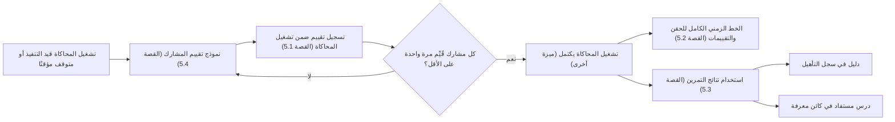

# تقييم المشاركين ونتائج التمرين

<!-- BEGIN GENERATED: doc -->
| البند | القيمة |
|---|---|
| المعرّف | FEAT-RES-EXERCISE-EVALUATION |
| الإصدار | 0.2 |
| الحالة | مسودة |
| القدرة | CAP-08 الموارد والجاهزية |
| القدرة الفرعية | CAP-08.05 التدريب والتمارين (R3) |
| الأدوار | مقيّم التمرين؛ مدير التدريب |
| الشاشات | SCR-48 التمارين والسيناريوهات والمحاكاة والجاهزية |
| حالات الاستخدام | UC-162، UC-163 |
| القصص | 4: 2 من المواصفة، و2 جديدة |
<!-- END GENERATED: doc -->

## 1. نظرة عامة

### 1.1 القيمة

يقيّم المقيّم أداء كل مشارك في كل كفاءة، وتُستخدم النتائج دليلًا على التأهيل ودروسًا مستفادة.

### 1.2 النطاق

| البند | القيمة |
|---|---|
| المستخدمون | مقيّم التمرين؛ مدير الموارد ومدير التدريب (استخدام النتيجة دليل تأهيل)؛ مدير المعرفة (استخدامها درسًا مستفادًا) |
| الشاشات | SCR-48 التمارين والسيناريوهات والمحاكاة والجاهزية |
| حالات الاستخدام (بالكلمات) | تسجيل تقييم مشارك بكفاءة محددة أثناء تشغيل المحاكاة؛ عرض الخط الزمني الكامل لتسليم الحقن والتقييمات؛ الاستشهاد بتشغيل محاكاة مكتمل دليلاً في سجل التأهيل أو مصدرًا لدرس مستفاد |
| المتطلبات (بالكلمات) | تقييم واحد على الأقل لكل مشارك وكفاءة، دائمًا بمقيّم غير المشارك نفسه؛ لا يكتمل تشغيل المحاكاة إلا بعد تقييم كل مشارك في التمرين مرة واحدة على الأقل؛ الاستشهاد بالمحاكاة المكتملة في سجل التأهيل أو في كائن المعرفة دون أي تغيير في مخطط بياناتهما |
| خارج النطاق | تخطيط التمرين وجدولته وإلغاؤه وبدؤه (ميزة «تخطيط التمارين وجدولتها»)؛ بدء تشغيل المحاكاة وتسليم الحقن وإيقافه مؤقتًا واستئنافه وإكماله وإلغاؤه (ميزة أخرى من AGG-SIMULATION)؛ إنشاء كائن المعرفة نفسه بتفاصيله (قدرة المعرفة والذاكرة المؤسسية) |

### 1.3 خريطة الميزة

**الشكل 1: من تسجيل التقييم إلى استخدام نتائج التمرين**



## 2. القواعد المشتركة

تنطبق على كل قصص الميزة، فلا تتكرر داخل القصص. وكل قصة تذكر ما يخصها فقط.

### 2.1 السياق المشترك

كل قصة تبدأ من ثلاثة شروط: مستأجر نشط، وحزمة السياسات الأساسية مفعّلة، ومستخدم مسجّل الدخول ومخوَّل. وتشير إليها القصص بخطوة واحدة: «بفرض السياق المشترك للميزة».

### 2.2 الصلاحية وعدم الإفصاح

- من لا يحق له رؤية العنصر يتلقى ردًا بشكل «غير متاح» تمامًا، فلا يعرف أنه موجود.
- من يرى العنصر ولا يحق له الإجراء يتلقى «لا تملك صلاحية هذا الإجراء».

### 2.3 أوامر تغيير الحالة

- **منع التكرار:** يُرسل كل أمر بمفتاح فريد، فإعادة الطلب نفسه لا تُنفَّذ مرتين.
- **حماية التعديل المتزامن:** يُرسل كل أمر بإصدار البيانات الذي يراه المستخدم. فإن عدّلها غيره في الأثناء، يُرفض الأمر.
- **السجل:** إن نجح الأمر، يُكتب حدثه وسجل التدقيق في المعاملة نفسها.

### 2.4 الرفض المشترك

```gherkin
# language: ar
خاصية: الرفض المشترك لأوامر الميزة

  سيناريو مخطط: رفض مشترك لكل أمر في الميزة
    بفرض السياق المشترك للميزة
    و <الحالة>
    عندما يُرسل المستخدم أي أمر من أوامر الميزة
    اذاً يُرفض برمز <الرمز> ويرى "<الرسالة>"
    و لا يتغير شيء

    امثلة:
      | الحالة                                  | الرمز                  | الرسالة                                                 |
      | العنصر خارج صلاحياته                    | NOT_FOUND              | غير متاح                                                |
      | العنصر مرئي له ولا يحق له الإجراء       | AUTHZ_DENIED           | لا تملك صلاحية هذا الإجراء                              |
      | غيره عدّل العنصر بعد أن فتحه            | VERSION_CONFLICT       | تغيّرت البيانات منذ فتحتها. راجع التغييرات ثم أعد المحاولة |
      | أعاد مفتاح منع التكرار بمحتوى مختلف     | IDEMPOTENCY_KEY_REUSED | طلب مكرر بمحتوى مختلف                                   |
      | البيانات ناقصة أو غير صحيحة             | VALIDATION_FAILED      | بعض البيانات ناقصة أو غير صحيحة. راجع الحقول المعلَّمة      |

  سيناريو: إعادة الطلب نفسه لا تُنفَّذ مرتين
    بفرض السياق المشترك للميزة
    و أمر نجح بمفتاح منع تكرار
    عندما يُعاد الطلب نفسه بالمفتاح نفسه
    اذاً تُعاد النتيجة الأولى ولا يُكتب حدث ثانٍ
```

## 3. الجودة وتعريف الاكتمال

### 3.1 متطلبات الجودة

<!-- BEGIN GENERATED: quality -->
لا متطلبات جودة مرتبطة بمتطلبات هذه الميزة مباشرة. تنطبق متطلبات المنصة العامة (`FEAT-PLT-*`).
<!-- END GENERATED: quality -->

### 3.2 تعريف الاكتمال

القصة مكتملة حين تتحقق الشروط الخمسة:

1. سيناريوهاتها والقواعد المشتركة تمر في الاختبار الآلي.
2. فحوص البنية المعمارية تمر.
3. نصوص الواجهة والرسائل موجودة بالعربية والإنجليزية.
4. مراجعة الكود مكتملة.
5. ما تضيفه القصة نفسها في قسم «القواعد» تحقق.

## 4. فهرس القصص

<!-- BEGIN GENERATED: story-index -->
| المعرّف | القصة | النوع | الحالة |
|---|---|---|---|
| `US-BC05-SIM-RECORD-EVALUATION` | تسجيل تقييم ضمن تشغيل المحاكاة | أمر | مسودة |
| `US-BC05-Q-SIM-TIMELINE` | جلب: Full, ordered timeline of inject deliveries and evaluations for a simulation | جلب | مسودة |
| `US-UI-SCR48-APPLY-RESULTS` | استخدام نتائج التمرين دليل تأهيل ودرسًا مستفادًا | واجهة | مسودة |
| `US-UI-SCR48-EVALUATION-FORM` | نموذج تقييم المشارك لكل كفاءة | واجهة | مسودة |
<!-- END GENERATED: story-index -->

## 5. القصص

### 5.1 US-BC05-SIM-RECORD-EVALUATION — تسجيل تقييم ضمن تشغيل المحاكاة

| النوع | الإصدار | الأولوية | دون اتصال | الحالة |
|---|---|---|---|---|
| أمر | R3 | Must | لا | مسودة |

> **كـ** مقيّم التمرين، **أريد** أن أسجّل تقييم أداء مشارك في كفاءة محددة ضمن تشغيل المحاكاة الجاري، **حتى** تُحفظ نتيجته دليلاً موثقًا يُستخدم لاحقًا في تأهيله أو في الدروس المستفادة.

**باختصار:** المقيّم يسجّل لكل مشارك وكفاءة نتيجة واحدة من ثلاث (مستوفى، جزئي، غير مستوفى) مع ملاحظة اختيارية، ولا يقيّم نفسه، ولا تتغير حالة تشغيل المحاكاة بذلك.

#### القواعد

- **متى يُسمح:** تشغيل المحاكاة «قيد التنفيذ» أو «متوقف مؤقتًا».
- **من يُسمح له:** مقيّم التمرين، على ألا يكون هو نفسه المشارك الذي يُقيَّم (فصل المهام).
- **البيانات:** المشارك (من مشاركي التمرين المرتبط)، رمز الكفاءة من قاموس الكفاءات المعتمد، النتيجة، ملاحظة اختيارية.
- **الأثر:** يُسجَّل حدث «سُجِّل تقييم المشارك» دون تغيير حالة تشغيل المحاكاة. وتشغيل المحاكاة لا يكتمل (بقصة أخرى) إلا بعد أن ينال كل مشارك في التمرين تقييمًا واحدًا على الأقل.

#### معايير القبول

```gherkin
# language: ar
خاصية: تسجيل تقييم ضمن تشغيل المحاكاة

  سيناريو: المقيّم يسجّل تقييم مشارك
    بفرض السياق المشترك للميزة
    و تشغيل محاكاة "قيد التنفيذ" له مشارك ضمن مشاركي التمرين المرتبط
    عندما يسجّل المقيّم نتيجة "مستوفى" للمشارك في كفاءة محددة
    اذاً تبقى حالة تشغيل المحاكاة دون تغيير
    و يُسجَّل حدث "سُجِّل تقييم المشارك"

  سيناريو مخطط: رفض خاص بتسجيل التقييم
    بفرض السياق المشترك للميزة
    و <الحالة>
    عندما يحاول المقيّم تسجيل التقييم
    اذاً يُرفض برمز <الرمز> ويرى <الرسالة>

    امثلة:
      | الحالة                                   | الرمز                             | الرسالة                                           |
      | المقيّم هو المشارك نفسه                  | SEGREGATION_OF_DUTIES             | لا يجوز أن يعتمد الشخص نفسه ما قدّمه أو طلبه      |
      | تشغيل المحاكاة "مكتمل" أو "متوقف نهائيًا" | SIMULATION_INVALID_STATE_TRANSITION | الوضع الحالي لتشغيل المحاكاة لا يسمح بهذا الإجراء |
```

<details><summary>المراجع التقنية والتتبع</summary>

<!-- BEGIN GENERATED: refs US-BC05-SIM-RECORD-EVALUATION -->
| البند | المعرّف | المعنى |
|---|---|---|
| الواجهة البرمجية | `POST /api/v1/readiness/simulations/{id}/actions/record-evaluation` | — |
| الأمر | `CMD-SIM-RECORD-EVALUATION` | تسجيل تقييم ضمن تشغيل المحاكاة |
| السياسة | `POL-SIM-RECORD-EVALUATION` | Evaluator؛ tenant match; evaluator ≠ participant (INV-SIM-03) |
| الحدث | `EVT-SIM-EVALUATION-RECORDED` | يصل إلى: Qualification Record (optional evidence source, SLC-03 — unmodified, evidence:urn already generic);… |
| الكيان | `AGG-SIMULATION` | تشغيل المحاكاة |
| الجدول | `readiness.simulations` | الجدول الرئيسي لتشغيل المحاكاة |
| وحدة النشر | DU-14 | — |
| المتطلبات | REQ-TRX-008، REQ-TRX-009، REQ-TRX-010، REQ-TRX-011 | معانيها في القسم 6. التتبع |
| حالة الاستخدام | UC-162 | Conduct Exercise Simulation |
| الاختبار | TST-SIMULATION-SM، TST-SLC19-INVARIANTS | دورة حالات تشغيل المحاكاة، وثوابت الشريحة SLC-19 |
<!-- END GENERATED: refs US-BC05-SIM-RECORD-EVALUATION -->

</details>

### 5.2 US-BC05-Q-SIM-TIMELINE — جلب: Full, ordered timeline of inject deliveries and evaluations for a simulation

| النوع | الإصدار | الأولوية | دون اتصال | الحالة |
|---|---|---|---|---|
| جلب | R3 | Should | لا | مسودة |

> **كـ** مستخدم مخوَّل على تشغيل المحاكاة، **أريد** الخط الزمني الكامل المرتب لتسليم الحقن والتقييمات، **حتى** أراجع ما جرى في التمرين بترتيبه الفعلي.

**باختصار:** تُعاد أحداث تسليم الحقن والتقييمات مرتبة زمنيًا صفحةً بعد صفحة، ولا يكشف الرد وجود عناصر خارج نطاق المستخدم.

#### القواعد

- **من يرى ماذا:** من يقع تشغيل المحاكاة ضمن نطاقه المسموح فقط.
- **البيانات:** المؤشر والحد.

#### معايير القبول

```gherkin
# language: ar
خاصية: الخط الزمني لتشغيل المحاكاة

  سيناريو: يرى المستخدم الخط الزمني الكامل لمحاكاة ضمن نطاقه
    بفرض السياق المشترك للميزة
    و تشغيل محاكاة ضمن نطاقه له حقن وتقييمات مسجَّلة
    عندما يطلب الخط الزمني للمحاكاة
    اذاً تُعاد الأحداث مرتبة زمنيًا من الأقدم إلى الأحدث
    و لا يكشف أي عدد أو اقتراح وجود عنصر محجوب

  سيناريو: الصفحة التالية من الخط الزمني
    بفرض السياق المشترك للميزة
    و خط زمني أطول من صفحة واحدة
    عندما يطلب الصفحة التالية بالمؤشر
    اذاً تُعاد الأحداث التالية دون تكرار ولا فجوة
```

<details><summary>المراجع التقنية والتتبع</summary>

<!-- BEGIN GENERATED: refs US-BC05-Q-SIM-TIMELINE -->
| البند | المعرّف | المعنى |
|---|---|---|
| الواجهة البرمجية | `GET /api/v1/readiness/simulations/{simulation_id}/timeline` | — |
| الاستعلام | `QRY-SIM-TIMELINE` | Full, ordered timeline of inject deliveries and evaluations for a simulation |
| السياسة | `POL-SIM-TIMELINE` | allowed_scope |
| الكيان | `AGG-SIMULATION` | تشغيل المحاكاة |
| الجدول | `readiness.simulations` | الجدول الرئيسي لتشغيل المحاكاة |
| وحدة النشر | DU-14 | — |
| المتطلب | REQ-TRX-015 | The system shall provide the full, ordered timeline of inject deliveries and evaluations for a simulation run… |
| حالة الاستخدام | UC-162 | Conduct Exercise Simulation |
| الاختبار | TST-SIMULATION-SM، TST-SLC19-INVARIANTS | دورة حالات تشغيل المحاكاة، وثوابت الشريحة SLC-19 |
<!-- END GENERATED: refs US-BC05-Q-SIM-TIMELINE -->

</details>

### 5.3 US-UI-SCR48-APPLY-RESULTS — استخدام نتائج التمرين دليل تأهيل ودرسًا مستفادًا

| النوع | الإصدار | الأولوية | دون اتصال | الحالة |
|---|---|---|---|---|
| واجهة | R3 | Should | لا | مسودة |

> **كـ** مدير الموارد أو مدير التدريب، **أريد** أن أستشهد بتشغيل محاكاة مكتمل دليلاً عند تسجيل أو تجديد سجل تأهيل، **حتى** أستثمر نتائج التمرين في الجاهزية دون تكرار العمل.

**باختصار:** شاشة التمرين تعرض على تشغيل محاكاة مكتمل رابطين: استخدامه دليل تأهيل، واستخدامه مصدرًا لدرس مستفاد، وكل منهما يفتح نموذج القصة المعنية مع مرجع المحاكاة معبَّأً مسبقًا في حقل الدليل أو المصدر الموجود أصلًا.

> **ملاحظة [Derived]:** المصدر (REQ-TRX-012، REQ-TRX-013) يذكر أن سجل التأهيل وكائن المعرفة يمكنهما الاستشهاد بمحاكاة مكتملة دون تغيير مخطط بياناتهما، ولا يصف شاشة أو رابطًا بعينه؛ فافترضنا هذا العرض على شاشة التمارين.

#### القواعد

- **متى يحدث:** تشغيل المحاكاة «مكتمل» فقط.
- **من يُسمح له:** مدير الموارد أو مدير التدريب لاستخدامها دليل تأهيل؛ مدير المعرفة لاستخدامها درسًا مستفادًا.
- **الأثر:** يُمرَّر مرجع تشغيل المحاكاة إلى حقل الدليل الموجود في سجل التأهيل، أو حقل المصدر الموجود في كائن المعرفة من نوع درس، دون أي حقل جديد في أي منهما.

#### معايير القبول

```gherkin
# language: ar
خاصية: استخدام نتائج التمرين

  سيناريو: فتح نموذج سجل التأهيل من تشغيل محاكاة مكتمل
    بفرض السياق المشترك للميزة
    و تشغيل محاكاة "مكتمل" ضمن نطاق مدير الموارد
    عندما يختار استخدامه دليل تأهيل
    اذاً يُفتح نموذج سجل التأهيل بمرجع تشغيل المحاكاة معبَّأً في حقل الدليل

  سيناريو: لا يظهر الرابط قبل اكتمال المحاكاة
    بفرض السياق المشترك للميزة
    و تشغيل محاكاة "قيد التنفيذ" أو "متوقف مؤقتًا"
    عندما يفتح المستخدم شاشته
    اذاً لا يظهر رابط استخدام النتائج
    و لا يتغير شيء
```

<details><summary>المراجع التقنية والتتبع</summary>

<!-- BEGIN GENERATED: refs US-UI-SCR48-APPLY-RESULTS -->
| البند | المعرّف | المعنى |
|---|---|---|
| الشاشة | SCR-48 | شاشة التمارين والسيناريوهات والمحاكاة والجاهزية |
| حالة الاستخدام | UC-163 | Apply Exercise Results |
| المصدر | `[Derived]` | — |
| المتطلبات | REQ-TRX-012، REQ-TRX-013 | معانيها في القسم 6. التتبع |
| حالة الاستخدام | UC-163 | Apply Exercise Results |
<!-- END GENERATED: refs US-UI-SCR48-APPLY-RESULTS -->

</details>

### 5.4 US-UI-SCR48-EVALUATION-FORM — نموذج تقييم المشارك لكل كفاءة

| النوع | الإصدار | الأولوية | دون اتصال | الحالة |
|---|---|---|---|---|
| واجهة | R3 | Must | لا | مسودة |

> **كـ** مقيّم التمرين، **أريد** نموذجًا يسرد كل مشارك وكفاءته المطلوبة ضمن تشغيل المحاكاة الجاري، **حتى** أسجّل تقييم كل كفاءة بسهولة دون أن أفوّت مشاركًا.

**باختصار:** النموذج يسرد المشاركين وكفاءاتهم، ويعلّم من قُيِّم بالفعل، ويستبعد المقيّم نفسه من قائمة من يمكن تقييمهم.

> **ملاحظة [Derived]:** المصدر (REQ-TRX-009) يذكر وجوب تسجيل تقييم لكل مشارك وكفاءة بمقيّم مختلف، ولا يصف شكل النموذج؛ فافترضنا هذا العرض على شاشة التمرين.

#### القواعد

- **متى يحدث:** تشغيل المحاكاة «قيد التنفيذ» أو «متوقف مؤقتًا».
- **من يُسمح له:** مقيّم التمرين.
- **الأثر:** كل إدخال في النموذج يرسل أمر تسجيل التقييم (القصة 5.1)، ويحدّث علامة «قُيِّم» في النموذج فور النجاح.

#### معايير القبول

```gherkin
# language: ar
خاصية: نموذج تقييم المشارك

  سيناريو: عرض المشاركين وكفاءاتهم مع من قُيِّم
    بفرض السياق المشترك للميزة
    و تشغيل محاكاة "قيد التنفيذ" له مشاركون منهم من قُيِّم بالفعل
    عندما يفتح المقيّم نموذج التقييم
    اذاً يرى كل مشارك وكفاءته، وعلامة «قُيِّم» على من سجّل له تقييم

  سيناريو: المقيّم مستبعد من قائمة من يمكن تقييمهم
    بفرض السياق المشترك للميزة
    و المقيّم أحد مشاركي التمرين نفسه
    عندما يفتح نموذج التقييم
    اذاً لا يظهر اسمه في قائمة المشاركين القابلين للتقييم
```

<details><summary>المراجع التقنية والتتبع</summary>

<!-- BEGIN GENERATED: refs US-UI-SCR48-EVALUATION-FORM -->
| البند | المعرّف | المعنى |
|---|---|---|
| الشاشة | SCR-48 | شاشة التمارين والسيناريوهات والمحاكاة والجاهزية |
| المصدر | `[Derived]` | — |
| المتطلب | REQ-TRX-009 | A simulation run shall record a per-participant, per-competency evaluation, always by an evaluator distinct f… |
| حالة الاستخدام | UC-162 | Conduct Exercise Simulation |
<!-- END GENERATED: refs US-UI-SCR48-EVALUATION-FORM -->

</details>

## 6. التتبع

<!-- BEGIN GENERATED: trace -->
| المتطلب | المعنى | القصص | الاختبار |
|---|---|---|---|
| REQ-TRX-008 | A simulation run shall record inject deliveries as an append-only, strictly time-ordered log. | `US-BC05-SIM-RECORD-EVALUATION` | TST-SIMULATION-SM |
| REQ-TRX-009 | A simulation run shall record a per-participant, per-competency evaluation, always by an evaluator distinct f… | `US-BC05-SIM-RECORD-EVALUATION`، `US-UI-SCR48-EVALUATION-FORM` | TST-SIMULATION-SM |
| REQ-TRX-010 | A simulation run shall reach COMPLETED only when every participant listed on its linked exercise has at least… | `US-BC05-SIM-RECORD-EVALUATION` | TST-SIMULATION-SM، TST-SLC19-INVARIANTS |
| REQ-TRX-011 | A simulation run shall be pausable and resumable, or abortable with a reason, without losing any previously r… | `US-BC05-SIM-RECORD-EVALUATION` | TST-SIMULATION-SM |
| REQ-TRX-012 | A person's qualification record shall be able to cite a completed simulation run as evidence, using the exist… | `US-UI-SCR48-APPLY-RESULTS` | TST-SLC19-INVARIANTS |
| REQ-TRX-013 | A completed simulation run shall be usable as the terminal source of an After Action Review, captured as a le… | `US-UI-SCR48-APPLY-RESULTS` | TST-SLC19-INVARIANTS |
| REQ-TRX-015 | The system shall provide the full, ordered timeline of inject deliveries and evaluations for a simulation run… | `US-BC05-Q-SIM-TIMELINE` | — |
<!-- END GENERATED: trace -->

## 7. سجل التغييرات

| الإصدار | التاريخ | التغيير |
|---|---|---|
| 0.1 | — | هيكل مولَّد من خريطة الميزات |
| 0.2 | 2026-10-13 | كتابة القصص كاملة بمعيار القصص |
