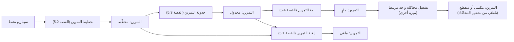
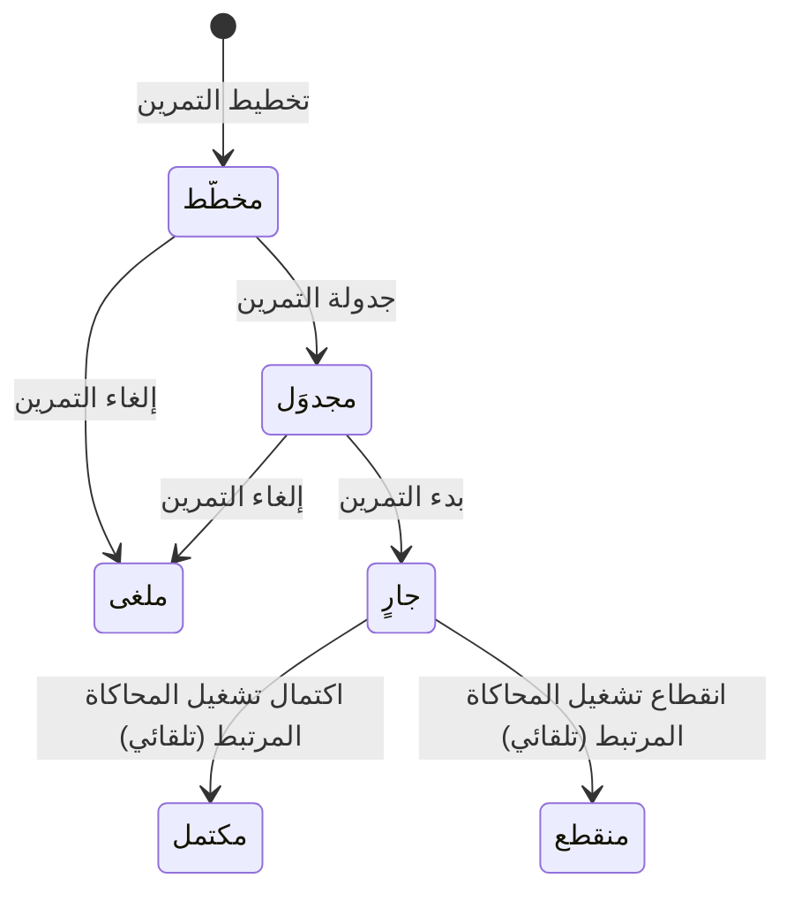

# تخطيط التمارين وجدولتها

<!-- BEGIN GENERATED: doc -->
| البند | القيمة |
|---|---|
| المعرّف | FEAT-RES-EXERCISE-PLANNING |
| الإصدار | 0.3 |
| الحالة | مسودة |
| القدرة | CAP-08 الموارد والجاهزية |
| القدرة الفرعية | CAP-08.05 التدريب والتمارين (R3) |
| الأدوار | مدير التمرين؛ مدير التدريب |
| الشاشات | SCR-48 التمارين والسيناريوهات والمحاكاة والجاهزية |
| حالات الاستخدام | UC-161 |
| القصص | 9: 6 من المواصفة، و3 جديدة |
<!-- END GENERATED: doc -->

## 1. نظرة عامة

### 1.1 القيمة

يخطط مدير التمرين للتمرين ويحدد موعده ومكانه ومشاركيه ثم يطلقه في وقته.

### 1.2 النطاق

| البند | القيمة |
|---|---|
| المستخدمون | مدير التمرين (مدير التدريب) |
| الشاشات | SCR-48 التمارين والسيناريوهات والمحاكاة والجاهزية |
| حالات الاستخدام (بالكلمات) | تخطيط تمرين جديد بالاستشهاد بسيناريو نشط؛ جدولته بموعد ومكان ومشاركين مؤكَّدين؛ بدؤه فينشأ تشغيل محاكاة واحد مرتبط به؛ إلغاؤه قبل أن يبدأ؛ عرض التمرين وقائمة التمارين؛ اشتقاق تصنيف التمرين والسيناريو والمحاكاة |
| المتطلبات (بالكلمات) | التمرين لا يُخطَّط إلا على سيناريو نشط لحظة التخطيط، ومرجعه يبقى ثابتًا طوال حياة التمرين؛ لا يبدأ إلا بموعد صحيح ومكان ومشاركين مؤكَّدين؛ بدؤه ينشئ تشغيل محاكاة واحدًا بالضبط في المعاملة نفسها؛ نتيجته النهائية (مكتمل أو ملغى) يحددها تشغيل المحاكاة المرتبط وحده؛ يُلغى بسبب قبل أن يبدأ، ولا يُلغى بعد أن يصبح جاريًا؛ يرى المستخدم المخوَّل التمارين ضمن نطاقه فقط |
| خارج النطاق | إدارة تشغيل المحاكاة نفسه بعد بدئه: تسليم الحقن، الإيقاف المؤقت، الاستئناف، الإكمال، الإلغاء (ميزة أخرى من AGG-SIMULATION)؛ تسجيل التقييمات واستخدام نتائج التمرين (ميزة «تقييم المشاركين ونتائج التمرين»)؛ إنشاء السيناريو نفسه وتحريره (ميزة سيناريوهات التدريب) |

### 1.3 خريطة الميزة

**الشكل 1: من تخطيط التمرين إلى تشغيل المحاكاة**



**الشكل 2: دورة حالات التمرين**



## 2. القواعد المشتركة

تنطبق على كل قصص الميزة، فلا تتكرر داخل القصص. وكل قصة تذكر ما يخصها فقط.

### 2.1 السياق المشترك

كل قصة تبدأ من ثلاثة شروط: مستأجر نشط، وحزمة السياسات الأساسية مفعّلة، ومستخدم مسجّل الدخول ومخوَّل. وتشير إليها القصص بخطوة واحدة: «بفرض السياق المشترك للميزة».

### 2.2 الصلاحية وعدم الإفصاح

- من لا يحق له رؤية العنصر يتلقى ردًا بشكل «غير متاح» تمامًا، فلا يعرف أنه موجود.
- من يرى العنصر ولا يحق له الإجراء يتلقى «لا تملك صلاحية هذا الإجراء».

### 2.3 أوامر تغيير الحالة

- **منع التكرار:** يُرسل كل أمر بمفتاح فريد، فإعادة الطلب نفسه لا تُنفَّذ مرتين.
- **حماية التعديل المتزامن:** يُرسل كل أمر بإصدار البيانات الذي يراه المستخدم. فإن عدّلها غيره في الأثناء، يُرفض الأمر.
- **السجل:** إن نجح الأمر، يُكتب حدثه وسجل التدقيق في المعاملة نفسها.

### 2.4 الرفض المشترك

```gherkin
# language: ar
خاصية: الرفض المشترك لأوامر الميزة

  سيناريو مخطط: رفض مشترك لكل أمر في الميزة
    بفرض السياق المشترك للميزة
    و <الحالة>
    عندما يُرسل المستخدم أي أمر من أوامر الميزة
    اذاً يُرفض برمز <الرمز> ويرى "<الرسالة>"
    و لا يتغير شيء

    امثلة:
      | الحالة                                  | الرمز                  | الرسالة                                                 |
      | العنصر خارج صلاحياته                    | NOT_FOUND              | غير متاح                                                |
      | العنصر مرئي له ولا يحق له الإجراء       | AUTHZ_DENIED           | لا تملك صلاحية هذا الإجراء                              |
      | غيره عدّل العنصر بعد أن فتحه            | VERSION_CONFLICT       | تغيّرت البيانات منذ فتحتها. راجع التغييرات ثم أعد المحاولة |
      | أعاد مفتاح منع التكرار بمحتوى مختلف     | IDEMPOTENCY_KEY_REUSED | طلب مكرر بمحتوى مختلف                                   |
      | البيانات ناقصة أو غير صحيحة             | VALIDATION_FAILED      | بعض البيانات ناقصة أو غير صحيحة. راجع الحقول المعلَّمة      |

  سيناريو: إعادة الطلب نفسه لا تُنفَّذ مرتين
    بفرض السياق المشترك للميزة
    و أمر نجح بمفتاح منع تكرار
    عندما يُعاد الطلب نفسه بالمفتاح نفسه
    اذاً تُعاد النتيجة الأولى ولا يُكتب حدث ثانٍ
```

## 3. الجودة وتعريف الاكتمال

### 3.1 متطلبات الجودة

<!-- BEGIN GENERATED: quality -->
لا متطلبات جودة مرتبطة بمتطلبات هذه الميزة مباشرة. تنطبق متطلبات المنصة العامة (`FEAT-PLT-*`).
<!-- END GENERATED: quality -->

### 3.2 تعريف الاكتمال

القصة مكتملة حين تتحقق الشروط الخمسة:

1. سيناريوهاتها والقواعد المشتركة تمر في الاختبار الآلي.
2. فحوص البنية المعمارية تمر.
3. نصوص الواجهة والرسائل موجودة بالعربية والإنجليزية.
4. مراجعة الكود مكتملة.
5. ما تضيفه القصة نفسها في قسم «القواعد» تحقق.

## 4. فهرس القصص

<!-- BEGIN GENERATED: story-index -->
| المعرّف | القصة | النوع | الحالة |
|---|---|---|---|
| `US-BC05-EXR-CANCEL` | إلغاء التمرين | أمر | مسودة |
| `US-BC05-EXR-PLAN` | تخطيط التمرين | أمر | مسودة |
| `US-BC05-EXR-SCHEDULE` | جدولة التمرين | أمر | مسودة |
| `US-BC05-EXR-START` | بدء التمرين | أمر | مسودة |
| `US-BC05-Q-EXR-GET` | جلب: Exercise with frozen scenario reference, participants, current state | جلب | مسودة |
| `US-BC05-Q-EXR-LIST` | جلب: Exercises filtered by scenario, state, window | جلب | مسودة |
| `US-DOM-TRX-LABEL` | اشتقاق تصنيف السيناريو والتمرين والمحاكاة | نظام | مسودة |
| `US-UI-SCR48-EXERCISE-CALENDAR` | تقويم التمارين حسب الحالة والموعد | واجهة | مسودة |
| `US-UI-SCR48-EXERCISE-SETUP` | تجهيز التمرين وزر البدء حسب الجاهزية | واجهة | مسودة |
<!-- END GENERATED: story-index -->

## 5. القصص

### 5.1 US-BC05-EXR-CANCEL — إلغاء التمرين

| النوع | الإصدار | الأولوية | دون اتصال | الحالة |
|---|---|---|---|---|
| أمر | R3 | Must | لا | مسودة |

> **كـ** مدير التمرين، **أريد** إلغاء التمرين قبل أن يبدأ، **حتى** لا يُنفَّذ تمرين لم يعد مطلوبًا.

**باختصار:** يلغي مدير التمرين التمرين «المخطَّط» أو «المجدوَل» بذكر سبب، فيصبح «ملغى»، ولا يُلغى بعد أن يصير «جاريًا».

#### القواعد

- **متى يُسمح:** التمرين «مخطَّط» أو «مجدوَل»، ولم يبدأ.
- **من يُسمح له:** مدير التمرين.
- **البيانات:** سبب الإلغاء (إلزامي).
- **الأثر:** يُسجَّل حدث «أُلغي التمرين».

#### معايير القبول

```gherkin
# language: ar
خاصية: إلغاء التمرين

  سيناريو: مدير التمرين يلغي تمرينًا مجدوَلًا
    بفرض السياق المشترك للميزة
    و تمرين "مجدوَل" لم يبدأ
    عندما يلغيه مدير التمرين بسبب
    اذاً تصبح حالته "ملغى"
    و يُسجَّل حدث "أُلغي التمرين"

  سيناريو مخطط: رفض خاص بالإلغاء
    بفرض السياق المشترك للميزة
    و <الحالة>
    عندما يحاول مدير التمرين إلغاء التمرين
    اذاً يُرفض برمز <الرمز> ويرى <الرسالة>

    امثلة:
      | الحالة                         | الرمز                          | الرسالة                                     |
      | التمرين "جارٍ" أو انتهى بحالة نهائية | EXERCISE_INVALID_STATE_TRANSITION | الوضع الحالي للتمرين لا يسمح بهذا الإجراء |
      | لم يُذكر سبب الإلغاء           | REASON_REQUIRED                | اذكر السبب                                  |
```

<details><summary>المراجع التقنية والتتبع</summary>

<!-- BEGIN GENERATED: refs US-BC05-EXR-CANCEL -->
| البند | المعرّف | المعنى |
|---|---|---|
| الواجهة البرمجية | `POST /api/v1/readiness/exercises/{id}/actions/cancel` | — |
| الأمر | `CMD-EXR-CANCEL` | إلغاء التمرين |
| السياسة | `POL-EXR-CANCEL` | Exercise Director / Training Manager؛ tenant match |
| الحدث | `EVT-EXR-CANCELLED` | يصل إلى: Search projection (SLC-05) |
| الكيان | `AGG-EXERCISE` | التمرين |
| الجدول | `readiness.exercises` | الجدول الرئيسي للتمرين |
| وحدة النشر | DU-14 | — |
| المتطلبات | REQ-TRX-003، REQ-TRX-004، REQ-TRX-005، REQ-TRX-006، REQ-TRX-007 | معانيها في القسم 6. التتبع |
| حالة الاستخدام | UC-161 | Plan & Schedule Exercise |
| الاختبار | TST-EXERCISE-SM، TST-SLC19-INVARIANTS | دورة حالات التمرين، وثوابت الشريحة SLC-19 |
<!-- END GENERATED: refs US-BC05-EXR-CANCEL -->

</details>

### 5.2 US-BC05-EXR-PLAN — تخطيط التمرين

| النوع | الإصدار | الأولوية | دون اتصال | الحالة |
|---|---|---|---|---|
| أمر | R3 | Must | لا | مسودة |

> **كـ** مدير التمرين، **أريد** تخطيط تمرين جديد على سيناريو محدَّد، **حتى** أحدِّد هدفه ومشاركيه قبل جدولته.

**باختصار:** يختار مدير التمرين سيناريو «نشطًا» ويحدِّد الأهداف والمشاركين والغرض، فيُنشأ التمرين «مخطَّطًا» ومرجع السيناريو يبقى ثابتًا بعد ذلك ولو تغيّر السيناريو نفسه.

#### القواعد

- **متى يُسمح:** لا تمرين سابق بهذه البيانات؛ السيناريو «نشط» لحظة التخطيط ومرئي لمدير التمرين.
- **من يُسمح له:** مدير التمرين.
- **البيانات:** السيناريو، الأهداف، المشاركون، الغرض (تدريب، تأهيل، تقييم)، ومتطلب الدور عند وجوده.
- **الأثر:** يُسجَّل حدث «خُطِّط التمرين»، ويتجمَّد مرجع السيناريو طوال حياة التمرين.

#### معايير القبول

```gherkin
# language: ar
خاصية: تخطيط التمرين

  سيناريو: تخطيط تمرين على سيناريو نشط
    بفرض السياق المشترك للميزة
    و سيناريو "نشط" مرئي لمدير التمرين
    عندما يخطّط مدير التمرين تمرينًا على هذا السيناريو بأهداف ومشاركين وغرض
    اذاً تصبح حالة التمرين "مخطَّط"
    و يُسجَّل حدث "خُطِّط التمرين" مع تجميد مرجع السيناريو

  سيناريو مخطط: رفض خاص بالتخطيط
    بفرض السياق المشترك للميزة
    و <الحالة>
    عندما يحاول مدير التمرين تخطيط التمرين
    اذاً يُرفض برمز <الرمز> ويرى <الرسالة>

    امثلة:
      | الحالة                                    | الرمز            | الرسالة                                                       |
      | السيناريو "مسودة" أو "ملغى" وليس "نشطًا"  | EXERCISE_INVALID | بيانات التمرين غير مكتملة                                     |
```

<details><summary>المراجع التقنية والتتبع</summary>

<!-- BEGIN GENERATED: refs US-BC05-EXR-PLAN -->
| البند | المعرّف | المعنى |
|---|---|---|
| الواجهة البرمجية | `POST /api/v1/readiness/exercises` | — |
| الأمر | `CMD-EXR-PLAN` | تخطيط التمرين |
| السياسة | `POL-EXR-PLAN` | Exercise Director / Training Manager؛ tenant match; scenario ACTIVE and visible to actor |
| الحدث | `EVT-EXR-PLANNED` | يصل إلى: Search projection (SLC-05) |
| الكيان | `AGG-EXERCISE` | التمرين |
| الجدول | `readiness.exercises` | الجدول الرئيسي للتمرين |
| وحدة النشر | DU-14 | — |
| المتطلبات | REQ-TRX-003، REQ-TRX-004، REQ-TRX-005، REQ-TRX-006، REQ-TRX-007 | معانيها في القسم 6. التتبع |
| حالة الاستخدام | UC-161 | Plan & Schedule Exercise |
| الاختبار | TST-EXERCISE-SM، TST-SLC19-INVARIANTS | دورة حالات التمرين، وثوابت الشريحة SLC-19 |
<!-- END GENERATED: refs US-BC05-EXR-PLAN -->

</details>

### 5.3 US-BC05-EXR-SCHEDULE — جدولة التمرين

| النوع | الإصدار | الأولوية | دون اتصال | الحالة |
|---|---|---|---|---|
| أمر | R3 | Must | لا | مسودة |

> **كـ** مدير التمرين، **أريد** جدولة التمرين بموعد ومكان ومشاركين مؤكَّدين، **حتى** يصبح جاهزًا للبدء في وقته.

**باختصار:** بعد تخطيط التمرين يحدِّد مدير التمرين النافذة الزمنية والمكان ويؤكِّد المشاركين، فتصير حالته «مجدوَلة».

#### القواعد

- **متى يُسمح:** التمرين «مخطَّط».
- **من يُسمح له:** مدير التمرين.
- **البيانات:** النافذة الزمنية (بدايتها قبل نهايتها)، المكان، المشاركون المؤكَّدون.
- **الأثر:** يُسجَّل حدث «جُدِول التمرين».

#### معايير القبول

```gherkin
# language: ar
خاصية: جدولة التمرين

  سيناريو: جدولة تمرين مخطَّط
    بفرض السياق المشترك للميزة
    و تمرين "مخطَّط"
    عندما يجدوله مدير التمرين بنافذة زمنية صحيحة ومكان ومشاركين مؤكَّدين
    اذاً تصبح حالته "مجدوَل"
    و يُسجَّل حدث "جُدِول التمرين"

  سيناريو مخطط: رفض خاص بالجدولة
    بفرض السياق المشترك للميزة
    و <الحالة>
    عندما يحاول مدير التمرين جدولة التمرين
    اذاً يُرفض برمز <الرمز> ويرى <الرسالة>

    امثلة:
      | الحالة                                        | الرمز                          | الرسالة                                    |
      | نهاية النافذة قبل بدايتها، أو المكان أو المشاركون غير مؤكَّدين | EXERCISE_INVALID | بيانات التمرين غير مكتملة                 |
      | التمرين ليس "مخطَّطًا"                         | EXERCISE_INVALID_STATE_TRANSITION | الوضع الحالي للتمرين لا يسمح بهذا الإجراء |
```

<details><summary>المراجع التقنية والتتبع</summary>

<!-- BEGIN GENERATED: refs US-BC05-EXR-SCHEDULE -->
| البند | المعرّف | المعنى |
|---|---|---|
| الواجهة البرمجية | `POST /api/v1/readiness/exercises/{id}/actions/schedule` | — |
| الأمر | `CMD-EXR-SCHEDULE` | جدولة التمرين |
| السياسة | `POL-EXR-SCHEDULE` | Exercise Director / Training Manager؛ tenant match |
| الحدث | `EVT-EXR-SCHEDULED` | يصل إلى: Search projection (SLC-05) |
| الكيان | `AGG-EXERCISE` | التمرين |
| الجدول | `readiness.exercises` | الجدول الرئيسي للتمرين |
| وحدة النشر | DU-14 | — |
| المتطلبات | REQ-TRX-003، REQ-TRX-004، REQ-TRX-005، REQ-TRX-006، REQ-TRX-007 | معانيها في القسم 6. التتبع |
| حالة الاستخدام | UC-161 | Plan & Schedule Exercise |
| الاختبار | TST-EXERCISE-SM، TST-SLC19-INVARIANTS | دورة حالات التمرين، وثوابت الشريحة SLC-19 |
<!-- END GENERATED: refs US-BC05-EXR-SCHEDULE -->

</details>

### 5.4 US-BC05-EXR-START — بدء التمرين

| النوع | الإصدار | الأولوية | دون اتصال | الحالة |
|---|---|---|---|---|
| أمر | R3 | Must | لا | مسودة |

> **كـ** مدير التمرين، **أريد** بدء التمرين في وقته، **حتى** ينطلق تنفيذه الفعلي بتشغيل محاكاة واحد مرتبط به.

**باختصار:** يبدأ مدير التمرين التمرين «المجدوَل» عند حلول نافذته الزمنية أو بتجاوز معتمد، فتصير حالته «جارية» وينشئ النظام في المعاملة نفسها تشغيل محاكاة واحدًا على السيناريو المجمَّد للتمرين.

#### القواعد

- **متى يُسمح:** التمرين «مجدوَل»، والنافذة الزمنية حانت أو التجاوز معتمد.
- **من يُسمح له:** مدير التمرين.
- **الأثر:** يُسجَّل حدث «بدأ التمرين»، وينشأ في المعاملة نفسها تشغيل محاكاة واحد بالضبط مرتبط بالتمرين وبسيناريوه المجمَّد. (القصة 5.1 من ميزة «تقييم المشاركين ونتائج التمرين» تتولى تسجيل تقييمات هذا التشغيل)

#### معايير القبول

```gherkin
# language: ar
خاصية: بدء التمرين

  سيناريو: بدء تمرين مجدوَل في نافذته
    بفرض السياق المشترك للميزة
    و تمرين "مجدوَل" حانت نافذته الزمنية
    عندما يبدؤه مدير التمرين
    اذاً تصبح حالته "جارٍ"
    و ينشأ تشغيل محاكاة واحد مرتبط بالتمرين وبسيناريوه المجمَّد في المعاملة نفسها
    و يُسجَّل حدث "بدأ التمرين"

  سيناريو مخطط: رفض خاص ببدء التمرين
    بفرض السياق المشترك للميزة
    و <الحالة>
    عندما يحاول مدير التمرين بدء التمرين
    اذاً يُرفض برمز <الرمز> ويرى <الرسالة>

    امثلة:
      | الحالة                                     | الرمز                          | الرسالة                                    |
      | النافذة الزمنية لم تحن ولا تجاوز معتمد     | EXERCISE_INVALID                  | بيانات التمرين غير مكتملة                 |
      | التمرين ليس "مجدوَلًا"                     | EXERCISE_INVALID_STATE_TRANSITION | الوضع الحالي للتمرين لا يسمح بهذا الإجراء |
```

<details><summary>المراجع التقنية والتتبع</summary>

<!-- BEGIN GENERATED: refs US-BC05-EXR-START -->
| البند | المعرّف | المعنى |
|---|---|---|
| الواجهة البرمجية | `POST /api/v1/readiness/exercises/{id}/actions/start` | — |
| الأمر | `CMD-EXR-START` | بدء التمرين |
| السياسة | `POL-EXR-START` | Exercise Director / Training Manager؛ tenant match |
| الحدث | `EVT-EXR-STARTED` | يصل إلى: Simulation (creation trigger); Search projection (SLC-05) |
| الكيان | `AGG-EXERCISE` | التمرين |
| الجدول | `readiness.exercises` | الجدول الرئيسي للتمرين |
| وحدة النشر | DU-14 | — |
| المتطلبات | REQ-TRX-003، REQ-TRX-004، REQ-TRX-005، REQ-TRX-006، REQ-TRX-007 | معانيها في القسم 6. التتبع |
| حالة الاستخدام | UC-161 | Plan & Schedule Exercise |
| الاختبار | TST-EXERCISE-SM، TST-SLC19-INVARIANTS | دورة حالات التمرين، وثوابت الشريحة SLC-19 |
<!-- END GENERATED: refs US-BC05-EXR-START -->

</details>

### 5.5 US-BC05-Q-EXR-GET — جلب: Exercise with frozen scenario reference, participants, current state

| النوع | الإصدار | الأولوية | دون اتصال | الحالة |
|---|---|---|---|---|
| جلب | R3 | Must | لا | مسودة |

> **كـ** مستخدم مخوَّل على التمرين، **أريد** جلب تفاصيل تمرين بمرجع سيناريوه المجمَّد ومشاركيه وحالته الحالية، **حتى** أراجع ما خُطِّط له.

**باختصار:** تُعاد تفاصيل التمرين إن كان ضمن نطاق المستخدم، وتُعامَل معاملة «غير متاح» إن لم يكن.

#### القواعد

- **من يرى ماذا:** من يقع التمرين ضمن نطاقه المسموح فقط.

#### معايير القبول

```gherkin
# language: ar
خاصية: تفاصيل التمرين

  سيناريو: يرى المستخدم تفاصيل تمرين ضمن نطاقه
    بفرض السياق المشترك للميزة
    و تمرين ضمن نطاقه
    عندما يطلب تفاصيله
    اذاً تُعاد بياناته: مرجع سيناريوه المجمَّد، ومشاركوه، وحالته الحالية
```

<details><summary>المراجع التقنية والتتبع</summary>

<!-- BEGIN GENERATED: refs US-BC05-Q-EXR-GET -->
| البند | المعرّف | المعنى |
|---|---|---|
| الواجهة البرمجية | `GET /api/v1/readiness/exercises/{exercise_id}` | — |
| الاستعلام | `QRY-EXR-GET` | Exercise with frozen scenario reference, participants, current state |
| السياسة | `POL-EXR-GET` | allowed_scope |
| الكيان | `AGG-EXERCISE` | التمرين |
| الجدول | `readiness.exercises` | الجدول الرئيسي للتمرين |
| وحدة النشر | DU-14 | — |
| المتطلب | REQ-TRX-014 | The system shall let an authorized actor list and filter scenarios, exercises and simulation runs, restricted… |
| حالة الاستخدام | UC-161 | Plan & Schedule Exercise |
| الاختبار | TST-EXERCISE-SM، TST-SLC19-INVARIANTS | دورة حالات التمرين، وثوابت الشريحة SLC-19 |
<!-- END GENERATED: refs US-BC05-Q-EXR-GET -->

</details>

### 5.6 US-BC05-Q-EXR-LIST — جلب: Exercises filtered by scenario, state, window

| النوع | الإصدار | الأولوية | دون اتصال | الحالة |
|---|---|---|---|---|
| جلب | R3 | Must | لا | مسودة |

> **كـ** مستخدم مخوَّل، **أريد** قائمة التمارين مصفَّاة بالسيناريو والحالة والنافذة الزمنية، **حتى** أتابع تمارين جهتي.

**باختصار:** تُعاد التمارين التي يحق للمستخدم رؤيتها فقط، صفحةً بعد صفحة، ولا يكشف عددها وجود تمارين محجوبة.

#### القواعد

- **من يرى ماذا:** من يقع التمرين ضمن نطاقه المسموح فقط.
- **البيانات:** السيناريو، الحالة، النافذة الزمنية، المؤشر والحد.

#### معايير القبول

```gherkin
# language: ar
خاصية: قائمة التمارين

  سيناريو: يرى المستخدم تمارين نطاقه فقط
    بفرض السياق المشترك للميزة
    و تمارين داخل نطاقه وأخرى خارجه
    عندما يطلب قائمة التمارين مصفَّاة بالسيناريو أو الحالة أو النافذة الزمنية
    اذاً تُعاد التمارين داخل نطاقه فقط
    و لا يكشف أي عدد أو اقتراح وجود تمرين محجوب

  سيناريو: الصفحة التالية
    بفرض السياق المشترك للميزة
    و تمارين أكثر من صفحة
    عندما يطلب الصفحة التالية بالمؤشر
    اذاً تُعاد التمارين التالية دون تكرار ولا فجوة
```

<details><summary>المراجع التقنية والتتبع</summary>

<!-- BEGIN GENERATED: refs US-BC05-Q-EXR-LIST -->
| البند | المعرّف | المعنى |
|---|---|---|
| الواجهة البرمجية | `GET /api/v1/readiness/exercises` | — |
| الاستعلام | `QRY-EXR-LIST` | Exercises filtered by scenario, state, window |
| السياسة | `POL-EXR-LIST` | allowed_scope |
| الكيان | `AGG-EXERCISE` | التمرين |
| الجدول | `readiness.exercises` | الجدول الرئيسي للتمرين |
| وحدة النشر | DU-14 | — |
| المتطلب | REQ-TRX-014 | The system shall let an authorized actor list and filter scenarios, exercises and simulation runs, restricted… |
| حالة الاستخدام | UC-161 | Plan & Schedule Exercise |
| الاختبار | TST-EXERCISE-SM، TST-SLC19-INVARIANTS | دورة حالات التمرين، وثوابت الشريحة SLC-19 |
<!-- END GENERATED: refs US-BC05-Q-EXR-LIST -->

</details>

### 5.7 US-DOM-TRX-LABEL — اشتقاق تصنيف السيناريو والتمرين والمحاكاة

| النوع | الإصدار | الأولوية | دون اتصال | الحالة |
|---|---|---|---|---|
| نظام | R3 | Must | لا ينطبق | مسودة |

> **كـ** النظام، **أريد** أن أشتق تصنيف التمرين والسيناريو وتشغيل المحاكاة تلقائيًا، **حتى** لا يبقى عنصر من هذه الدرجة بلا تصنيف أمني.

**باختصار:** عند إنشاء تمرين أو تشغيل محاكاة يُشتق تصنيفه من العنصر الذي يرتبط به، دون إدخال يدوي.

> **ملاحظة [Derived]:** قاعدة اشتقاق التصنيف لهذه العناصر الخمسة (ومنها التمرين وتشغيل المحاكاة) غير محسومة في المصدر، وهي فجوة مسجَّلة صريحًا (`17-security-design.md` §10، S-26). القاعدة هنا افتراض يحتاج مراجعة المالك عند حسم القاعدة الرسمية.

#### القواعد

- **متى يحدث:** عند إنشاء تمرين أو تشغيل محاكاة.
- **الأثر:** يحمل التمرين تصنيف سيناريوه المرتبط، ويحمل تشغيل المحاكاة تصنيف تمرينه المرتبط، فيتحقق شرط التصنيف لكل عنصر من الدرجة T1 أو T2. **[Derived]**

#### معايير القبول

```gherkin
# language: ar
خاصية: اشتقاق تصنيف التمرين والمحاكاة

  سيناريو: اشتقاق تصنيف تمرين جديد من سيناريوه
    بفرض سيناريو له تصنيف أمني معيَّن
    عندما يُنشأ تمرين يستشهد بهذا السيناريو
    اذاً يحمل التمرين التصنيف نفسه

  سيناريو: لا يتغير تصنيف ما لا صلة له بالتغيير
    بفرض تمرين تصنيفه مشتق من سيناريوه
    عندما يتغيّر تصنيف عنصر آخر لا صلة له بهذا التمرين
    اذاً يبقى تصنيف التمرين كما هو
    و لا يتغير شيء
```

<details><summary>المراجع التقنية والتتبع</summary>

<!-- BEGIN GENERATED: refs US-DOM-TRX-LABEL -->
| البند | المعرّف | المعنى |
|---|---|---|
| المصدر | `17-security-design.md §10` | — |
| المصدر | `[Derived]` | — |
| المتطلب | REQ-GOV-002 | The system shall require a classification on every object of importance tier T1 or T2. |
<!-- END GENERATED: refs US-DOM-TRX-LABEL -->

</details>

### 5.8 US-UI-SCR48-EXERCISE-CALENDAR — تقويم التمارين حسب الحالة والموعد

| النوع | الإصدار | الأولوية | دون اتصال | الحالة |
|---|---|---|---|---|
| واجهة | R3 | Must | لا | مسودة |

> **كـ** مدير التمرين، **أريد** تقويمًا للتمارين حسب حالتها وموعدها، **حتى** أرى دفعة التمارين القادمة والجارية بنظرة واحدة.

**باختصار:** تعرض شاشة التمارين تقويمًا يجمع التمارين ضمن نطاق المستخدم بحالتها (مخطَّط، مجدوَل، جارٍ، مكتمل، منقطع، ملغى) وموعدها.

> **ملاحظة [Derived]:** المصدر (REQ-TRX-014) يذكر أن قوائم التمارين تُصفَّى بالحالة والموعد، ولا يصف عرض التقويم بعينه؛ فافترضنا هذا العرض على الشاشة.

#### القواعد

- **من يرى ماذا:** من يقع التمرين ضمن نطاقه المسموح فقط.

#### معايير القبول

```gherkin
# language: ar
خاصية: تقويم التمارين

  سيناريو: عرض التمارين في التقويم حسب حالتها وموعدها
    بفرض السياق المشترك للميزة
    و تمارين ضمن نطاقه بحالات ومواعيد مختلفة
    عندما يفتح مدير التمرين تقويم التمارين
    اذاً يرى كل تمرين في موعده مع علامة حالته
    و لا يظهر أي تمرين خارج نطاقه
```

<details><summary>المراجع التقنية والتتبع</summary>

<!-- BEGIN GENERATED: refs US-UI-SCR48-EXERCISE-CALENDAR -->
| البند | المعرّف | المعنى |
|---|---|---|
| الشاشة | SCR-48 | شاشة التمارين والسيناريوهات والمحاكاة والجاهزية |
| المصدر | `[Derived]` | — |
| المتطلب | REQ-TRX-014 | The system shall let an authorized actor list and filter scenarios, exercises and simulation runs, restricted… |
| حالة الاستخدام | UC-161 | Plan & Schedule Exercise |
<!-- END GENERATED: refs US-UI-SCR48-EXERCISE-CALENDAR -->

</details>

### 5.9 US-UI-SCR48-EXERCISE-SETUP — تجهيز التمرين وزر البدء حسب الجاهزية

| النوع | الإصدار | الأولوية | دون اتصال | الحالة |
|---|---|---|---|---|
| واجهة | R3 | Must | لا | مسودة |

> **كـ** مدير التمرين، **أريد** شاشة تجهيز تمرين تُظهر زر «بدء» لا يُفعَّل إلا حين يستوفي التمرين شروط البدء، **حتى** لا أحاول بدء تمرين غير جاهز.

**باختصار:** شاشة تجهيز التمرين تعرض الموعد والمكان والمشاركين، وزر البدء يُعطَّل حتى يصير التمرين «مجدوَلًا» بموعد صحيح ومكان ومشاركين مؤكَّدين.

> **ملاحظة [Derived]:** المصدر (REQ-TRX-003، REQ-TRX-004) يذكر شروط التخطيط والجدولة، ولا يصف شكل الشاشة أو الزر؛ فافترضنا هذا العرض.

#### القواعد

- **متى يحدث:** عرض التمرين بعد تخطيطه أو جدولته.
- **من يُسمح له:** مدير التمرين، على التمرين ضمن نطاقه.
- **الأثر:** يُفعَّل زر البدء حين يكون التمرين «مجدوَلًا» بموعد ومكان ومشاركين مؤكَّدين فقط؛ وأي نداء للبدء قبل ذلك يرسل أمر بدء التمرين (القصة 5.4) الذي يرفضه.

#### معايير القبول

```gherkin
# language: ar
خاصية: تجهيز التمرين وزر البدء

  سيناريو: تعطيل زر البدء قبل الجدولة
    بفرض السياق المشترك للميزة
    و تمرين "مخطَّط" غير مجدوَل بعد
    عندما يفتح مدير التمرين شاشة تجهيزه
    اذاً يكون زر البدء معطَّلًا

  سيناريو: تفعيل زر البدء بعد الجدولة
    بفرض السياق المشترك للميزة
    و تمرين "مجدوَل" بموعد ومكان ومشاركين مؤكَّدين
    عندما يفتح مدير التمرين شاشة تجهيزه
    اذاً يكون زر البدء مفعَّلًا
```

<details><summary>المراجع التقنية والتتبع</summary>

<!-- BEGIN GENERATED: refs US-UI-SCR48-EXERCISE-SETUP -->
| البند | المعرّف | المعنى |
|---|---|---|
| الشاشة | SCR-48 | شاشة التمارين والسيناريوهات والمحاكاة والجاهزية |
| المصدر | `[Derived]` | — |
| المتطلبات | REQ-TRX-003، REQ-TRX-004 | معانيها في القسم 6. التتبع |
| حالة الاستخدام | UC-161 | Plan & Schedule Exercise |
<!-- END GENERATED: refs US-UI-SCR48-EXERCISE-SETUP -->

</details>

## 6. التتبع

<!-- BEGIN GENERATED: trace -->
| المتطلب | المعنى | القصص | الاختبار |
|---|---|---|---|
| REQ-GOV-002 | The system shall require a classification on every object of importance tier T1 or T2. | `US-DOM-TRX-LABEL` | — |
| REQ-TRX-003 | An exercise shall be planned only against a scenario that is ACTIVE at that instant; the scenario reference s… | `US-BC05-EXR-CANCEL`، `US-BC05-EXR-PLAN`، `US-BC05-EXR-SCHEDULE`، `US-BC05-EXR-START`، `US-UI-SCR48-EXERCISE-SETUP` | TST-EXERCISE-SM، TST-SLC19-INVARIANTS |
| REQ-TRX-004 | An exercise shall be scheduled with a valid time window, a location and confirmed participants before it can… | `US-BC05-EXR-CANCEL`، `US-BC05-EXR-PLAN`، `US-BC05-EXR-SCHEDULE`، `US-BC05-EXR-START`، `US-UI-SCR48-EXERCISE-SETUP` | TST-EXERCISE-SM |
| REQ-TRX-005 | Starting a scheduled exercise shall create exactly one linked simulation run, in the same unit of work. | كل قصص الأوامر والنظام في الميزة (4) | TST-EXERCISE-SM، TST-SLC19-INVARIANTS |
| REQ-TRX-006 | An exercise's terminal outcome (COMPLETED or ABORTED) shall be driven exclusively by its linked simulation's… | كل قصص الأوامر والنظام في الميزة (4) | TST-EXERCISE-SM، TST-SLC19-INVARIANTS |
| REQ-TRX-007 | An exercise shall be cancellable with a reason before it starts, and never once it is in progress. | كل قصص الأوامر والنظام في الميزة (4) | TST-EXERCISE-SM |
| REQ-TRX-014 | The system shall let an authorized actor list and filter scenarios, exercises and simulation runs, restricted… | `US-BC05-Q-EXR-GET`، `US-BC05-Q-EXR-LIST`، `US-UI-SCR48-EXERCISE-CALENDAR` | — |
<!-- END GENERATED: trace -->

## 7. سجل التغييرات

| الإصدار | التاريخ | التغيير |
|---|---|---|
| 0.1 | — | هيكل مولَّد من خريطة الميزات |
| 0.2 | 2026-10-13 | كتابة القصص كاملة بمعيار القصص |
| 0.3 | 2026-10-13 | تصحيحات المراجعة المستقلة (الدفعة الأولى) |
