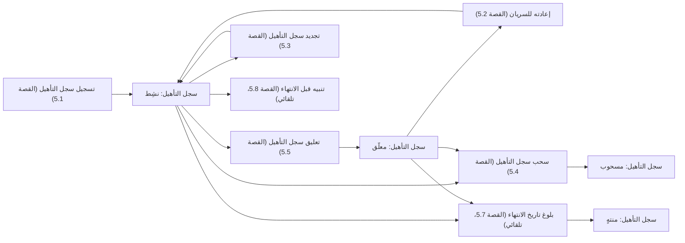
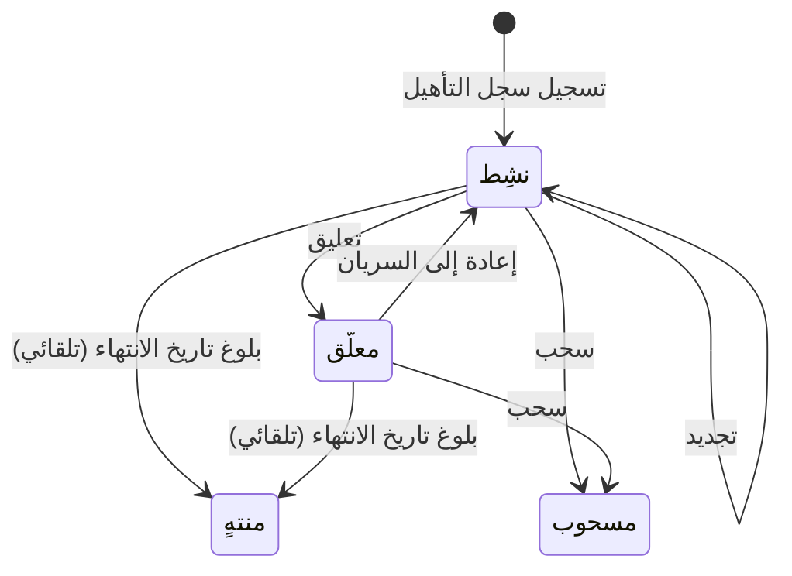

# سجلات تأهيل الأفراد

<!-- BEGIN GENERATED: doc -->
| البند | القيمة |
|---|---|
| المعرّف | FEAT-RES-QUALIFICATIONS |
| الإصدار | 0.1 |
| الحالة | مسودة |
| القدرة | CAP-08 الموارد والجاهزية |
| القدرة الفرعية | CAP-08.04 الكفاءة والأهلية (R1 (الأهلية فقط)) |
| الأدوار | مدير الموارد؛ مدير التدريب؛ المدير؛ الفرد نفسه؛ النظام |
| الشاشات | SCR-42 التأهيل والأهلية |
| حالات الاستخدام | UC-102 |
| القصص | 11: 7 من المواصفة، و4 جديدة |
<!-- END GENERATED: doc -->

## 1. نظرة عامة

### 1.1 القيمة

يحفظ مدير الموارد أو مدير التدريب مؤهلات كل فرد وشهاداته وصلاحيتها، وتنتهي تلقائيًا عند انقضاء مدتها.

### 1.2 النطاق

| البند | القيمة |
|---|---|
| المستخدمون | مدير الموارد؛ مدير التدريب؛ المدير (ضمن نطاقه)؛ الفرد نفسه؛ النظام؛ مهندس التكامل (استيراد من الموارد البشرية) |
| الشاشات | SCR-42 التأهيل والأهلية |
| حالات الاستخدام (بالكلمات) | تسجيل سجل تأهيل جديد لفرد بكفاءة أو شهادة ومدة صلاحية؛ تعليقه وإعادته للسريان؛ تجديد صلاحيته؛ سحبه نهائيًا بسبب؛ انتهاؤه تلقائيًا ببلوغ تاريخ نهاية صلاحيته؛ تنبيه الفرد ومديره قبل الانتهاء؛ عرض مؤهلات الفرد وصلاحيتها في تاريخ معين، وعرض الفرد مؤهلاته وشهاداته الخاصة؛ استيراد مؤهلات من نظام الموارد البشرية |
| المتطلبات (بالكلمات) | تسجيل كفاءة أو تأهيل أو شهادة كل فرد بفترة صلاحيتها، وظهورها منتهية عند الاستعلام بعد الانتهاء؛ فحص الأهلية لشخص أو دور أو مهمة في وقت معيَّن يعيد حالة من حالات الأهلية المحدَّدة مع أسبابها |
| خارج النطاق | فحص الأهلية نفسه وحساب حالاته (قصة عابرة للـAggregates خارج هذه الميزة)؛ متطلبات الدور ومقارنتها بالمؤهلات (ميزة الكفاءة في SLC-09)؛ إسناد المهام بناءً على الأهلية (قدرة التخطيط والتنفيذ) |

### 1.3 خريطة الميزة

**الشكل 1: دورة سجل التأهيل من التسجيل إلى الانتهاء**



**الشكل 2: دورة حالات سجل التأهيل**



## 2. القواعد المشتركة

تنطبق على كل قصص الميزة، فلا تتكرر داخل القصص. وكل قصة تذكر ما يخصها فقط.

### 2.1 السياق المشترك

كل قصة تبدأ من ثلاثة شروط: مستأجر نشط، وحزمة السياسات الأساسية مفعّلة، ومستخدم مسجّل الدخول ومخوَّل. وتشير إليها القصص بخطوة واحدة: «بفرض السياق المشترك للميزة».

### 2.2 الصلاحية وعدم الإفصاح

- من لا يحق له رؤية العنصر يتلقى ردًا بشكل «غير متاح» تمامًا، فلا يعرف أنه موجود.
- من يرى العنصر ولا يحق له الإجراء يتلقى «لا تملك صلاحية هذا الإجراء».

### 2.3 أوامر تغيير الحالة

- **منع التكرار:** يُرسل كل أمر بمفتاح فريد، فإعادة الطلب نفسه لا تُنفَّذ مرتين.
- **حماية التعديل المتزامن:** يُرسل كل أمر بإصدار البيانات الذي يراه المستخدم. فإن عدّلها غيره في الأثناء، يُرفض الأمر.
- **السجل:** إن نجح الأمر، يُكتب حدثه وسجل التدقيق في المعاملة نفسها.

### 2.4 الرفض المشترك

```gherkin
# language: ar
خاصية: الرفض المشترك لأوامر الميزة

  سيناريو مخطط: رفض مشترك لكل أمر في الميزة
    بفرض السياق المشترك للميزة
    و <الحالة>
    عندما يُرسل المستخدم أي أمر من أوامر الميزة
    اذاً يُرفض برمز <الرمز> ويرى "<الرسالة>"
    و لا يتغير شيء

    امثلة:
      | الحالة                                  | الرمز                  | الرسالة                                                 |
      | العنصر خارج صلاحياته                    | NOT_FOUND              | غير متاح                                                |
      | العنصر مرئي له ولا يحق له الإجراء       | AUTHZ_DENIED           | لا تملك صلاحية هذا الإجراء                              |
      | غيره عدّل العنصر بعد أن فتحه            | VERSION_CONFLICT       | تغيّرت البيانات منذ فتحتها. راجع التغييرات ثم أعد المحاولة |
      | أعاد مفتاح منع التكرار بمحتوى مختلف     | IDEMPOTENCY_KEY_REUSED | طلب مكرر بمحتوى مختلف                                   |
      | البيانات ناقصة أو غير صحيحة             | VALIDATION_FAILED      | بعض البيانات ناقصة أو غير صحيحة. راجع الحقول المعلَّمة      |

  سيناريو: إعادة الطلب نفسه لا تُنفَّذ مرتين
    بفرض السياق المشترك للميزة
    و أمر نجح بمفتاح منع تكرار
    عندما يُعاد الطلب نفسه بالمفتاح نفسه
    اذاً تُعاد النتيجة الأولى ولا يُكتب حدث ثانٍ
```

## 3. الجودة وتعريف الاكتمال

### 3.1 متطلبات الجودة

<!-- BEGIN GENERATED: quality -->
لا متطلبات جودة مرتبطة بمتطلبات هذه الميزة مباشرة. تنطبق متطلبات المنصة العامة (`FEAT-PLT-*`).
<!-- END GENERATED: quality -->

### 3.2 تعريف الاكتمال

القصة مكتملة حين تتحقق الشروط الخمسة:

1. سيناريوهاتها والقواعد المشتركة تمر في الاختبار الآلي.
2. فحوص البنية المعمارية تمر.
3. نصوص الواجهة والرسائل موجودة بالعربية والإنجليزية.
4. مراجعة الكود مكتملة.
5. ما تضيفه القصة نفسها في قسم «القواعد» تحقق.

## 4. فهرس القصص

<!-- BEGIN GENERATED: story-index -->
| المعرّف | القصة | النوع | الحالة |
|---|---|---|---|
| `US-BC05-QUAL-RECORD` | تسجيل سجل التأهيل | أمر | مسودة |
| `US-BC05-QUAL-REINSTATE` | إعادة سجل التأهيل إلى السريان | أمر | مسودة |
| `US-BC05-QUAL-RENEW` | تجديد سجل التأهيل | أمر | مسودة |
| `US-BC05-QUAL-REVOKE` | سحب سجل التأهيل | أمر | مسودة |
| `US-BC05-QUAL-SUSPEND` | تعليق سجل التأهيل | أمر | مسودة |
| `US-BC05-Q-QUAL-LIST` | جلب: Qualification records as of t | جلب | مسودة |
| `US-BC05-S-QUALIFICATION-RECORD-01` | تلقائي: valid_to reached (سجل التأهيل) | نظام | مسودة |
| `US-DOM-QUAL-EXPIRY-NOTICE` | تنبيه الفرد ومديره قبل انتهاء المؤهل | نظام | مسودة |
| `US-UI-SCR42-MY-QUALS` | الفرد يرى مؤهلاته وشهاداته | واجهة | مسودة |
| `US-UI-SCR42-QUAL-LIST` | مؤهلات الفرد وصلاحيتها في تاريخ معين | واجهة | مسودة |
| `US-INT-HR-QUALIFICATIONS` | استيراد المؤهلات من نظام الموارد البشرية | تكامل | مسودة |
<!-- END GENERATED: story-index -->

## 5. القصص

### 5.1 US-BC05-QUAL-RECORD — تسجيل سجل التأهيل

| النوع | الإصدار | الأولوية | دون اتصال | الحالة |
|---|---|---|---|---|
| أمر | R1 | Must | لا | مسودة |

> **كـ** مدير الموارد أو مدير التدريب، **أريد** تسجيل سجل تأهيل جديد لفرد، **حتى** تُعرف كفاءاته وتأهيله وشهاداته ومدة صلاحية كل منها.

**باختصار:** يسجّل المسؤول نوع التأهيل (كفاءة، تأهيل، شهادة) ورمزه ومستواه وفترة صلاحيته وجهة إصداره، فيُنشأ سجل التأهيل «نشِطًا».

#### القواعد

- **متى يُسمح:** لا سجل سابق بهذه البيانات؛ الفرد «نشِط»؛ رمز التأهيل من قاموس الكفاءات المعتمد؛ المستوى صحيح؛ بداية الصلاحية قبل نهايتها.
- **من يُسمح له:** مدير الموارد أو مدير التدريب، ضمن نطاق تنظيمه.
- **البيانات:** الفرد، نوع التأهيل، الرمز، المستوى، بداية ونهاية الصلاحية، الجهة المصدرة، ومرجع دليل اختياري (قد يكون تشغيل محاكاة مكتملاً من ميزة تقييم المشاركين).
- **الأثر:** يُسجَّل حدث «سُجِّل سجل التأهيل»، فتُبطَل ذاكرة الأهلية المخزَّنة لهذا الفرد ويُعاد فحصها عند إسناد المهام.

#### معايير القبول

```gherkin
# language: ar
خاصية: تسجيل سجل التأهيل

  سيناريو: تسجيل سجل تأهيل جديد لفرد نشِط
    بفرض السياق المشترك للميزة
    و فرد "نشِط" لا سجل تأهيل سابق له بهذا الرمز والمستوى
    عندما يسجّل مدير الموارد نوع التأهيل ورمزه ومستواه وفترة صلاحيته وجهة إصداره
    اذاً تصبح حالة سجل التأهيل "نشِط"
    و يُسجَّل حدث "سُجِّل سجل التأهيل"

  سيناريو مخطط: رفض خاص بالتسجيل
    بفرض السياق المشترك للميزة
    و <الحالة>
    عندما يحاول مدير الموارد تسجيل سجل التأهيل
    اذاً يُرفض برمز <الرمز> ويرى <الرسالة>

    امثلة:
      | الحالة                                                                    | الرمز                | الرسالة                     |
      | الفرد غير نشِط، أو الرمز خارج قاموس الكفاءات، أو بداية الصلاحية بعد نهايتها | QUALIFICATION_INVALID | بيانات التأهيل غير صحيحة   |
```

<details><summary>المراجع التقنية والتتبع</summary>

<!-- BEGIN GENERATED: refs US-BC05-QUAL-RECORD -->
| البند | المعرّف | المعنى |
|---|---|---|
| الواجهة البرمجية | `POST /api/v1/readiness/qualification-records` | — |
| الأمر | `CMD-QUAL-RECORD` | تسجيل سجل التأهيل |
| السياسة | `POL-QUAL-RECORD` | Resource Manager / Training Manager؛ tenant match; task visible; org scope |
| الحدث | `EVT-QUAL-RECORDED` | يصل إلى: Eligibility cache invalidation; Task assignment re-check report |
| الكيان | `AGG-QUALIFICATION-RECORD` | سجل التأهيل |
| الجدول | `readiness.qualification_records` | الجدول الرئيسي لسجل التأهيل |
| وحدة النشر | DU-08 | — |
| المتطلبات | REQ-RDY-001، REQ-RDY-002 | معانيها في القسم 6. التتبع |
| حالة الاستخدام | UC-102 | Check Eligibility |
| الاختبار | TST-QUALIFICATION-RECORD-SM، TST-SLC03-INVARIANTS | دورة حالات سجل التأهيل، وثوابت الشريحة SLC-03 |
<!-- END GENERATED: refs US-BC05-QUAL-RECORD -->

</details>

### 5.2 US-BC05-QUAL-REINSTATE — إعادة سجل التأهيل إلى السريان

| النوع | الإصدار | الأولوية | دون اتصال | الحالة |
|---|---|---|---|---|
| أمر | R1 | Must | لا | مسودة |

> **كـ** مدير الموارد أو مدير التدريب، **أريد** إعادة سجل التأهيل المعلَّق إلى السريان، **حتى** يُحسَب الفرد مؤهَّلاً من جديد بعد أن ينتفي سبب التعليق.

**باختصار:** يعيد المسؤول سجل التأهيل «المعلَّق» إلى «نشِط» ما دامت فترة صلاحيته لم تنته.

#### القواعد

- **متى يُسمح:** سجل التأهيل «معلَّق»، وفترة صلاحيته لم تنته.
- **من يُسمح له:** مدير الموارد أو مدير التدريب، ضمن نطاق تنظيمه.
- **الأثر:** يُسجَّل حدث «أُعيد سجل التأهيل إلى السريان»، فتُبطَل ذاكرة الأهلية المخزَّنة لهذا الفرد.

#### معايير القبول

```gherkin
# language: ar
خاصية: إعادة سجل التأهيل إلى السريان

  سيناريو: إعادة سجل تأهيل معلَّق لم تنته صلاحيته
    بفرض السياق المشترك للميزة
    و سجل تأهيل "معلَّق" لم تنته فترة صلاحيته
    عندما يعيده مدير الموارد إلى السريان
    اذاً تصبح حالته "نشِط"
    و يُسجَّل حدث "أُعيد سجل التأهيل إلى السريان"

  سيناريو مخطط: رفض خاص بالإعادة إلى السريان
    بفرض السياق المشترك للميزة
    و <الحالة>
    عندما يحاول مدير الموارد إعادة سجل التأهيل إلى السريان
    اذاً يُرفض برمز <الرمز> ويرى <الرسالة>

    امثلة:
      | الحالة                                   | الرمز                                          | الرسالة                                       |
      | سجل التأهيل "نشِط" أو "منتهٍ" أو "مسحوب"  | QUALIFICATION_RECORD_INVALID_STATE_TRANSITION | الوضع الحالي لسجل التأهيل لا يسمح بهذا الإجراء |
      | فترة صلاحيته انتهت                        | QUALIFICATION_EXPIRED                          | انتهت صلاحية التأهيل                           |
```

<details><summary>المراجع التقنية والتتبع</summary>

<!-- BEGIN GENERATED: refs US-BC05-QUAL-REINSTATE -->
| البند | المعرّف | المعنى |
|---|---|---|
| الواجهة البرمجية | `POST /api/v1/readiness/qualification-records/{id}/actions/reinstate` | — |
| الأمر | `CMD-QUAL-REINSTATE` | إعادة سجل التأهيل إلى السريان |
| السياسة | `POL-QUAL-REINSTATE` | Resource Manager / Training Manager؛ tenant match; task visible; org scope |
| الحدث | `EVT-QUAL-REINSTATED` | يصل إلى: Eligibility cache invalidation; Task assignment re-check report |
| الكيان | `AGG-QUALIFICATION-RECORD` | سجل التأهيل |
| الجدول | `readiness.qualification_records` | الجدول الرئيسي لسجل التأهيل |
| وحدة النشر | DU-08 | — |
| المتطلبات | REQ-RDY-001، REQ-RDY-002 | معانيها في القسم 6. التتبع |
| حالة الاستخدام | UC-102 | Check Eligibility |
| الاختبار | TST-QUALIFICATION-RECORD-SM، TST-SLC03-INVARIANTS | دورة حالات سجل التأهيل، وثوابت الشريحة SLC-03 |
<!-- END GENERATED: refs US-BC05-QUAL-REINSTATE -->

</details>

### 5.3 US-BC05-QUAL-RENEW — تجديد سجل التأهيل

| النوع | الإصدار | الأولوية | دون اتصال | الحالة |
|---|---|---|---|---|
| أمر | R1 | Must | لا | مسودة |

> **كـ** مدير الموارد أو مدير التدريب، **أريد** تجديد سجل تأهيل نشِط، **حتى** تمتد صلاحيته دون إنشاء سجل جديد.

**باختصار:** يمدِّد المسؤول تاريخ نهاية صلاحية سجل التأهيل «النشِط» بدليل جديد، فتزداد نسخته دون أن تتغير حالته.

#### القواعد

- **متى يُسمح:** سجل التأهيل «نشِط»، وتاريخ النهاية الجديد بعد القديم.
- **من يُسمح له:** مدير الموارد أو مدير التدريب، ضمن نطاق تنظيمه.
- **البيانات:** تاريخ نهاية الصلاحية الجديد، ومرجع دليل اختياري (قد يكون تشغيل محاكاة مكتملاً من ميزة تقييم المشاركين).
- **الأثر:** يُسجَّل حدث «جُدِّد سجل التأهيل»، فتُبطَل ذاكرة الأهلية المخزَّنة لهذا الفرد.

#### معايير القبول

```gherkin
# language: ar
خاصية: تجديد سجل التأهيل

  سيناريو: تجديد سجل تأهيل نشِط بتاريخ نهاية جديد
    بفرض السياق المشترك للميزة
    و سجل تأهيل "نشِط"
    عندما يجدِّده مدير الموارد بتاريخ نهاية بعد القديم
    اذاً تبقى حالته "نشِط" وتزداد نسخته واحدًا
    و يُسجَّل حدث "جُدِّد سجل التأهيل"

  سيناريو مخطط: رفض خاص بالتجديد
    بفرض السياق المشترك للميزة
    و <الحالة>
    عندما يحاول مدير الموارد تجديد سجل التأهيل
    اذاً يُرفض برمز <الرمز> ويرى <الرسالة>

    امثلة:
      | الحالة                                      | الرمز                                          | الرسالة                                       |
      | تاريخ النهاية الجديد لا يأتي بعد القديم      | QUALIFICATION_INVALID                          | بيانات التأهيل غير صحيحة                      |
      | سجل التأهيل "معلَّق" أو "منتهٍ" أو "مسحوب"    | QUALIFICATION_RECORD_INVALID_STATE_TRANSITION | الوضع الحالي لسجل التأهيل لا يسمح بهذا الإجراء |
```

<details><summary>المراجع التقنية والتتبع</summary>

<!-- BEGIN GENERATED: refs US-BC05-QUAL-RENEW -->
| البند | المعرّف | المعنى |
|---|---|---|
| الواجهة البرمجية | `POST /api/v1/readiness/qualification-records/{id}/actions/renew` | — |
| الأمر | `CMD-QUAL-RENEW` | تجديد سجل التأهيل |
| السياسة | `POL-QUAL-RENEW` | Resource Manager / Training Manager؛ tenant match; task visible; org scope |
| الحدث | `EVT-QUAL-RENEWED` | يصل إلى: Eligibility cache invalidation; Task assignment re-check report |
| الكيان | `AGG-QUALIFICATION-RECORD` | سجل التأهيل |
| الجدول | `readiness.qualification_records` | الجدول الرئيسي لسجل التأهيل |
| وحدة النشر | DU-08 | — |
| المتطلبات | REQ-RDY-001، REQ-RDY-002 | معانيها في القسم 6. التتبع |
| حالة الاستخدام | UC-102 | Check Eligibility |
| الاختبار | TST-QUALIFICATION-RECORD-SM، TST-SLC03-INVARIANTS | دورة حالات سجل التأهيل، وثوابت الشريحة SLC-03 |
<!-- END GENERATED: refs US-BC05-QUAL-RENEW -->

</details>

### 5.4 US-BC05-QUAL-REVOKE — سحب سجل التأهيل

| النوع | الإصدار | الأولوية | دون اتصال | الحالة |
|---|---|---|---|---|
| أمر | R1 | Must | لا | مسودة |

> **كـ** مدير الموارد أو مدير التدريب، **أريد** سحب سجل تأهيل بسبب، **حتى** لا يُحسَب الفرد مؤهَّلاً بعد اكتشاف ما ينفي ذلك.

**باختصار:** يسحب المسؤول سجل التأهيل «النشِط» أو «المعلَّق» بذكر سبب، فتصير حالته «مسحوبة» نهائيًا.

#### القواعد

- **متى يُسمح:** سجل التأهيل «نشِط» أو «معلَّق».
- **من يُسمح له:** مدير الموارد أو مدير التدريب، ضمن نطاق تنظيمه.
- **البيانات:** سبب السحب (إلزامي).
- **الأثر:** يُسجَّل حدث «سُحب سجل التأهيل»، وهي حالة نهائية لا تراجع عنها، فتُبطَل ذاكرة الأهلية المخزَّنة لهذا الفرد.

#### معايير القبول

```gherkin
# language: ar
خاصية: سحب سجل التأهيل

  سيناريو: سحب سجل تأهيل نشِط بسبب
    بفرض السياق المشترك للميزة
    و سجل تأهيل "نشِط"
    عندما يسحبه مدير الموارد بسبب
    اذاً تصبح حالته "مسحوب"
    و يُسجَّل حدث "سُحب سجل التأهيل"

  سيناريو مخطط: رفض خاص بالسحب
    بفرض السياق المشترك للميزة
    و <الحالة>
    عندما يحاول مدير الموارد سحب سجل التأهيل
    اذاً يُرفض برمز <الرمز> ويرى <الرسالة>

    امثلة:
      | الحالة                           | الرمز                                          | الرسالة                                       |
      | سجل التأهيل "منتهٍ" أو "مسحوب"    | QUALIFICATION_RECORD_INVALID_STATE_TRANSITION | الوضع الحالي لسجل التأهيل لا يسمح بهذا الإجراء |
      | لم يُذكر سبب السحب                | REASON_REQUIRED                                | اذكر السبب                                     |
```

<details><summary>المراجع التقنية والتتبع</summary>

<!-- BEGIN GENERATED: refs US-BC05-QUAL-REVOKE -->
| البند | المعرّف | المعنى |
|---|---|---|
| الواجهة البرمجية | `POST /api/v1/readiness/qualification-records/{id}/actions/revoke` | — |
| الأمر | `CMD-QUAL-REVOKE` | سحب سجل التأهيل |
| السياسة | `POL-QUAL-REVOKE` | Resource Manager / Training Manager؛ tenant match; task visible; org scope |
| الحدث | `EVT-QUAL-REVOKED` | يصل إلى: Eligibility cache invalidation; Task assignment re-check report |
| الكيان | `AGG-QUALIFICATION-RECORD` | سجل التأهيل |
| الجدول | `readiness.qualification_records` | الجدول الرئيسي لسجل التأهيل |
| وحدة النشر | DU-08 | — |
| المتطلبات | REQ-RDY-001، REQ-RDY-002 | معانيها في القسم 6. التتبع |
| حالة الاستخدام | UC-102 | Check Eligibility |
| الاختبار | TST-QUALIFICATION-RECORD-SM، TST-SLC03-INVARIANTS | دورة حالات سجل التأهيل، وثوابت الشريحة SLC-03 |
<!-- END GENERATED: refs US-BC05-QUAL-REVOKE -->

</details>

### 5.5 US-BC05-QUAL-SUSPEND — تعليق سجل التأهيل

| النوع | الإصدار | الأولوية | دون اتصال | الحالة |
|---|---|---|---|---|
| أمر | R1 | Must | لا | مسودة |

> **كـ** مدير الموارد أو مدير التدريب، **أريد** تعليق سجل تأهيل نشِط بسبب، **حتى** يتوقف حساب الفرد مؤهَّلاً مؤقتًا دون سحب سجله نهائيًا.

**باختصار:** يعلِّق المسؤول سجل التأهيل «النشِط» بذكر سبب، فتصير حالته «معلَّقة» قابلة للإعادة إلى السريان.

#### القواعد

- **متى يُسمح:** سجل التأهيل «نشِط».
- **من يُسمح له:** مدير الموارد أو مدير التدريب، ضمن نطاق تنظيمه.
- **البيانات:** سبب التعليق (إلزامي).
- **الأثر:** يُسجَّل حدث «عُلِّق سجل التأهيل»، فتُبطَل ذاكرة الأهلية المخزَّنة لهذا الفرد.

#### معايير القبول

```gherkin
# language: ar
خاصية: تعليق سجل التأهيل

  سيناريو: تعليق سجل تأهيل نشِط بسبب
    بفرض السياق المشترك للميزة
    و سجل تأهيل "نشِط"
    عندما يعلِّقه مدير الموارد بسبب
    اذاً تصبح حالته "معلَّق"
    و يُسجَّل حدث "عُلِّق سجل التأهيل"

  سيناريو مخطط: رفض خاص بالتعليق
    بفرض السياق المشترك للميزة
    و <الحالة>
    عندما يحاول مدير الموارد تعليق سجل التأهيل
    اذاً يُرفض برمز <الرمز> ويرى <الرسالة>

    امثلة:
      | الحالة                                       | الرمز                                          | الرسالة                                       |
      | سجل التأهيل "منتهٍ" أو "مسحوب" أو "معلَّق" أصلًا | QUALIFICATION_RECORD_INVALID_STATE_TRANSITION | الوضع الحالي لسجل التأهيل لا يسمح بهذا الإجراء |
      | لم يُذكر سبب التعليق                           | REASON_REQUIRED                                | اذكر السبب                                     |
```

<details><summary>المراجع التقنية والتتبع</summary>

<!-- BEGIN GENERATED: refs US-BC05-QUAL-SUSPEND -->
| البند | المعرّف | المعنى |
|---|---|---|
| الواجهة البرمجية | `POST /api/v1/readiness/qualification-records/{id}/actions/suspend` | — |
| الأمر | `CMD-QUAL-SUSPEND` | تعليق سجل التأهيل |
| السياسة | `POL-QUAL-SUSPEND` | Resource Manager / Training Manager؛ tenant match; task visible; org scope |
| الحدث | `EVT-QUAL-SUSPENDED` | يصل إلى: Eligibility cache invalidation; Task assignment re-check report |
| الكيان | `AGG-QUALIFICATION-RECORD` | سجل التأهيل |
| الجدول | `readiness.qualification_records` | الجدول الرئيسي لسجل التأهيل |
| وحدة النشر | DU-08 | — |
| المتطلبات | REQ-RDY-001، REQ-RDY-002 | معانيها في القسم 6. التتبع |
| حالة الاستخدام | UC-102 | Check Eligibility |
| الاختبار | TST-QUALIFICATION-RECORD-SM، TST-SLC03-INVARIANTS | دورة حالات سجل التأهيل، وثوابت الشريحة SLC-03 |
<!-- END GENERATED: refs US-BC05-QUAL-SUSPEND -->

</details>

### 5.6 US-BC05-Q-QUAL-LIST — جلب: Qualification records as of t

| النوع | الإصدار | الأولوية | دون اتصال | الحالة |
|---|---|---|---|---|
| جلب | R1 | Must | لا | مسودة |

> **كـ** مدير أو مدير موارد ضمن نطاقه، أو الفرد نفسه، **أريد** سجلات تأهيل فرد كما كانت في تاريخ معيَّن، **حتى** أعرف مؤهلاته وصلاحيتها.

**باختصار:** تُعاد سجلات تأهيل الفرد صفحةً بعد صفحة، لمن يقع الفرد ضمن نطاقه أو للفرد نفسه عن سجلاته، ولا يكشف الرد وجود سجلات محجوبة.

#### القواعد

- **من يرى ماذا:** المدير أو مدير الموارد الذي يقع الفرد ضمن نطاقه، أو الفرد عن سجلاته هو نفسه.
- **البيانات:** المؤشر والحد.

#### معايير القبول

```gherkin
# language: ar
خاصية: سجلات تأهيل الفرد

  سيناريو: المدير يرى سجلات تأهيل فرد ضمن نطاقه
    بفرض السياق المشترك للميزة
    و فرد ضمن نطاق مدير الموارد له سجلات تأهيل
    عندما يطلب مدير الموارد سجلات تأهيل هذا الفرد
    اذاً تُعاد سجلاته بحالتها الحالية
    و لا يكشف أي عدد أو اقتراح وجود سجل محجوب

  سيناريو: الصفحة التالية
    بفرض السياق المشترك للميزة
    و سجلات تأهيل أكثر من صفحة
    عندما يطلب الصفحة التالية بالمؤشر
    اذاً تُعاد السجلات التالية دون تكرار ولا فجوة
```

<details><summary>المراجع التقنية والتتبع</summary>

<!-- BEGIN GENERATED: refs US-BC05-Q-QUAL-LIST -->
| البند | المعرّف | المعنى |
|---|---|---|
| الواجهة البرمجية | `GET /api/v1/readiness/persons/{person_id}/qualifications` | — |
| الاستعلام | `QRY-QUAL-LIST` | Qualification records as of t |
| السياسة | `POL-QUAL-LIST` | Manager/Resource Manager in scope; self |
| الكيان | `AGG-QUALIFICATION-RECORD` | سجل التأهيل |
| الجدول | `readiness.qualification_records` | الجدول الرئيسي لسجل التأهيل |
| وحدة النشر | DU-08 | — |
| المتطلب | REQ-RDY-001 | The system shall record each person's competencies, qualifications and certifications with their validity per… |
| حالة الاستخدام | UC-102 | Check Eligibility |
| الاختبار | TST-QUALIFICATION-RECORD-SM، TST-SLC03-INVARIANTS | دورة حالات سجل التأهيل، وثوابت الشريحة SLC-03 |
<!-- END GENERATED: refs US-BC05-Q-QUAL-LIST -->

</details>

### 5.7 US-BC05-S-QUALIFICATION-RECORD-01 — تلقائي: valid_to reached (سجل التأهيل)

| النوع | الإصدار | الأولوية | دون اتصال | الحالة |
|---|---|---|---|---|
| نظام | R1 | Must | لا ينطبق | مسودة |

> **كـ** النظام، **أريد** أن أنقل سجل التأهيل إلى «منتهٍ» ببلوغ تاريخ نهاية صلاحيته، **حتى** لا يُحسَب الفرد مؤهَّلاً بعد انتهاء صلاحية تأهيله.

**باختصار:** المجدوِل يفحص سجلات التأهيل «النشِطة» و«المعلَّقة»، فإذا بلغت تاريخ نهاية صلاحيتها نقلها إلى «منتهٍ» دون أمر من مستخدم.

#### القواعد

- **متى يحدث:** سجل التأهيل «نشِط» أو «معلَّق»، وبلغ تاريخ نهاية صلاحيته.
- **الأثر:** تصبح حالته «منتهٍ»، ويُسجَّل حدث «انتهى سجل التأهيل» وسجل تدقيق بهوية النظام، فتُبطَل ذاكرة الأهلية المخزَّنة لهذا الفرد. وفحص الأهلية يراجع انتهاء الصلاحية وقت القراءة أيضًا، فلا يعتمد على هذا الانتقال وحده.

#### معايير القبول

```gherkin
# language: ar
خاصية: انتهاء سجل التأهيل تلقائيًا

  سيناريو: بلوغ تاريخ انتهاء سجل تأهيل نشِط
    بفرض سجل تأهيل "نشِط" بلغ تاريخ نهاية صلاحيته
    عندما يحين وقت فحص المجدوِل
    اذاً تصبح حالته "منتهٍ"
    و يُسجَّل حدث "انتهى سجل التأهيل" وسجل تدقيق بهوية النظام

  سيناريو: سجل لم يبلغ تاريخ انتهائه لا يتغير
    بفرض سجل تأهيل "نشِط" لم يبلغ تاريخ نهاية صلاحيته
    عندما يحين وقت فحص المجدوِل
    اذاً تبقى حالته كما هي
    و لا يتغير شيء
```

<details><summary>المراجع التقنية والتتبع</summary>

<!-- BEGIN GENERATED: refs US-BC05-S-QUALIFICATION-RECORD-01 -->
| البند | المعرّف | المعنى |
|---|---|---|
| المحفِّز | `SYS:valid_to reached` | scheduler (eligibility also checks validity at read time) |
| الانتقال | ACTIVE, SUSPENDED ← EXPIRED | — |
| الحدث | `EVT-QUAL-EXPIRED` | يصل إلى: Eligibility cache invalidation; Task assignment re-check report |
| الكيان | `AGG-QUALIFICATION-RECORD` | سجل التأهيل |
| الجدول | `readiness.qualification_records` | الجدول الرئيسي لسجل التأهيل |
| وحدة النشر | DU-08 | — |
| المتطلبات | REQ-RDY-001، REQ-RDY-002 | معانيها في القسم 6. التتبع |
| حالة الاستخدام | UC-102 | Check Eligibility |
| الاختبار | TST-QUALIFICATION-RECORD-SM، TST-SLC03-INVARIANTS | دورة حالات سجل التأهيل، وثوابت الشريحة SLC-03 |
<!-- END GENERATED: refs US-BC05-S-QUALIFICATION-RECORD-01 -->

</details>

### 5.8 US-DOM-QUAL-EXPIRY-NOTICE — تنبيه الفرد ومديره قبل انتهاء المؤهل

| النوع | الإصدار | الأولوية | دون اتصال | الحالة |
|---|---|---|---|---|
| نظام | R1 | Must | لا ينطبق | مسودة |

> **كـ** النظام، **أريد** أن أنبِّه الفرد ومديره قبل انتهاء مؤهله، **حتى** يتسع الوقت لتجديده قبل أن يصبح غير مؤهَّل.

**باختصار:** قبل بلوغ سجل التأهيل «النشِط» تاريخ نهاية صلاحيته بفترة سماح، يرسل النظام تنبيهًا إلى الفرد ومديره.

> **ملاحظة [Derived]:** المصدر (REQ-RDY-001) يذكر فقط تسجيل فترة الصلاحية وظهور انتهائها عند الاستعلام، ولا يذكر تنبيهًا قبل الانتهاء أو مدته؛ فافترضنا هذا التنبيه، وفترة السماح تحتاج تأكيد المالك.

#### القواعد

- **متى يحدث:** سجل التأهيل «نشِط»، واقترب تاريخ نهاية صلاحيته من فترة السماح المعتمدة. **[Derived]**
- **الأثر:** يصل إشعار إلى الفرد ومديره، دون أن تتغير حالة سجل التأهيل.

#### معايير القبول

```gherkin
# language: ar
خاصية: تنبيه قبل انتهاء التأهيل

  سيناريو: التنبيه عند اقتراب انتهاء سجل تأهيل نشِط
    بفرض سجل تأهيل "نشِط" اقترب تاريخ نهاية صلاحيته من فترة السماح
    عندما يحين وقت فحص المجدوِل
    اذاً يصل إشعار التنبيه إلى الفرد ومديره
    و تبقى حالة سجل التأهيل "نشِط"

  سيناريو: لا تنبيه قبل فترة السماح
    بفرض سجل تأهيل "نشِط" لم يقترب تاريخ نهاية صلاحيته من فترة السماح
    عندما يحين وقت فحص المجدوِل
    اذاً لا يُرسَل أي تنبيه
    و لا يتغير شيء
```

<details><summary>المراجع التقنية والتتبع</summary>

<!-- BEGIN GENERATED: refs US-DOM-QUAL-EXPIRY-NOTICE -->
| البند | المعرّف | المعنى |
|---|---|---|
| حالة الاستخدام | UC-102 | Check Eligibility |
| المصدر | `[Derived]` | — |
| المتطلب | REQ-RDY-001 | The system shall record each person's competencies, qualifications and certifications with their validity per… |
| حالة الاستخدام | UC-102 | Check Eligibility |
<!-- END GENERATED: refs US-DOM-QUAL-EXPIRY-NOTICE -->

</details>

### 5.9 US-UI-SCR42-MY-QUALS — الفرد يرى مؤهلاته وشهاداته

| النوع | الإصدار | الأولوية | دون اتصال | الحالة |
|---|---|---|---|---|
| واجهة | R1 | Must | لا | مسودة |

> **كـ** المستخدم، **أريد** أن أرى مؤهلاتي وشهاداتي وصلاحية كل منها، **حتى** أعرف ما يلزمني تجديده قبل أن أُعتبر غير مؤهَّل.

**باختصار:** شاشة التأهيل تعرض على الفرد سجلات تأهيله هو نفسه فقط، بحالتها وتاريخ نهاية صلاحيتها.

> **ملاحظة [Derived]:** المصدر يذكر أن سياسة جلب مؤهلات الفرد تسمح للفرد برؤية سجلاته هو نفسه (`17-security-design.md` §12.6، REQ-RDY-001)، ولا يصف شاشة «مؤهلاتي» بعينها؛ فافترضنا هذا العرض.

#### القواعد

- **من يرى ماذا:** الفرد يرى سجلات تأهيله هو نفسه فقط.

#### معايير القبول

```gherkin
# language: ar
خاصية: مؤهلاتي وشهاداتي

  سيناريو: الفرد يرى سجلات تأهيله هو نفسه
    بفرض السياق المشترك للميزة
    و للمستخدم سجلات تأهيل خاصة به
    عندما يفتح شاشة مؤهلاتي
    اذاً يرى سجلاته بحالتها وتاريخ نهاية صلاحيتها
    و لا يرى سجلات تأهيل غيره
```

<details><summary>المراجع التقنية والتتبع</summary>

<!-- BEGIN GENERATED: refs US-UI-SCR42-MY-QUALS -->
| البند | المعرّف | المعنى |
|---|---|---|
| الشاشة | SCR-42 | شاشة التأهيل والأهلية |
| المصدر | `17-security-design.md §12.6` | — |
| المصدر | `[Derived]` | — |
| المتطلب | REQ-RDY-001 | The system shall record each person's competencies, qualifications and certifications with their validity per… |
| حالة الاستخدام | UC-102 | Check Eligibility |
<!-- END GENERATED: refs US-UI-SCR42-MY-QUALS -->

</details>

### 5.10 US-UI-SCR42-QUAL-LIST — مؤهلات الفرد وصلاحيتها في تاريخ معين

| النوع | الإصدار | الأولوية | دون اتصال | الحالة |
|---|---|---|---|---|
| واجهة | R1 | Must | لا | مسودة |

> **كـ** مدير الموارد، **أريد** رؤية مؤهلات فرد وصلاحيتها كما كانت في تاريخ معيَّن، **حتى** أحكم على أهليته في ذلك التاريخ.

**باختصار:** شاشة التأهيل تعرض لمدير الموارد سجلات تأهيل فرد ضمن نطاقه، مع إمكان اختيار تاريخ لمعرفة حالتها فيه.

> **ملاحظة [Derived]:** المصدر (REQ-RDY-001) يذكر أن انتهاء التأهيل يظهر عند الاستعلام بعد تاريخه، ولا يصف عرض اختيار تاريخ على الشاشة؛ فافترضنا هذا العرض.

#### القواعد

- **من يرى ماذا:** من يقع الفرد ضمن نطاقه المسموح فقط.
- **البيانات:** التاريخ المطلوب عرض حالة المؤهلات فيه (الحالي افتراضيًا).

#### معايير القبول

```gherkin
# language: ar
خاصية: مؤهلات الفرد في تاريخ معين

  سيناريو: عرض مؤهلات فرد كما كانت في تاريخ سابق
    بفرض السياق المشترك للميزة
    و فرد ضمن نطاق مدير الموارد له سجل تأهيل انتهت صلاحيته بعد ذلك التاريخ
    عندما يطلب مدير الموارد مؤهلات هذا الفرد في ذلك التاريخ
    اذاً يرى السجل بحالته في ذلك التاريخ
```

<details><summary>المراجع التقنية والتتبع</summary>

<!-- BEGIN GENERATED: refs US-UI-SCR42-QUAL-LIST -->
| البند | المعرّف | المعنى |
|---|---|---|
| الشاشة | SCR-42 | شاشة التأهيل والأهلية |
| المصدر | `[Derived]` | — |
| المتطلب | REQ-RDY-001 | The system shall record each person's competencies, qualifications and certifications with their validity per… |
| حالة الاستخدام | UC-102 | Check Eligibility |
<!-- END GENERATED: refs US-UI-SCR42-QUAL-LIST -->

</details>

### 5.11 US-INT-HR-QUALIFICATIONS — استيراد المؤهلات من نظام الموارد البشرية

| النوع | الإصدار | الأولوية | دون اتصال | الحالة |
|---|---|---|---|---|
| تكامل | R1 | Must | لا ينطبق | مسودة |

> **كـ** نظام الموارد البشرية الخارجي، **أريد** أن أرسل مؤهلات الأفراد المستوردة اقتراحات تأهيل، **حتى** يراجعها مدير الموارد أو مدير التدريب قبل اعتمادها في سجلات التأهيل.

**باختصار:** استيراد المؤهلات من نظام الموارد البشرية ينتج اقتراحات لكل فرد، ولا يسجّلها آليًا، بل يراجعها مدير الموارد أو مدير التدريب ثم يسجّلها بالأمر العادي.

> **ملاحظة [Derived]:** المصدر (`20-integration-design.md` §4) يصف مسار الموارد البشرية بتحديث بيانات الشخص واقتراح تغييرات الأدوار والوحدات دون تطبيقها آليًا، ولا يذكر استيراد المؤهلات بالتحديد؛ فافترضنا أن مؤهلاتها تتبع النمط نفسه: تُقترح ولا تُسجَّل آليًا، ويحتاج هذا تأكيد المالك.

#### القواعد

- **متى يحدث:** عند استيراد دفعة من نظام الموارد البشرية تتضمن مؤهلات لأفراد معروفين في المستأجر. **[Derived]**
- **البيانات:** الفرد، نوع التأهيل ورمزه ومستواه، فترة الصلاحية، الجهة المصدرة، كما وردت من النظام الخارجي.
- **الأثر:** تُنشأ اقتراحات تأهيل بانتظار المراجعة، ولا يُسجَّل سجل تأهيل فعلي إلا بعد اعتمادها عبر تسجيل سجل التأهيل (القصة 5.1).

#### معايير القبول

```gherkin
# language: ar
خاصية: استيراد المؤهلات من نظام الموارد البشرية

  سيناريو: اقتراح مؤهل من دفعة مستوردة
    بفرض السياق المشترك للميزة
    و دفعة مستوردة من نظام الموارد البشرية فيها مؤهل لفرد معروف في المستأجر
    عندما يصل الاستيراد
    اذاً يُنشأ اقتراح تأهيل بانتظار مراجعة مدير الموارد أو مدير التدريب
    و لا يُسجَّل سجل تأهيل فعلي قبل الاعتماد

  سيناريو مخطط: رفض خاص بالاستيراد
    بفرض السياق المشترك للميزة
    و <الحالة>
    عندما يصل الاستيراد
    اذاً يُرفض برمز <الرمز> ويرى <الرسالة>

    امثلة:
      | الحالة                           | الرمز               | الرسالة                     |
      | الفرد غير معروف في المستأجر      | QUALIFICATION_INVALID | بيانات التأهيل غير صحيحة   |
```

<details><summary>المراجع التقنية والتتبع</summary>

<!-- BEGIN GENERATED: refs US-INT-HR-QUALIFICATIONS -->
| البند | المعرّف | المعنى |
|---|---|---|
| المصدر | `20-integration-design.md §4` | — |
| المصدر | `[Derived]` | — |
| المتطلب | REQ-RDY-001 | The system shall record each person's competencies, qualifications and certifications with their validity per… |
| حالة الاستخدام | UC-102 | Check Eligibility |
<!-- END GENERATED: refs US-INT-HR-QUALIFICATIONS -->

</details>

## 6. التتبع

<!-- BEGIN GENERATED: trace -->
| المتطلب | المعنى | القصص | الاختبار |
|---|---|---|---|
| REQ-RDY-001 | The system shall record each person's competencies, qualifications and certifications with their validity per… | `US-BC05-Q-QUAL-LIST`، `US-BC05-QUAL-RECORD`، `US-BC05-QUAL-REINSTATE`، `US-BC05-QUAL-RENEW`، `US-BC05-QUAL-REVOKE`، `US-BC05-QUAL-SUSPEND`، `US-BC05-S-QUALIFICATION-RECORD-01`، `US-DOM-QUAL-EXPIRY-NOTICE`، `US-INT-HR-QUALIFICATIONS`، `US-UI-SCR42-MY-QUALS`، `US-UI-SCR42-QUAL-LIST` | TST-QUALIFICATION-RECORD-SM، TST-SLC03-INVARIANTS |
| REQ-RDY-002 | When eligibility is checked for a person, role or task at a given time, the system shall return ELIGIBLE, CON… | كل قصص الأوامر والنظام في الميزة (6) | TST-QUALIFICATION-RECORD-SM، TST-SLC03-INVARIANTS |
<!-- END GENERATED: trace -->

## 7. سجل التغييرات

| الإصدار | التاريخ | التغيير |
|---|---|---|
| 0.1 | — | هيكل مولَّد من خريطة الميزات |
| 0.2 | 2026-10-13 | كتابة القصص كاملة بمعيار القصص |
