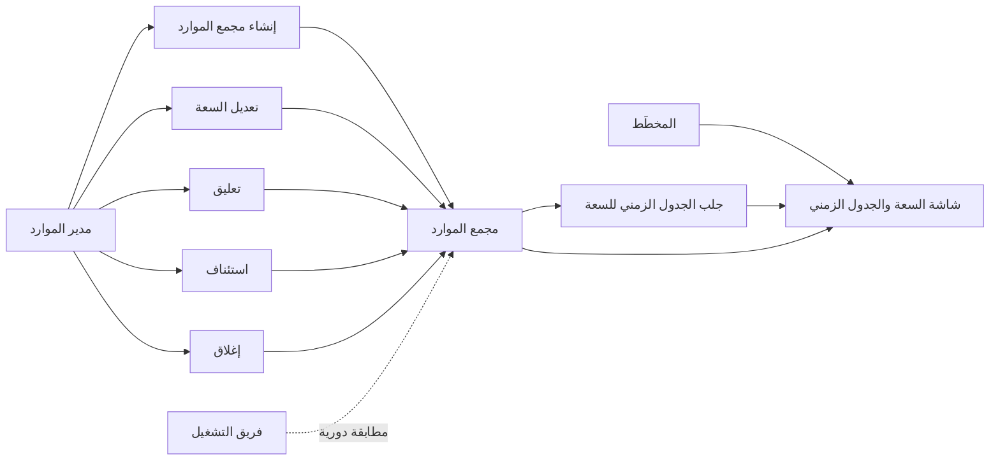
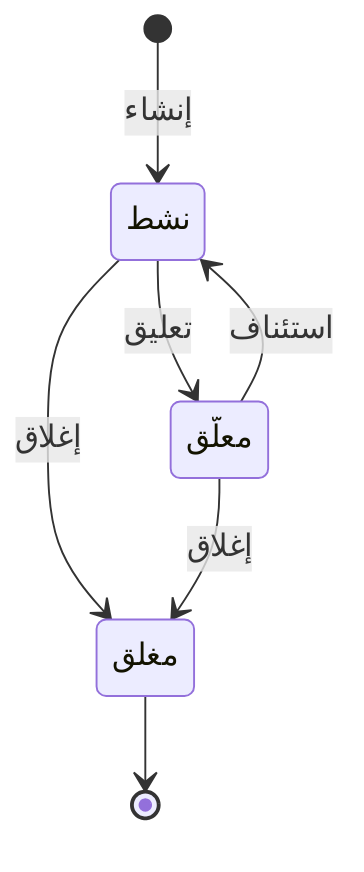

# إدارة مجمعات الموارد

<!-- BEGIN GENERATED: doc -->
| البند | القيمة |
|---|---|
| المعرّف | FEAT-RES-RESOURCE-POOLS |
| الإصدار | 0.2 |
| الحالة | مسودة |
| القدرة | CAP-08 الموارد والجاهزية |
| القدرة الفرعية | CAP-08.02 تخصيص الموارد (R2) |
| الأدوار | مدير الموارد؛ المخطِّط |
| الشاشات | SCR-41 المجمعات والتخصيص والجدول الزمني للسعة |
| حالات الاستخدام | UC-054 |
| القصص | 11: 6 من المواصفة، و5 جديدة |
<!-- END GENERATED: doc -->

## 1. نظرة عامة

### 1.1 القيمة

يدير مدير الموارد مخزون كل نوع من الموارد وسعته ويرى المتاح والملتزم به ساعة بساعة.

### 1.2 النطاق

| البند | القيمة |
|---|---|
| المستخدمون | مدير الموارد؛ المخطِّط (يستخدم السعة والمتاح عند التخصيص دون أن يملك إجراءات الميزة) |
| الشاشات | شاشة المجمعات والتخصيص والجدول الزمني للسعة (SCR-41) |
| حالات الاستخدام بالكلام | إنشاء مجمع موارد جديد بنوعه ووحدته وسعته الابتدائية؛ تعديل سعته بمرور الزمن؛ تعليقه فيتوقف التخصيص الجديد منه؛ استئنافه؛ إغلاقه نهائيًا؛ عرض السعة والملتزم والمتاح ساعة بساعة ضمن فترة؛ عرض تفاصيل مجمع واحد وقائمة المجمعات ضمن نطاق المستخدم؛ مطابقة دفتر السعة مع الالتزامات دوريًا |
| المتطلبات بالكلام | إدارة مجمعات الموارد بنوعها وكميتها ووحدتها وسعتها وتوافرها بمرور الزمن |
| خارج النطاق | تخصيص الموارد نفسه وحسم التعارض عليه (ميزة التخصيص)؛ تعريف أنواع الموارد ووحدات القياس (مرجعية) |

### 1.3 خريطة الميزة

**الشكل 1: خريطة ميزة مجمعات الموارد**



القصة تحمل مجمع الموارد عبر ثلاث حالات غير نهائية وواحدة نهائية، كما في **الشكل 2**.

**الشكل 2: رحلة مجمع الموارد**



## 2. القواعد المشتركة

تنطبق على كل قصص الميزة، فلا تتكرر داخل القصص. وكل قصة تذكر ما يخصها فقط.

### 2.1 السياق المشترك

كل قصة تبدأ من ثلاثة شروط: مستأجر نشط، وحزمة السياسات الأساسية مفعّلة، ومستخدم مسجّل الدخول ومخوَّل. وتشير إليها القصص بخطوة واحدة: «بفرض السياق المشترك للميزة».

### 2.2 الصلاحية وعدم الإفصاح

- من لا يحق له رؤية العنصر يتلقى ردًا بشكل «غير متاح» تمامًا، فلا يعرف أنه موجود.
- من يرى العنصر ولا يحق له الإجراء يتلقى «لا تملك صلاحية هذا الإجراء».

### 2.3 أوامر تغيير الحالة

- **منع التكرار:** يُرسل كل أمر بمفتاح فريد، فإعادة الطلب نفسه لا تُنفَّذ مرتين.
- **حماية التعديل المتزامن:** يُرسل كل أمر بإصدار البيانات الذي يراه المستخدم. فإن عدّلها غيره في الأثناء، يُرفض الأمر.
- **السجل:** إن نجح الأمر، يُكتب حدثه وسجل التدقيق في المعاملة نفسها.

### 2.4 الرفض المشترك

```gherkin
# language: ar
خاصية: الرفض المشترك لأوامر الميزة

  سيناريو مخطط: رفض مشترك لكل أمر في الميزة
    بفرض السياق المشترك للميزة
    و <الحالة>
    عندما يُرسل المستخدم أي أمر من أوامر الميزة
    اذاً يُرفض برمز <الرمز> ويرى "<الرسالة>"
    و لا يتغير شيء

    امثلة:
      | الحالة                                  | الرمز                  | الرسالة                                                 |
      | العنصر خارج صلاحياته                    | NOT_FOUND              | غير متاح                                                |
      | العنصر مرئي له ولا يحق له الإجراء       | AUTHZ_DENIED           | لا تملك صلاحية هذا الإجراء                              |
      | غيره عدّل العنصر بعد أن فتحه            | VERSION_CONFLICT       | تغيّرت البيانات منذ فتحتها. راجع التغييرات ثم أعد المحاولة |
      | أعاد مفتاح منع التكرار بمحتوى مختلف     | IDEMPOTENCY_KEY_REUSED | طلب مكرر بمحتوى مختلف                                   |
      | البيانات ناقصة أو غير صحيحة             | VALIDATION_FAILED      | بعض البيانات ناقصة أو غير صحيحة. راجع الحقول المعلَّمة      |

  سيناريو: إعادة الطلب نفسه لا تُنفَّذ مرتين
    بفرض السياق المشترك للميزة
    و أمر نجح بمفتاح منع تكرار
    عندما يُعاد الطلب نفسه بالمفتاح نفسه
    اذاً تُعاد النتيجة الأولى ولا يُكتب حدث ثانٍ
```

## 3. الجودة وتعريف الاكتمال

### 3.1 متطلبات الجودة

<!-- BEGIN GENERATED: quality -->
لا متطلبات جودة مرتبطة بمتطلبات هذه الميزة مباشرة. تنطبق متطلبات المنصة العامة (`FEAT-PLT-*`).
<!-- END GENERATED: quality -->

### 3.2 تعريف الاكتمال

القصة مكتملة حين تتحقق الشروط الخمسة:

1. سيناريوهاتها والقواعد المشتركة تمر في الاختبار الآلي.
2. فحوص البنية المعمارية تمر.
3. نصوص الواجهة والرسائل موجودة بالعربية والإنجليزية.
4. مراجعة الكود مكتملة.
5. ما تضيفه القصة نفسها في قسم «القواعد» تحقق.

## 4. فهرس القصص

<!-- BEGIN GENERATED: story-index -->
| المعرّف | القصة | النوع | الحالة |
|---|---|---|---|
| `US-BC05-RPL-ADJUST-CAPACITY` | تعديل سعة مجمع الموارد | أمر | مسودة |
| `US-BC05-RPL-CLOSE` | إغلاق مجمع الموارد | أمر | مسودة |
| `US-BC05-RPL-CREATE` | إنشاء مجمع الموارد | أمر | مسودة |
| `US-BC05-RPL-RESUME` | استئناف مجمع الموارد | أمر | مسودة |
| `US-BC05-RPL-SUSPEND` | تعليق مجمع الموارد | أمر | مسودة |
| `US-BC05-Q-POL-TIMELINE` | جلب: Capacity, committed and available quantity per hour in a window | جلب | مسودة |
| `US-DOM-RPL-GET` | عرض تفاصيل مجمع موارد واحد | جلب | مسودة |
| `US-DOM-RPL-LIST` | قائمة مجمعات الموارد ضمن نطاقي | جلب | مسودة |
| `US-UI-SCR41-CAPACITY-TIMELINE` | مخطط السعة والملتزم والمتاح ساعة بساعة | واجهة | مسودة |
| `US-UI-SCR41-POOL-VIEW` | صفحة مجمع واحد بسعته وحالته | واجهة | مسودة |
| `US-OPS-RPL-LEDGER-RECONCILE` | مطابقة دفتر السعة مع الالتزامات | تشغيل | مسودة |
<!-- END GENERATED: story-index -->

## 5. القصص

### 5.1 US-BC05-RPL-ADJUST-CAPACITY — تعديل سعة مجمع الموارد

| النوع | الإصدار | الأولوية | دون اتصال | الحالة |
|---|---|---|---|---|
| أمر | R2 | Must | لا | مسودة |

> **كـ** مدير الموارد، **أريد** أن أعدّل سعة مجمع الموارد بقيمة جديدة وتاريخ نفاذ وسبب، **حتى** تعكس السعة الواقع ولا يُخصَّص أكثر من المتاح فعلًا.

**باختصار:** يعدّل مدير الموارد سعة المجمع «النشط» أو «المعلَّق» دون أن تتغير حالته، وتُحفظ السعة سجلًا زمنيًا. وخفض السعة دون ما التُزم به يحتاج قرارات استرجاع أولًا.

#### القواعد

- **متى يُسمح:** المجمع «نشط» أو «معلَّق»، وسعة جديدة بتاريخ نفاذ وسبب.
- **من يُسمح له:** مدير الموارد، ضمن نطاق ملكيته.
- **البيانات:** السعة الجديدة، تاريخ نفاذها، والسبب — كلها إلزامية.
- **الأثر:** يبقى المجمع بحالته، ويُسجَّل حدث «عُدِّلت سعة المجمع» يصل إلى دفتر السعة.

#### معايير القبول

```gherkin
# language: ar
خاصية: تعديل سعة مجمع الموارد

  سيناريو: مدير الموارد يعدّل السعة
    بفرض السياق المشترك للميزة
    و مجمع موارد "نشط" وسعته الملتزم بها أقل من السعة الجديدة
    عندما يعدّل مدير الموارد سعته بقيمة جديدة وتاريخ نفاذ وسبب
    اذاً تبقى حالته كما هي ويزداد إصداره
    و يُسجَّل حدث "عُدِّلت سعة المجمع"

  سيناريو مخطط: رفض خاص بتعديل السعة
    بفرض السياق المشترك للميزة
    و <الحالة>
    عندما يحاول مدير الموارد تعديل السعة
    اذاً يُرفض برمز <الرمز> ويرى <الرسالة>
    و لا يتغير شيء

    امثلة:
      | الحالة                                                    | الرمز                                  | الرسالة                                                 |
      | السعة الجديدة أقل من الكمية الملتزم بها دون قرار استرجاع | CAPACITY_BELOW_COMMITMENTS             | لا يمكن خفض السعة دون ما التُزم به. احسم الالتزامات أولًا |
      | المجمع "مغلق"                                              | RESOURCE_POOL_INVALID_STATE_TRANSITION | الوضع الحالي لمجمع الموارد لا يسمح بهذا الإجراء          |
```

<details><summary>المراجع التقنية والتتبع</summary>

<!-- BEGIN GENERATED: refs US-BC05-RPL-ADJUST-CAPACITY -->
| البند | المعرّف | المعنى |
|---|---|---|
| الواجهة البرمجية | `POST /api/v1/readiness/resource-pools/{id}/actions/adjust-capacity` | — |
| الأمر | `CMD-RPL-ADJUST-CAPACITY` | تعديل سعة مجمع الموارد |
| السياسة | `POL-RPL-ADJUST-CAPACITY` | Resource Manager؛ tenant match; object visible; owner/pool scope |
| الحدث | `EVT-RPL-CAPACITY-ADJUSTED` | يصل إلى: Capacity ledger |
| الكيان | `AGG-RESOURCE-POOL` | مجمع الموارد |
| الجدول | `readiness.resource_pools` | الجدول الرئيسي لمجمع الموارد |
| وحدة النشر | DU-14 | — |
| المتطلب | REQ-RES-006 | The system shall manage resource pools with type, quantity, unit, capacity and availability over time. |
| حالة الاستخدام | UC-054 | Allocate Resource |
| الاختبار | TST-RESOURCE-POOL-SM، TST-SLC09-INVARIANTS | دورة حالات مجمع الموارد، وثوابت الشريحة SLC-09 |
<!-- END GENERATED: refs US-BC05-RPL-ADJUST-CAPACITY -->

</details>

### 5.2 US-BC05-RPL-CLOSE — إغلاق مجمع الموارد

| النوع | الإصدار | الأولوية | دون اتصال | الحالة |
|---|---|---|---|---|
| أمر | R2 | Must | لا | مسودة |

> **كـ** مدير الموارد، **أريد** أن أغلق مجمع الموارد نهائيًا بسبب حين تنتهي الحاجة إليه، **حتى** لا يبقى ظاهرًا للتخصيص وهو غير مستخدم.

**باختصار:** يغلق مدير الموارد المجمع «النشط» أو «المعلَّق» فيصير «مغلق» نهائيًا، ولا يُغلق إن كانت عليه تخصيصات قائمة.

#### القواعد

- **متى يُسمح:** المجمع «نشط» أو «معلَّق»، ولا توجد عليه تخصيصات «ملتزم بها» أو «معلَّقة».
- **من يُسمح له:** مدير الموارد، ضمن نطاق ملكيته.
- **البيانات:** السبب (إلزامي).
- **الأثر:** المجمع يصير «مغلق» (حالة نهائية)، ويُسجَّل حدث «أُغلق المجمع» يصل إلى دفتر السعة.

#### معايير القبول

```gherkin
# language: ar
خاصية: إغلاق مجمع الموارد

  سيناريو: مدير الموارد يغلق مجمعًا بلا التزامات
    بفرض السياق المشترك للميزة
    و مجمع موارد "نشط" بلا تخصيصات ملتزم بها أو معلَّقة
    عندما يغلقه مدير الموارد بسبب
    اذاً تصبح حالته "مغلق"
    و يُسجَّل حدث "أُغلق المجمع"

  سيناريو مخطط: رفض خاص بالإغلاق
    بفرض السياق المشترك للميزة
    و <الحالة>
    عندما يحاول مدير الموارد إغلاق المجمع
    اذاً يُرفض برمز <الرمز> ويرى <الرسالة>
    و لا يتغير شيء

    امثلة:
      | الحالة                            | الرمز                                  | الرسالة                                         |
      | توجد تخصيصات ملتزم بها أو معلَّقة | POOL_HAS_COMMITMENTS                   | للمجمع تخصيصات قائمة                            |
      | المجمع "مغلق" من قبل              | RESOURCE_POOL_INVALID_STATE_TRANSITION | الوضع الحالي لمجمع الموارد لا يسمح بهذا الإجراء |
```

<details><summary>المراجع التقنية والتتبع</summary>

<!-- BEGIN GENERATED: refs US-BC05-RPL-CLOSE -->
| البند | المعرّف | المعنى |
|---|---|---|
| الواجهة البرمجية | `POST /api/v1/readiness/resource-pools/{id}/actions/close` | — |
| الأمر | `CMD-RPL-CLOSE` | إغلاق مجمع الموارد |
| السياسة | `POL-RPL-CLOSE` | Resource Manager؛ tenant match; object visible; owner/pool scope |
| الحدث | `EVT-RPL-CLOSED` | يصل إلى: Capacity ledger |
| الكيان | `AGG-RESOURCE-POOL` | مجمع الموارد |
| الجدول | `readiness.resource_pools` | الجدول الرئيسي لمجمع الموارد |
| وحدة النشر | DU-14 | — |
| المتطلب | REQ-RES-006 | The system shall manage resource pools with type, quantity, unit, capacity and availability over time. |
| حالة الاستخدام | UC-054 | Allocate Resource |
| الاختبار | TST-RESOURCE-POOL-SM، TST-SLC09-INVARIANTS | دورة حالات مجمع الموارد، وثوابت الشريحة SLC-09 |
<!-- END GENERATED: refs US-BC05-RPL-CLOSE -->

</details>

### 5.3 US-BC05-RPL-CREATE — إنشاء مجمع الموارد

| النوع | الإصدار | الأولوية | دون اتصال | الحالة |
|---|---|---|---|---|
| أمر | R2 | Must | لا | مسودة |

> **كـ** مدير الموارد، **أريد** أن أنشئ مجمع موارد جديدًا بنوعه ووحدته وسعته الابتدائية ونطاق ملكيته، **حتى** يُبنى عليه التخصيص لاحقًا.

**باختصار:** ينشئ مدير الموارد مجمعًا جديدًا بنوع من كتالوج أنواع الموارد ووحدة قياس ونطاق ملكية وسعة ابتدائية وتسمية، فيصير «نشط» مباشرة.

#### القواعد

- **متى يُسمح:** نوع الموارد من كتالوج الأنواع المعتمد، ووحدة قياس، ونطاق ملكية، وسعة ابتدائية، وتسمية.
- **من يُسمح له:** مدير الموارد.
- **البيانات:** نوع الموارد، الاسم، الوحدة، نطاق الملكية، السعة الابتدائية، والتسمية — كلها إلزامية.
- **الأثر:** المجمع يصير «نشط»، ويُسجَّل حدث «أُنشئ المجمع» يصل إلى دفتر السعة.

#### معايير القبول

```gherkin
# language: ar
خاصية: إنشاء مجمع الموارد

  سيناريو: مدير الموارد ينشئ مجمعًا جديدًا
    بفرض السياق المشترك للميزة
    عندما ينشئ مدير الموارد مجمعًا بنوع ووحدة ونطاق ملكية وسعة ابتدائية وتسمية
    اذاً تصبح حالته "نشط"
    و يُسجَّل حدث "أُنشئ المجمع"

  سيناريو مخطط: رفض خاص بالإنشاء
    بفرض السياق المشترك للميزة
    و <الحالة>
    عندما يحاول مدير الموارد إنشاء المجمع
    اذاً يُرفض برمز <الرمز> ويرى <الرسالة>
    و لا يتغير شيء

    امثلة:
      | الحالة                                                                       | الرمز        | الرسالة                       |
      | نوع الموارد خارج الكتالوج، أو الوحدة أو نطاق الملكية أو السعة الابتدائية ناقصة | POOL_INVALID | بيانات مجمع الموارد غير صحيحة |
      | اسم المجمع فارغ                                                              | VALIDATION_FAILED | الاسم مطلوب               |
```

<details><summary>المراجع التقنية والتتبع</summary>

<!-- BEGIN GENERATED: refs US-BC05-RPL-CREATE -->
| البند | المعرّف | المعنى |
|---|---|---|
| الواجهة البرمجية | `POST /api/v1/readiness/resource-pools` | — |
| الأمر | `CMD-RPL-CREATE` | إنشاء مجمع الموارد |
| السياسة | `POL-RPL-CREATE` | Resource Manager؛ tenant match; object visible; owner/pool scope |
| الحدث | `EVT-RPL-CREATED` | يصل إلى: Capacity ledger |
| الكيان | `AGG-RESOURCE-POOL` | مجمع الموارد |
| الجدول | `readiness.resource_pools` | الجدول الرئيسي لمجمع الموارد |
| وحدة النشر | DU-14 | — |
| المتطلب | REQ-RES-006 | The system shall manage resource pools with type, quantity, unit, capacity and availability over time. |
| حالة الاستخدام | UC-054 | Allocate Resource |
| الاختبار | TST-RESOURCE-POOL-SM، TST-SLC09-INVARIANTS | دورة حالات مجمع الموارد، وثوابت الشريحة SLC-09 |
<!-- END GENERATED: refs US-BC05-RPL-CREATE -->

</details>

### 5.4 US-BC05-RPL-RESUME — استئناف مجمع الموارد

| النوع | الإصدار | الأولوية | دون اتصال | الحالة |
|---|---|---|---|---|
| أمر | R2 | Must | لا | مسودة |

> **كـ** مدير الموارد، **أريد** أن أستأنف مجمع موارد معلَّقًا، **حتى** يعود مصدرًا للتخصيص من جديد.

**باختصار:** يستأنف مدير الموارد المجمع «المعلَّق» دون شروط إضافية، فيصير «نشط» من جديد.

#### القواعد

- **متى يُسمح:** المجمع «معلَّق» فقط.
- **من يُسمح له:** مدير الموارد.
- **الأثر:** المجمع يصير «نشط»، ويُسجَّل حدث «استُؤنف المجمع» يصل إلى دفتر السعة.

#### معايير القبول

```gherkin
# language: ar
خاصية: استئناف مجمع الموارد

  سيناريو: مدير الموارد يستأنف مجمعًا معلَّقًا
    بفرض السياق المشترك للميزة
    و مجمع موارد "معلَّق"
    عندما يستأنفه مدير الموارد
    اذاً تصبح حالته "نشط"
    و يُسجَّل حدث "استُؤنف المجمع"

  سيناريو مخطط: رفض خاص بالاستئناف
    بفرض السياق المشترك للميزة
    و <الحالة>
    عندما يحاول مدير الموارد استئناف المجمع
    اذاً يُرفض برمز <الرمز> ويرى <الرسالة>
    و لا يتغير شيء

    امثلة:
      | الحالة                   | الرمز                                  | الرسالة                                         |
      | المجمع ليس "معلَّقًا"     | RESOURCE_POOL_INVALID_STATE_TRANSITION | الوضع الحالي لمجمع الموارد لا يسمح بهذا الإجراء |
```

<details><summary>المراجع التقنية والتتبع</summary>

<!-- BEGIN GENERATED: refs US-BC05-RPL-RESUME -->
| البند | المعرّف | المعنى |
|---|---|---|
| الواجهة البرمجية | `POST /api/v1/readiness/resource-pools/{id}/actions/resume` | — |
| الأمر | `CMD-RPL-RESUME` | استئناف مجمع الموارد |
| السياسة | `POL-RPL-RESUME` | Resource Manager؛ tenant match; object visible; owner/pool scope |
| الحدث | `EVT-RPL-RESUMED` | يصل إلى: Capacity ledger |
| الكيان | `AGG-RESOURCE-POOL` | مجمع الموارد |
| الجدول | `readiness.resource_pools` | الجدول الرئيسي لمجمع الموارد |
| وحدة النشر | DU-14 | — |
| المتطلب | REQ-RES-006 | The system shall manage resource pools with type, quantity, unit, capacity and availability over time. |
| حالة الاستخدام | UC-054 | Allocate Resource |
| الاختبار | TST-RESOURCE-POOL-SM، TST-SLC09-INVARIANTS | دورة حالات مجمع الموارد، وثوابت الشريحة SLC-09 |
<!-- END GENERATED: refs US-BC05-RPL-RESUME -->

</details>

### 5.5 US-BC05-RPL-SUSPEND — تعليق مجمع الموارد

| النوع | الإصدار | الأولوية | دون اتصال | الحالة |
|---|---|---|---|---|
| أمر | R2 | Must | لا | مسودة |

> **كـ** مدير الموارد، **أريد** أن أعلّق مجمعًا نشطًا بسبب، **حتى** يتوقف التخصيص الجديد منه مؤقتًا دون إغلاقه.

**باختصار:** يعلّق مدير الموارد المجمع «النشط» بسبب، فيصير «معلَّق» ولا تُقبل عليه تخصيصات جديدة حتى يُستأنف.

#### القواعد

- **متى يُسمح:** المجمع «نشط»، وسبب مذكور.
- **من يُسمح له:** مدير الموارد.
- **البيانات:** السبب (إلزامي).
- **الأثر:** المجمع يصير «معلَّق»، ويُسجَّل حدث «عُلِّق المجمع» يصل إلى دفتر السعة، ولا تُقبل عليه تخصيصات جديدة وهو معلَّق.

#### معايير القبول

```gherkin
# language: ar
خاصية: تعليق مجمع الموارد

  سيناريو: مدير الموارد يعلّق مجمعًا نشطًا
    بفرض السياق المشترك للميزة
    و مجمع موارد "نشط"
    عندما يعلّقه مدير الموارد بسبب
    اذاً تصبح حالته "معلَّق"
    و يُسجَّل حدث "عُلِّق المجمع"

  سيناريو مخطط: رفض خاص بالتعليق
    بفرض السياق المشترك للميزة
    و <الحالة>
    عندما يحاول مدير الموارد تعليق المجمع
    اذاً يُرفض برمز <الرمز> ويرى <الرسالة>
    و لا يتغير شيء

    امثلة:
      | الحالة                  | الرمز                                  | الرسالة                                         |
      | السبب فارغ              | REASON_REQUIRED                        | اذكر السبب                                      |
      | المجمع "معلَّق" أو "مغلق" | RESOURCE_POOL_INVALID_STATE_TRANSITION | الوضع الحالي لمجمع الموارد لا يسمح بهذا الإجراء |
```

<details><summary>المراجع التقنية والتتبع</summary>

<!-- BEGIN GENERATED: refs US-BC05-RPL-SUSPEND -->
| البند | المعرّف | المعنى |
|---|---|---|
| الواجهة البرمجية | `POST /api/v1/readiness/resource-pools/{id}/actions/suspend` | — |
| الأمر | `CMD-RPL-SUSPEND` | تعليق مجمع الموارد |
| السياسة | `POL-RPL-SUSPEND` | Resource Manager؛ tenant match; object visible; owner/pool scope |
| الحدث | `EVT-RPL-SUSPENDED` | يصل إلى: Capacity ledger |
| الكيان | `AGG-RESOURCE-POOL` | مجمع الموارد |
| الجدول | `readiness.resource_pools` | الجدول الرئيسي لمجمع الموارد |
| وحدة النشر | DU-14 | — |
| المتطلب | REQ-RES-006 | The system shall manage resource pools with type, quantity, unit, capacity and availability over time. |
| حالة الاستخدام | UC-054 | Allocate Resource |
| الاختبار | TST-RESOURCE-POOL-SM، TST-SLC09-INVARIANTS | دورة حالات مجمع الموارد، وثوابت الشريحة SLC-09 |
<!-- END GENERATED: refs US-BC05-RPL-SUSPEND -->

</details>

### 5.6 US-BC05-Q-POL-TIMELINE — جلب: Capacity, committed and available quantity per hour in a window

| النوع | الإصدار | الأولوية | دون اتصال | الحالة |
|---|---|---|---|---|
| جلب | R2 | Must | لا | مسودة |

> **كـ** مدير الموارد، **أريد** أن أرى السعة والكمية الملتزم بها والمتاحة ساعة بساعة لمجمع خلال فترة، **حتى** أعرف ما يمكن تخصيصه قبل أن أطلبه.

**باختصار:** يعاد جدول زمني بالسعة والملتزم والمتاح لكل ساعة ضمن الفترة المطلوبة، لمجمع يقع ضمن نطاق المستخدم، صفحةً بعد صفحة.

#### القواعد

- **من يرى ماذا:** من يقع المجمع ضمن نطاقه.
- **المرشحات:** الفترة المطلوبة (من - إلى)، المؤشر والحد.

#### معايير القبول

```gherkin
# language: ar
خاصية: الجدول الزمني لسعة المجمع

  سيناريو: يرى المستخدم الجدول الزمني لمجمع ضمن نطاقه
    بفرض السياق المشترك للميزة
    و مجمع موارد ضمن نطاقه له سعة وتخصيصات في الفترة المطلوبة
    عندما يطلب الجدول الزمني للسعة خلال فترة
    اذاً تُعاد السعة والملتزم والمتاح لكل ساعة في الفترة

  سيناريو: الصفحة التالية
    بفرض السياق المشترك للميزة
    و الفترة المطلوبة أطول من صفحة واحدة
    عندما يطلب الصفحة التالية بالمؤشر
    اذاً تُعاد الساعات التالية دون تكرار ولا فجوة
```

<details><summary>المراجع التقنية والتتبع</summary>

<!-- BEGIN GENERATED: refs US-BC05-Q-POL-TIMELINE -->
| البند | المعرّف | المعنى |
|---|---|---|
| الواجهة البرمجية | `GET /api/v1/readiness/resource-pools/{pool_id}/timeline` | — |
| الاستعلام | `QRY-POL-TIMELINE` | Capacity, committed and available quantity per hour in a window |
| السياسة | `POL-POL-TIMELINE` | pool scope |
| الكيان | `AGG-RESOURCE-POOL` | مجمع الموارد |
| الجدول | `readiness.resource_pools` | الجدول الرئيسي لمجمع الموارد |
| وحدة النشر | DU-14 | — |
| المتطلب | REQ-RES-006 | The system shall manage resource pools with type, quantity, unit, capacity and availability over time. |
| حالة الاستخدام | UC-054 | Allocate Resource |
| الاختبار | TST-RESOURCE-POOL-SM، TST-SLC09-INVARIANTS | دورة حالات مجمع الموارد، وثوابت الشريحة SLC-09 |
<!-- END GENERATED: refs US-BC05-Q-POL-TIMELINE -->

</details>

### 5.7 US-DOM-RPL-GET — عرض تفاصيل مجمع موارد واحد

| النوع | الإصدار | الأولوية | دون اتصال | الحالة |
|---|---|---|---|---|
| جلب | R2 | Must | لا | مسودة |

> **كـ** مدير الموارد، **أريد** جلب تفاصيل مجمع موارد واحد بنوعه وسعته الحالية وحالته ونطاق ملكيته، **حتى** أراجعها قبل تعديل أو تخصيص.

**باختصار:** تعاد تفاصيل مجمع واحد يقع ضمن نطاق المستخدم.

> **ملاحظة [Derived]:** لا استعلام قراءة مخصص لمجمع واحد في المواصفة؛ استُنتجت القصة من حاجة شاشة المجمعات إلى تفاصيل المجمع (21-ui-design.md، صف SCR-41).

#### القواعد

- **من يرى ماذا:** من يقع المجمع ضمن نطاقه.

#### معايير القبول

```gherkin
# language: ar
خاصية: تفاصيل مجمع الموارد

  سيناريو: يرى المستخدم تفاصيل مجمع ضمن نطاقه
    بفرض السياق المشترك للميزة
    و مجمع موارد ضمن نطاقه
    عندما يطلب تفاصيله
    اذاً تُعاد تفاصيله: النوع، والوحدة، والسعة الحالية، والحالة، ونطاق الملكية
```

<details><summary>المراجع التقنية والتتبع</summary>

<!-- BEGIN GENERATED: refs US-DOM-RPL-GET -->
| البند | المعرّف | المعنى |
|---|---|---|
| الشاشة | SCR-41 | شاشة المجمعات والتخصيص والجدول الزمني للسعة |
| المصدر | `21-ui-design.md §14` | — |
| المصدر | `[Derived]` | — |
| المتطلب | REQ-RES-006 | The system shall manage resource pools with type, quantity, unit, capacity and availability over time. |
| حالة الاستخدام | UC-054 | Allocate Resource |
<!-- END GENERATED: refs US-DOM-RPL-GET -->

</details>

### 5.8 US-DOM-RPL-LIST — قائمة مجمعات الموارد ضمن نطاقي

| النوع | الإصدار | الأولوية | دون اتصال | الحالة |
|---|---|---|---|---|
| جلب | R2 | Must | لا | مسودة |

> **كـ** مدير الموارد، **أريد** قائمة مجمعات الموارد ضمن نطاقي، مع إمكانية التصفية بالنوع والحالة، **حتى** أختار المجمع المناسب للتخصيص أو الإدارة.

**باختصار:** تعاد مجمعات الموارد التي يحق للمستخدم رؤيتها فقط، صفحةً بعد صفحة، دون كشف عدد المحجوب منها.

> **ملاحظة [Derived]:** لا مصدر صريح لهذا الاستعلام؛ استُنتجت القصة من حاجة شاشة المجمعات إلى عرض قائمتها (21-ui-design.md، صف SCR-41).

#### القواعد

- **من يرى ماذا:** مجمعات الموارد ضمن نطاق المستخدم فقط.
- **المرشحات:** النوع، الحالة، نطاق الملكية، المؤشر والحد.

#### معايير القبول

```gherkin
# language: ar
خاصية: قائمة مجمعات الموارد

  سيناريو: يرى المستخدم مجمعاته فقط
    بفرض السياق المشترك للميزة
    و مجمعات ضمن نطاقه وأخرى خارجه
    عندما يطلب قائمة المجمعات
    اذاً تُعاد المجمعات ضمن نطاقه فقط
    و لا يكشف أي عدد أو اقتراح وجود مجمع محجوب

  سيناريو: الصفحة التالية
    بفرض السياق المشترك للميزة
    و مجمعاته أكثر من صفحة
    عندما يطلب الصفحة التالية بالمؤشر
    اذاً تُعاد المجمعات التالية دون تكرار ولا فجوة
```

<details><summary>المراجع التقنية والتتبع</summary>

<!-- BEGIN GENERATED: refs US-DOM-RPL-LIST -->
| البند | المعرّف | المعنى |
|---|---|---|
| الشاشة | SCR-41 | شاشة المجمعات والتخصيص والجدول الزمني للسعة |
| المصدر | `[Derived]` | — |
| المتطلب | REQ-RES-006 | The system shall manage resource pools with type, quantity, unit, capacity and availability over time. |
| حالة الاستخدام | UC-054 | Allocate Resource |
<!-- END GENERATED: refs US-DOM-RPL-LIST -->

</details>

### 5.9 US-UI-SCR41-CAPACITY-TIMELINE — مخطط السعة والملتزم والمتاح ساعة بساعة

| النوع | الإصدار | الأولوية | دون اتصال | الحالة |
|---|---|---|---|---|
| واجهة | R2 | Must | لا | مسودة |

> **كـ** المستخدم (مدير الموارد أو المخطِّط)، **أريد** أن أرى مخططًا بيانيًا للسعة والملتزم والمتاح ساعة بساعة لمجمع، **حتى** أقدّر ما يمكن تخصيصه قبل أن أعتمد طلبًا.

**باختصار:** تعرض الشاشة الجدول الزمني للسعة مخططًا بيانيًا زمنيًا يميّز السعة والملتزم والمتاح بألوان مختلفة، ويسمح بتغيير الفترة المعروضة.

> **ملاحظة [Derived]:** شكل المخطط وسلوكه عند غياب البيانات مستنتجان من حاجة الشاشة إلى عرض استعلام الجدول الزمني (21-ui-design.md، صف SCR-41).

#### معايير القبول

```gherkin
# language: ar
خاصية: مخطط السعة والملتزم والمتاح

  سيناريو: عرض المخطط لفترة مختارة
    بفرض السياق المشترك للميزة
    و مجمع موارد ضمن نطاق المستخدم
    عندما يفتح المستخدم الجدول الزمني للسعة ويختار فترة
    اذاً يرى مخططًا يميّز السعة والملتزم والمتاح لكل ساعة في الفترة

  سيناريو: لا بيانات في الفترة المختارة
    بفرض السياق المشترك للميزة
    و مجمع موارد بلا سعة مسجَّلة في الفترة المختارة
    عندما يفتح المستخدم الجدول الزمني لتلك الفترة
    اذاً يرى رسالة بعدم وجود بيانات لها، لا مخططًا فارغًا مضلِّلًا
```

<details><summary>المراجع التقنية والتتبع</summary>

<!-- BEGIN GENERATED: refs US-UI-SCR41-CAPACITY-TIMELINE -->
| البند | المعرّف | المعنى |
|---|---|---|
| الشاشة | SCR-41 | شاشة المجمعات والتخصيص والجدول الزمني للسعة |
| المصدر | `[Derived]` | — |
| المتطلب | REQ-RES-006 | The system shall manage resource pools with type, quantity, unit, capacity and availability over time. |
| حالة الاستخدام | UC-054 | Allocate Resource |
<!-- END GENERATED: refs US-UI-SCR41-CAPACITY-TIMELINE -->

</details>

### 5.10 US-UI-SCR41-POOL-VIEW — صفحة مجمع واحد بسعته وحالته

| النوع | الإصدار | الأولوية | دون اتصال | الحالة |
|---|---|---|---|---|
| واجهة | R2 | Must | لا | مسودة |

> **كـ** المستخدم (مدير الموارد أو المخطِّط)، **أريد** صفحة لمجمع واحد تعرض سعته وحالته وتجمع إجراءاته، **حتى** أديره دون التنقل بين شاشات متعددة.

**باختصار:** تعرض الصفحة تفاصيل المجمع وحالته، وأزرار تعديل السعة والتعليق والاستئناف والإغلاق، كل زر حسب ما تسمح به حالته الحالية.

> **ملاحظة [Derived]:** لا مصدر صريح لتجميع هذه الإجراءات في صفحة واحدة؛ استُنتجت القصة من حاجة شاشة المجمعات إلى صفحة لمجمع واحد (21-ui-design.md، صف SCR-41).

#### معايير القبول

```gherkin
# language: ar
خاصية: صفحة مجمع الموارد

  سيناريو: مجمع نشط يعرض إجراءات التعليق والإغلاق
    بفرض السياق المشترك للميزة
    و مجمع موارد "نشط" ضمن نطاق المستخدم
    عندما يفتح المستخدم صفحته
    اذاً يرى سعته الحالية وحالته وأزرار "تعديل السعة" و"تعليق" و"إغلاق"

  سيناريو: مجمع مغلق لا يعرض أي إجراء تعديل
    بفرض السياق المشترك للميزة
    و مجمع موارد "مغلق"
    عندما يفتح المستخدم صفحته
    اذاً يرى سعته وتاريخها دون أي زر تعديل أو إغلاق جديد
```

<details><summary>المراجع التقنية والتتبع</summary>

<!-- BEGIN GENERATED: refs US-UI-SCR41-POOL-VIEW -->
| البند | المعرّف | المعنى |
|---|---|---|
| الشاشة | SCR-41 | شاشة المجمعات والتخصيص والجدول الزمني للسعة |
| المصدر | `21-ui-design.md §14` | — |
| المصدر | `[Derived]` | — |
| المتطلب | REQ-RES-006 | The system shall manage resource pools with type, quantity, unit, capacity and availability over time. |
| حالة الاستخدام | UC-054 | Allocate Resource |
<!-- END GENERATED: refs US-UI-SCR41-POOL-VIEW -->

</details>

### 5.11 US-OPS-RPL-LEDGER-RECONCILE — مطابقة دفتر السعة مع الالتزامات

| النوع | الإصدار | الأولوية | دون اتصال | الحالة |
|---|---|---|---|---|
| تشغيل | R2 | Must | لا ينطبق | مسودة |

> **كـ** فريق التشغيل، **أريد** أن أطابق دفتر سعة كل مجمع مع التزاماته دوريًا، **حتى** أكتشف أي انحراف قبل أن يُخصَّص فوق ما هو متاح فعلًا.

**باختصار:** تعمل وظيفة دورية تجمع التخصيصات «الملتزم بها» لكل مجمع وتطابقها مع سعته المسجَّلة لكل فترة زمنية، وتُنبّه فريق التشغيل عند أي انحراف، لأن الدفتر يُكتب فقط من معالجات التخصيص ولا يُعدَّل مباشرة (THR-S09-04).

#### معايير القبول

```gherkin
# language: ar
خاصية: مطابقة دفتر سعة المجمع مع الالتزامات

  سيناريو: الدفتر يطابق الالتزامات
    بفرض مجمع موارد وتخصيصاته الملتزم بها في فترة معيَّنة
    عندما تعمل وظيفة المطابقة الدورية
    اذاً لا يُسجَّل أي انحراف

  سيناريو: الدفتر لا يطابق الالتزامات
    بفرض مجمع موارد والكمية المسجَّلة في دفتره تختلف عن مجموع التزاماته
    عندما تعمل وظيفة المطابقة الدورية
    اذاً يُسجَّل انحراف الدفتر وتُنبَّه فرق التشغيل
```

<details><summary>المراجع التقنية والتتبع</summary>

<!-- BEGIN GENERATED: refs US-OPS-RPL-LEDGER-RECONCILE -->
| البند | المعرّف | المعنى |
|---|---|---|
| المصدر | `17-security-design.md §12.9` | — |
| المتطلب | REQ-RES-006 | The system shall manage resource pools with type, quantity, unit, capacity and availability over time. |
| حالة الاستخدام | UC-054 | Allocate Resource |
<!-- END GENERATED: refs US-OPS-RPL-LEDGER-RECONCILE -->

</details>

## 6. التتبع

<!-- BEGIN GENERATED: trace -->
| المتطلب | المعنى | القصص | الاختبار |
|---|---|---|---|
| REQ-RES-006 | The system shall manage resource pools with type, quantity, unit, capacity and availability over time. | `US-BC05-Q-POL-TIMELINE`، `US-BC05-RPL-ADJUST-CAPACITY`، `US-BC05-RPL-CLOSE`، `US-BC05-RPL-CREATE`، `US-BC05-RPL-RESUME`، `US-BC05-RPL-SUSPEND`، `US-DOM-RPL-GET`، `US-DOM-RPL-LIST`، `US-OPS-RPL-LEDGER-RECONCILE`، `US-UI-SCR41-CAPACITY-TIMELINE`، `US-UI-SCR41-POOL-VIEW` | TST-RESOURCE-POOL-SM، TST-SLC09-INVARIANTS |
<!-- END GENERATED: trace -->

## 7. سجل التغييرات

| الإصدار | التاريخ | التغيير |
|---|---|---|
| 0.1 | — | هيكل مولَّد من خريطة الميزات |
| 0.2 | 2026-10-13 | كتابة القصص كاملة بمعيار القصص |
| 0.3 | 2026-10-13 | تصحيحات المراجعة المستقلة (الدفعة الأولى) |
