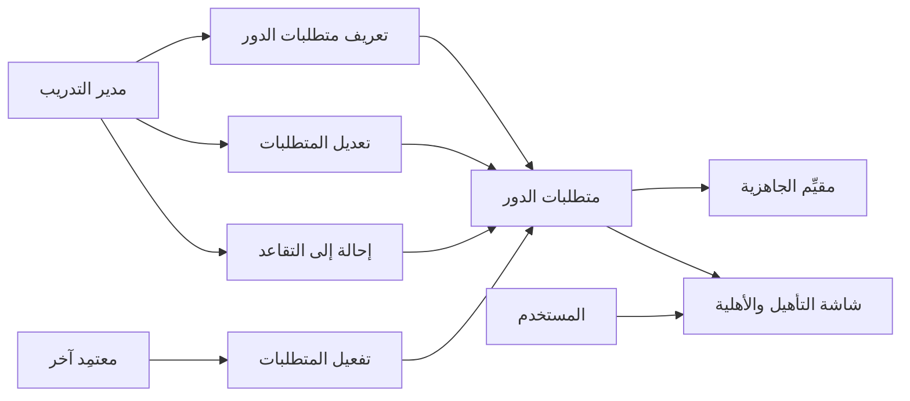
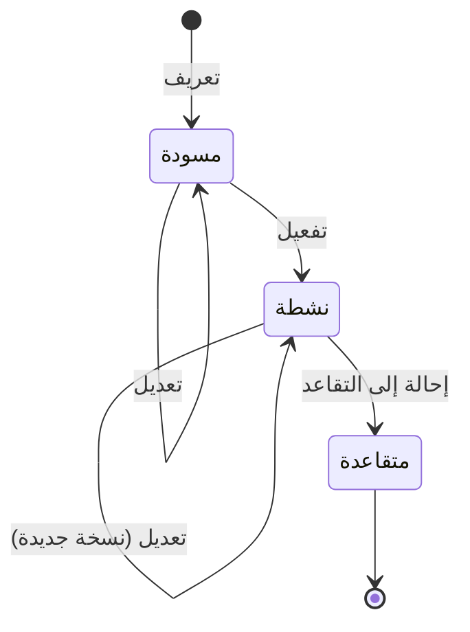

# متطلبات الأدوار

<!-- BEGIN GENERATED: doc -->
| البند | القيمة |
|---|---|
| المعرّف | FEAT-RES-ROLE-REQUIREMENTS |
| الإصدار | 0.2 |
| الحالة | مسودة |
| القدرة | CAP-08 الموارد والجاهزية |
| القدرة الفرعية | CAP-08.04 الكفاءة والأهلية (R1 (الأهلية فقط)) |
| الأدوار | مدير التدريب؛ مسؤول الإدارة |
| الشاشات | SCR-42 التأهيل والأهلية |
| حالات الاستخدام | UC-102 |
| القصص | 6: 4 من المواصفة، و2 جديدة |
<!-- END GENERATED: doc -->

## 1. نظرة عامة

### 1.1 القيمة

يحدد مدير التدريب ما يلزم كل دور من مؤهلات وخبرات، ليُبنى عليه الحكم بالأهلية.

### 1.2 النطاق

| البند | القيمة |
|---|---|
| المستخدمون | مدير التدريب؛ مسؤول الإدارة |
| الشاشات | شاشة التأهيل والأهلية (SCR-42) |
| حالات الاستخدام بالكلام | تعريف متطلبات دور جديدة من كتالوج الكفاءات المعتمد؛ تعديلها وهي مسودة أو نشطة؛ تفعيلها بمعتمِد غير من عرّفها؛ إحالتها إلى التقاعد بسبب؛ عرض متطلبات الأدوار ونسخها السابقة؛ تحريرها من شاشة واحدة |
| المتطلبات بالكلام | حساب جاهزية شخص أو وحدة من متطلبات الدور والكفاءات والمؤهلات والشهادات والتدريب الحديث والخبرة |
| خارج النطاق | فحص الأهلية نفسه لشخص بعينه ضمن طلب تخصيص (ميزة أخرى)؛ كتالوج الكفاءات ومرجعياته |

### 1.3 خريطة الميزة

**الشكل 1: خريطة ميزة متطلبات الأدوار**



القصة تحمل متطلبات الدور عبر حالتين غير نهائيتين وحالة نهائية، كما في **الشكل 2**.

**الشكل 2: رحلة متطلبات الدور**



## 2. القواعد المشتركة

تنطبق على كل قصص الميزة، فلا تتكرر داخل القصص. وكل قصة تذكر ما يخصها فقط.

### 2.1 السياق المشترك

كل قصة تبدأ من ثلاثة شروط: مستأجر نشط، وحزمة السياسات الأساسية مفعّلة، ومستخدم مسجّل الدخول ومخوَّل. وتشير إليها القصص بخطوة واحدة: «بفرض السياق المشترك للميزة».

### 2.2 الصلاحية وعدم الإفصاح

- من لا يحق له رؤية العنصر يتلقى ردًا بشكل «غير متاح» تمامًا، فلا يعرف أنه موجود.
- من يرى العنصر ولا يحق له الإجراء يتلقى «لا تملك صلاحية هذا الإجراء».

### 2.3 أوامر تغيير الحالة

- **منع التكرار:** يُرسل كل أمر بمفتاح فريد، فإعادة الطلب نفسه لا تُنفَّذ مرتين.
- **حماية التعديل المتزامن:** يُرسل كل أمر بإصدار البيانات الذي يراه المستخدم. فإن عدّلها غيره في الأثناء، يُرفض الأمر.
- **السجل:** إن نجح الأمر، يُكتب حدثه وسجل التدقيق في المعاملة نفسها.

### 2.4 الرفض المشترك

```gherkin
# language: ar
خاصية: الرفض المشترك لأوامر الميزة

  سيناريو مخطط: رفض مشترك لكل أمر في الميزة
    بفرض السياق المشترك للميزة
    و <الحالة>
    عندما يُرسل المستخدم أي أمر من أوامر الميزة
    اذاً يُرفض برمز <الرمز> ويرى "<الرسالة>"
    و لا يتغير شيء

    امثلة:
      | الحالة                                  | الرمز                  | الرسالة                                                 |
      | العنصر خارج صلاحياته                    | NOT_FOUND              | غير متاح                                                |
      | العنصر مرئي له ولا يحق له الإجراء       | AUTHZ_DENIED           | لا تملك صلاحية هذا الإجراء                              |
      | غيره عدّل العنصر بعد أن فتحه            | VERSION_CONFLICT       | تغيّرت البيانات منذ فتحتها. راجع التغييرات ثم أعد المحاولة |
      | أعاد مفتاح منع التكرار بمحتوى مختلف     | IDEMPOTENCY_KEY_REUSED | طلب مكرر بمحتوى مختلف                                   |
      | البيانات ناقصة أو غير صحيحة             | VALIDATION_FAILED      | بعض البيانات ناقصة أو غير صحيحة. راجع الحقول المعلَّمة      |

  سيناريو: إعادة الطلب نفسه لا تُنفَّذ مرتين
    بفرض السياق المشترك للميزة
    و أمر نجح بمفتاح منع تكرار
    عندما يُعاد الطلب نفسه بالمفتاح نفسه
    اذاً تُعاد النتيجة الأولى ولا يُكتب حدث ثانٍ
```

## 3. الجودة وتعريف الاكتمال

### 3.1 متطلبات الجودة

<!-- BEGIN GENERATED: quality -->
لا متطلبات جودة مرتبطة بمتطلبات هذه الميزة مباشرة. تنطبق متطلبات المنصة العامة (`FEAT-PLT-*`).
<!-- END GENERATED: quality -->

### 3.2 تعريف الاكتمال

القصة مكتملة حين تتحقق الشروط الخمسة:

1. سيناريوهاتها والقواعد المشتركة تمر في الاختبار الآلي.
2. فحوص البنية المعمارية تمر.
3. نصوص الواجهة والرسائل موجودة بالعربية والإنجليزية.
4. مراجعة الكود مكتملة.
5. ما تضيفه القصة نفسها في قسم «القواعد» تحقق.

## 4. فهرس القصص

<!-- BEGIN GENERATED: story-index -->
| المعرّف | القصة | النوع | الحالة |
|---|---|---|---|
| `US-BC05-RRQ-ACTIVATE` | تفعيل متطلبات الدور | أمر | مسودة |
| `US-BC05-RRQ-DEFINE` | تعريف متطلبات الدور | أمر | مسودة |
| `US-BC05-RRQ-EDIT` | تعديل متطلبات الدور | أمر | مسودة |
| `US-BC05-RRQ-RETIRE` | إحالة متطلبات الدور إلى التقاعد | أمر | مسودة |
| `US-DOM-RRQ-LIST` | عرض متطلبات الأدوار ونسخها | جلب | مسودة |
| `US-UI-SCR42-ROLE-REQUIREMENTS` | تحرير متطلبات الدور ونسخها واعتمادها | واجهة | مسودة |
<!-- END GENERATED: story-index -->

## 5. القصص

### 5.1 US-BC05-RRQ-ACTIVATE — تفعيل متطلبات الدور

| النوع | الإصدار | الأولوية | دون اتصال | الحالة |
|---|---|---|---|---|
| أمر | R1 | Must | لا | مسودة |

> **كـ** مدير التدريب، وليس من عرَّف المتطلبات، **أريد** أن أفعّل متطلبات دور مسودة بعد مراجعتها، **حتى** يبدأ العمل بها في حساب الأهلية.

**باختصار:** يفعّل معتمِد غير من عرَّف المتطلبات متطلبات الدور «المسودة»، فتصير «نشطة».

#### القواعد

- **متى يُسمح:** متطلبات الدور «مسودة».
- **من يُسمح له:** مدير التدريب أو مسؤول الإدارة، على ألا يكون المعتمِد من عرَّفها (فصل المهام).
- **الأثر:** متطلبات الدور تصير «نشطة»، ويُسجَّل حدث «فُعِّلت متطلبات الدور» يصل إلى مقيِّم الجاهزية وذاكرة الأهلية المؤقتة.

#### معايير القبول

```gherkin
# language: ar
خاصية: تفعيل متطلبات الدور

  سيناريو: معتمِد غير المعرِّف يفعّل المتطلبات
    بفرض السياق المشترك للميزة
    و متطلبات دور "مسودة" عرّفها شخص آخر
    عندما يفعّلها المعتمِد
    اذاً تصبح حالتها "نشطة"
    و يُسجَّل حدث "فُعِّلت متطلبات الدور"

  سيناريو مخطط: رفض خاص بالتفعيل
    بفرض السياق المشترك للميزة
    و <الحالة>
    عندما يحاول المعتمِد تفعيل المتطلبات
    اذاً يُرفض برمز <الرمز> ويرى <الرسالة>
    و لا يتغير شيء

    امثلة:
      | الحالة                              | الرمز                                     | الرسالة                                              |
      | المعتمِد هو من عرَّف المتطلبات نفسه | SEGREGATION_OF_DUTIES                     | لا يجوز أن يعتمد الشخص نفسه ما قدّمه أو طلبه         |
      | متطلبات الدور "نشطة" أو "متقاعدة"   | ROLE_REQUIREMENT_INVALID_STATE_TRANSITION | الوضع الحالي لمتطلبات الدور لا يسمح بهذا الإجراء    |
```

<details><summary>المراجع التقنية والتتبع</summary>

<!-- BEGIN GENERATED: refs US-BC05-RRQ-ACTIVATE -->
| البند | المعرّف | المعنى |
|---|---|---|
| الواجهة البرمجية | `POST /api/v1/readiness/role-requirements/{id}/actions/activate` | — |
| الأمر | `CMD-RRQ-ACTIVATE` | تفعيل متطلبات الدور |
| السياسة | `POL-RRQ-ACTIVATE` | Training Manager / Administrator؛ tenant match; object visible; owner/pool scope |
| الحدث | `EVT-RRQ-ACTIVATED` | يصل إلى: Readiness evaluator; Eligibility cache |
| الكيان | `AGG-ROLE-REQUIREMENT` | متطلبات الدور |
| الجدول | `readiness.role_requirements` | الجدول الرئيسي لمتطلبات الدور |
| وحدة النشر | DU-14 | — |
| المتطلب | REQ-RES-013 | The system shall evaluate readiness of a person or unit from role requirements, competencies, qualifications,… |
| حالة الاستخدام | UC-102 | Check Eligibility |
| الاختبار | TST-ROLE-REQUIREMENT-SM، TST-SLC09-INVARIANTS | دورة حالات متطلبات الدور، وثوابت الشريحة SLC-09 |
<!-- END GENERATED: refs US-BC05-RRQ-ACTIVATE -->

</details>

### 5.2 US-BC05-RRQ-DEFINE — تعريف متطلبات الدور

| النوع | الإصدار | الأولوية | دون اتصال | الحالة |
|---|---|---|---|---|
| أمر | R1 | Must | لا | مسودة |

> **كـ** مدير التدريب، **أريد** أن أعرّف متطلبات الجاهزية لدور: كفاءات، مؤهلات، شهادات، تدريب حديث، خبرة، **حتى** يُبنى عليها حكم الأهلية لاحقًا.

**باختصار:** يعرّف مدير التدريب متطلبات دور موجود، مرجعيةً إلى كتالوج الكفاءات، فتصير «مسودة» بانتظار التفعيل.

#### القواعد

- **متى يُسمح:** الدور موجود، والمتطلبات تشير إلى كتالوج الكفاءات المعتمد.
- **من يُسمح له:** مدير التدريب أو مسؤول الإدارة.
- **البيانات:** الدور وقائمة المتطلبات (إلزاميان).
- **الأثر:** متطلبات الدور تصير «مسودة»، ويُسجَّل حدث «عُرِّفت متطلبات الدور» يصل إلى مقيِّم الجاهزية وذاكرة الأهلية المؤقتة.

#### معايير القبول

```gherkin
# language: ar
خاصية: تعريف متطلبات الدور

  سيناريو: مدير التدريب يعرّف متطلبات دور جديدة
    بفرض السياق المشترك للميزة
    و دور موجود بلا متطلبات نشطة
    عندما يعرّف مدير التدريب متطلباته من كتالوج الكفاءات
    اذاً تصبح حالتها "مسودة"
    و يُسجَّل حدث "عُرِّفت متطلبات الدور"

  سيناريو مخطط: رفض خاص بالتعريف
    بفرض السياق المشترك للميزة
    و <الحالة>
    عندما يحاول مدير التدريب تعريف المتطلبات
    اذاً يُرفض برمز <الرمز> ويرى <الرسالة>
    و لا يتغير شيء

    امثلة:
      | الحالة                                                 | الرمز                    | الرسالة                        |
      | الدور غير موجود، أو متطلب لا يشير إلى كتالوج الكفاءات | ROLE_REQUIREMENT_INVALID | بيانات متطلبات الدور غير صحيحة |
```

<details><summary>المراجع التقنية والتتبع</summary>

<!-- BEGIN GENERATED: refs US-BC05-RRQ-DEFINE -->
| البند | المعرّف | المعنى |
|---|---|---|
| الواجهة البرمجية | `POST /api/v1/readiness/role-requirements` | — |
| الأمر | `CMD-RRQ-DEFINE` | تعريف متطلبات الدور |
| السياسة | `POL-RRQ-DEFINE` | Training Manager / Administrator؛ tenant match; object visible; owner/pool scope |
| الحدث | `EVT-RRQ-DEFINED` | يصل إلى: Readiness evaluator; Eligibility cache |
| الكيان | `AGG-ROLE-REQUIREMENT` | متطلبات الدور |
| الجدول | `readiness.role_requirements` | الجدول الرئيسي لمتطلبات الدور |
| وحدة النشر | DU-14 | — |
| المتطلب | REQ-RES-013 | The system shall evaluate readiness of a person or unit from role requirements, competencies, qualifications,… |
| حالة الاستخدام | UC-102 | Check Eligibility |
| الاختبار | TST-ROLE-REQUIREMENT-SM، TST-SLC09-INVARIANTS | دورة حالات متطلبات الدور، وثوابت الشريحة SLC-09 |
<!-- END GENERATED: refs US-BC05-RRQ-DEFINE -->

</details>

### 5.3 US-BC05-RRQ-EDIT — تعديل متطلبات الدور

| النوع | الإصدار | الأولوية | دون اتصال | الحالة |
|---|---|---|---|---|
| أمر | R1 | Must | لا | مسودة |

> **كـ** مدير التدريب، **أريد** أن أعدّل متطلبات دور مسودة أو نشطة، **حتى** تعكس ما استجد من كفاءات أو شهادات.

**باختصار:** يعدّل مدير التدريب قائمة المتطلبات لمتطلبات دور «مسودة» أو «نشطة». وتعديل النشطة يحفظ نسخة جديدة منها دون تغيير حالتها.

#### القواعد

- **متى يُسمح:** متطلبات الدور «مسودة» أو «نشطة»، والمتطلبات الجديدة صحيحة.
- **من يُسمح له:** مدير التدريب أو مسؤول الإدارة.
- **البيانات:** قائمة المتطلبات الجديدة (إلزامي).
- **الأثر:** تبقى الحالة كما هي ويزداد إصدارها، وتُحفظ نسخة جديدة إن كانت «نشطة». ويُسجَّل حدث «عُدِّلت متطلبات الدور» يصل إلى مقيِّم الجاهزية وذاكرة الأهلية المؤقتة.

#### معايير القبول

```gherkin
# language: ar
خاصية: تعديل متطلبات الدور

  سيناريو: مدير التدريب يعدّل متطلبات دور نشطة
    بفرض السياق المشترك للميزة
    و متطلبات دور "نشطة"
    عندما يعدّل مدير التدريب قائمة متطلباتها
    اذاً تبقى حالتها كما هي ويزداد إصدارها
    و يُسجَّل حدث "عُدِّلت متطلبات الدور"

  سيناريو مخطط: رفض خاص بالتعديل
    بفرض السياق المشترك للميزة
    و <الحالة>
    عندما يحاول مدير التدريب تعديل المتطلبات
    اذاً يُرفض برمز <الرمز> ويرى <الرسالة>
    و لا يتغير شيء

    امثلة:
      | الحالة                      | الرمز                                     | الرسالة                                           |
      | المتطلبات الجديدة غير صحيحة | ROLE_REQUIREMENT_INVALID                  | بيانات متطلبات الدور غير صحيحة                    |
      | متطلبات الدور "متقاعدة"     | ROLE_REQUIREMENT_INVALID_STATE_TRANSITION | الوضع الحالي لمتطلبات الدور لا يسمح بهذا الإجراء |
```

<details><summary>المراجع التقنية والتتبع</summary>

<!-- BEGIN GENERATED: refs US-BC05-RRQ-EDIT -->
| البند | المعرّف | المعنى |
|---|---|---|
| الواجهة البرمجية | `POST /api/v1/readiness/role-requirements/{id}/actions/edit` | — |
| الأمر | `CMD-RRQ-EDIT` | تعديل متطلبات الدور |
| السياسة | `POL-RRQ-EDIT` | Training Manager / Administrator؛ tenant match; object visible; owner/pool scope |
| الحدث | `EVT-RRQ-EDITED` | يصل إلى: Readiness evaluator; Eligibility cache |
| الكيان | `AGG-ROLE-REQUIREMENT` | متطلبات الدور |
| الجدول | `readiness.role_requirements` | الجدول الرئيسي لمتطلبات الدور |
| وحدة النشر | DU-14 | — |
| المتطلب | REQ-RES-013 | The system shall evaluate readiness of a person or unit from role requirements, competencies, qualifications,… |
| حالة الاستخدام | UC-102 | Check Eligibility |
| الاختبار | TST-ROLE-REQUIREMENT-SM، TST-SLC09-INVARIANTS | دورة حالات متطلبات الدور، وثوابت الشريحة SLC-09 |
<!-- END GENERATED: refs US-BC05-RRQ-EDIT -->

</details>

### 5.4 US-BC05-RRQ-RETIRE — إحالة متطلبات الدور إلى التقاعد

| النوع | الإصدار | الأولوية | دون اتصال | الحالة |
|---|---|---|---|---|
| أمر | R1 | Must | لا | مسودة |

> **كـ** مدير التدريب، **أريد** أن أحيل متطلبات دور نشطة إلى التقاعد بسبب حين لا تعود صالحة، **حتى** لا يُبنى عليها حكم أهلية جديد.

**باختصار:** يحيل مدير التدريب متطلبات الدور «النشطة» إلى التقاعد بسبب، فتصير «متقاعدة» نهائيًا.

#### القواعد

- **متى يُسمح:** متطلبات الدور «نشطة»، وسبب مذكور.
- **من يُسمح له:** مدير التدريب أو مسؤول الإدارة.
- **البيانات:** السبب (إلزامي).
- **الأثر:** متطلبات الدور تصير «متقاعدة» (حالة نهائية)، ويُسجَّل حدث «أُحيلت متطلبات الدور إلى التقاعد» يصل إلى مقيِّم الجاهزية وذاكرة الأهلية المؤقتة.

#### معايير القبول

```gherkin
# language: ar
خاصية: إحالة متطلبات الدور إلى التقاعد

  سيناريو: مدير التدريب يحيل متطلبات نشطة إلى التقاعد
    بفرض السياق المشترك للميزة
    و متطلبات دور "نشطة"
    عندما يحيلها مدير التدريب إلى التقاعد بسبب
    اذاً تصبح حالتها "متقاعدة"
    و يُسجَّل حدث "أُحيلت متطلبات الدور إلى التقاعد"

  سيناريو مخطط: رفض خاص بالإحالة إلى التقاعد
    بفرض السياق المشترك للميزة
    و <الحالة>
    عندما يحاول مدير التدريب إحالة المتطلبات إلى التقاعد
    اذاً يُرفض برمز <الرمز> ويرى <الرسالة>
    و لا يتغير شيء

    امثلة:
      | الحالة                            | الرمز                                     | الرسالة                                           |
      | السبب فارغ                        | REASON_REQUIRED                           | اذكر السبب                                        |
      | متطلبات الدور "مسودة" أو "متقاعدة" | ROLE_REQUIREMENT_INVALID_STATE_TRANSITION | الوضع الحالي لمتطلبات الدور لا يسمح بهذا الإجراء |
```

<details><summary>المراجع التقنية والتتبع</summary>

<!-- BEGIN GENERATED: refs US-BC05-RRQ-RETIRE -->
| البند | المعرّف | المعنى |
|---|---|---|
| الواجهة البرمجية | `POST /api/v1/readiness/role-requirements/{id}/actions/retire` | — |
| الأمر | `CMD-RRQ-RETIRE` | إحالة متطلبات الدور إلى التقاعد |
| السياسة | `POL-RRQ-RETIRE` | Training Manager / Administrator؛ tenant match; object visible; owner/pool scope |
| الحدث | `EVT-RRQ-RETIRED` | يصل إلى: Readiness evaluator; Eligibility cache |
| الكيان | `AGG-ROLE-REQUIREMENT` | متطلبات الدور |
| الجدول | `readiness.role_requirements` | الجدول الرئيسي لمتطلبات الدور |
| وحدة النشر | DU-14 | — |
| المتطلب | REQ-RES-013 | The system shall evaluate readiness of a person or unit from role requirements, competencies, qualifications,… |
| حالة الاستخدام | UC-102 | Check Eligibility |
| الاختبار | TST-ROLE-REQUIREMENT-SM، TST-SLC09-INVARIANTS | دورة حالات متطلبات الدور، وثوابت الشريحة SLC-09 |
<!-- END GENERATED: refs US-BC05-RRQ-RETIRE -->

</details>

### 5.5 US-DOM-RRQ-LIST — عرض متطلبات الأدوار ونسخها

| النوع | الإصدار | الأولوية | دون اتصال | الحالة |
|---|---|---|---|---|
| جلب | R1 | Must | لا | مسودة |

> **كـ** مدير التدريب، **أريد** قائمة متطلبات الأدوار مع نسخها السابقة، **حتى** أراجع ما تغير في متطلبات دور بمرور الزمن.

**باختصار:** تعاد متطلبات الأدوار ضمن نطاق المستخدم، مع نسخها السابقة، صفحةً بعد صفحة.

> **ملاحظة [Derived]:** لا استعلام مخصص في المواصفة؛ استُنتجت القصة من حاجة شاشة التأهيل والأهلية إلى عرض متطلبات الأدوار ونسخها (21-ui-design.md، صف SCR-42).

#### القواعد

- **من يرى ماذا:** من يقع الدور ضمن نطاقه.

#### معايير القبول

```gherkin
# language: ar
خاصية: قائمة متطلبات الأدوار ونسخها

  سيناريو: يرى المستخدم متطلبات الأدوار ضمن نطاقه
    بفرض السياق المشترك للميزة
    و متطلبات أدوار ضمن نطاقه وأخرى خارجه
    عندما يطلب قائمة متطلبات الأدوار
    اذاً تُعاد المتطلبات ضمن نطاقه فقط مع نسخها السابقة
    و لا يكشف أي عدد أو اقتراح وجود متطلبات محجوبة
```

<details><summary>المراجع التقنية والتتبع</summary>

<!-- BEGIN GENERATED: refs US-DOM-RRQ-LIST -->
| البند | المعرّف | المعنى |
|---|---|---|
| الشاشة | SCR-42 | شاشة التأهيل والأهلية |
| المصدر | `[Derived]` | — |
| المتطلب | REQ-RES-013 | The system shall evaluate readiness of a person or unit from role requirements, competencies, qualifications,… |
| حالة الاستخدام | UC-102 | Check Eligibility |
<!-- END GENERATED: refs US-DOM-RRQ-LIST -->

</details>

### 5.6 US-UI-SCR42-ROLE-REQUIREMENTS — تحرير متطلبات الدور ونسخها واعتمادها

| النوع | الإصدار | الأولوية | دون اتصال | الحالة |
|---|---|---|---|---|
| واجهة | R1 | Should | لا | مسودة |

> **كـ** المستخدم (مدير التدريب أو مسؤول الإدارة)، **أريد** شاشة واحدة أحرر فيها متطلبات دور، وأرى نسخها السابقة، وأفعّلها حين تجهز، **حتى** أدير دورة حياتها دون التنقل بين شاشات متعددة.

**باختصار:** تعرض الشاشة نموذج تحرير المتطلبات، وقائمة نسخها السابقة، وزر التفعيل حين تكون «مسودة» ومعتمِدها غير معرِّفها.

> **ملاحظة [Derived]:** تجميع التحرير والنسخ السابقة وزر التفعيل في شاشة واحدة مستنتج من حاجة شاشة التأهيل والأهلية إلى إدارة دورة حياة متطلبات الدور (21-ui-design.md، صف SCR-42).

#### معايير القبول

```gherkin
# language: ar
خاصية: تحرير متطلبات الدور

  سيناريو: متطلبات مسودة تعرض زر التفعيل لمعتمِد آخر
    بفرض السياق المشترك للميزة
    و متطلبات دور "مسودة" عرّفها مستخدم آخر
    عندما يفتح المعتمِد شاشة المتطلبات
    اذاً يرى زر "تفعيل" ونسخها السابقة

  سيناريو: متطلبات متقاعدة لا تعرض أي إجراء تعديل
    بفرض السياق المشترك للميزة
    و متطلبات دور "متقاعدة"
    عندما يفتح المستخدم شاشتها
    اذاً لا يرى زر تعديل أو تفعيل عليها
```

<details><summary>المراجع التقنية والتتبع</summary>

<!-- BEGIN GENERATED: refs US-UI-SCR42-ROLE-REQUIREMENTS -->
| البند | المعرّف | المعنى |
|---|---|---|
| الشاشة | SCR-42 | شاشة التأهيل والأهلية |
| حالة الاستخدام | UC-102 | Check Eligibility |
| المصدر | `17-security-design.md §12.4` | — |
| المصدر | `[Derived]` | — |
<!-- END GENERATED: refs US-UI-SCR42-ROLE-REQUIREMENTS -->

</details>

## 6. التتبع

<!-- BEGIN GENERATED: trace -->
| المتطلب | المعنى | القصص | الاختبار |
|---|---|---|---|
| REQ-RES-013 | The system shall evaluate readiness of a person or unit from role requirements, competencies, qualifications,… | `US-BC05-RRQ-ACTIVATE`، `US-BC05-RRQ-DEFINE`، `US-BC05-RRQ-EDIT`، `US-BC05-RRQ-RETIRE`، `US-DOM-RRQ-LIST` | TST-ROLE-REQUIREMENT-SM، TST-SLC09-INVARIANTS |
<!-- END GENERATED: trace -->

## 7. سجل التغييرات

| الإصدار | التاريخ | التغيير |
|---|---|---|
| 0.1 | — | هيكل مولَّد من خريطة الميزات |
| 0.2 | 2026-10-13 | كتابة القصص كاملة بمعيار القصص |
| 0.3 | 2026-10-13 | تصحيحات المراجعة المستقلة (الدفعة الأولى) |
