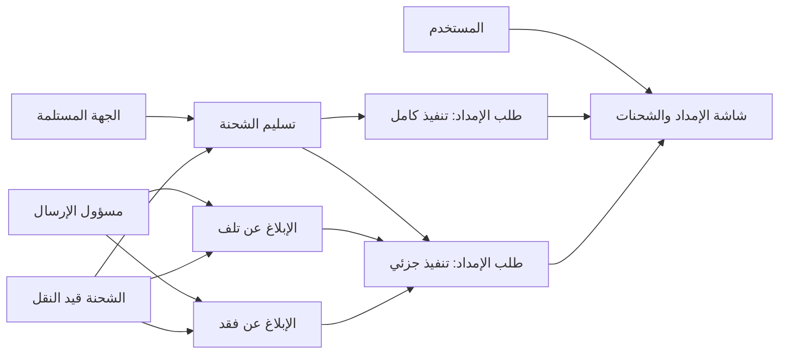
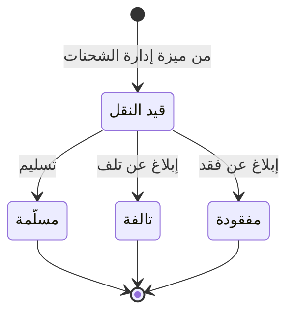

# استلام الشحنات والخسائر

<!-- BEGIN GENERATED: doc -->
| البند | القيمة |
|---|---|
| المعرّف | FEAT-RES-SHIPMENT-RECEIPT |
| الإصدار | 0.2 |
| الحالة | مسودة |
| القدرة | CAP-08 الموارد والجاهزية |
| القدرة الفرعية | CAP-08.03 الإمداد (R3) |
| الأدوار | الجهة المستلمة؛ الناقل؛ مسؤول الإرسال؛ النظام |
| الشاشات | SCR-49 الإمداد والشحنات |
| حالات الاستخدام | UC-152 |
| القصص | 7: 5 من المواصفة، و2 جديدة |
<!-- END GENERATED: doc -->

## 1. نظرة عامة

### 1.1 القيمة

تسجل الجهة المستلمة ما وصل فعلًا أو ما تلف أو فُقد، فيُغلق طلب الإمداد كاملًا أو جزئيًا بدقة.

### 1.2 النطاق

| البند | القيمة |
|---|---|
| المستخدمون | الجهة المستلمة؛ مسؤول الإرسال؛ الناقل؛ النظام |
| الشاشات | شاشة الإمداد والشحنات (SCR-49) |
| حالات الاستخدام بالكلام | تسليم الشحنة بالكمية التي وصلت فعلًا؛ الإبلاغ عن تلفها أو فقدها أثناء النقل؛ إنهاء طلب الإمداد المرتبط تلقائيًا كاملًا أو جزئيًا بحسب نتيجة الشحنة؛ عرض ملخص نتيجة الطلب وتسجيل الاستلام من شاشة واحدة |
| المتطلبات بالكلام | تتبع الكمية المسلَّمة فعلًا متمايزة عن الكمية المخطَّطة، والإبلاغ عن تلف الشحنة أو فقدها، وتحديد نتيجة طلب الإمداد تبعًا لذلك |
| خارج النطاق | تخطيط الشحنة وبدء نقلها وتسجيل نقاط عبورها وإلغاؤها (ميزة إدارة الشحنات)؛ طلب الإمداد نفسه وتخصيصه من مجمع الموارد (ميزتان أخريان) |

### 1.3 خريطة الميزة

**الشكل 1: خريطة ميزة استلام الشحنات والخسائر**



القصة تحمل الشحنة من «قيد النقل» إلى إحدى ثلاث نهايات، كما في **الشكل 2**.

**الشكل 2: رحلة الشحنة من قيد النقل إلى الاستلام**



## 2. القواعد المشتركة

تنطبق على كل قصص الميزة، فلا تتكرر داخل القصص. وكل قصة تذكر ما يخصها فقط.

### 2.1 السياق المشترك

كل قصة تبدأ من ثلاثة شروط: مستأجر نشط، وحزمة السياسات الأساسية مفعّلة، ومستخدم مسجّل الدخول ومخوَّل. وتشير إليها القصص بخطوة واحدة: «بفرض السياق المشترك للميزة».

### 2.2 الصلاحية وعدم الإفصاح

- من لا يحق له رؤية العنصر يتلقى ردًا بشكل «غير متاح» تمامًا، فلا يعرف أنه موجود.
- من يرى العنصر ولا يحق له الإجراء يتلقى «لا تملك صلاحية هذا الإجراء».

### 2.3 أوامر تغيير الحالة

- **منع التكرار:** يُرسل كل أمر بمفتاح فريد، فإعادة الطلب نفسه لا تُنفَّذ مرتين.
- **حماية التعديل المتزامن:** يُرسل كل أمر بإصدار البيانات الذي يراه المستخدم. فإن عدّلها غيره في الأثناء، يُرفض الأمر.
- **السجل:** إن نجح الأمر، يُكتب حدثه وسجل التدقيق في المعاملة نفسها.

### 2.4 الرفض المشترك

```gherkin
# language: ar
خاصية: الرفض المشترك لأوامر الميزة

  سيناريو مخطط: رفض مشترك لكل أمر في الميزة
    بفرض السياق المشترك للميزة
    و <الحالة>
    عندما يُرسل المستخدم أي أمر من أوامر الميزة
    اذاً يُرفض برمز <الرمز> ويرى "<الرسالة>"
    و لا يتغير شيء

    امثلة:
      | الحالة                                  | الرمز                  | الرسالة                                                 |
      | العنصر خارج صلاحياته                    | NOT_FOUND              | غير متاح                                                |
      | العنصر مرئي له ولا يحق له الإجراء       | AUTHZ_DENIED           | لا تملك صلاحية هذا الإجراء                              |
      | غيره عدّل العنصر بعد أن فتحه            | VERSION_CONFLICT       | تغيّرت البيانات منذ فتحتها. راجع التغييرات ثم أعد المحاولة |
      | أعاد مفتاح منع التكرار بمحتوى مختلف     | IDEMPOTENCY_KEY_REUSED | طلب مكرر بمحتوى مختلف                                   |
      | البيانات ناقصة أو غير صحيحة             | VALIDATION_FAILED      | بعض البيانات ناقصة أو غير صحيحة. راجع الحقول المعلَّمة      |

  سيناريو: إعادة الطلب نفسه لا تُنفَّذ مرتين
    بفرض السياق المشترك للميزة
    و أمر نجح بمفتاح منع تكرار
    عندما يُعاد الطلب نفسه بالمفتاح نفسه
    اذاً تُعاد النتيجة الأولى ولا يُكتب حدث ثانٍ
```

## 3. الجودة وتعريف الاكتمال

### 3.1 متطلبات الجودة

<!-- BEGIN GENERATED: quality -->
لا متطلبات جودة مرتبطة بمتطلبات هذه الميزة مباشرة. تنطبق متطلبات المنصة العامة (`FEAT-PLT-*`).
<!-- END GENERATED: quality -->

### 3.2 تعريف الاكتمال

القصة مكتملة حين تتحقق الشروط الخمسة:

1. سيناريوهاتها والقواعد المشتركة تمر في الاختبار الآلي.
2. فحوص البنية المعمارية تمر.
3. نصوص الواجهة والرسائل موجودة بالعربية والإنجليزية.
4. مراجعة الكود مكتملة.
5. ما تضيفه القصة نفسها في قسم «القواعد» تحقق.

## 4. فهرس القصص

<!-- BEGIN GENERATED: story-index -->
| المعرّف | القصة | النوع | الحالة |
|---|---|---|---|
| `US-BC05-SHP-DELIVER` | تسليم الشحنة | أمر | مسودة |
| `US-BC05-SHP-REPORT-DAMAGE` | الإبلاغ عن تلف الشحنة | أمر | مسودة |
| `US-BC05-SHP-REPORT-LOST` | الإبلاغ عن فقد الشحنة | أمر | مسودة |
| `US-BC05-S-LOGISTICS-REQUEST-06` | تلقائي: linked shipment delivered in full (طلب الإمداد) | نظام | مسودة |
| `US-BC05-S-LOGISTICS-REQUEST-07` | تلقائي: linked shipment resolved short (طلب الإمداد) | نظام | مسودة |
| `US-UI-SCR49-OUTCOME-SUMMARY` | ملخص نتيجة الطلب كاملًا أو جزئيًا | واجهة | مسودة |
| `US-UI-SCR49-RECEIPT` | تسجيل المستلم فعلًا والتالف والمفقود | واجهة | مسودة |
<!-- END GENERATED: story-index -->

## 5. القصص

### 5.1 US-BC05-SHP-DELIVER — تسليم الشحنة

| النوع | الإصدار | الأولوية | دون اتصال | الحالة |
|---|---|---|---|---|
| أمر | R3 | Must | لا | مسودة |

> **كـ** الجهة المستلمة، **أريد** أن أؤكد استلام الشحنة بالكمية التي وصلت فعلًا، **حتى** يُسجَّل ما وصل بدقة ولو كان أقل من المخطَّط.

**باختصار:** تؤكد الجهة المستلمة استلام الشحنة «قيد النقل» بكمية مستلمة لا تتجاوز الكمية المخطَّطة، فتصير «مسلَّمة»، ويُسجَّل أي نقص بدلًا من إخفائه.

#### القواعد

- **متى يُسمح:** الشحنة «قيد النقل».
- **من يُسمح له:** الجهة المستلمة.
- **البيانات:** الكمية المستلمة فعلًا (إلزامي، لا تتجاوز الكمية المخطَّطة)، من استلمها (إلزامي)، ملاحظة (اختياري).
- **الأثر:** الشحنة تصير «مسلَّمة»، ويُسجَّل حدث «سُلِّمت الشحنة» يصل إلى طلب الإمداد المرتبط فيحدِّد تنفيذه كاملًا أو جزئيًا، وإلى نتائج البحث.

#### معايير القبول

```gherkin
# language: ar
خاصية: تسليم الشحنة

  سيناريو: الجهة المستلمة تؤكد استلام الشحنة كاملة
    بفرض السياق المشترك للميزة
    و شحنة "قيد النقل" بكمية مخطَّطة معلومة
    عندما تؤكد الجهة المستلمة استلامها بالكمية الكاملة ومن استلمها
    اذاً تصبح حالتها "مسلَّمة"
    و يُسجَّل حدث "سُلِّمت الشحنة"

  سيناريو مخطط: رفض خاص بالتسليم
    بفرض السياق المشترك للميزة
    و <الحالة>
    عندما تحاول الجهة المستلمة تأكيد التسليم
    اذاً يُرفض برمز <الرمز> ويرى <الرسالة>
    و لا يتغير شيء

    امثلة:
      | الحالة                                   | الرمز                              | الرسالة                                             |
      | الكمية المستلمة أكبر من الكمية المخطَّطة | DELIVERY_INVALID                   | الكمية المسلَّمة أكبر من المخطط أو لم يؤكدها المستلم |
      | الشحنة ليست "قيد النقل"                   | SHIPMENT_INVALID_STATE_TRANSITION  | الوضع الحالي للشحنة لا يسمح بهذا الإجراء             |
```

<details><summary>المراجع التقنية والتتبع</summary>

<!-- BEGIN GENERATED: refs US-BC05-SHP-DELIVER -->
| البند | المعرّف | المعنى |
|---|---|---|
| الواجهة البرمجية | `POST /api/v1/readiness/shipments/{id}/actions/deliver` | — |
| الأمر | `CMD-SHP-DELIVER` | تسليم الشحنة |
| السياسة | `POL-SHP-DELIVER` | receiving party؛ tenant match; delivered_quantity ≤ planned quantity (INV-SHP-02) |
| الحدث | `EVT-SHP-DELIVERED` | يصل إلى: Logistics Request (fulfillment status); Search projection (SLC-05) |
| الكيان | `AGG-SHIPMENT` | الشحنة |
| الجدول | `readiness.shipments` | الجدول الرئيسي للشحنة |
| وحدة النشر | DU-14 | — |
| المتطلبات | REQ-LOG-004، REQ-LOG-005، REQ-LOG-006، REQ-LOG-007، REQ-LOG-009 | معانيها في القسم 6. التتبع |
| حالة الاستخدام | UC-152 | Receive Shipment or Report Loss/Damage |
| الاختبار | TST-SHIPMENT-SM، TST-SLC18-INVARIANTS | دورة حالات الشحنة، وثوابت الشريحة SLC-18 |
<!-- END GENERATED: refs US-BC05-SHP-DELIVER -->

</details>

### 5.2 US-BC05-SHP-REPORT-DAMAGE — الإبلاغ عن تلف الشحنة

| النوع | الإصدار | الأولوية | دون اتصال | الحالة |
|---|---|---|---|---|
| أمر | R3 | Must | لا | مسودة |

> **كـ** مسؤول الإرسال، **أريد** أن أبلغ عن تلف الشحنة أثناء النقل بكمية وسبب ودليل، **حتى** يُحسم طلب الإمداد المرتبط بدقة ولا يبقى منتظرًا شحنة لن تصل سليمة.

**باختصار:** يبلّغ مسؤول الإرسال عن تلف الشحنة «قيد النقل» بكمية تالفة وسبب، فتصير «تالفة».

#### القواعد

- **متى يُسمح:** الشحنة «قيد النقل».
- **من يُسمح له:** مسؤول الإرسال أو الناقل.
- **البيانات:** الكمية التالفة والسبب (إلزاميان)، والدليل (اختياري).
- **الأثر:** الشحنة تصير «تالفة»، ويُسجَّل حدث «تلفت الشحنة» يصل إلى طلب الإمداد المرتبط فيصير منفَّذًا جزئيًا، وإلى نتائج البحث.

#### معايير القبول

```gherkin
# language: ar
خاصية: الإبلاغ عن تلف الشحنة

  سيناريو: مسؤول الإرسال يبلّغ عن تلف الشحنة
    بفرض السياق المشترك للميزة
    و شحنة "قيد النقل"
    عندما يبلّغ مسؤول الإرسال عن تلفها بكمية وسبب
    اذاً تصبح حالتها "تالفة"
    و يُسجَّل حدث "تلفت الشحنة"

  سيناريو مخطط: رفض خاص بالإبلاغ عن التلف
    بفرض السياق المشترك للميزة
    و <الحالة>
    عندما يحاول مسؤول الإرسال الإبلاغ عن التلف
    اذاً يُرفض برمز <الرمز> ويرى <الرسالة>
    و لا يتغير شيء

    امثلة:
      | الحالة                  | الرمز                              | الرسالة                                  |
      | السبب فارغ              | REASON_REQUIRED                    | اذكر السبب                               |
      | الشحنة ليست "قيد النقل" | SHIPMENT_INVALID_STATE_TRANSITION  | الوضع الحالي للشحنة لا يسمح بهذا الإجراء |
```

<details><summary>المراجع التقنية والتتبع</summary>

<!-- BEGIN GENERATED: refs US-BC05-SHP-REPORT-DAMAGE -->
| البند | المعرّف | المعنى |
|---|---|---|
| الواجهة البرمجية | `POST /api/v1/readiness/shipments/{id}/actions/report-damage` | — |
| الأمر | `CMD-SHP-REPORT-DAMAGE` | الإبلاغ عن تلف الشحنة |
| السياسة | `POL-SHP-REPORT-DAMAGE` | carrier operator · dispatcher؛ tenant match |
| الحدث | `EVT-SHP-DAMAGED` | يصل إلى: Logistics Request (fulfillment status); Search projection (SLC-05) |
| الكيان | `AGG-SHIPMENT` | الشحنة |
| الجدول | `readiness.shipments` | الجدول الرئيسي للشحنة |
| وحدة النشر | DU-14 | — |
| المتطلبات | REQ-LOG-004، REQ-LOG-005، REQ-LOG-006، REQ-LOG-007، REQ-LOG-009 | معانيها في القسم 6. التتبع |
| حالة الاستخدام | UC-152 | Receive Shipment or Report Loss/Damage |
| الاختبار | TST-SHIPMENT-SM، TST-SLC18-INVARIANTS | دورة حالات الشحنة، وثوابت الشريحة SLC-18 |
<!-- END GENERATED: refs US-BC05-SHP-REPORT-DAMAGE -->

</details>

### 5.3 US-BC05-SHP-REPORT-LOST — الإبلاغ عن فقد الشحنة

| النوع | الإصدار | الأولوية | دون اتصال | الحالة |
|---|---|---|---|---|
| أمر | R3 | Must | لا | مسودة |

> **كـ** مسؤول الإرسال، **أريد** أن أبلغ عن فقد الشحنة أثناء النقل بسبب، **حتى** يُحسم طلب الإمداد المرتبط ولا يبقى منتظرًا شحنة لن تصل.

**باختصار:** يبلّغ مسؤول الإرسال عن فقد الشحنة «قيد النقل» بسبب، فتصير «مفقودة».

#### القواعد

- **متى يُسمح:** الشحنة «قيد النقل».
- **من يُسمح له:** مسؤول الإرسال أو الناقل.
- **البيانات:** السبب (إلزامي).
- **الأثر:** الشحنة تصير «مفقودة»، ويُسجَّل حدث «فُقدت الشحنة» يصل إلى طلب الإمداد المرتبط فيصير منفَّذًا جزئيًا بالكمية التي وصلت فعلًا قبل الفقد، ولو كانت صفرًا، وإلى نتائج البحث.

#### معايير القبول

```gherkin
# language: ar
خاصية: الإبلاغ عن فقد الشحنة

  سيناريو: مسؤول الإرسال يبلّغ عن فقد الشحنة
    بفرض السياق المشترك للميزة
    و شحنة "قيد النقل"
    عندما يبلّغ مسؤول الإرسال عن فقدها بسبب
    اذاً تصبح حالتها "مفقودة"
    و يُسجَّل حدث "فُقدت الشحنة"

  سيناريو مخطط: رفض خاص بالإبلاغ عن الفقد
    بفرض السياق المشترك للميزة
    و <الحالة>
    عندما يحاول مسؤول الإرسال الإبلاغ عن الفقد
    اذاً يُرفض برمز <الرمز> ويرى <الرسالة>
    و لا يتغير شيء

    امثلة:
      | الحالة                  | الرمز                              | الرسالة                                  |
      | السبب فارغ              | REASON_REQUIRED                    | اذكر السبب                               |
      | الشحنة ليست "قيد النقل" | SHIPMENT_INVALID_STATE_TRANSITION  | الوضع الحالي للشحنة لا يسمح بهذا الإجراء |
```

<details><summary>المراجع التقنية والتتبع</summary>

<!-- BEGIN GENERATED: refs US-BC05-SHP-REPORT-LOST -->
| البند | المعرّف | المعنى |
|---|---|---|
| الواجهة البرمجية | `POST /api/v1/readiness/shipments/{id}/actions/report-lost` | — |
| الأمر | `CMD-SHP-REPORT-LOST` | الإبلاغ عن فقد الشحنة |
| السياسة | `POL-SHP-REPORT-LOST` | carrier operator · dispatcher؛ tenant match |
| الحدث | `EVT-SHP-LOST` | يصل إلى: Logistics Request (fulfillment status); Search projection (SLC-05) |
| الكيان | `AGG-SHIPMENT` | الشحنة |
| الجدول | `readiness.shipments` | الجدول الرئيسي للشحنة |
| وحدة النشر | DU-14 | — |
| المتطلبات | REQ-LOG-004، REQ-LOG-005، REQ-LOG-006، REQ-LOG-007، REQ-LOG-009 | معانيها في القسم 6. التتبع |
| حالة الاستخدام | UC-152 | Receive Shipment or Report Loss/Damage |
| الاختبار | TST-SHIPMENT-SM، TST-SLC18-INVARIANTS | دورة حالات الشحنة، وثوابت الشريحة SLC-18 |
<!-- END GENERATED: refs US-BC05-SHP-REPORT-LOST -->

</details>

### 5.4 US-BC05-S-LOGISTICS-REQUEST-06 — تلقائي: linked shipment delivered in full (طلب الإمداد)

| النوع | الإصدار | الأولوية | دون اتصال | الحالة |
|---|---|---|---|---|
| نظام | R3 | Must | لا ينطبق | مسودة |

> **كـ** النظام، **أريد** أن أنقل طلب الإمداد «قيد النقل» إلى «منفَّذ بالكامل» حين تُسلَّم الشحنة المرتبطة به كاملة، **حتى** يعرف طالب الإمداد ومتابعوه أن طلبهم اكتمل تمامًا.

**باختصار:** حين تُسلَّم الشحنة المرتبطة بطلب الإمداد بكمية تساوي الكمية المطلوبة، يصير طلب الإمداد «منفَّذًا بالكامل»، ويُسجَّل الاستهلاك على التخصيص المرتبط به.

#### القواعد

- **متى يحدث:** الشحنة المرتبطة بطلب الإمداد «قيد النقل» سُلِّمت بكمية تساوي الكمية المطلوبة.
- **الأثر:** طلب الإمداد يصير «منفَّذًا بالكامل» (حالة نهائية)، ويُسجَّل الاستهلاك على التخصيص المرتبط، ويُسجَّل حدث «تم تنفيذ طلب الإمداد بالكامل».

#### معايير القبول

```gherkin
# language: ar
خاصية: تنفيذ طلب الإمداد بالكامل عند التسليم الكامل

  سيناريو: الشحنة المرتبطة سُلِّمت كاملة
    بفرض طلب إمداد "قيد النقل" وشحنته المرتبطة سُلِّمت بكمية تساوي الكمية المطلوبة
    عندما يُسجَّل تسليم الشحنة
    اذاً تصبح حالة طلب الإمداد "منفَّذ بالكامل"
    و يُسجَّل حدث "تم تنفيذ طلب الإمداد بالكامل"

  سيناريو: الشحنة سُلِّمت بأقل من الكمية المطلوبة
    بفرض طلب إمداد "قيد النقل" وشحنته المرتبطة سُلِّمت بكمية أقل من الكمية المطلوبة
    عندما يُسجَّل تسليم الشحنة
    اذاً لا تتغير حالة طلب الإمداد إلى "منفَّذ بالكامل"
```

<details><summary>المراجع التقنية والتتبع</summary>

<!-- BEGIN GENERATED: refs US-BC05-S-LOGISTICS-REQUEST-06 -->
| البند | المعرّف | المعنى |
|---|---|---|
| المحفِّز | `SYS:linked shipment delivered in full` | SLC-18 EVT-SHP-DELIVERED with delivered_quantity = requested quantity; records consumption on the linked allo… |
| الانتقال | IN_TRANSIT ← FULFILLED | — |
| الحدث | `EVT-LGR-FULFILLED` | يصل إلى: Capacity ledger (via linked allocation, SLC-09); Search projection (SLC-05) |
| الكيان | `AGG-LOGISTICS-REQUEST` | طلب الإمداد |
| الجدول | `readiness.logistics_requests` | الجدول الرئيسي لطلب الإمداد |
| وحدة النشر | DU-14 | — |
| المتطلبات | REQ-LOG-001، REQ-LOG-002، REQ-LOG-003، REQ-LOG-008، REQ-LOG-009، REQ-LOG-013، REQ-LOG-014 | معانيها في القسم 6. التتبع |
| حالة الاستخدام | UC-152 | Receive Shipment or Report Loss/Damage |
| الاختبار | TST-LOGISTICS-REQUEST-SM، TST-SLC18-INVARIANTS | دورة حالات طلب الإمداد، وثوابت الشريحة SLC-18 |
<!-- END GENERATED: refs US-BC05-S-LOGISTICS-REQUEST-06 -->

</details>

### 5.5 US-BC05-S-LOGISTICS-REQUEST-07 — تلقائي: linked shipment resolved short (طلب الإمداد)

| النوع | الإصدار | الأولوية | دون اتصال | الحالة |
|---|---|---|---|---|
| نظام | R3 | Must | لا ينطبق | مسودة |

> **كـ** النظام، **أريد** أن أنقل طلب الإمداد «قيد النقل» إلى «منفَّذ جزئيًا» حين تُسلَّم شحنته بأقل من المطلوب أو تتلف أو تُفقد، **حتى** يُسجَّل النقص بدقة ولا يُخفى بوصفه تنفيذًا كاملًا.

**باختصار:** حين تُسلَّم الشحنة المرتبطة بكمية أقل من المطلوبة، أو تُسجَّل تالفة أو مفقودة، يصير طلب الإمداد «منفَّذًا جزئيًا»، ويُسجَّل الاستهلاك بالكمية التي وصلت فعلًا قبل الحادثة، ولو كانت صفرًا.

#### القواعد

- **متى يحدث:** الشحنة المرتبطة بطلب الإمداد «قيد النقل» سُلِّمت بكمية أقل من المطلوبة، أو أُبلغ عن تلفها أو فقدها.
- **الأثر:** طلب الإمداد يصير «منفَّذًا جزئيًا» (حالة نهائية)، ويُسجَّل الاستهلاك على التخصيص المرتبط بالكمية التي وصلت فعلًا، ويُسجَّل حدث «نُفِّذ طلب الإمداد جزئيًا».

#### معايير القبول

```gherkin
# language: ar
خاصية: تنفيذ طلب الإمداد جزئيًا عند نقص التسليم أو التلف أو الفقد

  سيناريو: الشحنة سُلِّمت بأقل من الكمية المطلوبة
    بفرض طلب إمداد "قيد النقل" وشحنته المرتبطة سُلِّمت بكمية أقل من الكمية المطلوبة
    عندما يُسجَّل تسليم الشحنة
    اذاً تصبح حالة طلب الإمداد "منفَّذ جزئيًا"
    و يُسجَّل حدث "نُفِّذ طلب الإمداد جزئيًا" بالكمية التي وصلت فعلًا

  سيناريو: الشحنة أُبلغ عن تلفها أو فقدها
    بفرض طلب إمداد "قيد النقل" وشحنته المرتبطة أُبلغ عن تلفها أو فقدها
    عندما يُسجَّل البلاغ
    اذاً تصبح حالة طلب الإمداد "منفَّذ جزئيًا"
    و يُسجَّل الاستهلاك بالكمية التي وصلت فعلًا قبل الحادثة، ولو كانت صفرًا

  سيناريو: الشحنة سُلِّمت بالكامل فلا تنفيذ جزئي
    بفرض طلب إمداد "قيد النقل" وشحنته المرتبطة سُلِّمت بكمية تساوي الكمية المطلوبة
    عندما يُسجَّل تسليم الشحنة
    اذاً لا تتغير حالة طلب الإمداد إلى "منفَّذ جزئيًا"
```

<details><summary>المراجع التقنية والتتبع</summary>

<!-- BEGIN GENERATED: refs US-BC05-S-LOGISTICS-REQUEST-07 -->
| البند | المعرّف | المعنى |
|---|---|---|
| المحفِّز | `SYS:linked shipment resolved short` | SLC-18 EVT-SHP-DELIVERED with delivered_quantity < requested quantity, or EVT-SHP-DAMAGED / EVT-SHP-LOST; rec… |
| الانتقال | IN_TRANSIT ← PARTIALLY_FULFILLED | — |
| الحدث | `EVT-LGR-PARTIALLY-FULFILLED` | يصل إلى: Capacity ledger (via linked allocation, SLC-09); Search projection (SLC-05) |
| الكيان | `AGG-LOGISTICS-REQUEST` | طلب الإمداد |
| الجدول | `readiness.logistics_requests` | الجدول الرئيسي لطلب الإمداد |
| وحدة النشر | DU-14 | — |
| المتطلبات | REQ-LOG-001، REQ-LOG-002، REQ-LOG-003، REQ-LOG-008، REQ-LOG-009، REQ-LOG-013، REQ-LOG-014 | معانيها في القسم 6. التتبع |
| حالة الاستخدام | UC-152 | Receive Shipment or Report Loss/Damage |
| الاختبار | TST-LOGISTICS-REQUEST-SM، TST-SLC18-INVARIANTS | دورة حالات طلب الإمداد، وثوابت الشريحة SLC-18 |
<!-- END GENERATED: refs US-BC05-S-LOGISTICS-REQUEST-07 -->

</details>

### 5.6 US-UI-SCR49-OUTCOME-SUMMARY — ملخص نتيجة الطلب كاملًا أو جزئيًا

| النوع | الإصدار | الأولوية | دون اتصال | الحالة |
|---|---|---|---|---|
| واجهة | R3 | Must | لا | مسودة |

> **كـ** المستخدم (مستخدم الإمداد أو مقدم الطلب)، **أريد** أن أرى ملخصًا لنتيجة طلب الإمداد: ما وصل، وما تلف أو فُقد، كاملًا أو جزئيًا، **حتى** أعرف دون الرجوع لكل شحنة بمفردها هل استُوفي الطلب.

**باختصار:** تعرض الشاشة حالة طلب الإمداد النهائية مع الكمية المستلمة فعلًا وأي كمية تالفة أو مفقودة، مجمَّعة من شحناته.

#### معايير القبول

```gherkin
# language: ar
خاصية: ملخص نتيجة طلب الإمداد

  سيناريو: طلب نُفِّذ جزئيًا
    بفرض طلب إمداد "منفَّذ جزئيًا" له شحنة سُلِّمت بأقل من المطلوب
    عندما يفتح المستخدم ملخص الطلب
    اذاً يرى الكمية المستلمة فعلًا وسبب عدم اكتمالها

  سيناريو: طلب نُفِّذ بالكامل
    بفرض طلب إمداد "منفَّذ بالكامل"
    عندما يفتح المستخدم ملخص الطلب
    اذاً يرى أن الكمية المستلمة تساوي الكمية المطلوبة بالكامل
```

<details><summary>المراجع التقنية والتتبع</summary>

<!-- BEGIN GENERATED: refs US-UI-SCR49-OUTCOME-SUMMARY -->
| البند | المعرّف | المعنى |
|---|---|---|
| الشاشة | SCR-49 | شاشة الإمداد والشحنات |
| المصدر | `[Derived]` | — |
| المتطلبات | REQ-LOG-006، REQ-LOG-008 | معانيها في القسم 6. التتبع |
| حالة الاستخدام | UC-152 | Receive Shipment or Report Loss/Damage |
<!-- END GENERATED: refs US-UI-SCR49-OUTCOME-SUMMARY -->

</details>

### 5.7 US-UI-SCR49-RECEIPT — تسجيل المستلم فعلًا والتالف والمفقود

| النوع | الإصدار | الأولوية | دون اتصال | الحالة |
|---|---|---|---|---|
| واجهة | R3 | Must | لا | مسودة |

> **كـ** المستخدم (الجهة المستلمة أو مسؤول الإرسال)، **أريد** شاشة واحدة أسجل فيها ما وصل فعلًا، أو أبلغ عن تلف أو فقد، لكل شحنة، **حتى** أسجل نتيجة الاستلام بأقل خطوات دون الخلط بين الحالات الثلاث.

**باختصار:** تعرض الشاشة للشحنة «قيد النقل» ثلاثة إجراءات: تسليم بكمية مستلمة، أو إبلاغ عن تلف بكمية وسبب ودليل، أو إبلاغ عن فقد بسبب، ولا تعرض إجراءً لا يسمح به وضعها الحالي.

#### معايير القبول

```gherkin
# language: ar
خاصية: تسجيل نتيجة استلام الشحنة

  سيناريو: الشحنة قيد النقل تعرض الإجراءات الثلاثة
    بفرض شحنة "قيد النقل" ضمن نطاق المستخدم
    عندما يفتح المستخدم شاشة الشحنة
    اذاً يرى أزرار "تسليم" و"تلف" و"فقد"

  سيناريو: شحنة محسومة لا تعرض أي إجراء
    بفرض شحنة "مسلَّمة" أو "تالفة" أو "مفقودة"
    عندما يفتح المستخدم شاشة الشحنة
    اذاً لا يرى أي إجراء تغيير حالة عليها
```

<details><summary>المراجع التقنية والتتبع</summary>

<!-- BEGIN GENERATED: refs US-UI-SCR49-RECEIPT -->
| البند | المعرّف | المعنى |
|---|---|---|
| الشاشة | SCR-49 | شاشة الإمداد والشحنات |
| المتطلبات | REQ-LOG-006، REQ-LOG-007 | معانيها في القسم 6. التتبع |
| حالة الاستخدام | UC-152 | Receive Shipment or Report Loss/Damage |
<!-- END GENERATED: refs US-UI-SCR49-RECEIPT -->

</details>

## 6. التتبع

<!-- BEGIN GENERATED: trace -->
| المتطلب | المعنى | القصص | الاختبار |
|---|---|---|---|
| REQ-LOG-001 | The system shall allow an authorized actor to request a quantity of a logistics item to a destination, and sh… | `US-BC05-S-LOGISTICS-REQUEST-06`، `US-BC05-S-LOGISTICS-REQUEST-07` | TST-LOGISTICS-REQUEST-SM، TST-SLC18-INVARIANTS |
| REQ-LOG-002 | The system shall track logistics item inventory as a Resource Pool (SLC-09) rather than a separate stock mode… | `US-BC05-S-LOGISTICS-REQUEST-06`، `US-BC05-S-LOGISTICS-REQUEST-07` | TST-LOGISTICS-REQUEST-SM، TST-SLC18-INVARIANTS |
| REQ-LOG-003 | A logistics request's approval routing shall exactly follow its linked allocation's approval outcome; no sepa… | `US-BC05-S-LOGISTICS-REQUEST-06`، `US-BC05-S-LOGISTICS-REQUEST-07` | TST-LOGISTICS-REQUEST-SM، TST-SLC18-INVARIANTS |
| REQ-LOG-004 | The system shall allow dispatch of an approved logistics request only while its linked allocation remains COM… | `US-BC05-SHP-DELIVER`، `US-BC05-SHP-REPORT-DAMAGE`، `US-BC05-SHP-REPORT-LOST` | TST-SHIPMENT-SM، TST-SLC18-INVARIANTS |
| REQ-LOG-005 | The system shall record a shipment's movement as an append-only, chronologically ordered checkpoint history. | `US-BC05-SHP-DELIVER`، `US-BC05-SHP-REPORT-DAMAGE`، `US-BC05-SHP-REPORT-LOST` | TST-SHIPMENT-SM |
| REQ-LOG-006 | The system shall record the quantity actually delivered at receipt, distinct from the quantity planned, and s… | `US-BC05-SHP-DELIVER`، `US-BC05-SHP-REPORT-DAMAGE`، `US-BC05-SHP-REPORT-LOST`، `US-UI-SCR49-OUTCOME-SUMMARY`، `US-UI-SCR49-RECEIPT` | TST-SHIPMENT-SM، TST-SLC18-INVARIANTS |
| REQ-LOG-007 | The system shall allow reporting a shipment as damaged or lost in transit, recording the reason and, for dama… | `US-BC05-SHP-DELIVER`، `US-BC05-SHP-REPORT-DAMAGE`، `US-BC05-SHP-REPORT-LOST`، `US-UI-SCR49-RECEIPT` | TST-SHIPMENT-SM |
| REQ-LOG-008 | The system shall record consumption on a logistics request's linked allocation only from a confirmed shipment… | `US-BC05-S-LOGISTICS-REQUEST-06`، `US-BC05-S-LOGISTICS-REQUEST-07`، `US-UI-SCR49-OUTCOME-SUMMARY` | TST-LOGISTICS-REQUEST-SM، TST-SLC18-INVARIANTS |
| REQ-LOG-009 | The system shall allow cancelling a logistics request before dispatch, releasing its linked allocation, and s… | كل قصص الميزة المأخوذة من المواصفة (5) | TST-LOGISTICS-REQUEST-SM، TST-SHIPMENT-SM، TST-SLC18-INVARIANTS |
| REQ-LOG-013 | The system shall resolve a logistics item's identity against a per-tenant reference catalog (RD-LOGISTICS-ITE… | `US-BC05-S-LOGISTICS-REQUEST-06`، `US-BC05-S-LOGISTICS-REQUEST-07` | TST-LOGISTICS-REQUEST-SM |
| REQ-LOG-014 | Contention among logistics requests for the same pool shall be resolved exactly as SLC-09 resolves allocation… | `US-BC05-S-LOGISTICS-REQUEST-06`، `US-BC05-S-LOGISTICS-REQUEST-07` | TST-LOGISTICS-REQUEST-SM |
<!-- END GENERATED: trace -->

## 7. سجل التغييرات

| الإصدار | التاريخ | التغيير |
|---|---|---|
| 0.1 | — | هيكل مولَّد من خريطة الميزات |
| 0.2 | 2026-10-13 | كتابة القصص كاملة بمعيار القصص |
