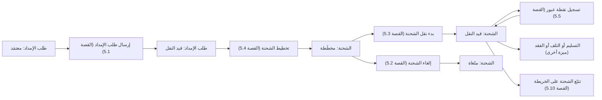
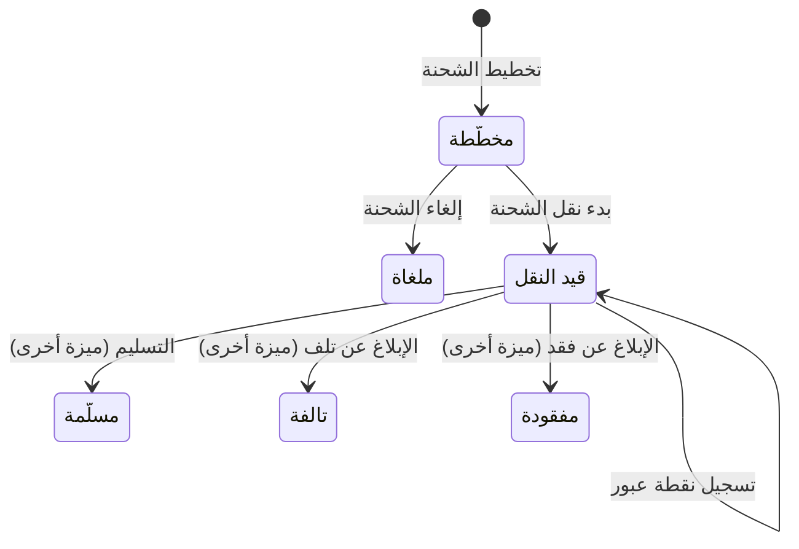

# إرسال الشحنات وتتبعها

<!-- BEGIN GENERATED: doc -->
| البند | القيمة |
|---|---|
| المعرّف | FEAT-RES-SHIPMENT-TRACKING |
| الإصدار | 0.3 |
| الحالة | مسودة |
| القدرة | CAP-08 الموارد والجاهزية |
| القدرة الفرعية | CAP-08.03 الإمداد (R3) |
| الأدوار | مسؤول الإرسال؛ الناقل |
| الشاشات | SCR-49 الإمداد والشحنات |
| حالات الاستخدام | UC-151 |
| القصص | 12: 8 من المواصفة، و4 جديدة |
<!-- END GENERATED: doc -->

## 1. نظرة عامة

### 1.1 القيمة

يرسل مسؤول الإرسال الشحنة ويتابع الجميع مسارها نقطة بنقطة حتى وصولها.

### 1.2 النطاق

| البند | القيمة |
|---|---|
| المستخدمون | مسؤول الإرسال (مستخدم الإمداد)؛ الناقل |
| الشاشات | SCR-49 الإمداد والشحنات |
| حالات الاستخدام (بالكلمات) | إرسال طلب إمداد معتمَد فتبدأ شحنته؛ تخطيط الشحنة من مجمع يحمل تخصيصًا ملتزمًا؛ بدء نقلها بتسجيل مغادرتها؛ تسجيل نقاط عبورها بالترتيب الزمني حتى تسليمها؛ إلغاؤها قبل أن تغادر؛ عرض الشحنة وقائمتها وسجل تتبعها الكامل على الخريطة |
| المتطلبات (بالكلمات) | لا إرسال إلا وتخصيص طلب الإمداد المرتبط ما زال ملتزمًا، وكمية الشحن لا تتجاوز الكمية المطلوبة؛ نقاط عبور الشحنة سجل لا يُعدَّل، يُضاف إليه فقط بترتيب زمني صارم؛ لا إلغاء للشحنة بعد مغادرتها؛ لا يرى المستخدم إلا الشحنات وطلبات الإمداد ضمن نطاقه المسموح |
| خارج النطاق | تقديم طلب الإمداد وإلغاؤه قبل إرساله (ميزة «طلب الإمداد»)؛ تسليم الشحنة والإبلاغ عن تلفها أو فقدها، وما يترتب على ذلك من استيفاء طلب الإمداد (ميزة أخرى)؛ تخصيص الموارد نفسه وسعة المجمعات (SLC-09) |

### 1.3 خريطة الميزة

**الشكل 1: من إرسال طلب الإمداد إلى تتبع الشحنة**



**الشكل 2: دورة حالات الشحنة**



## 2. القواعد المشتركة

تنطبق على كل قصص الميزة، فلا تتكرر داخل القصص. وكل قصة تذكر ما يخصها فقط.

### 2.1 السياق المشترك

كل قصة تبدأ من ثلاثة شروط: مستأجر نشط، وحزمة السياسات الأساسية مفعّلة، ومستخدم مسجّل الدخول ومخوَّل. وتشير إليها القصص بخطوة واحدة: «بفرض السياق المشترك للميزة».

### 2.2 الصلاحية وعدم الإفصاح

- من لا يحق له رؤية العنصر يتلقى ردًا بشكل «غير متاح» تمامًا، فلا يعرف أنه موجود.
- من يرى العنصر ولا يحق له الإجراء يتلقى «لا تملك صلاحية هذا الإجراء».

### 2.3 أوامر تغيير الحالة

- **منع التكرار:** يُرسل كل أمر بمفتاح فريد، فإعادة الطلب نفسه لا تُنفَّذ مرتين.
- **حماية التعديل المتزامن:** يُرسل كل أمر بإصدار البيانات الذي يراه المستخدم. فإن عدّلها غيره في الأثناء، يُرفض الأمر.
- **السجل:** إن نجح الأمر، يُكتب حدثه وسجل التدقيق في المعاملة نفسها.

### 2.4 الرفض المشترك

```gherkin
# language: ar
خاصية: الرفض المشترك لأوامر الميزة

  سيناريو مخطط: رفض مشترك لكل أمر في الميزة
    بفرض السياق المشترك للميزة
    و <الحالة>
    عندما يُرسل المستخدم أي أمر من أوامر الميزة
    اذاً يُرفض برمز <الرمز> ويرى "<الرسالة>"
    و لا يتغير شيء

    امثلة:
      | الحالة                                  | الرمز                  | الرسالة                                                 |
      | العنصر خارج صلاحياته                    | NOT_FOUND              | غير متاح                                                |
      | العنصر مرئي له ولا يحق له الإجراء       | AUTHZ_DENIED           | لا تملك صلاحية هذا الإجراء                              |
      | غيره عدّل العنصر بعد أن فتحه            | VERSION_CONFLICT       | تغيّرت البيانات منذ فتحتها. راجع التغييرات ثم أعد المحاولة |
      | أعاد مفتاح منع التكرار بمحتوى مختلف     | IDEMPOTENCY_KEY_REUSED | طلب مكرر بمحتوى مختلف                                   |
      | البيانات ناقصة أو غير صحيحة             | VALIDATION_FAILED      | بعض البيانات ناقصة أو غير صحيحة. راجع الحقول المعلَّمة      |

  سيناريو: إعادة الطلب نفسه لا تُنفَّذ مرتين
    بفرض السياق المشترك للميزة
    و أمر نجح بمفتاح منع تكرار
    عندما يُعاد الطلب نفسه بالمفتاح نفسه
    اذاً تُعاد النتيجة الأولى ولا يُكتب حدث ثانٍ
```

## 3. الجودة وتعريف الاكتمال

### 3.1 متطلبات الجودة

<!-- BEGIN GENERATED: quality -->
| المرجع | الموقف | المطلوب |
|---|---|---|
| QAS-LOG-002 | shipment dispatched to its destination | transit duration within target (tagged: recalibrate after Pilot R1 and R2 — RSK-028) |
<!-- END GENERATED: quality -->

### 3.2 تعريف الاكتمال

القصة مكتملة حين تتحقق الشروط الخمسة:

1. سيناريوهاتها والقواعد المشتركة تمر في الاختبار الآلي.
2. فحوص البنية المعمارية تمر.
3. نصوص الواجهة والرسائل موجودة بالعربية والإنجليزية.
4. مراجعة الكود مكتملة.
5. ما تضيفه القصة نفسها في قسم «القواعد» تحقق.

## 4. فهرس القصص

<!-- BEGIN GENERATED: story-index -->
| المعرّف | القصة | النوع | الحالة |
|---|---|---|---|
| `US-BC05-LGR-DISPATCH` | إرسال طلب الإمداد | أمر | مسودة |
| `US-BC05-SHP-CANCEL` | إلغاء الشحنة | أمر | مسودة |
| `US-BC05-SHP-DEPART` | بدء نقل الشحنة | أمر | مسودة |
| `US-BC05-SHP-PLAN` | تخطيط الشحنة | أمر | مسودة |
| `US-BC05-SHP-RECORD-CHECKPOINT` | تسجيل نقطة عبور لـالشحنة | أمر | مسودة |
| `US-BC05-Q-SHP-GET` | جلب: Shipment with current state and delivered/damaged/lost quantity | جلب | مسودة |
| `US-BC05-Q-SHP-LIST` | جلب: Shipments filtered by logistics request, carrier, state, window | جلب | مسودة |
| `US-BC05-Q-SHP-TRACKING` | جلب: Full checkpoint history of a shipment, in order | جلب | مسودة |
| `US-UI-SCR49-DISPATCH` | الإرسال متاح فقط والتخصيص ملتزم | واجهة | مسودة |
| `US-UI-SCR49-TRACKING-MAP` | مسار الشحنة نقطة بنقطة على الخريطة | واجهة | مسودة |
| `US-PLT-SHP-TRANSIT-METRIC` | قياس مدة نقل الشحنات مقابل الهدف | منصة | مسودة |
| `US-INT-CARRIER-CHECKPOINTS` | استقبال نقاط العبور من نظام الناقل | تكامل | مسودة |
<!-- END GENERATED: story-index -->

## 5. القصص

### 5.1 US-BC05-LGR-DISPATCH — إرسال طلب الإمداد

| النوع | الإصدار | الأولوية | دون اتصال | الحالة |
|---|---|---|---|---|
| أمر | R3 | Must | لا | مسودة |

> **كـ** مسؤول الإرسال، **أريد** إرسال طلب الإمداد المعتمَد، **حتى** تبدأ شحنته تنفيذ ما طُلب.

**باختصار:** بعد اعتماد طلب الإمداد، وبقاء تخصيصه المرتبط «ملتزمًا»، يرسله مسؤول الإرسال بتحديد الناقل وكمية الشحن (لا تتجاوز الكمية المطلوبة)، فتصبح حالته «قيد النقل» وتبدأ شحنته.

#### القواعد

- **متى يُسمح:** طلب الإمداد «معتمَد»، وتخصيصه المرتبط ما زال «ملتزمًا».
- **من يُسمح له:** مسؤول الإرسال.
- **البيانات:** الناقل (إلزامي)، وكمية الشحن (إلزامية، لا تتجاوز الكمية المطلوبة).
- **الأثر:** يُسجَّل حدث «أُرسل طلب الإمداد»، وتُخطَّط له شحنة تشير إلى الطلب والتخصيص المرتبط (القصة 5.4).

#### معايير القبول

```gherkin
# language: ar
خاصية: إرسال طلب الإمداد

  سيناريو: مسؤول الإرسال يرسل طلبًا معتمَدًا
    بفرض السياق المشترك للميزة
    و طلب إمداد "معتمَد" وتخصيصه المرتبط "ملتزم"
    عندما يرسله مسؤول الإرسال بناقل وكمية شحن لا تتجاوز الكمية المطلوبة
    اذاً تصبح حالة طلب الإمداد "قيد النقل"
    و يُسجَّل حدث "أُرسل طلب الإمداد"

  سيناريو مخطط: رفض خاص بالإرسال
    بفرض السياق المشترك للميزة
    و <الحالة>
    عندما يحاول مسؤول الإرسال إرسال الطلب
    اذاً يُرفض برمز <الرمز> ويرى <الرسالة>

    امثلة:
      | الحالة                                              | الرمز                                       | الرسالة                                       |
      | طلب الإمداد ليس في حالة "معتمَد"                    | LOGISTICS_REQUEST_INVALID_STATE_TRANSITION | الوضع الحالي لطلب الإمداد لا يسمح بهذا الإجراء |
      | التخصيص المرتبط لم يعد "ملتزمًا"                    | ALLOCATION_NOT_COMMITTED                    | التخصيص المرتبط بالطلب لم يعد ملتزمًا به       |
```

<details><summary>المراجع التقنية والتتبع</summary>

<!-- BEGIN GENERATED: refs US-BC05-LGR-DISPATCH -->
| البند | المعرّف | المعنى |
|---|---|---|
| الواجهة البرمجية | `POST /api/v1/readiness/logistics-requests/{id}/actions/dispatch` | — |
| الأمر | `CMD-LGR-DISPATCH` | إرسال طلب الإمداد |
| السياسة | `POL-LGR-DISPATCH` | dispatcher؛ tenant match; linked allocation COMMITTED (INV-LGR-02) |
| الحدث | `EVT-LGR-DISPATCHED` | يصل إلى: Capacity ledger (via linked allocation, SLC-09); Search projection (SLC-05) |
| الكيان | `AGG-LOGISTICS-REQUEST` | طلب الإمداد |
| الجدول | `readiness.logistics_requests` | الجدول الرئيسي لطلب الإمداد |
| وحدة النشر | DU-14 | — |
| المتطلبات | REQ-LOG-001، REQ-LOG-002، REQ-LOG-003، REQ-LOG-008، REQ-LOG-009، REQ-LOG-013، REQ-LOG-014 | معانيها في القسم 6. التتبع |
| حالات الاستخدام | UC-150، UC-152 | Request Logistics Items؛ Receive Shipment or Report Loss/Damage |
| الاختبار | TST-LOGISTICS-REQUEST-SM، TST-SLC18-INVARIANTS | دورة حالات طلب الإمداد، وثوابت الشريحة SLC-18 |
<!-- END GENERATED: refs US-BC05-LGR-DISPATCH -->

</details>

### 5.2 US-BC05-SHP-CANCEL — إلغاء الشحنة

| النوع | الإصدار | الأولوية | دون اتصال | الحالة |
|---|---|---|---|---|
| أمر | R3 | Must | لا | مسودة |

> **كـ** مسؤول الإرسال، **أريد** إلغاء الشحنة قبل أن تغادر، **حتى** أتراجع عن خطأ في التخطيط دون أن تتحرك بضاعة لم تُرسل.

**باختصار:** يلغي مسؤول الإرسال الشحنة «المخطَّطة» بسبب، ما دامت لم تغادر بعد، فتصبح «ملغاة».

#### القواعد

- **متى يُسمح:** الشحنة «مخطَّطة»، ولم تغادر بعد.
- **من يُسمح له:** مسؤول الإرسال.
- **البيانات:** سبب الإلغاء (إلزامي).
- **الأثر:** يُسجَّل حدث «أُلغيت الشحنة»، وينعكس ذلك على حالة استيفاء طلب الإمداد المرتبط.

#### معايير القبول

```gherkin
# language: ar
خاصية: إلغاء الشحنة

  سيناريو: إلغاء شحنة مخطَّطة لم تغادر
    بفرض السياق المشترك للميزة
    و شحنة "مخطَّطة" لم تغادر بعد
    عندما يلغيها مسؤول الإرسال بسبب
    اذاً تصبح حالتها "ملغاة"
    و يُسجَّل حدث "أُلغيت الشحنة"

  سيناريو مخطط: رفض خاص بالإلغاء
    بفرض السياق المشترك للميزة
    و <الحالة>
    عندما يحاول مسؤول الإرسال إلغاء الشحنة
    اذاً يُرفض برمز <الرمز> ويرى <الرسالة>

    امثلة:
      | الحالة                                | الرمز                         | الرسالة                                 |
      | الشحنة غادرت أو انتهت بحالة نهائية    | SHIPMENT_INVALID_STATE_TRANSITION | الوضع الحالي للشحنة لا يسمح بهذا الإجراء |
      | لم يُذكر سبب الإلغاء                  | REASON_REQUIRED               | اذكر السبب                              |
```

<details><summary>المراجع التقنية والتتبع</summary>

<!-- BEGIN GENERATED: refs US-BC05-SHP-CANCEL -->
| البند | المعرّف | المعنى |
|---|---|---|
| الواجهة البرمجية | `POST /api/v1/readiness/shipments/{id}/actions/cancel` | — |
| الأمر | `CMD-SHP-CANCEL` | إلغاء الشحنة |
| السياسة | `POL-SHP-CANCEL` | dispatcher؛ tenant match; only before departure (INV-SHP-04) |
| الحدث | `EVT-SHP-CANCELLED` | يصل إلى: Logistics Request (fulfillment status); Search projection (SLC-05) |
| الكيان | `AGG-SHIPMENT` | الشحنة |
| الجدول | `readiness.shipments` | الجدول الرئيسي للشحنة |
| وحدة النشر | DU-14 | — |
| المتطلبات | REQ-LOG-004، REQ-LOG-005، REQ-LOG-006، REQ-LOG-007، REQ-LOG-009 | معانيها في القسم 6. التتبع |
| حالة الاستخدام | UC-151 | Dispatch & Track Shipment |
| الاختبار | TST-SHIPMENT-SM، TST-SLC18-INVARIANTS | دورة حالات الشحنة، وثوابت الشريحة SLC-18 |
<!-- END GENERATED: refs US-BC05-SHP-CANCEL -->

</details>

### 5.3 US-BC05-SHP-DEPART — بدء نقل الشحنة

| النوع | الإصدار | الأولوية | دون اتصال | الحالة |
|---|---|---|---|---|
| أمر | R3 | Must | لا | مسودة |

> **كـ** الناقل أو مسؤول الإرسال، **أريد** تسجيل مغادرة الشحنة، **حتى** يبدأ تتبُّع مسارها حتى وصولها.

**باختصار:** بعد تأكيد الناقل، يبدأ نقل الشحنة «المخطَّطة» بتسجيل نقطة المغادرة، فتصبح «قيد النقل».

#### القواعد

- **متى يُسمح:** الشحنة «مخطَّطة»، والناقل مؤكِّد للمغادرة.
- **من يُسمح له:** الناقل أو مسؤول الإرسال.
- **البيانات:** ملاحظة المغادرة (اختيارية).
- **الأثر:** يُسجَّل حدث «غادرت الشحنة» مع نقطة عبور المغادرة، وينعكس ذلك على حالة استيفاء طلب الإمداد المرتبط.

#### معايير القبول

```gherkin
# language: ar
خاصية: بدء نقل الشحنة

  سيناريو: بدء نقل شحنة مخطَّطة أكَّد ناقلها المغادرة
    بفرض السياق المشترك للميزة
    و شحنة "مخطَّطة" أكَّد الناقل مغادرتها
    عندما يبدأ الناقل أو مسؤول الإرسال نقلها
    اذاً تصبح حالتها "قيد النقل"
    و يُسجَّل حدث "غادرت الشحنة" مع نقطة عبور المغادرة

  سيناريو مخطط: رفض خاص ببدء النقل
    بفرض السياق المشترك للميزة
    و <الحالة>
    عندما يحاول بدء نقل الشحنة
    اذاً يُرفض برمز <الرمز> ويرى <الرسالة>

    امثلة:
      | الحالة                                | الرمز                              | الرسالة                                    |
      | الشحنة ليست "مخطَّطة"                 | SHIPMENT_INVALID_STATE_TRANSITION  | الوضع الحالي للشحنة لا يسمح بهذا الإجراء    |
      | لم تُسجَّل نقطة مغادرة ولا تأكيد الناقل | DEPARTURE_INVALID                  | سجّل نقطة المغادرة وتأكيد الناقل |
```

<details><summary>المراجع التقنية والتتبع</summary>

<!-- BEGIN GENERATED: refs US-BC05-SHP-DEPART -->
| البند | المعرّف | المعنى |
|---|---|---|
| الواجهة البرمجية | `POST /api/v1/readiness/shipments/{id}/actions/depart` | — |
| الأمر | `CMD-SHP-DEPART` | بدء نقل الشحنة |
| السياسة | `POL-SHP-DEPART` | carrier operator · dispatcher؛ tenant match |
| الحدث | `EVT-SHP-DEPARTED` | يصل إلى: Logistics Request (fulfillment status); Search projection (SLC-05) |
| الكيان | `AGG-SHIPMENT` | الشحنة |
| الجدول | `readiness.shipments` | الجدول الرئيسي للشحنة |
| وحدة النشر | DU-14 | — |
| المتطلبات | REQ-LOG-004، REQ-LOG-005، REQ-LOG-006، REQ-LOG-007، REQ-LOG-009 | معانيها في القسم 6. التتبع |
| حالة الاستخدام | UC-151 | Dispatch & Track Shipment |
| الاختبار | TST-SHIPMENT-SM، TST-SLC18-INVARIANTS | دورة حالات الشحنة، وثوابت الشريحة SLC-18 |
<!-- END GENERATED: refs US-BC05-SHP-DEPART -->

</details>

### 5.4 US-BC05-SHP-PLAN — تخطيط الشحنة

| النوع | الإصدار | الأولوية | دون اتصال | الحالة |
|---|---|---|---|---|
| أمر | R3 | Must | لا | مسودة |

> **كـ** مسؤول الإرسال، **أريد** تخطيط شحنة تنفّذ طلب إمداد معتمَدًا، **حتى** يُحدَّد ناقلها ووجهتها وكميتها قبل مغادرتها.

**باختصار:** يخطِّط مسؤول الإرسال شحنة من مجمع يحمل تخصيصًا ملتزمًا كافيًا لطلب إمداد «معتمَد»، بكمية لا تتجاوز التخصيص الملتزم، فتُنشأ الشحنة «مخطَّطة».

#### القواعد

- **متى يُسمح:** طلب الإمداد المرتبط «معتمَد»، ومجمع المصدر يحمل كمية تخصيص ملتزمة كافية ومرئية لمسؤول الإرسال.
- **من يُسمح له:** مسؤول الإرسال.
- **البيانات:** طلب الإمداد (إلزامي)، مجمع المصدر (إلزامي)، الوجهة (إلزامية)، الناقل (إلزامي)، الكمية المخطَّطة (إلزامية، لا تتجاوز التخصيص الملتزم).
- **الأثر:** يُسجَّل حدث «خُطِّطت الشحنة»، وينعكس ذلك على حالة استيفاء طلب الإمداد المرتبط.

#### معايير القبول

```gherkin
# language: ar
خاصية: تخطيط الشحنة

  سيناريو: تخطيط شحنة لطلب إمداد معتمَد
    بفرض السياق المشترك للميزة
    و طلب إمداد "معتمَد" ومجمع مصدر يحمل تخصيصًا ملتزمًا كافيًا ومرئيًا لمسؤول الإرسال
    عندما يخطِّط مسؤول الإرسال شحنة له بوجهة وناقل وكمية لا تتجاوز التخصيص الملتزم
    اذاً تُنشأ الشحنة بحالة "مخطَّطة"
    و يُسجَّل حدث "خُطِّطت الشحنة"

  سيناريو مخطط: رفض خاص بالتخطيط
    بفرض السياق المشترك للميزة
    و <الحالة>
    عندما يحاول مسؤول الإرسال تخطيط الشحنة
    اذاً يُرفض برمز <الرمز> ويرى <الرسالة>

    امثلة:
      | الحالة                                                              | الرمز            | الرسالة                        |
      | طلب الإمداد المرتبط ليس "معتمَدًا"، أو الكمية المخطَّطة أكبر من التخصيص الملتزم | SHIPMENT_INVALID | بيانات الشحنة غير صحيحة       |
      | طلب الإمداد غير إلزامي                                             | VALIDATION_FAILED | طلب الإمداد مطلوب             |
      | مجمع المصدر غير إلزامي                                             | VALIDATION_FAILED | مجمع المصدر مطلوب             |
      | الوجهة غير إلزامية                                                 | VALIDATION_FAILED | الوجهة مطلوبة                 |
      | الناقل غير إلزامي                                                  | VALIDATION_FAILED | الناقل مطلوب                  |
      | الكمية المخطَّطة غير إلزامية                                        | VALIDATION_FAILED | الكمية المخطَّطة مطلوبة        |
```

<details><summary>المراجع التقنية والتتبع</summary>

<!-- BEGIN GENERATED: refs US-BC05-SHP-PLAN -->
| البند | المعرّف | المعنى |
|---|---|---|
| الواجهة البرمجية | `POST /api/v1/readiness/shipments` | — |
| الأمر | `CMD-SHP-PLAN` | تخطيط الشحنة |
| السياسة | `POL-SHP-PLAN` | dispatcher؛ tenant match; origin pool scope visible to actor; linked logistics request APPROVED |
| الحدث | `EVT-SHP-PLANNED` | يصل إلى: Logistics Request (fulfillment status); Search projection (SLC-05) |
| الكيان | `AGG-SHIPMENT` | الشحنة |
| الجدول | `readiness.shipments` | الجدول الرئيسي للشحنة |
| وحدة النشر | DU-14 | — |
| المتطلبات | REQ-LOG-004، REQ-LOG-005، REQ-LOG-006، REQ-LOG-007، REQ-LOG-009 | معانيها في القسم 6. التتبع |
| حالة الاستخدام | UC-151 | Dispatch & Track Shipment |
| الاختبار | TST-SHIPMENT-SM، TST-SLC18-INVARIANTS | دورة حالات الشحنة، وثوابت الشريحة SLC-18 |
<!-- END GENERATED: refs US-BC05-SHP-PLAN -->

</details>

### 5.5 US-BC05-SHP-RECORD-CHECKPOINT — تسجيل نقطة عبور لـالشحنة

| النوع | الإصدار | الأولوية | دون اتصال | الحالة |
|---|---|---|---|---|
| أمر | R3 | Must | لا | مسودة |

> **كـ** الناقل أو مسؤول الإرسال، **أريد** تسجيل نقطة عبور جديدة لشحنة قيد النقل، **حتى** يعرف الجميع مكانها لحظة بلحظة.

**باختصار:** تسجَّل نقطة عبور (موقع ووقت) للشحنة «قيد النقل» بعد النقطة السابقة زمنيًا، فتُضاف إلى سجل حركتها دون أن تتغير حالتها.

#### القواعد

- **متى يُسمح:** الشحنة «قيد النقل»، والوقت الجديد بعد وقت آخر نقطة عبور مسجَّلة.
- **من يُسمح له:** الناقل أو مسؤول الإرسال.
- **البيانات:** الموقع (إلزامي)، الوقت (إلزامي)، ملاحظة (اختيارية).
- **الأثر:** يُسجَّل حدث «سُجِّلت نقطة عبور» ويُضاف إلى سجل الحركة؛ لا تتغير حالة الشحنة.

#### معايير القبول

```gherkin
# language: ar
خاصية: تسجيل نقطة عبور للشحنة

  سيناريو: تسجيل نقطة عبور بعد سابقتها
    بفرض السياق المشترك للميزة
    و شحنة "قيد النقل" آخر نقطة عبور لها في وقت معلوم
    عندما يسجِّل الناقل أو مسؤول الإرسال نقطة عبور بموقع ووقت بعد تلك النقطة
    اذاً تُضاف نقطة العبور إلى سجل حركة الشحنة
    و تبقى حالتها "قيد النقل"
    و يُسجَّل حدث "سُجِّلت نقطة عبور"

  سيناريو مخطط: رفض خاص بتسجيل نقطة العبور
    بفرض السياق المشترك للميزة
    و <الحالة>
    عندما يحاول تسجيل نقطة عبور
    اذاً يُرفض برمز <الرمز> ويرى <الرسالة>

    امثلة:
      | الحالة                                       | الرمز                             | الرسالة                                  |
      | وقت النقطة الجديدة ليس بعد النقطة السابقة    | CHECKPOINT_INVALID                | نقطة التتبع يجب أن تكون بعد النقطة السابقة |
      | الشحنة ليست "قيد النقل"                      | SHIPMENT_INVALID_STATE_TRANSITION | الوضع الحالي للشحنة لا يسمح بهذا الإجراء  |
```

<details><summary>المراجع التقنية والتتبع</summary>

<!-- BEGIN GENERATED: refs US-BC05-SHP-RECORD-CHECKPOINT -->
| البند | المعرّف | المعنى |
|---|---|---|
| الواجهة البرمجية | `POST /api/v1/readiness/shipments/{id}/actions/record-checkpoint` | — |
| الأمر | `CMD-SHP-RECORD-CHECKPOINT` | تسجيل نقطة عبور لـالشحنة |
| السياسة | `POL-SHP-RECORD-CHECKPOINT` | carrier operator · dispatcher؛ tenant match; checkpoint strictly after the previous one (INV-SHP-01) |
| الحدث | `EVT-SHP-CHECKPOINT-RECORDED` | يصل إلى: Logistics Request (fulfillment status); Search projection (SLC-05) |
| الكيان | `AGG-SHIPMENT` | الشحنة |
| الجدول | `readiness.shipments` | الجدول الرئيسي للشحنة |
| وحدة النشر | DU-14 | — |
| المتطلبات | REQ-LOG-004، REQ-LOG-005، REQ-LOG-006، REQ-LOG-007، REQ-LOG-009 | معانيها في القسم 6. التتبع |
| حالة الاستخدام | UC-151 | Dispatch & Track Shipment |
| الاختبار | TST-SHIPMENT-SM، TST-SLC18-INVARIANTS | دورة حالات الشحنة، وثوابت الشريحة SLC-18 |
<!-- END GENERATED: refs US-BC05-SHP-RECORD-CHECKPOINT -->

</details>

### 5.6 US-BC05-Q-SHP-GET — جلب: Shipment with current state and delivered/damaged/lost quantity

| النوع | الإصدار | الأولوية | دون اتصال | الحالة |
|---|---|---|---|---|
| جلب | R3 | Must | لا | مسودة |

> **كـ** أي مستخدم مخوَّل، **أريد** جلب تفاصيل شحنة ضمن نطاقي، **حتى** أعرف حالتها والكمية المسلَّمة أو التالفة أو المفقودة فيها.

**باختصار:** تُعاد تفاصيل الشحنة الحالية لمن يحق له رؤيتها فقط، بعد فحص صلاحيته مجددًا.

#### القواعد

- **من يرى ماذا:** من تقع الشحنة ضمن نطاقه المسموح فقط.

#### معايير القبول

```gherkin
# language: ar
خاصية: جلب تفاصيل الشحنة

  سيناريو: يرى المستخدم شحنة ضمن نطاقه
    بفرض السياق المشترك للميزة
    و شحنة ضمن نطاق المستخدم المسموح
    عندما يطلب تفاصيلها
    اذاً تُعاد حالتها الحالية والكمية المسلَّمة أو التالفة أو المفقودة
```

<details><summary>المراجع التقنية والتتبع</summary>

<!-- BEGIN GENERATED: refs US-BC05-Q-SHP-GET -->
| البند | المعرّف | المعنى |
|---|---|---|
| الواجهة البرمجية | `GET /api/v1/readiness/shipments/{shipment_id}` | — |
| الاستعلام | `QRY-SHP-GET` | Shipment with current state and delivered/damaged/lost quantity |
| السياسة | `POL-SHP-GET` | allowed_scope |
| الكيان | `AGG-SHIPMENT` | الشحنة |
| الجدول | `readiness.shipments` | الجدول الرئيسي للشحنة |
| وحدة النشر | DU-14 | — |
| المتطلب | REQ-LOG-011 | The system shall let an authorized actor list and filter shipments by logistics request, carrier, state and w… |
| حالة الاستخدام | UC-151 | Dispatch & Track Shipment |
| الاختبار | TST-SHIPMENT-SM، TST-SLC18-INVARIANTS | دورة حالات الشحنة، وثوابت الشريحة SLC-18 |
<!-- END GENERATED: refs US-BC05-Q-SHP-GET -->

</details>

### 5.7 US-BC05-Q-SHP-LIST — جلب: Shipments filtered by logistics request, carrier, state, window

| النوع | الإصدار | الأولوية | دون اتصال | الحالة |
|---|---|---|---|---|
| جلب | R3 | Must | لا | مسودة |

> **كـ** أي مستخدم مخوَّل، **أريد** قائمة الشحنات مصفّاة بطلب الإمداد أو الناقل أو الحالة أو فترة زمنية، **حتى** أتابع شحنات نطاقي دون أن أفتح كلًّا منها.

**باختصار:** تُعاد الشحنات التي يحق للمستخدم رؤيتها فقط، صفحةً بعد صفحة، ولا يكشف عددها وجود شحنات محجوبة.

**المرشحات:** طلب الإمداد · الناقل · الحالة · فترة زمنية.

#### القواعد

- **من يرى ماذا:** من تقع الشحنة ضمن نطاقه المسموح فقط.

#### معايير القبول

```gherkin
# language: ar
خاصية: قائمة الشحنات

  سيناريو: يرى المستخدم شحنات نطاقه فقط
    بفرض السياق المشترك للميزة
    و شحنات داخل نطاق المستخدم وأخرى خارجه
    عندما يطلب قائمة الشحنات بمرشِّح
    اذاً تُعاد الشحنات داخل نطاقه فقط، ويُعاد فحص صلاحية كل منها
    و لا يكشف أي عدد أو اقتراح وجود شحنة محجوبة
```

<details><summary>المراجع التقنية والتتبع</summary>

<!-- BEGIN GENERATED: refs US-BC05-Q-SHP-LIST -->
| البند | المعرّف | المعنى |
|---|---|---|
| الواجهة البرمجية | `GET /api/v1/readiness/shipments` | — |
| الاستعلام | `QRY-SHP-LIST` | Shipments filtered by logistics request, carrier, state, window |
| السياسة | `POL-SHP-LIST` | allowed_scope |
| الكيان | `AGG-SHIPMENT` | الشحنة |
| الجدول | `readiness.shipments` | الجدول الرئيسي للشحنة |
| وحدة النشر | DU-14 | — |
| المتطلب | REQ-LOG-011 | The system shall let an authorized actor list and filter shipments by logistics request, carrier, state and w… |
| حالة الاستخدام | UC-151 | Dispatch & Track Shipment |
| الاختبار | TST-SHIPMENT-SM، TST-SLC18-INVARIANTS | دورة حالات الشحنة، وثوابت الشريحة SLC-18 |
<!-- END GENERATED: refs US-BC05-Q-SHP-LIST -->

</details>

### 5.8 US-BC05-Q-SHP-TRACKING — جلب: Full checkpoint history of a shipment, in order

| النوع | الإصدار | الأولوية | دون اتصال | الحالة |
|---|---|---|---|---|
| جلب | R3 | Should | لا | مسودة |

> **كـ** أي مستخدم مخوَّل، **أريد** سجل نقاط عبور الشحنة كاملًا بترتيبه الزمني، **حتى** أعرف مسارها نقطة بنقطة حتى لحظتها الحالية.

**باختصار:** يُعاد سجل نقاط عبور الشحنة بترتيبه الزمني الكامل لمن يحق له رؤيتها فقط.

#### القواعد

- **من يرى ماذا:** من تقع الشحنة ضمن نطاقه المسموح فقط.

#### معايير القبول

```gherkin
# language: ar
خاصية: سجل تتبع الشحنة

  سيناريو: يرى المستخدم سجل التتبع الكامل لشحنة ضمن نطاقه
    بفرض السياق المشترك للميزة
    و شحنة ضمن نطاق المستخدم لها عدة نقاط عبور
    عندما يطلب سجل تتبعها
    اذاً تُعاد كل نقاط العبور بترتيبها الزمني دون تكرار ولا فجوة
```

<details><summary>المراجع التقنية والتتبع</summary>

<!-- BEGIN GENERATED: refs US-BC05-Q-SHP-TRACKING -->
| البند | المعرّف | المعنى |
|---|---|---|
| الواجهة البرمجية | `GET /api/v1/readiness/shipments/{shipment_id}/checkpoints` | — |
| الاستعلام | `QRY-SHP-TRACKING` | Full checkpoint history of a shipment, in order |
| السياسة | `POL-SHP-TRACKING` | allowed_scope |
| الكيان | `AGG-SHIPMENT` | الشحنة |
| الجدول | `readiness.shipments` | الجدول الرئيسي للشحنة |
| وحدة النشر | DU-14 | — |
| المتطلب | REQ-LOG-012 | The system shall provide the full, ordered checkpoint history of a shipment to an authorized actor. |
| حالة الاستخدام | UC-151 | Dispatch & Track Shipment |
| الاختبار | TST-SHIPMENT-SM، TST-SLC18-INVARIANTS | دورة حالات الشحنة، وثوابت الشريحة SLC-18 |
<!-- END GENERATED: refs US-BC05-Q-SHP-TRACKING -->

</details>

### 5.9 US-UI-SCR49-DISPATCH — الإرسال متاح فقط والتخصيص ملتزم

| النوع | الإصدار | الأولوية | دون اتصال | الحالة |
|---|---|---|---|---|
| واجهة | R3 | Must | لا | مسودة |

> **كـ** مسؤول الإرسال، **أريد** أن يظهر زر الإرسال فقط على طلب إمداد معتمَد تخصيصه ملتزم، **حتى** لا أحاول إرسال طلب لا يصح إرساله.

**باختصار:** تُظهر شاشة الإمداد والشحنات زر «إرسال» على طلب الإمداد «المعتمَد» وحده، وتخفيه أو تعطّله حين لا يعود تخصيصه المرتبط «ملتزمًا».

#### القواعد

- **متى يحدث:** عند عرض طلب إمداد على الشاشة.
- **الأثر:** زر الإرسال يظهر فعّالًا فقط حين تتحقق شرطا الحالة والتخصيص معًا؛ وأي محاولة إرسال رغم ذلك تُرفض بالقواعد نفسها في القصة 5.1.

#### معايير القبول

```gherkin
# language: ar
خاصية: توفر زر الإرسال

  سيناريو: زر الإرسال يظهر على طلب معتمَد وتخصيصه ملتزم
    بفرض السياق المشترك للميزة
    و طلب إمداد "معتمَد" وتخصيصه المرتبط "ملتزم"
    عندما يفتح مسؤول الإرسال تفاصيله
    اذاً يظهر زر الإرسال فعّالًا

  سيناريو: زر الإرسال يختفي حين يفقد التخصيص التزامه
    بفرض السياق المشترك للميزة
    و طلب إمداد "معتمَد" فقد تخصيصه المرتبط حالة "ملتزم"
    عندما يفتح مسؤول الإرسال تفاصيله
    اذاً لا يظهر زر الإرسال فعّالًا
```

<details><summary>المراجع التقنية والتتبع</summary>

<!-- BEGIN GENERATED: refs US-UI-SCR49-DISPATCH -->
| البند | المعرّف | المعنى |
|---|---|---|
| الشاشة | SCR-49 | شاشة الإمداد والشحنات |
| المتطلب | REQ-LOG-004 | The system shall allow dispatch of an approved logistics request only while its linked allocation remains COM… |
| حالة الاستخدام | UC-151 | Dispatch & Track Shipment |
<!-- END GENERATED: refs US-UI-SCR49-DISPATCH -->

</details>

### 5.10 US-UI-SCR49-TRACKING-MAP — مسار الشحنة نقطة بنقطة على الخريطة

| النوع | الإصدار | الأولوية | دون اتصال | الحالة |
|---|---|---|---|---|
| واجهة | R3 | Should | لا | مسودة |

> **كـ** مسؤول الإرسال، **أريد** أن أرى مسار الشحنة على خريطة تصل نقاط عبورها بترتيبها الزمني، **حتى** أتابع تقدُّمها بنظرة واحدة لا بقراءة جدول.

**باختصار:** تعرض شاشة الإمداد والشحنات مسار الشحنة على الخريطة خطًّا يصل نقاط عبورها بترتيبها الزمني، آخرها موقعها الحالي.

> **ملاحظة [Derived]:** المصدر يصف تصميم الخريطة العام (`21-ui-design.md` §7) وسجل التتبع الكامل (القصة 5.8)، ولا يصف عرض مسار الشحنة بعينه على الخريطة؛ فافترضنا هذا العرض.

#### القواعد

- **من يرى ماذا:** من تقع الشحنة ضمن نطاقه المسموح فقط.

#### معايير القبول

```gherkin
# language: ar
خاصية: مسار الشحنة على الخريطة

  سيناريو: عرض مسار شحنة ضمن نطاق المستخدم
    بفرض السياق المشترك للميزة
    و شحنة ضمن نطاق المستخدم لها عدة نقاط عبور
    عندما يفتح مسؤول الإرسال مسارها على الخريطة
    اذاً يُرسم خط يصل نقاط عبورها بترتيبها الزمني
    و تُعلَّم آخر نقطة بأنها الموقع الحالي
```

<details><summary>المراجع التقنية والتتبع</summary>

<!-- BEGIN GENERATED: refs US-UI-SCR49-TRACKING-MAP -->
| البند | المعرّف | المعنى |
|---|---|---|
| الشاشة | SCR-49 | شاشة الإمداد والشحنات |
| المصدر | `21-ui-design.md §7` | — |
| المصدر | `[Derived]` | — |
| المتطلب | REQ-LOG-012 | The system shall provide the full, ordered checkpoint history of a shipment to an authorized actor. |
| حالة الاستخدام | UC-151 | Dispatch & Track Shipment |
<!-- END GENERATED: refs US-UI-SCR49-TRACKING-MAP -->

</details>

### 5.11 US-PLT-SHP-TRANSIT-METRIC — قياس مدة نقل الشحنات مقابل الهدف

| النوع | الإصدار | الأولوية | دون اتصال | الحالة |
|---|---|---|---|---|
| منصة | R3 | Must | لا ينطبق | مسودة |

> **كـ** فريق المنصة، **أريد** أن أقيس المدة بين إرسال الشحنة وتسليمها مقابل هدف محدد، **حتى** أكشف تجاوز الهدف وأعيد ضبطه عند الحاجة.

**باختصار:** تُقاس مدة النقل من إرسال الشحنة إلى تسليمها لكل شحنة، وتُقارن بالهدف المحدد لمعرفة التجاوز.

#### القواعد

- **البيانات:** وقت الإرسال، وقت التسليم، الهدف المحدد لمدة النقل.

#### معايير القبول

```gherkin
# language: ar
خاصية: قياس مدة نقل الشحنات

  سيناريو: مدة نقل شحنة ضمن الهدف
    بفرض شحنة أُرسلت ثم سُلِّمت
    عندما تُقاس مدة نقلها
    اذاً تُسجَّل المدة الفعلية مقارنةً بالهدف المحدد

  سيناريو: مدة نقل شحنة تجاوزت الهدف
    بفرض شحنة استغرق نقلها أكثر من الهدف المحدد
    عندما تُقاس مدة نقلها
    اذاً يُعلَّم تجاوز الهدف لمراجعته
```

> **ملاحظة:** الهدف الرقمي لمدة النقل يُعاد ضبطه بعد الدفعتين التجريبيتين R1 وR2 (RSK-028)، فلا رقم ثابت هنا.

<details><summary>المراجع التقنية والتتبع</summary>

<!-- BEGIN GENERATED: refs US-PLT-SHP-TRANSIT-METRIC -->
| البند | المعرّف | المعنى |
|---|---|---|
| الجودة | QAS-LOG-002 | shipment dispatched to its destination → transit duration within target (tagged: recalibrate after Pilot R1 a… |
| المتطلب | REQ-LOG-004 | The system shall allow dispatch of an approved logistics request only while its linked allocation remains COM… |
| حالة الاستخدام | UC-151 | Dispatch & Track Shipment |
<!-- END GENERATED: refs US-PLT-SHP-TRANSIT-METRIC -->

</details>

### 5.12 US-INT-CARRIER-CHECKPOINTS — استقبال نقاط العبور من نظام الناقل

| النوع | الإصدار | الأولوية | دون اتصال | الحالة |
|---|---|---|---|---|
| تكامل | R3 | Should | لا ينطبق | مسودة |

> **كـ** محوّل نظام الناقل، **أريد** استقبال نقاط عبور الشحنة من نظام الناقل بهوية حساب خدمة، **حتى** يتحدَّث مسار الشحنة دون تسجيل يدوي لكل نقطة.

**باختصار:** يسحب المحوّل نقاط عبور من نظام الناقل ويترجمها إلى أمر تسجيل نقطة عبور بهوية حساب خدمة؛ والنقطة التي لا تأتي بعد سابقتها زمنيًا تُحجز للمراجعة بدل أن تُرفض بصمت.

> **ملاحظة [Derived]:** تصميم التكامل العام (`20-integration-design.md` §3) يصف المحوّل وطبقة مكافحة الفساد لكل نظام خارجي، ولا يذكر نظام الناقل بعينه؛ فطبّقنا النمط نفسه عليه.

#### القواعد

- **متى يحدث:** عند استقبال نقطة عبور جديدة من نظام الناقل.
- **البيانات (الرسالة المتبادلة):** سجل نظام الناقل يُترجم إلى الموقع والوقت والملاحظة قبل إرساله كأمر داخلي.
- **الأثر:** الأمر الداخلي يُطبَّق بالقواعد نفسها لتسجيل نقطة العبور (القصة 5.5).

#### معايير القبول

```gherkin
# language: ar
خاصية: استقبال نقاط العبور من نظام الناقل

  سيناريو: استقبال نقطة عبور صالحة
    بفرض السياق المشترك للميزة
    و شحنة "قيد النقل" ونقطة عبور جديدة من نظام الناقل بعد آخر نقطة مسجَّلة
    عندما يترجمها المحوّل إلى أمر تسجيل نقطة عبور بهوية حساب الخدمة
    اذاً تُضاف نقطة العبور إلى سجل حركة الشحنة بالقواعد نفسها

  سيناريو: نقطة عبور لا تأتي بعد سابقتها زمنيًا
    بفرض السياق المشترك للميزة
    و نقطة عبور من نظام الناقل بوقت قبل آخر نقطة مسجَّلة أو مساويًا له
    عندما يعالجها المحوّل
    اذاً تُحجز للمراجعة بسببها
    و لا يُضاف شيء إلى سجل حركة الشحنة
```

<details><summary>المراجع التقنية والتتبع</summary>

<!-- BEGIN GENERATED: refs US-INT-CARRIER-CHECKPOINTS -->
| البند | المعرّف | المعنى |
|---|---|---|
| المصدر | `20-integration-design.md §3` | — |
| المصدر | `[Derived]` | — |
| المتطلب | REQ-LOG-005 | The system shall record a shipment's movement as an append-only, chronologically ordered checkpoint history. |
| حالة الاستخدام | UC-151 | Dispatch & Track Shipment |
<!-- END GENERATED: refs US-INT-CARRIER-CHECKPOINTS -->

</details>

## 6. التتبع

<!-- BEGIN GENERATED: trace -->
| المتطلب | المعنى | القصص | الاختبار |
|---|---|---|---|
| REQ-LOG-001 | The system shall allow an authorized actor to request a quantity of a logistics item to a destination, and sh… | `US-BC05-LGR-DISPATCH` | TST-LOGISTICS-REQUEST-SM، TST-SLC18-INVARIANTS |
| REQ-LOG-002 | The system shall track logistics item inventory as a Resource Pool (SLC-09) rather than a separate stock mode… | `US-BC05-LGR-DISPATCH` | TST-LOGISTICS-REQUEST-SM، TST-SLC18-INVARIANTS |
| REQ-LOG-003 | A logistics request's approval routing shall exactly follow its linked allocation's approval outcome; no sepa… | `US-BC05-LGR-DISPATCH` | TST-LOGISTICS-REQUEST-SM، TST-SLC18-INVARIANTS |
| REQ-LOG-004 | The system shall allow dispatch of an approved logistics request only while its linked allocation remains COM… | `US-BC05-SHP-CANCEL`، `US-BC05-SHP-DEPART`، `US-BC05-SHP-PLAN`، `US-BC05-SHP-RECORD-CHECKPOINT`، `US-PLT-SHP-TRANSIT-METRIC`، `US-UI-SCR49-DISPATCH` | TST-SHIPMENT-SM، TST-SLC18-INVARIANTS |
| REQ-LOG-005 | The system shall record a shipment's movement as an append-only, chronologically ordered checkpoint history. | `US-BC05-SHP-CANCEL`، `US-BC05-SHP-DEPART`، `US-BC05-SHP-PLAN`، `US-BC05-SHP-RECORD-CHECKPOINT`، `US-INT-CARRIER-CHECKPOINTS` | TST-SHIPMENT-SM |
| REQ-LOG-006 | The system shall record the quantity actually delivered at receipt, distinct from the quantity planned, and s… | `US-BC05-SHP-CANCEL`، `US-BC05-SHP-DEPART`، `US-BC05-SHP-PLAN`، `US-BC05-SHP-RECORD-CHECKPOINT` | TST-SHIPMENT-SM، TST-SLC18-INVARIANTS |
| REQ-LOG-007 | The system shall allow reporting a shipment as damaged or lost in transit, recording the reason and, for dama… | `US-BC05-SHP-CANCEL`، `US-BC05-SHP-DEPART`، `US-BC05-SHP-PLAN`، `US-BC05-SHP-RECORD-CHECKPOINT` | TST-SHIPMENT-SM |
| REQ-LOG-008 | The system shall record consumption on a logistics request's linked allocation only from a confirmed shipment… | `US-BC05-LGR-DISPATCH` | TST-LOGISTICS-REQUEST-SM، TST-SLC18-INVARIANTS |
| REQ-LOG-009 | The system shall allow cancelling a logistics request before dispatch, releasing its linked allocation, and s… | كل قصص الأوامر والنظام في الميزة (5) | TST-LOGISTICS-REQUEST-SM، TST-SHIPMENT-SM، TST-SLC18-INVARIANTS |
| REQ-LOG-011 | The system shall let an authorized actor list and filter shipments by logistics request, carrier, state and w… | `US-BC05-Q-SHP-GET`، `US-BC05-Q-SHP-LIST` | — |
| REQ-LOG-012 | The system shall provide the full, ordered checkpoint history of a shipment to an authorized actor. | `US-BC05-Q-SHP-TRACKING`، `US-UI-SCR49-TRACKING-MAP` | — |
| REQ-LOG-013 | The system shall resolve a logistics item's identity against a per-tenant reference catalog (RD-LOGISTICS-ITE… | `US-BC05-LGR-DISPATCH` | TST-LOGISTICS-REQUEST-SM |
| REQ-LOG-014 | Contention among logistics requests for the same pool shall be resolved exactly as SLC-09 resolves allocation… | `US-BC05-LGR-DISPATCH` | TST-LOGISTICS-REQUEST-SM |
<!-- END GENERATED: trace -->

> **ملاحظة [Needs Review]:** يربط الجدول أعلاه REQ-LOG-004 (الذي نصّه خاص بـ `CMD-LGR-DISPATCH`/حالة الرفض `ALLOCATION_NOT_COMMITTED`) بكل قصص أوامر الشحنة (السطور 225، 286، 347، 409، 471، 656، 745 وجدول §6 أعلاه)، وذلك بسبب حقل `traces.satisfies` الواسع في ترويسة `AGG-SHIPMENT.md` الذي ينسخه المولِّد حرفيًا. هذا خلل في بيانات المصدر (ترويسة `AGG-SHIPMENT.md`) لا في نص القصص المؤلَّف، ويلزم تصحيحه في المصدر خارج نطاق هذا الملف.

## 7. سجل التغييرات

| الإصدار | التاريخ | التغيير |
|---|---|---|
| 0.1 | — | هيكل مولَّد من خريطة الميزات |
| 0.2 | 2026-10-13 | كتابة القصص كاملة بمعيار القصص |
| 0.3 | 2026-10-13 | تصحيحات المراجعة المستقلة (الدفعة الأولى) |
