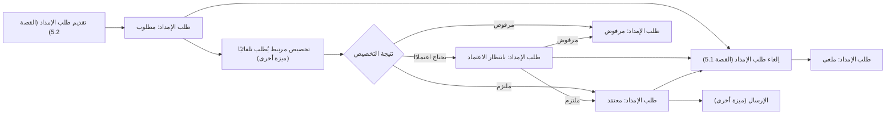
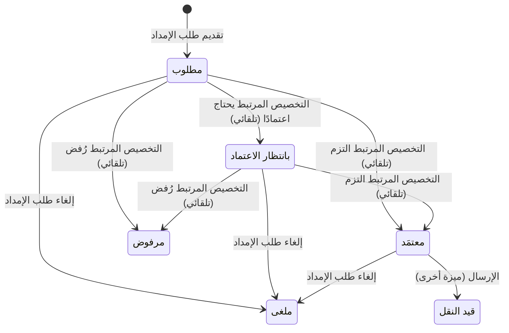

# طلب الإمداد

<!-- BEGIN GENERATED: doc -->
| البند | القيمة |
|---|---|
| المعرّف | FEAT-RES-SUPPLY-REQUEST |
| الإصدار | 0.2 |
| الحالة | مسودة |
| القدرة | CAP-08 الموارد والجاهزية |
| القدرة الفرعية | CAP-08.03 الإمداد (R3) |
| الأدوار | ضابط الإمداد؛ المخطِّط؛ النظام |
| الشاشات | SCR-49 الإمداد والشحنات |
| حالات الاستخدام | UC-150 |
| القصص | 13: 9 من المواصفة، و4 جديدة |
<!-- END GENERATED: doc -->

## 1. نظرة عامة

### 1.1 القيمة

يطلب ضابط الإمداد أو المخطط كمية من صنف إلى وجهة ويتابع موافقتها أو رفضها حتى تصبح جاهزة للإرسال.

### 1.2 النطاق

| البند | القيمة |
|---|---|
| المستخدمون | ضابط الإمداد؛ المخطِّط؛ مقدِّم الطلب أو سلطة الإمداد (الإلغاء) |
| الشاشات | SCR-49 الإمداد والشحنات |
| حالات الاستخدام (بالكلمات) | تقديم طلب إمداد بكمية من صنف إلى وجهة، فيُطلب تخصيص موارد له تلقائيًا؛ متابعة موافقة التخصيص أو رفضه أو حاجته إلى اعتماد، تلقائيًا بتغير حالة الطلب؛ إلغاء الطلب قبل إرساله؛ عرض الطلب وقائمته بمرشحاتها؛ اشتقاق تصنيف الطلب |
| المتطلبات (بالكلمات) | كل طلب إمداد يصدر عنه تخصيص واحد بالضبط في المعاملة نفسها، ولا طلب بلا تخصيص؛ حالة الطلب تتبع حالة تخصيصه وحده، ولا اعتماد مستقل على مستوى الطلب؛ هوية الصنف تُحل من فهرس كل مستأجر لا من قائمة ثابتة؛ التزاحم على مجمع واحد يُحسم بالأولوية ثم وقت الطلب كما في تخصيص الموارد؛ لا يرى المستخدم إلا طلبات نطاقه المسموح |
| خارج النطاق | إرسال الطلب المعتمَد وتخطيط الشحنة وتتبعها (ميزة «إرسال الشحنات وتتبعها»)؛ تسليم الشحنة واستيفاء الطلب النهائي (ميزة أخرى)؛ آلية الموافقة والتخصيص نفسها (SLC-09) |

### 1.3 خريطة الميزة

**الشكل 1: من تقديم الطلب إلى اعتماده**



**الشكل 2: دورة حالات طلب الإمداد**



## 2. القواعد المشتركة

تنطبق على كل قصص الميزة، فلا تتكرر داخل القصص. وكل قصة تذكر ما يخصها فقط.

### 2.1 السياق المشترك

كل قصة تبدأ من ثلاثة شروط: مستأجر نشط، وحزمة السياسات الأساسية مفعّلة، ومستخدم مسجّل الدخول ومخوَّل. وتشير إليها القصص بخطوة واحدة: «بفرض السياق المشترك للميزة».

### 2.2 الصلاحية وعدم الإفصاح

- من لا يحق له رؤية العنصر يتلقى ردًا بشكل «غير متاح» تمامًا، فلا يعرف أنه موجود.
- من يرى العنصر ولا يحق له الإجراء يتلقى «لا تملك صلاحية هذا الإجراء».

### 2.3 أوامر تغيير الحالة

- **منع التكرار:** يُرسل كل أمر بمفتاح فريد، فإعادة الطلب نفسه لا تُنفَّذ مرتين.
- **حماية التعديل المتزامن:** يُرسل كل أمر بإصدار البيانات الذي يراه المستخدم. فإن عدّلها غيره في الأثناء، يُرفض الأمر.
- **السجل:** إن نجح الأمر، يُكتب حدثه وسجل التدقيق في المعاملة نفسها.

### 2.4 الرفض المشترك

```gherkin
# language: ar
خاصية: الرفض المشترك لأوامر الميزة

  سيناريو مخطط: رفض مشترك لكل أمر في الميزة
    بفرض السياق المشترك للميزة
    و <الحالة>
    عندما يُرسل المستخدم أي أمر من أوامر الميزة
    اذاً يُرفض برمز <الرمز> ويرى "<الرسالة>"
    و لا يتغير شيء

    امثلة:
      | الحالة                                  | الرمز                  | الرسالة                                                 |
      | العنصر خارج صلاحياته                    | NOT_FOUND              | غير متاح                                                |
      | العنصر مرئي له ولا يحق له الإجراء       | AUTHZ_DENIED           | لا تملك صلاحية هذا الإجراء                              |
      | غيره عدّل العنصر بعد أن فتحه            | VERSION_CONFLICT       | تغيّرت البيانات منذ فتحتها. راجع التغييرات ثم أعد المحاولة |
      | أعاد مفتاح منع التكرار بمحتوى مختلف     | IDEMPOTENCY_KEY_REUSED | طلب مكرر بمحتوى مختلف                                   |
      | البيانات ناقصة أو غير صحيحة             | VALIDATION_FAILED      | بعض البيانات ناقصة أو غير صحيحة. راجع الحقول المعلَّمة      |

  سيناريو: إعادة الطلب نفسه لا تُنفَّذ مرتين
    بفرض السياق المشترك للميزة
    و أمر نجح بمفتاح منع تكرار
    عندما يُعاد الطلب نفسه بالمفتاح نفسه
    اذاً تُعاد النتيجة الأولى ولا يُكتب حدث ثانٍ
```

## 3. الجودة وتعريف الاكتمال

### 3.1 متطلبات الجودة

<!-- BEGIN GENERATED: quality -->
لا متطلبات جودة مرتبطة بمتطلبات هذه الميزة مباشرة. تنطبق متطلبات المنصة العامة (`FEAT-PLT-*`).
<!-- END GENERATED: quality -->

### 3.2 تعريف الاكتمال

القصة مكتملة حين تتحقق الشروط الخمسة:

1. سيناريوهاتها والقواعد المشتركة تمر في الاختبار الآلي.
2. فحوص البنية المعمارية تمر.
3. نصوص الواجهة والرسائل موجودة بالعربية والإنجليزية.
4. مراجعة الكود مكتملة.
5. ما تضيفه القصة نفسها في قسم «القواعد» تحقق.

## 4. فهرس القصص

<!-- BEGIN GENERATED: story-index -->
| المعرّف | القصة | النوع | الحالة |
|---|---|---|---|
| `US-BC05-LGR-CANCEL` | إلغاء طلب الإمداد | أمر | مسودة |
| `US-BC05-LGR-REQUEST` | تقديم طلب الإمداد | أمر | مسودة |
| `US-BC05-Q-LGR-GET` | جلب: Logistics request with linked allocation and shipment refs | جلب | مسودة |
| `US-BC05-Q-LGR-LIST` | جلب: Logistics requests filtered by item, destination, state, priority | جلب | مسودة |
| `US-BC05-S-LOGISTICS-REQUEST-01` | تلقائي: اعتماد طلب الإمداد عند التزام تخصيصه | نظام | مسودة |
| `US-BC05-S-LOGISTICS-REQUEST-02` | تلقائي: تعليق طلب الإمداد بانتظار اعتماد تخصيصه | نظام | مسودة |
| `US-BC05-S-LOGISTICS-REQUEST-03` | تلقائي: رفض طلب الإمداد عند رفض تخصيصه | نظام | مسودة |
| `US-BC05-S-LOGISTICS-REQUEST-04` | تلقائي: اعتماد طلب الإمداد بعد انتظار الاعتماد | نظام | مسودة |
| `US-BC05-S-LOGISTICS-REQUEST-05` | تلقائي: رفض طلب الإمداد بعد انتظار الاعتماد | نظام | مسودة |
| `US-DOM-LGR-LABEL` | اشتقاق تصنيف طلب الإمداد والشحنة | نظام | مسودة |
| `US-UI-SCR49-REQUEST-FORM` | طلب إمداد من فهرس الأصناف وحالة تخصيصه | واجهة | مسودة |
| `US-UI-SCR49-REQUEST-LIST` | قائمة طلبات الإمداد بمرشحاتها وروابطها | واجهة | مسودة |
| `US-INT-ERP-INVENTORY` | مقارنة مخزون الأصناف في ERP بالمجمعات | تكامل | مسودة |
<!-- END GENERATED: story-index -->

## 5. القصص

### 5.1 US-BC05-LGR-CANCEL — إلغاء طلب الإمداد

| النوع | الإصدار | الأولوية | دون اتصال | الحالة |
|---|---|---|---|---|
| أمر | R3 | Must | لا | مسودة |

> **كـ** مقدِّم الطلب أو سلطة الإمداد، **أريد** إلغاء طلب الإمداد قبل إرساله، **حتى** أتراجع عنه وأُحرِّر تخصيصه لغيره.

**باختصار:** يلغي مقدِّم الطلب أو سلطة الإمداد طلب الإمداد بسبب ما دام لم يُرسل بعد، فتصير حالته «ملغى»، ويُحرَّر تخصيصه إن كان «ملتزمًا».

#### القواعد

- **متى يُسمح:** طلب الإمداد في حالة «مطلوب» أو «بانتظار الاعتماد» أو «معتمَد» (أي قبل إرساله).
- **من يُسمح له:** مقدِّم الطلب أو سلطة الإمداد.
- **البيانات:** سبب الإلغاء (إلزامي).
- **الأثر:** يُسجَّل حدث «أُلغي طلب الإمداد»؛ ويُحرَّر التخصيص المرتبط إن كان «ملتزمًا»، أو يُترك لانتهاء حجزه المبدئي إن كان بانتظار الاعتماد.

#### معايير القبول

```gherkin
# language: ar
خاصية: إلغاء طلب الإمداد

  سيناريو: إلغاء طلب إمداد قبل إرساله
    بفرض السياق المشترك للميزة
    و طلب إمداد في حالة "مطلوب" أو "بانتظار الاعتماد" أو "معتمَد"
    عندما يلغيه مقدِّم الطلب أو سلطة الإمداد بسبب
    اذاً تصبح حالته "ملغى"
    و يُسجَّل حدث "أُلغي طلب الإمداد"
    و يُحرَّر التخصيص المرتبط إن كان ملتزمًا

  سيناريو مخطط: رفض خاص بالإلغاء
    بفرض السياق المشترك للميزة
    و <الحالة>
    عندما يحاول إلغاء طلب الإمداد
    اذاً يُرفض برمز <الرمز> ويرى <الرسالة>

    امثلة:
      | الحالة                                 | الرمز                                       | الرسالة                                        |
      | الطلب أُرسل أو انتهى بحالة نهائية      | LOGISTICS_REQUEST_INVALID_STATE_TRANSITION | الوضع الحالي لطلب الإمداد لا يسمح بهذا الإجراء |
      | لم يُذكر سبب الإلغاء                   | REASON_REQUIRED                             | اذكر السبب                                     |
```

<details><summary>المراجع التقنية والتتبع</summary>

<!-- BEGIN GENERATED: refs US-BC05-LGR-CANCEL -->
| البند | المعرّف | المعنى |
|---|---|---|
| الواجهة البرمجية | `POST /api/v1/readiness/logistics-requests/{id}/actions/cancel` | — |
| الأمر | `CMD-LGR-CANCEL` | إلغاء طلب الإمداد |
| السياسة | `POL-LGR-CANCEL` | requester · logistics authority؛ tenant match |
| الحدث | `EVT-LGR-CANCELLED` | يصل إلى: Capacity ledger (via linked allocation, SLC-09); Search projection (SLC-05) |
| الكيان | `AGG-LOGISTICS-REQUEST` | طلب الإمداد |
| الجدول | `readiness.logistics_requests` | الجدول الرئيسي لطلب الإمداد |
| وحدة النشر | DU-14 | — |
| المتطلبات | REQ-LOG-001، REQ-LOG-002، REQ-LOG-003، REQ-LOG-008، REQ-LOG-009، REQ-LOG-013، REQ-LOG-014 | معانيها في القسم 6. التتبع |
| حالة الاستخدام | UC-150 | Request Logistics Items |
| الاختبار | TST-LOGISTICS-REQUEST-SM، TST-SLC18-INVARIANTS | دورة حالات طلب الإمداد، وثوابت الشريحة SLC-18 |
<!-- END GENERATED: refs US-BC05-LGR-CANCEL -->

</details>

### 5.2 US-BC05-LGR-REQUEST — تقديم طلب الإمداد

| النوع | الإصدار | الأولوية | دون اتصال | الحالة |
|---|---|---|---|---|
| أمر | R3 | Must | لا | مسودة |

> **كـ** ضابط الإمداد أو المخطِّط، **أريد** تقديم طلب إمداد بكمية من صنف إلى وجهة، **حتى** تبدأ موافقته تلقائيًا وتُحجز الكمية له.

**باختصار:** يقدِّم ضابط الإمداد أو المخطِّط طلب إمداد بصنف وكمية ووجهة وموعد حاجة وأولوية، فيُنشأ الطلب «مطلوبًا»، ويُطلب تخصيص موارد له تلقائيًا في المعاملة نفسها.

#### القواعد

- **متى يُسمح:** مجمع الصنف «نشط»، والكمية المطلوبة أكبر من صفر بوحدة المجمع.
- **من يُسمح له:** ضابط الإمداد أو المخطِّط، ومجمع الصنف مرئي له.
- **البيانات:** مجمع الصنف (إلزامي)، الكمية (إلزامية)، الوجهة (إلزامية)، موعد الحاجة (إلزامي)، الأولوية من 1 إلى 5 (إلزامية)، مبرِّر الطلب (اختياري).
- **الأثر:** يُسجَّل حدث «قُدِّم طلب الإمداد»، ويُطلب في المعاملة نفسها تخصيص موارد واحد بالضبط يستهدف هذا الطلب، فلا يبقى طلب بلا تخصيص.

#### معايير القبول

```gherkin
# language: ar
خاصية: تقديم طلب الإمداد

  سيناريو: تقديم طلب إمداد على مجمع نشط
    بفرض السياق المشترك للميزة
    و مجمع صنف "نشط" مرئي لضابط الإمداد
    عندما يقدِّم ضابط الإمداد طلبًا بكمية أكبر من صفر ووجهة وموعد حاجة وأولوية
    اذاً يُنشأ الطلب بحالة "مطلوب"
    و يُسجَّل حدث "قُدِّم طلب الإمداد"
    و يُطلب تخصيص موارد واحد يستهدف هذا الطلب في المعاملة نفسها

  سيناريو مخطط: رفض خاص بالتقديم
    بفرض السياق المشترك للميزة
    و <الحالة>
    عندما يحاول تقديم طلب الإمداد
    اذاً يُرفض برمز <الرمز> ويرى <الرسالة>

    امثلة:
      | الحالة                                       | الرمز                        | الرسالة                      |
      | مجمع الصنف ليس "نشطًا"، أو الكمية صفر أو أقل | LOGISTICS_REQUEST_INVALID    | بيانات طلب الإمداد غير صحيحة |
      | مجمع الصنف غير إلزامي                        | VALIDATION_FAILED             | مجمع الصنف مطلوب             |
      | الكمية غير إلزامية                            | VALIDATION_FAILED             | الكمية مطلوبة                |
      | الوجهة غير إلزامية                            | VALIDATION_FAILED             | الوجهة مطلوبة                |
      | موعد الحاجة غير إلزامي                        | VALIDATION_FAILED             | موعد الحاجة مطلوب            |
      | الأولوية غير إلزامية                          | VALIDATION_FAILED             | الأولوية مطلوبة              |
```

<details><summary>المراجع التقنية والتتبع</summary>

<!-- BEGIN GENERATED: refs US-BC05-LGR-REQUEST -->
| البند | المعرّف | المعنى |
|---|---|---|
| الواجهة البرمجية | `POST /api/v1/readiness/logistics-requests` | — |
| الأمر | `CMD-LGR-REQUEST` | تقديم طلب الإمداد |
| السياسة | `POL-LGR-REQUEST` | Logistics Officer / Planner؛ tenant match; item_pool visible to actor |
| الحدث | `EVT-LGR-REQUESTED` | يصل إلى: Capacity ledger (via linked allocation, SLC-09); Search projection (SLC-05) |
| الكيان | `AGG-LOGISTICS-REQUEST` | طلب الإمداد |
| الجدول | `readiness.logistics_requests` | الجدول الرئيسي لطلب الإمداد |
| وحدة النشر | DU-14 | — |
| المتطلبات | REQ-LOG-001، REQ-LOG-002، REQ-LOG-003، REQ-LOG-008، REQ-LOG-009، REQ-LOG-013، REQ-LOG-014 | معانيها في القسم 6. التتبع |
| حالة الاستخدام | UC-150 | Request Logistics Items |
| الاختبار | TST-LOGISTICS-REQUEST-SM، TST-SLC18-INVARIANTS | دورة حالات طلب الإمداد، وثوابت الشريحة SLC-18 |
<!-- END GENERATED: refs US-BC05-LGR-REQUEST -->

</details>

### 5.3 US-BC05-Q-LGR-GET — جلب: Logistics request with linked allocation and shipment refs

| النوع | الإصدار | الأولوية | دون اتصال | الحالة |
|---|---|---|---|---|
| جلب | R3 | Must | لا | مسودة |

> **كـ** أي مستخدم مخوَّل، **أريد** جلب تفاصيل طلب إمداد مع تخصيصه وشحنته المرتبطين، **حتى** أتابع مساره كاملًا من مكان واحد.

**باختصار:** تُعاد تفاصيل طلب الإمداد مع مرجعي تخصيصه وشحنته لمن يحق له رؤيته فقط، بعد فحص صلاحيته مجددًا.

#### القواعد

- **من يرى ماذا:** من يقع طلب الإمداد ضمن نطاقه المسموح، أو مقدِّم الطلب نفسه.

#### معايير القبول

```gherkin
# language: ar
خاصية: جلب تفاصيل طلب الإمداد

  سيناريو: يرى المستخدم طلبًا ضمن نطاقه
    بفرض السياق المشترك للميزة
    و طلب إمداد ضمن نطاق المستخدم المسموح
    عندما يطلب تفاصيله
    اذاً تُعاد تفاصيله مع مرجعي تخصيصه وشحنته المرتبطين
```

<details><summary>المراجع التقنية والتتبع</summary>

<!-- BEGIN GENERATED: refs US-BC05-Q-LGR-GET -->
| البند | المعرّف | المعنى |
|---|---|---|
| الواجهة البرمجية | `GET /api/v1/readiness/logistics-requests/{request_id}` | — |
| الاستعلام | `QRY-LGR-GET` | Logistics request with linked allocation and shipment refs |
| السياسة | `POL-LGR-GET` | allowed_scope; requester |
| الكيان | `AGG-LOGISTICS-REQUEST` | طلب الإمداد |
| الجدول | `readiness.logistics_requests` | الجدول الرئيسي لطلب الإمداد |
| وحدة النشر | DU-14 | — |
| المتطلب | REQ-LOG-010 | The system shall let an authorized actor list and filter logistics requests by item, destination, state and p… |
| حالة الاستخدام | UC-150 | Request Logistics Items |
| الاختبار | TST-LOGISTICS-REQUEST-SM، TST-SLC18-INVARIANTS | دورة حالات طلب الإمداد، وثوابت الشريحة SLC-18 |
<!-- END GENERATED: refs US-BC05-Q-LGR-GET -->

</details>

### 5.4 US-BC05-Q-LGR-LIST — جلب: Logistics requests filtered by item, destination, state, priority

| النوع | الإصدار | الأولوية | دون اتصال | الحالة |
|---|---|---|---|---|
| جلب | R3 | Must | لا | مسودة |

> **كـ** أي مستخدم مخوَّل، **أريد** قائمة طلبات الإمداد مصفّاة بالصنف أو الوجهة أو الحالة أو الأولوية، **حتى** أتابع طلبات نطاقي دون أن أفتح كلًّا منها.

**باختصار:** تُعاد طلبات الإمداد التي يحق للمستخدم رؤيتها فقط، صفحةً بعد صفحة، ولا يكشف عددها وجود طلبات محجوبة.

**المرشحات:** الصنف · الوجهة · الحالة · الأولوية.

#### القواعد

- **من يرى ماذا:** من يقع طلب الإمداد ضمن نطاقه المسموح فقط.

#### معايير القبول

```gherkin
# language: ar
خاصية: قائمة طلبات الإمداد

  سيناريو: يرى المستخدم طلبات نطاقه فقط
    بفرض السياق المشترك للميزة
    و طلبات إمداد داخل نطاق المستخدم وأخرى خارجه
    عندما يطلب قائمة طلبات الإمداد بمرشِّح
    اذاً تُعاد الطلبات داخل نطاقه فقط، ويُعاد فحص صلاحية كل منها
    و لا يكشف أي عدد أو اقتراح وجود طلب محجوب
```

<details><summary>المراجع التقنية والتتبع</summary>

<!-- BEGIN GENERATED: refs US-BC05-Q-LGR-LIST -->
| البند | المعرّف | المعنى |
|---|---|---|
| الواجهة البرمجية | `GET /api/v1/readiness/logistics-requests` | — |
| الاستعلام | `QRY-LGR-LIST` | Logistics requests filtered by item, destination, state, priority |
| السياسة | `POL-LGR-LIST` | allowed_scope |
| الكيان | `AGG-LOGISTICS-REQUEST` | طلب الإمداد |
| الجدول | `readiness.logistics_requests` | الجدول الرئيسي لطلب الإمداد |
| وحدة النشر | DU-14 | — |
| المتطلب | REQ-LOG-010 | The system shall let an authorized actor list and filter logistics requests by item, destination, state and p… |
| حالة الاستخدام | UC-150 | Request Logistics Items |
| الاختبار | TST-LOGISTICS-REQUEST-SM، TST-SLC18-INVARIANTS | دورة حالات طلب الإمداد، وثوابت الشريحة SLC-18 |
<!-- END GENERATED: refs US-BC05-Q-LGR-LIST -->

</details>

### 5.5 US-BC05-S-LOGISTICS-REQUEST-01 — تلقائي: اعتماد طلب الإمداد عند التزام تخصيصه

| النوع | الإصدار | الأولوية | دون اتصال | الحالة |
|---|---|---|---|---|
| نظام | R3 | Must | لا ينطبق | مسودة |

> **كـ** النظام، **أريد** نقل طلب الإمداد «المطلوب» إلى «معتمَد» حين يلتزم تخصيصه المرتبط، **حتى** تتبع حالة الطلب حالة تخصيصه دون اعتماد مستقل.

**باختصار:** حين يلتزم التخصيص المرتبط بطلب إمداد «مطلوب»، ينتقل الطلب تلقائيًا إلى «معتمَد».

#### القواعد

- **متى يحدث:** عند التزام التخصيص المرتبط بطلب الإمداد وهو في حالة «مطلوب».
- **الأثر:** يُسجَّل حدث «اعتُمد طلب الإمداد» وسجل تدقيق بهوية النظام.

#### معايير القبول

```gherkin
# language: ar
خاصية: اعتماد طلب الإمداد عند التزام تخصيصه

  سيناريو: التزام التخصيص المرتبط بطلب مطلوب
    بفرض طلب إمداد في حالة "مطلوب" وتخصيصه المرتبط يلتزم
    عندما يصل حدث التزام التخصيص
    اذاً تصبح حالة طلب الإمداد "معتمَد"
    و يُسجَّل حدث "اعتُمد طلب الإمداد" بهوية النظام

  سيناريو: لا يتغير طلب لم يلتزم تخصيصه المرتبط
    بفرض طلب إمداد في حالة "مطلوب" وتخصيصه المرتبط لم يلتزم بعد
    عندما يُفحص الطلب
    اذاً تبقى حالته "مطلوب"
    و لا يتغير شيء
```

<details><summary>المراجع التقنية والتتبع</summary>

<!-- BEGIN GENERATED: refs US-BC05-S-LOGISTICS-REQUEST-01 -->
| البند | المعرّف | المعنى |
|---|---|---|
| المحفِّز | `SYS:linked allocation committed` | SLC-09 EVT-ALC-COMMITTED for the linked allocation |
| الانتقال | REQUESTED ← APPROVED | — |
| الحدث | `EVT-LGR-APPROVED` | يصل إلى: Capacity ledger (via linked allocation, SLC-09); Search projection (SLC-05) |
| الكيان | `AGG-LOGISTICS-REQUEST` | طلب الإمداد |
| الجدول | `readiness.logistics_requests` | الجدول الرئيسي لطلب الإمداد |
| وحدة النشر | DU-14 | — |
| المتطلبات | REQ-LOG-001، REQ-LOG-002، REQ-LOG-003، REQ-LOG-008، REQ-LOG-009، REQ-LOG-013، REQ-LOG-014 | معانيها في القسم 6. التتبع |
| حالة الاستخدام | UC-150 | Request Logistics Items |
| الاختبار | TST-LOGISTICS-REQUEST-SM، TST-SLC18-INVARIANTS | دورة حالات طلب الإمداد، وثوابت الشريحة SLC-18 |
<!-- END GENERATED: refs US-BC05-S-LOGISTICS-REQUEST-01 -->

</details>

### 5.6 US-BC05-S-LOGISTICS-REQUEST-02 — تلقائي: تعليق طلب الإمداد بانتظار اعتماد تخصيصه

| النوع | الإصدار | الأولوية | دون اتصال | الحالة |
|---|---|---|---|---|
| نظام | R3 | Must | لا ينطبق | مسودة |

> **كـ** النظام، **أريد** نقل طلب الإمداد «المطلوب» إلى «بانتظار الاعتماد» حين يحتاج تخصيصه المرتبط اعتمادًا، **حتى** يعرف الجميع أن الطلب معلَّق لا مرفوض.

**باختصار:** حين يحتاج التخصيص المرتبط بطلب إمداد «مطلوب» اعتمادًا، ينتقل الطلب تلقائيًا إلى «بانتظار الاعتماد».

#### القواعد

- **متى يحدث:** عند احتياج التخصيص المرتبط إلى اعتماد وطلب الإمداد في حالة «مطلوب».
- **الأثر:** يُسجَّل حدث «طلب الإمداد بانتظار الاعتماد» وسجل تدقيق بهوية النظام.

#### معايير القبول

```gherkin
# language: ar
خاصية: تعليق طلب الإمداد بانتظار اعتماد تخصيصه

  سيناريو: احتياج التخصيص المرتبط اعتمادًا
    بفرض طلب إمداد في حالة "مطلوب" وتخصيصه المرتبط يحتاج اعتمادًا
    عندما يصل حدث الحاجة إلى الاعتماد
    اذاً تصبح حالة طلب الإمداد "بانتظار الاعتماد"
    و يُسجَّل حدث "طلب الإمداد بانتظار الاعتماد" بهوية النظام

  سيناريو: لا يتغير طلب لا يحتاج تخصيصه اعتمادًا
    بفرض طلب إمداد في حالة "مطلوب" وتخصيصه المرتبط لا يحتاج اعتمادًا
    عندما يُفحص الطلب
    اذاً تبقى حالته "مطلوب"
    و لا يتغير شيء
```

<details><summary>المراجع التقنية والتتبع</summary>

<!-- BEGIN GENERATED: refs US-BC05-S-LOGISTICS-REQUEST-02 -->
| البند | المعرّف | المعنى |
|---|---|---|
| المحفِّز | `SYS:linked allocation requires approval` | SLC-09 EVT-ALC-APPROVAL-REQUIRED for the linked allocation |
| الانتقال | REQUESTED ← PENDING_APPROVAL | — |
| الحدث | `EVT-LGR-PENDING-APPROVAL` | يصل إلى: Capacity ledger (via linked allocation, SLC-09); Search projection (SLC-05) |
| الكيان | `AGG-LOGISTICS-REQUEST` | طلب الإمداد |
| الجدول | `readiness.logistics_requests` | الجدول الرئيسي لطلب الإمداد |
| وحدة النشر | DU-14 | — |
| المتطلبات | REQ-LOG-001، REQ-LOG-002، REQ-LOG-003، REQ-LOG-008، REQ-LOG-009، REQ-LOG-013، REQ-LOG-014 | معانيها في القسم 6. التتبع |
| حالة الاستخدام | UC-150 | Request Logistics Items |
| الاختبار | TST-LOGISTICS-REQUEST-SM، TST-SLC18-INVARIANTS | دورة حالات طلب الإمداد، وثوابت الشريحة SLC-18 |
<!-- END GENERATED: refs US-BC05-S-LOGISTICS-REQUEST-02 -->

</details>

### 5.7 US-BC05-S-LOGISTICS-REQUEST-03 — تلقائي: رفض طلب الإمداد عند رفض تخصيصه

| النوع | الإصدار | الأولوية | دون اتصال | الحالة |
|---|---|---|---|---|
| نظام | R3 | Must | لا ينطبق | مسودة |

> **كـ** النظام، **أريد** نقل طلب الإمداد «المطلوب» إلى «مرفوض» حين يُرفض تخصيصه المرتبط، **حتى** يعرف مقدِّم الطلب أن طلبه لن يُنفَّذ وسببه.

**باختصار:** حين يُرفض التخصيص المرتبط بطلب إمداد «مطلوب»، ينتقل الطلب تلقائيًا إلى «مرفوض» بسبب الرفض نفسه.

#### القواعد

- **متى يحدث:** عند رفض التخصيص المرتبط وطلب الإمداد في حالة «مطلوب».
- **الأثر:** يُسجَّل حدث «رُفض طلب الإمداد» بسبب الرفض المنقول من التخصيص، وسجل تدقيق بهوية النظام.

#### معايير القبول

```gherkin
# language: ar
خاصية: رفض طلب الإمداد عند رفض تخصيصه

  سيناريو: رفض التخصيص المرتبط بطلب مطلوب
    بفرض طلب إمداد في حالة "مطلوب" وتخصيصه المرتبط يُرفض بسبب
    عندما يصل حدث رفض التخصيص
    اذاً تصبح حالة طلب الإمداد "مرفوض"
    و يُسجَّل حدث "رُفض طلب الإمداد" بالسبب نفسه

  سيناريو: لا يتغير طلب لم يُرفض تخصيصه المرتبط
    بفرض طلب إمداد في حالة "مطلوب" وتخصيصه المرتبط لم يُرفض
    عندما يُفحص الطلب
    اذاً تبقى حالته "مطلوب"
    و لا يتغير شيء
```

<details><summary>المراجع التقنية والتتبع</summary>

<!-- BEGIN GENERATED: refs US-BC05-S-LOGISTICS-REQUEST-03 -->
| البند | المعرّف | المعنى |
|---|---|---|
| المحفِّز | `SYS:linked allocation rejected` | SLC-09 EVT-ALC-REJECTED for the linked allocation; reason codes carried over |
| الانتقال | REQUESTED ← REJECTED | — |
| الحدث | `EVT-LGR-REJECTED` | يصل إلى: Capacity ledger (via linked allocation, SLC-09); Search projection (SLC-05) |
| الكيان | `AGG-LOGISTICS-REQUEST` | طلب الإمداد |
| الجدول | `readiness.logistics_requests` | الجدول الرئيسي لطلب الإمداد |
| وحدة النشر | DU-14 | — |
| المتطلبات | REQ-LOG-001، REQ-LOG-002، REQ-LOG-003، REQ-LOG-008، REQ-LOG-009، REQ-LOG-013، REQ-LOG-014 | معانيها في القسم 6. التتبع |
| حالة الاستخدام | UC-150 | Request Logistics Items |
| الاختبار | TST-LOGISTICS-REQUEST-SM، TST-SLC18-INVARIANTS | دورة حالات طلب الإمداد، وثوابت الشريحة SLC-18 |
<!-- END GENERATED: refs US-BC05-S-LOGISTICS-REQUEST-03 -->

</details>

### 5.8 US-BC05-S-LOGISTICS-REQUEST-04 — تلقائي: اعتماد طلب الإمداد بعد انتظار الاعتماد

| النوع | الإصدار | الأولوية | دون اتصال | الحالة |
|---|---|---|---|---|
| نظام | R3 | Must | لا ينطبق | مسودة |

> **كـ** النظام، **أريد** نقل طلب الإمداد «بانتظار الاعتماد» إلى «معتمَد» حين يلتزم تخصيصه المرتبط، **حتى** يستمر الطلب إلى الإرسال بعد أن اعتُمد تخصيصه.

**باختصار:** حين يلتزم التخصيص المرتبط بطلب إمداد «بانتظار الاعتماد»، ينتقل الطلب تلقائيًا إلى «معتمَد»، تمامًا كما ينتقل الطلب «المطلوب» (القصة 5.5) لكن من نقطة انتظار الاعتماد.

#### القواعد

- **متى يحدث:** عند التزام التخصيص المرتبط وطلب الإمداد في حالة «بانتظار الاعتماد».
- **الأثر:** يُسجَّل حدث «اعتُمد طلب الإمداد» وسجل تدقيق بهوية النظام.

#### معايير القبول

```gherkin
# language: ar
خاصية: اعتماد طلب الإمداد بعد انتظار الاعتماد

  سيناريو: التزام التخصيص المرتبط بطلب بانتظار الاعتماد
    بفرض طلب إمداد في حالة "بانتظار الاعتماد" وتخصيصه المرتبط يلتزم
    عندما يصل حدث التزام التخصيص
    اذاً تصبح حالة طلب الإمداد "معتمَد"
    و يُسجَّل حدث "اعتُمد طلب الإمداد" بهوية النظام

  سيناريو: لا يتغير طلب لم يلتزم تخصيصه المرتبط
    بفرض طلب إمداد في حالة "بانتظار الاعتماد" وتخصيصه المرتبط لا يزال بانتظار الاعتماد
    عندما يُفحص الطلب
    اذاً تبقى حالته "بانتظار الاعتماد"
    و لا يتغير شيء
```

<details><summary>المراجع التقنية والتتبع</summary>

<!-- BEGIN GENERATED: refs US-BC05-S-LOGISTICS-REQUEST-04 -->
| البند | المعرّف | المعنى |
|---|---|---|
| المحفِّز | `SYS:linked allocation committed` | SLC-09 EVT-ALC-COMMITTED for the linked allocation |
| الانتقال | PENDING_APPROVAL ← APPROVED | — |
| الحدث | `EVT-LGR-APPROVED` | يصل إلى: Capacity ledger (via linked allocation, SLC-09); Search projection (SLC-05) |
| الكيان | `AGG-LOGISTICS-REQUEST` | طلب الإمداد |
| الجدول | `readiness.logistics_requests` | الجدول الرئيسي لطلب الإمداد |
| وحدة النشر | DU-14 | — |
| المتطلبات | REQ-LOG-001، REQ-LOG-002، REQ-LOG-003، REQ-LOG-008، REQ-LOG-009، REQ-LOG-013، REQ-LOG-014 | معانيها في القسم 6. التتبع |
| حالة الاستخدام | UC-150 | Request Logistics Items |
| الاختبار | TST-LOGISTICS-REQUEST-SM، TST-SLC18-INVARIANTS | دورة حالات طلب الإمداد، وثوابت الشريحة SLC-18 |
<!-- END GENERATED: refs US-BC05-S-LOGISTICS-REQUEST-04 -->

</details>

### 5.9 US-BC05-S-LOGISTICS-REQUEST-05 — تلقائي: رفض طلب الإمداد بعد انتظار الاعتماد

| النوع | الإصدار | الأولوية | دون اتصال | الحالة |
|---|---|---|---|---|
| نظام | R3 | Must | لا ينطبق | مسودة |

> **كـ** النظام، **أريد** نقل طلب الإمداد «بانتظار الاعتماد» إلى «مرفوض» حين يُرفض تخصيصه المرتبط أو ينتهي حجزه المبدئي، **حتى** لا يبقى طلب معلَّقًا إلى الأبد.

**باختصار:** حين يُرفض التخصيص المرتبط بطلب إمداد «بانتظار الاعتماد» (برفض صريح أو بانتهاء حجزه المبدئي)، ينتقل الطلب تلقائيًا إلى «مرفوض».

#### القواعد

- **متى يحدث:** عند رفض التخصيص المرتبط أو انتهاء حجزه المبدئي، وطلب الإمداد في حالة «بانتظار الاعتماد».
- **الأثر:** يُسجَّل حدث «رُفض طلب الإمداد» وسجل تدقيق بهوية النظام.

#### معايير القبول

```gherkin
# language: ar
خاصية: رفض طلب الإمداد بعد انتظار الاعتماد

  سيناريو: رفض التخصيص المرتبط أو انتهاء حجزه المبدئي
    بفرض طلب إمداد في حالة "بانتظار الاعتماد"
    و تخصيصه المرتبط يُرفض أو ينتهي حجزه المبدئي
    عندما يصل حدث رفض التخصيص
    اذاً تصبح حالة طلب الإمداد "مرفوض"
    و يُسجَّل حدث "رُفض طلب الإمداد" بهوية النظام

  سيناريو: لا يتغير طلب لم يُرفض تخصيصه المرتبط ولم ينتهِ حجزه
    بفرض طلب إمداد في حالة "بانتظار الاعتماد" وتخصيصه المرتبط ما زال قائمًا
    عندما يُفحص الطلب
    اذاً تبقى حالته "بانتظار الاعتماد"
    و لا يتغير شيء
```

<details><summary>المراجع التقنية والتتبع</summary>

<!-- BEGIN GENERATED: refs US-BC05-S-LOGISTICS-REQUEST-05 -->
| البند | المعرّف | المعنى |
|---|---|---|
| المحفِّز | `SYS:linked allocation rejected` | SLC-09 EVT-ALC-REJECTED for the linked allocation (approval denied or provisional hold elapsed) |
| الانتقال | PENDING_APPROVAL ← REJECTED | — |
| الحدث | `EVT-LGR-REJECTED` | يصل إلى: Capacity ledger (via linked allocation, SLC-09); Search projection (SLC-05) |
| الكيان | `AGG-LOGISTICS-REQUEST` | طلب الإمداد |
| الجدول | `readiness.logistics_requests` | الجدول الرئيسي لطلب الإمداد |
| وحدة النشر | DU-14 | — |
| المتطلبات | REQ-LOG-001، REQ-LOG-002، REQ-LOG-003، REQ-LOG-008، REQ-LOG-009، REQ-LOG-013، REQ-LOG-014 | معانيها في القسم 6. التتبع |
| حالة الاستخدام | UC-150 | Request Logistics Items |
| الاختبار | TST-LOGISTICS-REQUEST-SM، TST-SLC18-INVARIANTS | دورة حالات طلب الإمداد، وثوابت الشريحة SLC-18 |
<!-- END GENERATED: refs US-BC05-S-LOGISTICS-REQUEST-05 -->

</details>

### 5.10 US-DOM-LGR-LABEL — اشتقاق تصنيف طلب الإمداد والشحنة

| النوع | الإصدار | الأولوية | دون اتصال | الحالة |
|---|---|---|---|---|
| نظام | R3 | Must | لا ينطبق | مسودة |

> **كـ** النظام، **أريد** أن أشتق تصنيف طلب الإمداد والشحنة تلقائيًا من مجمع الصنف المرتبط، **حتى** لا يبقى عنصر من هذه الدرجة بلا تصنيف أمني.

**باختصار:** عند تقديم طلب إمداد يُشتق تصنيفه من مجمع الصنف المرتبط، دون إدخال يدوي.

> **ملاحظة [Derived]:** قاعدة اشتقاق التصنيف لهذه العناصر الخمسة (ومنها طلب الإمداد والشحنة) غير محسومة في المصدر، وهي فجوة مسجَّلة صريحًا (`17-security-design.md` §10، S-26). القاعدة هنا افتراض يحتاج مراجعة المالك عند حسم القاعدة الرسمية.

#### القواعد

- **متى يحدث:** عند تقديم طلب إمداد جديد.
- **الأثر:** يحمل طلب الإمداد تصنيف مجمع الصنف المرتبط، فيتحقق شرط التصنيف لكل عنصر من الدرجة T1 أو T2. **[Derived]**

#### معايير القبول

```gherkin
# language: ar
خاصية: اشتقاق تصنيف طلب الإمداد

  سيناريو: اشتقاق تصنيف طلب جديد من مجمع الصنف
    بفرض مجمع صنف له تصنيف أمني معيَّن
    عندما يُقدَّم طلب إمداد على هذا المجمع
    اذاً يحمل طلب الإمداد التصنيف نفسه

  سيناريو: لا يتغير تصنيف ما لا صلة له بالتغيير
    بفرض طلب إمداد تصنيفه مشتق من مجمعه
    عندما يتغيّر تصنيف عنصر آخر لا صلة له بهذا الطلب
    اذاً يبقى تصنيف الطلب كما هو
    و لا يتغير شيء
```

<details><summary>المراجع التقنية والتتبع</summary>

<!-- BEGIN GENERATED: refs US-DOM-LGR-LABEL -->
| البند | المعرّف | المعنى |
|---|---|---|
| المصدر | `17-security-design.md §10` | — |
| المصدر | `[Derived]` | — |
| المتطلب | REQ-GOV-002 | The system shall require a classification on every object of importance tier T1 or T2. |
<!-- END GENERATED: refs US-DOM-LGR-LABEL -->

</details>

### 5.11 US-UI-SCR49-REQUEST-FORM — طلب إمداد من فهرس الأصناف وحالة تخصيصه

| النوع | الإصدار | الأولوية | دون اتصال | الحالة |
|---|---|---|---|---|
| واجهة | R3 | Must | لا | مسودة |

> **كـ** ضابط الإمداد، **أريد** استمارة تملأ الصنف من فهرس الأصناف وتُظهر حالة تخصيصه، **حتى** أقدِّم طلبًا صحيحًا من أول مرة.

**باختصار:** تملأ شاشة الإمداد والشحنات حقل الصنف من فهرس أصناف المستأجر، وتعرض حالة تخصيصه قبل التقديم وبعده، فلا يدخل مستخدم الإمداد قيمة صنف خارج الفهرس.

#### القواعد

- **متى يحدث:** عند فتح استمارة طلب الإمداد ومتابعة حالة طلب مُقدَّم.
- **الأثر:** استمارة التقديم تعرض أصناف الفهرس فقط؛ وتفاصيل الطلب تعرض حالته الحالية وحالة تخصيصه المرتبط.

#### معايير القبول

```gherkin
# language: ar
خاصية: استمارة طلب الإمداد

  سيناريو: اختيار صنف من الفهرس وتقديم الطلب
    بفرض السياق المشترك للميزة
    و فهرس أصناف المستأجر يحوي أصنافًا نشطة
    عندما يفتح ضابط الإمداد استمارة الطلب ويختار صنفًا منها
    اذاً تُقدَّم بيانات الطلب بالقواعد نفسها لتقديم طلب الإمداد

  سيناريو: عرض حالة تخصيص الطلب بعد تقديمه
    بفرض السياق المشترك للميزة
    و طلب إمداد مُقدَّم له تخصيص مرتبط
    عندما يفتح ضابط الإمداد تفاصيل الطلب
    اذاً يرى حالته الحالية وحالة تخصيصه المرتبط
```

<details><summary>المراجع التقنية والتتبع</summary>

<!-- BEGIN GENERATED: refs US-UI-SCR49-REQUEST-FORM -->
| البند | المعرّف | المعنى |
|---|---|---|
| الشاشة | SCR-49 | شاشة الإمداد والشحنات |
| المتطلبات | REQ-LOG-001، REQ-LOG-003، REQ-LOG-013 | معانيها في القسم 6. التتبع |
| حالة الاستخدام | UC-150 | Request Logistics Items |
<!-- END GENERATED: refs US-UI-SCR49-REQUEST-FORM -->

</details>

### 5.12 US-UI-SCR49-REQUEST-LIST — قائمة طلبات الإمداد بمرشحاتها وروابطها

| النوع | الإصدار | الأولوية | دون اتصال | الحالة |
|---|---|---|---|---|
| واجهة | R3 | Must | لا | مسودة |

> **كـ** ضابط الإمداد أو المخطِّط، **أريد** قائمة طلبات الإمداد بمرشحاتها وروابط تخصيصها وشحنتها، **حتى** أنتقل من الطلب إلى ما يرتبط به مباشرة.

**باختصار:** تعرض شاشة الإمداد والشحنات قائمة طلبات نطاق المستخدم، تُصفّى بالصنف والوجهة والحالة والأولوية، وكل صف فيها يرتبط بتخصيصه وشحنته حين توجد.

> **ملاحظة [Derived]:** المصدر يذكر تصفية القائمة بهذه المرشحات (REQ-LOG-010)، ولا يذكر روابط التخصيص والشحنة في عرض القائمة نفسه؛ فافترضناها تسهيلًا للتنقل من الطلب إلى ما يتبعه.

#### القواعد

- **من يرى ماذا:** من يقع طلب الإمداد ضمن نطاقه المسموح فقط.

#### معايير القبول

```gherkin
# language: ar
خاصية: قائمة طلبات الإمداد في الشاشة

  سيناريو: تصفية القائمة وفتح رابط التخصيص
    بفرض السياق المشترك للميزة
    و طلبات إمداد ضمن نطاق المستخدم بحالات مختلفة
    عندما يصفّي ضابط الإمداد القائمة بالصنف أو الوجهة أو الحالة أو الأولوية
    اذاً تُعاد الطلبات المطابقة ضمن نطاقه فقط
    و يفتح من أي طلب رابط تخصيصه أو شحنته المرتبطين حين يوجدان
```

<details><summary>المراجع التقنية والتتبع</summary>

<!-- BEGIN GENERATED: refs US-UI-SCR49-REQUEST-LIST -->
| البند | المعرّف | المعنى |
|---|---|---|
| الشاشة | SCR-49 | شاشة الإمداد والشحنات |
| المصدر | `[Derived]` | — |
| المتطلب | REQ-LOG-010 | The system shall let an authorized actor list and filter logistics requests by item, destination, state and p… |
| حالة الاستخدام | UC-150 | Request Logistics Items |
<!-- END GENERATED: refs US-UI-SCR49-REQUEST-LIST -->

</details>

### 5.13 US-INT-ERP-INVENTORY — مقارنة مخزون الأصناف في ERP بالمجمعات

| النوع | الإصدار | الأولوية | دون اتصال | الحالة |
|---|---|---|---|---|
| تكامل | R3 | Must | لا ينطبق | مسودة |

> **كـ** محوّل نظام المؤسسة (ERP)، **أريد** مقارنة مخزون أصناف الإمداد في نظام المؤسسة بمجمعات الموارد المناظرة لها في المنصة، **حتى** يُكشف التعارض بين المصدرين بدل أن يُخفى.

**باختصار:** يسحب المحوّل دفعة سجلات مخزون من نظام المؤسسة ويقارنها بسعة مجمعات الموارد المناظرة؛ والسجل الذي لا يطابق مجمعًا نشطًا يُحجز للمراجعة بسببه.

> **ملاحظة [Derived]:** تصميم التكامل العام (`20-integration-design.md` §2) يصف المحوّل وارد من ERP إلى دفعات استيراد تنتج ادعاءات على الكيانات (منها المخزون)، ولا يصف مقارنة صريحة بمجمعات الموارد؛ فطبّقنا نمط المحوّل العام نفسه على هذه المقارنة، اتساقًا مع أن مخزون أصناف الإمداد يُتتبَّع كمجمع موارد لا نموذج مخزون منفصل (REQ-LOG-002).

#### القواعد

- **متى يحدث:** عند سحب دفعة مخزون جديدة من نظام المؤسسة بمفتاح دفعة لم يُستخدم من قبل.
- **البيانات (الرسالة المتبادلة):** سجل مخزون نظام المؤسسة يُقارن بسعة مجمع الموارد المرتبط به عبر معرّف خارجي مربوط.
- **الأثر:** الفرق بين المصدرين يُسجَّل في الدفعة للمراجعة؛ ولا يُعدَّل مجمع الموارد تلقائيًا من هذه المقارنة وحدها.

#### معايير القبول

```gherkin
# language: ar
خاصية: مقارنة مخزون ERP بالمجمعات

  سيناريو: مطابقة سجل مخزون بمجمع موارد مرتبط
    بفرض السياق المشترك للميزة
    و دفعة مخزون جديدة من نظام المؤسسة بمفتاح دفعة لم يُستخدم من قبل
    عندما يقارنها المحوّل بمجمعات الموارد المرتبطة بمعرّف خارجي
    اذاً تُسجَّل نتيجة المقارنة لكل سجل مطابق دون تعديل المجمع تلقائيًا

  سيناريو: سجل مخزون بلا مجمع مرتبط
    بفرض السياق المشترك للميزة
    و دفعة فيها سجل مخزون لا يطابق أي مجمع نشط
    عندما يعالج المحوّل الدفعة
    اذاً يُحجز السجل غير المطابق للمراجعة بسببه
    و تُسجَّل بقية سجلات الدفعة المطابقة
```

<details><summary>المراجع التقنية والتتبع</summary>

<!-- BEGIN GENERATED: refs US-INT-ERP-INVENTORY -->
| البند | المعرّف | المعنى |
|---|---|---|
| المصدر | `20-integration-design.md §2` | — |
| المصدر | `BRL-013` | — |
| المصدر | `[Derived]` | — |
| المتطلب | REQ-LOG-002 | The system shall track logistics item inventory as a Resource Pool (SLC-09) rather than a separate stock mode… |
| حالة الاستخدام | UC-150 | Request Logistics Items |
<!-- END GENERATED: refs US-INT-ERP-INVENTORY -->

</details>

## 6. التتبع

<!-- BEGIN GENERATED: trace -->
| المتطلب | المعنى | القصص | الاختبار |
|---|---|---|---|
| REQ-GOV-002 | The system shall require a classification on every object of importance tier T1 or T2. | `US-DOM-LGR-LABEL` | — |
| REQ-LOG-001 | The system shall allow an authorized actor to request a quantity of a logistics item to a destination, and sh… | `US-BC05-LGR-CANCEL`، `US-BC05-LGR-REQUEST`، `US-BC05-S-LOGISTICS-REQUEST-01`، `US-BC05-S-LOGISTICS-REQUEST-02`، `US-BC05-S-LOGISTICS-REQUEST-03`، `US-BC05-S-LOGISTICS-REQUEST-04`، `US-BC05-S-LOGISTICS-REQUEST-05`، `US-UI-SCR49-REQUEST-FORM` | TST-LOGISTICS-REQUEST-SM، TST-SLC18-INVARIANTS |
| REQ-LOG-002 | The system shall track logistics item inventory as a Resource Pool (SLC-09) rather than a separate stock mode… | `US-BC05-LGR-CANCEL`، `US-BC05-LGR-REQUEST`، `US-BC05-S-LOGISTICS-REQUEST-01`، `US-BC05-S-LOGISTICS-REQUEST-02`، `US-BC05-S-LOGISTICS-REQUEST-03`، `US-BC05-S-LOGISTICS-REQUEST-04`، `US-BC05-S-LOGISTICS-REQUEST-05`، `US-INT-ERP-INVENTORY` | TST-LOGISTICS-REQUEST-SM، TST-SLC18-INVARIANTS |
| REQ-LOG-003 | A logistics request's approval routing shall exactly follow its linked allocation's approval outcome; no sepa… | `US-BC05-LGR-CANCEL`، `US-BC05-LGR-REQUEST`، `US-BC05-S-LOGISTICS-REQUEST-01`، `US-BC05-S-LOGISTICS-REQUEST-02`، `US-BC05-S-LOGISTICS-REQUEST-03`، `US-BC05-S-LOGISTICS-REQUEST-04`، `US-BC05-S-LOGISTICS-REQUEST-05`، `US-UI-SCR49-REQUEST-FORM` | TST-LOGISTICS-REQUEST-SM، TST-SLC18-INVARIANTS |
| REQ-LOG-008 | The system shall record consumption on a logistics request's linked allocation only from a confirmed shipment… | كل قصص الأوامر والنظام في الميزة (7) | TST-LOGISTICS-REQUEST-SM، TST-SLC18-INVARIANTS |
| REQ-LOG-009 | The system shall allow cancelling a logistics request before dispatch, releasing its linked allocation, and s… | كل قصص الأوامر والنظام في الميزة (7) | TST-LOGISTICS-REQUEST-SM، TST-SHIPMENT-SM، TST-SLC18-INVARIANTS |
| REQ-LOG-010 | The system shall let an authorized actor list and filter logistics requests by item, destination, state and p… | `US-BC05-Q-LGR-GET`، `US-BC05-Q-LGR-LIST`، `US-UI-SCR49-REQUEST-LIST` | — |
| REQ-LOG-013 | The system shall resolve a logistics item's identity against a per-tenant reference catalog (RD-LOGISTICS-ITE… | `US-BC05-LGR-CANCEL`، `US-BC05-LGR-REQUEST`، `US-BC05-S-LOGISTICS-REQUEST-01`، `US-BC05-S-LOGISTICS-REQUEST-02`، `US-BC05-S-LOGISTICS-REQUEST-03`، `US-BC05-S-LOGISTICS-REQUEST-04`، `US-BC05-S-LOGISTICS-REQUEST-05`، `US-UI-SCR49-REQUEST-FORM` | TST-LOGISTICS-REQUEST-SM |
| REQ-LOG-014 | Contention among logistics requests for the same pool shall be resolved exactly as SLC-09 resolves allocation… | كل قصص الأوامر والنظام في الميزة (7) | TST-LOGISTICS-REQUEST-SM |
<!-- END GENERATED: trace -->

## 7. سجل التغييرات

| الإصدار | التاريخ | التغيير |
|---|---|---|
| 0.1 | — | هيكل مولَّد من خريطة الميزات |
| 0.2 | 2026-10-13 | كتابة القصص كاملة بمعيار القصص |
