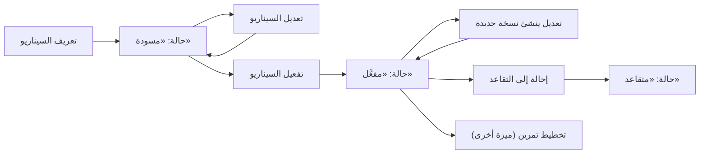
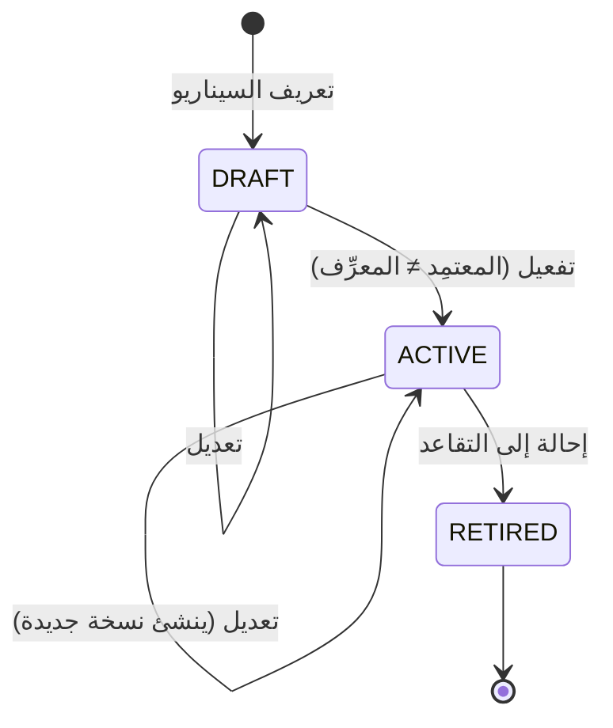

# سيناريوهات التدريب

<!-- BEGIN GENERATED: doc -->
| البند | القيمة |
|---|---|
| المعرّف | FEAT-RES-TRAINING-SCENARIOS |
| الإصدار | 0.1 |
| الحالة | مسودة |
| القدرة | CAP-08 الموارد والجاهزية |
| القدرة الفرعية | CAP-08.05 التدريب والتمارين (R3) |
| الأدوار | مدير التدريب؛ مدير التمرين |
| الشاشات | SCR-48 التمارين والسيناريوهات والمحاكاة والجاهزية |
| حالات الاستخدام | UC-160 |
| القصص | 8: 6 من المواصفة، و2 جديدة |
<!-- END GENERATED: doc -->

## 1. نظرة عامة

### 1.1 القيمة

يُعد مدير التدريب سيناريوهات تدريب بأحداثها والكفاءات المستهدفة، ويعتمدها مدير التمرين قبل استخدامها.

### 1.2 النطاق

| البند | القيمة |
|---|---|
| المستخدمون | مدير التدريب (يعرّف السيناريو ويعدّله)؛ مدير التمرين (يفعّله ويحيله إلى التقاعد)؛ أي مستخدم مخوَّل (يتصفح السيناريوهات ضمن نطاقه) |
| الشاشات | SCR-48 التمارين والسيناريوهات والمحاكاة والجاهزية |
| حالات الاستخدام | تعريف سيناريو تدريب وتفعيله وإحالته إلى التقاعد (UC-160)؛ تصفح السيناريوهات قبل تخطيط تمرين (UC-161) |
| المتطلبات | تعريف سيناريو بموقف وكفاءات مستهدفة وحقن مرتبة زمنيًا، في دورة حالات مُفوتَرة مع فصل الواجبات عند التفعيل (REQ-TRX-001)؛ تعديل سيناريو مفعَّل ينشئ نسخة جديدة دون أن يتأثر تمرين خُطِّط على نسخة سابقة (REQ-TRX-002)؛ تصفح السيناريوهات والتمارين والمحاكاة محصورًا بالنطاق المرئي (REQ-TRX-014) |
| خارج النطاق | تخطيط التمرين وتنفيذه ومحاكاته (ميزات أخرى في القدرة الفرعية نفسها) |

### 1.3 خريطة الميزة

**الشكل 1: دورة حياة سيناريو التدريب**



**الشكل 2: حالات سيناريو التدريب**



## 2. القواعد المشتركة

تنطبق على كل قصص الميزة، فلا تتكرر داخل القصص. وكل قصة تذكر ما يخصها فقط.

### 2.1 السياق المشترك

كل قصة تبدأ من ثلاثة شروط: مستأجر نشط، وحزمة السياسات الأساسية مفعّلة، ومستخدم مسجّل الدخول ومخوَّل. وتشير إليها القصص بخطوة واحدة: «بفرض السياق المشترك للميزة».

### 2.2 الصلاحية وعدم الإفصاح

- من لا يحق له رؤية العنصر يتلقى ردًا بشكل «غير متاح» تمامًا، فلا يعرف أنه موجود.
- من يرى العنصر ولا يحق له الإجراء يتلقى «لا تملك صلاحية هذا الإجراء».

### 2.3 أوامر تغيير الحالة

- **منع التكرار:** يُرسل كل أمر بمفتاح فريد، فإعادة الطلب نفسه لا تُنفَّذ مرتين.
- **حماية التعديل المتزامن:** يُرسل كل أمر بإصدار البيانات الذي يراه المستخدم. فإن عدّلها غيره في الأثناء، يُرفض الأمر.
- **السجل:** إن نجح الأمر، يُكتب حدثه وسجل التدقيق في المعاملة نفسها.

### 2.4 الرفض المشترك

```gherkin
# language: ar
خاصية: الرفض المشترك لأوامر الميزة

  سيناريو مخطط: رفض مشترك لكل أمر في الميزة
    بفرض السياق المشترك للميزة
    و <الحالة>
    عندما يُرسل المستخدم أي أمر من أوامر الميزة
    اذاً يُرفض برمز <الرمز> ويرى "<الرسالة>"
    و لا يتغير شيء

    امثلة:
      | الحالة                                  | الرمز                  | الرسالة                                                 |
      | العنصر خارج صلاحياته                    | NOT_FOUND              | غير متاح                                                |
      | العنصر مرئي له ولا يحق له الإجراء       | AUTHZ_DENIED           | لا تملك صلاحية هذا الإجراء                              |
      | غيره عدّل العنصر بعد أن فتحه            | VERSION_CONFLICT       | تغيّرت البيانات منذ فتحتها. راجع التغييرات ثم أعد المحاولة |
      | أعاد مفتاح منع التكرار بمحتوى مختلف     | IDEMPOTENCY_KEY_REUSED | طلب مكرر بمحتوى مختلف                                   |
      | البيانات ناقصة أو غير صحيحة             | VALIDATION_FAILED      | بعض البيانات ناقصة أو غير صحيحة. راجع الحقول المعلَّمة      |

  سيناريو: إعادة الطلب نفسه لا تُنفَّذ مرتين
    بفرض السياق المشترك للميزة
    و أمر نجح بمفتاح منع تكرار
    عندما يُعاد الطلب نفسه بالمفتاح نفسه
    اذاً تُعاد النتيجة الأولى ولا يُكتب حدث ثانٍ
```

## 3. الجودة وتعريف الاكتمال

### 3.1 متطلبات الجودة

<!-- BEGIN GENERATED: quality -->
لا متطلبات جودة مرتبطة بمتطلبات هذه الميزة مباشرة. تنطبق متطلبات المنصة العامة (`FEAT-PLT-*`).
<!-- END GENERATED: quality -->

### 3.2 تعريف الاكتمال

القصة مكتملة حين تتحقق الشروط الخمسة:

1. سيناريوهاتها والقواعد المشتركة تمر في الاختبار الآلي.
2. فحوص البنية المعمارية تمر.
3. نصوص الواجهة والرسائل موجودة بالعربية والإنجليزية.
4. مراجعة الكود مكتملة.
5. ما تضيفه القصة نفسها في قسم «القواعد» تحقق.

## 4. فهرس القصص

<!-- BEGIN GENERATED: story-index -->
| المعرّف | القصة | النوع | الحالة |
|---|---|---|---|
| `US-BC05-SCN-ACTIVATE` | تفعيل سيناريو التدريب | أمر | مسودة |
| `US-BC05-SCN-DEFINE` | تعريف سيناريو التدريب | أمر | مسودة |
| `US-BC05-SCN-EDIT` | تعديل سيناريو التدريب | أمر | مسودة |
| `US-BC05-SCN-RETIRE` | إحالة سيناريو التدريب إلى التقاعد | أمر | مسودة |
| `US-BC05-Q-SCN-GET` | جلب: Scenario with injects and target competencies | جلب | مسودة |
| `US-BC05-Q-SCN-LIST` | جلب: Scenarios filtered by exercise type, state | جلب | مسودة |
| `US-UI-SCR48-SCENARIO-EDITOR` | تحرير السيناريو وأحداثه بترتيبها الزمني | واجهة | مسودة |
| `US-UI-SCR48-SCENARIO-VERSIONS` | نسخ السيناريو والتمارين المرتبطة بكل نسخة | واجهة | مسودة |
<!-- END GENERATED: story-index -->

## 5. القصص

### 5.1 US-BC05-SCN-ACTIVATE — تفعيل سيناريو التدريب

| النوع | الإصدار | الأولوية | دون اتصال | الحالة |
|---|---|---|---|---|
| أمر | R3 | Must | لا | مسودة |

> **كـ** مدير التمرين، **أريد** أن أفعّل سيناريو تدريب أعدَّه غيري، **حتى** يصبح جاهزًا لتخطيط التمارين عليه.

**باختصار:** يفعّل مدير التمرين سيناريو «مسودة» فيصير «مفعَّلًا»، شرط ألا يكون المعتمِد نفسه من عرَّف السيناريو.

#### القواعد

- **متى يُسمح:** السيناريو «مسودة».
- **من يُسمح له:** مدير التمرين، شرط ألا يكون المعتمِد هو من عرَّف السيناريو.
- **الأثر:** تصبح حالة السيناريو «مفعَّل»، فيصلح لتخطيط تمرين عليه، ويُسجَّل حدث «فُعِّل السيناريو».

#### معايير القبول

```gherkin
# language: ar
خاصية: تفعيل سيناريو التدريب

  سيناريو: مدير تمرين غير معرِّف السيناريو يفعّله
    بفرض السياق المشترك للميزة
    و سيناريو "مسودة" ومعتمِده غير من عرَّفه
    عندما يفعّله مدير التمرين
    اذاً تصبح حالته "مفعَّل"
    و يُسجَّل حدث "فُعِّل السيناريو"

  سيناريو مخطط: رفض خاص بتفعيل السيناريو
    بفرض السياق المشترك للميزة
    و <الحالة>
    عندما يحاول تفعيل السيناريو
    اذاً يُرفض برمز <الرمز> ويرى <الرسالة>
    و لا يتغير شيء

    امثلة:
      | الحالة                                             | الرمز                              | الرسالة                                           |
      | السيناريو "مفعَّل" أو "متقاعد" من قبل              | SCENARIO_INVALID_STATE_TRANSITION  | الوضع الحالي لسيناريو التدريب لا يسمح بهذا الإجراء |
      | المعتمِد هو من عرَّف السيناريو نفسه                | SEGREGATION_OF_DUTIES              | لا يجوز أن يعتمد الشخص نفسه ما قدّمه أو طلبه       |
```

<details><summary>المراجع التقنية والتتبع</summary>

<!-- BEGIN GENERATED: refs US-BC05-SCN-ACTIVATE -->
| البند | المعرّف | المعنى |
|---|---|---|
| الواجهة البرمجية | `POST /api/v1/readiness/scenarios/{id}/actions/activate` | — |
| الأمر | `CMD-SCN-ACTIVATE` | تفعيل سيناريو التدريب |
| السياسة | `POL-SCN-ACTIVATE` | Exercise Director؛ tenant match; approver ≠ author (INV-SCN via segregation of duties) |
| الحدث | `EVT-SCN-ACTIVATED` | يصل إلى: Exercise (frozen scenario reference on plan); Search projection (SLC-05) |
| الكيان | `AGG-SCENARIO` | سيناريو التدريب |
| الجدول | `readiness.scenarios` | الجدول الرئيسي لسيناريو التدريب |
| وحدة النشر | DU-14 | — |
| المتطلبات | REQ-TRX-001، REQ-TRX-002 | معانيها في القسم 6. التتبع |
| حالة الاستخدام | UC-160 | Define Training Scenario |
| الاختبار | TST-SCENARIO-SM، TST-SLC19-INVARIANTS | دورة حالات سيناريو التدريب، وثوابت الشريحة SLC-19 |
<!-- END GENERATED: refs US-BC05-SCN-ACTIVATE -->

</details>

### 5.2 US-BC05-SCN-DEFINE — تعريف سيناريو التدريب

| النوع | الإصدار | الأولوية | دون اتصال | الحالة |
|---|---|---|---|---|
| أمر | R3 | Must | لا | مسودة |

> **كـ** مدير التدريب، **أريد** أن أعرِّف سيناريو تدريب بموقفه وكفاءاته المستهدفة وحقنه المرتبة زمنيًا، **حتى** يُعاد استخدامه في تمارين قادمة.

**باختصار:** يعرِّف مدير التدريب سيناريو جديدًا بعنوان ونوع تمرين وموقف وكفاءات مستهدفة وحقن مرتبة بترتيب زمني متزايد صراحةً، فيصير «مسودة».

#### القواعد

- **متى يُسمح:** عند تعريف سيناريو جديد لم يُسجَّل من قبل.
- **من يُسمح له:** مدير التدريب.
- **البيانات:** العنوان، ونوع التمرين (من كتالوج أنواع التمارين)، والموقف، والكفاءات المستهدفة (من كتالوج الكفاءات)، والحقن مرتبة بإزاحة زمنية متزايدة صراحةً دون تزامن أو تراجع.
- **الأثر:** يصير السيناريو «مسودة»، ويُسجَّل حدث «عُرِّف السيناريو».

#### معايير القبول

```gherkin
# language: ar
خاصية: تعريف سيناريو التدريب

  سيناريو: مدير التدريب يعرِّف سيناريو جديدًا
    بفرض السياق المشترك للميزة
    و عنوان ونوع تمرين وموقف وكفاءات مستهدفة وحقن مرتبة بترتيب زمني متزايد
    عندما يعرِّف مدير التدريب السيناريو بهذه البيانات
    اذاً تصبح حالته "مسودة"
    و يُسجَّل حدث "عُرِّف السيناريو"

  سيناريو مخطط: رفض خاص بتعريف السيناريو
    بفرض السياق المشترك للميزة
    و <الحالة>
    عندما يحاول تعريف السيناريو
    اذاً يُرفض برمز <الرمز> ويرى <الرسالة>
    و لا يتغير شيء

    امثلة:
      | الحالة                                                              | الرمز               | الرسالة                     |
      | نوع التمرين غير موجود في الكتالوج، أو الحقن غير مرتبة بترتيب متزايد | SCENARIO_INVALID    | بيانات السيناريو غير مكتملة |
      | العنوان غير مذكور                                                   | VALIDATION_FAILED   | العنوان مطلوب                |
```

<details><summary>المراجع التقنية والتتبع</summary>

<!-- BEGIN GENERATED: refs US-BC05-SCN-DEFINE -->
| البند | المعرّف | المعنى |
|---|---|---|
| الواجهة البرمجية | `POST /api/v1/readiness/scenarios` | — |
| الأمر | `CMD-SCN-DEFINE` | تعريف سيناريو التدريب |
| السياسة | `POL-SCN-DEFINE` | Training Manager؛ tenant match |
| الحدث | `EVT-SCN-DEFINED` | يصل إلى: Search projection (SLC-05) |
| الكيان | `AGG-SCENARIO` | سيناريو التدريب |
| الجدول | `readiness.scenarios` | الجدول الرئيسي لسيناريو التدريب |
| وحدة النشر | DU-14 | — |
| المتطلبات | REQ-TRX-001، REQ-TRX-002 | معانيها في القسم 6. التتبع |
| حالة الاستخدام | UC-160 | Define Training Scenario |
| الاختبار | TST-SCENARIO-SM، TST-SLC19-INVARIANTS | دورة حالات سيناريو التدريب، وثوابت الشريحة SLC-19 |
<!-- END GENERATED: refs US-BC05-SCN-DEFINE -->

</details>

### 5.3 US-BC05-SCN-EDIT — تعديل سيناريو التدريب

| النوع | الإصدار | الأولوية | دون اتصال | الحالة |
|---|---|---|---|---|
| أمر | R3 | Must | لا | مسودة |

> **كـ** مدير التدريب، **أريد** أن أعدِّل سيناريو «مسودة» أو «مفعَّل»، **حتى** يعكس موقفه وحقنه آخر ما استجد دون أن يتأثر تمرين خُطِّط على نسخته السابقة.

**باختصار:** يعدِّل مدير التدريب عنوان السيناريو أو موقفه أو كفاءاته أو حقنه بنفس شروط التعريف؛ وإن كان السيناريو «مفعَّلًا» يُنشئ التعديل نسخة جديدة منه، ويحتفظ كل تمرين خُطِّط على نسخة سابقة بمرجعه المجمَّد إليها.

#### القواعد

- **متى يُسمح:** السيناريو «مسودة» أو «مفعَّل».
- **من يُسمح له:** مدير التدريب.
- **البيانات:** نفس شروط التعريف لما يتغيّر من العنوان أو الموقف أو الكفاءات أو الحقن.
- **الأثر:** حالة السيناريو لا تتغير، ويرتفع إصداره بواحد؛ وإن كان «مفعَّلًا» يُنشأ إصدار جديد منه دون أن يتأثر تمرين مخطَّط على الإصدار السابق (مرجعه يبقى مجمَّدًا)، ويُسجَّل حدث «عُدِّل السيناريو».

#### معايير القبول

```gherkin
# language: ar
خاصية: تعديل سيناريو التدريب

  سيناريو: تعديل سيناريو مفعَّل لا يؤثر على تمرين سابق
    بفرض السياق المشترك للميزة
    و سيناريو "مفعَّل" وتمرين خُطِّط على إصداره الحالي
    عندما يعدِّله مدير التدريب
    اذاً يرتفع إصدار السيناريو بواحد وتبقى حالته كما هي
    و يحتفظ التمرين السابق بمرجعه المجمَّد إلى الإصدار القديم
    و يُسجَّل حدث "عُدِّل السيناريو"

  سيناريو مخطط: رفض خاص بتعديل السيناريو
    بفرض السياق المشترك للميزة
    و <الحالة>
    عندما يحاول تعديل السيناريو
    اذاً يُرفض برمز <الرمز> ويرى <الرسالة>
    و لا يتغير شيء

    امثلة:
      | الحالة                                           | الرمز                              | الرسالة                                            |
      | السيناريو "متقاعد"                               | SCENARIO_INVALID_STATE_TRANSITION  | الوضع الحالي لسيناريو التدريب لا يسمح بهذا الإجراء |
      | الحقن الجديدة غير مرتبة بترتيب زمني متزايد        | SCENARIO_INVALID                   | بيانات السيناريو غير مكتملة                        |
```

<details><summary>المراجع التقنية والتتبع</summary>

<!-- BEGIN GENERATED: refs US-BC05-SCN-EDIT -->
| البند | المعرّف | المعنى |
|---|---|---|
| الواجهة البرمجية | `POST /api/v1/readiness/scenarios/{id}/actions/edit` | — |
| الأمر | `CMD-SCN-EDIT` | تعديل سيناريو التدريب |
| السياسة | `POL-SCN-EDIT` | Training Manager؛ tenant match |
| الحدث | `EVT-SCN-EDITED` | يصل إلى: Search projection (SLC-05) |
| الكيان | `AGG-SCENARIO` | سيناريو التدريب |
| الجدول | `readiness.scenarios` | الجدول الرئيسي لسيناريو التدريب |
| وحدة النشر | DU-14 | — |
| المتطلبات | REQ-TRX-001، REQ-TRX-002 | معانيها في القسم 6. التتبع |
| حالة الاستخدام | UC-160 | Define Training Scenario |
| الاختبار | TST-SCENARIO-SM، TST-SLC19-INVARIANTS | دورة حالات سيناريو التدريب، وثوابت الشريحة SLC-19 |
<!-- END GENERATED: refs US-BC05-SCN-EDIT -->

</details>

### 5.4 US-BC05-SCN-RETIRE — إحالة سيناريو التدريب إلى التقاعد

| النوع | الإصدار | الأولوية | دون اتصال | الحالة |
|---|---|---|---|---|
| أمر | R3 | Must | لا | مسودة |

> **كـ** مدير التمرين، **أريد** أن أحيل سيناريو «مفعَّلًا» إلى التقاعد بسبب، **حتى** يُعرف أنه لم يعد يصلح لتمارين جديدة.

**باختصار:** يحيل مدير التمرين السيناريو «المفعَّل» إلى التقاعد بسبب صريح، فتصبح حالته «متقاعد» نهائيًا، ولا يصلح بعدها لتخطيط تمرين جديد.

#### القواعد

- **متى يُسمح:** السيناريو «مفعَّل».
- **من يُسمح له:** مدير التمرين.
- **البيانات:** السبب (إلزامي).
- **الأثر:** تصبح حالة السيناريو «متقاعد»، وهي حالة نهائية، ويُسجَّل حدث «أُحيل السيناريو إلى التقاعد».

#### معايير القبول

```gherkin
# language: ar
خاصية: إحالة سيناريو التدريب إلى التقاعد

  سيناريو: إحالة سيناريو مفعَّل إلى التقاعد
    بفرض السياق المشترك للميزة
    و سيناريو "مفعَّل"
    عندما يحيله مدير التمرين إلى التقاعد بسبب
    اذاً تصبح حالته "متقاعد"
    و يُسجَّل حدث "أُحيل السيناريو إلى التقاعد"

  سيناريو مخطط: رفض خاص بالإحالة إلى التقاعد
    بفرض السياق المشترك للميزة
    و <الحالة>
    عندما يحاول إحالة السيناريو إلى التقاعد
    اذاً يُرفض برمز <الرمز> ويرى <الرسالة>
    و لا يتغير شيء

    امثلة:
      | الحالة                                   | الرمز                              | الرسالة                                            |
      | السيناريو "مسودة" أو "متقاعد" من قبل     | SCENARIO_INVALID_STATE_TRANSITION  | الوضع الحالي لسيناريو التدريب لا يسمح بهذا الإجراء |
      | السبب غير مذكور                          | REASON_REQUIRED                    | اذكر السبب                                          |
```

<details><summary>المراجع التقنية والتتبع</summary>

<!-- BEGIN GENERATED: refs US-BC05-SCN-RETIRE -->
| البند | المعرّف | المعنى |
|---|---|---|
| الواجهة البرمجية | `POST /api/v1/readiness/scenarios/{id}/actions/retire` | — |
| الأمر | `CMD-SCN-RETIRE` | إحالة سيناريو التدريب إلى التقاعد |
| السياسة | `POL-SCN-RETIRE` | Exercise Director؛ tenant match |
| الحدث | `EVT-SCN-RETIRED` | يصل إلى: Search projection (SLC-05) |
| الكيان | `AGG-SCENARIO` | سيناريو التدريب |
| الجدول | `readiness.scenarios` | الجدول الرئيسي لسيناريو التدريب |
| وحدة النشر | DU-14 | — |
| المتطلبات | REQ-TRX-001، REQ-TRX-002 | معانيها في القسم 6. التتبع |
| حالة الاستخدام | UC-160 | Define Training Scenario |
| الاختبار | TST-SCENARIO-SM، TST-SLC19-INVARIANTS | دورة حالات سيناريو التدريب، وثوابت الشريحة SLC-19 |
<!-- END GENERATED: refs US-BC05-SCN-RETIRE -->

</details>

### 5.5 US-BC05-Q-SCN-GET — جلب تفاصيل سيناريو تدريب واحد

| النوع | الإصدار | الأولوية | دون اتصال | الحالة |
|---|---|---|---|---|
| جلب | R3 | Must | لا | مسودة |

> **كـ** مستخدم مخوَّل، **أريد** أن أرى تفاصيل سيناريو تدريب بحقنه وكفاءاته المستهدفة، **حتى** أراجعه قبل تخطيط تمرين عليه.

**باختصار:** تُعاد تفاصيل السيناريو كاملة، بحقنه مرتبة زمنيًا وكفاءاته المستهدفة، إن كان ضمن النطاق المرئي للطالب.

#### القواعد

- **من يرى ماذا:** أي مستخدم مخوَّل يرى السيناريو ضمن نطاقه المسموح فقط.

#### معايير القبول

```gherkin
# language: ar
خاصية: جلب تفاصيل سيناريو تدريب واحد

  سيناريو: الطالب يرى سيناريو ضمن نطاقه
    بفرض السياق المشترك للميزة
    و سيناريو تدريب ضمن النطاق المرئي للطالب
    عندما يطلب تفاصيل السيناريو
    اذاً تُعاد تفاصيله كاملة بحقنه مرتبة زمنيًا وكفاءاته المستهدفة
```

<details><summary>المراجع التقنية والتتبع</summary>

<!-- BEGIN GENERATED: refs US-BC05-Q-SCN-GET -->
| البند | المعرّف | المعنى |
|---|---|---|
| الواجهة البرمجية | `GET /api/v1/readiness/scenarios/{scenario_id}` | — |
| الاستعلام | `QRY-SCN-GET` | Scenario with injects and target competencies |
| السياسة | `POL-SCN-GET` | allowed_scope |
| الكيان | `AGG-SCENARIO` | سيناريو التدريب |
| الجدول | `readiness.scenarios` | الجدول الرئيسي لسيناريو التدريب |
| وحدة النشر | DU-14 | — |
| المتطلب | REQ-TRX-014 | The system shall let an authorized actor list and filter scenarios, exercises and simulation runs, restricted… |
| حالة الاستخدام | UC-161 | Plan & Schedule Exercise |
| الاختبار | TST-SCENARIO-SM، TST-SLC19-INVARIANTS | دورة حالات سيناريو التدريب، وثوابت الشريحة SLC-19 |
<!-- END GENERATED: refs US-BC05-Q-SCN-GET -->

</details>

### 5.6 US-BC05-Q-SCN-LIST — جلب سيناريوهات التدريب مصفّاة بنوع التمرين والحالة

| النوع | الإصدار | الأولوية | دون اتصال | الحالة |
|---|---|---|---|---|
| جلب | R3 | Must | لا | مسودة |

> **كـ** مستخدم مخوَّل، **أريد** تصفح سيناريوهات التدريب مصفّاة بنوع التمرين وحالتها، **حتى** أختار سيناريو مناسبًا لتمرين قادم.

**باختصار:** تُعاد سيناريوهات التدريب التي يحق للمستخدم رؤيتها فقط، صفحةً بعد صفحة، ولا يكشف عددها أو مرشحاتها وجود سيناريوهات محجوبة.

#### القواعد

- **من يرى ماذا:** كل مستخدم يرى سيناريوهات نطاقه المسموح فقط.
- **المرشحات:** نوع التمرين، والحالة، والمؤشر والحد لكل صفحة.

#### معايير القبول

```gherkin
# language: ar
خاصية: جلب سيناريوهات التدريب مصفّاة بنوع التمرين والحالة

  سيناريو: يرى المستخدم سيناريوهات نطاقه فقط
    بفرض السياق المشترك للميزة
    و سيناريوهات داخل نطاق المستخدم وأخرى خارجه
    عندما يطلب سيناريوهات التدريب مصفّاة بنوع التمرين أو الحالة
    اذاً تُعاد السيناريوهات داخل نطاقه فقط، ويُعاد فحص صلاحية كل منها
    و لا يكشف أي عدد أو مرشّح وجود سيناريو محجوب

  سيناريو: الصفحة التالية
    بفرض السياق المشترك للميزة
    و سيناريوهات أكثر من صفحة
    عندما يطلب الصفحة التالية بالمؤشر
    اذاً تُعاد السيناريوهات التالية دون تكرار ولا فجوة
```

<details><summary>المراجع التقنية والتتبع</summary>

<!-- BEGIN GENERATED: refs US-BC05-Q-SCN-LIST -->
| البند | المعرّف | المعنى |
|---|---|---|
| الواجهة البرمجية | `GET /api/v1/readiness/scenarios` | — |
| الاستعلام | `QRY-SCN-LIST` | Scenarios filtered by exercise type, state |
| السياسة | `POL-SCN-LIST` | allowed_scope |
| الكيان | `AGG-SCENARIO` | سيناريو التدريب |
| الجدول | `readiness.scenarios` | الجدول الرئيسي لسيناريو التدريب |
| وحدة النشر | DU-14 | — |
| المتطلب | REQ-TRX-014 | The system shall let an authorized actor list and filter scenarios, exercises and simulation runs, restricted… |
| حالة الاستخدام | UC-161 | Plan & Schedule Exercise |
| الاختبار | TST-SCENARIO-SM، TST-SLC19-INVARIANTS | دورة حالات سيناريو التدريب، وثوابت الشريحة SLC-19 |
<!-- END GENERATED: refs US-BC05-Q-SCN-LIST -->

</details>

### 5.7 US-UI-SCR48-SCENARIO-EDITOR — تحرير السيناريو وحقنه بترتيبها الزمني

| النوع | الإصدار | الأولوية | دون اتصال | الحالة |
|---|---|---|---|---|
| واجهة | R3 | Must | لا | مسودة |

> **كـ** مدير التدريب، **أريد** محررًا يرتب حقن السيناريو زمنيًا تلقائيًا ويمنعني من ترك فجوة أو تزامن بينها، **حتى** أبني سيناريو صحيحًا دون حساب الإزاحات يدويًا.

**باختصار:** يعرض المحرر حقن السيناريو على خط زمني واحد، ويمنع حفظ إزاحتين متساويتين أو متراجعتين، ويعرض تحذيرًا فوريًا عند إدخال إزاحة غير صحيحة. **[Derived]**

#### القواعد

- يرتب المحرر الحقن تلقائيًا بإزاحتها الزمنية، ولا يسمح بحفظ إزاحتين متساويتين أو متراجعتين. **[Derived]**
- الكفاءات المستهدفة تُختار من كتالوج الكفاءات، لا نصًا حرًّا. **[Derived]**

#### معايير القبول

```gherkin
# language: ar
خاصية: تحرير السيناريو وحقنه بترتيبها الزمني

  سيناريو: ترتيب الحقن على خط زمني واحد
    بفرض السياق المشترك للميزة
    و سيناريو بعدة حقن
    عندما يفتح مدير التدريب محرر السيناريو
    اذاً تُعرض الحقن على خط زمني واحد مرتبة بإزاحتها

  سيناريو: إزاحة متراجعة تُمنع من الحفظ
    بفرض السياق المشترك للميزة
    و مدير التدريب يضيف حقنًا بإزاحة أقل من الحقن السابق
    عندما يحاول حفظ السيناريو
    اذاً يُمنع الحفظ ويظهر تحذير بالحقن المتعارضة
```

<details><summary>المراجع التقنية والتتبع</summary>

<!-- BEGIN GENERATED: refs US-UI-SCR48-SCENARIO-EDITOR -->
| البند | المعرّف | المعنى |
|---|---|---|
| الشاشة | SCR-48 | شاشة التمارين والسيناريوهات والمحاكاة والجاهزية |
| المصدر | `[Derived]` | — |
| المتطلب | REQ-TRX-001 | The system shall allow defining a training scenario with a situation narrative, target competencies and an or… |
| حالة الاستخدام | UC-160 | Define Training Scenario |
<!-- END GENERATED: refs US-UI-SCR48-SCENARIO-EDITOR -->

</details>

### 5.8 US-UI-SCR48-SCENARIO-VERSIONS — نسخ السيناريو والتمارين المرتبطة بكل نسخة

| النوع | الإصدار | الأولوية | دون اتصال | الحالة |
|---|---|---|---|---|
| واجهة | R3 | Must | لا | مسودة |

> **كـ** مدير التدريب، **أريد** أن أرى إصدارات سيناريو مفعَّل وأي تمرين خُطِّط على كل منها، **حتى** أعرف أثر تعديلي قبل أن أقدمه.

**باختصار:** تعرض الشاشة كل إصدارات السيناريو المفعَّل بترتيبها، وتحت كل إصدار التمارين التي خُطِّطت عليه وبقيت محتفظة بمرجعه المجمَّد. **[Derived]**

#### القواعد

- تعرض الشاشة التمارين تحت الإصدار الذي خُطِّطت عليه فعلًا، لا تحت آخر إصدار. **[Derived]**

#### معايير القبول

```gherkin
# language: ar
خاصية: نسخ السيناريو والتمارين المرتبطة بكل نسخة

  سيناريو: عرض إصدارات السيناريو وتماريها
    بفرض السياق المشترك للميزة
    و سيناريو مفعَّل له إصداران وتمرين خُطِّط على الإصدار الأول
    عندما يفتح مدير التدريب شاشة إصدارات السيناريو
    اذاً يُعرض كل إصدار على حدة
    و يظهر التمرين تحت الإصدار الأول الذي خُطِّط عليه فعلًا
```

<details><summary>المراجع التقنية والتتبع</summary>

<!-- BEGIN GENERATED: refs US-UI-SCR48-SCENARIO-VERSIONS -->
| البند | المعرّف | المعنى |
|---|---|---|
| الشاشة | SCR-48 | شاشة التمارين والسيناريوهات والمحاكاة والجاهزية |
| المصدر | `[Derived]` | — |
| المتطلب | REQ-TRX-002 | Editing an ACTIVE scenario shall create a new version; an exercise already planned against a prior version sh… |
| حالة الاستخدام | UC-160 | Define Training Scenario |
<!-- END GENERATED: refs US-UI-SCR48-SCENARIO-VERSIONS -->

</details>

## 6. التتبع

<!-- BEGIN GENERATED: trace -->
| المتطلب | المعنى | القصص | الاختبار |
|---|---|---|---|
| REQ-TRX-001 | The system shall allow defining a training scenario with a situation narrative, target competencies and an or… | `US-BC05-SCN-ACTIVATE`، `US-BC05-SCN-DEFINE`، `US-BC05-SCN-EDIT`، `US-BC05-SCN-RETIRE`، `US-UI-SCR48-SCENARIO-EDITOR` | TST-SCENARIO-SM |
| REQ-TRX-002 | Editing an ACTIVE scenario shall create a new version; an exercise already planned against a prior version sh… | `US-BC05-SCN-ACTIVATE`، `US-BC05-SCN-DEFINE`، `US-BC05-SCN-EDIT`، `US-BC05-SCN-RETIRE`، `US-UI-SCR48-SCENARIO-VERSIONS` | TST-SCENARIO-SM، TST-SLC19-INVARIANTS |
| REQ-TRX-014 | The system shall let an authorized actor list and filter scenarios, exercises and simulation runs, restricted… | `US-BC05-Q-SCN-GET`، `US-BC05-Q-SCN-LIST` | — |
<!-- END GENERATED: trace -->

## 7. سجل التغييرات

| الإصدار | التاريخ | التغيير |
|---|---|---|
| 0.1 | — | هيكل مولَّد من خريطة الميزات |
| 0.2 | 2026-10-13 | كتابة القصص كاملة بمعيار القصص |
