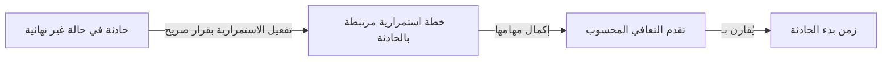

# تفعيل خطة الطوارئ ومتابعة التعافي

<!-- BEGIN GENERATED: doc -->
| البند | القيمة |
|---|---|
| المعرّف | FEAT-RSK-CONTINUITY |
| الإصدار | 0.2 |
| الحالة | مسودة |
| القدرة | CAP-09 المخاطر والطوارئ |
| القدرة الفرعية | CAP-09.03 الاستمرارية والتعافي (R3) |
| الأدوار | قائد الحادثة؛ مالك الاستمرارية |
| الشاشات | SCR-47 سجل المخاطر والحوادث، SCR-35 متابعة التنفيذ |
| حالات الاستخدام | UC-144 |
| القصص | 4: 2 من المواصفة، و2 جديدة |
<!-- END GENERATED: doc -->

## 1. نظرة عامة

### 1.1 القيمة

يفعّل قائد الحادثة خطة الطوارئ بقرار صريح، ويتابع مع مالك الاستمرارية تقدم التعافي مقارنة بزمن بدء الحادثة.

### 1.2 النطاق

| البند | القيمة |
|---|---|
| المستخدمون | قائد الحادثة بسلطة صريحة لتفعيل الاستمرارية؛ مالك الاستمرارية |
| الشاشات | SCR-47 سجل المخاطر والحوادث؛ SCR-35 متابعة التنفيذ |
| حالات الاستخدام | تفعيل خطة الاستمرارية بقرار صريح من قائد الحادثة؛ متابعة تقدم التعافي مقارنة بزمن بدء الحادثة |
| المتطلبات | لا تفعيل تلقائي لخطة الاستمرارية كأثر جانبي لتصعيد الخطورة؛ حساب تقدم التعافي من مهام خطة الاستمرارية المرتبطة دون آلة حالة أو جدول تخزين جديد |
| خارج النطاق | إعداد خطة الاستمرارية نفسها وأنشطتها (ميزات تخطيط الخطط)؛ حساب RTO/RPO دقيق، فالقيمة تقديرية فقط |

### 1.3 خريطة الميزة

**الشكل 1: من تفعيل الاستمرارية إلى تقدم التعافي**



## 2. القواعد المشتركة

تنطبق على كل قصص الميزة، فلا تتكرر داخل القصص. وكل قصة تذكر ما يخصها فقط.

### 2.1 السياق المشترك

كل قصة تبدأ من ثلاثة شروط: مستأجر نشط، وحزمة السياسات الأساسية مفعّلة، ومستخدم مسجّل الدخول ومخوَّل. وتشير إليها القصص بخطوة واحدة: «بفرض السياق المشترك للميزة».

### 2.2 الصلاحية وعدم الإفصاح

- من لا يحق له رؤية العنصر يتلقى ردًا بشكل «غير متاح» تمامًا، فلا يعرف أنه موجود.
- من يرى العنصر ولا يحق له الإجراء يتلقى «لا تملك صلاحية هذا الإجراء».

### 2.3 أوامر تغيير الحالة

- **منع التكرار:** يُرسل كل أمر بمفتاح فريد، فإعادة الطلب نفسه لا تُنفَّذ مرتين.
- **حماية التعديل المتزامن:** يُرسل كل أمر بإصدار البيانات الذي يراه المستخدم. فإن عدّلها غيره في الأثناء، يُرفض الأمر.
- **السجل:** إن نجح الأمر، يُكتب حدثه وسجل التدقيق في المعاملة نفسها.

### 2.4 الرفض المشترك

```gherkin
# language: ar
خاصية: الرفض المشترك لأوامر الميزة

  سيناريو مخطط: رفض مشترك لكل أمر في الميزة
    بفرض السياق المشترك للميزة
    و <الحالة>
    عندما يُرسل المستخدم أي أمر من أوامر الميزة
    اذاً يُرفض برمز <الرمز> ويرى "<الرسالة>"
    و لا يتغير شيء

    امثلة:
      | الحالة                                  | الرمز                  | الرسالة                                                 |
      | العنصر خارج صلاحياته                    | NOT_FOUND              | غير متاح                                                |
      | العنصر مرئي له ولا يحق له الإجراء       | AUTHZ_DENIED           | لا تملك صلاحية هذا الإجراء                              |
      | غيره عدّل العنصر بعد أن فتحه            | VERSION_CONFLICT       | تغيّرت البيانات منذ فتحتها. راجع التغييرات ثم أعد المحاولة |
      | أعاد مفتاح منع التكرار بمحتوى مختلف     | IDEMPOTENCY_KEY_REUSED | طلب مكرر بمحتوى مختلف                                   |
      | البيانات ناقصة أو غير صحيحة             | VALIDATION_FAILED      | بعض البيانات ناقصة أو غير صحيحة. راجع الحقول المعلَّمة      |

  سيناريو: إعادة الطلب نفسه لا تُنفَّذ مرتين
    بفرض السياق المشترك للميزة
    و أمر نجح بمفتاح منع تكرار
    عندما يُعاد الطلب نفسه بالمفتاح نفسه
    اذاً تُعاد النتيجة الأولى ولا يُكتب حدث ثانٍ
```

## 3. الجودة وتعريف الاكتمال

### 3.1 متطلبات الجودة

<!-- BEGIN GENERATED: quality -->
لا متطلبات جودة مرتبطة بمتطلبات هذه الميزة مباشرة. تنطبق متطلبات المنصة العامة (`FEAT-PLT-*`).
<!-- END GENERATED: quality -->

### 3.2 تعريف الاكتمال

القصة مكتملة حين تتحقق الشروط الخمسة:

1. سيناريوهاتها والقواعد المشتركة تمر في الاختبار الآلي.
2. فحوص البنية المعمارية تمر.
3. نصوص الواجهة والرسائل موجودة بالعربية والإنجليزية.
4. مراجعة الكود مكتملة.
5. ما تضيفه القصة نفسها في قسم «القواعد» تحقق.

## 4. فهرس القصص

<!-- BEGIN GENERATED: story-index -->
| المعرّف | القصة | النوع | الحالة |
|---|---|---|---|
| `US-BC04-INC-ACTIVATE-CONTINGENCY` | تفعيل خطة الاستمرارية لـالحادثة | أمر | مسودة |
| `US-BC04-Q-INC-RECOVERY-STATUS` | جلب: تقدم التعافي المحسوب من مهام خطة الاستمرارية المرتبطة مقابل زمن بدء الحادثة (RTO/RPO تقديرية) | جلب | مسودة |
| `US-UI-SCR47-ACTIVATE-CONTINGENCY` | تفعيل خطة الطوارئ بقرار صريح | واجهة | مسودة |
| `US-UI-SCR47-RECOVERY-STATUS` | تقدم التعافي مقابل زمن بدء الحادثة | واجهة | مسودة |
<!-- END GENERATED: story-index -->

## 5. القصص

### 5.1 US-BC04-INC-ACTIVATE-CONTINGENCY — تفعيل خطة الاستمرارية لـالحادثة

| النوع | الإصدار | الأولوية | دون اتصال | الحالة |
|---|---|---|---|---|
| أمر | R3 | Must | لا | مسودة |

> **كـ** قائد الحادثة بسلطة صريحة لتفعيل الاستمرارية، **أريد** أن أفعّل خطة الاستمرارية للحادثة بقرار واضح، **حتى** يبدأ التعافي فورًا دون انتظار أمر ضمني أو تصعيد آخر.

**باختصار:** يفعّل قائد الحادثة خطة استمرارية لحادثة قائمة في أي وقت ما دامت غير نهائية، فتُنشأ أو تُربط بها خطة استمرارية، دون أن تتغير حالة الحادثة نفسها.

#### القواعد

- **متى يُسمح:** الحادثة في حالة غير نهائية، وتفعيل الاستمرارية أمر صريح منفصل دائمًا، ولا يحدث تلقائيًا كأثر جانبي لتصعيد الخطورة (REQ-RCM-011).
- **من يُسمح له:** قائد الحادثة الذي يحمل سلطة صريحة لتفعيل الاستمرارية.
- **البيانات:** قالب خطة الاستمرارية الذي تُنشأ الخطة منه.
- **الأثر:** تُنشأ خطة استمرارية أو تُربط بالحادثة، وتتبع من حينها دورة حياة الخطط العادية. حالة الحادثة لا تتغير، ويصل حدث التفعيل إلى الإشعار ومتابعة التنفيذ.

#### معايير القبول

```gherkin
# language: ar
خاصية: تفعيل خطة الاستمرارية لـالحادثة

  سيناريو: القائد يفعّل الاستمرارية دون تغيير حالة الحادثة
    بفرض السياق المشترك للميزة
    و حادثة بسلطة قائدها الصريحة لتفعيل الاستمرارية، في حالة غير نهائية
    عندما يفعّل القائد خطة الاستمرارية بقالب خطة
    اذاً تُنشأ أو تُربط خطة استمرارية بالحادثة
    و تبقى حالة الحادثة كما هي
    و يُسجَّل حدث "فُعِّلت خطة الاستمرارية"

  سيناريو مخطط: رفض خاص بتفعيل الاستمرارية
    بفرض السياق المشترك للميزة
    و <الحالة>
    عندما يحاول القائد تفعيل خطة الاستمرارية
    اذاً يُرفض برمز <الرمز> ويرى "<الرسالة>"
    و لا يتغير شيء

    امثلة:
      | الحالة                                      | الرمز                             | الرسالة                                    |
      | الحادثة مغلقة أو ملغاة                      | INCIDENT_INVALID_STATE_TRANSITION | الوضع الحالي للحادثة لا يسمح بهذا الإجراء |
      | تعذّر ربط قالب الخطة بخطة استمرارية صالحة    | PLAN_LINK_INVALID                 | تعذّر ربط خطة الطوارئ بالحادثة             |
      | قالب الخطة مفقود                            | VALIDATION_FAILED                 | قالب الخطة مطلوب                            |
```

<details><summary>المراجع التقنية والتتبع</summary>

<!-- BEGIN GENERATED: refs US-BC04-INC-ACTIVATE-CONTINGENCY -->
| البند | المعرّف | المعنى |
|---|---|---|
| الواجهة البرمجية | `POST /api/v1/operations/incidents/{id}/actions/activate-contingency` | — |
| الأمر | `CMD-INC-ACTIVATE-CONTINGENCY` | تفعيل خطة الاستمرارية لـالحادثة |
| السياسة | `POL-INC-ACTIVATE-CONTINGENCY` | قائد الحادثة بسلطة صريحة لتفعيل الاستمرارية؛ tenant match; أمر صريح دائماً (INV-INC-03) |
| الحدث | `EVT-INC-CONTINGENCY-ACTIVATED` | يصل إلى: Search projection (SLC-05); Notification (SLC-06); اقتراحات كائن المعرفة (SLC-12، بعد الإغلاق — R3-Q… |
| الكيان | `AGG-INCIDENT` | الحادثة |
| الجدول | `operations.incidents` | الجدول الرئيسي للحادثة |
| وحدة النشر | DU-08 | — |
| المتطلب | REQ-RCM-011 | The system shall never activate a contingency plan automatically as a side effect of a severity escalation; a… |
| حالة الاستخدام | UC-144 | Activate Contingency & Track Recovery |
| الاختبار | TST-INCIDENT-SM، TST-SLC17-INVARIANTS | دورة حالات الحادثة، وثوابت الشريحة SLC-17 |
<!-- END GENERATED: refs US-BC04-INC-ACTIVATE-CONTINGENCY -->

</details>

### 5.2 US-BC04-Q-INC-RECOVERY-STATUS — جلب: تقدم التعافي المحسوب من مهام خطة الاستمرارية المرتبطة مقابل زمن بدء الحادثة (RTO/RPO تقديرية)

| النوع | الإصدار | الأولوية | دون اتصال | الحالة |
|---|---|---|---|---|
| جلب | R3 | Should | لا | مسودة |

> **كـ** قائد الحادثة أو مالك الاستمرارية، **أريد** أن أرى تقدم التعافي المحسوب من مهام خطة الاستمرارية المرتبطة بالحادثة مقابل زمن بدء الحادثة، **حتى** أعرف تقديرًا لزمن التعافي المستهدف دون انتظار تقرير يدوي.

**باختصار:** يُحسب تقدم التعافي عند كل طلب من حالة مهام خطة الاستمرارية المرتبطة، وهو تقدير لا قيمة مخزَّنة أو نهائية.

#### القواعد

- **من يرى ماذا:** قائد الحادثة ومالك الاستمرارية، ضمن النطاق المرئي لهما فقط.
- **البيانات:** لا يُخزَّن تقدم التعافي في جدول أو حالة مستقلة؛ يُحسب من مهام خطة الاستمرارية المرتبطة ومن زمن بدء الحادثة في كل طلب (REQ-RCM-016).

#### معايير القبول

```gherkin
# language: ar
خاصية: تقدم التعافي مقابل زمن بدء الحادثة

  سيناريو: القائد يرى تقدم التعافي
    بفرض السياق المشترك للميزة
    و حادثة فعّل قائدها خطة استمرارية ولها مهام مكتملة جزئيًا
    عندما يطلب القائد تقدم التعافي
    اذاً يُعاد تقدم التعافي المحسوب من إكمال مهام الخطة المرتبطة مقابل زمن بدء الحادثة، كتقدير لا قيمة نهائية

  سيناريو: الحادثة بلا خطة استمرارية مفعَّلة
    بفرض السياق المشترك للميزة
    و حادثة لم يُفعَّل لها خطة استمرارية
    عندما يطلب القائد تقدم التعافي
    اذاً يُعاد أنه لا تقدم تعافٍ محسوب لعدم وجود خطة مرتبطة
```

<details><summary>المراجع التقنية والتتبع</summary>

<!-- BEGIN GENERATED: refs US-BC04-Q-INC-RECOVERY-STATUS -->
| البند | المعرّف | المعنى |
|---|---|---|
| الواجهة البرمجية | `GET /api/v1/operations/incidents/{incident_id}/recovery-status` | — |
| الاستعلام | `QRY-INC-RECOVERY-STATUS` | تقدم التعافي المحسوب من مهام خطة الاستمرارية المرتبطة مقابل زمن بدء الحادثة (RTO/RPO تقديرية) |
| السياسة | `POL-INC-RECOVERY-STATUS` | القائد؛ مالك الاستمرارية |
| الكيان | `AGG-INCIDENT` | الحادثة |
| الجدول | `operations.incidents` | الجدول الرئيسي للحادثة |
| وحدة النشر | DU-08 | — |
| المتطلب | REQ-RCM-016 | The system shall compute an incident's recovery status from its linked contingency plan's task completion aga… |
| حالة الاستخدام | UC-144 | Activate Contingency & Track Recovery |
| الاختبار | TST-INCIDENT-SM، TST-SLC17-INVARIANTS | دورة حالات الحادثة، وثوابت الشريحة SLC-17 |
<!-- END GENERATED: refs US-BC04-Q-INC-RECOVERY-STATUS -->

</details>

### 5.3 US-UI-SCR47-ACTIVATE-CONTINGENCY — تفعيل خطة الطوارئ بقرار صريح

| النوع | الإصدار | الأولوية | دون اتصال | الحالة |
|---|---|---|---|---|
| واجهة | R3 | Must | لا | مسودة |

> **كـ** المستخدم (قائد الحادثة بسلطة التفعيل)، **أريد** زر تفعيل واضحًا ومستقلاً لخطة الاستمرارية على شاشة الحادثة، **حتى** لا تُفعَّل الاستمرارية بالخطأ أو تُفهم كجزء من تصعيد الخطورة.

**باختصار:** يظهر فعل «تفعيل خطة الاستمرارية» فقط لمن يحمل سلطته، منفصلًا عن أفعال تغيير الخطورة، ويطلب تأكيدًا صريحًا قبل الإرسال.

#### القواعد

- يظهر الفعل فقط إذا شملت صلاحيات المستخدم سلطة التفعيل وكانت حالة الحادثة غير نهائية؛ والخادم هو الحكم النهائي **[Derived]**.
- الفعل منفصل بصريًا عن أفعال التصعيد وخفض الخطورة، فلا يُفهم كأثر جانبي لهما (REQ-RCM-011).
- يطلب اختيار قالب خطة الاستمرارية وتأكيدًا صريحًا قبل الإرسال.

#### معايير القبول

```gherkin
# language: ar
خاصية: تفعيل خطة الطوارئ بقرار صريح

  سيناريو: ظهور الفعل لحامل السلطة فقط
    بفرض السياق المشترك للميزة
    و حادثة في حالة غير نهائية، والمستخدم يحمل سلطة تفعيل الاستمرارية
    عندما يفتح شاشة الحادثة
    اذاً يظهر له فعل "تفعيل خطة الاستمرارية" مستقلاً عن أفعال التصعيد وخفض الخطورة

  سيناريو: التأكيد قبل التفعيل
    بفرض السياق المشترك للميزة
    و المستخدم فتح نموذج تفعيل الاستمرارية واختار قالب خطة
    عندما يؤكد التفعيل
    اذاً يُرسل الأمر بمفتاح منع تكرار وإصدار الحادثة المعروض
    و تظهر الخطة الجديدة مرتبطة بالحادثة دون تغيير حالتها

  سيناريو: الفعل لا يظهر لمن لا يحمل السلطة
    بفرض السياق المشترك للميزة
    و المستخدم يرى الحادثة ولا يحمل سلطة تفعيل الاستمرارية
    عندما يفتح شاشة الحادثة
    اذاً لا يظهر له فعل "تفعيل خطة الاستمرارية"
```

<details><summary>المراجع التقنية والتتبع</summary>

<!-- BEGIN GENERATED: refs US-UI-SCR47-ACTIVATE-CONTINGENCY -->
| البند | المعرّف | المعنى |
|---|---|---|
| الشاشة | SCR-47 | شاشة سجل المخاطر والحوادث |
| المصدر | `THR-S17-02` | — |
| المصدر | `[Derived]` | — |
| المتطلب | REQ-RCM-011 | The system shall never activate a contingency plan automatically as a side effect of a severity escalation; a… |
| حالة الاستخدام | UC-144 | Activate Contingency & Track Recovery |
<!-- END GENERATED: refs US-UI-SCR47-ACTIVATE-CONTINGENCY -->

</details>

### 5.4 US-UI-SCR47-RECOVERY-STATUS — تقدم التعافي مقابل زمن بدء الحادثة

| النوع | الإصدار | الأولوية | دون اتصال | الحالة |
|---|---|---|---|---|
| واجهة | R3 | Should | لا | مسودة |

> **كـ** المستخدم (قائد الحادثة أو مالك الاستمرارية)، **أريد** أن أرى تقدم التعافي مقابل زمن بدء الحادثة على شاشتي الحادثة ومتابعة التنفيذ، **حتى** أقيّم هل نحن داخل هدف زمن التعافي أم تجاوزناه.

**باختصار:** تعرض الشاشة تقدم مهام خطة الاستمرارية المرتبطة كنسبة مقابل زمن بدء الحادثة، مع تنبيه حين لا توجد خطة مفعَّلة بعد.

#### القواعد

- يُعرض تقدم التعافي كتقدير فقط، لا كقيمة نهائية مضمونة (REQ-RCM-016).
- إن لم تُفعَّل خطة استمرارية بعد، تعرض الشاشة ذلك بدل نسبة تقدم فارغة أو مضلِّلة **[Derived]**.

#### معايير القبول

```gherkin
# language: ar
خاصية: تقدم التعافي مقابل زمن بدء الحادثة

  سيناريو: عرض تقدم التعافي لحادثة بخطة مفعَّلة
    بفرض السياق المشترك للميزة
    و حادثة فعّل قائدها خطة استمرارية ولها مهام مكتملة جزئيًا
    عندما يفتح مالك الاستمرارية شاشة متابعة التنفيذ
    اذاً يرى تقدم التعافي المحسوب من إكمال مهام الخطة مقابل زمن بدء الحادثة، موسومًا كتقدير

  سيناريو: لا خطة استمرارية مفعَّلة بعد
    بفرض السياق المشترك للميزة
    و حادثة لم يُفعَّل لها خطة استمرارية
    عندما يفتح القائد شاشة الحادثة
    اذاً تعرض الشاشة أنه لا تقدم تعافٍ محسوب بعد، لا نسبة فارغة
```

<details><summary>المراجع التقنية والتتبع</summary>

<!-- BEGIN GENERATED: refs US-UI-SCR47-RECOVERY-STATUS -->
| البند | المعرّف | المعنى |
|---|---|---|
| الشاشة | SCR-47 | شاشة سجل المخاطر والحوادث |
| الشاشة | SCR-35 | شاشة متابعة التنفيذ |
| المصدر | `risk-contingency-spec.md §5` | — |
| المصدر | `[Derived]` | — |
| المتطلب | REQ-RCM-016 | The system shall compute an incident's recovery status from its linked contingency plan's task completion aga… |
| حالة الاستخدام | UC-144 | Activate Contingency & Track Recovery |
<!-- END GENERATED: refs US-UI-SCR47-RECOVERY-STATUS -->

</details>

## 6. التتبع

<!-- BEGIN GENERATED: trace -->
| المتطلب | المعنى | القصص | الاختبار |
|---|---|---|---|
| REQ-RCM-011 | The system shall never activate a contingency plan automatically as a side effect of a severity escalation; a… | `US-BC04-INC-ACTIVATE-CONTINGENCY`، `US-UI-SCR47-ACTIVATE-CONTINGENCY` | TST-INCIDENT-SM، TST-SLC17-INVARIANTS |
| REQ-RCM-016 | The system shall compute an incident's recovery status from its linked contingency plan's task completion aga… | `US-BC04-Q-INC-RECOVERY-STATUS`، `US-UI-SCR47-RECOVERY-STATUS` | — |
<!-- END GENERATED: trace -->

## 7. سجل التغييرات

| الإصدار | التاريخ | التغيير |
|---|---|---|
| 0.1 | — | هيكل مولَّد من خريطة الميزات |
| 0.2 | 2026-10-13 | كتابة القصص كاملة بمعيار القصص |
