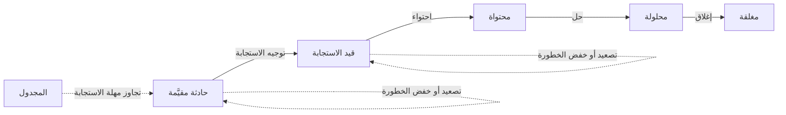
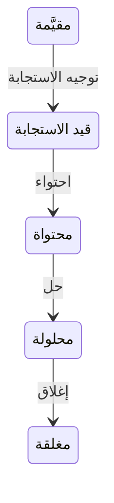

# قيادة الاستجابة للحادثة

<!-- BEGIN GENERATED: doc -->
| البند | القيمة |
|---|---|
| المعرّف | FEAT-RSK-INCIDENT-COMMAND |
| الإصدار | 0.2 |
| الحالة | مسودة |
| القدرة | CAP-09 المخاطر والطوارئ |
| القدرة الفرعية | CAP-09.02 الحوادث والاستجابة (R3) |
| الأدوار | قائد الحادثة؛ النظام |
| الشاشات | SCR-47 سجل المخاطر والحوادث، SCR-01 مهامي |
| حالات الاستخدام | UC-143 |
| القصص | 11: 7 من المواصفة، و4 جديدة |
<!-- END GENERATED: doc -->

## 1. نظرة عامة

### 1.1 القيمة

يوجّه قائد الحادثة الاستجابة ويصعّد الخطورة أو يخفضها حتى الاحتواء والحل والإغلاق، ويُنبَّه إن تأخر التوجيه.

### 1.2 النطاق

| البند | القيمة |
|---|---|
| المستخدمون | قائد الحادثة؛ النظام؛ فريق التشغيل |
| الشاشات | SCR-47 سجل المخاطر والحوادث؛ SCR-01 مهامي (مهام الاستجابة) |
| حالات الاستخدام | توجيه الاستجابة وتصعيد خطورة الحادثة أو خفضها حتى الاحتواء والحل والإغلاق؛ تنبيه تلقائي عند تجاوز مهلة الاستجابة؛ ضبط مهل الاستجابة بعد التجربة التمهيدية |
| المتطلبات | الخطورة تزداد فقط بالتصعيد وتنقص فقط بالخفض بمستوى واحد كحد أقصى؛ لا إغلاق قبل انتهاء كل مهام الاستجابة؛ مهمة استجابة تُنشأ مباشرة تحت الحادثة دون حاجة لخطة |
| خارج النطاق | الإبلاغ عن الحادثة وتقييمها الأول (ميزة «الإبلاغ عن الحوادث وتقييمها»)؛ تفعيل خطة الاستمرارية ومتابعة التعافي (ميزة «تفعيل خطة الطوارئ ومتابعة التعافي») |

### 1.3 خريطة الميزة

**الشكل 1: دورة قيادة الاستجابة للحادثة**



**الشكل 2: حالات الحادثة ضمن قيادة الاستجابة**



## 2. القواعد المشتركة

تنطبق على كل قصص الميزة، فلا تتكرر داخل القصص. وكل قصة تذكر ما يخصها فقط.

### 2.1 السياق المشترك

كل قصة تبدأ من ثلاثة شروط: مستأجر نشط، وحزمة السياسات الأساسية مفعّلة، ومستخدم مسجّل الدخول ومخوَّل. وتشير إليها القصص بخطوة واحدة: «بفرض السياق المشترك للميزة».

### 2.2 الصلاحية وعدم الإفصاح

- من لا يحق له رؤية العنصر يتلقى ردًا بشكل «غير متاح» تمامًا، فلا يعرف أنه موجود.
- من يرى العنصر ولا يحق له الإجراء يتلقى «لا تملك صلاحية هذا الإجراء».

### 2.3 أوامر تغيير الحالة

- **منع التكرار:** يُرسل كل أمر بمفتاح فريد، فإعادة الطلب نفسه لا تُنفَّذ مرتين.
- **حماية التعديل المتزامن:** يُرسل كل أمر بإصدار البيانات الذي يراه المستخدم. فإن عدّلها غيره في الأثناء، يُرفض الأمر.
- **السجل:** إن نجح الأمر، يُكتب حدثه وسجل التدقيق في المعاملة نفسها.

### 2.4 الرفض المشترك

```gherkin
# language: ar
خاصية: الرفض المشترك لأوامر الميزة

  سيناريو مخطط: رفض مشترك لكل أمر في الميزة
    بفرض السياق المشترك للميزة
    و <الحالة>
    عندما يُرسل المستخدم أي أمر من أوامر الميزة
    اذاً يُرفض برمز <الرمز> ويرى "<الرسالة>"
    و لا يتغير شيء

    امثلة:
      | الحالة                                  | الرمز                  | الرسالة                                                 |
      | العنصر خارج صلاحياته                    | NOT_FOUND              | غير متاح                                                |
      | العنصر مرئي له ولا يحق له الإجراء       | AUTHZ_DENIED           | لا تملك صلاحية هذا الإجراء                              |
      | غيره عدّل العنصر بعد أن فتحه            | VERSION_CONFLICT       | تغيّرت البيانات منذ فتحتها. راجع التغييرات ثم أعد المحاولة |
      | أعاد مفتاح منع التكرار بمحتوى مختلف     | IDEMPOTENCY_KEY_REUSED | طلب مكرر بمحتوى مختلف                                   |
      | البيانات ناقصة أو غير صحيحة             | VALIDATION_FAILED      | بعض البيانات ناقصة أو غير صحيحة. راجع الحقول المعلَّمة      |

  سيناريو: إعادة الطلب نفسه لا تُنفَّذ مرتين
    بفرض السياق المشترك للميزة
    و أمر نجح بمفتاح منع تكرار
    عندما يُعاد الطلب نفسه بالمفتاح نفسه
    اذاً تُعاد النتيجة الأولى ولا يُكتب حدث ثانٍ
```

### 2.5 سجل تغير الخطورة

خطورة الحادثة تزداد فقط عبر أمر التصعيد (القصة 5.5) وتنقص فقط عبر أمر خفض الخطورة (القصة 5.3)، بمستوى واحد كحد أقصى في كل خفض، ولا تتغير كأثر جانبي لأي أمر آخر (INV-INC-01). كل تغيير يُسجَّل في سجل تغير الخطورة بالمستوى السابق والجديد والوقت والسبب، ولا يُكتب فوق ما سُجِّل سابقًا.

## 3. الجودة وتعريف الاكتمال

### 3.1 متطلبات الجودة

<!-- BEGIN GENERATED: quality -->
| المرجع | الموقف | المطلوب |
|---|---|---|
| QAS-RCM-001 | CRISIS-severity incident assessed | response dispatched within the severity's SLA (tagged: recalibrate after Pilot R1 and R2 — RSK-028) |
<!-- END GENERATED: quality -->

### 3.2 تعريف الاكتمال

القصة مكتملة حين تتحقق الشروط الخمسة:

1. سيناريوهاتها والقواعد المشتركة تمر في الاختبار الآلي.
2. فحوص البنية المعمارية تمر.
3. نصوص الواجهة والرسائل موجودة بالعربية والإنجليزية.
4. مراجعة الكود مكتملة.
5. ما تضيفه القصة نفسها في قسم «القواعد» تحقق.

## 4. فهرس القصص

<!-- BEGIN GENERATED: story-index -->
| المعرّف | القصة | النوع | الحالة |
|---|---|---|---|
| `US-BC04-INC-CLOSE` | إغلاق الحادثة | أمر | مسودة |
| `US-BC04-INC-CONTAIN` | احتواء الحادثة | أمر | مسودة |
| `US-BC04-INC-DE-ESCALATE` | خفض خطورة الحادثة | أمر | مسودة |
| `US-BC04-INC-DISPATCH-RESPONSE` | توجيه الاستجابة لـالحادثة | أمر | مسودة |
| `US-BC04-INC-ESCALATE` | تصعيد الحادثة | أمر | مسودة |
| `US-BC04-INC-RESOLVE` | حل الحادثة | أمر | مسودة |
| `US-BC04-S-INCIDENT-01` | تلقائي: response SLA elapsed without dispatch (الحادثة) | نظام | مسودة |
| `US-UI-SCR47-COMMAND-ACTIONS` | أفعال قائد الحادثة حسب حالتها | واجهة | مسودة |
| `US-UI-SCR47-DISPATCH` | توجيه الاستجابة بقائد ومهام مرتبطة | واجهة | مسودة |
| `US-UI-SCR47-SEVERITY-HISTORY` | سجل تغير خطورة الحادثة | واجهة | مسودة |
| `US-OPS-RSK-SLA-RECALIBRATE` | ضبط مهل الاستجابة حسب الخطورة بعد التجربة | تشغيل | مسودة |
<!-- END GENERATED: story-index -->

## 5. القصص

### 5.1 US-BC04-INC-CLOSE — إغلاق الحادثة

| النوع | الإصدار | الأولوية | دون اتصال | الحالة |
|---|---|---|---|---|
| أمر | R3 | Must | لا | مسودة |

> **كـ** قائد الحادثة، **أريد** أن أغلق الحادثة بعد حلها، **حتى** تنتهي دورة حياتها رسميًا وتُحفظ كمرجع تاريخي.

**باختصار:** يغلق قائد الحادثة حادثة محلولة بملاحظة إغلاق، فتصير «مغلقة» نهائيًا، مع إمكانية ربط مرجع درس مستفاد اختياري.

#### القواعد

- **متى يُسمح:** الحادثة «محلولة» فقط.
- **من يُسمح له:** قائد الحادثة.
- **البيانات:** ملاحظة الإغلاق (إلزامية)، ومرجع درس مستفاد (اختياري، بعد الإغلاق).
- **الأثر:** تصبح الحادثة «مغلقة»، وهي حالة نهائية لا رجوع عنها؛ يصل حدث الإغلاق إلى الإشعار ومتابعة التنفيذ، وقد يُقترح بعدها كائن معرفة.

#### معايير القبول

```gherkin
# language: ar
خاصية: إغلاق الحادثة

  سيناريو: القائد يغلق حادثة محلولة
    بفرض السياق المشترك للميزة
    و حادثة مسندة إلى قائدها في حالة "محلولة"
    عندما يغلقها بملاحظة إغلاق
    اذاً تصبح حالتها "مغلقة"
    و يُسجَّل حدث "أُغلقت الحادثة"

  سيناريو مخطط: رفض خاص بإغلاق الحادثة
    بفرض السياق المشترك للميزة
    و <الحالة>
    عندما يحاول القائد إغلاق الحادثة
    اذاً يُرفض برمز <الرمز> ويرى "<الرسالة>"
    و لا يتغير شيء

    امثلة:
      | الحالة                | الرمز                              | الرسالة                                    |
      | الحادثة ليست "محلولة" | INCIDENT_INVALID_STATE_TRANSITION | الوضع الحالي للحادثة لا يسمح بهذا الإجراء |
      | ملاحظة الإغلاق مفقودة | REASON_REQUIRED                   | اذكر السبب                                  |
```

<details><summary>المراجع التقنية والتتبع</summary>

<!-- BEGIN GENERATED: refs US-BC04-INC-CLOSE -->
| البند | المعرّف | المعنى |
|---|---|---|
| الواجهة البرمجية | `POST /api/v1/operations/incidents/{id}/actions/close` | — |
| الأمر | `CMD-INC-CLOSE` | إغلاق الحادثة |
| السياسة | `POL-INC-CLOSE` | قائد الحادثة؛ tenant match |
| الحدث | `EVT-INC-CLOSED` | يصل إلى: Search projection (SLC-05); Notification (SLC-06); اقتراحات كائن المعرفة (SLC-12، بعد الإغلاق — R3-Q… |
| الكيان | `AGG-INCIDENT` | الحادثة |
| الجدول | `operations.incidents` | الجدول الرئيسي للحادثة |
| وحدة النشر | DU-08 | — |
| المتطلبات | REQ-RCM-006، REQ-RCM-007، REQ-RCM-008، REQ-RCM-009، REQ-RCM-010، REQ-RCM-012، REQ-RCM-013 | معانيها في القسم 6. التتبع |
| حالة الاستخدام | UC-143 | Command Incident Response |
| الاختبار | TST-INCIDENT-SM، TST-SLC17-INVARIANTS | دورة حالات الحادثة، وثوابت الشريحة SLC-17 |
<!-- END GENERATED: refs US-BC04-INC-CLOSE -->

</details>

### 5.2 US-BC04-INC-CONTAIN — احتواء الحادثة

| النوع | الإصدار | الأولوية | دون اتصال | الحالة |
|---|---|---|---|---|
| أمر | R3 | Must | لا | مسودة |

> **كـ** قائد الحادثة، **أريد** أن أعلن احتواء الحادثة بعد توجيه الاستجابة، **حتى** يعرف الجميع أن الخطر توقف عن الانتشار وبدأ التحول إلى الحل.

**باختصار:** يؤكد قائد الحادثة احتواء حادثة قيد الاستجابة بملاحظة احتواء، فتصير «محتواة» تمهيدًا لحلها.

#### القواعد

- **متى يُسمح:** الحادثة «قيد الاستجابة» فقط.
- **من يُسمح له:** قائد الحادثة.
- **البيانات:** ملاحظة الاحتواء (إلزامية).
- **الأثر:** تصبح الحادثة «محتواة»، ويصل حدث الاحتواء إلى الإشعار ومتابعة التنفيذ.

#### معايير القبول

```gherkin
# language: ar
خاصية: احتواء الحادثة

  سيناريو: القائد يؤكد احتواء حادثة قيد الاستجابة
    بفرض السياق المشترك للميزة
    و حادثة "قيد الاستجابة"
    عندما يؤكد القائد احتواءها بملاحظة احتواء
    اذاً تصبح حالتها "محتواة"
    و يُسجَّل حدث "احتُويت الحادثة"

  سيناريو مخطط: رفض خاص باحتواء الحادثة
    بفرض السياق المشترك للميزة
    و <الحالة>
    عندما يحاول القائد احتواء الحادثة
    اذاً يُرفض برمز <الرمز> ويرى "<الرسالة>"
    و لا يتغير شيء

    امثلة:
      | الحالة                      | الرمز                              | الرسالة                                    |
      | الحادثة ليست "قيد الاستجابة" | INCIDENT_INVALID_STATE_TRANSITION | الوضع الحالي للحادثة لا يسمح بهذا الإجراء |
      | ملاحظة الاحتواء مفقودة       | REASON_REQUIRED                   | اذكر السبب                                  |
```

<details><summary>المراجع التقنية والتتبع</summary>

<!-- BEGIN GENERATED: refs US-BC04-INC-CONTAIN -->
| البند | المعرّف | المعنى |
|---|---|---|
| الواجهة البرمجية | `POST /api/v1/operations/incidents/{id}/actions/contain` | — |
| الأمر | `CMD-INC-CONTAIN` | احتواء الحادثة |
| السياسة | `POL-INC-CONTAIN` | قائد الحادثة؛ tenant match |
| الحدث | `EVT-INC-CONTAINED` | يصل إلى: Search projection (SLC-05); Notification (SLC-06); اقتراحات كائن المعرفة (SLC-12، بعد الإغلاق — R3-Q… |
| الكيان | `AGG-INCIDENT` | الحادثة |
| الجدول | `operations.incidents` | الجدول الرئيسي للحادثة |
| وحدة النشر | DU-08 | — |
| المتطلبات | REQ-RCM-006، REQ-RCM-007، REQ-RCM-008، REQ-RCM-009، REQ-RCM-010، REQ-RCM-012، REQ-RCM-013 | معانيها في القسم 6. التتبع |
| حالة الاستخدام | UC-143 | Command Incident Response |
| الاختبار | TST-INCIDENT-SM، TST-SLC17-INVARIANTS | دورة حالات الحادثة، وثوابت الشريحة SLC-17 |
<!-- END GENERATED: refs US-BC04-INC-CONTAIN -->

</details>

### 5.3 US-BC04-INC-DE-ESCALATE — خفض خطورة الحادثة

| النوع | الإصدار | الأولوية | دون اتصال | الحالة |
|---|---|---|---|---|
| أمر | R3 | Must | لا | مسودة |

> **كـ** قائد الحادثة بسلطة صريحة، **أريد** أن أخفض خطورة حادثة تحسّن وضعها بمستوى واحد كحد أقصى، **حتى** يعكس مستوى الخطورة الوضع الفعلي دون تجاوز حدود السلطة.

**باختصار:** يخفض قائد الحادثة بسلطة صريحة خطورة حادثة في أي حالة غير نهائية بمستوى واحد كحد أقصى وبسبب مذكور، فيُسجَّل التغيير في سجل تغير الخطورة (§2.5) دون أن تتغير حالة الحادثة.

#### القواعد

- **متى يُسمح:** الحادثة في حالة غير نهائية، والخفض بمستوى واحد كحد أقصى من المستوى الحالي (§2.5).
- **من يُسمح له:** قائد الحادثة الذي يحمل سلطة صريحة لخفض الخطورة.
- **البيانات:** السبب (إلزامي)، ومستوى الخطورة الجديد.
- **الأثر:** يُسجَّل التغيير في سجل تغير الخطورة دون أن تتغير حالة الحادثة، ويصل حدث الخفض إلى الإشعار ومتابعة التنفيذ. الخفض لا يحدث إلا بهذا الأمر المنفصل؛ لا يعكسه أمر التصعيد ولا أي أمر آخر (REQ-RCM-009).

#### معايير القبول

```gherkin
# language: ar
خاصية: خفض خطورة الحادثة

  سيناريو: القائد يخفض الخطورة بمستوى واحد
    بفرض السياق المشترك للميزة
    و حادثة بسلطة قائدها الصريحة لخفض الخطورة، خطورتها الحالية "طارئ"
    عندما يخفضها إلى "كبير" بسبب التحسن
    اذاً تبقى حالة الحادثة كما هي
    و يُسجَّل تغير الخطورة من "طارئ" إلى "كبير" بسببه في سجل تغير الخطورة
    و يُسجَّل حدث "خُفِّضت خطورة الحادثة"

  سيناريو مخطط: رفض خاص بخفض الخطورة
    بفرض السياق المشترك للميزة
    و <الحالة>
    عندما يحاول خفض الخطورة
    اذاً يُرفض برمز <الرمز> ويرى "<الرسالة>"
    و لا يتغير شيء

    امثلة:
      | الحالة                                                 | الرمز                             | الرسالة                                    |
      | الحادثة مغلقة أو ملغاة                                | INCIDENT_INVALID_STATE_TRANSITION | الوضع الحالي للحادثة لا يسمح بهذا الإجراء |
      | لا سلطة صريحة، أو لا سبب، أو الخفض أكثر من مستوى واحد | REASON_REQUIRED                   | اذكر السبب                                  |
```

<details><summary>المراجع التقنية والتتبع</summary>

<!-- BEGIN GENERATED: refs US-BC04-INC-DE-ESCALATE -->
| البند | المعرّف | المعنى |
|---|---|---|
| الواجهة البرمجية | `POST /api/v1/operations/incidents/{id}/actions/de-escalate` | — |
| الأمر | `CMD-INC-DE-ESCALATE` | خفض خطورة الحادثة |
| السياسة | `POL-INC-DE-ESCALATE` | قائد الحادثة بسلطة صريحة؛ tenant match; new_severity أدنى بمستوى واحد كحد أقصى (INV-INC-01) |
| الحدث | `EVT-INC-DE-ESCALATED` | يصل إلى: Search projection (SLC-05); Notification (SLC-06); اقتراحات كائن المعرفة (SLC-12، بعد الإغلاق — R3-Q… |
| الكيان | `AGG-INCIDENT` | الحادثة |
| الجدول | `operations.incidents` | الجدول الرئيسي للحادثة |
| وحدة النشر | DU-08 | — |
| المتطلبات | REQ-RCM-006، REQ-RCM-007، REQ-RCM-008، REQ-RCM-009، REQ-RCM-010، REQ-RCM-012، REQ-RCM-013 | معانيها في القسم 6. التتبع |
| حالة الاستخدام | UC-143 | Command Incident Response |
| الاختبار | TST-INCIDENT-SM، TST-SLC17-INVARIANTS | دورة حالات الحادثة، وثوابت الشريحة SLC-17 |
<!-- END GENERATED: refs US-BC04-INC-DE-ESCALATE -->

</details>

### 5.4 US-BC04-INC-DISPATCH-RESPONSE — توجيه الاستجابة لـالحادثة

| النوع | الإصدار | الأولوية | دون اتصال | الحالة |
|---|---|---|---|---|
| أمر | R3 | Must | لا | مسودة |

> **كـ** قائد الحادثة، **أريد** أن أوجّه الاستجابة بتسمية قائد وربط مهمة استجابة واحدة على الأقل، **حتى** يبدأ التنفيذ الفعلي بمسؤولية واضحة.

**باختصار:** بعد تقييم الحادثة يوجّه قائدها الاستجابة بتسمية قائد استجابة وربط مهمة استجابة واحدة على الأقل، فتصير «قيد الاستجابة».

#### القواعد

- **متى يُسمح:** الحادثة «مقيَّمة» فقط.
- **من يُسمح له:** قائد الحادثة، وقائد الاستجابة المسمّى يجب أن يكون مخوَّلًا ضمن النطاق.
- **البيانات:** قائد الاستجابة، ومهمة استجابة واحدة على الأقل مرتبطة بالحادثة مباشرة دون حاجة لخطة (REQ-RCM-013).
- **الأثر:** تصبح الحادثة «قيد الاستجابة»، ويصل حدث التوجيه إلى الإشعار ومتابعة التنفيذ.

#### معايير القبول

```gherkin
# language: ar
خاصية: توجيه الاستجابة لـالحادثة

  سيناريو: القائد يوجّه الاستجابة
    بفرض السياق المشترك للميزة
    و حادثة "مقيَّمة"
    عندما يوجّه القائد الاستجابة بقائد استجابة ومهمة استجابة واحدة مرتبطة
    اذاً تصبح حالتها "قيد الاستجابة"
    و يُسجَّل حدث "وُجِّهت الاستجابة"

  سيناريو مخطط: رفض خاص بتوجيه الاستجابة
    بفرض السياق المشترك للميزة
    و <الحالة>
    عندما يحاول القائد توجيه الاستجابة
    اذاً يُرفض برمز <الرمز> ويرى "<الرسالة>"
    و لا يتغير شيء

    امثلة:
      | الحالة                                           | الرمز                             | الرسالة                                    |
      | الحادثة ليست "مقيَّمة"                           | INCIDENT_INVALID_STATE_TRANSITION | الوضع الحالي للحادثة لا يسمح بهذا الإجراء |
      | لا قائد استجابة محدَّد أو لا مهمة استجابة مرتبطة | RESPONSE_REQUIRED                 | أضف مهمة استجابة واحدة على الأقل           |
```

<details><summary>المراجع التقنية والتتبع</summary>

<!-- BEGIN GENERATED: refs US-BC04-INC-DISPATCH-RESPONSE -->
| البند | المعرّف | المعنى |
|---|---|---|
| الواجهة البرمجية | `POST /api/v1/operations/incidents/{id}/actions/dispatch-response` | — |
| الأمر | `CMD-INC-DISPATCH-RESPONSE` | توجيه الاستجابة لـالحادثة |
| السياسة | `POL-INC-DISPATCH-RESPONSE` | قائد الحادثة؛ tenant match; commander authorized in scope |
| الحدث | `EVT-INC-RESPONSE-DISPATCHED` | يصل إلى: Search projection (SLC-05); Notification (SLC-06); اقتراحات كائن المعرفة (SLC-12، بعد الإغلاق — R3-Q… |
| الكيان | `AGG-INCIDENT` | الحادثة |
| الجدول | `operations.incidents` | الجدول الرئيسي للحادثة |
| وحدة النشر | DU-08 | — |
| المتطلبات | REQ-RCM-006، REQ-RCM-007، REQ-RCM-008، REQ-RCM-009، REQ-RCM-010، REQ-RCM-012، REQ-RCM-013 | معانيها في القسم 6. التتبع |
| حالة الاستخدام | UC-143 | Command Incident Response |
| الاختبار | TST-INCIDENT-SM، TST-SLC17-INVARIANTS | دورة حالات الحادثة، وثوابت الشريحة SLC-17 |
<!-- END GENERATED: refs US-BC04-INC-DISPATCH-RESPONSE -->

</details>

### 5.5 US-BC04-INC-ESCALATE — تصعيد الحادثة

| النوع | الإصدار | الأولوية | دون اتصال | الحالة |
|---|---|---|---|---|
| أمر | R3 | Must | لا | مسودة |

> **كـ** قائد الحادثة، **أريد** أن أصعّد خطورة الحادثة حين تتدهور، **حتى** يُنبَّه المستوى الأعلى فورًا ويُعاد تقييم الاستجابة.

**باختصار:** يصعّد قائد الحادثة خطورتها إلى مستوى أعلى فقط بسبب مذكور، فيُسجَّل التغيير في سجل تغير الخطورة (§2.5) ويُنبَّه المستوى الأعلى، دون أن تتغير حالة الحادثة.

#### القواعد

- **متى يُسمح:** الحادثة في حالة غير نهائية، والمستوى الجديد أعلى من الحالي فقط (§2.5).
- **من يُسمح له:** قائد الحادثة.
- **البيانات:** السبب (إلزامي)، ومستوى الخطورة الجديد.
- **الأثر:** يُسجَّل التغيير في سجل تغير الخطورة، ويصل إشعار إلى المستوى الأعلى من القيادة، دون أن تتغير حالة الحادثة. التصعيد لا يفعّل خطة استمرارية تلقائيًا أبدًا؛ تفعيلها أمر منفصل في ميزة أخرى (REQ-RCM-011).

#### معايير القبول

```gherkin
# language: ar
خاصية: تصعيد الحادثة

  سيناريو: القائد يصعّد الخطورة
    بفرض السياق المشترك للميزة
    و حادثة خطورتها الحالية "صغير"
    عندما يصعّدها القائد إلى "كبير" بسبب التدهور
    اذاً تبقى حالة الحادثة كما هي
    و يُسجَّل تغير الخطورة من "صغير" إلى "كبير" بسببه في سجل تغير الخطورة
    و يصل إشعار إلى المستوى الأعلى من القيادة
    و يُسجَّل حدث "صُعِّدت الحادثة"

  سيناريو مخطط: رفض خاص بتصعيد الحادثة
    بفرض السياق المشترك للميزة
    و <الحالة>
    عندما يحاول القائد تصعيد الحادثة
    اذاً يُرفض برمز <الرمز> ويرى "<الرسالة>"
    و لا يتغير شيء

    امثلة:
      | الحالة                             | الرمز                             | الرسالة                                    |
      | الحادثة مغلقة أو ملغاة             | INCIDENT_INVALID_STATE_TRANSITION | الوضع الحالي للحادثة لا يسمح بهذا الإجراء |
      | المستوى الجديد ليس أعلى من الحالي | SEVERITY_MUST_INCREASE            | يمكن رفع الخطورة فقط                        |
```

<details><summary>المراجع التقنية والتتبع</summary>

<!-- BEGIN GENERATED: refs US-BC04-INC-ESCALATE -->
| البند | المعرّف | المعنى |
|---|---|---|
| الواجهة البرمجية | `POST /api/v1/operations/incidents/{id}/actions/escalate` | — |
| الأمر | `CMD-INC-ESCALATE` | تصعيد الحادثة |
| السياسة | `POL-INC-ESCALATE` | قائد الحادثة؛ tenant match; new_severity أعلى فقط (INV-INC-01) |
| الحدث | `EVT-INC-ESCALATED` | يصل إلى: Search projection (SLC-05); Notification (SLC-06); اقتراحات كائن المعرفة (SLC-12، بعد الإغلاق — R3-Q… |
| الكيان | `AGG-INCIDENT` | الحادثة |
| الجدول | `operations.incidents` | الجدول الرئيسي للحادثة |
| وحدة النشر | DU-08 | — |
| المتطلبات | REQ-RCM-006، REQ-RCM-007، REQ-RCM-008، REQ-RCM-009، REQ-RCM-010، REQ-RCM-012، REQ-RCM-013 | معانيها في القسم 6. التتبع |
| حالة الاستخدام | UC-143 | Command Incident Response |
| الاختبار | TST-INCIDENT-SM، TST-SLC17-INVARIANTS | دورة حالات الحادثة، وثوابت الشريحة SLC-17 |
<!-- END GENERATED: refs US-BC04-INC-ESCALATE -->

</details>

### 5.6 US-BC04-INC-RESOLVE — حل الحادثة

| النوع | الإصدار | الأولوية | دون اتصال | الحالة |
|---|---|---|---|---|
| أمر | R3 | Must | لا | مسودة |

> **كـ** قائد الحادثة، **أريد** أن أحل الحادثة بعد أن تنتهي كل مهام الاستجابة، **حتى** ننتقل إلى التعافي والإغلاق دون ترك عمل مفتوح.

**باختصار:** يحل قائد الحادثة حادثة محتواة بملاحظة حل، بعد أن تصل كل مهام استجابتها إلى حالة نهائية، فتصير «محلولة».

#### القواعد

- **متى يُسمح:** الحادثة «محتواة»، وكل مهام الاستجابة المرتبطة بها في حالة نهائية (INV-INC-02).
- **من يُسمح له:** قائد الحادثة.
- **البيانات:** ملاحظة الحل (إلزامية).
- **الأثر:** تصبح الحادثة «محلولة»، ويصل حدث الحل إلى الإشعار ومتابعة التنفيذ.

#### معايير القبول

```gherkin
# language: ar
خاصية: حل الحادثة

  سيناريو: القائد يحل حادثة محتواة بمهام منتهية
    بفرض السياق المشترك للميزة
    و حادثة "محتواة" وكل مهام استجابتها في حالة نهائية
    عندما يحلها القائد بملاحظة حل
    اذاً تصبح حالتها "محلولة"
    و يُسجَّل حدث "حُلَّت الحادثة"

  سيناريو مخطط: رفض خاص بحل الحادثة
    بفرض السياق المشترك للميزة
    و <الحالة>
    عندما يحاول القائد حل الحادثة
    اذاً يُرفض برمز <الرمز> ويرى "<الرسالة>"
    و لا يتغير شيء

    امثلة:
      | الحالة                        | الرمز                             | الرسالة                                    |
      | الحادثة ليست "محتواة"         | INCIDENT_INVALID_STATE_TRANSITION | الوضع الحالي للحادثة لا يسمح بهذا الإجراء |
      | توجد مهمة استجابة لم تنته بعد | RESPONSE_TASKS_OPEN               | توجد مهام استجابة مفتوحة                    |
```

<details><summary>المراجع التقنية والتتبع</summary>

<!-- BEGIN GENERATED: refs US-BC04-INC-RESOLVE -->
| البند | المعرّف | المعنى |
|---|---|---|
| الواجهة البرمجية | `POST /api/v1/operations/incidents/{id}/actions/resolve` | — |
| الأمر | `CMD-INC-RESOLVE` | حل الحادثة |
| السياسة | `POL-INC-RESOLVE` | قائد الحادثة؛ tenant match; كل مهام الاستجابة نهائية (INV-INC-02) |
| الحدث | `EVT-INC-RESOLVED` | يصل إلى: Search projection (SLC-05); Notification (SLC-06); اقتراحات كائن المعرفة (SLC-12، بعد الإغلاق — R3-Q… |
| الكيان | `AGG-INCIDENT` | الحادثة |
| الجدول | `operations.incidents` | الجدول الرئيسي للحادثة |
| وحدة النشر | DU-08 | — |
| المتطلبات | REQ-RCM-006، REQ-RCM-007، REQ-RCM-008، REQ-RCM-009، REQ-RCM-010، REQ-RCM-012، REQ-RCM-013 | معانيها في القسم 6. التتبع |
| حالة الاستخدام | UC-143 | Command Incident Response |
| الاختبار | TST-INCIDENT-SM، TST-SLC17-INVARIANTS | دورة حالات الحادثة، وثوابت الشريحة SLC-17 |
<!-- END GENERATED: refs US-BC04-INC-RESOLVE -->

</details>

### 5.7 US-BC04-S-INCIDENT-01 — تلقائي: response SLA elapsed without dispatch (الحادثة)

| النوع | الإصدار | الأولوية | دون اتصال | الحالة |
|---|---|---|---|---|
| نظام | R3 | Must | لا ينطبق | مسودة |

> **كـ** النظام، **أريد** أن أعلّم الحادثة بتجاوز مهلة الاستجابة حين لا يُوجَّه لها استجابة في وقتها، **حتى** يعرف المسؤولون أنها تجاوزت مهلة الخطورة المحددة لها دون تدخل.

**باختصار:** يفحص المجدول الحوادث «المُبلَّغة» أو «المقيَّمة» دوريًا، فإن تجاوزت مهلة الاستجابة المحددة لخطورتها دون توجيه استجابة، يُسجَّل تجاوز المهلة دون تغيير حالتها.

#### القواعد

- **متى يحدث:** الحادثة «مُبلَّغة» أو «مقيَّمة»، وتجاوزت مهلة الاستجابة المحددة لمستوى خطورتها دون أن يوجَّه لها استجابة؛ مهل الخطورة قيم مبدئية تخضع لإعادة معايرة (القصة 5.11).
- **الأثر:** يُسجَّل حدث تجاوز مهلة الاستجابة وسجل تدقيق بهوية النظام، دون أن تتغير حالة الحادثة.

#### معايير القبول

```gherkin
# language: ar
خاصية: تجاوز مهلة الاستجابة دون توجيه

  سيناريو: حادثة تجاوزت مهلتها دون توجيه استجابة
    بفرض حادثة "مُبلَّغة" أو "مقيَّمة" تجاوزت مهلة الاستجابة المحددة لخطورتها
    عندما يحين وقت فحص المجدول
    اذاً تبقى حالتها كما هي
    و يُسجَّل حدث "تجاوزت الحادثة مهلة الاستجابة" وسجل تدقيق بهوية النظام

  سيناريو: حادثة وُجِّهت لها استجابة في وقتها
    بفرض حادثة "قيد الاستجابة" بالفعل
    عندما يحين وقت فحص المجدول
    اذاً لا يُسجَّل أي تجاوز مهلة
```

<details><summary>المراجع التقنية والتتبع</summary>

<!-- BEGIN GENERATED: refs US-BC04-S-INCIDENT-01 -->
| البند | المعرّف | المعنى |
|---|---|---|
| المحفِّز | `SYS:response SLA elapsed without dispatch` | المجدول؛ SLA حسب severity، موسوم 'تُعاد معايرته بعد Pilot R1/R2' (RSK-028) |
| الانتقال | REPORTED, ASSESSED ← (بلا تغيير) | — |
| الحدث | `EVT-INC-SLA-BREACHED` | يصل إلى: Search projection (SLC-05); Notification (SLC-06); اقتراحات كائن المعرفة (SLC-12، بعد الإغلاق — R3-Q… |
| الكيان | `AGG-INCIDENT` | الحادثة |
| الجدول | `operations.incidents` | الجدول الرئيسي للحادثة |
| وحدة النشر | DU-08 | — |
| المتطلبات | REQ-RCM-006، REQ-RCM-007، REQ-RCM-008، REQ-RCM-009، REQ-RCM-010، REQ-RCM-012، REQ-RCM-013 | معانيها في القسم 6. التتبع |
| حالة الاستخدام | UC-143 | Command Incident Response |
| الاختبار | TST-INCIDENT-SM، TST-SLC17-INVARIANTS | دورة حالات الحادثة، وثوابت الشريحة SLC-17 |
<!-- END GENERATED: refs US-BC04-S-INCIDENT-01 -->

</details>

### 5.8 US-UI-SCR47-COMMAND-ACTIONS — أفعال قائد الحادثة حسب حالتها

| النوع | الإصدار | الأولوية | دون اتصال | الحالة |
|---|---|---|---|---|
| واجهة | R3 | Must | لا | مسودة |

> **كـ** المستخدم (قائد الحادثة)، **أريد** أن أرى فقط الأفعال المتاحة لحالة الحادثة الحالية ودوري، **حتى** لا أحاول فعلًا سيرفضه الخادم.

**باختصار:** تعرض شاشة الحادثة أفعال التوجيه والاحتواء والحل والإغلاق والتصعيد والخفض، كل فعل فقط إذا سمحت به حالة الحادثة المعروضة وصلاحيات المستخدم؛ وهذا تلميح، والخادم هو الحكم.

#### القواعد

- يظهر كل فعل حسب حالة الحادثة المعروضة وصلاحيات المستخدم في سياقه الأمني، ويختفي خارج ذلك.
- ظهور الفعل تلميح فقط؛ رفض الخادم يبقى الحكم النهائي، وقد يظهر فعل يرفضه الخادم بسبب نطاق أو تصنيف (REQ-RCM-009، REQ-RCM-010).
- أفعال التصعيد والخفض تظهران مستقلتين عن بقية الأفعال، فلا تُفهمان كجزء من انتقال حالة عادي (§2.5).

#### معايير القبول

```gherkin
# language: ar
خاصية: أفعال قائد الحادثة حسب حالتها

  سيناريو: أفعال حادثة قيد الاستجابة
    بفرض السياق المشترك للميزة
    و حادثة "قيد الاستجابة" وقائدها يفتحها
    عندما يفتح شاشة الحادثة
    اذاً يرى فعل "احتواء" وفعلي "تصعيد" و"خفض الخطورة"
    و لا يرى فعل "حل" أو "إغلاق"

  سيناريو: الخادم يرفض فعلاً ظهر كتلميح
    بفرض السياق المشترك للميزة
    و المستخدم يرى فعلاً ظهر له بحسب الحالة المعروضة محليًا
    عندما تغيّرت حالة الحادثة على الخادم قبل إرساله
    اذاً يُرفض الفعل بتعارض الإصدار
    و تُحمَّل الحالة الجديدة وتُحدَّث الأفعال المعروضة
```

<details><summary>المراجع التقنية والتتبع</summary>

<!-- BEGIN GENERATED: refs US-UI-SCR47-COMMAND-ACTIONS -->
| البند | المعرّف | المعنى |
|---|---|---|
| الشاشة | SCR-47 | شاشة سجل المخاطر والحوادث |
| المصدر | `21-ui-design.md §6.3` | — |
| المصدر | `[Derived]` | — |
| المتطلبات | REQ-RCM-009، REQ-RCM-010 | معانيها في القسم 6. التتبع |
| حالة الاستخدام | UC-143 | Command Incident Response |
<!-- END GENERATED: refs US-UI-SCR47-COMMAND-ACTIONS -->

</details>

### 5.9 US-UI-SCR47-DISPATCH — توجيه الاستجابة بقائد ومهام مرتبطة

| النوع | الإصدار | الأولوية | دون اتصال | الحالة |
|---|---|---|---|---|
| واجهة | R3 | Must | لا | مسودة |

> **كـ** المستخدم (قائد الحادثة)، **أريد** نموذجًا واحدًا لتسمية قائد الاستجابة وربط مهمة أو أكثر من مهامها مباشرة، **حتى** أوجّه الاستجابة دون الاضطرار إلى إعداد خطة كاملة أولًا.

**باختصار:** يفتح قائد الحادثة نموذج توجيه الاستجابة فيختار قائدًا ويربط مهمة استجابة واحدة على الأقل، منشأة مباشرة تحت الحادثة أو من مهام قائمة، دون الحاجة إلى خطة.

#### القواعد

- النموذج يسمح بربط مهمة استجابة قائمة، أو إنشاء مهمة جديدة مرتبطة بالحادثة مباشرة دون خطة (REQ-RCM-013).
- لا يُرسل التوجيه قبل تسمية قائد استجابة ومهمة استجابة واحدة على الأقل مرتبطة.

#### معايير القبول

```gherkin
# language: ar
خاصية: توجيه الاستجابة بقائد ومهام مرتبطة

  سيناريو: إنشاء مهمة استجابة مباشرة دون خطة
    بفرض السياق المشترك للميزة
    و حادثة "مقيَّمة" وقائدها يفتح نموذج التوجيه
    عندما يسمي قائد استجابة وينشئ مهمة استجابة جديدة مرتبطة بالحادثة مباشرة
    اذاً تصبح حالة الحادثة "قيد الاستجابة"
    و تظهر المهمة في سجل مهام الحادثة دون أن ترتبط بأي خطة

  سيناريو: ربط مهمة موجودة
    بفرض السياق المشترك للميزة
    و حادثة "مقيَّمة" وقائدها يفتح نموذج التوجيه
    عندما يسمي قائد استجابة ويربط مهمة استجابة قائمة
    اذاً تصبح حالة الحادثة "قيد الاستجابة"
    و تظهر المهمة المرتبطة في سجل مهام الحادثة
```

<details><summary>المراجع التقنية والتتبع</summary>

<!-- BEGIN GENERATED: refs US-UI-SCR47-DISPATCH -->
| البند | المعرّف | المعنى |
|---|---|---|
| الشاشة | SCR-47 | شاشة سجل المخاطر والحوادث |
| الشاشة | SCR-02 | شاشة تفاصيل المهمة وسجلها |
| المصدر | `[Derived]` | — |
| المتطلبات | REQ-RCM-008، REQ-RCM-013 | معانيها في القسم 6. التتبع |
| حالة الاستخدام | UC-143 | Command Incident Response |
<!-- END GENERATED: refs US-UI-SCR47-DISPATCH -->

</details>

### 5.10 US-UI-SCR47-SEVERITY-HISTORY — سجل تغير خطورة الحادثة

| النوع | الإصدار | الأولوية | دون اتصال | الحالة |
|---|---|---|---|---|
| واجهة | R3 | Should | لا | مسودة |

> **كـ** المستخدم (قائد الحادثة أو المدير)، **أريد** أن أرى سجل كل تغيير في خطورة الحادثة بتسلسله الزمني وسببه، **حتى** أراجع كيف تطورت الحادثة ومن قرر كل تغيير.

**باختصار:** تعرض الشاشة سجل تغير الخطورة كاملاً: من أي مستوى إلى أي مستوى، ومتى، وبأي سبب، بلا تعديل على ما سُجِّل سابقًا.

#### القواعد

- يُعرض كل تغيير خطورة بترتيبه الزمني: المستوى السابق، المستوى الجديد، الوقت، والسبب، دون أي سطر قابل للتعديل أو الحذف؛ هذا امتداد لقاعدة سجل تغير الخطورة (§2.5) وحماية له من العبث.
- السجل يشمل تغييرات التصعيد والخفض معًا في تسلسل واحد.

#### معايير القبول

```gherkin
# language: ar
خاصية: سجل تغير خطورة الحادثة

  سيناريو: عرض سجل تغير الخطورة
    بفرض السياق المشترك للميزة
    و حادثة صُعِّدت مرة وخُفِّضت مرة
    عندما يفتح المستخدم سجل تغير الخطورة
    اذاً يرى التغييرين بترتيبهما الزمني، كل منهما بمستواه السابق والجديد ووقته وسببه

  سيناريو: السجل لا يتغير بعد كتابته
    بفرض السياق المشترك للميزة
    و سجل تغير خطورة مكتوب لحادثة
    عندما يحاول أي مستخدم تعديل سطر منه
    اذاً لا يوجد فعل لتعديل السجل أو حذف سطر منه
```

<details><summary>المراجع التقنية والتتبع</summary>

<!-- BEGIN GENERATED: refs US-UI-SCR47-SEVERITY-HISTORY -->
| البند | المعرّف | المعنى |
|---|---|---|
| الشاشة | SCR-47 | شاشة سجل المخاطر والحوادث |
| المصدر | `THR-S17-01` | — |
| المصدر | `risk-contingency-spec.md §6` | — |
<!-- END GENERATED: refs US-UI-SCR47-SEVERITY-HISTORY -->

</details>

### 5.11 US-OPS-RSK-SLA-RECALIBRATE — ضبط مهل الاستجابة حسب الخطورة بعد التجربة

| النوع | الإصدار | الأولوية | دون اتصال | الحالة |
|---|---|---|---|---|
| تشغيل | R3 | Should | لا ينطبق | مسودة |

> **كـ** فريق التشغيل، **أريد** أن أضبط مهلة الاستجابة لكل مستوى خطورة بعد نتائج التجربة التمهيدية، **حتى** تعكس المهل واقع زمن الاستجابة الفعلي بدل قيم مبدئية افتراضية.

**باختصار:** مهل الاستجابة المستخدمة في فحص تجاوزها (القصة 5.7) قيم مبدئية موسومة بإعادة المعايرة بعد جولتي التجربة التمهيدية R1 وR2، وفريق التشغيل يضبطها لكل مستوى خطورة دون تعديل كود النظام.

#### القواعد

- **متى يحدث:** بعد جولتي التجربة التمهيدية R1 وR2، أو عند مراجعة دورية لاحقة لمهل الاستجابة.
- **الأثر:** تُحدَّث مهلة الاستجابة لكل مستوى خطورة في إعدادات المستأجر، فتستخدمها الحادثة التالية التي تُفحص مهلتها دون أثر رجعي على الحوادث السابقة.

#### معايير القبول

```gherkin
# language: ar
خاصية: ضبط مهل الاستجابة حسب الخطورة

  سيناريو: ضبط المهلة بعد التجربة التمهيدية
    بفرض انتهاء جولة تجربة تمهيدية ونتائج زمن استجابة فعلي لكل مستوى خطورة
    عندما يضبط فريق التشغيل مهلة الاستجابة لمستوى خطورة معيَّن
    اذاً تُستخدم المهلة الجديدة في فحص الحوادث التالية لذلك المستوى
    و لا تتغير مهلة الحوادث التي فُحصت مهلتها قبل الضبط

  سيناريو: لا ضبط دون نتائج تجربة
    بفرض عدم اكتمال جولة التجربة التمهيدية بعد
    عندما يحاول فريق التشغيل ضبط المهلة
    اذاً تبقى المهل المبدئية كما هي
```

<details><summary>المراجع التقنية والتتبع</summary>

<!-- BEGIN GENERATED: refs US-OPS-RSK-SLA-RECALIBRATE -->
| البند | المعرّف | المعنى |
|---|---|---|
| الجودة | QAS-RCM-001 | CRISIS-severity incident assessed → response dispatched within the severity's SLA (tagged: recalibrate after… |
| المصدر | `risk-contingency-spec.md §6` | — |
| المصدر | `US-BC04-S-INCIDENT-01` | — |
<!-- END GENERATED: refs US-OPS-RSK-SLA-RECALIBRATE -->

</details>

## 6. التتبع

<!-- BEGIN GENERATED: trace -->
| المتطلب | المعنى | القصص | الاختبار |
|---|---|---|---|
| REQ-RCM-006 | The system shall allow any authorized actor to report an incident with a hazard category, description, at lea… | كل قصص الميزة المأخوذة من المواصفة (7) | TST-INCIDENT-SM |
| REQ-RCM-007 | The system shall require an authorized assessor to set an incident's severity to one of MINOR, MAJOR, EMERGEN… | كل قصص الميزة المأخوذة من المواصفة (7) | TST-INCIDENT-SM |
| REQ-RCM-008 | The system shall require a commander and at least one linked response task before an incident moves to respon… | `US-BC04-INC-CLOSE`، `US-BC04-INC-CONTAIN`، `US-BC04-INC-DE-ESCALATE`، `US-BC04-INC-DISPATCH-RESPONSE`، `US-BC04-INC-ESCALATE`، `US-BC04-INC-RESOLVE`، `US-BC04-S-INCIDENT-01`، `US-UI-SCR47-DISPATCH` | TST-INCIDENT-SM |
| REQ-RCM-009 | When an incident's severity is escalated, the system shall accept only a value higher than the current severi… | `US-BC04-INC-CLOSE`، `US-BC04-INC-CONTAIN`، `US-BC04-INC-DE-ESCALATE`، `US-BC04-INC-DISPATCH-RESPONSE`، `US-BC04-INC-ESCALATE`، `US-BC04-INC-RESOLVE`، `US-BC04-S-INCIDENT-01`، `US-UI-SCR47-COMMAND-ACTIONS` | TST-INCIDENT-SM، TST-SLC17-INVARIANTS |
| REQ-RCM-010 | The system shall reject closing an incident while any of its linked response tasks is not in a terminal state. | `US-BC04-INC-CLOSE`، `US-BC04-INC-CONTAIN`، `US-BC04-INC-DE-ESCALATE`، `US-BC04-INC-DISPATCH-RESPONSE`، `US-BC04-INC-ESCALATE`، `US-BC04-INC-RESOLVE`، `US-BC04-S-INCIDENT-01`، `US-UI-SCR47-COMMAND-ACTIONS` | TST-INCIDENT-SM، TST-SLC17-INVARIANTS |
| REQ-RCM-012 | When an incident references a risk as materialized, the system shall not change that risk's state automatical… | كل قصص الميزة المأخوذة من المواصفة (7) | TST-INCIDENT-SM، TST-SLC17-INVARIANTS |
| REQ-RCM-013 | The system shall allow a response task to be created directly under an incident (incident_ref) without requir… | `US-BC04-INC-CLOSE`، `US-BC04-INC-CONTAIN`، `US-BC04-INC-DE-ESCALATE`، `US-BC04-INC-DISPATCH-RESPONSE`، `US-BC04-INC-ESCALATE`، `US-BC04-INC-RESOLVE`، `US-BC04-S-INCIDENT-01`، `US-UI-SCR47-DISPATCH` | TST-INCIDENT-SM، TST-SLC17-INVARIANTS |
<!-- END GENERATED: trace -->

## 7. سجل التغييرات

| الإصدار | التاريخ | التغيير |
|---|---|---|
| 0.1 | — | هيكل مولَّد من خريطة الميزات |
| 0.2 | 2026-10-13 | كتابة القصص كاملة بمعيار القصص |
