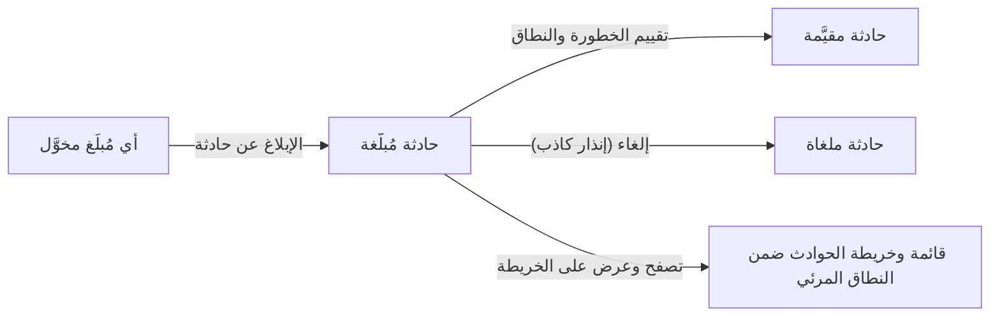

# الإبلاغ عن الحوادث وتقييمها

<!-- BEGIN GENERATED: doc -->
| البند | القيمة |
|---|---|
| المعرّف | FEAT-RSK-INCIDENT-REPORT |
| الإصدار | 0.1 |
| الحالة | مسودة |
| القدرة | CAP-09 المخاطر والطوارئ |
| القدرة الفرعية | CAP-09.02 الحوادث والاستجابة (R3) |
| الأدوار | المُبلِّغ؛ مقيّم الحادثة؛ أي مستخدم مخوَّل |
| الشاشات | SCR-47 سجل المخاطر والحوادث |
| حالات الاستخدام | UC-142 |
| القصص | 8: 5 من المواصفة، و3 جديدة |
<!-- END GENERATED: doc -->

## 1. نظرة عامة

### 1.1 القيمة

يبلّغ أي مستخدم مخوَّل عن حادثة فورًا، ويحدد المقيّم خطورتها، ويتابع الجميع الحوادث ضمن نطاقهم.

### 1.2 النطاق

| البند | القيمة |
|---|---|
| المستخدمون | أي مُبلِّغ مخوَّل؛ مقيّم الحادثة؛ أي مستخدم مخوَّل ضمن نطاقه |
| الشاشات | SCR-47 سجل المخاطر والحوادث |
| حالات الاستخدام | الإبلاغ عن حادثة فورًا بأقل الحقول أو بنموذج كامل؛ تقييم خطورتها ونطاقها المتأثر؛ إلغاؤها إن كانت إنذارًا كاذبًا؛ تصفح الحوادث وعرضها على الخريطة ضمن النطاق المرئي |
| المتطلبات | الإبلاغ بفئة خطر ووصف ونطاق تأثر واحد على الأقل وخطورة ابتدائية «صغيرة»؛ التقييم يحدد الخطورة قبل توجيه الاستجابة؛ ربط الحادثة بخطر لا يغيّر حالة ذلك الخطر تلقائيًا؛ القوائم والخريطة مقصورة على النطاق المرئي للطالب |
| خارج النطاق | توجيه الاستجابة وتصعيد الخطورة واحتواؤها وحلها وإغلاقها (ميزة «قيادة الاستجابة للحادثة»)؛ تفعيل خطة الاستمرارية ومتابعة التعافي (ميزة «تفعيل خطة الطوارئ ومتابعة التعافي») |

### 1.3 خريطة الميزة

**الشكل 1: من الإبلاغ إلى التقييم أو الإلغاء**



## 2. القواعد المشتركة

تنطبق على كل قصص الميزة، فلا تتكرر داخل القصص. وكل قصة تذكر ما يخصها فقط.

### 2.1 السياق المشترك

كل قصة تبدأ من ثلاثة شروط: مستأجر نشط، وحزمة السياسات الأساسية مفعّلة، ومستخدم مسجّل الدخول ومخوَّل. وتشير إليها القصص بخطوة واحدة: «بفرض السياق المشترك للميزة».

### 2.2 الصلاحية وعدم الإفصاح

- من لا يحق له رؤية العنصر يتلقى ردًا بشكل «غير متاح» تمامًا، فلا يعرف أنه موجود.
- من يرى العنصر ولا يحق له الإجراء يتلقى «لا تملك صلاحية هذا الإجراء».

### 2.3 أوامر تغيير الحالة

- **منع التكرار:** يُرسل كل أمر بمفتاح فريد، فإعادة الطلب نفسه لا تُنفَّذ مرتين.
- **حماية التعديل المتزامن:** يُرسل كل أمر بإصدار البيانات الذي يراه المستخدم. فإن عدّلها غيره في الأثناء، يُرفض الأمر.
- **السجل:** إن نجح الأمر، يُكتب حدثه وسجل التدقيق في المعاملة نفسها.

### 2.4 الرفض المشترك

```gherkin
# language: ar
خاصية: الرفض المشترك لأوامر الميزة

  سيناريو مخطط: رفض مشترك لكل أمر في الميزة
    بفرض السياق المشترك للميزة
    و <الحالة>
    عندما يُرسل المستخدم أي أمر من أوامر الميزة
    اذاً يُرفض برمز <الرمز> ويرى "<الرسالة>"
    و لا يتغير شيء

    امثلة:
      | الحالة                                  | الرمز                  | الرسالة                                                 |
      | العنصر خارج صلاحياته                    | NOT_FOUND              | غير متاح                                                |
      | العنصر مرئي له ولا يحق له الإجراء       | AUTHZ_DENIED           | لا تملك صلاحية هذا الإجراء                              |
      | غيره عدّل العنصر بعد أن فتحه            | VERSION_CONFLICT       | تغيّرت البيانات منذ فتحتها. راجع التغييرات ثم أعد المحاولة |
      | أعاد مفتاح منع التكرار بمحتوى مختلف     | IDEMPOTENCY_KEY_REUSED | طلب مكرر بمحتوى مختلف                                   |
      | البيانات ناقصة أو غير صحيحة             | VALIDATION_FAILED      | بعض البيانات ناقصة أو غير صحيحة. راجع الحقول المعلَّمة      |

  سيناريو: إعادة الطلب نفسه لا تُنفَّذ مرتين
    بفرض السياق المشترك للميزة
    و أمر نجح بمفتاح منع تكرار
    عندما يُعاد الطلب نفسه بالمفتاح نفسه
    اذاً تُعاد النتيجة الأولى ولا يُكتب حدث ثانٍ
```

## 3. الجودة وتعريف الاكتمال

### 3.1 متطلبات الجودة

<!-- BEGIN GENERATED: quality -->
لا متطلبات جودة مرتبطة بمتطلبات هذه الميزة مباشرة. تنطبق متطلبات المنصة العامة (`FEAT-PLT-*`).
<!-- END GENERATED: quality -->

### 3.2 تعريف الاكتمال

القصة مكتملة حين تتحقق الشروط الخمسة:

1. سيناريوهاتها والقواعد المشتركة تمر في الاختبار الآلي.
2. فحوص البنية المعمارية تمر.
3. نصوص الواجهة والرسائل موجودة بالعربية والإنجليزية.
4. مراجعة الكود مكتملة.
5. ما تضيفه القصة نفسها في قسم «القواعد» تحقق.

## 4. فهرس القصص

<!-- BEGIN GENERATED: story-index -->
| المعرّف | القصة | النوع | الحالة |
|---|---|---|---|
| `US-BC04-INC-ASSESS` | تقييم الحادثة | أمر | مسودة |
| `US-BC04-INC-CANCEL` | إلغاء الحادثة | أمر | مسودة |
| `US-BC04-INC-REPORT` | الإبلاغ عن الحادثة | أمر | مسودة |
| `US-BC04-Q-INC-GET` | جلب: Incident بنطاقه المرئي للطالب | جلب | مسودة |
| `US-BC04-Q-INC-LIST` | جلب: حوادث مصفّاة بالفئة/الخطورة/الحالة/النطاق | جلب | مسودة |
| `US-UI-SCR47-INCIDENT-LIST` | قائمة الحوادث بالتصفية والخطورة | واجهة | مسودة |
| `US-UI-SCR47-INCIDENT-MAP` | عرض الحوادث ضمن نطاقي على الخريطة | واجهة | مسودة |
| `US-UI-SCR47-QUICK-REPORT` | إبلاغ سريع عن حادثة بأقل الحقول | واجهة | مسودة |
<!-- END GENERATED: story-index -->

## 5. القصص

### 5.1 US-BC04-INC-ASSESS — تقييم الحادثة

| النوع | الإصدار | الأولوية | دون اتصال | الحالة |
|---|---|---|---|---|
| أمر | R3 | Must | لا | مسودة |

> **كـ** مقيّم الحادثة، **أريد** أن أحدد خطورتها الأولية والنطاقات المتأثرة بها، **حتى** يبدأ قائد الحادثة توجيه استجابة تناسب حجمها الحقيقي.

**باختصار:** يقيّم المقيّم حادثة «مُبلَّغة» بتحديد خطورتها والنطاقات المتأثرة، فتصير «مقيَّمة» وجاهزة لتوجيه الاستجابة.

#### القواعد

- **متى يُسمح:** الحادثة «مُبلَّغة» فقط.
- **من يُسمح له:** مقيّم مخوَّل، والنطاقات المتأثرة يجب أن تكون مرئية له.
- **البيانات:** مستوى الخطورة (صغير حتى أزمة)، والنطاقات المتأثرة (عنصر واحد على الأقل).
- **الأثر:** تصبح الحادثة «مقيَّمة»، ويصل حدث التقييم إلى الإشعار ومتابعة التنفيذ.

#### معايير القبول

```gherkin
# language: ar
خاصية: تقييم الحادثة

  سيناريو: المقيّم يقيّم حادثة مُبلَّغة
    بفرض السياق المشترك للميزة
    و حادثة "مُبلَّغة" ونطاقاتها المتأثرة مرئية للمقيّم
    عندما يحدد المقيّم خطورتها ونطاقاتها المتأثرة
    اذاً تصبح حالتها "مقيَّمة"
    و يُسجَّل حدث "قُيِّمت الحادثة"

  سيناريو مخطط: رفض خاص بتقييم الحادثة
    بفرض السياق المشترك للميزة
    و <الحالة>
    عندما يحاول المقيّم تقييم الحادثة
    اذاً يُرفض برمز <الرمز> ويرى "<الرسالة>"
    و لا يتغير شيء

    امثلة:
      | الحالة                                        | الرمز                             | الرسالة                                    |
      | الحادثة ليست "مُبلَّغة"                       | INCIDENT_INVALID_STATE_TRANSITION | الوضع الحالي للحادثة لا يسمح بهذا الإجراء |
      | مستوى الخطورة أو النطاقات المتأثرة غير صحيحة | INCIDENT_INVALID                 | بيانات الحادثة غير مكتملة                   |
      | مستوى الخطورة مفقود                          | VALIDATION_FAILED                 | مستوى الخطورة مطلوب                         |
```

<details><summary>المراجع التقنية والتتبع</summary>

<!-- BEGIN GENERATED: refs US-BC04-INC-ASSESS -->
| البند | المعرّف | المعنى |
|---|---|---|
| الواجهة البرمجية | `POST /api/v1/operations/incidents/{id}/actions/assess` | — |
| الأمر | `CMD-INC-ASSESS` | تقييم الحادثة |
| السياسة | `POL-INC-ASSESS` | مقيّم الحادثة؛ tenant match; affected_scope_refs visible to actor |
| الحدث | `EVT-INC-ASSESSED` | يصل إلى: Search projection (SLC-05); Notification (SLC-06); اقتراحات كائن المعرفة (SLC-12، بعد الإغلاق — R3-Q… |
| الكيان | `AGG-INCIDENT` | الحادثة |
| الجدول | `operations.incidents` | الجدول الرئيسي للحادثة |
| وحدة النشر | DU-08 | — |
| المتطلبات | REQ-RCM-006، REQ-RCM-007، REQ-RCM-008، REQ-RCM-009، REQ-RCM-010، REQ-RCM-012، REQ-RCM-013 | معانيها في القسم 6. التتبع |
| حالة الاستخدام | UC-142 | Report & Assess Incident |
| الاختبار | TST-INCIDENT-SM، TST-SLC17-INVARIANTS | دورة حالات الحادثة، وثوابت الشريحة SLC-17 |
<!-- END GENERATED: refs US-BC04-INC-ASSESS -->

</details>

### 5.2 US-BC04-INC-CANCEL — إلغاء الحادثة

| النوع | الإصدار | الأولوية | دون اتصال | الحالة |
|---|---|---|---|---|
| أمر | R3 | Must | لا | مسودة |

> **كـ** أي مُبلِّغ مخوَّل، **أريد** أن ألغي حادثة أبلغت عنها تبيّن أنها إنذار كاذب، **حتى** لا تستهلك متابعة لا حاجة لها.

**باختصار:** يلغي المُبلِّغ حادثة «مُبلَّغة» بسبب إنذار كاذب، فتصير «ملغاة» نهائيًا.

#### القواعد

- **متى يُسمح:** الحادثة «مُبلَّغة» فقط.
- **من يُسمح له:** أي مُبلِّغ مخوَّل.
- **البيانات:** السبب (إلزامي).
- **الأثر:** تصبح الحادثة «ملغاة»، وهي حالة نهائية لا رجوع عنها.

#### معايير القبول

```gherkin
# language: ar
خاصية: إلغاء الحادثة

  سيناريو: المُبلِّغ يلغي حادثة إنذار كاذب
    بفرض السياق المشترك للميزة
    و حادثة "مُبلَّغة"
    عندما يلغيها المُبلِّغ بسبب إنذار كاذب
    اذاً تصبح حالتها "ملغاة"
    و يُسجَّل حدث "أُلغيت الحادثة"

  سيناريو مخطط: رفض خاص بإلغاء الحادثة
    بفرض السياق المشترك للميزة
    و <الحالة>
    عندما يحاول إلغاء الحادثة
    اذاً يُرفض برمز <الرمز> ويرى "<الرسالة>"
    و لا يتغير شيء

    امثلة:
      | الحالة                   | الرمز                             | الرسالة                                    |
      | الحادثة ليست "مُبلَّغة" | INCIDENT_INVALID_STATE_TRANSITION | الوضع الحالي للحادثة لا يسمح بهذا الإجراء |
      | السبب مفقود              | REASON_REQUIRED                   | اذكر السبب                                  |
```

<details><summary>المراجع التقنية والتتبع</summary>

<!-- BEGIN GENERATED: refs US-BC04-INC-CANCEL -->
| البند | المعرّف | المعنى |
|---|---|---|
| الواجهة البرمجية | `POST /api/v1/operations/incidents/{id}/actions/cancel` | — |
| الأمر | `CMD-INC-CANCEL` | إلغاء الحادثة |
| السياسة | `POL-INC-CANCEL` | أي مُبلِّغ مخوَّل (تبليغ، إلغاء)؛ tenant match |
| الحدث | `EVT-INC-CANCELLED` | يصل إلى: Search projection (SLC-05); Notification (SLC-06); اقتراحات كائن المعرفة (SLC-12، بعد الإغلاق — R3-Q… |
| الكيان | `AGG-INCIDENT` | الحادثة |
| الجدول | `operations.incidents` | الجدول الرئيسي للحادثة |
| وحدة النشر | DU-08 | — |
| المتطلبات | REQ-RCM-006، REQ-RCM-007، REQ-RCM-008، REQ-RCM-009، REQ-RCM-010، REQ-RCM-012، REQ-RCM-013 | معانيها في القسم 6. التتبع |
| حالة الاستخدام | UC-142 | Report & Assess Incident |
| الاختبار | TST-INCIDENT-SM، TST-SLC17-INVARIANTS | دورة حالات الحادثة، وثوابت الشريحة SLC-17 |
<!-- END GENERATED: refs US-BC04-INC-CANCEL -->

</details>

### 5.3 US-BC04-INC-REPORT — الإبلاغ عن الحادثة

| النوع | الإصدار | الأولوية | دون اتصال | الحالة |
|---|---|---|---|---|
| أمر | R3 | Must | لا | مسودة |

> **كـ** أي مُبلِّغ مخوَّل، **أريد** أن أبلّغ عن حادثة بفئة خطرها ووصفها والنطاقات المتأثرة، **حتى** يبدأ تتبعها فورًا من لحظة وقوعها.

**باختصار:** يبلّغ المُبلِّغ عن حادثة جديدة بفئة خطرها ووصفها ونطاق متأثر واحد على الأقل، وقد يربطها بخطر سبق تحديده إن تحقق، فتُسجَّل «مُبلَّغة» بخطورة ابتدائية «صغيرة».

#### القواعد

- **متى يُسمح:** لا توجد حادثة سابقة لهذا التبليغ؛ هذا إنشاء جديد.
- **من يُسمح له:** أي مُبلِّغ مخوَّل، والنطاقات المتأثرة يجب أن تكون مرئية له.
- **البيانات:** فئة الخطر، والوصف، ونطاق متأثر واحد على الأقل، ومرجع خطر تحقَّق (اختياري)، والتصنيف الأمني (لا يقل عن تصنيف النطاق).
- **الأثر:** تُسجَّل الحادثة «مُبلَّغة» بخطورة ابتدائية «صغيرة»، ويصل حدث التبليغ إلى الإشعار ومتابعة التنفيذ. ربطها بخطر لا يغيّر حالة ذلك الخطر تلقائيًا أبدًا؛ مالك الخطر يتصرف بأمر منفصل في ميزة سجل المخاطر (REQ-RCM-012).

#### معايير القبول

```gherkin
# language: ar
خاصية: الإبلاغ عن الحادثة

  سيناريو: الإبلاغ عن حادثة جديدة
    بفرض السياق المشترك للميزة
    و فئة خطر ووصف ونطاق متأثر مرئي للمُبلِّغ
    عندما يبلّغ المُبلِّغ عن الحادثة
    اذاً تُسجَّل الحادثة "مُبلَّغة" بخطورة ابتدائية "صغيرة"
    و يُسجَّل حدث "أُبلِغ عن الحادثة"

  سيناريو: الإبلاغ عن حادثة مرتبطة بخطر تحقَّق
    بفرض السياق المشترك للميزة
    و خطر مسجَّل سابقًا تحقَّق فعليًا
    عندما يبلّغ المُبلِّغ عن الحادثة ويربطها بذلك الخطر
    اذاً تُسجَّل الحادثة مرتبطة بالخطر
    و تبقى حالة الخطر كما كانت دون تغيير تلقائي

  سيناريو مخطط: رفض خاص بالإبلاغ عن الحادثة
    بفرض السياق المشترك للميزة
    و <الحالة>
    عندما يحاول الإبلاغ عن الحادثة
    اذاً يُرفض برمز <الرمز> ويرى "<الرسالة>"
    و لا يتغير شيء

    امثلة:
      | الحالة                                                 | الرمز             | الرسالة                   |
      | فئة الخطر أو الوصف أو نطاق التأثر غير مكتمل أو غير صالح | INCIDENT_INVALID  | بيانات الحادثة غير مكتملة |
      | فئة الخطر مفقودة                                       | VALIDATION_FAILED | فئة الخطر مطلوبة          |
```

<details><summary>المراجع التقنية والتتبع</summary>

<!-- BEGIN GENERATED: refs US-BC04-INC-REPORT -->
| البند | المعرّف | المعنى |
|---|---|---|
| الواجهة البرمجية | `POST /api/v1/operations/incidents` | — |
| الأمر | `CMD-INC-REPORT` | الإبلاغ عن الحادثة |
| السياسة | `POL-INC-REPORT` | أي مُبلِّغ مخوَّل (تبليغ، إلغاء)؛ tenant match; scope_refs visible to actor |
| الحدث | `EVT-INC-REPORTED` | يصل إلى: Search projection (SLC-05); Notification (SLC-06); اقتراحات كائن المعرفة (SLC-12، بعد الإغلاق — R3-Q… |
| الكيان | `AGG-INCIDENT` | الحادثة |
| الجدول | `operations.incidents` | الجدول الرئيسي للحادثة |
| وحدة النشر | DU-08 | — |
| المتطلبات | REQ-RCM-006، REQ-RCM-007، REQ-RCM-008، REQ-RCM-009، REQ-RCM-010، REQ-RCM-012، REQ-RCM-013 | معانيها في القسم 6. التتبع |
| حالة الاستخدام | UC-142 | Report & Assess Incident |
| الاختبار | TST-INCIDENT-SM، TST-SLC17-INVARIANTS | دورة حالات الحادثة، وثوابت الشريحة SLC-17 |
<!-- END GENERATED: refs US-BC04-INC-REPORT -->

</details>

### 5.4 US-BC04-Q-INC-GET — جلب: Incident بنطاقه المرئي للطالب

| النوع | الإصدار | الأولوية | دون اتصال | الحالة |
|---|---|---|---|---|
| جلب | R3 | Must | لا | مسودة |

> **كـ** أي مستخدم مخوَّل ضمن نطاقه المرئي، **أريد** أن أفتح تفاصيل حادثة واحدة، **حتى** أرى حالتها وخطورتها وما يخصها دون تجاوز ما يحق لي رؤيته.

**باختصار:** تُعاد تفاصيل الحادثة فقط إذا كانت ضمن نطاق الطالب المرئي، وتُعاد «غير متاحة» تمامًا خارج ذلك.

#### القواعد

- **من يرى ماذا:** أي مستخدم مخوَّل ضمن نطاقه المسموح فقط؛ من خارج نطاقه يتلقى «غير متاح».

#### معايير القبول

```gherkin
# language: ar
خاصية: جلب تفاصيل الحادثة

  سيناريو: الطالب يرى حادثة ضمن نطاقه
    بفرض السياق المشترك للميزة
    و حادثة ضمن نطاق الطالب المرئي
    عندما يطلب تفاصيلها
    اذاً تُعاد تفاصيلها بعد إعادة فحص صلاحيته عليها
```

<details><summary>المراجع التقنية والتتبع</summary>

<!-- BEGIN GENERATED: refs US-BC04-Q-INC-GET -->
| البند | المعرّف | المعنى |
|---|---|---|
| الواجهة البرمجية | `GET /api/v1/operations/incidents/{incident_id}` | — |
| الاستعلام | `QRY-INC-GET` | Incident بنطاقه المرئي للطالب |
| السياسة | `POL-INC-GET` | allowed_scope |
| الكيان | `AGG-INCIDENT` | الحادثة |
| الجدول | `operations.incidents` | الجدول الرئيسي للحادثة |
| وحدة النشر | DU-08 | — |
| المتطلب | REQ-RCM-015 | The system shall let an authorized actor list and filter incidents by category, severity, status and scope, r… |
| حالة الاستخدام | UC-142 | Report & Assess Incident |
| الاختبار | TST-INCIDENT-SM، TST-SLC17-INVARIANTS | دورة حالات الحادثة، وثوابت الشريحة SLC-17 |
<!-- END GENERATED: refs US-BC04-Q-INC-GET -->

</details>

### 5.5 US-BC04-Q-INC-LIST — جلب: حوادث مصفّاة بالفئة/الخطورة/الحالة/النطاق

| النوع | الإصدار | الأولوية | دون اتصال | الحالة |
|---|---|---|---|---|
| جلب | R3 | Must | لا | مسودة |

> **كـ** أي مستخدم مخوَّل، **أريد** أن أستعرض الحوادث مصفّاة بالفئة والخطورة والحالة والنطاق، **حتى** أتابع ما يخص نطاقي فقط دون تمرير كل السجل.

**باختصار:** تُعاد الحوادث التي يحق للمستخدم رؤيتها فقط، صفحة بعد صفحة، ولا يكشف عددها أو ترشيحها وجود حوادث محجوبة.

#### القواعد

- **من يرى ماذا:** أي مستخدم مخوَّل، ضمن نطاقه المسموح فقط.
- **المرشحات:** الفئة، الخطورة، الحالة، النطاق، والمؤشر والحد لصفحة النتائج.

#### معايير القبول

```gherkin
# language: ar
خاصية: قائمة الحوادث المصفّاة

  سيناريو: يرى المستخدم حوادث نطاقه فقط
    بفرض السياق المشترك للميزة
    و حوادث داخل نطاق المستخدم وأخرى خارجه
    عندما يطلب قائمة الحوادث مصفّاة بالفئة أو الخطورة أو الحالة
    اذاً تُعاد الحوادث داخل نطاقه فقط، ويُعاد فحص صلاحية كل منها
    و لا يكشف أي عدد أو ترشيح وجود حادثة محجوبة

  سيناريو: الصفحة التالية
    بفرض السياق المشترك للميزة
    و حوادث المستخدم أكثر من صفحة
    عندما يطلب الصفحة التالية بالمؤشر
    اذاً تُعاد الحوادث التالية دون تكرار ولا فجوة
```

<details><summary>المراجع التقنية والتتبع</summary>

<!-- BEGIN GENERATED: refs US-BC04-Q-INC-LIST -->
| البند | المعرّف | المعنى |
|---|---|---|
| الواجهة البرمجية | `GET /api/v1/operations/incidents` | — |
| الاستعلام | `QRY-INC-LIST` | حوادث مصفّاة بالفئة/الخطورة/الحالة/النطاق |
| السياسة | `POL-INC-LIST` | allowed_scope |
| الكيان | `AGG-INCIDENT` | الحادثة |
| الجدول | `operations.incidents` | الجدول الرئيسي للحادثة |
| وحدة النشر | DU-08 | — |
| المتطلب | REQ-RCM-015 | The system shall let an authorized actor list and filter incidents by category, severity, status and scope, r… |
| حالة الاستخدام | UC-142 | Report & Assess Incident |
| الاختبار | TST-INCIDENT-SM، TST-SLC17-INVARIANTS | دورة حالات الحادثة، وثوابت الشريحة SLC-17 |
<!-- END GENERATED: refs US-BC04-Q-INC-LIST -->

</details>

### 5.6 US-UI-SCR47-INCIDENT-LIST — قائمة الحوادث بالتصفية والخطورة

| النوع | الإصدار | الأولوية | دون اتصال | الحالة |
|---|---|---|---|---|
| واجهة | R3 | Must | لا | مسودة |

> **كـ** المستخدم (أي مستخدم مخوَّل ضمن نطاقه)، **أريد** قائمة حوادث يمكن تصفيتها بالفئة والخطورة والحالة والنطاق، وخطورة كل حادثة ظاهرة بشارة، **حتى** أحدد الحوادث الأخطر أولاً بنظرة واحدة.

**باختصار:** تعرض الشاشة الحوادث بترقيم مؤشر، مع مرشحات الفئة والخطورة والحالة والنطاق في عنوان الرابط، وشارة لون لمستوى خطورة كل حادثة.

#### القواعد

- المرشحات تُحفظ في عنوان الرابط فتُشارك وتُحفظ كمفضلة **[Derived]**.
- لا يُعرض عدد إجمالي إلا ما يحسبه الخادم من الحوادث المرئية؛ لا «عدد مخفي».
- شارة الخطورة تلوَّن حسب المستوى، من صغير حتى أزمة، لتمييز الأخطر بنظرة واحدة.

#### معايير القبول

```gherkin
# language: ar
خاصية: قائمة الحوادث بالتصفية والخطورة

  سيناريو: تصفية القائمة بالخطورة
    بفرض السياق المشترك للميزة
    و حوادث بمستويات خطورة مختلفة ضمن نطاق المستخدم
    عندما يصفي القائمة بمستوى خطورة معيَّن
    اذاً تظهر الحوادث بتلك الخطورة فقط، كل منها بشارة خطورتها

  سيناريو: لا يظهر عدد الحوادث المحجوبة
    بفرض السياق المشترك للميزة
    و حوادث خارج نطاق المستخدم
    عندما يفتح القائمة
    اذاً لا يظهر أي عدد أو إشارة إلى وجود حوادث محجوبة
```

<details><summary>المراجع التقنية والتتبع</summary>

<!-- BEGIN GENERATED: refs US-UI-SCR47-INCIDENT-LIST -->
| البند | المعرّف | المعنى |
|---|---|---|
| الشاشة | SCR-47 | شاشة سجل المخاطر والحوادث |
| المصدر | `21-ui-design.md §10` | — |
| المصدر | `[Derived]` | — |
| المتطلب | REQ-RCM-015 | The system shall let an authorized actor list and filter incidents by category, severity, status and scope, r… |
| حالة الاستخدام | UC-142 | Report & Assess Incident |
<!-- END GENERATED: refs US-UI-SCR47-INCIDENT-LIST -->

</details>

### 5.7 US-UI-SCR47-INCIDENT-MAP — عرض الحوادث ضمن نطاقي على الخريطة

| النوع | الإصدار | الأولوية | دون اتصال | الحالة |
|---|---|---|---|---|
| واجهة | R3 | Must | لا | مسودة |

> **كـ** المستخدم (أي مستخدم مخوَّل ضمن نطاقه)، **أريد** أن أرى الحوادث على الخريطة بموقعها ضمن نطاقي، **حتى** أفهم انتشارها الجغرافي بنظرة واحدة.

**باختصار:** تعرض الخريطة الحوادث ضمن نطاق المستخدم المرئي كطبقة منفصلة، بتجميع عند التصغير، دون الحوادث المحجوبة.

#### القواعد

- تُعرض الحوادث كطبقة من طبقات الخريطة المشتركة، بتجميع عند التصغير وكثافة محدودة لكل بلاطة.
- عضو النطاق المعمَّم يُرسم في مركز خلية حتمي وتظهر له علامة «معمم»، مثل بقية طبقات الخريطة.
- لا تظهر حادثة خارج النطاق المرئي للمستخدم على الخريطة بأي شكل.

#### معايير القبول

```gherkin
# language: ar
خاصية: عرض الحوادث على الخريطة ضمن نطاقي

  سيناريو: عرض الحوادث ضمن النطاق المرئي
    بفرض السياق المشترك للميزة
    و حوادث داخل نطاق المستخدم وأخرى خارجه، بمواقع مختلفة
    عندما يفتح المستخدم طبقة الحوادث على الخريطة
    اذاً تظهر حوادث نطاقه فقط بمواقعها
    و لا تظهر أي إشارة إلى وجود حوادث خارج نطاقه

  سيناريو: تجميع الحوادث عند التصغير
    بفرض السياق المشترك للميزة
    و عدد كبير من الحوادث متقاربة الموقع ضمن نطاق المستخدم
    عندما يصغّر مستوى الخريطة
    اذاً تُجمَّع الحوادث المتقاربة في علامة واحدة بعددها
```

<details><summary>المراجع التقنية والتتبع</summary>

<!-- BEGIN GENERATED: refs US-UI-SCR47-INCIDENT-MAP -->
| البند | المعرّف | المعنى |
|---|---|---|
| الشاشة | SCR-47 | شاشة سجل المخاطر والحوادث |
| المصدر | `21-ui-design.md §7` | — |
| المصدر | `[Derived]` | — |
| المتطلب | REQ-RCM-015 | The system shall let an authorized actor list and filter incidents by category, severity, status and scope, r… |
| حالة الاستخدام | UC-142 | Report & Assess Incident |
<!-- END GENERATED: refs US-UI-SCR47-INCIDENT-MAP -->

</details>

### 5.8 US-UI-SCR47-QUICK-REPORT — إبلاغ سريع عن حادثة بأقل الحقول

| النوع | الإصدار | الأولوية | دون اتصال | الحالة |
|---|---|---|---|---|
| واجهة | R3 | Must | لا | مسودة |

> **كـ** المستخدم (أي مُبلِّغ مخوَّل)، **أريد** نموذجًا سريعًا بأقل الحقول الإلزامية للإبلاغ عن حادثة، **حتى** أبلّغ فورًا دون تأخير وقت وقوعها بتعبئة نموذج طويل.

**باختصار:** يفتح المُبلِّغ نموذج إبلاغ سريع يطلب فقط فئة الخطر والوصف ونطاق التأثر، فيُرسل الأمر بالخطورة الابتدائية الافتراضية، وتُفتح تفاصيل الحادثة الكاملة للتعبئة لاحقًا.

#### القواعد

- النموذج السريع يطلب فقط الحقول الإلزامية لأمر الإبلاغ: فئة الخطر، والوصف، ونطاق التأثر واحد على الأقل، ويترك الباقي لاحقًا **[Derived]**.
- بعد الإرسال تُفتح شاشة تفاصيل الحادثة الجديدة لإتمام أي بيانات إضافية.

#### معايير القبول

```gherkin
# language: ar
خاصية: إبلاغ سريع عن حادثة

  سيناريو: إبلاغ سريع بأقل الحقول
    بفرض السياق المشترك للميزة
    و المُبلِّغ فتح نموذج الإبلاغ السريع
    عندما يدخل فئة الخطر والوصف ونطاق التأثر ويرسل
    اذاً تُسجَّل الحادثة "مُبلَّغة" بخطورة ابتدائية "صغيرة"
    و تُفتح شاشة تفاصيلها لإتمام أي بيانات إضافية

  سيناريو: الإرسال يُرفض عند نقص حقل إلزامي
    بفرض السياق المشترك للميزة
    و المُبلِّغ فتح نموذج الإبلاغ السريع دون إدخال نطاق التأثر
    عندما يحاول الإرسال
    اذاً يظهر له أن نطاق التأثر مطلوب ولا يُرسل الأمر
```

<details><summary>المراجع التقنية والتتبع</summary>

<!-- BEGIN GENERATED: refs US-UI-SCR47-QUICK-REPORT -->
| البند | المعرّف | المعنى |
|---|---|---|
| الشاشة | SCR-47 | شاشة سجل المخاطر والحوادث |
| المصدر | `[Derived]` | — |
| المتطلب | REQ-RCM-006 | The system shall allow any authorized actor to report an incident with a hazard category, description, at lea… |
| حالة الاستخدام | UC-142 | Report & Assess Incident |
<!-- END GENERATED: refs US-UI-SCR47-QUICK-REPORT -->

</details>

## 6. التتبع

<!-- BEGIN GENERATED: trace -->
| المتطلب | المعنى | القصص | الاختبار |
|---|---|---|---|
| REQ-RCM-006 | The system shall allow any authorized actor to report an incident with a hazard category, description, at lea… | `US-BC04-INC-ASSESS`، `US-BC04-INC-CANCEL`، `US-BC04-INC-REPORT`، `US-UI-SCR47-QUICK-REPORT` | TST-INCIDENT-SM |
| REQ-RCM-007 | The system shall require an authorized assessor to set an incident's severity to one of MINOR, MAJOR, EMERGEN… | كل قصص الأوامر والنظام في الميزة (3) | TST-INCIDENT-SM |
| REQ-RCM-008 | The system shall require a commander and at least one linked response task before an incident moves to respon… | كل قصص الأوامر والنظام في الميزة (3) | TST-INCIDENT-SM |
| REQ-RCM-009 | When an incident's severity is escalated, the system shall accept only a value higher than the current severi… | كل قصص الأوامر والنظام في الميزة (3) | TST-INCIDENT-SM، TST-SLC17-INVARIANTS |
| REQ-RCM-010 | The system shall reject closing an incident while any of its linked response tasks is not in a terminal state. | كل قصص الأوامر والنظام في الميزة (3) | TST-INCIDENT-SM، TST-SLC17-INVARIANTS |
| REQ-RCM-012 | When an incident references a risk as materialized, the system shall not change that risk's state automatical… | كل قصص الأوامر والنظام في الميزة (3) | TST-INCIDENT-SM، TST-SLC17-INVARIANTS |
| REQ-RCM-013 | The system shall allow a response task to be created directly under an incident (incident_ref) without requir… | كل قصص الأوامر والنظام في الميزة (3) | TST-INCIDENT-SM، TST-SLC17-INVARIANTS |
| REQ-RCM-015 | The system shall let an authorized actor list and filter incidents by category, severity, status and scope, r… | `US-BC04-Q-INC-GET`، `US-BC04-Q-INC-LIST`، `US-UI-SCR47-INCIDENT-LIST`، `US-UI-SCR47-INCIDENT-MAP` | — |
<!-- END GENERATED: trace -->

## 7. سجل التغييرات

| الإصدار | التاريخ | التغيير |
|---|---|---|
| 0.1 | — | هيكل مولَّد من خريطة الميزات |
| 0.2 | 2026-10-13 | كتابة القصص كاملة بمعيار القصص |
