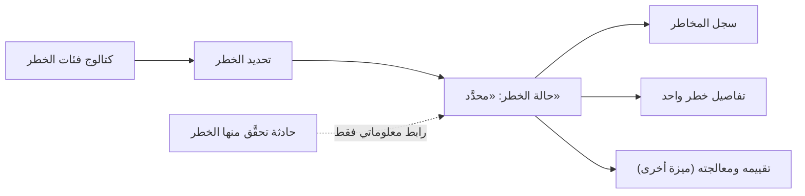

# سجل المخاطر

<!-- BEGIN GENERATED: doc -->
| البند | القيمة |
|---|---|
| المعرّف | FEAT-RSK-RISK-REGISTER |
| الإصدار | 0.2 |
| الحالة | مسودة |
| القدرة | CAP-09 المخاطر والطوارئ |
| القدرة الفرعية | CAP-09.01 إدارة المخاطر (R3) |
| الأدوار | محدِّد الخطر؛ مدير المخاطر؛ مالك النطاق؛ النظام |
| الشاشات | SCR-47 سجل المخاطر والحوادث |
| حالات الاستخدام | UC-140 |
| القصص | 7: 4 من المواصفة، و3 جديدة |
<!-- END GENERATED: doc -->

## 1. نظرة عامة

### 1.1 القيمة

يسجل المستخدم المخوَّل خطرًا محتملًا بنطاقه، ويتصفح سجل المخاطر مصفّى حسب ما يحق له رؤيته.

### 1.2 النطاق

| البند | القيمة |
|---|---|
| المستخدمون | محدِّد الخطر (يسجل الخطر)؛ مالك النطاق ومدير المخاطر (يتصفحان سجل المخاطر)؛ النظام (يربط الحادثة المتحقِّقة بالخطر) |
| الشاشات | SCR-47 سجل المخاطر والحوادث |
| حالات الاستخدام | تحديد الخطر، ثم تقييمه (UC-140 — يغطي هذه الميزة جانب التحديد والعرض، وتقييمه ومعالجته في ميزة أخرى) |
| المتطلبات | تحديد خطر بفئة من كتالوج المستأجر ووصف ونطاق واحد على الأقل (REQ-RCM-001)؛ عرض سجل المخاطر مصفًّى بالفئة والنطاق والدرجة، محصورًا بما يراه الطالب (REQ-RCM-014) |
| خارج النطاق | تقييم الخطر ومعالجته وإغلاقه (ميزة «تقييم المخاطر ومعالجتها»)؛ تسجيل الحوادث الفعلية ومتابعتها (قدرة فرعية أخرى، CAP-09.02) |

### 1.3 خريطة الميزة

**الشكل 1: تحديد الخطر وعرضه في السجل**



## 2. القواعد المشتركة

تنطبق على كل قصص الميزة، فلا تتكرر داخل القصص. وكل قصة تذكر ما يخصها فقط.

### 2.1 السياق المشترك

كل قصة تبدأ من ثلاثة شروط: مستأجر نشط، وحزمة السياسات الأساسية مفعّلة، ومستخدم مسجّل الدخول ومخوَّل. وتشير إليها القصص بخطوة واحدة: «بفرض السياق المشترك للميزة».

### 2.2 الصلاحية وعدم الإفصاح

- من لا يحق له رؤية العنصر يتلقى ردًا بشكل «غير متاح» تمامًا، فلا يعرف أنه موجود.
- من يرى العنصر ولا يحق له الإجراء يتلقى «لا تملك صلاحية هذا الإجراء».

### 2.3 أوامر تغيير الحالة

- **منع التكرار:** يُرسل كل أمر بمفتاح فريد، فإعادة الطلب نفسه لا تُنفَّذ مرتين.
- **حماية التعديل المتزامن:** يُرسل كل أمر بإصدار البيانات الذي يراه المستخدم. فإن عدّلها غيره في الأثناء، يُرفض الأمر.
- **السجل:** إن نجح الأمر، يُكتب حدثه وسجل التدقيق في المعاملة نفسها.

### 2.4 الرفض المشترك

```gherkin
# language: ar
خاصية: الرفض المشترك لأوامر الميزة

  سيناريو مخطط: رفض مشترك لكل أمر في الميزة
    بفرض السياق المشترك للميزة
    و <الحالة>
    عندما يُرسل المستخدم أي أمر من أوامر الميزة
    اذاً يُرفض برمز <الرمز> ويرى "<الرسالة>"
    و لا يتغير شيء

    امثلة:
      | الحالة                                  | الرمز                  | الرسالة                                                 |
      | العنصر خارج صلاحياته                    | NOT_FOUND              | غير متاح                                                |
      | العنصر مرئي له ولا يحق له الإجراء       | AUTHZ_DENIED           | لا تملك صلاحية هذا الإجراء                              |
      | غيره عدّل العنصر بعد أن فتحه            | VERSION_CONFLICT       | تغيّرت البيانات منذ فتحتها. راجع التغييرات ثم أعد المحاولة |
      | أعاد مفتاح منع التكرار بمحتوى مختلف     | IDEMPOTENCY_KEY_REUSED | طلب مكرر بمحتوى مختلف                                   |
      | البيانات ناقصة أو غير صحيحة             | VALIDATION_FAILED      | بعض البيانات ناقصة أو غير صحيحة. راجع الحقول المعلَّمة      |

  سيناريو: إعادة الطلب نفسه لا تُنفَّذ مرتين
    بفرض السياق المشترك للميزة
    و أمر نجح بمفتاح منع تكرار
    عندما يُعاد الطلب نفسه بالمفتاح نفسه
    اذاً تُعاد النتيجة الأولى ولا يُكتب حدث ثانٍ
```

## 3. الجودة وتعريف الاكتمال

### 3.1 متطلبات الجودة

<!-- BEGIN GENERATED: quality -->
لا متطلبات جودة مرتبطة بمتطلبات هذه الميزة مباشرة. تنطبق متطلبات المنصة العامة (`FEAT-PLT-*`).
<!-- END GENERATED: quality -->

### 3.2 تعريف الاكتمال

القصة مكتملة حين تتحقق الشروط الخمسة:

1. سيناريوهاتها والقواعد المشتركة تمر في الاختبار الآلي.
2. فحوص البنية المعمارية تمر.
3. نصوص الواجهة والرسائل موجودة بالعربية والإنجليزية.
4. مراجعة الكود مكتملة.
5. ما تضيفه القصة نفسها في قسم «القواعد» تحقق.

## 4. فهرس القصص

<!-- BEGIN GENERATED: story-index -->
| المعرّف | القصة | النوع | الحالة |
|---|---|---|---|
| `US-BC04-RIS-IDENTIFY` | تحديد الخطر | أمر | مسودة |
| `US-BC04-Q-RIS-GET` | جلب تفاصيل خطر واحد | جلب | مسودة |
| `US-BC04-Q-RIS-REGISTER` | جلب سجل المخاطر مصفّى بالفئة والنطاق والدرجة | جلب | مسودة |
| `US-BC04-S-RISK-01` | ربط الحادثة المتحقِّقة بالخطر | نظام | مسودة |
| `US-UI-SCR47-RISK-FORM` | نموذج تسجيل خطر بفئته ونطاقه | واجهة | مسودة |
| `US-UI-SCR47-RISK-REGISTER` | سجل المخاطر بالتصفية ومصفوفة الدرجة | واجهة | مسودة |
| `US-OPS-RSK-HAZARD-CATALOG` | تحميل فئات الخطر للمستأجر عند التهيئة | تشغيل | مسودة |
<!-- END GENERATED: story-index -->

## 5. القصص

### 5.1 US-BC04-RIS-IDENTIFY — تحديد الخطر

| النوع | الإصدار | الأولوية | دون اتصال | الحالة |
|---|---|---|---|---|
| أمر | R3 | Must | لا | مسودة |

> **كـ** محدِّد الخطر، **أريد** أن أسجل خطرًا محتملًا بفئته ووصفه ونطاقه، **حتى** يبدأ تتبعه وتقييمه ومعالجته قبل أن يقع.

**باختصار:** يسجل محدِّد الخطر خطرًا جديدًا بفئة من كتالوج المستأجر، ووصف، ونطاق واحد على الأقل، وتصنيف أمني لا يقل عن تصنيف أعلى نطاقاته، فيصير الخطر «محدَّدًا» في انتظار التقييم.

#### القواعد

- **متى يُسمح:** عند إنشاء خطر جديد لم يُسجَّل من قبل.
- **من يُسمح له:** محدِّد الخطر.
- **البيانات:** فئة الخطر (مرجع من كتالوج فئات الخطر الخاص بالمستأجر، ولا فئات ثابتة في النظام)، والوصف، ونطاق واحد على الأقل (أصل أو منطقة أو منظمة أو خطة)، وتصنيف أمني لا يقل عن تصنيف أعلى هذه النطاقات.
- **الأثر:** حدث «حُدِّد خطر» يصل إلى البحث، وإلى حالات التنسيق إن ارتبط نطاق الخطر بحالة تنسيق قائمة.

#### معايير القبول

```gherkin
# language: ar
خاصية: تحديد الخطر

  سيناريو: محدِّد الخطر يسجل خطرًا جديدًا
    بفرض السياق المشترك للميزة
    و فئة خطر من كتالوج المستأجر، ونطاق واحد على الأقل، وتصنيف يطابق تصنيف النطاق
    عندما يحدد محدِّد الخطر الخطر بفئته ووصفه ونطاقه وتصنيفه
    اذاً تصبح حالته "محدَّد"
    و يُسجَّل حدث "حُدِّد خطر"

  سيناريو مخطط: رفض خاص بتحديد الخطر
    بفرض السياق المشترك للميزة
    و <الحالة>
    عندما يحاول تحديد الخطر
    اذاً يُرفض برمز <الرمز> ويرى <الرسالة>
    و لا يتغير شيء

    امثلة:
      | الحالة                                                              | الرمز              | الرسالة                     |
      | فئة الخطر غير موجودة في كتالوج المستأجر، أو النطاق أقل من واحد، أو تصنيف الخطر أدنى من تصنيف نطاقه | RISK_INVALID       | بيانات الخطر غير مكتملة     |
      | الوصف غير مذكور                                                     | VALIDATION_FAILED  | الوصف مطلوب                 |
```

<details><summary>المراجع التقنية والتتبع</summary>

<!-- BEGIN GENERATED: refs US-BC04-RIS-IDENTIFY -->
| البند | المعرّف | المعنى |
|---|---|---|
| الواجهة البرمجية | `POST /api/v1/operations/risks` | — |
| الأمر | `CMD-RIS-IDENTIFY` | تحديد الخطر |
| السياسة | `POL-RIS-IDENTIFY` | محدِّد الخطر (تحديد) · مقيّم (تقييم، إعادة تقييم) · موافق المعالجة (تخطيط المعالجة) · مدير المخاطر (إغلاق)؛ t… |
| الحدث | `EVT-RIS-IDENTIFIED` | يصل إلى: Search projection (SLC-05); Coordination cases (SLC-15، عند ارتباط النطاق) |
| الكيان | `AGG-RISK` | الخطر |
| الجدول | `operations.risks` | الجدول الرئيسي للخطر |
| وحدة النشر | DU-08 | — |
| المتطلبات | REQ-RCM-001، REQ-RCM-002، REQ-RCM-003، REQ-RCM-004، REQ-RCM-005 | معانيها في القسم 6. التتبع |
| حالة الاستخدام | UC-140 | Identify & Assess Risk |
| الاختبار | TST-RISK-SM، TST-SLC17-INVARIANTS | دورة حالات الخطر، وثوابت الشريحة SLC-17 |
<!-- END GENERATED: refs US-BC04-RIS-IDENTIFY -->

</details>

### 5.2 US-BC04-Q-RIS-GET — جلب تفاصيل خطر واحد

| النوع | الإصدار | الأولوية | دون اتصال | الحالة |
|---|---|---|---|---|
| جلب | R3 | Must | لا | مسودة |

> **كـ** مالك النطاق أو مدير المخاطر، **أريد** أن أرى تفاصيل خطر واحد يقع ضمن نطاقي المرئي، **حتى** أتابع فئته ودرجته وحالته.

**باختصار:** تُعاد تفاصيل الخطر كاملة بعد إعادة فحص صلاحية الطالب عليه.

#### القواعد

- **من يرى ماذا:** مالك النطاق؛ مدير المخاطر، ولا يرى أي منهما خطرًا خارج نطاقه المرئي.

#### معايير القبول

```gherkin
# language: ar
خاصية: جلب تفاصيل خطر واحد

  سيناريو: الطالب يرى خطرًا ضمن نطاقه
    بفرض السياق المشترك للميزة
    و خطر ضمن النطاق المرئي للطالب
    عندما يطلب تفاصيل الخطر
    اذاً تُعاد تفاصيله كاملة بعد إعادة فحص صلاحيته
```

<details><summary>المراجع التقنية والتتبع</summary>

<!-- BEGIN GENERATED: refs US-BC04-Q-RIS-GET -->
| البند | المعرّف | المعنى |
|---|---|---|
| الواجهة البرمجية | `GET /api/v1/operations/risks/{risk_id}` | — |
| الاستعلام | `QRY-RIS-GET` | Risk بنطاقه المرئي للطالب |
| السياسة | `POL-RIS-GET` | مالك النطاق؛ مدير المخاطر |
| الكيان | `AGG-RISK` | الخطر |
| الجدول | `operations.risks` | الجدول الرئيسي للخطر |
| وحدة النشر | DU-08 | — |
| المتطلب | REQ-RCM-014 | The system shall let an authorized actor list and filter the risk register by category, scope and score, rest… |
| حالة الاستخدام | UC-140 | Identify & Assess Risk |
| الاختبار | TST-RISK-SM، TST-SLC17-INVARIANTS | دورة حالات الخطر، وثوابت الشريحة SLC-17 |
<!-- END GENERATED: refs US-BC04-Q-RIS-GET -->

</details>

### 5.3 US-BC04-Q-RIS-REGISTER — جلب سجل المخاطر مصفّى بالفئة والنطاق والدرجة

| النوع | الإصدار | الأولوية | دون اتصال | الحالة |
|---|---|---|---|---|
| جلب | R3 | Must | لا | مسودة |

> **كـ** مستخدم مخوَّل، **أريد** تصفح سجل المخاطر مصفًّى بالفئة والنطاق والدرجة، **حتى** أتابع المخاطر التي تقع ضمن نطاقي.

**باختصار:** تُعاد المخاطر التي يحق للمستخدم رؤيتها فقط، صفحةً بعد صفحة، ولا يكشف عددها أو مرشحاتها وجود مخاطر محجوبة.

#### القواعد

- **من يرى ماذا:** كل مستخدم يرى المخاطر ضمن نطاقه المسموح فقط.
- **المرشحات:** الفئة، والنطاق، ودرجة الخطر، والمؤشر والحد لكل صفحة.

#### معايير القبول

```gherkin
# language: ar
خاصية: جلب سجل المخاطر مصفّى بالفئة والنطاق والدرجة

  سيناريو: يرى المستخدم مخاطر نطاقه فقط
    بفرض السياق المشترك للميزة
    و مخاطر داخل نطاق المستخدم وأخرى خارجه
    عندما يطلب سجل المخاطر مصفًّى بفئة أو نطاق أو درجة
    اذاً تُعاد المخاطر داخل نطاقه فقط، ويُعاد فحص صلاحية كل منها
    و لا يكشف أي عدد أو مرشّح وجود خطر محجوب

  سيناريو: الصفحة التالية
    بفرض السياق المشترك للميزة
    و مخاطر أكثر من صفحة
    عندما يطلب الصفحة التالية بالمؤشر
    اذاً تُعاد المخاطر التالية دون تكرار ولا فجوة
```

<details><summary>المراجع التقنية والتتبع</summary>

<!-- BEGIN GENERATED: refs US-BC04-Q-RIS-REGISTER -->
| البند | المعرّف | المعنى |
|---|---|---|
| الواجهة البرمجية | `GET /api/v1/operations/risks` | — |
| الاستعلام | `QRY-RIS-REGISTER` | سجل المخاطر مصفّى بالفئة/النطاق/الدرجة |
| السياسة | `POL-RIS-REGISTER` | allowed_scope |
| الكيان | `AGG-RISK` | الخطر |
| الجدول | `operations.risks` | الجدول الرئيسي للخطر |
| وحدة النشر | DU-08 | — |
| المتطلب | REQ-RCM-014 | The system shall let an authorized actor list and filter the risk register by category, scope and score, rest… |
| حالة الاستخدام | UC-140 | Identify & Assess Risk |
| الاختبار | TST-RISK-SM، TST-SLC17-INVARIANTS | دورة حالات الخطر، وثوابت الشريحة SLC-17 |
<!-- END GENERATED: refs US-BC04-Q-RIS-REGISTER -->

</details>

### 5.4 US-BC04-S-RISK-01 — ربط الحادثة المتحقِّقة بالخطر

| النوع | الإصدار | الأولوية | دون اتصال | الحالة |
|---|---|---|---|---|
| نظام | R3 | Must | لا ينطبق | مسودة |

> **كـ** النظام، **أريد** أن أربط الحادثة التي تحقَّق منها الخطر بالخطر نفسه دون تغيير حالته، **حتى** يظهر هذا الارتباط في سجل الخطر دون أثر جانبي صامت.

**باختصار:** عند تسجيل حادثة تشير إلى خطر بوصفه مرجعه، يُسجَّل هذا الرابط على الخطر دون أن تتغير حالته؛ فتغيير حالة الخطر يبقى بأمر صريح من مالكه.

#### القواعد

- **متى يحدث:** عند تسجيل حادثة تشير إلى هذا الخطر بوصفه مرجعها، في أي حالة غير نهائية للخطر.
- **الأثر:** رابط معلوماتي فقط؛ لا يغيّر حالة الخطر تلقائيًا أبدًا، ويُسجَّل حدث «ارتبط الخطر بتحقُّقه» وسجل تدقيق بهوية النظام.

#### معايير القبول

```gherkin
# language: ar
خاصية: ربط الحادثة المتحقِّقة بالخطر

  سيناريو: حادثة تشير إلى خطر قائم في حالة غير نهائية
    بفرض خطر في حالة غير نهائية
    عندما تُسجَّل حادثة تشير إلى هذا الخطر بوصفه مرجعها
    اذاً تبقى حالة الخطر كما هي
    و يُسجَّل حدث "ارتبط الخطر بتحقُّقه" وسجل تدقيق بهوية النظام

  سيناريو: لا رابط دون حادثة
    بفرض خطر في حالة غير نهائية ولا حادثة تشير إليه
    عندما يُفحص الخطر
    اذاً لا يُسجَّل أي رابط تحقُّق
```

<details><summary>المراجع التقنية والتتبع</summary>

<!-- BEGIN GENERATED: refs US-BC04-S-RISK-01 -->
| البند | المعرّف | المعنى |
|---|---|---|
| المحفِّز | `SYS:incident references this risk as risk_ref` | رابط تلقائي عند تسجيل حادثة تحقَّق منها هذا الخطر؛ لا يغيّر حالة الخطر تلقائياً أبداً (INV-RIS-05) |
| الانتقال | أي حالة غير نهائية ← (بلا تغيير) | — |
| الحدث | `EVT-RIS-MATERIALIZATION-LINKED` | يصل إلى: Search projection (SLC-05); Coordination cases (SLC-15، عند ارتباط النطاق) |
| الكيان | `AGG-RISK` | الخطر |
| الجدول | `operations.risks` | الجدول الرئيسي للخطر |
| وحدة النشر | DU-08 | — |
| المتطلبات | REQ-RCM-001، REQ-RCM-002، REQ-RCM-003، REQ-RCM-004، REQ-RCM-005 | معانيها في القسم 6. التتبع |
| حالة الاستخدام | UC-140 | Identify & Assess Risk |
| الاختبار | TST-RISK-SM، TST-SLC17-INVARIANTS | دورة حالات الخطر، وثوابت الشريحة SLC-17 |
<!-- END GENERATED: refs US-BC04-S-RISK-01 -->

</details>

### 5.5 US-UI-SCR47-RISK-FORM — نموذج تسجيل خطر بفئته ونطاقه

| النوع | الإصدار | الأولوية | دون اتصال | الحالة |
|---|---|---|---|---|
| واجهة | R3 | Must | لا | مسودة |

> **كـ** المستخدم، **أريد** نموذجًا يعرض فئات الخطر من كتالوج جهتي ويتيح لي اختيار نطاقه وتصنيفه، **حتى** أسجل خطرًا كاملًا من المحاولة الأولى.

**باختصار:** النموذج يحمّل فئات الخطر من كتالوج المستأجر لا من قائمة ثابتة، ويتحقق من اكتمال الوصف والنطاق والتصنيف قبل الإرسال، ويعرض رسالة الحقل الناقص عند الحاجة. **[Derived]**

#### القواعد

- يعرض النموذج فئات الخطر المحمَّلة لجهة المستخدم عند التهيئة، لا فئات مثبَّتة في الواجهة. **[Derived]**
- لا يُرسَل الطلب قبل اكتمال الوصف ونطاق واحد على الأقل. **[Derived]**

#### معايير القبول

```gherkin
# language: ar
خاصية: نموذج تسجيل خطر بفئته ونطاقه

  سيناريو: فئات الخطر من كتالوج الجهة
    بفرض السياق المشترك للميزة
    و كتالوج فئات خطر محمَّل لجهة المستخدم
    عندما يفتح المستخدم نموذج تسجيل خطر
    اذاً تُعرض فئات الخطر من كتالوج جهته فقط

  سيناريو: حقل ناقص يمنع الإرسال
    بفرض السياق المشترك للميزة
    و المستخدم يملأ النموذج دون نطاق
    عندما يحاول إرسال النموذج
    اذاً يُمنع الإرسال وتظهر رسالة الحقل الناقص
```

<details><summary>المراجع التقنية والتتبع</summary>

<!-- BEGIN GENERATED: refs US-UI-SCR47-RISK-FORM -->
| البند | المعرّف | المعنى |
|---|---|---|
| الشاشة | SCR-47 | شاشة سجل المخاطر والحوادث |
| المصدر | `risk-contingency-spec.md §1` | — |
| المصدر | `[Derived]` | — |
| المتطلب | REQ-RCM-001 | The system shall allow an authorized actor to identify a risk with a hazard category, description, and at lea… |
| حالة الاستخدام | UC-140 | Identify & Assess Risk |
<!-- END GENERATED: refs US-UI-SCR47-RISK-FORM -->

</details>

### 5.6 US-UI-SCR47-RISK-REGISTER — سجل المخاطر بالتصفية ومصفوفة الدرجة

| النوع | الإصدار | الأولوية | دون اتصال | الحالة |
|---|---|---|---|---|
| واجهة | R3 | Must | لا | مسودة |

> **كـ** المستخدم، **أريد** تصفح سجل المخاطر مصفوفًا بالاحتمال والأثر، **حتى** أحدد أعلى المخاطر درجة بنظرة واحدة.

**باختصار:** تعرض الشاشة سجل المخاطر مصفًّى بالفئة والنطاق والدرجة، مع مصفوفة احتمال × أثر تلوّن كل خطر حسب درجته. **[Derived]**

#### القواعد

- تلوَّن خلايا مصفوفة الاحتمال والأثر حسب درجة الخطر الناتجة، دون أن تُدخَل الدرجة يدويًا. **[Derived]**
- التصفية بالفئة والنطاق والدرجة لا تكشف عدد المخاطر المحجوبة عن المستخدم.

#### معايير القبول

```gherkin
# language: ar
خاصية: سجل المخاطر بالتصفية ومصفوفة الدرجة

  سيناريو: عرض سجل المخاطر مصفوفًا بالدرجة
    بفرض السياق المشترك للميزة
    و مخاطر بدرجات مختلفة ضمن نطاق المستخدم
    عندما يفتح المستخدم سجل المخاطر
    اذاً تُعرض المخاطر في مصفوفة احتمال × أثر، كل خطر في خليته حسب درجته

  سيناريو: تصفية السجل
    بفرض السياق المشترك للميزة
    و مخاطر من فئات ونطاقات مختلفة
    عندما يصفّي المستخدم السجل بفئة أو نطاق
    اذاً تُعرض المخاطر المطابقة فقط
```

<details><summary>المراجع التقنية والتتبع</summary>

<!-- BEGIN GENERATED: refs US-UI-SCR47-RISK-REGISTER -->
| البند | المعرّف | المعنى |
|---|---|---|
| الشاشة | SCR-47 | شاشة سجل المخاطر والحوادث |
| المصدر | `21-ui-design.md §1` | — |
| المصدر | `[Derived]` | — |
| المتطلب | REQ-RCM-014 | The system shall let an authorized actor list and filter the risk register by category, scope and score, rest… |
| حالة الاستخدام | UC-140 | Identify & Assess Risk |
<!-- END GENERATED: refs US-UI-SCR47-RISK-REGISTER -->

</details>

### 5.7 US-OPS-RSK-HAZARD-CATALOG — تحميل فئات الخطر للمستأجر عند التهيئة

| النوع | الإصدار | الأولوية | دون اتصال | الحالة |
|---|---|---|---|---|
| تشغيل | R3 | Must | لا ينطبق | مسودة |

> **كـ** فريق التشغيل، **أريد** أن أحمّل كتالوج فئات الخطر الخاص بكل مستأجر عند تهيئته، **حتى** يسجل محدِّدو الخطر فيه بفئات تعكس واقعه لا قائمة ثابتة.

**باختصار:** عند تهيئة مستأجر جديد يُحمَّل كتالوج فئات الخطر الخاص به من الفئات الأساسية المقترحة (طبيعي، تقني، أمني، صحي، بيئي، آخر) أو من فئات يحددها، ولا تبقى فئات الخطر مثبَّتة في الكود.

#### القواعد

- **متى يحدث:** عند تهيئة مستأجر جديد، مرة واحدة، قبل أن يسجل أحد خطرًا له.
- **الأثر:** يصير كتالوج فئات الخطر متاحًا لهذا المستأجر وحده، ويشير إليه كل خطر يسجَّل فيه فيما بعد.

#### معايير القبول

```gherkin
# language: ar
خاصية: تحميل فئات الخطر للمستأجر عند التهيئة

  سيناريو: تهيئة مستأجر جديد
    بفرض مستأجر جديد قيد التهيئة ولا كتالوج فئات خطر له بعد
    عندما تكتمل خطوات تهيئته
    اذاً يصير كتالوج فئات الخطر الأساسية متاحًا له
    و تستطيع إدارته إضافة فئات أخرى إليه

  سيناريو: مستأجر له كتالوج من قبل
    بفرض مستأجر له كتالوج فئات خطر مكتمل
    عندما يُعاد فحص تهيئته
    اذاً لا يُستبدَل كتالوجه القائم
```

<details><summary>المراجع التقنية والتتبع</summary>

<!-- BEGIN GENERATED: refs US-OPS-RSK-HAZARD-CATALOG -->
| البند | المعرّف | المعنى |
|---|---|---|
| المصدر | `risk-contingency-spec.md §1` | — |
| المتطلب | REQ-RCM-001 | The system shall allow an authorized actor to identify a risk with a hazard category, description, and at lea… |
| حالة الاستخدام | UC-140 | Identify & Assess Risk |
<!-- END GENERATED: refs US-OPS-RSK-HAZARD-CATALOG -->

</details>

## 6. التتبع

<!-- BEGIN GENERATED: trace -->
| المتطلب | المعنى | القصص | الاختبار |
|---|---|---|---|
| REQ-RCM-001 | The system shall allow an authorized actor to identify a risk with a hazard category, description, and at lea… | `US-BC04-RIS-IDENTIFY`، `US-BC04-S-RISK-01`، `US-OPS-RSK-HAZARD-CATALOG`، `US-UI-SCR47-RISK-FORM` | TST-RISK-SM |
| REQ-RCM-002 | The system shall require a likelihood and an impact rating (1-5) to assess a risk, and shall compute the risk… | `US-BC04-RIS-IDENTIFY`، `US-BC04-S-RISK-01` | TST-RISK-SM، TST-SLC17-INVARIANTS |
| REQ-RCM-003 | Where tenant policy requires segregation of duties, the system shall reject a risk assessment or reassessment… | `US-BC04-RIS-IDENTIFY`، `US-BC04-S-RISK-01` | TST-RISK-SM، TST-SLC17-INVARIANTS |
| REQ-RCM-004 | The system shall require at least one treatment action for a risk moving to treated status, unless the chosen… | `US-BC04-RIS-IDENTIFY`، `US-BC04-S-RISK-01` | TST-RISK-SM، TST-SLC17-INVARIANTS |
| REQ-RCM-005 | The system shall require an explicit rationale to close a risk, and shall provide no command to reopen a clos… | `US-BC04-RIS-IDENTIFY`، `US-BC04-S-RISK-01` | TST-RISK-SM، TST-SLC17-INVARIANTS |
| REQ-RCM-014 | The system shall let an authorized actor list and filter the risk register by category, scope and score, rest… | `US-BC04-Q-RIS-GET`، `US-BC04-Q-RIS-REGISTER`، `US-UI-SCR47-RISK-REGISTER` | — |
<!-- END GENERATED: trace -->

## 7. سجل التغييرات

| الإصدار | التاريخ | التغيير |
|---|---|---|
| 0.1 | — | هيكل مولَّد من خريطة الميزات |
| 0.2 | 2026-10-13 | كتابة القصص كاملة بمعيار القصص |
