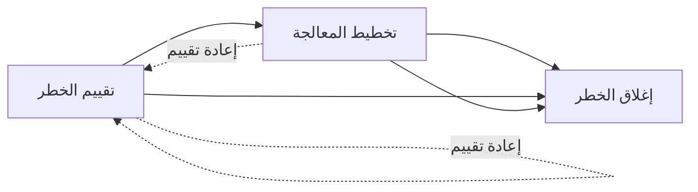
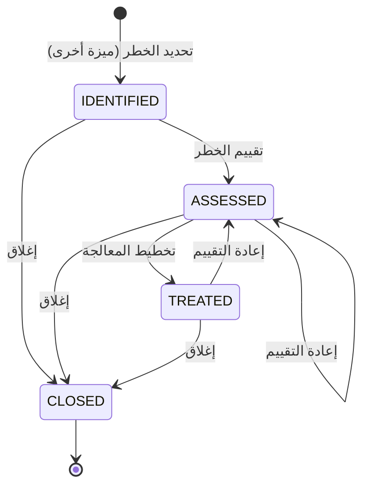

# تقييم المخاطر ومعالجتها

<!-- BEGIN GENERATED: doc -->
| البند | القيمة |
|---|---|
| المعرّف | FEAT-RSK-RISK-TREATMENT |
| الإصدار | 0.2 |
| الحالة | مسودة |
| القدرة | CAP-09 المخاطر والطوارئ |
| القدرة الفرعية | CAP-09.01 إدارة المخاطر (R3) |
| الأدوار | مقيّم الخطر؛ موافق المعالجة؛ مدير المخاطر |
| الشاشات | SCR-47 سجل المخاطر والحوادث |
| حالات الاستخدام | UC-140، UC-141 |
| القصص | 5: 4 من المواصفة، و1 جديدة |
<!-- END GENERATED: doc -->

## 1. نظرة عامة

### 1.1 القيمة

يقيّم المقيّم الخطر — غير من سجّله — ويخطط لمعالجته ثم يغلقه بمبرر صريح.

### 1.2 النطاق

| البند | القيمة |
|---|---|
| المستخدمون | مقيّم الخطر (يقيّم ويعيد التقييم)؛ موافق المعالجة (يخطط المعالجة)؛ مدير المخاطر (يغلق) |
| الشاشات | SCR-47 سجل المخاطر والحوادث |
| حالات الاستخدام | تقييم الخطر وإعادة تقييمه، ثم تخطيط معالجته وإغلاقه (UC-140، UC-141) |
| المتطلبات | حساب درجة الخطر تلقائيًا من الاحتمال والأثر (REQ-RCM-002)؛ فصل بين من حدد الخطر ومن يقيّمه عند تفعيل سياسة فصل الواجبات (REQ-RCM-003)؛ إجراء معالجة واحد على الأقل إلا عند قبول الخطر بموافقة مخوَّلة (REQ-RCM-004)؛ مبرر صريح لإغلاق الخطر ولا أمر لإعادة فتحه (REQ-RCM-005) |
| خارج النطاق | تحديد الخطر أول مرة وتصفح سجله (ميزة «سجل المخاطر»)؛ تسجيل الحوادث الفعلية ومتابعتها |

### 1.3 خريطة الميزة

**الشكل 1: مسار معالجة الخطر**



**الشكل 2: حالات الخطر في هذه الميزة**



## 2. القواعد المشتركة

تنطبق على كل قصص الميزة، فلا تتكرر داخل القصص. وكل قصة تذكر ما يخصها فقط.

### 2.1 السياق المشترك

كل قصة تبدأ من ثلاثة شروط: مستأجر نشط، وحزمة السياسات الأساسية مفعّلة، ومستخدم مسجّل الدخول ومخوَّل. وتشير إليها القصص بخطوة واحدة: «بفرض السياق المشترك للميزة».

### 2.2 الصلاحية وعدم الإفصاح

- من لا يحق له رؤية العنصر يتلقى ردًا بشكل «غير متاح» تمامًا، فلا يعرف أنه موجود.
- من يرى العنصر ولا يحق له الإجراء يتلقى «لا تملك صلاحية هذا الإجراء».

### 2.3 أوامر تغيير الحالة

- **منع التكرار:** يُرسل كل أمر بمفتاح فريد، فإعادة الطلب نفسه لا تُنفَّذ مرتين.
- **حماية التعديل المتزامن:** يُرسل كل أمر بإصدار البيانات الذي يراه المستخدم. فإن عدّلها غيره في الأثناء، يُرفض الأمر.
- **السجل:** إن نجح الأمر، يُكتب حدثه وسجل التدقيق في المعاملة نفسها.

### 2.4 الرفض المشترك

```gherkin
# language: ar
خاصية: الرفض المشترك لأوامر الميزة

  سيناريو مخطط: رفض مشترك لكل أمر في الميزة
    بفرض السياق المشترك للميزة
    و <الحالة>
    عندما يُرسل المستخدم أي أمر من أوامر الميزة
    اذاً يُرفض برمز <الرمز> ويرى "<الرسالة>"
    و لا يتغير شيء

    امثلة:
      | الحالة                                  | الرمز                  | الرسالة                                                 |
      | العنصر خارج صلاحياته                    | NOT_FOUND              | غير متاح                                                |
      | العنصر مرئي له ولا يحق له الإجراء       | AUTHZ_DENIED           | لا تملك صلاحية هذا الإجراء                              |
      | غيره عدّل العنصر بعد أن فتحه            | VERSION_CONFLICT       | تغيّرت البيانات منذ فتحتها. راجع التغييرات ثم أعد المحاولة |
      | أعاد مفتاح منع التكرار بمحتوى مختلف     | IDEMPOTENCY_KEY_REUSED | طلب مكرر بمحتوى مختلف                                   |
      | البيانات ناقصة أو غير صحيحة             | VALIDATION_FAILED      | بعض البيانات ناقصة أو غير صحيحة. راجع الحقول المعلَّمة      |

  سيناريو: إعادة الطلب نفسه لا تُنفَّذ مرتين
    بفرض السياق المشترك للميزة
    و أمر نجح بمفتاح منع تكرار
    عندما يُعاد الطلب نفسه بالمفتاح نفسه
    اذاً تُعاد النتيجة الأولى ولا يُكتب حدث ثانٍ
```

## 3. الجودة وتعريف الاكتمال

### 3.1 متطلبات الجودة

<!-- BEGIN GENERATED: quality -->
لا متطلبات جودة مرتبطة بمتطلبات هذه الميزة مباشرة. تنطبق متطلبات المنصة العامة (`FEAT-PLT-*`).
<!-- END GENERATED: quality -->

### 3.2 تعريف الاكتمال

القصة مكتملة حين تتحقق الشروط الخمسة:

1. سيناريوهاتها والقواعد المشتركة تمر في الاختبار الآلي.
2. فحوص البنية المعمارية تمر.
3. نصوص الواجهة والرسائل موجودة بالعربية والإنجليزية.
4. مراجعة الكود مكتملة.
5. ما تضيفه القصة نفسها في قسم «القواعد» تحقق.

## 4. فهرس القصص

<!-- BEGIN GENERATED: story-index -->
| المعرّف | القصة | النوع | الحالة |
|---|---|---|---|
| `US-BC04-RIS-ASSESS` | تقييم الخطر | أمر | مسودة |
| `US-BC04-RIS-CLOSE` | إغلاق الخطر | أمر | مسودة |
| `US-BC04-RIS-PLAN-TREATMENT` | تخطيط معالجة الخطر | أمر | مسودة |
| `US-BC04-RIS-REASSESS` | إعادة تقييم الخطر | أمر | مسودة |
| `US-UI-SCR47-RISK-TREATMENT` | تقييم الخطر ومعالجته وإغلاقه بمبرر | واجهة | مسودة |
<!-- END GENERATED: story-index -->

## 5. القصص

### 5.1 US-BC04-RIS-ASSESS — تقييم الخطر

| النوع | الإصدار | الأولوية | دون اتصال | الحالة |
|---|---|---|---|---|
| أمر | R3 | Must | لا | مسودة |

> **كـ** مقيّم الخطر، **أريد** أن أقيّم خطرًا محدَّدًا باحتماله وأثره، **حتى** تُعرف درجته وتُحدَّد أولوية معالجته.

**باختصار:** يسجل المقيّم احتمال الخطر وأثره، فتُحسب درجته تلقائيًا ويصير الخطر «مقيَّمًا». ولا يجوز لمن حدد الخطر أن يقيّمه بنفسه إن فعّلت جهته سياسة فصل الواجبات.

#### القواعد

- **متى يُسمح:** الخطر «محدَّد».
- **من يُسمح له:** مقيّم الخطر، شرط ألا يكون هو من حدد الخطر نفسه عند تفعيل سياسة فصل الواجبات.
- **البيانات:** الاحتمال والأثر، كل منهما من 1 إلى 5.
- **الأثر:** تُحسب درجة الخطر (الاحتمال × الأثر) تلقائيًا ولا تُقبل مُدخَلة مباشرة، ويُسجَّل حدث «قُيِّم الخطر».

#### معايير القبول

```gherkin
# language: ar
خاصية: تقييم الخطر

  سيناريو: مقيّم غير محدِّد الخطر يقيّمه
    بفرض السياق المشترك للميزة
    و خطر "محدَّد" ومقيّمه غير من حدده
    عندما يقيّمه المقيّم باحتمال وأثر
    اذاً تصبح حالته "مقيَّم"
    و تُحسب درجته تلقائيًا من الاحتمال والأثر
    و يُسجَّل حدث "قُيِّم الخطر"

  سيناريو مخطط: رفض خاص بتقييم الخطر
    بفرض السياق المشترك للميزة
    و <الحالة>
    عندما يحاول تقييم الخطر
    اذاً يُرفض برمز <الرمز> ويرى <الرسالة>
    و لا يتغير شيء

    امثلة:
      | الحالة                                                     | الرمز                          | الرسالة                                            |
      | الخطر ليس في حالة "محدَّد"                                | RISK_INVALID_STATE_TRANSITION  | الوضع الحالي للخطر لا يسمح بهذا الإجراء            |
      | المقيّم هو من حدد الخطر وجهته تطبق فصل الواجبات           | SEGREGATION_OF_DUTIES          | لا يجوز أن يعتمد الشخص نفسه ما قدّمه أو طلبه       |
      | الاحتمال غير مذكور                                         | VALIDATION_FAILED              | الاحتمال مطلوب                                     |
```

<details><summary>المراجع التقنية والتتبع</summary>

<!-- BEGIN GENERATED: refs US-BC04-RIS-ASSESS -->
| البند | المعرّف | المعنى |
|---|---|---|
| الواجهة البرمجية | `POST /api/v1/operations/risks/{id}/actions/assess` | — |
| الأمر | `CMD-RIS-ASSESS` | تقييم الخطر |
| السياسة | `POL-RIS-ASSESS` | مقيّم (تقييم، إعادة تقييم)؛ tenant match; scope_refs visible to actor |
| الحدث | `EVT-RIS-ASSESSED` | يصل إلى: Search projection (SLC-05); Coordination cases (SLC-15، عند ارتباط النطاق) |
| الكيان | `AGG-RISK` | الخطر |
| الجدول | `operations.risks` | الجدول الرئيسي للخطر |
| وحدة النشر | DU-08 | — |
| المتطلبات | REQ-RCM-001، REQ-RCM-002، REQ-RCM-003، REQ-RCM-004، REQ-RCM-005 | معانيها في القسم 6. التتبع |
| حالات الاستخدام | UC-140، UC-141 | Identify & Assess Risk؛ Treat & Close Risk |
| الاختبار | TST-RISK-SM، TST-SLC17-INVARIANTS | دورة حالات الخطر، وثوابت الشريحة SLC-17 |
<!-- END GENERATED: refs US-BC04-RIS-ASSESS -->

</details>

### 5.2 US-BC04-RIS-CLOSE — إغلاق الخطر

| النوع | الإصدار | الأولوية | دون اتصال | الحالة |
|---|---|---|---|---|
| أمر | R3 | Must | لا | مسودة |

> **كـ** مدير المخاطر، **أريد** أن أغلق خطرًا بمبرر صريح، **حتى** يُعرف ما آل إليه ولا يبقى مفتوحًا دون سبب.

**باختصار:** يغلق مدير المخاطر الخطر بمبرر من ثلاثة: أُحيل إلى التقاعد، أو قُبل نهائيًا، أو تحقَّق فعلًا — وفي الحالة الأخيرة يذكر الحادثة التي تحقَّق منها. ولا يوجد أمر لإعادة فتح خطر مُغلَق؛ إعادة تحديد الخطر نفسه تنشئ خطرًا جديدًا.

#### القواعد

- **متى يُسمح:** الخطر «محدَّد» أو «مقيَّم» أو «معالَج».
- **من يُسمح له:** مدير المخاطر.
- **البيانات:** المبرر (إحالة إلى التقاعد، أو قبول نهائي، أو تحقُّق فعلي)، ومرجع الحادثة إلزامي عند التحقُّق الفعلي.
- **الأثر:** تصبح حالة الخطر «مغلَق»، وهي حالة نهائية لا رجوع عنها، ويُسجَّل حدث «أُغلق الخطر».

#### معايير القبول

```gherkin
# language: ar
خاصية: إغلاق الخطر

  سيناريو: إغلاق خطر بمبرر
    بفرض السياق المشترك للميزة
    و خطر غير مغلَق
    عندما يغلقه مدير المخاطر بمبرر "قبول نهائي"
    اذاً تصبح حالته "مغلَق"
    و يُسجَّل حدث "أُغلق الخطر"

  سيناريو مخطط: رفض خاص بإغلاق الخطر
    بفرض السياق المشترك للميزة
    و <الحالة>
    عندما يحاول إغلاق الخطر
    اذاً يُرفض برمز <الرمز> ويرى <الرسالة>
    و لا يتغير شيء

    امثلة:
      | الحالة                                                  | الرمز                          | الرسالة                                      |
      | الخطر مغلَق من قبل                                      | RISK_INVALID_STATE_TRANSITION  | الوضع الحالي للخطر لا يسمح بهذا الإجراء      |
      | المبرر "تحقُّق فعلي" دون مرجع حادثة، أو المبرر مفقود    | RATIONALE_REQUIRED             | اذكر سبب الإغلاق، ومرجع الحادثة إن تحقق الخطر |
      | المبرر غير مذكور                                        | VALIDATION_FAILED              | المبرر مطلوب                                 |
```

<details><summary>المراجع التقنية والتتبع</summary>

<!-- BEGIN GENERATED: refs US-BC04-RIS-CLOSE -->
| البند | المعرّف | المعنى |
|---|---|---|
| الواجهة البرمجية | `POST /api/v1/operations/risks/{id}/actions/close` | — |
| الأمر | `CMD-RIS-CLOSE` | إغلاق الخطر |
| السياسة | `POL-RIS-CLOSE` | مدير المخاطر؛ tenant match; scope_refs visible to actor |
| الحدث | `EVT-RIS-CLOSED` | يصل إلى: Search projection (SLC-05); Coordination cases (SLC-15، عند ارتباط النطاق) |
| الكيان | `AGG-RISK` | الخطر |
| الجدول | `operations.risks` | الجدول الرئيسي للخطر |
| وحدة النشر | DU-08 | — |
| المتطلبات | REQ-RCM-001، REQ-RCM-002، REQ-RCM-003، REQ-RCM-004، REQ-RCM-005 | معانيها في القسم 6. التتبع |
| حالات الاستخدام | UC-140، UC-141 | Identify & Assess Risk؛ Treat & Close Risk |
| الاختبار | TST-RISK-SM، TST-SLC17-INVARIANTS | دورة حالات الخطر، وثوابت الشريحة SLC-17 |
<!-- END GENERATED: refs US-BC04-RIS-CLOSE -->

</details>

### 5.3 US-BC04-RIS-PLAN-TREATMENT — تخطيط معالجة الخطر

| النوع | الإصدار | الأولوية | دون اتصال | الحالة |
|---|---|---|---|---|
| أمر | R3 | Must | لا | مسودة |

> **كـ** موافق المعالجة، **أريد** أن أخطط معالجة خطر مقيَّم باستراتيجية وإجراء معالجة، **حتى** يُعرف كيف يُحَد منه.

**باختصار:** يختار موافق المعالجة استراتيجية (تجنب، تخفيف، تحويل، قبول) لخطر «مقيَّم»، مع إجراء معالجة واحد على الأقل إلا عند القبول بموافقة مخوَّلة صريحة، فيصير الخطر «معالَجًا».

#### القواعد

- **متى يُسمح:** الخطر «مقيَّم».
- **من يُسمح له:** موافق المعالجة المخوَّل.
- **البيانات:** استراتيجية المعالجة (تجنب، تخفيف، تحويل، قبول)، وإجراء معالجة واحد على الأقل إلا عند القبول، والموافق.
- **الأثر:** تصبح حالة الخطر «معالَج»، ويُسجَّل حدث «خُطِّطت معالجة الخطر».

#### معايير القبول

```gherkin
# language: ar
خاصية: تخطيط معالجة الخطر

  سيناريو: تخطيط معالجة خطر مقيَّم
    بفرض السياق المشترك للميزة
    و خطر "مقيَّم"
    عندما يخطط موافق المعالجة معالجته باستراتيجية "تخفيف" وإجراء معالجة واحد على الأقل
    اذاً تصبح حالته "معالَج"
    و يُسجَّل حدث "خُطِّطت معالجة الخطر"

  سيناريو مخطط: رفض خاص بتخطيط المعالجة
    بفرض السياق المشترك للميزة
    و <الحالة>
    عندما يحاول تخطيط المعالجة
    اذاً يُرفض برمز <الرمز> ويرى <الرسالة>
    و لا يتغير شيء

    امثلة:
      | الحالة                                                              | الرمز                          | الرسالة                                 |
      | الخطر ليس "مقيَّمًا"                                               | RISK_INVALID_STATE_TRANSITION  | الوضع الحالي للخطر لا يسمح بهذا الإجراء |
      | الاستراتيجية غير "قبول" وبلا إجراء معالجة واحد على الأقل            | TREATMENT_INVALID              | خطة المعالجة غير مكتملة                 |
      | الاستراتيجية غير مذكورة                                             | VALIDATION_FAILED              | الاستراتيجية مطلوبة                     |
```

<details><summary>المراجع التقنية والتتبع</summary>

<!-- BEGIN GENERATED: refs US-BC04-RIS-PLAN-TREATMENT -->
| البند | المعرّف | المعنى |
|---|---|---|
| الواجهة البرمجية | `POST /api/v1/operations/risks/{id}/actions/plan-treatment` | — |
| الأمر | `CMD-RIS-PLAN-TREATMENT` | تخطيط معالجة الخطر |
| السياسة | `POL-RIS-PLAN-TREATMENT` | موافق المعالجة مخوَّل؛ tenant match; scope_refs visible to actor |
| الحدث | `EVT-RIS-TREATMENT-PLANNED` | يصل إلى: Search projection (SLC-05); Coordination cases (SLC-15، عند ارتباط النطاق) |
| الكيان | `AGG-RISK` | الخطر |
| الجدول | `operations.risks` | الجدول الرئيسي للخطر |
| وحدة النشر | DU-08 | — |
| المتطلبات | REQ-RCM-001، REQ-RCM-002، REQ-RCM-003، REQ-RCM-004، REQ-RCM-005 | معانيها في القسم 6. التتبع |
| حالات الاستخدام | UC-140، UC-141 | Identify & Assess Risk؛ Treat & Close Risk |
| الاختبار | TST-RISK-SM، TST-SLC17-INVARIANTS | دورة حالات الخطر، وثوابت الشريحة SLC-17 |
<!-- END GENERATED: refs US-BC04-RIS-PLAN-TREATMENT -->

</details>

### 5.4 US-BC04-RIS-REASSESS — إعادة تقييم الخطر

| النوع | الإصدار | الأولوية | دون اتصال | الحالة |
|---|---|---|---|---|
| أمر | R3 | Must | لا | مسودة |

> **كـ** مقيّم الخطر، **أريد** أن أعيد تقييم خطر مقيَّم أو معالَج باحتمال وأثر جديدين وسبب، **حتى** تعكس درجته معرفة أحدث.

**باختصار:** يسجل المقيّم احتمالًا وأثرًا جديدين وسببًا لإعادة التقييم، فتُحسب درجة الخطر من جديد ويبقى الخطر «مقيَّمًا» حتى لو كان «معالَجًا» قبلها.

#### القواعد

- **متى يُسمح:** الخطر «مقيَّم» أو «معالَج».
- **من يُسمح له:** مقيّم الخطر، شرط ألا يكون هو من حدد الخطر نفسه عند تفعيل سياسة فصل الواجبات.
- **البيانات:** الاحتمال والأثر الجديدان، وسبب إعادة التقييم.
- **الأثر:** تعود حالة الخطر إلى «مقيَّم» وتُحسب درجته من جديد، ويُسجَّل حدث «أُعيد تقييم الخطر».

#### معايير القبول

```gherkin
# language: ar
خاصية: إعادة تقييم الخطر

  سيناريو: إعادة تقييم خطر معالَج
    بفرض السياق المشترك للميزة
    و خطر "معالَج"
    عندما يعيد المقيّم تقييمه باحتمال وأثر جديدين وسبب
    اذاً تصبح حالته "مقيَّم"
    و تُحسب درجته من جديد
    و يُسجَّل حدث "أُعيد تقييم الخطر"

  سيناريو مخطط: رفض خاص بإعادة التقييم
    بفرض السياق المشترك للميزة
    و <الحالة>
    عندما يحاول إعادة تقييم الخطر
    اذاً يُرفض برمز <الرمز> ويرى <الرسالة>
    و لا يتغير شيء

    امثلة:
      | الحالة                                                     | الرمز                          | الرسالة                                            |
      | الخطر «محدَّد» أو «مغلَق»                                 | RISK_INVALID_STATE_TRANSITION  | الوضع الحالي للخطر لا يسمح بهذا الإجراء            |
      | المقيّم هو من حدد الخطر وجهته تطبق فصل الواجبات           | SEGREGATION_OF_DUTIES          | لا يجوز أن يعتمد الشخص نفسه ما قدّمه أو طلبه       |
      | سبب إعادة التقييم غير مذكور                                | VALIDATION_FAILED              | السبب مطلوب                                        |
```

<details><summary>المراجع التقنية والتتبع</summary>

<!-- BEGIN GENERATED: refs US-BC04-RIS-REASSESS -->
| البند | المعرّف | المعنى |
|---|---|---|
| الواجهة البرمجية | `POST /api/v1/operations/risks/{id}/actions/reassess` | — |
| الأمر | `CMD-RIS-REASSESS` | إعادة تقييم الخطر |
| السياسة | `POL-RIS-REASSESS` | مقيّم (تقييم، إعادة تقييم)؛ tenant match; scope_refs visible to actor |
| الحدث | `EVT-RIS-REASSESSED` | يصل إلى: Search projection (SLC-05); Coordination cases (SLC-15، عند ارتباط النطاق) |
| الكيان | `AGG-RISK` | الخطر |
| الجدول | `operations.risks` | الجدول الرئيسي للخطر |
| وحدة النشر | DU-08 | — |
| المتطلبات | REQ-RCM-001، REQ-RCM-002، REQ-RCM-003، REQ-RCM-004، REQ-RCM-005 | معانيها في القسم 6. التتبع |
| حالات الاستخدام | UC-140، UC-141 | Identify & Assess Risk؛ Treat & Close Risk |
| الاختبار | TST-RISK-SM، TST-SLC17-INVARIANTS | دورة حالات الخطر، وثوابت الشريحة SLC-17 |
<!-- END GENERATED: refs US-BC04-RIS-REASSESS -->

</details>

### 5.5 US-UI-SCR47-RISK-TREATMENT — تقييم الخطر ومعالجته وإغلاقه بمبرر

| النوع | الإصدار | الأولوية | دون اتصال | الحالة |
|---|---|---|---|---|
| واجهة | R3 | Must | لا | مسودة |

> **كـ** المستخدم، **أريد** شاشة واحدة أقيّم فيها الخطر، وأخطط معالجته، وأغلقه بمبرر، **حتى** أتابع مسار الخطر كاملًا دون تنقل بين شاشات.

**باختصار:** تعرض الشاشة درجة الخطر محسوبة فور إدخال الاحتمال والأثر، وتفرض إجراء معالجة واحدًا على الأقل عند أي استراتيجية غير القبول، ولا تسمح بإغلاق الخطر دون مبرر. **[Derived]**

#### القواعد

- تُحسب درجة الخطر وتُعرض فور تغيير الاحتمال أو الأثر، دون إدخال يدوي لها. **[Derived]**
- لا تُرسَل خطة المعالجة دون إجراء واحد على الأقل، إلا عند اختيار «قبول». **[Derived]**
- لا يُرسَل إغلاق الخطر دون مبرر؛ وإن كان المبرر «تحقُّق فعلي» تطلب الشاشة مرجع الحادثة. **[Derived]**

#### معايير القبول

```gherkin
# language: ar
خاصية: تقييم الخطر ومعالجته وإغلاقه بمبرر

  سيناريو: درجة الخطر تُحسب فور إدخال الاحتمال والأثر
    بفرض السياق المشترك للميزة
    و خطر "محدَّد" مفتوح على الشاشة
    عندما يدخل المستخدم الاحتمال والأثر
    اذاً تُعرض درجة الخطر محسوبة فورًا دون إدخال يدوي لها

  سيناريو: إغلاق دون مبرر يُمنع
    بفرض السياق المشترك للميزة
    و خطر مفتوح على الشاشة
    عندما يحاول المستخدم إغلاقه دون اختيار مبرر
    اذاً يُمنع الإرسال وتظهر رسالة الحقل الناقص
```

<details><summary>المراجع التقنية والتتبع</summary>

<!-- BEGIN GENERATED: refs US-UI-SCR47-RISK-TREATMENT -->
| البند | المعرّف | المعنى |
|---|---|---|
| الشاشة | SCR-47 | شاشة سجل المخاطر والحوادث |
| المصدر | `[Derived]` | — |
| المتطلبات | REQ-RCM-002، REQ-RCM-004، REQ-RCM-005 | معانيها في القسم 6. التتبع |
| حالات الاستخدام | UC-140، UC-141 | Identify & Assess Risk؛ Treat & Close Risk |
<!-- END GENERATED: refs US-UI-SCR47-RISK-TREATMENT -->

</details>

## 6. التتبع

<!-- BEGIN GENERATED: trace -->
| المتطلب | المعنى | القصص | الاختبار |
|---|---|---|---|
| REQ-RCM-001 | The system shall allow an authorized actor to identify a risk with a hazard category, description, and at lea… | كل قصص الميزة المأخوذة من المواصفة (4) | TST-RISK-SM |
| REQ-RCM-002 | The system shall require a likelihood and an impact rating (1-5) to assess a risk, and shall compute the risk… | `US-BC04-RIS-ASSESS`، `US-BC04-RIS-CLOSE`، `US-BC04-RIS-PLAN-TREATMENT`، `US-BC04-RIS-REASSESS`، `US-UI-SCR47-RISK-TREATMENT` | TST-RISK-SM، TST-SLC17-INVARIANTS |
| REQ-RCM-003 | Where tenant policy requires segregation of duties, the system shall reject a risk assessment or reassessment… | كل قصص الميزة المأخوذة من المواصفة (4) | TST-RISK-SM، TST-SLC17-INVARIANTS |
| REQ-RCM-004 | The system shall require at least one treatment action for a risk moving to treated status, unless the chosen… | `US-BC04-RIS-ASSESS`، `US-BC04-RIS-CLOSE`، `US-BC04-RIS-PLAN-TREATMENT`، `US-BC04-RIS-REASSESS`، `US-UI-SCR47-RISK-TREATMENT` | TST-RISK-SM، TST-SLC17-INVARIANTS |
| REQ-RCM-005 | The system shall require an explicit rationale to close a risk, and shall provide no command to reopen a clos… | `US-BC04-RIS-ASSESS`، `US-BC04-RIS-CLOSE`، `US-BC04-RIS-PLAN-TREATMENT`، `US-BC04-RIS-REASSESS`، `US-UI-SCR47-RISK-TREATMENT` | TST-RISK-SM، TST-SLC17-INVARIANTS |
<!-- END GENERATED: trace -->

## 7. سجل التغييرات

| الإصدار | التاريخ | التغيير |
|---|---|---|
| 0.1 | — | هيكل مولَّد من خريطة الميزات |
| 0.2 | 2026-10-13 | كتابة القصص كاملة بمعيار القصص |
