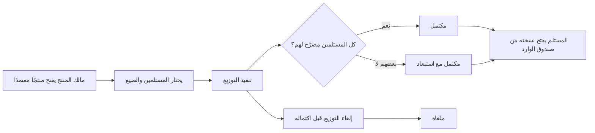
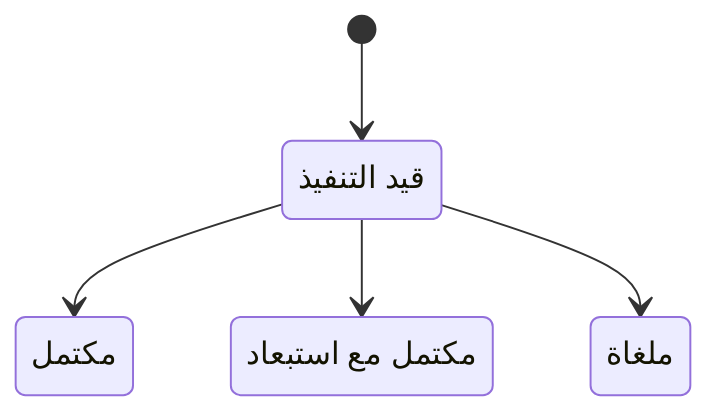

# توزيع المنتجات

<!-- BEGIN GENERATED: doc -->
| البند | القيمة |
|---|---|
| المعرّف | FEAT-COM-DISTRIBUTION |
| الإصدار | 0.1 |
| الحالة | مسودة |
| القدرة | CAP-10 الاتصال والمنتجات |
| القدرة الفرعية | CAP-10.02 التقارير والإحاطات ومنتجات الخرائط (R2) |
| الأدوار | المدير؛ مالك المنتج؛ مسؤول الأمن؛ المدقِّق؛ النظام |
| الشاشات | SCR-43 المنتجات والتوزيع |
| حالات الاستخدام | UC-112 |
| القصص | 7: 5 من المواصفة، و2 جديدة |
<!-- END GENERATED: doc -->

## 1. نظرة عامة

### 1.1 القيمة

يوزع المدير أو مالك المنتج المنتج المعتمد على المخوّلين فقط، مع سجل كامل لمن استلمه.

### 1.2 النطاق

| البند | القيمة |
|---|---|
| المستخدمون | المدير أو مالك المنتج اللذان يوزِّعان أو يلغيان توزيعًا؛ مسؤول الأمن والمدقِّق يتابعان سجل التسليم؛ المستلم يفتح النسخة الموزَّعة إليه؛ النظام يحسم نتيجة كل توزيع |
| الشاشات | SCR-43 المنتجات والتوزيع؛ وصندوق الوارد (SCR-03) لاستقبال المستلم |
| حالات الاستخدام | توزيع نسخة معتمدة من منتج على مستلمين محددين بصيغة أو أكثر؛ إلغاء توزيع لم يكتمل؛ تتبّع من استلم كل نسخة؛ فتح المستلم نسخته |
| المتطلبات | كل نسخة تُسلَّم فقط لمن يحق له تصنيف المنتج وهو داخل جمهوره المعتمد (REQ-PRD-004)؛ كل نسخة تصديرية تحمل علامة مائية تحدد مستلمها (REQ-PRD-005) |
| خارج النطاق | إنشاء المنتج وتوليده وتقديمه ومراجعته واعتماده (ميزة مراجعة المنتجات واعتمادها)؛ تحديد جمهور المنتج أو أدوار المستخدمين (إدارة المؤسسة والوصول) |

### 1.3 خريطة الميزة

**الشكل 1: مسار التوزيع من الاختيار إلى فتح المستلم**



**الشكل 2: حالات التوزيع**



## 2. القواعد المشتركة

تنطبق على كل قصص الميزة، فلا تتكرر داخل القصص. وكل قصة تذكر ما يخصها فقط.

### 2.1 السياق المشترك

كل قصة تبدأ من ثلاثة شروط: مستأجر نشط، وحزمة السياسات الأساسية مفعّلة، ومستخدم مسجّل الدخول ومخوَّل. وتشير إليها القصص بخطوة واحدة: «بفرض السياق المشترك للميزة».

### 2.2 الصلاحية وعدم الإفصاح

- من لا يحق له رؤية العنصر يتلقى ردًا بشكل «غير متاح» تمامًا، فلا يعرف أنه موجود.
- من يرى العنصر ولا يحق له الإجراء يتلقى «لا تملك صلاحية هذا الإجراء».

### 2.3 أوامر تغيير الحالة

- **منع التكرار:** يُرسل كل أمر بمفتاح فريد، فإعادة الطلب نفسه لا تُنفَّذ مرتين.
- **حماية التعديل المتزامن:** يُرسل كل أمر بإصدار البيانات الذي يراه المستخدم. فإن عدّلها غيره في الأثناء، يُرفض الأمر.
- **السجل:** إن نجح الأمر، يُكتب حدثه وسجل التدقيق في المعاملة نفسها.

### 2.4 الرفض المشترك

```gherkin
# language: ar
خاصية: الرفض المشترك لأوامر الميزة

  سيناريو مخطط: رفض مشترك لكل أمر في الميزة
    بفرض السياق المشترك للميزة
    و <الحالة>
    عندما يُرسل المستخدم أي أمر من أوامر الميزة
    اذاً يُرفض برمز <الرمز> ويرى "<الرسالة>"
    و لا يتغير شيء

    امثلة:
      | الحالة                                  | الرمز                  | الرسالة                                                 |
      | العنصر خارج صلاحياته                    | NOT_FOUND              | غير متاح                                                |
      | العنصر مرئي له ولا يحق له الإجراء       | AUTHZ_DENIED           | لا تملك صلاحية هذا الإجراء                              |
      | غيره عدّل العنصر بعد أن فتحه            | VERSION_CONFLICT       | تغيّرت البيانات منذ فتحتها. راجع التغييرات ثم أعد المحاولة |
      | أعاد مفتاح منع التكرار بمحتوى مختلف     | IDEMPOTENCY_KEY_REUSED | طلب مكرر بمحتوى مختلف                                   |
      | البيانات ناقصة أو غير صحيحة             | VALIDATION_FAILED      | بعض البيانات ناقصة أو غير صحيحة. راجع الحقول المعلَّمة      |

  سيناريو: إعادة الطلب نفسه لا تُنفَّذ مرتين
    بفرض السياق المشترك للميزة
    و أمر نجح بمفتاح منع تكرار
    عندما يُعاد الطلب نفسه بالمفتاح نفسه
    اذاً تُعاد النتيجة الأولى ولا يُكتب حدث ثانٍ
```

## 3. الجودة وتعريف الاكتمال

### 3.1 متطلبات الجودة

<!-- BEGIN GENERATED: quality -->
لا متطلبات جودة مرتبطة بمتطلبات هذه الميزة مباشرة. تنطبق متطلبات المنصة العامة (`FEAT-PLT-*`).
<!-- END GENERATED: quality -->

### 3.2 تعريف الاكتمال

القصة مكتملة حين تتحقق الشروط الخمسة:

1. سيناريوهاتها والقواعد المشتركة تمر في الاختبار الآلي.
2. فحوص البنية المعمارية تمر.
3. نصوص الواجهة والرسائل موجودة بالعربية والإنجليزية.
4. مراجعة الكود مكتملة.
5. ما تضيفه القصة نفسها في قسم «القواعد» تحقق.

## 4. فهرس القصص

<!-- BEGIN GENERATED: story-index -->
| المعرّف | القصة | النوع | الحالة |
|---|---|---|---|
| `US-BC06-DST-CANCEL` | إلغاء التوزيع | أمر | مسودة |
| `US-BC06-DST-DISTRIBUTE` | تنفيذ التوزيع | أمر | مسودة |
| `US-BC06-Q-DST-LOG` | جلب: Distribution and delivery log with watermark ids | جلب | مسودة |
| `US-BC06-S-DISTRIBUTION-01` | تلقائي: all recipients authorized and delivered (التوزيع) | نظام | مسودة |
| `US-BC06-S-DISTRIBUTION-02` | تلقائي: some recipients not authorized (التوزيع) | نظام | مسودة |
| `US-UI-SCR43-DISTRIBUTE` | اختيار المستلمين ورؤية المستبعدين بعد التوزيع | واجهة | مسودة |
| `US-UI-SCR43-RECIPIENT-VIEW` | المستلم يفتح المنتج الموزَّع إليه | واجهة | مسودة |
<!-- END GENERATED: story-index -->

## 5. القصص

### 5.1 US-BC06-DST-CANCEL — إلغاء التوزيع

| النوع | الإصدار | الأولوية | دون اتصال | الحالة |
|---|---|---|---|---|
| أمر | R2 | Must | لا | مسودة |

> **كـ** مالك المنتج، **أريد** إلغاء توزيع لم يكتمل، **حتى** أمنع تسليم نسخ لم تعد صحيحة أو بدأت بالخطأ.

**باختصار:** يلغي مالك المنتج أو المدير توزيعًا «قيد التنفيذ» بذكر سبب، فتصير حالته «ملغاة» ولا تُسلَّم أي نسخة جديدة بعدها.

#### القواعد

- **متى يُسمح:** التوزيع في حالة «قيد التنفيذ»، ومع سبب للإلغاء.
- **من يُسمح له:** المدير أو مالك المنتج.
- **البيانات:** سبب الإلغاء (إلزامي).
- **الأثر:** حدث «أُلغي التوزيع» يصل إلى إشعار المستلمين وسجل التدقيق.

#### معايير القبول

```gherkin
# language: ar
خاصية: إلغاء التوزيع

  سيناريو: إلغاء توزيع قيد التنفيذ
    بفرض السياق المشترك للميزة
    و توزيع "قيد التنفيذ" أنشأه المستخدم
    عندما يلغيه بذكر السبب
    اذاً تصبح حالته "ملغاة"
    و يُسجَّل حدث "أُلغي التوزيع"

  سيناريو مخطط: رفض خاص بإلغاء التوزيع
    بفرض السياق المشترك للميزة
    و <الحالة>
    عندما يحاول إلغاء التوزيع
    اذاً يُرفض برمز <الرمز> ويرى "<الرسالة>"
    و لا يتغير شيء

    امثلة:
      | الحالة                                  | الرمز                            | الرسالة                                            |
      | التوزيع ليس "قيد التنفيذ"               | DISTRIBUTION_INVALID_STATE_TRANSITION | الوضع الحالي للتوزيع لا يسمح بهذا الإجراء      |
      | لم يُذكر سبب الإلغاء                     | REASON_REQUIRED                  | اذكر السبب                                         |
```

<details><summary>المراجع التقنية والتتبع</summary>

<!-- BEGIN GENERATED: refs US-BC06-DST-CANCEL -->
| البند | المعرّف | المعنى |
|---|---|---|
| الواجهة البرمجية | `POST /api/v1/knowledge/distributions/{id}/actions/cancel` | — |
| الأمر | `CMD-DST-CANCEL` | إلغاء التوزيع |
| السياسة | `POL-DST-CANCEL` | Manager / product owner؛ tenant match; object visible |
| الحدث | `EVT-DST-CANCELLED` | يصل إلى: Notification (recipients); Audit |
| الكيان | `AGG-DISTRIBUTION` | التوزيع |
| الجدول | `knowledge.distributions` | الجدول الرئيسي للتوزيع |
| وحدة النشر | DU-15 | — |
| المتطلبات | REQ-PRD-004، REQ-PRD-005 | معانيها في القسم 6. التتبع |
| حالة الاستخدام | UC-112 | Distribute / Export Product |
| الاختبار | TST-DISTRIBUTION-SM، TST-SLC12-INVARIANTS | دورة حالات التوزيع، وثوابت الشريحة SLC-12 |
<!-- END GENERATED: refs US-BC06-DST-CANCEL -->

</details>

### 5.2 US-BC06-DST-DISTRIBUTE — تنفيذ التوزيع

| النوع | الإصدار | الأولوية | دون اتصال | الحالة |
|---|---|---|---|---|
| أمر | R2 | Must | لا | مسودة |

> **كـ** مالك المنتج، **أريد** توزيع نسخة معتمدة من منتج على مستلمين محددين بصيغ مختارة، **حتى** يصلهم العمل دون أن يتجاوز أحد تصنيفه.

**باختصار:** يبدأ مالك المنتج أو المدير توزيع منتج معتمد على مستلمين (مستخدمين أو وحدات تنظيمية) بصيغة أو أكثر، فيصير التوزيع «قيد التنفيذ» ثم يحسمه النظام تلقائيًا.

#### القواعد

- **متى يُسمح:** المنتج «معتمد»، والمستلمون محددون، والصيغ من بين PDF وDOCX والعرض داخل التطبيق.
- **من يُسمح له:** المدير أو مالك المنتج.
- **البيانات:** المنتج (إلزامي)، قائمة المستلمين (إلزامية)، الصيغ (إلزامية)، رسالة اختيارية للمستلمين.
- **الأثر:** حدث «بدأ التوزيع» يصل إلى إشعار المستلمين وسجل التدقيق؛ كل نسخة تحمل علامة مائية خاصة بمستلمها.

#### معايير القبول

```gherkin
# language: ar
خاصية: تنفيذ التوزيع

  سيناريو: توزيع منتج معتمد
    بفرض السياق المشترك للميزة
    و منتج "معتمد" ومستلمون محددون
    عندما يوزّعه مالك المنتج بصيغة واحدة أو أكثر
    اذاً تصبح حالة التوزيع "قيد التنفيذ"
    و يُسجَّل حدث "بدأ التوزيع"

  سيناريو مخطط: رفض خاص بتنفيذ التوزيع
    بفرض السياق المشترك للميزة
    و <الحالة>
    عندما يحاول تنفيذ التوزيع
    اذاً يُرفض برمز <الرمز> ويرى "<الرسالة>"
    و لا يتغير شيء

    امثلة:
      | الحالة                    | الرمز                | الرسالة                          |
      | المنتج ليس "معتمدًا"      | PRODUCT_NOT_APPROVED | لا يمكن توزيع منتج غير معتمد     |
```

<details><summary>المراجع التقنية والتتبع</summary>

<!-- BEGIN GENERATED: refs US-BC06-DST-DISTRIBUTE -->
| البند | المعرّف | المعنى |
|---|---|---|
| الواجهة البرمجية | `POST /api/v1/knowledge/distributions` | — |
| الأمر | `CMD-DST-DISTRIBUTE` | تنفيذ التوزيع |
| السياسة | `POL-DST-DISTRIBUTE` | Manager / product owner؛ tenant match; object visible |
| الحدث | `EVT-DST-STARTED` | يصل إلى: Notification (recipients); Audit |
| الكيان | `AGG-DISTRIBUTION` | التوزيع |
| الجدول | `knowledge.distributions` | الجدول الرئيسي للتوزيع |
| وحدة النشر | DU-15 | — |
| المتطلبات | REQ-PRD-004، REQ-PRD-005 | معانيها في القسم 6. التتبع |
| حالة الاستخدام | UC-112 | Distribute / Export Product |
| الاختبار | TST-DISTRIBUTION-SM، TST-SLC12-INVARIANTS | دورة حالات التوزيع، وثوابت الشريحة SLC-12 |
<!-- END GENERATED: refs US-BC06-DST-DISTRIBUTE -->

</details>

### 5.3 US-BC06-Q-DST-LOG — سجل التوزيع والتسليم

| النوع | الإصدار | الأولوية | دون اتصال | الحالة |
|---|---|---|---|---|
| جلب | R2 | Must | لا | مسودة |

> **كـ** مالك المنتج أو مسؤول الأمن أو المدقِّق، **أريد** سجل التوزيع والتسليم بمعرِّف العلامة المائية لكل نسخة، **حتى** أعرف من استلم كل نسخة ومتى.

**باختصار:** يعيد الاستعلام سجل تسليمات منتج واحد، كل تسليم بمعرِّف علامته المائية، ولا يكشف إلا ما يحق لطالبه رؤيته.

#### القواعد

- **من يُسمح له:** موزِّع المنتج يرى تسليماته؛ مسؤول الأمن والمدقِّق يريان السجل كاملًا ضمن نطاقهما.
- **البيانات:** المنتج (إلزامي)، مع مؤشر وحد للصفحة.

#### معايير القبول

```gherkin
# language: ar
خاصية: سجل التوزيع والتسليم

  سيناريو: يرى الموزِّع سجل تسليم منتجه فقط
    بفرض السياق المشترك للميزة
    و لمنتج تسليمات داخل نطاقه وأخرى خارجه
    عندما يطلب سجل التوزيع
    اذاً تُعاد التسليمات داخل نطاقه فقط، كل منها بمعرِّف علامتها المائية
    و لا يكشف أي عدد أو اقتراح وجود تسليم محجوب

  سيناريو: الصفحة التالية
    بفرض السياق المشترك للميزة
    و سجل التسليم أكثر من صفحة
    عندما يطلب الصفحة التالية بالمؤشر
    اذاً تُعاد التسليمات التالية دون تكرار ولا فجوة
```

<details><summary>المراجع التقنية والتتبع</summary>

<!-- BEGIN GENERATED: refs US-BC06-Q-DST-LOG -->
| البند | المعرّف | المعنى |
|---|---|---|
| الواجهة البرمجية | `GET /api/v1/knowledge/products/{product_id}/distributions` | — |
| الاستعلام | `QRY-DST-LOG` | Distribution and delivery log with watermark ids |
| السياسة | `POL-DST-LOG` | distributor, Security Officer, Auditor |
| الكيان | `AGG-PRODUCT` | المنتج |
| الجدول | `knowledge.products` | الجدول الرئيسي للمنتج |
| وحدة النشر | DU-15 | — |
| المتطلب | REQ-PRD-004 | When a product is distributed, the system shall deliver it only to recipients authorized for its label and sh… |
| حالة الاستخدام | UC-112 | Distribute / Export Product |
| الاختبار | TST-PRODUCT-SM، TST-SLC12-INVARIANTS | دورة حالات المنتج، وثوابت الشريحة SLC-12 |
<!-- END GENERATED: refs US-BC06-Q-DST-LOG -->

</details>

### 5.4 US-BC06-S-DISTRIBUTION-01 — إكمال التوزيع عند تسليم كل المستلمين

| النوع | الإصدار | الأولوية | دون اتصال | الحالة |
|---|---|---|---|---|
| نظام | R2 | Must | لا ينطبق | مسودة |

> **كـ** النظام، **أريد** نقل التوزيع إلى «مكتمل» حين يصل إلى كل المستلمين المصرَّح لهم، **حتى** يعرف الموزِّع أن التسليم تم بالكامل.

**باختصار:** بعد تضمين علامة مائية خاصة بكل مستلم وتسجيل تسليمه، ينقل النظام التوزيع «قيد التنفيذ» إلى «مكتمل» دون تدخل بشري.

#### القواعد

- **متى يحدث:** كل مستلمي التوزيع مصرَّح لهم، وعلامتهم المائية (معرِّف المستلم، إصدار المنتج، الوقت) مضمَّنة، وتسليمهم مسجَّل.
- **الأثر:** حدث «اكتمل التوزيع» وسجل تدقيق بهوية النظام.

#### معايير القبول

```gherkin
# language: ar
خاصية: إكمال التوزيع عند تسليم كل المستلمين

  سيناريو: كل المستلمين مصرَّح لهم وتم التسليم
    بفرض توزيع "قيد التنفيذ" وكل مستلميه مصرَّح لهم وسُلِّمت نسخهم
    عندما يفحص النظام التوزيع
    اذاً تصبح حالته "مكتمل"
    و يُسجَّل حدث "اكتمل التوزيع" بسجل تدقيق بهوية النظام

  سيناريو: التسليم لم يكتمل بعد
    بفرض توزيع "قيد التنفيذ" لم يصل بعد إلى كل مستلميه
    عندما يفحص النظام التوزيع
    اذاً تبقى حالته كما هي
    و لا يُسجَّل أي حدث
```

<details><summary>المراجع التقنية والتتبع</summary>

<!-- BEGIN GENERATED: refs US-BC06-S-DISTRIBUTION-01 -->
| البند | المعرّف | المعنى |
|---|---|---|
| المحفِّز | `SYS:all recipients authorized and delivered` | per-recipient watermark (recipient id, product version, time) embedded; delivery logged |
| الانتقال | PREPARING ← COMPLETED | — |
| الحدث | `EVT-DST-COMPLETED` | يصل إلى: Notification (recipients); Audit |
| الكيان | `AGG-DISTRIBUTION` | التوزيع |
| الجدول | `knowledge.distributions` | الجدول الرئيسي للتوزيع |
| وحدة النشر | DU-15 | — |
| المتطلبات | REQ-PRD-004، REQ-PRD-005 | معانيها في القسم 6. التتبع |
| حالة الاستخدام | UC-112 | Distribute / Export Product |
| الاختبار | TST-DISTRIBUTION-SM، TST-SLC12-INVARIANTS | دورة حالات التوزيع، وثوابت الشريحة SLC-12 |
<!-- END GENERATED: refs US-BC06-S-DISTRIBUTION-01 -->

</details>

### 5.5 US-BC06-S-DISTRIBUTION-02 — إكمال التوزيع مع استبعاد مستلمين

| النوع | الإصدار | الأولوية | دون اتصال | الحالة |
|---|---|---|---|---|
| نظام | R2 | Must | لا ينطبق | مسودة |

> **كـ** النظام، **أريد** نقل التوزيع إلى «مكتمل مع استبعاد» حين يكون بعض المستلمين غير مصرَّح لهم، **حتى** يعرف الموزِّع من استُبعد دون أن يُطلع غيره على السبب.

**باختصار:** يستبعد النظام المستلمين غير المصرَّح لهم بتصنيف المنتج، ويسلِّم النسخة للباقين، وينقل التوزيع إلى «مكتمل مع استبعاد» مع قائمة المستبعدين للموزِّع وحده.

#### القواعد

- **متى يحدث:** بعض مستلمي التوزيع غير مصرَّح له بتصنيف المنتج.
- **الأثر:** استبعاد غير المصرَّح لهم وتسليم الباقين؛ حدث «اكتمل التوزيع مع استبعاد» وسجل تدقيق بهوية النظام؛ لا يكشف الاستبعاد محتوى المنتج.

#### معايير القبول

```gherkin
# language: ar
خاصية: إكمال التوزيع مع استبعاد مستلمين

  سيناريو: بعض المستلمين غير مصرَّح لهم
    بفرض توزيع "قيد التنفيذ" بعض مستلميه غير مصرَّح لهم بتصنيف المنتج
    عندما يفحص النظام التوزيع
    اذاً يُستبعد غير المصرَّح لهم ويُسلَّم الباقون
    و تصبح حالته "مكتمل مع استبعاد" وتُعرض قائمة المستبعدين للموزِّع وحده

  سيناريو: كل المستلمين مصرَّح لهم فلا استبعاد
    بفرض توزيع "قيد التنفيذ" وكل مستلميه مصرَّح لهم
    عندما يفحص النظام التوزيع
    اذاً لا يُستبعد أحد ولا يتغير شيء بهذا الانتقال
```

<details><summary>المراجع التقنية والتتبع</summary>

<!-- BEGIN GENERATED: refs US-BC06-S-DISTRIBUTION-02 -->
| البند | المعرّف | المعنى |
|---|---|---|
| المحفِّز | `SYS:some recipients not authorized` | unauthorized recipients excluded and listed to the distributor; others delivered |
| الانتقال | PREPARING ← COMPLETED_WITH_EXCLUSIONS | — |
| الحدث | `EVT-DST-COMPLETED-WITH-EXCLUSIONS` | يصل إلى: Notification (recipients); Audit |
| الكيان | `AGG-DISTRIBUTION` | التوزيع |
| الجدول | `knowledge.distributions` | الجدول الرئيسي للتوزيع |
| وحدة النشر | DU-15 | — |
| المتطلبات | REQ-PRD-004، REQ-PRD-005 | معانيها في القسم 6. التتبع |
| حالة الاستخدام | UC-112 | Distribute / Export Product |
| الاختبار | TST-DISTRIBUTION-SM، TST-SLC12-INVARIANTS | دورة حالات التوزيع، وثوابت الشريحة SLC-12 |
<!-- END GENERATED: refs US-BC06-S-DISTRIBUTION-02 -->

</details>

### 5.6 US-UI-SCR43-DISTRIBUTE — اختيار المستلمين ورؤية المستبعدين بعد التوزيع

| النوع | الإصدار | الأولوية | دون اتصال | الحالة |
|---|---|---|---|---|
| واجهة | R2 | Must | لا | مسودة |

> **كـ** مالك المنتج، **أريد** اختيار المستلمين وصيغ التصدير من شاشة واحدة ورؤية من استُبعد بعد التوزيع، **حتى** أتابع من استلم العمل فعلًا دون أن أفشي شيئًا لغيره.

**باختصار:** تعرض شاشة المنتجات والتوزيع نموذج اختيار المستلمين والصيغ، وبعد التوزيع تعرض للموزِّع وحده قائمة من استُبعد بسبب التصنيف.

#### القواعد

- **ما تعرضه الشاشة:** نموذج اختيار المستلمين (مستخدمون أو وحدات تنظيمية) والصيغ، وبعد التوزيع قائمة المستبعدين وسبب كل استبعاد.
- **من يراها:** قائمة المستبعدين لا يراها إلا من نفَّذ التوزيع؛ زر التوزيع يظهر فقط حين يكون المنتج «معتمدًا».

#### معايير القبول

```gherkin
# language: ar
خاصية: اختيار المستلمين ورؤية المستبعدين بعد التوزيع

  سيناريو: توزيع ناجح بلا استبعاد
    بفرض السياق المشترك للميزة
    و منتج "معتمد" يفتحه مالكه على شاشة المنتجات والتوزيع
    عندما يختار المستلمين والصيغ ويرسل التوزيع
    اذاً تتحول الشاشة إلى حالة "قيد التنفيذ" دون قائمة مستبعدين

  سيناريو: توزيع باستبعاد
    بفرض السياق المشترك للميزة
    و توزيع اكتمل مع استبعاد بعض المستلمين
    عندما يفتح الموزِّع نتيجة التوزيع
    اذاً يرى قائمة المستبعدين وسبب الاستبعاد
    لكن لا يرى تصنيف المستبعدين الأمني
```

<details><summary>المراجع التقنية والتتبع</summary>

<!-- BEGIN GENERATED: refs US-UI-SCR43-DISTRIBUTE -->
| البند | المعرّف | المعنى |
|---|---|---|
| الشاشة | SCR-43 | شاشة المنتجات والتوزيع |
| المصدر | `products-knowledge-archive-spec.md §2` | — |
| المصدر | `[Derived]` | — |
| المتطلب | REQ-PRD-004 | When a product is distributed, the system shall deliver it only to recipients authorized for its label and sh… |
| حالة الاستخدام | UC-112 | Distribute / Export Product |
<!-- END GENERATED: refs US-UI-SCR43-DISTRIBUTE -->

</details>

### 5.7 US-UI-SCR43-RECIPIENT-VIEW — المستلم يفتح المنتج الموزَّع إليه

| النوع | الإصدار | الأولوية | دون اتصال | الحالة |
|---|---|---|---|---|
| واجهة | R2 | Must | لا | مسودة |

> **كـ** المستلم، **أريد** أن أفتح المنتج الذي وُزِّع إليّ من صندوق الوارد، **حتى** أقرأه بالصيغة المرسلة لي دون أن أعرف شيئًا عن مستلمين آخرين.

**باختصار:** يصل إشعار بالتوزيع إلى المستلم، فيفتح من صندوق الوارد نسخته التي تحمل علامته المائية؛ وإن سُحب المنتج يرى أن النسخة لم تعد متاحة.

#### القواعد

- **ما تعرضه الشاشة:** رابط لفتح النسخة التي تخص المستلم وحده، بصيغتها المعتمدة.
- **من يراها:** المستلم المدرَج ضمن التوزيع فقط.
- **الأثر:** فتح النسخة لا يغيِّر حالة التوزيع، ويُسجَّل في سجل التدقيق كقراءة عادية.

#### معايير القبول

```gherkin
# language: ar
خاصية: المستلم يفتح المنتج الموزَّع إليه

  سيناريو: المستلم يفتح نسخته
    بفرض السياق المشترك للميزة
    و توزيع مكتمل يشمل المستخدم بين مستلميه
    عندما يفتح الإشعار من صندوق الوارد
    اذاً تُعرض له نسخته بعلامته المائية الخاصة

  سيناريو: المنتج سُحب
    بفرض السياق المشترك للميزة
    و منتج التوزيع "مسحوب"
    عندما يحاول المستلم فتح نسخته
    اذاً يرى أن النسخة لم تعد متاحة
```

<details><summary>المراجع التقنية والتتبع</summary>

<!-- BEGIN GENERATED: refs US-UI-SCR43-RECIPIENT-VIEW -->
| البند | المعرّف | المعنى |
|---|---|---|
| الشاشة | SCR-43 | شاشة المنتجات والتوزيع |
| الشاشة | SCR-03 | شاشة صندوق الوارد |
| المصدر | `[Derived]` | — |
| المتطلب | REQ-PRD-004 | When a product is distributed, the system shall deliver it only to recipients authorized for its label and sh… |
| حالة الاستخدام | UC-112 | Distribute / Export Product |
<!-- END GENERATED: refs US-UI-SCR43-RECIPIENT-VIEW -->

</details>

## 6. التتبع

<!-- BEGIN GENERATED: trace -->
| المتطلب | المعنى | القصص | الاختبار |
|---|---|---|---|
| REQ-PRD-004 | When a product is distributed, the system shall deliver it only to recipients authorized for its label and sh… | `US-BC06-DST-CANCEL`، `US-BC06-DST-DISTRIBUTE`، `US-BC06-Q-DST-LOG`، `US-BC06-S-DISTRIBUTION-01`، `US-BC06-S-DISTRIBUTION-02`، `US-UI-SCR43-DISTRIBUTE`، `US-UI-SCR43-RECIPIENT-VIEW` | TST-DISTRIBUTION-SM، TST-SLC12-INVARIANTS |
| REQ-PRD-005 | The system shall export approved products as PDF and as documents with a watermark identifying the recipient. | كل قصص الأوامر والنظام في الميزة (4) | TST-DISTRIBUTION-SM، TST-SLC12-INVARIANTS |
<!-- END GENERATED: trace -->

## 7. سجل التغييرات

| الإصدار | التاريخ | التغيير |
|---|---|---|
| 0.1 | — | هيكل مولَّد من خريطة الميزات |
| 0.2 | 2026-10-13 | كتابة القصص كاملة بمعيار القصص |
