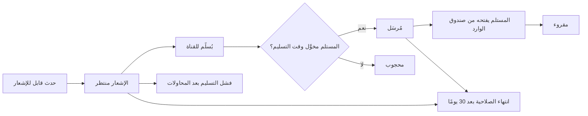
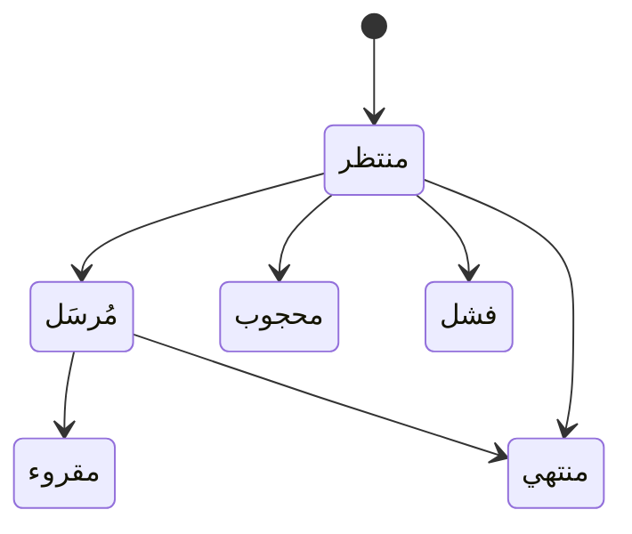

# صندوق إشعاراتي

<!-- BEGIN GENERATED: doc -->
| البند | القيمة |
|---|---|
| المعرّف | FEAT-COM-INBOX |
| الإصدار | 0.1 |
| الحالة | مسودة |
| القدرة | CAP-10 الاتصال والمنتجات |
| القدرة الفرعية | CAP-10.01 الإشعارات والتوزيع (R1 (إشعارات)) |
| الأدوار | أي مستخدم مخوَّل؛ النظام |
| الشاشات | SCR-03 صندوق الوارد |
| حالات الاستخدام | UC-099 |
| القصص | 7: 3 من المواصفة، و4 جديدة |
<!-- END GENERATED: doc -->

## 1. نظرة عامة

### 1.1 القيمة

يرى كل مستخدم إشعاراته في مكان واحد ويعلّمها كمقروءة، وتُنظف القديمة تلقائيًا.

### 1.2 النطاق

| البند | القيمة |
|---|---|
| المستخدمون | أي مستخدم مخوَّل، بصفته مستلم إشعاراته؛ النظام ينشئ الإشعار ويسلّمه وينهي القديم منه |
| الشاشات | SCR-03 صندوق الوارد |
| حالات الاستخدام | استقبال إشعار بحدث يخص المستخدم؛ تعليمه كمقروء؛ عرض صندوق واحد غير المقروء أولًا مع عداد يتحدث تلقائيًا؛ عمل صندوق الوارد دون اتصال وبسحب احتياطي عند تعطل الدفع |
| المتطلبات | عند وقوع حدث قابل للإشعار يسلَّم الإشعار داخل التطبيق وبالدفع للمحمول للمخوَّلين حسب تفضيلاتهم (REQ-COM-001)؛ لا تحمل حمولة الدفع محتوى مصنَّفًا ويقتصر محتوى الإشعار (REQ-COM-002) |
| خارج النطاق | إنشاء الحدث الذي يولِّد الإشعار (كل ميزة تنشئ أحداثها الخاصة)؛ تفضيلات القنوات والاشتراكات بعناصر محددة (ميزات أخرى) |

### 1.3 خريطة الميزة

**الشكل 1: مسار الإشعار من وقوع الحدث إلى قراءته**



**الشكل 2: حالات الإشعار**



## 2. القواعد المشتركة

تنطبق على كل قصص الميزة، فلا تتكرر داخل القصص. وكل قصة تذكر ما يخصها فقط.

### 2.1 السياق المشترك

كل قصة تبدأ من ثلاثة شروط: مستأجر نشط، وحزمة السياسات الأساسية مفعّلة، ومستخدم مسجّل الدخول ومخوَّل. وتشير إليها القصص بخطوة واحدة: «بفرض السياق المشترك للميزة».

### 2.2 الصلاحية وعدم الإفصاح

- من لا يحق له رؤية العنصر يتلقى ردًا بشكل «غير متاح» تمامًا، فلا يعرف أنه موجود.
- من يرى العنصر ولا يحق له الإجراء يتلقى «لا تملك صلاحية هذا الإجراء».

### 2.3 أوامر تغيير الحالة

- **منع التكرار:** يُرسل كل أمر بمفتاح فريد، فإعادة الطلب نفسه لا تُنفَّذ مرتين.
- **حماية التعديل المتزامن:** يُرسل كل أمر بإصدار البيانات الذي يراه المستخدم. فإن عدّلها غيره في الأثناء، يُرفض الأمر.
- **السجل:** إن نجح الأمر، يُكتب حدثه وسجل التدقيق في المعاملة نفسها.

### 2.4 الرفض المشترك

```gherkin
# language: ar
خاصية: الرفض المشترك لأوامر الميزة

  سيناريو مخطط: رفض مشترك لكل أمر في الميزة
    بفرض السياق المشترك للميزة
    و <الحالة>
    عندما يُرسل المستخدم أي أمر من أوامر الميزة
    اذاً يُرفض برمز <الرمز> ويرى "<الرسالة>"
    و لا يتغير شيء

    امثلة:
      | الحالة                                  | الرمز                  | الرسالة                                                 |
      | العنصر خارج صلاحياته                    | NOT_FOUND              | غير متاح                                                |
      | العنصر مرئي له ولا يحق له الإجراء       | AUTHZ_DENIED           | لا تملك صلاحية هذا الإجراء                              |
      | غيره عدّل العنصر بعد أن فتحه            | VERSION_CONFLICT       | تغيّرت البيانات منذ فتحتها. راجع التغييرات ثم أعد المحاولة |
      | أعاد مفتاح منع التكرار بمحتوى مختلف     | IDEMPOTENCY_KEY_REUSED | طلب مكرر بمحتوى مختلف                                   |
      | البيانات ناقصة أو غير صحيحة             | VALIDATION_FAILED      | بعض البيانات ناقصة أو غير صحيحة. راجع الحقول المعلَّمة      |

  سيناريو: إعادة الطلب نفسه لا تُنفَّذ مرتين
    بفرض السياق المشترك للميزة
    و أمر نجح بمفتاح منع تكرار
    عندما يُعاد الطلب نفسه بالمفتاح نفسه
    اذاً تُعاد النتيجة الأولى ولا يُكتب حدث ثانٍ
```

## 3. الجودة وتعريف الاكتمال

### 3.1 متطلبات الجودة

<!-- BEGIN GENERATED: quality -->
| المرجع | الموقف | المطلوب |
|---|---|---|
| QAS-OPS-003 | push gateway unavailable (air-gapped) | in-app inbox current; polling fallback ≤ 60 s |
| QAS-SEC-002 | searches, lists, maps or receives alerts touching objects above clearance | 0 leakage in inference suite (counts, facets, ordering, timing, errors) |
| QAS-SEC-012 | user not cleared for an alert's label | receives no alert, notification, push or count change |
<!-- END GENERATED: quality -->

### 3.2 تعريف الاكتمال

القصة مكتملة حين تتحقق الشروط الخمسة:

1. سيناريوهاتها والقواعد المشتركة تمر في الاختبار الآلي.
2. فحوص البنية المعمارية تمر.
3. نصوص الواجهة والرسائل موجودة بالعربية والإنجليزية.
4. مراجعة الكود مكتملة.
5. ما تضيفه القصة نفسها في قسم «القواعد» تحقق.

## 4. فهرس القصص

<!-- BEGIN GENERATED: story-index -->
| المعرّف | القصة | النوع | الحالة |
|---|---|---|---|
| `US-BC04-NTF-MARK-READ` | تعليم الإشعار كمقروء | أمر | مسودة |
| `US-BC04-Q-NTF-INBOX` | جلب: My notifications (references + templates) | جلب | مسودة |
| `US-BC04-S-NOTIFICATION-05` | تلقائي: TTL (30 d) elapsed (الإشعار) | نظام | مسودة |
| `US-UI-SCR03-LIST` | صندوق الوارد غير المقروء أولًا | واجهة | مسودة |
| `US-UI-SCR03-OFFLINE` | الإشعارات في التطبيق الميداني دون اتصال | واجهة | مسودة |
| `US-UI-SCR03-UNREAD-BADGE` | عداد غير المقروء يتحدث تلقائيًا | واجهة | مسودة |
| `US-PLT-INBOX-POLL-FALLBACK` | صندوق الوارد حالي بسحب احتياطي كل دقيقة | منصة | مسودة |
<!-- END GENERATED: story-index -->

## 5. القصص

### 5.1 US-BC04-NTF-MARK-READ — تعليم الإشعار كمقروء

| النوع | الإصدار | الأولوية | دون اتصال | الحالة |
|---|---|---|---|---|
| أمر | R1 | Must | لا | مسودة |

> **كـ** المستلم، **أريد** تعليم إشعاري كمقروء، **حتى** أعرف ما تابعته وما بقي عليّ.

**باختصار:** يعلّم المستلم إشعاره «مُرسَل» كمقروء بعد فتحه من صندوق الوارد، فتصير حالته «مقروء».

#### القواعد

- **متى يُسمح:** الإشعار في حالة «مُرسَل».
- **من يُسمح له:** المستلم نفسه فقط.
- **البيانات:** لا حمولة.
- **الأثر:** حدث «قُرئ الإشعار» يصل إلى بوابة الدفع وصندوق الوارد.

#### معايير القبول

```gherkin
# language: ar
خاصية: تعليم الإشعار كمقروء

  سيناريو: المستلم يعلّم إشعاره كمقروء
    بفرض السياق المشترك للميزة
    و إشعار "مُرسَل" للمستخدم
    عندما يعلّمه كمقروء
    اذاً تصبح حالته "مقروء"
    و يُسجَّل حدث "قُرئ الإشعار"

  سيناريو مخطط: رفض خاص بتعليم الإشعار كمقروء
    بفرض السياق المشترك للميزة
    و <الحالة>
    عندما يحاول تعليم الإشعار كمقروء
    اذاً يُرفض برمز <الرمز> ويرى "<الرسالة>"
    و لا يتغير شيء

    امثلة:
      | الحالة                          | الرمز                                  | الرسالة                                      |
      | الإشعار ليس "مُرسَلًا"           | NOTIFICATION_INVALID_STATE_TRANSITION  | الوضع الحالي للإشعار لا يسمح بهذا الإجراء    |
      | المستخدم ليس مستلم الإشعار       | NOT_RECIPIENT                          | لست مستلم هذا الإشعار                        |
```

<details><summary>المراجع التقنية والتتبع</summary>

<!-- BEGIN GENERATED: refs US-BC04-NTF-MARK-READ -->
| البند | المعرّف | المعنى |
|---|---|---|
| الواجهة البرمجية | `POST /api/v1/operations/notifications/{id}/actions/mark-read` | — |
| الأمر | `CMD-NTF-MARK-READ` | تعليم الإشعار كمقروء |
| السياسة | `POL-NTF-MARK-READ` | recipient؛ tenant match; target visible to subject |
| الحدث | `EVT-NTF-READ` | يصل إلى: Push gateway; In-app inbox |
| الكيان | `AGG-NOTIFICATION` | الإشعار |
| الجدول | `operations.notifications` | الجدول الرئيسي للإشعار |
| وحدة النشر | DU-08 | — |
| المتطلبات | REQ-COM-001، REQ-COM-002 | معانيها في القسم 6. التتبع |
| حالة الاستخدام | UC-099 | Receive Notification |
| الاختبار | TST-NOTIFICATION-SM، TST-SLC06-INVARIANTS | دورة حالات الإشعار، وثوابت الشريحة SLC-06 |
<!-- END GENERATED: refs US-BC04-NTF-MARK-READ -->

</details>

### 5.2 US-BC04-Q-NTF-INBOX — قائمة إشعاراتي

| النوع | الإصدار | الأولوية | دون اتصال | الحالة |
|---|---|---|---|---|
| جلب | R1 | Must | لا | مسودة |

> **كـ** المستلم، **أريد** قائمة إشعاراتي، **حتى** أعرف ما يخصني من أحداث النظام في مكان واحد.

**باختصار:** يعيد الاستعلام إشعارات المستلم فقط، كل إشعار بمرجعه وقالب عرضه، صفحة بعد صفحة.

#### القواعد

- **البيانات:** المؤشر والحد لكل صفحة.

#### معايير القبول

```gherkin
# language: ar
خاصية: قائمة إشعاراتي

  سيناريو: يرى المستخدم إشعاراته فقط
    بفرض السياق المشترك للميزة
    و للمستخدم إشعارات وأخرى لغيره
    عندما يطلب قائمة إشعاراته
    اذاً تُعاد إشعاراته فقط، ويُعاد فحص صلاحية كل منها
    و لا يكشف أي عدد أو اقتراح وجود إشعار محجوب

  سيناريو: الصفحة التالية
    بفرض السياق المشترك للميزة
    و إشعاراته أكثر من صفحة
    عندما يطلب الصفحة التالية بالمؤشر
    اذاً تُعاد الإشعارات التالية دون تكرار ولا فجوة
```

<details><summary>المراجع التقنية والتتبع</summary>

<!-- BEGIN GENERATED: refs US-BC04-Q-NTF-INBOX -->
| البند | المعرّف | المعنى |
|---|---|---|
| الواجهة البرمجية | `GET /api/v1/operations/notifications` | — |
| الاستعلام | `QRY-NTF-INBOX` | My notifications (references + templates) |
| السياسة | `POL-NTF-INBOX` | recipient |
| الكيان | `AGG-NOTIFICATION` | الإشعار |
| الجدول | `operations.notifications` | الجدول الرئيسي للإشعار |
| وحدة النشر | DU-08 | — |
| المتطلب | REQ-COM-001 | When a notifiable event occurs, the system shall deliver a notification in-app and by mobile push to authoriz… |
| حالة الاستخدام | UC-099 | Receive Notification |
| الاختبار | TST-NOTIFICATION-SM، TST-SLC06-INVARIANTS | دورة حالات الإشعار، وثوابت الشريحة SLC-06 |
<!-- END GENERATED: refs US-BC04-Q-NTF-INBOX -->

</details>

### 5.3 US-BC04-S-NOTIFICATION-05 — انتهاء الإشعار بعد 30 يومًا

| النوع | الإصدار | الأولوية | دون اتصال | الحالة |
|---|---|---|---|---|
| نظام | R1 | Must | لا ينطبق | مسودة |

> **كـ** النظام، **أريد** نقل الإشعار إلى «منتهي» بعد 30 يومًا من إنشائه، **حتى** لا يبقى صندوق الوارد مزدحمًا بإشعارات قديمة.

**باختصار:** يفحص المجدول الإشعارات «المنتظرة» أو «المُرسَلة» دوريًا، فينقل من تجاوز 30 يومًا منها إلى «منتهي» دون أي فعل من المستخدم.

#### القواعد

- **متى يحدث:** مرَّت 30 يومًا على الإشعار وهو في حالة «منتظر» أو «مُرسَل».
- **الأثر:** حدث «انتهى الإشعار» وسجل تدقيق بهوية النظام؛ يصل إلى بوابة الدفع وصندوق الوارد.

#### معايير القبول

```gherkin
# language: ar
خاصية: انتهاء الإشعار بعد 30 يومًا

  سيناريو: إشعار تجاوز 30 يومًا
    بفرض إشعار في حالة "منتظر" أو "مُرسَل" مضى على إنشائه 30 يومًا
    عندما يحين وقت فحص المجدول
    اذاً تصبح حالته "منتهي"
    و يُسجَّل حدث "انتهى الإشعار" بسجل تدقيق بهوية النظام

  سيناريو: إشعار لم يبلغ 30 يومًا
    بفرض إشعار في حالة "مُرسَل" لم يمض عليه 30 يومًا
    عندما يحين وقت فحص المجدول
    اذاً تبقى حالته كما هي
    و لا يُسجَّل أي حدث
```

<details><summary>المراجع التقنية والتتبع</summary>

<!-- BEGIN GENERATED: refs US-BC04-S-NOTIFICATION-05 -->
| البند | المعرّف | المعنى |
|---|---|---|
| المحفِّز | `SYS:TTL (30 d) elapsed` | scheduler |
| الانتقال | QUEUED, SENT ← EXPIRED | — |
| الحدث | `EVT-NTF-EXPIRED` | يصل إلى: Push gateway; In-app inbox |
| الكيان | `AGG-NOTIFICATION` | الإشعار |
| الجدول | `operations.notifications` | الجدول الرئيسي للإشعار |
| وحدة النشر | DU-08 | — |
| المتطلبات | REQ-COM-001، REQ-COM-002 | معانيها في القسم 6. التتبع |
| حالة الاستخدام | UC-099 | Receive Notification |
| الاختبار | TST-NOTIFICATION-SM، TST-SLC06-INVARIANTS | دورة حالات الإشعار، وثوابت الشريحة SLC-06 |
<!-- END GENERATED: refs US-BC04-S-NOTIFICATION-05 -->

</details>

### 5.4 US-UI-SCR03-LIST — صندوق الوارد غير المقروء أولًا

| النوع | الإصدار | الأولوية | دون اتصال | الحالة |
|---|---|---|---|---|
| واجهة | R1 | Must | لا | مسودة |

> **كـ** المستخدم، **أريد** أن أرى إشعاراتي غير المقروءة أولًا في صندوق واحد، **حتى** ألاحظ الجديد دون أن أفوّت القديم.

**باختصار:** تعرض شاشة صندوق الوارد الإشعارات غير المقروءة أولًا ثم المقروءة، ولا تعرض لأي مستخدم إشعارًا لا يخصه أو حُجب عنه.

#### القواعد

- **ما تعرضه الشاشة:** الإشعارات مرتبة بغير المقروء أولًا، كل إشعار بمرجعه وعنوان آمن من التصنيف.
- **من يراها:** كل مستخدم يرى إشعاراته فقط.

#### معايير القبول

```gherkin
# language: ar
خاصية: صندوق الوارد غير المقروء أولًا

  سيناريو: ترتيب الصندوق
    بفرض السياق المشترك للميزة
    و للمستخدم إشعارات مقروءة وأخرى غير مقروءة
    عندما يفتح صندوق الوارد
    اذاً تُعرض غير المقروءة أولًا

  سيناريو: إشعار حُجب بعد إرساله
    بفرض السياق المشترك للميزة
    و إشعار "محجوب" بعد أن فقد المستخدم صلاحية رؤية عنصره
    عندما يفتح صندوق الوارد
    اذاً لا يظهر ذلك الإشعار
```

<details><summary>المراجع التقنية والتتبع</summary>

<!-- BEGIN GENERATED: refs US-UI-SCR03-LIST -->
| البند | المعرّف | المعنى |
|---|---|---|
| الشاشة | SCR-03 | شاشة صندوق الوارد |
| حالة الاستخدام | UC-099 | Receive Notification |
| المصدر | `[Derived]` | — |
| المتطلب | REQ-COM-002 | The system shall not include classified content in mobile push payloads and shall limit notification content… |
| حالة الاستخدام | UC-099 | Receive Notification |
<!-- END GENERATED: refs US-UI-SCR03-LIST -->

</details>

### 5.5 US-UI-SCR03-OFFLINE — الإشعارات في التطبيق الميداني دون اتصال

| النوع | الإصدار | الأولوية | دون اتصال | الحالة |
|---|---|---|---|---|
| واجهة | R1 | Should | لا | مسودة |

> **كـ** المستخدم الميداني، **أريد** أن أرى الإشعارات التي وصلت قبل انقطاع الاتصال، **حتى** أعمل دون أن أُفاجأ عند عودة الاتصال.

**باختصار:** يعرض التطبيق الميداني النسخة المحلية من صندوق الوارد دون اتصال بعلامة أنها قد لا تكون محدَّثة، ويحدِّثها فور عودة الاتصال.

#### القواعد

- **ما تعرضه الشاشة:** النسخة المحلية من آخر مزامنة، مع علامة أنها قد لا تكون محدَّثة. [Derived]
- **من يراها:** مستخدم الجهاز فقط، من نسخته المحلية المشفرة.

> **ملاحظة:** المصادر لا تفصّل سلوك صندوق الوارد دون اتصال؛ الحد الأقصى 72 ساعة والنسخة المحلية المشفرة من قواعد العمل الميداني العامة (`21-ui-design.md` §8).

#### معايير القبول

```gherkin
# language: ar
خاصية: الإشعارات دون اتصال

  سيناريو: فتح الصندوق دون اتصال
    بفرض أن الجهاز دون اتصال وله نسخة محلية من صندوق الوارد
    عندما يفتح المستخدم صندوق الوارد
    اذاً تُعرض آخر نسخة محلية مع علامة أنها قد لا تكون محدَّثة

  سيناريو: عودة الاتصال
    بفرض أن الجهاز كان دون اتصال وعاد الاتصال
    عندما يُزامَن الجهاز
    اذاً يتحدث صندوق الوارد بأحدث الإشعارات المصرَّح له برؤيتها
```

<details><summary>المراجع التقنية والتتبع</summary>

<!-- BEGIN GENERATED: refs US-UI-SCR03-OFFLINE -->
| البند | المعرّف | المعنى |
|---|---|---|
| الشاشة | SCR-03 | شاشة صندوق الوارد |
| المصدر | `21-ui-design.md §8` | — |
| المصدر | `20-integration-design.md §6` | — |
| المصدر | `[Derived]` | — |
<!-- END GENERATED: refs US-UI-SCR03-OFFLINE -->

</details>

### 5.6 US-UI-SCR03-UNREAD-BADGE — عداد غير المقروء يتحدث تلقائيًا

| النوع | الإصدار | الأولوية | دون اتصال | الحالة |
|---|---|---|---|---|
| واجهة | R1 | Should | لا | مسودة |

> **كـ** المستخدم، **أريد** أن يتحدث عداد غير المقروء فور وصول إشعار جديد أو تعليم إشعار كمقروء، **حتى** أعرف دون فتح الصندوق كم إشعارًا بانتظاري.

**باختصار:** يتحدث عداد غير المقروء دون إعادة تحميل الصفحة عند وصول إشعار جديد أو تعليمه كمقروء، ولا يتحرك أبدًا بإشعار لا يحق للمستخدم رؤيته.

#### القواعد

- **ما تعرضه الشاشة:** عدد الإشعارات غير المقروءة للمستخدم الحالي فقط.
- **من يراها:** المستخدم نفسه؛ من فقد تصريح تصنيف إشعار لا يتغير عدده بسببه (QAS-SEC-012).

#### معايير القبول

```gherkin
# language: ar
خاصية: عداد غير المقروء يتحدث تلقائيًا

  سيناريو: إشعار جديد يرفع العداد
    بفرض السياق المشترك للميزة
    و للمستخدم عداد غير مقروء معروض
    عندما يصله إشعار جديد
    اذاً يرتفع العداد دون إعادة تحميل الصفحة

  سيناريو: إشعار لا يحق له رؤيته لا يغيّر العداد
    بفرض السياق المشترك للميزة
    و حدث أنشأ إشعارًا لعنصر لا يحق للمستخدم تصنيفه
    عندما يفحص النظام تصريح المستخدم عند التسليم
    اذاً لا يتغير عدد غير المقروء لدى المستخدم
```

<details><summary>المراجع التقنية والتتبع</summary>

<!-- BEGIN GENERATED: refs US-UI-SCR03-UNREAD-BADGE -->
| البند | المعرّف | المعنى |
|---|---|---|
| الشاشة | SCR-03 | شاشة صندوق الوارد |
| الجودة | QAS-SEC-012 | user not cleared for an alert's label → receives no alert, notification, push or count change |
| المصدر | `21-ui-design.md §13` | — |
| المصدر | `[Derived]` | — |
<!-- END GENERATED: refs US-UI-SCR03-UNREAD-BADGE -->

</details>

### 5.7 US-PLT-INBOX-POLL-FALLBACK — صندوق الوارد حالي بسحب احتياطي كل دقيقة

| النوع | الإصدار | الأولوية | دون اتصال | الحالة |
|---|---|---|---|---|
| منصة | R1 | Should | لا ينطبق | مسودة |

> **كـ** فريق المنصة، **أريد** سحبًا احتياطيًا لصندوق الوارد كل دقيقة عند تعطل بوابة الدفع، **حتى** يبقى صندوق الوارد داخل التطبيق حاليًا حتى في بيئة معزولة عن الإنترنت.

**باختصار:** حين تتعطل بوابة الدفع يسحب التطبيق صندوق الوارد كل 60 ثانية على الأكثر (QAS-OPS-003)، فيبقى محتواه داخل التطبيق حاليًا دون اعتماد على الدفع.

#### معايير القبول

```gherkin
# language: ar
خاصية: سحب احتياطي لصندوق الوارد

  سيناريو: بوابة الدفع معطلة
    بفرض أن بوابة الدفع غير متاحة
    عندما يفتح المستخدم صندوق الوارد
    اذاً يسحب التطبيق المحتوى كل 60 ثانية على الأكثر
    و يبقى الصندوق داخل التطبيق حاليًا

  سيناريو: بوابة الدفع متاحة
    بفرض أن بوابة الدفع متاحة
    عندما يصل إشعار جديد
    اذاً يصل بالدفع دون انتظار دورة السحب الاحتياطي
```

<details><summary>المراجع التقنية والتتبع</summary>

<!-- BEGIN GENERATED: refs US-PLT-INBOX-POLL-FALLBACK -->
| البند | المعرّف | المعنى |
|---|---|---|
| الجودة | QAS-OPS-003 | push gateway unavailable (air-gapped) → in-app inbox current; polling fallback ≤ 60 s |
| المصدر | `21-ui-design.md §13` | — |
<!-- END GENERATED: refs US-PLT-INBOX-POLL-FALLBACK -->

</details>

## 6. التتبع

<!-- BEGIN GENERATED: trace -->
| المتطلب | المعنى | القصص | الاختبار |
|---|---|---|---|
| REQ-COM-001 | When a notifiable event occurs, the system shall deliver a notification in-app and by mobile push to authoriz… | كل قصص الميزة المأخوذة من المواصفة (3) | TST-NOTIFICATION-SM، TST-SLC06-INVARIANTS، TST-SUBSCRIPTION-SM |
| REQ-COM-002 | The system shall not include classified content in mobile push payloads and shall limit notification content… | `US-BC04-NTF-MARK-READ`، `US-BC04-S-NOTIFICATION-05`، `US-UI-SCR03-LIST` | TST-NOTIFICATION-SM، TST-SLC06-INVARIANTS |
<!-- END GENERATED: trace -->

## 7. سجل التغييرات

| الإصدار | التاريخ | التغيير |
|---|---|---|
| 0.1 | — | هيكل مولَّد من خريطة الميزات |
| 0.2 | 2026-10-13 | كتابة القصص كاملة بمعيار القصص |
