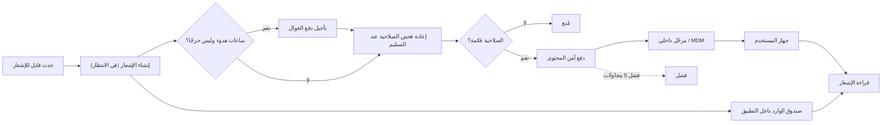
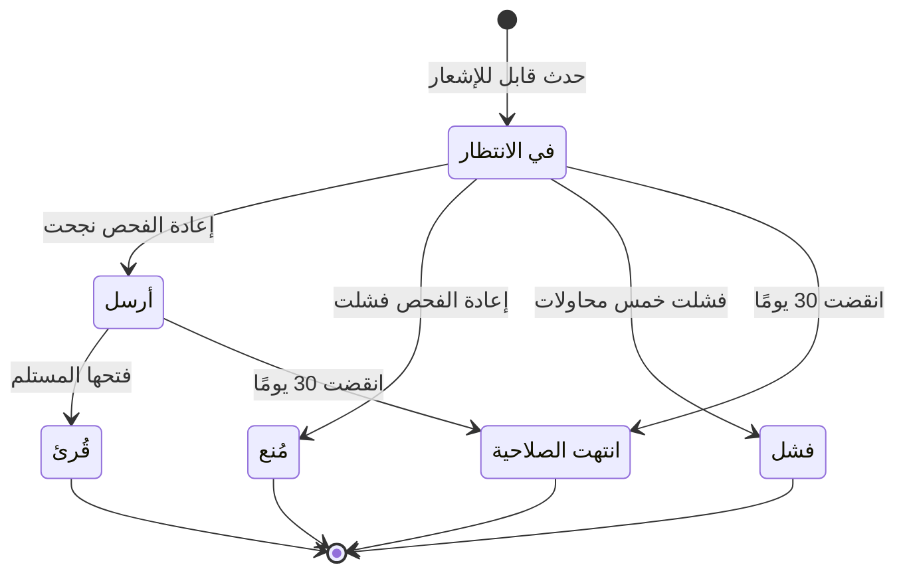

# إيصال الإشعارات بأمان

<!-- BEGIN GENERATED: doc -->
| البند | القيمة |
|---|---|
| المعرّف | FEAT-COM-NOTIFY-DELIVERY |
| الإصدار | 0.2 |
| الحالة | مسودة |
| القدرة | CAP-10 الاتصال والمنتجات |
| القدرة الفرعية | CAP-10.01 الإشعارات والتوزيع (R1 (إشعارات)) |
| الأدوار | النظام |
| الشاشات | SCR-03 صندوق الوارد |
| حالات الاستخدام | UC-099 |
| القصص | 11: 4 من المواصفة، و7 جديدة |
<!-- END GENERATED: doc -->

## 1. نظرة عامة

### 1.1 القيمة

تصل الإشعارات داخل التطبيق وعلى الجوال إلى المخوّلين فقط ودون محتوى سري في رسائل الجوال.

### 1.2 النطاق

| البند | القيمة |
|---|---|
| المستخدمون | كل مستخدم مخوَّل يتلقى إشعارات داخل التطبيق وعلى الجوال؛ فريق التشغيل أو الأمن يتابع فشل التسليم وتعطل المرحّل |
| الشاشات | SCR-03 صندوق الوارد |
| حالات الاستخدام (بالكلمات) | وصول إشعار لمستلم واحد عند وقوع حدث يستدعيه، وتسليمه لقناته الصحيحة فقط بعد إعادة فحص صلاحيته |
| المتطلبات (بالكلمات) | تسليم الإشعار داخل التطبيق وبالجوال للمخوَّلين فقط دون كشف محتوى الحدث نفسه؛ عدم تضمين أي محتوى مصنَّف في رسالة الجوال |
| خارج النطاق | تحديد المستخدم نوع الإشعار الذي يشترك فيه (ميزة الاشتراكات)؛ صياغة محتوى الحدث الأصلي المُنتِج للإشعار |

### 1.3 خريطة الميزة

**الشكل 1: مسار الإشعار من الحدث إلى المستلم**



**الشكل 2: دورة حالات الإشعار**



## 2. القواعد المشتركة

تنطبق على كل قصص الميزة، فلا تتكرر داخل القصص. وكل قصة تذكر ما يخصها فقط.

### 2.1 السياق المشترك

كل قصة تبدأ من ثلاثة شروط: مستأجر نشط، وحزمة السياسات الأساسية مفعّلة، ومستخدم مسجّل الدخول ومخوَّل. وتشير إليها القصص بخطوة واحدة: «بفرض السياق المشترك للميزة».

### 2.2 الصلاحية وعدم الإفصاح

- من لا يحق له رؤية العنصر يتلقى ردًا بشكل «غير متاح» تمامًا، فلا يعرف أنه موجود.
- من يرى العنصر ولا يحق له الإجراء يتلقى «لا تملك صلاحية هذا الإجراء».

### 2.3 أوامر تغيير الحالة

- **منع التكرار:** يُرسل كل أمر بمفتاح فريد، فإعادة الطلب نفسه لا تُنفَّذ مرتين.
- **حماية التعديل المتزامن:** يُرسل كل أمر بإصدار البيانات الذي يراه المستخدم. فإن عدّلها غيره في الأثناء، يُرفض الأمر.
- **السجل:** إن نجح الأمر، يُكتب حدثه وسجل التدقيق في المعاملة نفسها.

### 2.4 الرفض المشترك

```gherkin
# language: ar
خاصية: الرفض المشترك لأوامر الميزة

  سيناريو مخطط: رفض مشترك لكل أمر في الميزة
    بفرض السياق المشترك للميزة
    و <الحالة>
    عندما يُرسل المستخدم أي أمر من أوامر الميزة
    اذاً يُرفض برمز <الرمز> ويرى "<الرسالة>"
    و لا يتغير شيء

    امثلة:
      | الحالة                                  | الرمز                  | الرسالة                                                 |
      | العنصر خارج صلاحياته                    | NOT_FOUND              | غير متاح                                                |
      | العنصر مرئي له ولا يحق له الإجراء       | AUTHZ_DENIED           | لا تملك صلاحية هذا الإجراء                              |
      | غيره عدّل العنصر بعد أن فتحه            | VERSION_CONFLICT       | تغيّرت البيانات منذ فتحتها. راجع التغييرات ثم أعد المحاولة |
      | أعاد مفتاح منع التكرار بمحتوى مختلف     | IDEMPOTENCY_KEY_REUSED | طلب مكرر بمحتوى مختلف                                   |
      | البيانات ناقصة أو غير صحيحة             | VALIDATION_FAILED      | بعض البيانات ناقصة أو غير صحيحة. راجع الحقول المعلَّمة      |

  سيناريو: إعادة الطلب نفسه لا تُنفَّذ مرتين
    بفرض السياق المشترك للميزة
    و أمر نجح بمفتاح منع تكرار
    عندما يُعاد الطلب نفسه بالمفتاح نفسه
    اذاً تُعاد النتيجة الأولى ولا يُكتب حدث ثانٍ
```

### 2.5 قواعد مشتركة للتسليم

تنطبق على عدة قصص من قصص هذه الميزة، فلا تتكرر فيها:

- **الإشعار ليس حدث نطاق:** لا يحمل محتوى الحدث الذي أنتجه، بل مرجعًا إليه فقط (INV-NTF-01).
- **حمولة الدفع آمنة التصنيف:** مرجع URN وعنوان من قائمة قوالب آمنة التصنيف فقط؛ لا أسماء ولا مواقع ولا محتوى أعلى من تصنيف المستلم (INV-NTF-02، REQ-COM-002).
- **إعادة فحص الصلاحية عند كل تسليم:** بإصدار الأمان الحالي للمستلم وقت التسليم، لا وقت إنشاء الإشعار؛ فشل الفحص يمنع التسليم دون كشف السبب للمستلم.

## 3. الجودة وتعريف الاكتمال

### 3.1 متطلبات الجودة

<!-- BEGIN GENERATED: quality -->
| المرجع | الموقف | المطلوب |
|---|---|---|
| QAS-OPS-003 | push gateway unavailable (air-gapped) | in-app inbox current; polling fallback ≤ 60 s |
| QAS-PERF-005 | reports a value that meets a critical alert rule | end-to-end p95 ≤ 5 s |
| QAS-SEC-002 | searches, lists, maps or receives alerts touching objects above clearance | 0 leakage in inference suite (counts, facets, ordering, timing, errors) |
| QAS-SEC-007 | obtains a field device | 0 readable records without authentication; wipe on next connection |
| QAS-SEC-012 | user not cleared for an alert's label | receives no alert, notification, push or count change |
<!-- END GENERATED: quality -->

### 3.2 تعريف الاكتمال

القصة مكتملة حين تتحقق الشروط الخمسة:

1. سيناريوهاتها والقواعد المشتركة تمر في الاختبار الآلي.
2. فحوص البنية المعمارية تمر.
3. نصوص الواجهة والرسائل موجودة بالعربية والإنجليزية.
4. مراجعة الكود مكتملة.
5. ما تضيفه القصة نفسها في قسم «القواعد» تحقق.

## 4. فهرس القصص

<!-- BEGIN GENERATED: story-index -->
| المعرّف | القصة | النوع | الحالة |
|---|---|---|---|
| `US-BC04-S-NOTIFICATION-01` | تلقائي: إنشاء الإشعار عند حدث قابل للإشعار | نظام | مسودة |
| `US-BC04-S-NOTIFICATION-02` | تلقائي: تسليم الإشعار إلى القناة | نظام | مسودة |
| `US-BC04-S-NOTIFICATION-03` | تلقائي: منع تسليم الإشعار لفقد الصلاحية | نظام | مسودة |
| `US-BC04-S-NOTIFICATION-04` | تلقائي: فشل تسليم الإشعار بعد الإعادة | نظام | مسودة |
| `US-DOM-NTF-QUIET-HOURS` | تأجيل الدفع في ساعات الهدوء عدا الحرج | نظام | مسودة |
| `US-PLT-NOTIFY-FANOUT` | وصول إشعار التنبيه الحرج خلال خمس ثوانٍ | منصة | مسودة |
| `US-PLT-NOTIFY-SAFE-PAYLOAD` | رسالة الجوال مرجع وعنوان آمن فقط | منصة | مسودة |
| `US-INT-NOTIFY-DEVICE-TOKEN` | ربط الجهاز بالإشعارات وإلغاؤه عند فقده | تكامل | مسودة |
| `US-INT-NOTIFY-PUSH-RELAY` | إرسال الإشعار الفوري عبر مرحّل داخلي | تكامل | مسودة |
| `US-OPS-NOTIFY-DELIVERY-MONITOR` | مراقبة فشل الإشعارات وتعطل المرحّل | تشغيل | مسودة |
| `US-OPS-NOTIFY-LEAK-TEST` | اختبار عدم تسرب التنبيهات لغير المصرح لهم | تشغيل | مسودة |
<!-- END GENERATED: story-index -->

## 5. القصص

### 5.1 US-BC04-S-NOTIFICATION-01 — تلقائي: إنشاء الإشعار عند حدث قابل للإشعار

| النوع | الإصدار | الأولوية | دون اتصال | الحالة |
|---|---|---|---|---|
| نظام | R1 | Must | لا ينطبق | مسودة |

> **كـ** النظام، **أريد** إنشاء إشعار في حالة «في الانتظار» لمستلم واحد عند وقوع حدث يستدعي الإشعار، **حتى** يصل الإشعار لاحقًا لمن يحق له فقط دون كشف محتوى الحدث نفسه.

**باختصار:** عند وقوع حدث قابل للإشعار، ينشئ النظام إشعارًا في حالة «في الانتظار» لمستلم واحد نشط ومخوَّل على العنصر المشار إليه وقت الإنشاء؛ وحمولته مرجع فقط لا محتوى الحدث (§2.5).

#### القواعد

- **متى يحدث:** عند وقوع حدث يستدعي إشعار مستلم واحد، والمستلم نشط ومخوَّل على العنصر المشار إليه في تلك اللحظة.
- **الأثر:** يُنشأ الإشعار في حالة «في الانتظار»، ويُسجَّل حدث «أُضيف الإشعار إلى الطابور» وسجل تدقيق بهوية النظام.

#### معايير القبول

```gherkin
# language: ar
خاصية: إنشاء الإشعار عند حدث قابل للإشعار

  سيناريو: حدث قابل للإشعار لمستلم نشط ومخوَّل
    بفرض حدثًا وقع يستدعي إشعار مستلم نشط ومخوَّل على العنصر المشار إليه
    عندما يبلّغ النظام الإشعار
    اذاً يُنشأ الإشعار في حالة "في الانتظار"
    و يُسجَّل حدث "أُضيف الإشعار إلى الطابور"

  سيناريو: لا إشعار لمن فقد صلاحيته وقت الحدث
    بفرض حدثًا وقع ولم يعد المستلم مخوَّلًا على العنصر المشار إليه
    عندما يحاول النظام إضافة الإشعار
    اذاً لا يُنشأ الإشعار
    و لا يتغير شيء
```

<details><summary>المراجع التقنية والتتبع</summary>

<!-- BEGIN GENERATED: refs US-BC04-S-NOTIFICATION-01 -->
| البند | المعرّف | المعنى |
|---|---|---|
| المحفِّز | `SYS:notifiable event for recipient` | recipient ACTIVE; recipient authorized for the referenced object at enqueue time |
| الانتقال | ∅ ← QUEUED | — |
| الحدث | `EVT-NTF-QUEUED` | يصل إلى: Push gateway; In-app inbox |
| الكيان | `AGG-NOTIFICATION` | الإشعار |
| الجدول | `operations.notifications` | الجدول الرئيسي للإشعار |
| وحدة النشر | DU-08 | — |
| المتطلبات | REQ-COM-001، REQ-COM-002 | معانيها في القسم 6. التتبع |
| حالة الاستخدام | UC-099 | Receive Notification |
| الاختبار | TST-NOTIFICATION-SM، TST-SLC06-INVARIANTS | دورة حالات الإشعار، وثوابت الشريحة SLC-06 |
<!-- END GENERATED: refs US-BC04-S-NOTIFICATION-01 -->

</details>

### 5.2 US-BC04-S-NOTIFICATION-02 — تلقائي: تسليم الإشعار إلى القناة

| النوع | الإصدار | الأولوية | دون اتصال | الحالة |
|---|---|---|---|---|
| نظام | R1 | Must | لا ينطبق | مسودة |

> **كـ** النظام، **أريد** تسليم الإشعار «في الانتظار» إلى قناته بعد إعادة فحص صلاحية المستلم، **حتى** يصل الإشعار الفعلي لمن يحق له فقط وبمحتوى آمن للجوال.

**باختصار:** بعد نجاح إعادة فحص صلاحية المستلم عند لحظة التسليم، يسلّم النظام الإشعار «في الانتظار» إلى قناته فتصبح حالته «أُرسل»، وتحمل حمولة الدفع مرجعًا وعنوانًا آمن التصنيف فقط (§2.5).

#### القواعد

- **متى يحدث:** الإشعار «في الانتظار»، ونجحت إعادة فحص صلاحية المستلم عند لحظة التسليم.
- **الأثر:** تصبح حالة الإشعار «أُرسل»، وتُسلَّم حمولة الدفع بمرجع وعنوان آمن التصنيف فقط، ويُسجَّل حدث «أُرسل الإشعار».

#### معايير القبول

```gherkin
# language: ar
خاصية: تسليم الإشعار إلى القناة

  سيناريو: نجاح إعادة الفحص عند التسليم
    بفرض إشعارًا في حالة "في الانتظار" نجحت إعادة فحص صلاحية مستلمه
    عندما يسلّم النظام الإشعار
    اذاً تصبح حالته "أُرسل"
    و تحمل حمولة الدفع مرجعًا وعنوانًا آمن التصنيف فقط
    و يُسجَّل حدث "أُرسل الإشعار"

  سيناريو: لا تسليم ثانٍ لإشعار سبق إرساله
    بفرض إشعارًا سبق أن أصبحت حالته "أُرسل"
    عندما يحاول النظام تسليمه مرة أخرى
    اذاً تبقى حالته كما هي
    و لا يتغير شيء
```

<details><summary>المراجع التقنية والتتبع</summary>

<!-- BEGIN GENERATED: refs US-BC04-S-NOTIFICATION-02 -->
| البند | المعرّف | المعنى |
|---|---|---|
| المحفِّز | `SYS:delivered to channel` | re-check authorization at delivery (security_version); push payload = reference + classification-safe title t… |
| الانتقال | QUEUED ← SENT | — |
| الحدث | `EVT-NTF-SENT` | يصل إلى: Push gateway; In-app inbox |
| الكيان | `AGG-NOTIFICATION` | الإشعار |
| الجدول | `operations.notifications` | الجدول الرئيسي للإشعار |
| وحدة النشر | DU-08 | — |
| المتطلبات | REQ-COM-001، REQ-COM-002 | معانيها في القسم 6. التتبع |
| حالة الاستخدام | UC-099 | Receive Notification |
| الاختبار | TST-NOTIFICATION-SM، TST-SLC06-INVARIANTS | دورة حالات الإشعار، وثوابت الشريحة SLC-06 |
<!-- END GENERATED: refs US-BC04-S-NOTIFICATION-02 -->

</details>

### 5.3 US-BC04-S-NOTIFICATION-03 — تلقائي: منع تسليم الإشعار لفقد الصلاحية

| النوع | الإصدار | الأولوية | دون اتصال | الحالة |
|---|---|---|---|---|
| نظام | R1 | Must | لا ينطبق | مسودة |

> **كـ** النظام، **أريد** منع تسليم الإشعار إذا فقد المستلم صلاحيته على العنصر المشار إليه قبل لحظة التسليم، **حتى** لا يصل محتوى لمن لا يحق له رؤية العنصر بعد الآن.

**باختصار:** إذا فشلت إعادة فحص صلاحية المستلم عند لحظة التسليم، يمنع النظام تسليم الإشعار «في الانتظار» فتصير حالته «مُنع» نهائيًا دون أن يصل أي محتوى للمستلم.

#### القواعد

- **متى يحدث:** الإشعار «في الانتظار»، وفشلت إعادة فحص صلاحية المستلم عند لحظة التسليم.
- **الأثر:** تصبح حالة الإشعار «مُنع» (حالة نهائية)، ولا يُسلَّم أي محتوى للمستلم، ويُسجَّل حدث «مُنع الإشعار».

#### معايير القبول

```gherkin
# language: ar
خاصية: منع تسليم الإشعار لفقد الصلاحية

  سيناريو: فقد المستلم صلاحيته قبل التسليم
    بفرض إشعارًا في حالة "في الانتظار" وفقد مستلمه صلاحيته على العنصر المشار إليه
    عندما يحاول النظام تسليم الإشعار
    اذاً تصبح حالته "مُنع"
    و لا يُسلَّم أي محتوى للمستلم
    و يُسجَّل حدث "مُنع الإشعار"

  سيناريو: لم يحن وقت التسليم بعد
    بفرض إشعارًا في حالة "في الانتظار" ولم يحن وقت محاولة تسليمه
    عندما يُفحص طابور التسليم
    اذاً تبقى حالته "في الانتظار"
    و لا يتغير شيء
```

<details><summary>المراجع التقنية والتتبع</summary>

<!-- BEGIN GENERATED: refs US-BC04-S-NOTIFICATION-03 -->
| البند | المعرّف | المعنى |
|---|---|---|
| المحفِّز | `SYS:recipient no longer authorized at delivery` | re-check failed |
| الانتقال | QUEUED ← WITHHELD | — |
| الحدث | `EVT-NTF-WITHHELD` | يصل إلى: Push gateway; In-app inbox |
| الكيان | `AGG-NOTIFICATION` | الإشعار |
| الجدول | `operations.notifications` | الجدول الرئيسي للإشعار |
| وحدة النشر | DU-08 | — |
| المتطلبات | REQ-COM-001، REQ-COM-002 | معانيها في القسم 6. التتبع |
| حالة الاستخدام | UC-099 | Receive Notification |
| الاختبار | TST-NOTIFICATION-SM، TST-SLC06-INVARIANTS | دورة حالات الإشعار، وثوابت الشريحة SLC-06 |
<!-- END GENERATED: refs US-BC04-S-NOTIFICATION-03 -->

</details>

### 5.4 US-BC04-S-NOTIFICATION-04 — تلقائي: فشل تسليم الإشعار بعد الإعادة

| النوع | الإصدار | الأولوية | دون اتصال | الحالة |
|---|---|---|---|---|
| نظام | R1 | Must | لا ينطبق | مسودة |

> **كـ** النظام، **أريد** تسجيل فشل تسليم الإشعار بعد خمس محاولات بتراجع أسي، **حتى** يعرف المشغّل أن القناة الخارجية لم يصلها الإشعار، بينما تبقى نسخته داخل التطبيق متاحة.

**باختصار:** إذا فشلت كل محاولات تسليم الإشعار «في الانتظار» (خمس محاولات بتراجع أسي)، يسجّل النظام فشل التسليم فتصبح حالته «فشل» نهائيًا، مع بقاء نسخته داخل صندوق الوارد متاحة دائمًا.

#### القواعد

- **متى يحدث:** الإشعار «في الانتظار»، واستُنفذت خمس محاولات تسليم بتراجع أسي دون نجاح.
- **الأثر:** تصبح حالة الإشعار «فشل» (حالة نهائية)، وتبقى نسخته داخل صندوق الوارد متاحة، ويُسجَّل حدث «فشل تسليم الإشعار».

#### معايير القبول

```gherkin
# language: ar
خاصية: فشل تسليم الإشعار بعد الإعادة

  سيناريو: استُنفذت كل المحاولات
    بفرض إشعارًا في حالة "في الانتظار" فشلت خمس محاولات تسليمه بتراجع أسي
    عندما تُستنفذ المحاولة الأخيرة
    اذاً تصبح حالته "فشل"
    و تبقى نسخته داخل صندوق الوارد متاحة
    و يُسجَّل حدث "فشل تسليم الإشعار"

  سيناريو: لم تُستنفذ المحاولات بعد
    بفرض إشعارًا في حالة "في الانتظار" وبعض محاولات تسليمه لم تُجرَ بعد
    عندما تفشل محاولة واحدة فقط
    اذاً تبقى حالته "في الانتظار"
    و لا يتغير شيء
```

<details><summary>المراجع التقنية والتتبع</summary>

<!-- BEGIN GENERATED: refs US-BC04-S-NOTIFICATION-04 -->
| البند | المعرّف | المعنى |
|---|---|---|
| المحفِّز | `SYS:delivery failed after retries` | 5 attempts with exponential backoff; in-app copy remains |
| الانتقال | QUEUED ← FAILED | — |
| الحدث | `EVT-NTF-FAILED` | يصل إلى: Push gateway; In-app inbox |
| الكيان | `AGG-NOTIFICATION` | الإشعار |
| الجدول | `operations.notifications` | الجدول الرئيسي للإشعار |
| وحدة النشر | DU-08 | — |
| المتطلبات | REQ-COM-001، REQ-COM-002 | معانيها في القسم 6. التتبع |
| حالة الاستخدام | UC-099 | Receive Notification |
| الاختبار | TST-NOTIFICATION-SM، TST-SLC06-INVARIANTS | دورة حالات الإشعار، وثوابت الشريحة SLC-06 |
<!-- END GENERATED: refs US-BC04-S-NOTIFICATION-04 -->

</details>

### 5.5 US-DOM-NTF-QUIET-HOURS — تأجيل الدفع في ساعات الهدوء عدا الحرج

| النوع | الإصدار | الأولوية | دون اتصال | الحالة |
|---|---|---|---|---|
| نظام | R1 | Must | لا ينطبق | مسودة |

> **كـ** النظام، **أريد** تأجيل دفع الإشعار على الجوال خلال ساعات الهدوء المضبوطة للمستلم إلا إذا كانت خطورة التنبيه المرتبط به حرجة، **حتى** لا يُوقَظ المستخدم إلا للحرج، وتصله بقية الإشعارات بعد ساعات الهدوء.

**باختصار:** عند تسليم إشعار خلال ساعات الهدوء المضبوطة للمستلم، يؤجل النظام دفعه إلى الجوال حتى تنتهي، إلا أن تكون خطورة التنبيه المرتبط به «حرجة» فيصل فورًا؛ ويبقى الإشعار متاحًا في صندوق الوارد داخل التطبيق طوال التأجيل.

#### القواعد

- **متى يحدث:** موعد تسليم الإشعار داخل ساعات الهدوء المضبوطة للمستلم، وخطورة التنبيه المرتبط به ليست «حرجة» **[Derived]** (situation-alerting-spec.md §6).
- **الأثر:** يؤجَّل دفع الجوال إلى ما بعد ساعات الهدوء، بينما يبقى الإشعار داخل صندوق الوارد داخل التطبيق متاحًا فورًا **[Derived]**.

#### معايير القبول

```gherkin
# language: ar
خاصية: تأجيل الدفع في ساعات الهدوء

  سيناريو: إشعار غير حرج خلال ساعات الهدوء
    بفرض إشعارًا حان وقت تسليمه خلال ساعات الهدوء المضبوطة لمستلمه وخطورته ليست "حرجة"
    عندما يحاول النظام دفعه إلى الجوال
    اذاً يؤجَّل دفع الجوال إلى ما بعد ساعات الهدوء
    و يبقى الإشعار متاحًا في صندوق الوارد داخل التطبيق

  سيناريو: إشعار بخطورة حرجة لا يُؤجَّل
    بفرض إشعارًا حان وقت تسليمه خلال ساعات الهدوء المضبوطة لمستلمه وخطورته "حرجة"
    عندما يحاول النظام دفعه إلى الجوال
    اذاً يُدفع فورًا دون تأجيل
```

<details><summary>المراجع التقنية والتتبع</summary>

<!-- BEGIN GENERATED: refs US-DOM-NTF-QUIET-HOURS -->
| البند | المعرّف | المعنى |
|---|---|---|
| المصدر | `situation-alerting-spec.md §6` | — |
| المصدر | `[Derived]` | — |
| المتطلب | REQ-COM-001 | When a notifiable event occurs, the system shall deliver a notification in-app and by mobile push to authoriz… |
| حالة الاستخدام | UC-099 | Receive Notification |
<!-- END GENERATED: refs US-DOM-NTF-QUIET-HOURS -->

</details>

### 5.6 US-PLT-NOTIFY-FANOUT — وصول إشعار التنبيه الحرج خلال خمس ثوانٍ

| النوع | الإصدار | الأولوية | دون اتصال | الحالة |
|---|---|---|---|---|
| منصة | R1 | Must | لا ينطبق | مسودة |

> **كـ** فريق المنصة، **أريد** بنية تسليم تضمن وصول إشعار دفع التنبيه الحرج إلى المستلم خلال خمس ثوانٍ من طرف إلى طرف، **حتى** يتصرف المسؤولون فورًا مع التنبيهات الحرجة.

**باختصار:** زمن الإشعار من وقوع التنبيه الحرج إلى وصوله للمستلم لا يتجاوز خمس ثوانٍ عند المئين 95 تحت حمل التصميم (QAS-PERF-005).

#### معايير القبول

```gherkin
# language: ar
خاصية: وصول إشعار التنبيه الحرج خلال خمس ثوانٍ

  سيناريو: الهدف تحت حمل التصميم
    بفرض حمل بمزيج استراتيجية اختبار الأداء وبيانات بحجم التصميم
    عندما يصل تنبيه حرج يستدعي إشعارًا
    اذاً يصل الإشعار إلى المستلم خلال خمس ثوانٍ أو أقل عند المئين 95
```

<details><summary>المراجع التقنية والتتبع</summary>

<!-- BEGIN GENERATED: refs US-PLT-NOTIFY-FANOUT -->
| البند | المعرّف | المعنى |
|---|---|---|
| الجودة | QAS-PERF-005 | reports a value that meets a critical alert rule → end-to-end p95 ≤ 5 s |
| المتطلب | REQ-COM-001 | When a notifiable event occurs, the system shall deliver a notification in-app and by mobile push to authoriz… |
| حالة الاستخدام | UC-099 | Receive Notification |
<!-- END GENERATED: refs US-PLT-NOTIFY-FANOUT -->

</details>

### 5.7 US-PLT-NOTIFY-SAFE-PAYLOAD — رسالة الجوال مرجع وعنوان آمن فقط

| النوع | الإصدار | الأولوية | دون اتصال | الحالة |
|---|---|---|---|---|
| منصة | R1 | Must | لا ينطبق | مسودة |

> **كـ** فريق المنصة، **أريد** أن تُبنى حمولة دفع الجوال من مرجع وعنوان من قائمة قوالب آمنة التصنيف فقط دون أي محتوى مصنَّف، **حتى** لا يتسرب محتوى مصنَّف عبر رسائل الجوال العابرة لقناة خارجية.

**باختصار:** حمولة كل إشعار دفع تقتصر على مرجع URN وعنوان يُختار من قائمة قوالب آمنة التصنيف؛ لا أسماء ولا مواقع ولا أي محتوى أعلى من تصنيف المستلم (§2.5؛ INV-NTF-02).

#### معايير القبول

```gherkin
# language: ar
خاصية: حمولة دفع آمنة التصنيف

  سيناريو: بناء حمولة الدفع
    بفرض إشعارًا جاهزًا للتسليم عبر الدفع
    عندما تُبنى حمولته
    اذاً تقتصر الحمولة على مرجع URN وعنوان من قائمة آمنة التصنيف
    و لا تحتوي أي اسم أو موقع أو محتوى مصنَّف
```

<details><summary>المراجع التقنية والتتبع</summary>

<!-- BEGIN GENERATED: refs US-PLT-NOTIFY-SAFE-PAYLOAD -->
| البند | المعرّف | المعنى |
|---|---|---|
| الجودة | QAS-SEC-002 | searches, lists, maps or receives alerts touching objects above clearance → 0 leakage in inference suite (cou… |
| المصدر | `situation-alerting-spec.md §6` | — |
| المتطلب | REQ-COM-002 | The system shall not include classified content in mobile push payloads and shall limit notification content… |
| حالة الاستخدام | UC-099 | Receive Notification |
<!-- END GENERATED: refs US-PLT-NOTIFY-SAFE-PAYLOAD -->

</details>

### 5.8 US-INT-NOTIFY-DEVICE-TOKEN — ربط الجهاز بالإشعارات وإلغاؤه عند فقده

| النوع | الإصدار | الأولوية | دون اتصال | الحالة |
|---|---|---|---|---|
| تكامل | R1 | Must | لا ينطبق | مسودة |

> **كـ** النظام، **أريد** ربط رمز دفع الجهاز الميداني بمستخدمه عند تسجيله وإلغاء الرمز فورًا عند الإبلاغ عن فقد الجهاز، **حتى** لا تصل إشعارات دفع لجهاز مفقود.

**باختصار:** **[Derived]** عند تسجيل جهاز ميداني نشط يربط النظام رمز دفعه بمستخدمه فتصله إشعارات الدفع؛ وإذا أُبلغ عن فقد الجهاز يُلغى الرمز فورًا فلا تصله إشعارات لاحقة (REQ-OFF-005).

#### القواعد

- **متى يحدث:** عند تنشيط ربط جهاز ميداني جديد بمستخدمه، أو عند تغيير حالة الجهاز إلى «مفقود».
- **البيانات:** رمز دفع الجهاز، ومعرّف مستخدمه، وحالة الجهاز المتبادلة مع مرحّل الدفع (MDM) **[Derived]**.
- **الأثر:** يرتبط رمز الدفع بالمستخدم فتصله إشعاراته، أو يُلغى الرمز فلا تُرسل له إشعارات دفع جديدة بعد الإلغاء.

#### معايير القبول

```gherkin
# language: ar
خاصية: ربط الجهاز بالإشعارات وإلغاؤه عند فقده

  سيناريو: ربط رمز دفع جهاز نشط
    بفرض السياق المشترك للميزة
    و جهازًا ميدانيًا نشطًا يُسجَّل لأول مرة
    عندما يرسل رمز دفعه
    اذاً يرتبط الرمز بمستخدم الجهاز
    و تصله إشعارات الدفع التالية

  سيناريو: إلغاء الرمز عند فقد الجهاز
    بفرض السياق المشترك للميزة
    و جهازًا مرتبطًا برمز دفع نشط صدر بشأنه بلاغ فقد
    عندما يُعلَّم الجهاز "مفقود"
    اذاً يُلغى رمز دفعه فورًا
    و لا تصله إشعارات دفع جديدة بعده

  سيناريو مخطط: رفض خاص بربط الجهاز
    بفرض السياق المشترك للميزة
    و <الحالة>
    عندما يحاول ربط رمز الدفع
    اذاً يُرفض برمز <الرمز> ويرى <الرسالة>

    امثلة:
      | الحالة          | الرمز              | الرسالة                           |
      | الجهاز غير نشط  | DEVICE_NOT_ACTIVE  | الجهاز غير نشط. تواصل مع المسؤول  |
```

<details><summary>المراجع التقنية والتتبع</summary>

<!-- BEGIN GENERATED: refs US-INT-NOTIFY-DEVICE-TOKEN -->
| البند | المعرّف | المعنى |
|---|---|---|
| المصدر | `20-integration-design.md §2` | — |
| المصدر | `[Derived]` | — |
| المتطلبات | REQ-COM-001، REQ-OFF-005 | معانيها في القسم 6. التتبع |
| حالة الاستخدام | UC-099 | Receive Notification |
<!-- END GENERATED: refs US-INT-NOTIFY-DEVICE-TOKEN -->

</details>

### 5.9 US-INT-NOTIFY-PUSH-RELAY — إرسال الإشعار الفوري عبر مرحّل داخلي

| النوع | الإصدار | الأولوية | دون اتصال | الحالة |
|---|---|---|---|---|
| تكامل | R1 | Must | لا ينطبق | مسودة |

> **كـ** النظام، **أريد** إرسال إشعار الدفع للجهاز عبر قناة داخلية (اتصال دائم من التطبيق أو مرحّل MDM داخلي) دون الاعتماد على أي خدمة دفع عامة خارج الموقع، **حتى** تعمل الإشعارات في بيئة معزولة (air-gapped).

**باختصار:** يُسلَّم إشعار الدفع للجهاز عبر اتصال دائم من التطبيق عند توفر شبكة المؤسسة أو مرحّل MDM داخلي، مع سحب دوري احتياطي عند تعذر ذلك؛ ولا يعتمد المسار على أي خدمة دفع عامة خارجية (situation-alerting-spec.md §6؛ FIT-12).

#### القواعد

- **متى يحدث:** عند إرسال إشعار دفع إلى جهاز، والجهاز متصل بشبكة المؤسسة أو بمرحّل MDM الداخلي، أو يسحب الإشعارات المعلّقة دوريًا عند تعذر الاتصال الدائم.
- **البيانات:** رمز دفع الجهاز، ومرجع الإشعار فقط (لا محتوى مصنَّف، §2.5).
- **الأثر:** يصل الإشعار للجهاز عبر القناة الداخلية؛ وإن تعذر الاتصال الدائم، يسحب الجهاز إشعاراته المعلّقة دوريًا بدل أن تُفقد.

#### معايير القبول

```gherkin
# language: ar
خاصية: إرسال الإشعار الفوري عبر مرحّل داخلي

  سيناريو: التسليم عبر الاتصال الدائم
    بفرض السياق المشترك للميزة
    و جهازًا متصلًا بشبكة المؤسسة أو بمرحّل MDM الداخلي
    عندما يصل إشعار دفع له
    اذاً يُسلَّم عبر القناة الداخلية فورًا
    و لا يُستدعى أي مسار خارجي

  سيناريو: السحب الدوري عند تعذر الاتصال الدائم
    بفرض السياق المشترك للميزة
    و جهازًا لا يحافظ على اتصال دائم في تلك اللحظة
    عندما يحين وقت السحب الدوري
    اذاً تصله إشعاراته المعلّقة عبر السحب
    و لا تُفقد
```

<details><summary>المراجع التقنية والتتبع</summary>

<!-- BEGIN GENERATED: refs US-INT-NOTIFY-PUSH-RELAY -->
| البند | المعرّف | المعنى |
|---|---|---|
| المصدر | `20-integration-design.md §2` | — |
| فحص البنية | FIT-12 | No external network dependency at runtime or build (air-gapped) |
| المتطلب | REQ-COM-001 | When a notifiable event occurs, the system shall deliver a notification in-app and by mobile push to authoriz… |
| حالة الاستخدام | UC-099 | Receive Notification |
<!-- END GENERATED: refs US-INT-NOTIFY-PUSH-RELAY -->

</details>

### 5.10 US-OPS-NOTIFY-DELIVERY-MONITOR — مراقبة فشل الإشعارات وتعطل المرحّل

| النوع | الإصدار | الأولوية | دون اتصال | الحالة |
|---|---|---|---|---|
| تشغيل | R1 | Should | لا ينطبق | مسودة |

> **كـ** فريق التشغيل أو الأمن، **أريد** تنبيهًا عند تعطل بوابة الدفع أو تراكم رسائل فشل تسليم الإشعارات، **حتى** أتدخل قبل أن يفوت المستخدمون إشعارات مهمة.

**باختصار:** **[Derived]** عند تعطل بوابة الدفع في بيئة معزولة يبقى صندوق الوارد داخل التطبيق محدثًا مع سحب احتياطي لا يتجاوز 60 ثانية (QAS-OPS-003)؛ وتراكم فشل التسليم في الطابور الميت يُصعَّد بتنبيه لفريق التشغيل (23-crosscutting.md §6.2).

#### معايير القبول

```gherkin
# language: ar
خاصية: مراقبة فشل الإشعارات وتعطل المرحّل

  سيناريو: تعطل بوابة الدفع في بيئة معزولة
    بفرض أن بوابة الدفع غير متاحة
    عندما يفتح المستخدم صندوق الوارد
    اذاً يبقى صندوق الوارد داخل التطبيق محدثًا
    و لا يتجاوز السحب الاحتياطي 60 ثانية

  سيناريو: تراكم فشل في الطابور الميت
    بفرض أن رسائل فشل تسليم تراكمت في الطابور الميت
    عندما يُفحص المسار
    اذاً يُصعَّد تنبيه لفريق التشغيل بأولوية تناسب حساسية المسار
```

<details><summary>المراجع التقنية والتتبع</summary>

<!-- BEGIN GENERATED: refs US-OPS-NOTIFY-DELIVERY-MONITOR -->
| البند | المعرّف | المعنى |
|---|---|---|
| المصدر | `23-crosscutting.md §6.2` | — |
| الجودة | QAS-OPS-003 | push gateway unavailable (air-gapped) → in-app inbox current; polling fallback ≤ 60 s |
| المصدر | `[Derived]` | — |
<!-- END GENERATED: refs US-OPS-NOTIFY-DELIVERY-MONITOR -->

</details>

### 5.11 US-OPS-NOTIFY-LEAK-TEST — اختبار عدم تسرب التنبيهات لغير المصرح لهم

| النوع | الإصدار | الأولوية | دون اتصال | الحالة |
|---|---|---|---|---|
| تشغيل | R1 | Must | لا ينطبق | مسودة |

> **كـ** فريق التشغيل أو الأمن، **أريد** تشغيل اختبار دوري يتحقق أن المستخدم غير المصرَّح له بتصنيف تنبيه لا يتلقى عنه إشعارًا ولا دفعًا ولا حتى تغيّرًا في عدد غير المقروء، **حتى** أضمن عدم تسرب وجود التنبيه نفسه.

**باختصار:** يشغّل الاختبار حزمة فحص التسرب على الإشعارات والتنبيهات، ويتحقق أن غير المصرَّح لهم لا يرون أي أثر لعنصر محجوب عنهم: لا إشعار، ولا دفع، ولا تغيّر في عدد، ولا فرق في التوقيت (QAS-SEC-002؛ QAS-SEC-012).

#### معايير القبول

```gherkin
# language: ar
خاصية: اختبار عدم تسرب التنبيهات

  سيناريو: مستخدم غير مصرَّح له بتصنيف التنبيه
    بفرض مستخدمًا غير مصرَّح له بتصنيف تنبيه صدر لعنصر ضمن نطاقه
    عندما تُشغَّل حزمة فحص التسرب
    اذاً لا يظهر له أي إشعار أو دفع بشأنه
    و لا يتغير عدد غير المقروء لديه
    و لا يختلف زمن استجابة طلباته بما يكشف وجوده
```

<details><summary>المراجع التقنية والتتبع</summary>

<!-- BEGIN GENERATED: refs US-OPS-NOTIFY-LEAK-TEST -->
| البند | المعرّف | المعنى |
|---|---|---|
| الجودة | QAS-SEC-012 | user not cleared for an alert's label → receives no alert, notification, push or count change |
| المتطلب | REQ-COM-002 | The system shall not include classified content in mobile push payloads and shall limit notification content… |
| حالة الاستخدام | UC-099 | Receive Notification |
<!-- END GENERATED: refs US-OPS-NOTIFY-LEAK-TEST -->

</details>

## 6. التتبع

<!-- BEGIN GENERATED: trace -->
| المتطلب | المعنى | القصص | الاختبار |
|---|---|---|---|
| REQ-COM-001 | When a notifiable event occurs, the system shall deliver a notification in-app and by mobile push to authoriz… | `US-BC04-S-NOTIFICATION-01`، `US-BC04-S-NOTIFICATION-02`، `US-BC04-S-NOTIFICATION-03`، `US-BC04-S-NOTIFICATION-04`، `US-DOM-NTF-QUIET-HOURS`، `US-INT-NOTIFY-DEVICE-TOKEN`، `US-INT-NOTIFY-PUSH-RELAY`، `US-PLT-NOTIFY-FANOUT` | TST-NOTIFICATION-SM، TST-SLC06-INVARIANTS، TST-SUBSCRIPTION-SM |
| REQ-COM-002 | The system shall not include classified content in mobile push payloads and shall limit notification content… | `US-BC04-S-NOTIFICATION-01`، `US-BC04-S-NOTIFICATION-02`، `US-BC04-S-NOTIFICATION-03`، `US-BC04-S-NOTIFICATION-04`، `US-OPS-NOTIFY-LEAK-TEST`، `US-PLT-NOTIFY-SAFE-PAYLOAD` | TST-NOTIFICATION-SM، TST-SLC06-INVARIANTS |
| REQ-OFF-005 | The system shall encrypt all data stored on field devices and shall support remote wipe of a lost device. | `US-INT-NOTIFY-DEVICE-TOKEN` | TST-DEVICE-SM، TST-PRELOAD-PACKAGE-SM، TST-SLC11-INVARIANTS |
<!-- END GENERATED: trace -->

## 7. سجل التغييرات

| الإصدار | التاريخ | التغيير |
|---|---|---|
| 0.1 | — | هيكل مولَّد من خريطة الميزات |
| 0.2 | 2026-10-13 | كتابة القصص كاملة بمعيار القصص |
