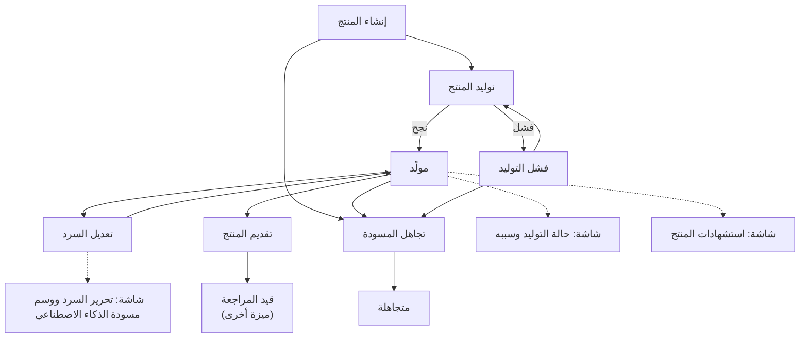
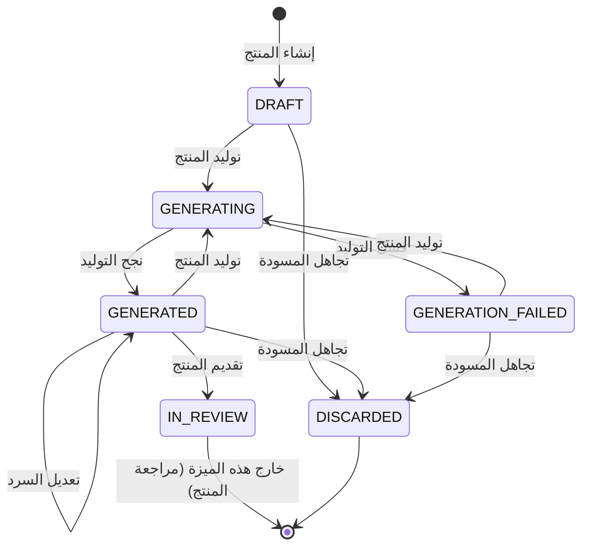

# إعداد التقارير والإحاطات

<!-- BEGIN GENERATED: doc -->
| البند | القيمة |
|---|---|
| المعرّف | FEAT-COM-PRODUCT-AUTHORING |
| الإصدار | 0.2 |
| الحالة | مسودة |
| القدرة | CAP-10 الاتصال والمنتجات |
| القدرة الفرعية | CAP-10.02 التقارير والإحاطات ومنتجات الخرائط (R2) |
| الأدوار | المحلل؛ المخطِّط؛ النظام |
| الشاشات | SCR-43 المنتجات والتوزيع |
| حالات الاستخدام | UC-110 |
| القصص | 12: 7 من المواصفة، و5 جديدة |
<!-- END GENERATED: doc -->

## 1. نظرة عامة

### 1.1 القيمة

يولد المحلل أو المخطط تقريرًا أو إحاطة أو خريطة من قالب ببياناته وأدلته، ويحرر نصه ثم يقدمه للمراجعة.

### 1.2 النطاق

| البند | القيمة |
|---|---|
| المستخدمون | المحلل والمخطِّط، بصفتهما مؤلفي المنتج؛ والنظام لتنفيذ التوليد غير المتزامن |
| الشاشات | SCR-43 المنتجات والتوزيع |
| حالات الاستخدام | توليد منتج من قالب نشط (UC-110)؛ الجزء الأول من مراجعة المنتج واعتماده (UC-111)، وهو تقديمه، قبل أن تتولى ميزة المراجعة بقيتها |
| المتطلبات | إنتاج التقارير والإحاطات ومنتجات الخرائط من قوالب مُصدَرة بأقسام وبيانات وأدلة واستشهادات (REQ-PRD-001)؛ ضبط تصنيف المنتج وفق أعلى تصنيف بين محتواه، وإخفاء ما يتجاوزه (REQ-PRD-002)؛ وسم مسودات الذكاء الاصطناعي ومنع تقديم المنتج قبل مراجعتها (REQ-AI-005) |
| خارج النطاق | مراجعة المنتج واعتماده وإعادته وسحبه (ميزة مراجعة المنتجات)؛ توزيعه على المستلمين (ميزة التوزيع)؛ تصفح المكتبة وتنزيل النسخ المعتمدة (ميزة مكتبة المنتجات)؛ إدارة قوالب المنتج نفسها (ميزة قوالب المنتجات) |

### 1.3 خريطة الميزة

**الشكل 1: مسار إعداد المنتج من الإنشاء إلى التقديم**



**الشكل 2: رحلة حالات المنتج داخل هذه الميزة**



## 2. القواعد المشتركة

تنطبق على كل قصص الميزة، فلا تتكرر داخل القصص. وكل قصة تذكر ما يخصها فقط.

### 2.1 السياق المشترك

كل قصة تبدأ من ثلاثة شروط: مستأجر نشط، وحزمة السياسات الأساسية مفعّلة، ومستخدم مسجّل الدخول ومخوَّل. وتشير إليها القصص بخطوة واحدة: «بفرض السياق المشترك للميزة».

### 2.2 الصلاحية وعدم الإفصاح

- من لا يحق له رؤية العنصر يتلقى ردًا بشكل «غير متاح» تمامًا، فلا يعرف أنه موجود.
- من يرى العنصر ولا يحق له الإجراء يتلقى «لا تملك صلاحية هذا الإجراء».

### 2.3 أوامر تغيير الحالة

- **منع التكرار:** يُرسل كل أمر بمفتاح فريد، فإعادة الطلب نفسه لا تُنفَّذ مرتين.
- **حماية التعديل المتزامن:** يُرسل كل أمر بإصدار البيانات الذي يراه المستخدم. فإن عدّلها غيره في الأثناء، يُرفض الأمر.
- **السجل:** إن نجح الأمر، يُكتب حدثه وسجل التدقيق في المعاملة نفسها.

### 2.4 الرفض المشترك

```gherkin
# language: ar
خاصية: الرفض المشترك لأوامر الميزة

  سيناريو مخطط: رفض مشترك لكل أمر في الميزة
    بفرض السياق المشترك للميزة
    و <الحالة>
    عندما يُرسل المستخدم أي أمر من أوامر الميزة
    اذاً يُرفض برمز <الرمز> ويرى "<الرسالة>"
    و لا يتغير شيء

    امثلة:
      | الحالة                                  | الرمز                  | الرسالة                                                 |
      | العنصر خارج صلاحياته                    | NOT_FOUND              | غير متاح                                                |
      | العنصر مرئي له ولا يحق له الإجراء       | AUTHZ_DENIED           | لا تملك صلاحية هذا الإجراء                              |
      | غيره عدّل العنصر بعد أن فتحه            | VERSION_CONFLICT       | تغيّرت البيانات منذ فتحتها. راجع التغييرات ثم أعد المحاولة |
      | أعاد مفتاح منع التكرار بمحتوى مختلف     | IDEMPOTENCY_KEY_REUSED | طلب مكرر بمحتوى مختلف                                   |
      | البيانات ناقصة أو غير صحيحة             | VALIDATION_FAILED      | بعض البيانات ناقصة أو غير صحيحة. راجع الحقول المعلَّمة      |

  سيناريو: إعادة الطلب نفسه لا تُنفَّذ مرتين
    بفرض السياق المشترك للميزة
    و أمر نجح بمفتاح منع تكرار
    عندما يُعاد الطلب نفسه بالمفتاح نفسه
    اذاً تُعاد النتيجة الأولى ولا يُكتب حدث ثانٍ
```

## 3. الجودة وتعريف الاكتمال

### 3.1 متطلبات الجودة

<!-- BEGIN GENERATED: quality -->
| المرجع | الموقف | المطلوب |
|---|---|---|
| QAS-PRD-001 | generate a 30-page product with 10 maps | ≤ 2 min (async job) |
| QAS-PRD-002 | product rendered for an audience | 0 content above the product label (inference suite on products) |
<!-- END GENERATED: quality -->

### 3.2 تعريف الاكتمال

القصة مكتملة حين تتحقق الشروط الخمسة:

1. سيناريوهاتها والقواعد المشتركة تمر في الاختبار الآلي.
2. فحوص البنية المعمارية تمر.
3. نصوص الواجهة والرسائل موجودة بالعربية والإنجليزية.
4. مراجعة الكود مكتملة.
5. ما تضيفه القصة نفسها في قسم «القواعد» تحقق.

## 4. فهرس القصص

<!-- BEGIN GENERATED: story-index -->
| المعرّف | القصة | النوع | الحالة |
|---|---|---|---|
| `US-BC06-PRD-CREATE` | إنشاء المنتج | أمر | مسودة |
| `US-BC06-PRD-DISCARD` | تجاهل مسودة المنتج | أمر | مسودة |
| `US-BC06-PRD-EDIT-NARRATIVE` | تعديل سرد المنتج | أمر | مسودة |
| `US-BC06-PRD-GENERATE` | توليد المنتج | أمر | مسودة |
| `US-BC06-PRD-SUBMIT` | تقديم المنتج | أمر | مسودة |
| `US-BC06-S-PRODUCT-01` | نجاح توليد المنتج | نظام | مسودة |
| `US-BC06-S-PRODUCT-02` | فشل توليد المنتج | نظام | مسودة |
| `US-UI-SCR43-CITATIONS` | كل عنصر في المنتج يقود إلى مصدره | واجهة | مسودة |
| `US-UI-SCR43-GENERATION-STATUS` | تقدم توليد المنتج وسبب فشله | واجهة | مسودة |
| `US-UI-SCR43-NARRATIVE-EDIT` | تحرير السرد فقط ووسم مسودة الذكاء الاصطناعي | واجهة | مسودة |
| `US-PLT-PRD-LABEL-SUITE` | اختبار عدم تجاوز محتوى المنتج تصنيفه | منصة | مسودة |
| `US-PLT-PRD-RENDER` | توليد منتج ثلاثين صفحة خلال دقيقتين | منصة | مسودة |
<!-- END GENERATED: story-index -->

## 5. القصص

### 5.1 US-BC06-PRD-CREATE — إنشاء المنتج

| النوع | الإصدار | الأولوية | دون اتصال | الحالة |
|---|---|---|---|---|
| أمر | R2 | Must | لا | مسودة |

> **كـ** المحلل أو المخطِّط، **أريد** إنشاء مسودة منتج من قالب نشط بمعاملات ومعطيات محددة، **حتى** أبدأ إعداد التقرير أو الإحاطة أو الخريطة بدل كتابته من الصفر.

**باختصار:** يختار المؤلف قالبًا نشطًا ومعاملاته وجمهوره وتصنيف الهدف، فيُنشأ منتج جديد في حالة «مسودة».

#### القواعد

- **متى يُسمح:** القالب نشط بإصدار محدد، والمعاملات صحيحة، والجمهور محدد بوحدات تنظيمية أو أدوار، وتصنيف الهدف لا يقل عن تصنيف أي عنصر في نطاق المعاملات. وإن كان المنتج تنقيحًا لمنتج سابق فيجب أن يكون ذلك المنتج معتمدًا.
- **من يُسمح له:** المحلل أو المخطِّط.
- **البيانات:** القالب، المعاملات، الجمهور، العنوان، تصنيف الهدف، ومرجع المنتج المُنقَّح إن وُجد.
- **الأثر:** تصبح حالة المنتج «مسودة»، ويُسجَّل حدث «أُنشئ المنتج».

#### معايير القبول

```gherkin
# language: ar
خاصية: إنشاء المنتج

  سيناريو: إنشاء مسودة منتج من قالب نشط
    بفرض السياق المشترك للميزة
    و قالب نشط بمعاملات صحيحة وجمهور محدد وتصنيف هدف يغطي عناصر نطاقه
    عندما يُنشئ المحلل منتجًا من القالب
    اذاً تصبح حالة المنتج "مسودة"
    و يُسجَّل حدث "أُنشئ المنتج"

  سيناريو مخطط: رفض خاص بإنشاء المنتج
    بفرض السياق المشترك للميزة
    و <الحالة>
    عندما يحاول إنشاء المنتج
    اذاً يُرفض برمز <الرمز> ويرى <الرسالة>
    و لا يتغير شيء

    امثلة:
      | الحالة                                                                              | الرمز              | الرسالة                     |
      | القالب غير نشط، أو الجمهور غير محدد، أو تصنيف الهدف أقل من تصنيف عناصر نطاقه، أو المنتج المنقَّح ليس معتمدًا | PRODUCT_INVALID    | بيانات المنتج غير صحيحة     |
      | العنوان غير مكتوب                                                                   | VALIDATION_FAILED  | العنوان مطلوب               |
```

<details><summary>المراجع التقنية والتتبع</summary>

<!-- BEGIN GENERATED: refs US-BC06-PRD-CREATE -->
| البند | المعرّف | المعنى |
|---|---|---|
| الواجهة البرمجية | `POST /api/v1/knowledge/products` | — |
| الأمر | `CMD-PRD-CREATE` | إنشاء المنتج |
| السياسة | `POL-PRD-CREATE` | Analyst / Planner (create, generate, edit, submit, discard) · reviewer (return, approve) · Manager (withdraw)… |
| الحدث | `EVT-PRD-CREATED` | يصل إلى: Distribution; Search projection (SLC-05); Notification (reviewers) |
| الكيان | `AGG-PRODUCT` | المنتج |
| الجدول | `knowledge.products` | الجدول الرئيسي للمنتج |
| وحدة النشر | DU-15 | — |
| المتطلبات | REQ-PRD-001، REQ-PRD-002، REQ-PRD-003 | معانيها في القسم 6. التتبع |
| حالة الاستخدام | UC-110 | Generate Product from Template |
| الاختبار | TST-PRODUCT-SM، TST-SLC12-INVARIANTS | دورة حالات المنتج، وثوابت الشريحة SLC-12 |
<!-- END GENERATED: refs US-BC06-PRD-CREATE -->

</details>

### 5.2 US-BC06-PRD-DISCARD — تجاهل مسودة المنتج

| النوع | الإصدار | الأولوية | دون اتصال | الحالة |
|---|---|---|---|---|
| أمر | R2 | Must | لا | مسودة |

> **كـ** المحلل أو المخطِّط مؤلف المنتج، **أريد** تجاهل مسودة منتج لم تعد مطلوبة، **حتى** لا تبقى مسودات متراكمة بلا غاية.

**باختصار:** يتجاهل المؤلف منتجًا في مسودة أو مولَّدًا أو فشل توليده بذكر سبب، فيصير «متجاهلًا» نهائيًا.

#### القواعد

- **متى يُسمح:** المنتج في حالة «مسودة» أو «مولَّد» أو «فشل التوليد»، وذُكر سبب التجاهل.
- **من يُسمح له:** مؤلف المنتج.
- **البيانات:** سبب التجاهل (إلزامي).
- **الأثر:** تصبح حالة المنتج «متجاهلة»، وهي حالة نهائية، ويُسجَّل حدث «تُجوهلت مسودة المنتج».

#### معايير القبول

```gherkin
# language: ar
خاصية: تجاهل مسودة المنتج

  سيناريو: تجاهل مسودة لم تعد مطلوبة
    بفرض السياق المشترك للميزة
    و منتج في حالة "مسودة" يملكه المستخدم
    عندما يتجاهل المؤلف المسودة بسبب
    اذاً تصبح حالة المنتج "متجاهلة"
    و يُسجَّل حدث "تُجوهلت مسودة المنتج"

  سيناريو مخطط: رفض خاص بتجاهل المنتج
    بفرض السياق المشترك للميزة
    و <الحالة>
    عندما يحاول تجاهل المنتج
    اذاً يُرفض برمز <الرمز> ويرى <الرسالة>
    و لا يتغير شيء

    امثلة:
      | الحالة                                                        | الرمز                         | الرسالة                              |
      | المنتج ليس في "مسودة" أو "مولَّد" أو "فشل التوليد"           | PRODUCT_INVALID_STATE_TRANSITION | الوضع الحالي للمنتج لا يسمح بهذا الإجراء |
      | لم يُذكر سبب التجاهل                                          | REASON_REQUIRED               | اذكر السبب                           |
      | السبب غير مكتوب                                               | VALIDATION_FAILED             | السبب مطلوب                          |
```

<details><summary>المراجع التقنية والتتبع</summary>

<!-- BEGIN GENERATED: refs US-BC06-PRD-DISCARD -->
| البند | المعرّف | المعنى |
|---|---|---|
| الواجهة البرمجية | `POST /api/v1/knowledge/products/{id}/actions/discard` | — |
| الأمر | `CMD-PRD-DISCARD` | تجاهل مسودة المنتج |
| السياسة | `POL-PRD-DISCARD` | Analyst / Planner (create, generate, edit, submit, discard) · reviewer (return, approve) · Manager (withdraw)… |
| الحدث | `EVT-PRD-DISCARDED` | يصل إلى: Distribution; Search projection (SLC-05); Notification (reviewers) |
| الكيان | `AGG-PRODUCT` | المنتج |
| الجدول | `knowledge.products` | الجدول الرئيسي للمنتج |
| وحدة النشر | DU-15 | — |
| المتطلبات | REQ-PRD-001، REQ-PRD-002، REQ-PRD-003 | معانيها في القسم 6. التتبع |
| حالة الاستخدام | UC-110 | Generate Product from Template |
| الاختبار | TST-PRODUCT-SM، TST-SLC12-INVARIANTS | دورة حالات المنتج، وثوابت الشريحة SLC-12 |
<!-- END GENERATED: refs US-BC06-PRD-DISCARD -->

</details>

### 5.3 US-BC06-PRD-EDIT-NARRATIVE — تعديل سرد المنتج

| النوع | الإصدار | الأولوية | دون اتصال | الحالة |
|---|---|---|---|---|
| أمر | R2 | Must | لا | مسودة |

> **كـ** المحلل أو المخطِّط مؤلف المنتج، **أريد** تعديل نص قسم سردي في منتج مولَّد، **حتى** أُحسّن صياغته قبل تقديمه دون إعادة توليد المنتج كله.

**باختصار:** يعدّل المؤلف نص قسم سردي في منتج «مولَّد»، فيبقى في حالته ويزداد إصداره واحدًا. أقسام البيانات لا تتغير إلا بإعادة التوليد.

#### القواعد

- **متى يُسمح:** المنتج في حالة «مولَّد»، والتعديل على قسم سردي لا قسم بيانات.
- **من يُسمح له:** مؤلف المنتج.
- **البيانات:** معرّف القسم، والنص الجديد.
- **الأثر:** تبقى حالة المنتج «مولَّد» ويزداد إصداره واحدًا، ويُسجَّل حدث «عُدِّل سرد المنتج».

#### معايير القبول

```gherkin
# language: ar
خاصية: تعديل سرد المنتج

  سيناريو: تعديل قسم سردي في منتج مولَّد
    بفرض السياق المشترك للميزة
    و منتج في حالة "مولَّد" فيه قسم سردي
    عندما يعدّل المؤلف نص القسم السردي
    اذاً تبقى حالة المنتج "مولَّد" ويزداد إصداره واحدًا
    و يُسجَّل حدث "عُدِّل سرد المنتج"

  سيناريو مخطط: رفض خاص بتعديل السرد
    بفرض السياق المشترك للميزة
    و <الحالة>
    عندما يحاول تعديل القسم
    اذاً يُرفض برمز <الرمز> ويرى <الرسالة>
    و لا يتغير شيء

    امثلة:
      | الحالة                                       | الرمز                         | الرسالة                                |
      | القسم المطلوب تعديله قسم بيانات لا سردي      | SECTION_NOT_EDITABLE          | هذا القسم يُحدَّث بإعادة التوليد فقط   |
      | المنتج ليس في حالة "مولَّد"                  | PRODUCT_INVALID_STATE_TRANSITION | الوضع الحالي للمنتج لا يسمح بهذا الإجراء |
      | النص غير مكتوب                               | VALIDATION_FAILED             | النص مطلوب                             |
```

<details><summary>المراجع التقنية والتتبع</summary>

<!-- BEGIN GENERATED: refs US-BC06-PRD-EDIT-NARRATIVE -->
| البند | المعرّف | المعنى |
|---|---|---|
| الواجهة البرمجية | `POST /api/v1/knowledge/products/{id}/actions/edit-narrative` | — |
| الأمر | `CMD-PRD-EDIT-NARRATIVE` | تعديل سرد المنتج |
| السياسة | `POL-PRD-EDIT-NARRATIVE` | Analyst / Planner (create, generate, edit, submit, discard) · reviewer (return, approve) · Manager (withdraw)… |
| الحدث | `EVT-PRD-NARRATIVE-EDITED` | يصل إلى: Distribution; Search projection (SLC-05); Notification (reviewers) |
| الكيان | `AGG-PRODUCT` | المنتج |
| الجدول | `knowledge.products` | الجدول الرئيسي للمنتج |
| وحدة النشر | DU-15 | — |
| المتطلبات | REQ-PRD-001، REQ-PRD-002، REQ-PRD-003 | معانيها في القسم 6. التتبع |
| حالة الاستخدام | UC-110 | Generate Product from Template |
| الاختبار | TST-PRODUCT-SM، TST-SLC12-INVARIANTS | دورة حالات المنتج، وثوابت الشريحة SLC-12 |
<!-- END GENERATED: refs US-BC06-PRD-EDIT-NARRATIVE -->

</details>

### 5.4 US-BC06-PRD-GENERATE — توليد المنتج

| النوع | الإصدار | الأولوية | دون اتصال | الحالة |
|---|---|---|---|---|
| أمر | R2 | Must | لا | مسودة |

> **كـ** المحلل أو المخطِّط مؤلف المنتج، **أريد** توليد محتوى المنتج من القالب وبياناته، **حتى** يُبنى التقرير أو الإحاطة أو الخريطة تلقائيًا بدل كتابة كل قسم يدويًا.

**باختصار:** يطلب المؤلف توليد منتج في مسودة أو مولَّد أو فشل توليده، فتبدأ مهمة توليد غير متزامنة بصلاحياته.

#### القواعد

- **متى يُسمح:** المنتج في حالة «مسودة» أو «مولَّد» أو «فشل التوليد».
- **من يُسمح له:** مؤلف المنتج.
- **الأثر:** تصبح حالة المنتج «قيد التوليد»، وتبدأ مهمة توليد غير متزامنة بصلاحيات المؤلف، ويُسجَّل حدث «بدأ توليد المنتج».

#### معايير القبول

```gherkin
# language: ar
خاصية: توليد المنتج

  سيناريو: بدء توليد منتج في مسودة
    بفرض السياق المشترك للميزة
    و منتج في حالة "مسودة" يملكه المستخدم
    عندما يطلب المؤلف توليد المنتج
    اذاً تصبح حالته "قيد التوليد"
    و يُسجَّل حدث "بدأ توليد المنتج"

  سيناريو مخطط: رفض خاص بتوليد المنتج
    بفرض السياق المشترك للميزة
    و <الحالة>
    عندما يحاول توليد المنتج
    اذاً يُرفض برمز <الرمز> ويرى <الرسالة>
    و لا يتغير شيء

    امثلة:
      | الحالة                                                          | الرمز                         | الرسالة                                |
      | المنتج ليس في "مسودة" أو "مولَّد" أو "فشل التوليد" (مثلًا قيد المراجعة) | PRODUCT_INVALID_STATE_TRANSITION | الوضع الحالي للمنتج لا يسمح بهذا الإجراء |
```

<details><summary>المراجع التقنية والتتبع</summary>

<!-- BEGIN GENERATED: refs US-BC06-PRD-GENERATE -->
| البند | المعرّف | المعنى |
|---|---|---|
| الواجهة البرمجية | `POST /api/v1/knowledge/products/{id}/actions/generate` | — |
| الأمر | `CMD-PRD-GENERATE` | توليد المنتج |
| السياسة | `POL-PRD-GENERATE` | Analyst / Planner (create, generate, edit, submit, discard) · reviewer (return, approve) · Manager (withdraw)… |
| الحدث | `EVT-PRD-GENERATION-STARTED` | يصل إلى: Distribution; Search projection (SLC-05); Notification (reviewers) |
| الكيان | `AGG-PRODUCT` | المنتج |
| الجدول | `knowledge.products` | الجدول الرئيسي للمنتج |
| وحدة النشر | DU-15 | — |
| المتطلبات | REQ-PRD-001، REQ-PRD-002، REQ-PRD-003 | معانيها في القسم 6. التتبع |
| حالة الاستخدام | UC-110 | Generate Product from Template |
| الاختبار | TST-PRODUCT-SM، TST-SLC12-INVARIANTS | دورة حالات المنتج، وثوابت الشريحة SLC-12 |
<!-- END GENERATED: refs US-BC06-PRD-GENERATE -->

</details>

### 5.5 US-BC06-PRD-SUBMIT — تقديم المنتج

| النوع | الإصدار | الأولوية | دون اتصال | الحالة |
|---|---|---|---|---|
| أمر | R2 | Must | لا | مسودة |

> **كـ** المحلل أو المخطِّط مؤلف المنتج، **أريد** تقديم المنتج المولَّد للمراجعة، **حتى** يعتمده المراجع قبل أن يُوزَّع.

**باختصار:** يقدّم المؤلف منتجًا «مولَّدًا» تحققت فيه كل أقسامه الإلزامية وروجعت مسودات الذكاء الاصطناعي فيه، فيصير «قيد المراجعة».

#### القواعد

- **متى يُسمح:** المنتج في حالة «مولَّد»، وكل أقسامه الإلزامية موجودة، وكل قسم سردي صاغه المساعد الذكي روجع قبل التقديم (القصة 5.10).
- **من يُسمح له:** مؤلف المنتج.
- **الأثر:** تصبح حالة المنتج «قيد المراجعة»، ويُسجَّل حدث «قُدِّم المنتج»، ويصل إلى المراجع عبر الإشعار.

#### معايير القبول

```gherkin
# language: ar
خاصية: تقديم المنتج

  سيناريو: تقديم منتج مكتمل الأقسام
    بفرض السياق المشترك للميزة
    و منتج في حالة "مولَّد" كل أقسامه الإلزامية موجودة وروجعت مسودات الذكاء الاصطناعي فيه
    عندما يقدّم المؤلف المنتج
    اذاً تصبح حالته "قيد المراجعة"
    و يُسجَّل حدث "قُدِّم المنتج"

  سيناريو مخطط: رفض خاص بتقديم المنتج
    بفرض السياق المشترك للميزة
    و <الحالة>
    عندما يحاول تقديم المنتج
    اذاً يُرفض برمز <الرمز> ويرى <الرسالة>
    و لا يتغير شيء

    امثلة:
      | الحالة                                                            | الرمز                         | الرسالة                                                     |
      | المنتج ينقصه قسم إلزامي، أو فيه قسم ذكاء اصطناعي لم يُراجع       | PRODUCT_INCOMPLETE            | المنتج غير مكتمل: أقسام ناقصة أو مقاطع من المساعد الذكي لم تُراجع |
      | المنتج ليس في حالة "مولَّد"                                      | PRODUCT_INVALID_STATE_TRANSITION | الوضع الحالي للمنتج لا يسمح بهذا الإجراء                    |
```

<details><summary>المراجع التقنية والتتبع</summary>

<!-- BEGIN GENERATED: refs US-BC06-PRD-SUBMIT -->
| البند | المعرّف | المعنى |
|---|---|---|
| الواجهة البرمجية | `POST /api/v1/knowledge/products/{id}/actions/submit` | — |
| الأمر | `CMD-PRD-SUBMIT` | تقديم المنتج |
| السياسة | `POL-PRD-SUBMIT` | Analyst / Planner (create, generate, edit, submit, discard) · reviewer (return, approve) · Manager (withdraw)… |
| الحدث | `EVT-PRD-SUBMITTED` | يصل إلى: Distribution; Search projection (SLC-05); Notification (reviewers) |
| الكيان | `AGG-PRODUCT` | المنتج |
| الجدول | `knowledge.products` | الجدول الرئيسي للمنتج |
| وحدة النشر | DU-15 | — |
| المتطلبات | REQ-PRD-001، REQ-PRD-002، REQ-PRD-003 | معانيها في القسم 6. التتبع |
| حالة الاستخدام | UC-110 | Generate Product from Template |
| الاختبار | TST-PRODUCT-SM، TST-SLC12-INVARIANTS | دورة حالات المنتج، وثوابت الشريحة SLC-12 |
<!-- END GENERATED: refs US-BC06-PRD-SUBMIT -->

</details>

### 5.6 US-BC06-S-PRODUCT-01 — نجاح توليد المنتج

| النوع | الإصدار | الأولوية | دون اتصال | الحالة |
|---|---|---|---|---|
| نظام | R2 | Must | لا ينطبق | مسودة |

> **كـ** النظام، **أريد** نقل المنتج إلى «مولَّد» حين تنجح مهمة توليده، **حتى** يتمكن المؤلف من مراجعة محتواه وتعديل سرده قبل تقديمه.

**باختصار:** عند نجاح مهمة التوليد، تُربط كل عناصر البيانات بلحظة التوليد، ويُستبعد أي محتوى تصنيفه أعلى من تصنيف المنتج دون أي إشارة إلى استبعاده، وتُحسب بصمة تجزئة لكل نسخة مُخرَجة.

#### القواعد

- **متى يحدث:** عند انتهاء مهمة التوليد غير المتزامنة بنجاح.
- **الأثر:** تصبح حالة المنتج «مولَّد»، وتُثبَّت الاستشهادات بلحظة التوليد، ويُستبعد المحتوى الذي يتجاوز تصنيف المنتج دون عدّ أو إشارة إليه، ويُسجَّل حدث «تولَّد المنتج» وسجل تدقيق بهوية النظام.

#### معايير القبول

```gherkin
# language: ar
خاصية: نجاح توليد المنتج

  سيناريو: اكتمال التوليد بنجاح
    بفرض منتج في حالة "قيد التوليد"
    عندما تنجح مهمة التوليد
    اذاً تصبح حالته "مولَّد"
    و يُسجَّل حدث "تولَّد المنتج" وسجل تدقيق بهوية النظام

  سيناريو: لا شيء يحدث لمنتج ليس قيد التوليد
    بفرض منتج ليس في حالة "قيد التوليد"
    عندما يُفحص ناتج مهمة توليد سابقة
    اذاً تبقى حالته كما هي
    و لا يُسجَّل أي حدث
```

<details><summary>المراجع التقنية والتتبع</summary>

<!-- BEGIN GENERATED: refs US-BC06-S-PRODUCT-01 -->
| البند | المعرّف | المعنى |
|---|---|---|
| المحفِّز | `SYS:generation succeeded` | every binding executed as known_at = generation time; content items with label > product label excluded; rend… |
| الانتقال | GENERATING ← GENERATED | — |
| الحدث | `EVT-PRD-GENERATED` | يصل إلى: Distribution; Search projection (SLC-05); Notification (reviewers) |
| الكيان | `AGG-PRODUCT` | المنتج |
| الجدول | `knowledge.products` | الجدول الرئيسي للمنتج |
| وحدة النشر | DU-15 | — |
| المتطلبات | REQ-PRD-001، REQ-PRD-002، REQ-PRD-003 | معانيها في القسم 6. التتبع |
| حالة الاستخدام | UC-110 | Generate Product from Template |
| الاختبار | TST-PRODUCT-SM، TST-SLC12-INVARIANTS | دورة حالات المنتج، وثوابت الشريحة SLC-12 |
<!-- END GENERATED: refs US-BC06-S-PRODUCT-01 -->

</details>

### 5.7 US-BC06-S-PRODUCT-02 — فشل توليد المنتج

| النوع | الإصدار | الأولوية | دون اتصال | الحالة |
|---|---|---|---|---|
| نظام | R2 | Must | لا ينطبق | مسودة |

> **كـ** النظام، **أريد** نقل المنتج إلى «فشل التوليد» حين تفشل مهمة توليده، **حتى** يعرف المؤلف أن التوليد لم يكتمل ويمكنه إعادة المحاولة.

**باختصار:** عند فشل مهمة التوليد، يُسجَّل سبب الفشل، وتنتقل حالة المنتج إلى «فشل التوليد»، فيتمكن المؤلف من إعادة طلب التوليد.

#### القواعد

- **متى يحدث:** عند انتهاء مهمة التوليد غير المتزامنة بفشل.
- **الأثر:** تصبح حالة المنتج «فشل التوليد»، ويُسجَّل سبب الفشل، ويُسجَّل حدث «فشل توليد المنتج» وسجل تدقيق بهوية النظام.

#### معايير القبول

```gherkin
# language: ar
خاصية: فشل توليد المنتج

  سيناريو: فشل مهمة التوليد
    بفرض منتج في حالة "قيد التوليد"
    عندما تفشل مهمة التوليد
    اذاً تصبح حالته "فشل التوليد"
    و يُسجَّل سبب الفشل، وحدث "فشل توليد المنتج" وسجل تدقيق بهوية النظام

  سيناريو: لا شيء يحدث لمنتج ليس قيد التوليد
    بفرض منتج ليس في حالة "قيد التوليد"
    عندما يُفحص ناتج مهمة توليد سابقة
    اذاً تبقى حالته كما هي
    و لا يُسجَّل أي حدث
```

<details><summary>المراجع التقنية والتتبع</summary>

<!-- BEGIN GENERATED: refs US-BC06-S-PRODUCT-02 -->
| البند | المعرّف | المعنى |
|---|---|---|
| المحفِّز | `SYS:generation failed` | error recorded |
| الانتقال | GENERATING ← GENERATION_FAILED | — |
| الحدث | `EVT-PRD-GENERATION-FAILED` | يصل إلى: Distribution; Search projection (SLC-05); Notification (reviewers) |
| الكيان | `AGG-PRODUCT` | المنتج |
| الجدول | `knowledge.products` | الجدول الرئيسي للمنتج |
| وحدة النشر | DU-15 | — |
| المتطلبات | REQ-PRD-001، REQ-PRD-002، REQ-PRD-003 | معانيها في القسم 6. التتبع |
| حالة الاستخدام | UC-110 | Generate Product from Template |
| الاختبار | TST-PRODUCT-SM، TST-SLC12-INVARIANTS | دورة حالات المنتج، وثوابت الشريحة SLC-12 |
<!-- END GENERATED: refs US-BC06-S-PRODUCT-02 -->

</details>

### 5.8 US-UI-SCR43-CITATIONS — كل عنصر في المنتج يقود إلى مصدره

| النوع | الإصدار | الأولوية | دون اتصال | الحالة |
|---|---|---|---|---|
| واجهة | R2 | Must | لا | مسودة |

> **كـ** المستخدم، **أريد** أن أفتح مصدر أي عنصر بيانات في المنتج من شاشة المنتج نفسها، **حتى** أتحقق من أصل المعلومة دون مغادرته.

**باختصار:** كل عنصر بيانات في المنتج المولَّد يحمل استشهادًا مثبَّتًا يقود إلى الكائن المصدر بإصداره وقت التوليد، ودون أي إشارة إلى ما استُبعد لتجاوزه التصنيف.

#### القواعد

**[Derived]** لا تصف المواصفة شكل شاشة المنتج، واستُنتج سلوك الاستشهاد من ثابتي المنتج اللذين يحصران تصنيف الاستشهاد ولحظة توليده، ومن القاعدة أن العناصر المستبعدة لا تُعرض ولا يُشار إليها.

#### معايير القبول

```gherkin
# language: ar
خاصية: الاستشهادات في المنتج

  سيناريو: فتح مصدر عنصر بيانات
    بفرض السياق المشترك للميزة
    و منتج مولَّد فيه عنصر بيانات باستشهاد مثبَّت
    عندما يفتح المستخدم استشهاد العنصر
    اذاً يُعرض الكائن المصدر بالإصدار الذي أُخذ منه وقت التوليد

  سيناريو: عنصر مستبعد لتجاوز تصنيف المنتج لا يظهر له استشهاد
    بفرض السياق المشترك للميزة
    و منتج فيه عنصر تجاوز تصنيفه تصنيف المنتج فاستُبعد
    عندما يُعرض المنتج
    اذاً لا يظهر العنصر المستبعد ولا أي إشارة إلى استبعاده
```

<details><summary>المراجع التقنية والتتبع</summary>

<!-- BEGIN GENERATED: refs US-UI-SCR43-CITATIONS -->
| البند | المعرّف | المعنى |
|---|---|---|
| الشاشة | SCR-43 | شاشة المنتجات والتوزيع |
| الجودة | QAS-PRD-002 | product rendered for an audience → 0 content above the product label (inference suite on products) |
| المصدر | `[Derived]` | — |
| المتطلب | REQ-PRD-001 | The system shall produce reports, briefings, map products and analytical products from versioned templates wi… |
| حالة الاستخدام | UC-110 | Generate Product from Template |
<!-- END GENERATED: refs US-UI-SCR43-CITATIONS -->

</details>

### 5.9 US-UI-SCR43-GENERATION-STATUS — تقدم توليد المنتج وسبب فشله

| النوع | الإصدار | الأولوية | دون اتصال | الحالة |
|---|---|---|---|---|
| واجهة | R2 | Must | لا | مسودة |

> **كـ** المستخدم مؤلف المنتج، **أريد** أن أرى تقدم توليد المنتج وسبب فشله إن حدث، **حتى** أعرف متى يصبح جاهزًا للمراجعة أو ماذا أصلح.

**باختصار:** تعرض شاشة المنتج حالة التوليد الحالية، وعند الفشل نص السبب المسجَّل مع إمكانية إعادة التوليد.

#### القواعد

**[Derived]** شكل عرض التقدم والسبب غير مذكور في المصادر، واستُنتج من هدف الأداء QAS-PRD-001 (توليد خلال دقيقتين كمهمة غير متزامنة) ومن سبب الفشل الذي تسجّله القصة 5.7 عند فشل التوليد.

#### معايير القبول

```gherkin
# language: ar
خاصية: تقدم توليد المنتج

  سيناريو: متابعة توليد جارٍ
    بفرض السياق المشترك للميزة
    و منتج في حالة "قيد التوليد"
    عندما يفتح المؤلف شاشة المنتج
    اذاً تُعرض حالة "قيد التوليد" دون تمكين أزرار التعديل أو التقديم

  سيناريو: عرض سبب فشل التوليد
    بفرض السياق المشترك للميزة
    و منتج في حالة "فشل التوليد" بسبب مسجَّل
    عندما يفتح المؤلف شاشة المنتج
    اذاً يُعرض سبب الفشل، ويُفعَّل زر إعادة التوليد
```

<details><summary>المراجع التقنية والتتبع</summary>

<!-- BEGIN GENERATED: refs US-UI-SCR43-GENERATION-STATUS -->
| البند | المعرّف | المعنى |
|---|---|---|
| الشاشة | SCR-43 | شاشة المنتجات والتوزيع |
| الجودة | QAS-PRD-001 | generate a 30-page product with 10 maps → ≤ 2 min (async job) |
| المصدر | `[Derived]` | — |
| المتطلب | REQ-PRD-001 | The system shall produce reports, briefings, map products and analytical products from versioned templates wi… |
| حالة الاستخدام | UC-110 | Generate Product from Template |
<!-- END GENERATED: refs US-UI-SCR43-GENERATION-STATUS -->

</details>

### 5.10 US-UI-SCR43-NARRATIVE-EDIT — تحرير السرد فقط ووسم مسودة الذكاء الاصطناعي

| النوع | الإصدار | الأولوية | دون اتصال | الحالة |
|---|---|---|---|---|
| واجهة | R2 | Must | لا | مسودة |

> **كـ** المستخدم مؤلف المنتج، **أريد** أن أحرر الأقسام السردية فقط وأرى وسم «مسودة ذكاء اصطناعي» على ما صاغه المساعد، **حتى** لا أخلط بين نص بشري ونص آلي لم يُراجع بعد.

**باختصار:** تفتح الشاشة للتحرير الأقسام السردية فقط وتقفل أقسام البيانات، وكل قسم سردي صاغه الذكاء الاصطناعي يحمل وسم «مسودة ذكاء اصطناعي» حتى يراجعه المؤلف، ولا يمكن تقديم المنتج (القصة 5.5) قبل ذلك.

#### القواعد

- **متى يحدث:** عند فتح شاشة منتج «مولَّد».
- **الأثر:** الأقسام السردية قابلة للتحرير المباشر، وأقسام البيانات مقفلة ومُشار إليها بأنها تتغير بإعادة التوليد فقط، وكل قسم سردي من المساعد الذكي يحمل وسم «مسودة ذكاء اصطناعي» حتى يراجعه المؤلف (REQ-AI-005).

#### معايير القبول

```gherkin
# language: ar
خاصية: تحرير السرد ووسم مسودة الذكاء الاصطناعي

  سيناريو: فتح قسم سردي للتحرير
    بفرض السياق المشترك للميزة
    و منتج مولَّد فيه قسم سردي
    عندما يفتح المؤلف القسم السردي
    اذاً يصبح قابلًا للتحرير مباشرة

  سيناريو: قسم البيانات مقفل عن التحرير المباشر
    بفرض السياق المشترك للميزة
    و منتج مولَّد فيه قسم مرتبط بالبيانات
    عندما يفتح المؤلف القسم
    اذاً يُعرض مقفلًا مع إشارة إلى أنه يتغير بإعادة التوليد فقط

  سيناريو: وسم مسودة الذكاء الاصطناعي يبقى حتى المراجعة
    بفرض السياق المشترك للميزة
    و قسم سردي صاغه المساعد الذكي ولم يُراجع بعد
    عندما يفتح المؤلف شاشة المنتج
    اذاً يُعرض القسم موسومًا "مسودة ذكاء اصطناعي"
    و لا يمكن تقديم المنتج قبل مراجعته
```

<details><summary>المراجع التقنية والتتبع</summary>

<!-- BEGIN GENERATED: refs US-UI-SCR43-NARRATIVE-EDIT -->
| البند | المعرّف | المعنى |
|---|---|---|
| الشاشة | SCR-43 | شاشة المنتجات والتوزيع |
| المصدر | `products-knowledge-archive-spec.md §1` | — |
| المتطلب | REQ-AI-005 | The system shall label every AI-generated draft as AI output and shall prevent its publication without human… |
| حالات الاستخدام | UC-073، UC-074 | Review AI Result؛ Approve AI-Assisted Result |
<!-- END GENERATED: refs US-UI-SCR43-NARRATIVE-EDIT -->

</details>

### 5.11 US-PLT-PRD-LABEL-SUITE — اختبار عدم تجاوز محتوى المنتج تصنيفه

| النوع | الإصدار | الأولوية | دون اتصال | الحالة |
|---|---|---|---|---|
| منصة | R2 | Must | لا ينطبق | مسودة |

> **كـ** فريق المنصة، **أريد** حزمة اختبار استدلالية تفحص كل منتج مولَّد وتتحقق أن محتواه لا يتجاوز تصنيفه، **حتى** تُضبط القاعدة آليًا عند كل توليد لا بمراجعة يدوية فقط.

**باختصار:** حزمة اختبار تشغّل التوليد على منتجات بتصنيفات مختلفة وتتحقق أن الناتج لا يحتوي أي عنصر أعلى من تصنيف المنتج (0 تجاوزات).

#### معايير القبول

```gherkin
# language: ar
خاصية: اختبار عدم تجاوز محتوى المنتج تصنيفه

  سيناريو: لا تجاوز في مجموعة منتجات الاختبار
    بفرض مجموعة منتجات مولَّدة بتصنيفات مختلفة ومحتوى يشمل عناصر أعلى من بعض تصنيفاتها
    عندما تُشغَّل حزمة اختبار التصنيف
    اذاً لا يظهر في أي منتج عنصر تصنيفه أعلى من تصنيفه

  سيناريو: الحزمة ترصد التجاوز لو حدث
    بفرض عيّنة اختبار فيها منتج يحتوي عنصرًا أعلى من تصنيفه
    عندما تُشغَّل حزمة اختبار التصنيف
    اذاً تفشل الحزمة وتحدد المنتج والعنصر المخالف
```

<details><summary>المراجع التقنية والتتبع</summary>

<!-- BEGIN GENERATED: refs US-PLT-PRD-LABEL-SUITE -->
| البند | المعرّف | المعنى |
|---|---|---|
| الجودة | QAS-PRD-002 | product rendered for an audience → 0 content above the product label (inference suite on products) |
| المتطلب | REQ-PRD-002 | The system shall set a product's label to at least the highest label of its content and shall render only con… |
| حالة الاستخدام | UC-110 | Generate Product from Template |
<!-- END GENERATED: refs US-PLT-PRD-LABEL-SUITE -->

</details>

### 5.12 US-PLT-PRD-RENDER — توليد منتج ثلاثين صفحة خلال دقيقتين

| النوع | الإصدار | الأولوية | دون اتصال | الحالة |
|---|---|---|---|---|
| منصة | R2 | Must | لا ينطبق | مسودة |

> **كـ** فريق المنصة، **أريد** أن تُنفَّذ مهمة توليد المنتج بسعة تكفي توليد 30 صفحة و10 خرائط خلال دقيقتين، **حتى** يحصل المؤلف على نتيجة التوليد في وقت معقول دون حجب الواجهة.

**باختصار:** مهمة التوليد غير متزامنة، وتحت حمل التصميم (30 صفحة، 10 خرائط) يكتمل التوليد خلال دقيقتين على الأكثر.

#### معايير القبول

```gherkin
# language: ar
خاصية: أداء توليد المنتج

  سيناريو: الهدف تحت حمل التصميم
    بفرض حمل بمنتج من 30 صفحة و10 خرائط وبيانات بحجم التصميم
    عندما يُطلب توليد المنتج
    اذاً تكتمل مهمة التوليد خلال دقيقتين أو أقل

  سيناريو: التوليد غير متزامن ولا يحجب الواجهة
    بفرض طلب توليد مرسل
    عندما يبدأ التوليد
    اذاً يستمر المستخدم في استخدام الشاشات الأخرى حتى اكتماله
```

<details><summary>المراجع التقنية والتتبع</summary>

<!-- BEGIN GENERATED: refs US-PLT-PRD-RENDER -->
| البند | المعرّف | المعنى |
|---|---|---|
| الجودة | QAS-PRD-001 | generate a 30-page product with 10 maps → ≤ 2 min (async job) |
| المتطلب | REQ-PRD-001 | The system shall produce reports, briefings, map products and analytical products from versioned templates wi… |
| حالة الاستخدام | UC-110 | Generate Product from Template |
<!-- END GENERATED: refs US-PLT-PRD-RENDER -->

</details>

## 6. التتبع

<!-- BEGIN GENERATED: trace -->
| المتطلب | المعنى | القصص | الاختبار |
|---|---|---|---|
| REQ-AI-005 | The system shall label every AI-generated draft as AI output and shall prevent its publication without human… | `US-UI-SCR43-NARRATIVE-EDIT` | TST-AI-RESULT-SM، TST-SLC10-INVARIANTS |
| REQ-PRD-001 | The system shall produce reports, briefings, map products and analytical products from versioned templates wi… | `US-BC06-PRD-CREATE`، `US-BC06-PRD-DISCARD`، `US-BC06-PRD-EDIT-NARRATIVE`، `US-BC06-PRD-GENERATE`، `US-BC06-PRD-SUBMIT`، `US-BC06-S-PRODUCT-01`، `US-BC06-S-PRODUCT-02`، `US-PLT-PRD-RENDER`، `US-UI-SCR43-CITATIONS`، `US-UI-SCR43-GENERATION-STATUS` | TST-PRODUCT-SM، TST-PRODUCT-TEMPLATE-SM، TST-SLC12-INVARIANTS |
| REQ-PRD-002 | The system shall set a product's label to at least the highest label of its content and shall render only con… | `US-BC06-PRD-CREATE`، `US-BC06-PRD-DISCARD`، `US-BC06-PRD-EDIT-NARRATIVE`، `US-BC06-PRD-GENERATE`، `US-BC06-PRD-SUBMIT`، `US-BC06-S-PRODUCT-01`، `US-BC06-S-PRODUCT-02`، `US-PLT-PRD-LABEL-SUITE` | TST-PRODUCT-SM، TST-SLC12-INVARIANTS |
| REQ-PRD-003 | When a product is approved, the system shall freeze its content as an immutable version with its citations pi… | كل قصص الميزة المأخوذة من المواصفة (7) | TST-PRODUCT-SM، TST-SLC12-INVARIANTS |
<!-- END GENERATED: trace -->

## 7. سجل التغييرات

| الإصدار | التاريخ | التغيير |
|---|---|---|
| 0.1 | — | هيكل مولَّد من خريطة الميزات |
| 0.2 | 2026-10-13 | كتابة القصص كاملة بمعيار القصص |
