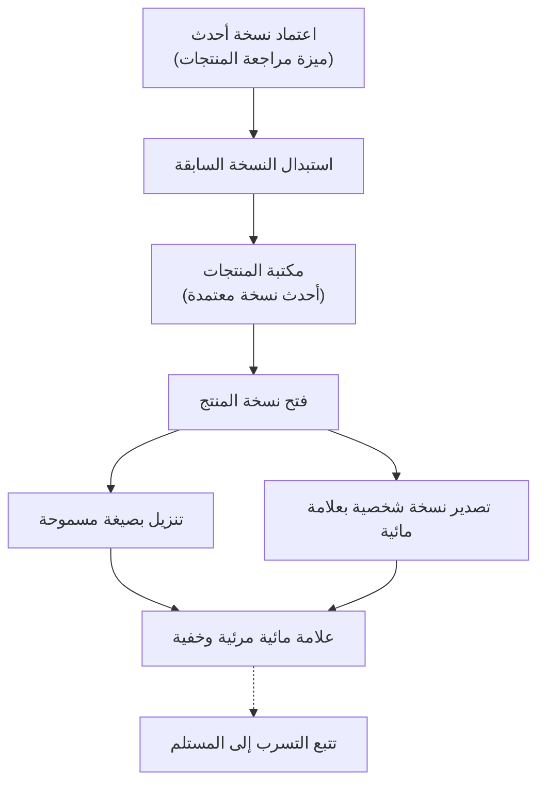

# تصفح المنتجات وتنزيلها

<!-- BEGIN GENERATED: doc -->
| البند | القيمة |
|---|---|
| المعرّف | FEAT-COM-PRODUCT-LIBRARY |
| الإصدار | 0.2 |
| الحالة | مسودة |
| القدرة | CAP-10 الاتصال والمنتجات |
| القدرة الفرعية | CAP-10.02 التقارير والإحاطات ومنتجات الخرائط (R2) |
| الأدوار | أي مستخدم مخوَّل؛ المحلل؛ المدير؛ النظام |
| الشاشات | SCR-43 المنتجات والتوزيع |
| حالات الاستخدام | UC-112 |
| القصص | 8: 3 من المواصفة، و5 جديدة |
<!-- END GENERATED: doc -->

## 1. نظرة عامة

### 1.1 القيمة

يجد المستخدم المخوّل المنتجات المعتمدة وأحدث نسخها وينزلها بصيغة PDF أو مستند بعلامة مائية باسمه.

### 1.2 النطاق

| البند | القيمة |
|---|---|
| المستخدمون | أي مستخدم مخوَّل ضمن جمهور المنتج وتصريحه؛ والنظام لاستبدال النسخ؛ وفريق المنصة لضمان العلامة المائية؛ وفريق التشغيل أو الأمن لتتبع التسرب |
| الشاشات | SCR-43 المنتجات والتوزيع |
| حالات الاستخدام | الجزء الأخير من مراجعة المنتج واعتماده (UC-111)، وهو ظهور النسخة المعتمدة في المكتبة؛ توزيع أو تصدير المنتج (UC-112) من زاوية من يفتحه وينزله |
| المتطلبات | تجميد نسخة المنتج المعتمدة بمحتوى ثابت واستشهادات مثبَّتة (REQ-PRD-003)؛ تصدير المنتجات المعتمدة بصيغة PDF أو مستند يحمل علامة مائية تعرّف المستلم (REQ-PRD-005)؛ وجزء من إنتاج المنتجات من قوالب (REQ-PRD-001) من زاوية عرضها في قائمة |
| خارج النطاق | إنشاء المنتج وتوليده وتحرير سرده وتقديمه (ميزة إعداد التقارير والإحاطات)؛ مراجعته واعتماده وإعادته وسحبه (ميزة مراجعة المنتجات)؛ توزيعه الرسمي على مستلمين محددين وسجل التسليم الكامل (ميزة التوزيع) |

### 1.3 خريطة الميزة

**الشكل 1: من مكتبة المنتجات إلى النسخة المصدَّرة**



## 2. القواعد المشتركة

تنطبق على كل قصص الميزة، فلا تتكرر داخل القصص. وكل قصة تذكر ما يخصها فقط.

### 2.1 السياق المشترك

كل قصة تبدأ من ثلاثة شروط: مستأجر نشط، وحزمة السياسات الأساسية مفعّلة، ومستخدم مسجّل الدخول ومخوَّل. وتشير إليها القصص بخطوة واحدة: «بفرض السياق المشترك للميزة».

### 2.2 الصلاحية وعدم الإفصاح

- من لا يحق له رؤية العنصر يتلقى ردًا بشكل «غير متاح» تمامًا، فلا يعرف أنه موجود.
- من يرى العنصر ولا يحق له الإجراء يتلقى «لا تملك صلاحية هذا الإجراء».

### 2.3 أوامر تغيير الحالة

- **منع التكرار:** يُرسل كل أمر بمفتاح فريد، فإعادة الطلب نفسه لا تُنفَّذ مرتين.
- **حماية التعديل المتزامن:** يُرسل كل أمر بإصدار البيانات الذي يراه المستخدم. فإن عدّلها غيره في الأثناء، يُرفض الأمر.
- **السجل:** إن نجح الأمر، يُكتب حدثه وسجل التدقيق في المعاملة نفسها.

### 2.4 الرفض المشترك

```gherkin
# language: ar
خاصية: الرفض المشترك لأوامر الميزة

  سيناريو مخطط: رفض مشترك لكل أمر في الميزة
    بفرض السياق المشترك للميزة
    و <الحالة>
    عندما يُرسل المستخدم أي أمر من أوامر الميزة
    اذاً يُرفض برمز <الرمز> ويرى "<الرسالة>"
    و لا يتغير شيء

    امثلة:
      | الحالة                                  | الرمز                  | الرسالة                                                 |
      | العنصر خارج صلاحياته                    | NOT_FOUND              | غير متاح                                                |
      | العنصر مرئي له ولا يحق له الإجراء       | AUTHZ_DENIED           | لا تملك صلاحية هذا الإجراء                              |
      | غيره عدّل العنصر بعد أن فتحه            | VERSION_CONFLICT       | تغيّرت البيانات منذ فتحتها. راجع التغييرات ثم أعد المحاولة |
      | أعاد مفتاح منع التكرار بمحتوى مختلف     | IDEMPOTENCY_KEY_REUSED | طلب مكرر بمحتوى مختلف                                   |
      | البيانات ناقصة أو غير صحيحة             | VALIDATION_FAILED      | بعض البيانات ناقصة أو غير صحيحة. راجع الحقول المعلَّمة      |

  سيناريو: إعادة الطلب نفسه لا تُنفَّذ مرتين
    بفرض السياق المشترك للميزة
    و أمر نجح بمفتاح منع تكرار
    عندما يُعاد الطلب نفسه بالمفتاح نفسه
    اذاً تُعاد النتيجة الأولى ولا يُكتب حدث ثانٍ
```

## 3. الجودة وتعريف الاكتمال

### 3.1 متطلبات الجودة

<!-- BEGIN GENERATED: quality -->
لا متطلبات جودة مرتبطة بمتطلبات هذه الميزة مباشرة. تنطبق متطلبات المنصة العامة (`FEAT-PLT-*`).
<!-- END GENERATED: quality -->

### 3.2 تعريف الاكتمال

القصة مكتملة حين تتحقق الشروط الخمسة:

1. سيناريوهاتها والقواعد المشتركة تمر في الاختبار الآلي.
2. فحوص البنية المعمارية تمر.
3. نصوص الواجهة والرسائل موجودة بالعربية والإنجليزية.
4. مراجعة الكود مكتملة.
5. ما تضيفه القصة نفسها في قسم «القواعد» تحقق.

## 4. فهرس القصص

<!-- BEGIN GENERATED: story-index -->
| المعرّف | القصة | النوع | الحالة |
|---|---|---|---|
| `US-DOM-PRD-EXPORT` | تصدير نسخة شخصية بعلامة مائية | أمر | مسودة |
| `US-BC06-Q-PRD-GET` | فتح نسخة المنتج | جلب | مسودة |
| `US-BC06-Q-PRD-LIST` | قائمة المنتجات | جلب | مسودة |
| `US-BC06-S-PRODUCT-03` | استبدال النسخة المعتمدة بنسخة أحدث | نظام | مسودة |
| `US-UI-SCR43-DOWNLOAD` | تنزيل المنتج بالصيغة المسموحة مع تنبيه العلامة | واجهة | مسودة |
| `US-UI-SCR43-LIBRARY` | مكتبة المنتجات المعتمدة بأحدث نسخها | واجهة | مسودة |
| `US-PLT-PRD-WATERMARK` | علامة مائية مرئية وخفية لكل نسخة | منصة | مسودة |
| `US-OPS-PRD-LEAK-TRACE` | تتبع النسخة المسربة إلى مستلمها | تشغيل | مسودة |
<!-- END GENERATED: story-index -->

## 5. القصص

### 5.1 US-DOM-PRD-EXPORT — تصدير نسخة شخصية بعلامة مائية

| النوع | الإصدار | الأولوية | دون اتصال | الحالة |
|---|---|---|---|---|
| أمر | R2 | Must | لا | مسودة |

> **كـ** أي مستخدم مخوَّل يرى المنتج المعتمد، **أريد** أن أصدّر نسخة شخصية منه بصيغة PDF أو مستند تحمل علامة مائية باسمي، **حتى** أحتفظ بنسخة قابلة للمشاركة يمكن تتبعها إن تسربت.

**باختصار:** يصدّر المستخدم المخوَّل نسخة من منتج معتمد، فتُولَّد نسخة بصيغة PDF أو مستند تحمل علامة مائية مرئية وغير مرئية تعرّف من صدَّرها.

#### القواعد

**[Derived]** لا يقابل هذا السلوك أمر في المواصفة؛ وهو مستنتج من REQ-PRD-005 وفجوة `GAP-US-009` (`00-open-questions.md` §3)، ويحتاج إضافة أمره إلى المواصفة.

- **متى يُسمح:** المنتج في حالة «معتمد»، والمستخدم ضمن جمهور المنتج المصرَّح وتصريحه الأمني يغطي تصنيفه.
- **من يُسمح له:** أي مستخدم مخوَّل ضمن النطاق المسموح.
- **البيانات:** الصيغة المطلوبة (PDF أو مستند).
- **الأثر:** تُنشأ نسخة مصدَّرة تحمل علامة مائية مرئية (معرّف المستخدم، إصدار المنتج، الوقت) وعلامة غير مرئية في بياناتها الوصفية، ويُسجَّل حدث «صُدِّرت نسخة من المنتج» **[Derived]** يتيح تتبع التسرب لاحقًا (القصة 5.8).

#### معايير القبول

```gherkin
# language: ar
خاصية: تصدير نسخة شخصية بعلامة مائية

  سيناريو: تصدير نسخة من منتج معتمد
    بفرض السياق المشترك للميزة
    و منتج في حالة "معتمد" ضمن جمهور المستخدم وتصريحه يغطي تصنيفه
    عندما يصدّر المستخدم نسخة بصيغة PDF
    اذاً تُنشأ نسخة تحمل علامة مائية مرئية بمعرّف المستخدم والإصدار والوقت وعلامة غير مرئية
    و يُسجَّل حدث "صُدِّرت نسخة من المنتج"

  سيناريو مخطط: رفض خاص بالتصدير
    بفرض السياق المشترك للميزة
    و <الحالة>
    عندما يحاول المستخدم التصدير
    اذاً يُرفض برمز <الرمز> ويرى <الرسالة>
    و لا يتغير شيء

    امثلة:
      | الحالة                          | الرمز                         | الرسالة                                  |
      | المنتج ليس في حالة "معتمد"     | PRODUCT_INVALID_STATE_TRANSITION | الوضع الحالي للمنتج لا يسمح بهذا الإجراء |
```

<details><summary>المراجع التقنية والتتبع</summary>

<!-- BEGIN GENERATED: refs US-DOM-PRD-EXPORT -->
| البند | المعرّف | المعنى |
|---|---|---|
| حالة الاستخدام | UC-112 | Distribute / Export Product |
| المصدر | `00-open-questions.md §3` | — |
| المصدر | `[Derived]` | — |
| المتطلب | REQ-PRD-005 | The system shall export approved products as PDF and as documents with a watermark identifying the recipient. |
| حالة الاستخدام | UC-112 | Distribute / Export Product |
<!-- END GENERATED: refs US-DOM-PRD-EXPORT -->

</details>

### 5.2 US-BC06-Q-PRD-GET — فتح نسخة المنتج

| النوع | الإصدار | الأولوية | دون اتصال | الحالة |
|---|---|---|---|---|
| جلب | R2 | Must | لا | مسودة |

> **كـ** أي مستخدم مخوَّل ضمن النطاق المسموح، **أريد** فتح نسخة منتج بمرفقاتها المُصيَّرة واستشهاداتها المثبَّتة، **حتى** أطّلع على محتواه المعتمد أو أُنزّله.

**باختصار:** تُعاد نسخة المنتج بعد إعادة فحص الصلاحية والتصنيف وقت الطلب، أو يُعاد رد «غير متاح» تمامًا لمن لا يحق له رؤيتها.

#### القواعد

- **من يُسمح له:** أي مستخدم ضمن جمهور المنتج المصرَّح، وتصريحه الأمني يغطي تصنيفه.

#### معايير القبول

```gherkin
# language: ar
خاصية: فتح نسخة المنتج

  سيناريو: يرى المستخدم نسخة مصرَّحًا له بها
    بفرض السياق المشترك للميزة
    و منتج ضمن جمهور المستخدم وتصريحه يغطي تصنيفه
    عندما يطلب المستخدم فتح نسخة المنتج
    اذاً تُعاد النسخة بمرفقاتها واستشهاداتها بعد إعادة فحص الصلاحية والتصنيف

  سيناريو: منتج لا يحق للمستخدم رؤيته
    بفرض السياق المشترك للميزة
    و منتج خارج جمهور المستخدم أو تصنيفه أعلى من تصريحه
    عندما يطلب المستخدم فتح نسخة المنتج
    اذاً يُعاد رد بشكل "غير متاح" تمامًا
```

<details><summary>المراجع التقنية والتتبع</summary>

<!-- BEGIN GENERATED: refs US-BC06-Q-PRD-GET -->
| البند | المعرّف | المعنى |
|---|---|---|
| الواجهة البرمجية | `GET /api/v1/knowledge/products/{product_id}` | — |
| الاستعلام | `QRY-PRD-GET` | Product version with rendered artifacts (download grants) and pinned citations |
| السياسة | `POL-PRD-GET` | audience + label rule |
| الكيان | `AGG-PRODUCT` | المنتج |
| الجدول | `knowledge.products` | الجدول الرئيسي للمنتج |
| وحدة النشر | DU-15 | — |
| المتطلب | REQ-PRD-003 | When a product is approved, the system shall freeze its content as an immutable version with its citations pi… |
| حالة الاستخدام | UC-111 | Review & Approve Product |
| الاختبار | TST-PRODUCT-SM، TST-SLC12-INVARIANTS | دورة حالات المنتج، وثوابت الشريحة SLC-12 |
<!-- END GENERATED: refs US-BC06-Q-PRD-GET -->

</details>

### 5.3 US-BC06-Q-PRD-LIST — قائمة المنتجات

| النوع | الإصدار | الأولوية | دون اتصال | الحالة |
|---|---|---|---|---|
| جلب | R2 | Must | لا | مسودة |

> **كـ** أي مستخدم مخوَّل ضمن النطاق المسموح، **أريد** قائمة المنتجات المصرَّح لي برؤيتها حسب نوعها وحالتها وموقفها أو حالتها التحليلية وتاريخها، **حتى** أجد المنتج الذي أحتاجه دون تصفح كل شيء.

**باختصار:** تُعاد المنتجات ضمن نطاق المستخدم فقط، صفحةً بعد صفحة، ولا يكشف عددها أو ترتيبها وجود منتجات محجوبة.

**المرشحات:** النوع · الحالة · الموقف أو حالة التحليل المرتبطة · التاريخ · المؤشر والحد.

#### القواعد

- **من يُسمح له:** أي مستخدم ضمن النطاق المسموح؛ كل عنصر في النتيجة يُعاد فحصه وقت العرض.

#### معايير القبول

```gherkin
# language: ar
خاصية: قائمة المنتجات

  سيناريو: يرى المستخدم المنتجات ضمن نطاقه فقط
    بفرض السياق المشترك للميزة
    و منتجات داخل نطاق المستخدم وأخرى خارجه
    عندما يطلب قائمة المنتجات
    اذاً تُعاد المنتجات داخل نطاقه فقط، ويُعاد فحص صلاحية كل منها
    و لا يكشف أي عدد أو ترتيب وجود منتج محجوب

  سيناريو: الصفحة التالية
    بفرض السياق المشترك للميزة
    و منتجات داخل نطاقه أكثر من صفحة
    عندما يطلب الصفحة التالية بالمؤشر
    اذاً تُعاد المنتجات التالية دون تكرار ولا فجوة
```

<details><summary>المراجع التقنية والتتبع</summary>

<!-- BEGIN GENERATED: refs US-BC06-Q-PRD-LIST -->
| البند | المعرّف | المعنى |
|---|---|---|
| الواجهة البرمجية | `GET /api/v1/knowledge/products` | — |
| الاستعلام | `QRY-PRD-LIST` | Products by kind, state, situation/case, date |
| السياسة | `POL-PRD-LIST` | allowed_scope |
| الكيان | `AGG-PRODUCT` | المنتج |
| الجدول | `knowledge.products` | الجدول الرئيسي للمنتج |
| وحدة النشر | DU-15 | — |
| المتطلب | REQ-PRD-001 | The system shall produce reports, briefings, map products and analytical products from versioned templates wi… |
| حالة الاستخدام | UC-110 | Generate Product from Template |
| الاختبار | TST-PRODUCT-SM، TST-SLC12-INVARIANTS | دورة حالات المنتج، وثوابت الشريحة SLC-12 |
<!-- END GENERATED: refs US-BC06-Q-PRD-LIST -->

</details>

### 5.4 US-BC06-S-PRODUCT-03 — استبدال النسخة المعتمدة بنسخة أحدث

| النوع | الإصدار | الأولوية | دون اتصال | الحالة |
|---|---|---|---|---|
| نظام | R2 | Must | لا ينطبق | مسودة |

> **كـ** النظام، **أريد** نقل نسخة المنتج المعتمدة سابقًا إلى «مستبدلة» حين تُعتمد نسخة أحدث من المنتج نفسه، **حتى** تبقى للمنتج نسخة معتمدة واحدة سارية في كل وقت.

**باختصار:** حين تُعتمد نسخة جديدة من منتج (في ميزة مراجعة المنتجات)، تنتقل النسخة المعتمدة السابقة من المنتج نفسه إلى «مستبدلة» تلقائيًا، فتبقى المكتبة (القصة 5.6) معروضة بأحدث نسخة فقط.

#### القواعد

- **متى يحدث:** عند اعتماد نسخة أحدث من المنتج نفسه، وهو أثر جانبي لأمر الاعتماد في ميزة مراجعة المنتجات.
- **الأثر:** تصبح حالة النسخة السابقة «مستبدلة»، وهي حالة نهائية لا يُقبل بعدها أي تغيير، ويُسجَّل حدث «استُبدلت نسخة المنتج» وسجل تدقيق بهوية النظام.

#### معايير القبول

```gherkin
# language: ar
خاصية: استبدال النسخة المعتمدة

  سيناريو: اعتماد نسخة أحدث يستبدل السابقة
    بفرض نسخة منتج في حالة "معتمد"
    عندما تُعتمد نسخة أحدث من المنتج نفسه
    اذاً تصبح حالة النسخة السابقة "مستبدلة"
    و يُسجَّل حدث "استُبدلت نسخة المنتج" وسجل تدقيق بهوية النظام

  سيناريو: لا شيء يحدث لنسخة ليست معتمدة
    بفرض نسخة منتج ليست في حالة "معتمد"
    عندما تُعتمد نسخة أخرى من منتج مختلف
    اذاً تبقى حالتها كما هي
    و لا يُسجَّل أي حدث
```

<details><summary>المراجع التقنية والتتبع</summary>

<!-- BEGIN GENERATED: refs US-BC06-S-PRODUCT-03 -->
| البند | المعرّف | المعنى |
|---|---|---|
| المحفِّز | `SYS:newer version approved` | system |
| الانتقال | APPROVED ← SUPERSEDED | — |
| الحدث | `EVT-PRD-SUPERSEDED` | يصل إلى: Distribution; Search projection (SLC-05); Notification (reviewers) |
| الكيان | `AGG-PRODUCT` | المنتج |
| الجدول | `knowledge.products` | الجدول الرئيسي للمنتج |
| وحدة النشر | DU-15 | — |
| المتطلبات | REQ-PRD-001، REQ-PRD-002، REQ-PRD-003 | معانيها في القسم 6. التتبع |
| حالات الاستخدام | UC-110، UC-111 | Generate Product from Template؛ Review & Approve Product |
| الاختبار | TST-PRODUCT-SM، TST-SLC12-INVARIANTS | دورة حالات المنتج، وثوابت الشريحة SLC-12 |
<!-- END GENERATED: refs US-BC06-S-PRODUCT-03 -->

</details>

### 5.5 US-UI-SCR43-DOWNLOAD — تنزيل المنتج بالصيغة المسموحة مع تنبيه العلامة

| النوع | الإصدار | الأولوية | دون اتصال | الحالة |
|---|---|---|---|---|
| واجهة | R2 | Must | لا | مسودة |

> **كـ** المستخدم المخوَّل، **أريد** أن أنزّل نسخة المنتج بصيغة مسموحة مع تنبيه بأنها موسومة باسمي، **حتى** أعرف أن النسخة متتبَّعة قبل أن أشاركها.

**باختصار:** شاشة المنتج تعرض الصيغ المسموحة للتنزيل (PDF، ومستند إن سمح القالب)، مع تنبيه قبل التنزيل بأن كل نسخة تحمل علامة مائية مرئية وغير مرئية تعرّف من نزّلها.

#### القواعد

**[Derived]** شكل تنبيه العلامة في الشاشة غير مذكور صريحًا في المصادر، واستُنتج من قاعدة العلامة المائية في `21-ui-design.md` §11 ومن REQ-PRD-005.

#### معايير القبول

```gherkin
# language: ar
خاصية: تنزيل المنتج مع تنبيه العلامة

  سيناريو: تنزيل بصيغة مسموحة
    بفرض السياق المشترك للميزة
    و منتج معتمد يسمح قالبه بصيغتي PDF ومستند
    عندما يختار المستخدم تنزيل المنتج بإحدى الصيغتين
    اذاً تُنزَّل نسخة بتلك الصيغة تحمل علامة مائية مرئية وغير مرئية

  سيناريو: تنبيه العلامة قبل التنزيل
    بفرض السياق المشترك للميزة
    و منتج معتمد يستعد المستخدم لتنزيله
    عندما تُفتح شاشة التنزيل
    اذاً يُعرض تنبيه بأن النسخة ستحمل علامة مائية تعرّف المستخدم ووقت التنزيل
```

<details><summary>المراجع التقنية والتتبع</summary>

<!-- BEGIN GENERATED: refs US-UI-SCR43-DOWNLOAD -->
| البند | المعرّف | المعنى |
|---|---|---|
| الشاشة | SCR-43 | شاشة المنتجات والتوزيع |
| المصدر | `21-ui-design.md §11` | — |
| المتطلب | REQ-PRD-005 | The system shall export approved products as PDF and as documents with a watermark identifying the recipient. |
| حالة الاستخدام | UC-112 | Distribute / Export Product |
<!-- END GENERATED: refs US-UI-SCR43-DOWNLOAD -->

</details>

### 5.6 US-UI-SCR43-LIBRARY — مكتبة المنتجات المعتمدة بأحدث نسخها

| النوع | الإصدار | الأولوية | دون اتصال | الحالة |
|---|---|---|---|---|
| واجهة | R2 | Must | لا | مسودة |

> **كـ** المستخدم المخوَّل، **أريد** أن أتصفح مكتبة المنتجات المعتمدة بأحدث نسخة سارية من كل منتج، **حتى** لا أعمل بالخطأ على نسخة استُبدلت.

**باختصار:** تعرض المكتبة لكل منتج آخر نسخة معتمدة سارية فقط، وتُخفي النسخ المستبدلة والمسحوبة عن القائمة الرئيسية مع إمكانية فتح سجل نسخه من داخله.

#### القواعد

**[Derived]** عرض «آخر نسخة فقط» في القائمة الرئيسية غير مذكور صريحًا في المصادر، واستُنتج من INV-PRD-01 (النسخة المعتمدة لا تتغير، والتعديل نسخة جديدة) ومن نقل النسخة القديمة إلى «مستبدلة» (القصة 5.4).

#### معايير القبول

```gherkin
# language: ar
خاصية: مكتبة المنتجات المعتمدة

  سيناريو: عرض أحدث نسخة فقط
    بفرض السياق المشترك للميزة
    و منتج له نسخة معتمدة حالية ونسخة سابقة مستبدلة
    عندما يفتح المستخدم مكتبة المنتجات
    اذاً تظهر النسخة الحالية فقط في القائمة الرئيسية

  سيناريو: فتح سجل نسخ المنتج
    بفرض السياق المشترك للميزة
    و منتج له نسخة حالية ونسخ مستبدلة
    عندما يفتح المستخدم سجل نسخ المنتج
    اذاً تظهر كل النسخ بحالتها وتاريخها
```

<details><summary>المراجع التقنية والتتبع</summary>

<!-- BEGIN GENERATED: refs US-UI-SCR43-LIBRARY -->
| البند | المعرّف | المعنى |
|---|---|---|
| الشاشة | SCR-43 | شاشة المنتجات والتوزيع |
| المصدر | `products-knowledge-archive-spec.md §2` | — |
| المصدر | `[Derived]` | — |
| المتطلب | REQ-PRD-003 | When a product is approved, the system shall freeze its content as an immutable version with its citations pi… |
| حالة الاستخدام | UC-111 | Review & Approve Product |
<!-- END GENERATED: refs US-UI-SCR43-LIBRARY -->

</details>

### 5.7 US-PLT-PRD-WATERMARK — علامة مائية مرئية وخفية لكل نسخة

| النوع | الإصدار | الأولوية | دون اتصال | الحالة |
|---|---|---|---|---|
| منصة | R2 | Must | لا ينطبق | مسودة |

> **كـ** فريق المنصة، **أريد** تضمين علامة مائية مرئية وغير مرئية في كل نسخة مصدَّرة أو منزَّلة من منتج، **حتى** يمكن تتبع مصدر أي نسخة مسربة إلى مستلمها.

**باختصار:** كل نسخة تُصدَّر أو تُنزَّل تحمل علامة مرئية (المستلم، إصدار المنتج، الوقت) وعلامة غير مرئية في البيانات الوصفية للملف وتشفير خفيف في هوامش الصفحات.

#### معايير القبول

```gherkin
# language: ar
خاصية: العلامة المائية لنسخ المنتج

  سيناريو: كل نسخة مصدَّرة تحمل العلامتين
    بفرض طلب تصدير أو تنزيل لنسخة منتج
    عندما تُولَّد النسخة
    اذاً تحمل علامة مرئية بالمستلم والإصدار والوقت، وعلامة غير مرئية في بياناتها الوصفية

  سيناريو: العلامة المرئية لا تمنع التصوير لكنها تتبعه
    بفرض نسخة محمَّلة بعلامة مائية مرئية
    عندما تُصوَّر صفحة منها أو تُعاد طباعتها
    اذاً تبقى العلامة المرئية ظاهرة في الصورة أو المطبوع
```

<details><summary>المراجع التقنية والتتبع</summary>

<!-- BEGIN GENERATED: refs US-PLT-PRD-WATERMARK -->
| البند | المعرّف | المعنى |
|---|---|---|
| المصدر | `products-knowledge-archive-spec.md §2` | — |
| المصدر | `21-ui-design.md §11` | — |
| المتطلب | REQ-PRD-005 | The system shall export approved products as PDF and as documents with a watermark identifying the recipient. |
| حالة الاستخدام | UC-112 | Distribute / Export Product |
<!-- END GENERATED: refs US-PLT-PRD-WATERMARK -->

</details>

### 5.8 US-OPS-PRD-LEAK-TRACE — تتبع النسخة المسربة إلى مستلمها

| النوع | الإصدار | الأولوية | دون اتصال | الحالة |
|---|---|---|---|---|
| تشغيل | R2 | Must | لا ينطبق | مسودة |

> **كـ** فريق التشغيل أو الأمن، **أريد** استخراج هوية مستلم نسخة مسربة من علامتها المائية، **حتى** أحدد مصدر التسرب وأتخذ إجراءً.

**باختصار:** عند رصد نسخة مسربة من منتج، يُقرأ معرّف التوزيع والمعلومات المضمَّنة في علامتها المائية المرئية وغير المرئية (القصة 5.7) لتحديد المستخدم الذي صدرت له النسخة.

#### معايير القبول

```gherkin
# language: ar
خاصية: تتبع النسخة المسربة

  سيناريو: استخراج هوية المستلم من نسخة مسربة
    بفرض نسخة من منتج ظهرت خارج قنواته المصرَّحة وتحمل علامة مائية
    عندما يفحص فريق الأمن علامتها المرئية وغير المرئية
    اذاً يُحدَّد المستخدم الذي صدرت له النسخة، إن وُجد في سجل التصدير أو التنزيل

  سيناريو: لا يوجد سجل تصدير أو تنزيل مطابق
    بفرض نسخة مسربة لا تطابق علامتها أي سجل مخزَّن
    عندما يفحص فريق الأمن العلامة
    اذاً يُسجَّل أن مصدر التسرب غير محدَّد، بدل افتراض مستلم
```

<details><summary>المراجع التقنية والتتبع</summary>

<!-- BEGIN GENERATED: refs US-OPS-PRD-LEAK-TRACE -->
| البند | المعرّف | المعنى |
|---|---|---|
| المصدر | `17-security-design.md §12.9` | — |
| المتطلب | REQ-PRD-005 | The system shall export approved products as PDF and as documents with a watermark identifying the recipient. |
| حالة الاستخدام | UC-112 | Distribute / Export Product |
<!-- END GENERATED: refs US-OPS-PRD-LEAK-TRACE -->

</details>

## 6. التتبع

<!-- BEGIN GENERATED: trace -->
| المتطلب | المعنى | القصص | الاختبار |
|---|---|---|---|
| REQ-PRD-001 | The system shall produce reports, briefings, map products and analytical products from versioned templates wi… | `US-BC06-Q-PRD-LIST`، `US-BC06-S-PRODUCT-03` | TST-PRODUCT-SM، TST-PRODUCT-TEMPLATE-SM، TST-SLC12-INVARIANTS |
| REQ-PRD-002 | The system shall set a product's label to at least the highest label of its content and shall render only con… | `US-BC06-S-PRODUCT-03` | TST-PRODUCT-SM، TST-SLC12-INVARIANTS |
| REQ-PRD-003 | When a product is approved, the system shall freeze its content as an immutable version with its citations pi… | `US-BC06-Q-PRD-GET`، `US-BC06-S-PRODUCT-03`، `US-UI-SCR43-LIBRARY` | TST-PRODUCT-SM، TST-SLC12-INVARIANTS |
| REQ-PRD-005 | The system shall export approved products as PDF and as documents with a watermark identifying the recipient. | `US-DOM-PRD-EXPORT`، `US-OPS-PRD-LEAK-TRACE`، `US-PLT-PRD-WATERMARK`، `US-UI-SCR43-DOWNLOAD` | TST-DISTRIBUTION-SM، TST-SLC12-INVARIANTS |
<!-- END GENERATED: trace -->

## 7. سجل التغييرات

| الإصدار | التاريخ | التغيير |
|---|---|---|
| 0.1 | — | هيكل مولَّد من خريطة الميزات |
| 0.2 | 2026-10-13 | كتابة القصص كاملة بمعيار القصص |
