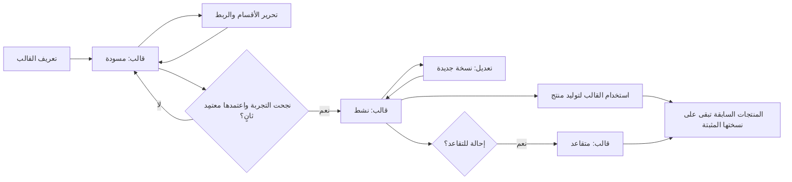
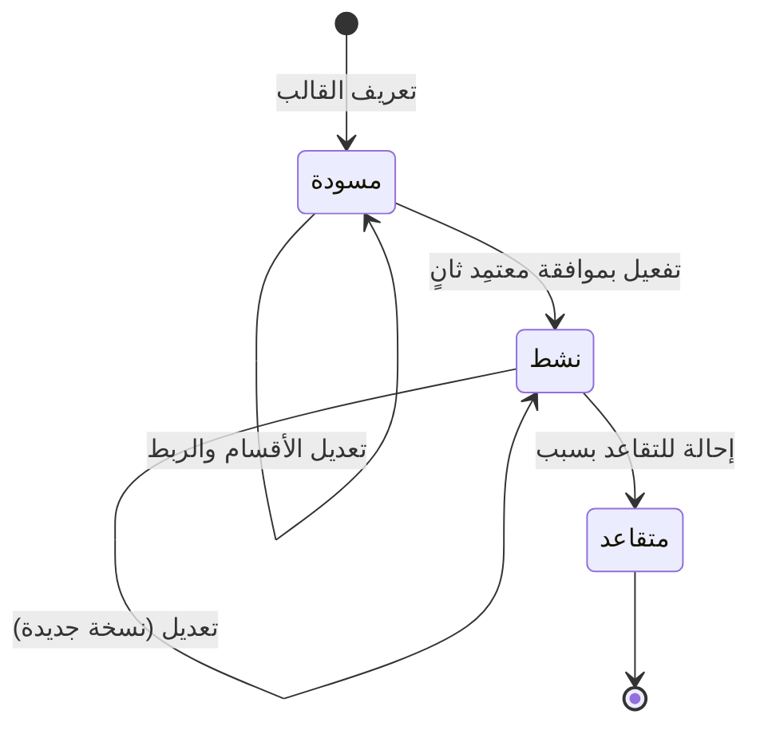

# قوالب المنتجات

<!-- BEGIN GENERATED: doc -->
| البند | القيمة |
|---|---|
| المعرّف | FEAT-COM-PRODUCT-TEMPLATES |
| الإصدار | 0.1 |
| الحالة | مسودة |
| القدرة | CAP-10 الاتصال والمنتجات |
| القدرة الفرعية | CAP-10.02 التقارير والإحاطات ومنتجات الخرائط (R2) |
| الأدوار | مدير المعرفة؛ قائد المحللين؛ صاحب السلطة أو المعتمِد الثاني |
| الشاشات | SCR-43 المنتجات والتوزيع |
| حالات الاستخدام | UC-110 |
| القصص | 7: 4 من المواصفة، و3 جديدة |
<!-- END GENERATED: doc -->

## 1. نظرة عامة

### 1.1 القيمة

يعد مدير المعرفة قوالب موحدة للتقارير والإحاطات والخرائط، ويعتمدها شخص ثانٍ قبل استخدامها.

### 1.2 النطاق

| البند | القيمة |
|---|---|
| المستخدمون | مدير المعرفة أو قائد المحللين يعرّف القالب ويعدّله ويحيله للتقاعد؛ صاحب السلطة أو المعتمِد الثاني يفعّله؛ أي مستخدم مخوَّل يستعرض القوالب عند إعداد منتج |
| الشاشات | SCR-43 المنتجات والتوزيع (قسم القوالب) |
| حالات الاستخدام (بالكلمات) | تعريف قالب منتج بأقسامه وربط بياناته، تجربته واعتماده بفصل المهام، تعديله بإصدار جديد، وإحالته للتقاعد مع إبقاء المنتجات القديمة على نسختها |
| المتطلبات (بالكلمات) | توليد المنتجات من قوالب ذات إصدارات، تضمن اتساق الشكل وربط كل قسم ببيانات باستعلام منصة معرَّف لا باستعلام حر |
| خارج النطاق | توليد المنتج نفسه من القالب؛ توزيع المنتج المولَّد على مستلميه (ميزتان أخريان) |

### 1.3 خريطة الميزة

**الشكل 1: من تعريف القالب إلى استخدامه في منتج**



**الشكل 2: دورة حالات قالب المنتج**



## 2. القواعد المشتركة

تنطبق على كل قصص الميزة، فلا تتكرر داخل القصص. وكل قصة تذكر ما يخصها فقط.

### 2.1 السياق المشترك

كل قصة تبدأ من ثلاثة شروط: مستأجر نشط، وحزمة السياسات الأساسية مفعّلة، ومستخدم مسجّل الدخول ومخوَّل. وتشير إليها القصص بخطوة واحدة: «بفرض السياق المشترك للميزة».

### 2.2 الصلاحية وعدم الإفصاح

- من لا يحق له رؤية العنصر يتلقى ردًا بشكل «غير متاح» تمامًا، فلا يعرف أنه موجود.
- من يرى العنصر ولا يحق له الإجراء يتلقى «لا تملك صلاحية هذا الإجراء».

### 2.3 أوامر تغيير الحالة

- **منع التكرار:** يُرسل كل أمر بمفتاح فريد، فإعادة الطلب نفسه لا تُنفَّذ مرتين.
- **حماية التعديل المتزامن:** يُرسل كل أمر بإصدار البيانات الذي يراه المستخدم. فإن عدّلها غيره في الأثناء، يُرفض الأمر.
- **السجل:** إن نجح الأمر، يُكتب حدثه وسجل التدقيق في المعاملة نفسها.

### 2.4 الرفض المشترك

```gherkin
# language: ar
خاصية: الرفض المشترك لأوامر الميزة

  سيناريو مخطط: رفض مشترك لكل أمر في الميزة
    بفرض السياق المشترك للميزة
    و <الحالة>
    عندما يُرسل المستخدم أي أمر من أوامر الميزة
    اذاً يُرفض برمز <الرمز> ويرى "<الرسالة>"
    و لا يتغير شيء

    امثلة:
      | الحالة                                  | الرمز                  | الرسالة                                                 |
      | العنصر خارج صلاحياته                    | NOT_FOUND              | غير متاح                                                |
      | العنصر مرئي له ولا يحق له الإجراء       | AUTHZ_DENIED           | لا تملك صلاحية هذا الإجراء                              |
      | غيره عدّل العنصر بعد أن فتحه            | VERSION_CONFLICT       | تغيّرت البيانات منذ فتحتها. راجع التغييرات ثم أعد المحاولة |
      | أعاد مفتاح منع التكرار بمحتوى مختلف     | IDEMPOTENCY_KEY_REUSED | طلب مكرر بمحتوى مختلف                                   |
      | البيانات ناقصة أو غير صحيحة             | VALIDATION_FAILED      | بعض البيانات ناقصة أو غير صحيحة. راجع الحقول المعلَّمة      |

  سيناريو: إعادة الطلب نفسه لا تُنفَّذ مرتين
    بفرض السياق المشترك للميزة
    و أمر نجح بمفتاح منع تكرار
    عندما يُعاد الطلب نفسه بالمفتاح نفسه
    اذاً تُعاد النتيجة الأولى ولا يُكتب حدث ثانٍ
```

### 2.5 قواعد مشتركة للقالب

تنطبق على عدة قصص من قصص هذه الميزة، فلا تتكرر فيها:

- **الربط ببيانات معرَّفة فقط:** كل ربط بيانات في قسم هو استعلام منصة معرَّف بمعاملات مكتوبة، لا استعلام حر؛ فتخضع بيانات المنتج لصلاحية المستخدم نفسها التي تخضع لها الواجهة (INV-PTM-01).
- **تثبيت الإصدار:** كل منتج يُولَّد من القالب يُثبَّت على إصدار القالب وقت التوليد؛ تعديل القالب أو إحالته للتقاعد لا يغيّر المنتجات المولَّدة سابقًا (INV-PTM-02).

## 3. الجودة وتعريف الاكتمال

### 3.1 متطلبات الجودة

<!-- BEGIN GENERATED: quality -->
لا متطلبات جودة مرتبطة بمتطلبات هذه الميزة مباشرة. تنطبق متطلبات المنصة العامة (`FEAT-PLT-*`).
<!-- END GENERATED: quality -->

### 3.2 تعريف الاكتمال

القصة مكتملة حين تتحقق الشروط الخمسة:

1. سيناريوهاتها والقواعد المشتركة تمر في الاختبار الآلي.
2. فحوص البنية المعمارية تمر.
3. نصوص الواجهة والرسائل موجودة بالعربية والإنجليزية.
4. مراجعة الكود مكتملة.
5. ما تضيفه القصة نفسها في قسم «القواعد» تحقق.

## 4. فهرس القصص

<!-- BEGIN GENERATED: story-index -->
| المعرّف | القصة | النوع | الحالة |
|---|---|---|---|
| `US-BC06-PTM-ACTIVATE` | تفعيل قالب المنتج | أمر | مسودة |
| `US-BC06-PTM-DEFINE` | تعريف قالب المنتج | أمر | مسودة |
| `US-BC06-PTM-EDIT` | تعديل قالب المنتج | أمر | مسودة |
| `US-BC06-PTM-RETIRE` | إحالة قالب المنتج إلى التقاعد | أمر | مسودة |
| `US-DOM-PTM-LIST` | عرض قوالب المنتجات ونسخها | جلب | مسودة |
| `US-UI-SCR43-TEMPLATE-EDITOR` | تحرير أقسام القالب وربط بياناته | واجهة | مسودة |
| `US-UI-SCR43-TEMPLATES` | قائمة قوالب المنتجات وحالاتها | واجهة | مسودة |
<!-- END GENERATED: story-index -->

## 5. القصص

### 5.1 US-BC06-PTM-ACTIVATE — تفعيل قالب المنتج

| النوع | الإصدار | الأولوية | دون اتصال | الحالة |
|---|---|---|---|---|
| أمر | R2 | Must | لا | مسودة |

> **كـ** صاحب السلطة أو المعتمِد الثاني، **أريد** تفعيل قالب منتج بعد نجاح توليد نموذجه التجريبي، **حتى** يصبح متاحًا لتوليد المنتجات الفعلية بعد مراجعة مستقلة عن مُعِدّه.

**باختصار:** بعد نجاح توليد نموذج تجريبي من القالب في حالة «مسودة»، يفعّله معتمِد ثانٍ غير مُعِدّه فيصبح «نشط» وقابلًا للاستخدام في توليد المنتجات.

#### القواعد

- **متى يُسمح:** القالب في حالة «مسودة»، ونجح توليد نموذج تجريبي منه.
- **من يُسمح له:** معتمِد ثانٍ غير مُعِدّ القالب (فصل المهام).
- **البيانات:** مرجع النموذج التجريبي الناجح (إلزامي).
- **الأثر:** تصبح حالة القالب «نشط»، ويُسجَّل حدث «فُعِّل قالب المنتج» ويصل إلى مولِّد المنتجات.

#### معايير القبول

```gherkin
# language: ar
خاصية: تفعيل قالب المنتج

  سيناريو: معتمِد ثانٍ يفعّل قالبًا نجحت تجربته
    بفرض السياق المشترك للميزة
    و قالب منتج "مسودة" نجح توليد نموذجه التجريبي
    عندما يفعّله معتمِد ثانٍ غير مُعِدّه
    اذاً تصبح حالته "نشط"
    و يُسجَّل حدث "فُعِّل قالب المنتج"

  سيناريو مخطط: رفض خاص بتفعيل القالب
    بفرض السياق المشترك للميزة
    و <الحالة>
    عندما يحاول تفعيل القالب
    اذاً يُرفض برمز <الرمز> ويرى <الرسالة>

    امثلة:
      | الحالة                          | الرمز                                      | الرسالة                                         |
      | القالب ليس في حالة "مسودة"      | PRODUCT_TEMPLATE_INVALID_STATE_TRANSITION  | الوضع الحالي لقالب المنتج لا يسمح بهذا الإجراء |
      | المعتمِد هو مُعِدّ القالب نفسه  | SEGREGATION_OF_DUTIES                      | لا يجوز أن يعتمد الشخص نفسه ما قدّمه أو طلبه    |
      | مرجع النموذج التجريبي مفقود     | VALIDATION_FAILED                          | مرجع النموذج التجريبي مطلوب                     |
```

<details><summary>المراجع التقنية والتتبع</summary>

<!-- BEGIN GENERATED: refs US-BC06-PTM-ACTIVATE -->
| البند | المعرّف | المعنى |
|---|---|---|
| الواجهة البرمجية | `POST /api/v1/knowledge/product-templates/{id}/actions/activate` | — |
| الأمر | `CMD-PTM-ACTIVATE` | تفعيل قالب المنتج |
| السياسة | `POL-PTM-ACTIVATE` | Knowledge Manager / Analysis lead (define, edit) · second approver (activate)؛ tenant match; object visible |
| الحدث | `EVT-PTM-ACTIVATED` | يصل إلى: Product generator |
| الكيان | `AGG-PRODUCT-TEMPLATE` | قالب المنتج |
| الجدول | `knowledge.product_templates` | الجدول الرئيسي لقالب المنتج |
| وحدة النشر | DU-15 | — |
| المتطلب | REQ-PRD-001 | The system shall produce reports, briefings, map products and analytical products from versioned templates wi… |
| حالة الاستخدام | UC-110 | Generate Product from Template |
| الاختبار | TST-PRODUCT-TEMPLATE-SM، TST-SLC12-INVARIANTS | دورة حالات قالب المنتج، وثوابت الشريحة SLC-12 |
<!-- END GENERATED: refs US-BC06-PTM-ACTIVATE -->

</details>

### 5.2 US-BC06-PTM-DEFINE — تعريف قالب المنتج

| النوع | الإصدار | الأولوية | دون اتصال | الحالة |
|---|---|---|---|---|
| أمر | R2 | Must | لا | مسودة |

> **كـ** مدير المعرفة أو قائد المحللين، **أريد** تعريف قالب منتج جديد برمز ونوع واسم، **حتى** أبدأ بناء أقسامه وربط بياناته.

**باختصار:** يعرّف مدير المعرفة قالب منتج جديد برمز فريد ونوع من أنواع المنتجات المدعومة واسم محلَّى، فيُنشأ في حالة «مسودة» جاهزًا لإضافة أقسامه.

#### القواعد

- **متى يُسمح:** الرمز غير مستخدم من قبل، والنوع أحد: تقرير، إحاطة، منتج خريطة، منتج تحليلي.
- **من يُسمح له:** مدير المعرفة أو قائد المحللين.
- **البيانات:** الرمز، والنوع، والاسم المحلَّى (كل منها إلزامي).
- **الأثر:** يُنشأ القالب في حالة «مسودة»، ويُسجَّل حدث «عُرِّف قالب المنتج».

#### معايير القبول

```gherkin
# language: ar
خاصية: تعريف قالب المنتج

  سيناريو: تعريف قالب جديد برمز فريد
    بفرض السياق المشترك للميزة
    و رمزًا غير مستخدم من قبل ونوع منتج من الأنواع المدعومة
    عندما يعرّف مدير المعرفة القالب بالرمز والنوع والاسم
    اذاً يُنشأ القالب في حالة "مسودة"
    و يُسجَّل حدث "عُرِّف قالب المنتج"

  سيناريو مخطط: رفض خاص بتعريف القالب
    بفرض السياق المشترك للميزة
    و <الحالة>
    عندما يحاول تعريف القالب
    اذاً يُرفض برمز <الرمز> ويرى <الرسالة>

    امثلة:
      | الحالة                                 | الرمز              | الرسالة                    |
      | الرمز مستخدم من قبل أو النوع غير مدعوم | TEMPLATE_INVALID   | بيانات القالب غير صحيحة    |
      | الرمز فارغ                              | VALIDATION_FAILED  | الرمز مطلوب                |
      | النوع فارغ                              | VALIDATION_FAILED  | النوع مطلوب                |
      | الاسم فارغ                              | VALIDATION_FAILED  | الاسم مطلوب                |
```

<details><summary>المراجع التقنية والتتبع</summary>

<!-- BEGIN GENERATED: refs US-BC06-PTM-DEFINE -->
| البند | المعرّف | المعنى |
|---|---|---|
| الواجهة البرمجية | `POST /api/v1/knowledge/product-templates` | — |
| الأمر | `CMD-PTM-DEFINE` | تعريف قالب المنتج |
| السياسة | `POL-PTM-DEFINE` | Knowledge Manager / Analysis lead (define, edit) · second approver (activate)؛ tenant match; object visible |
| الحدث | `EVT-PTM-DEFINED` | يصل إلى: Product generator |
| الكيان | `AGG-PRODUCT-TEMPLATE` | قالب المنتج |
| الجدول | `knowledge.product_templates` | الجدول الرئيسي لقالب المنتج |
| وحدة النشر | DU-15 | — |
| المتطلب | REQ-PRD-001 | The system shall produce reports, briefings, map products and analytical products from versioned templates wi… |
| حالة الاستخدام | UC-110 | Generate Product from Template |
| الاختبار | TST-PRODUCT-TEMPLATE-SM، TST-SLC12-INVARIANTS | دورة حالات قالب المنتج، وثوابت الشريحة SLC-12 |
<!-- END GENERATED: refs US-BC06-PTM-DEFINE -->

</details>

### 5.3 US-BC06-PTM-EDIT — تعديل قالب المنتج

| النوع | الإصدار | الأولوية | دون اتصال | الحالة |
|---|---|---|---|---|
| أمر | R2 | Must | لا | مسودة |

> **كـ** **[للكتابة]**، **أريد** **[للكتابة]**، **حتى** **[للكتابة]**.

**باختصار:** **[للكتابة]**

#### القواعد

**[للكتابة]**

#### معايير القبول

**[للكتابة]**

<details><summary>المراجع التقنية والتتبع</summary>

<!-- BEGIN GENERATED: refs US-BC06-PTM-EDIT -->
| البند | المعرّف | المعنى |
|---|---|---|
| الواجهة البرمجية | `POST /api/v1/knowledge/product-templates/{id}/actions/edit` | — |
| الأمر | `CMD-PTM-EDIT` | تعديل قالب المنتج |
| السياسة | `POL-PTM-EDIT` | Knowledge Manager / Analysis lead (define, edit) · second approver (activate)؛ tenant match; object visible |
| الحدث | `EVT-PTM-EDITED` | يصل إلى: Product generator |
| الكيان | `AGG-PRODUCT-TEMPLATE` | قالب المنتج |
| الجدول | `knowledge.product_templates` | الجدول الرئيسي لقالب المنتج |
| وحدة النشر | DU-15 | — |
| المتطلب | REQ-PRD-001 | The system shall produce reports, briefings, map products and analytical products from versioned templates wi… |
| حالة الاستخدام | UC-110 | Generate Product from Template |
| الاختبار | TST-PRODUCT-TEMPLATE-SM، TST-SLC12-INVARIANTS | دورة حالات قالب المنتج، وثوابت الشريحة SLC-12 |
<!-- END GENERATED: refs US-BC06-PTM-EDIT -->

</details>

### 5.4 US-BC06-PTM-RETIRE — إحالة قالب المنتج إلى التقاعد

| النوع | الإصدار | الأولوية | دون اتصال | الحالة |
|---|---|---|---|---|
| أمر | R2 | Must | لا | مسودة |

> **كـ** **[للكتابة]**، **أريد** **[للكتابة]**، **حتى** **[للكتابة]**.

**باختصار:** **[للكتابة]**

#### القواعد

**[للكتابة]**

#### معايير القبول

**[للكتابة]**

<details><summary>المراجع التقنية والتتبع</summary>

<!-- BEGIN GENERATED: refs US-BC06-PTM-RETIRE -->
| البند | المعرّف | المعنى |
|---|---|---|
| الواجهة البرمجية | `POST /api/v1/knowledge/product-templates/{id}/actions/retire` | — |
| الأمر | `CMD-PTM-RETIRE` | إحالة قالب المنتج إلى التقاعد |
| السياسة | `POL-PTM-RETIRE` | Knowledge Manager / Analysis lead (retire)؛ tenant match; object visible |
| الحدث | `EVT-PTM-RETIRED` | يصل إلى: Product generator |
| الكيان | `AGG-PRODUCT-TEMPLATE` | قالب المنتج |
| الجدول | `knowledge.product_templates` | الجدول الرئيسي لقالب المنتج |
| وحدة النشر | DU-15 | — |
| المتطلب | REQ-PRD-001 | The system shall produce reports, briefings, map products and analytical products from versioned templates wi… |
| حالة الاستخدام | UC-110 | Generate Product from Template |
| الاختبار | TST-PRODUCT-TEMPLATE-SM، TST-SLC12-INVARIANTS | دورة حالات قالب المنتج، وثوابت الشريحة SLC-12 |
<!-- END GENERATED: refs US-BC06-PTM-RETIRE -->

</details>

### 5.5 US-DOM-PTM-LIST — عرض قوالب المنتجات ونسخها

| النوع | الإصدار | الأولوية | دون اتصال | الحالة |
|---|---|---|---|---|
| جلب | R2 | Must | لا | مسودة |

> **كـ** **[للكتابة]**، **أريد** **[للكتابة]**، **حتى** **[للكتابة]**.

**باختصار:** **[للكتابة]**

#### القواعد

**[للكتابة]**

#### معايير القبول

**[للكتابة]**

<details><summary>المراجع التقنية والتتبع</summary>

<!-- BEGIN GENERATED: refs US-DOM-PTM-LIST -->
| البند | المعرّف | المعنى |
|---|---|---|
| المصدر | `00-open-questions.md §4` | — |
| المصدر | `[Derived]` | — |
| المتطلب | REQ-PRD-001 | The system shall produce reports, briefings, map products and analytical products from versioned templates wi… |
| حالة الاستخدام | UC-110 | Generate Product from Template |
<!-- END GENERATED: refs US-DOM-PTM-LIST -->

</details>

### 5.6 US-UI-SCR43-TEMPLATE-EDITOR — تحرير أقسام القالب وربط بياناته

| النوع | الإصدار | الأولوية | دون اتصال | الحالة |
|---|---|---|---|---|
| واجهة | R2 | Must | لا | مسودة |

> **كـ** **[للكتابة]**، **أريد** **[للكتابة]**، **حتى** **[للكتابة]**.

**باختصار:** **[للكتابة]**

#### القواعد

**[للكتابة]**

#### معايير القبول

**[للكتابة]**

<details><summary>المراجع التقنية والتتبع</summary>

<!-- BEGIN GENERATED: refs US-UI-SCR43-TEMPLATE-EDITOR -->
| البند | المعرّف | المعنى |
|---|---|---|
| الشاشة | SCR-43 | شاشة المنتجات والتوزيع |
| المصدر | `products-knowledge-archive-spec.md §1` | — |
| المصدر | `[Derived]` | — |
| المتطلب | REQ-PRD-001 | The system shall produce reports, briefings, map products and analytical products from versioned templates wi… |
| حالة الاستخدام | UC-110 | Generate Product from Template |
<!-- END GENERATED: refs US-UI-SCR43-TEMPLATE-EDITOR -->

</details>

### 5.7 US-UI-SCR43-TEMPLATES — قائمة قوالب المنتجات وحالاتها

| النوع | الإصدار | الأولوية | دون اتصال | الحالة |
|---|---|---|---|---|
| واجهة | R2 | Must | لا | مسودة |

> **كـ** **[للكتابة]**، **أريد** **[للكتابة]**، **حتى** **[للكتابة]**.

**باختصار:** **[للكتابة]**

#### القواعد

**[للكتابة]**

#### معايير القبول

**[للكتابة]**

<details><summary>المراجع التقنية والتتبع</summary>

<!-- BEGIN GENERATED: refs US-UI-SCR43-TEMPLATES -->
| البند | المعرّف | المعنى |
|---|---|---|
| الشاشة | SCR-43 | شاشة المنتجات والتوزيع |
| المصدر | `00-open-questions.md §4` | — |
| المصدر | `[Derived]` | — |
| المتطلب | REQ-PRD-001 | The system shall produce reports, briefings, map products and analytical products from versioned templates wi… |
| حالة الاستخدام | UC-110 | Generate Product from Template |
<!-- END GENERATED: refs US-UI-SCR43-TEMPLATES -->

</details>

## 6. التتبع

<!-- BEGIN GENERATED: trace -->
| المتطلب | المعنى | القصص | الاختبار |
|---|---|---|---|
| REQ-PRD-001 | The system shall produce reports, briefings, map products and analytical products from versioned templates wi… | `US-BC06-PTM-ACTIVATE`، `US-BC06-PTM-DEFINE`، `US-BC06-PTM-EDIT`، `US-BC06-PTM-RETIRE`، `US-DOM-PTM-LIST`، `US-UI-SCR43-TEMPLATE-EDITOR`، `US-UI-SCR43-TEMPLATES` | TST-PRODUCT-SM، TST-PRODUCT-TEMPLATE-SM، TST-SLC12-INVARIANTS |
<!-- END GENERATED: trace -->

## 7. سجل التغييرات

| الإصدار | التاريخ | التغيير |
|---|---|---|
| 0.1 | — | هيكل مولَّد من خريطة الميزات |
