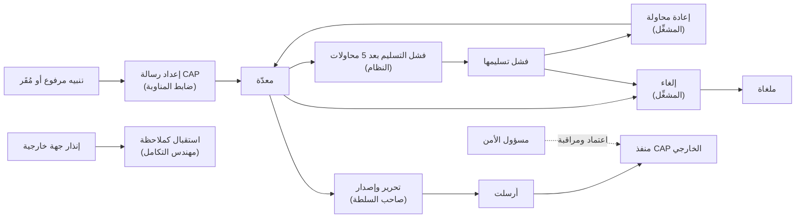
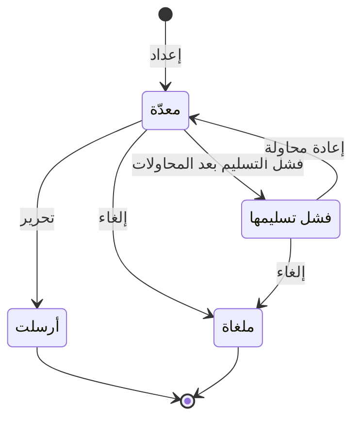

# رسائل الإنذار العام

<!-- BEGIN GENERATED: doc -->
| البند | القيمة |
|---|---|
| المعرّف | FEAT-COM-PUBLIC-ALERTS |
| الإصدار | 0.2 |
| الحالة | مسودة |
| القدرة | CAP-10 الاتصال والمنتجات |
| القدرة الفرعية | CAP-10.01 الإشعارات والتوزيع (R1 (إشعارات)) |
| الأدوار | ضابط المناوبة؛ المشغِّل؛ صاحب السلطة أو المعتمِد الثاني؛ المدقِّق؛ النظام |
| الشاشات | SCR-14 رسائل الإنذار العام (CAP) |
| حالات الاستخدام | UC-023 |
| القصص | 10: 6 من المواصفة، و4 جديدة |
<!-- END GENERATED: doc -->

## 1. نظرة عامة

### 1.1 القيمة

يعد ضابط المناوبة رسالة إنذار عامة بالمعيار الدولي ويطلقها صاحب السلطة إلى الجهات الخارجية مع متابعة وصولها.

### 1.2 النطاق

| البند | القيمة |
|---|---|
| المستخدمون | ضابط المناوبة (يُعِدّ)؛ صاحب السلطة أو المعتمِد الثاني (يحرّر ويصدر)؛ المشغِّل (يراقب، يعيد المحاولة، يلغي)؛ المدقِّق (يطّلع)؛ مسؤول الأمن (يعتمد منفذ CAP ويراقبه)؛ مهندس التكامل (يدير الاستقبال والإرسال)؛ النظام (يحدد فشل التسليم بعد المحاولات) |
| الشاشات | شاشة رسائل الإنذار العام (CAP) |
| حالات الاستخدام (بالكلام) | إدارة رسالة الإنذار العام من إعدادها حتى إصدارها أو إلغائها أو إعادة محاولتها، مع استقبال إنذارات الجهات الأخرى وإرسال إنذارات المستأجر لها |
| المتطلبات (بالكلام) | حيث يفعّل المستأجر ذلك، يتبادل النظام التنبيهات بمعيار بروتوكول الإنذار الموحَّد (CAP 1.2) |
| خارج النطاق | إنذارات الجهات الأخرى الواردة لا تُعامل كتنبيه مباشر، بل كملاحظة منسوبة لمصدرها تخضع لقواعد التنبيه العادية؛ تصميم قالب الإنذار نفسه (يُفترض معتمدًا سلفًا)؛ محتوى التنبيه الأصلي ومعالجته (ميزة التنبيهات، لا هذه الميزة) |

### 1.3 خريطة الميزة

**الشكل 1: مسار رسالة الإنذار العام من الإعداد إلى الإصدار**



**الشكل 2: دورة حالات رسالة CAP الصادرة**



## 2. القواعد المشتركة

تنطبق على كل قصص الميزة، فلا تتكرر داخل القصص. وكل قصة تذكر ما يخصها فقط.

### 2.1 السياق المشترك

كل قصة تبدأ من ثلاثة شروط: مستأجر نشط، وحزمة السياسات الأساسية مفعّلة، ومستخدم مسجّل الدخول ومخوَّل. وتشير إليها القصص بخطوة واحدة: «بفرض السياق المشترك للميزة».

### 2.2 الصلاحية وعدم الإفصاح

- من لا يحق له رؤية العنصر يتلقى ردًا بشكل «غير متاح» تمامًا، فلا يعرف أنه موجود.
- من يرى العنصر ولا يحق له الإجراء يتلقى «لا تملك صلاحية هذا الإجراء».

### 2.3 أوامر تغيير الحالة

- **منع التكرار:** يُرسل كل أمر بمفتاح فريد، فإعادة الطلب نفسه لا تُنفَّذ مرتين.
- **حماية التعديل المتزامن:** يُرسل كل أمر بإصدار البيانات الذي يراه المستخدم. فإن عدّلها غيره في الأثناء، يُرفض الأمر.
- **السجل:** إن نجح الأمر، يُكتب حدثه وسجل التدقيق في المعاملة نفسها.

### 2.4 الرفض المشترك

```gherkin
# language: ar
خاصية: الرفض المشترك لأوامر الميزة

  سيناريو مخطط: رفض مشترك لكل أمر في الميزة
    بفرض السياق المشترك للميزة
    و <الحالة>
    عندما يُرسل المستخدم أي أمر من أوامر الميزة
    اذاً يُرفض برمز <الرمز> ويرى "<الرسالة>"
    و لا يتغير شيء

    امثلة:
      | الحالة                                  | الرمز                  | الرسالة                                                 |
      | العنصر خارج صلاحياته                    | NOT_FOUND              | غير متاح                                                |
      | العنصر مرئي له ولا يحق له الإجراء       | AUTHZ_DENIED           | لا تملك صلاحية هذا الإجراء                              |
      | غيره عدّل العنصر بعد أن فتحه            | VERSION_CONFLICT       | تغيّرت البيانات منذ فتحتها. راجع التغييرات ثم أعد المحاولة |
      | أعاد مفتاح منع التكرار بمحتوى مختلف     | IDEMPOTENCY_KEY_REUSED | طلب مكرر بمحتوى مختلف                                   |
      | البيانات ناقصة أو غير صحيحة             | VALIDATION_FAILED      | بعض البيانات ناقصة أو غير صحيحة. راجع الحقول المعلَّمة      |

  سيناريو: إعادة الطلب نفسه لا تُنفَّذ مرتين
    بفرض السياق المشترك للميزة
    و أمر نجح بمفتاح منع تكرار
    عندما يُعاد الطلب نفسه بالمفتاح نفسه
    اذاً تُعاد النتيجة الأولى ولا يُكتب حدث ثانٍ
```

## 3. الجودة وتعريف الاكتمال

### 3.1 متطلبات الجودة

<!-- BEGIN GENERATED: quality -->
لا متطلبات جودة مرتبطة بمتطلبات هذه الميزة مباشرة. تنطبق متطلبات المنصة العامة (`FEAT-PLT-*`).
<!-- END GENERATED: quality -->

### 3.2 تعريف الاكتمال

القصة مكتملة حين تتحقق الشروط الخمسة:

1. سيناريوهاتها والقواعد المشتركة تمر في الاختبار الآلي.
2. فحوص البنية المعمارية تمر.
3. نصوص الواجهة والرسائل موجودة بالعربية والإنجليزية.
4. مراجعة الكود مكتملة.
5. ما تضيفه القصة نفسها في قسم «القواعد» تحقق.

## 4. فهرس القصص

<!-- BEGIN GENERATED: story-index -->
| المعرّف | القصة | النوع | الحالة |
|---|---|---|---|
| `US-BC03-CAP-CANCEL` | إلغاء رسالة CAP الصادرة | أمر | مسودة |
| `US-BC03-CAP-PREPARE` | إعداد رسالة CAP الصادرة | أمر | مسودة |
| `US-BC03-CAP-RELEASE` | تحرير رسالة CAP الصادرة | أمر | مسودة |
| `US-BC03-CAP-RETRY` | إعادة محاولة رسالة CAP الصادرة | أمر | مسودة |
| `US-BC03-Q-CAP-LIST` | جلب: Outbound CAP messages by state | جلب | مسودة |
| `US-BC03-S-CAP-MESSAGE-01` | تلقائي: delivery failed after retries (رسالة CAP الصادرة) | نظام | مسودة |
| `US-UI-SCR14-RELEASE-REVIEW` | معاينة رسالة الإنذار قبل إطلاقها وتتبع وصولها | واجهة | مسودة |
| `US-INT-CAP-INBOUND` | استقبال رسائل الإنذار من الجهات الأخرى | تكامل | مسودة |
| `US-INT-CAP-OUTBOUND` | إرسال رسالة الإنذار العام وتسجيل إقرارها | تكامل | مسودة |
| `US-OPS-CAP-ENDPOINT` | اعتماد منفذ الإنذار الخارجي ومراقبته | تشغيل | مسودة |
<!-- END GENERATED: story-index -->

## 5. القصص

### 5.1 US-BC03-CAP-CANCEL — إلغاء رسالة CAP الصادرة

| النوع | الإصدار | الأولوية | دون اتصال | الحالة |
|---|---|---|---|---|
| أمر | R1 | Should | لا | مسودة |

> **كـ** المشغِّل، **أريد** إلغاء رسالة الإنذار الصادرة بذكر السبب، **حتى** أوقف إصدارها قبل أن تصل فعليًا أو بعد أن فشل تسليمها.

**باختصار:** يلغي المشغِّل رسالة إنذار «معدّة» أو «فشل تسليمها» بذكر السبب، فتصير «ملغاة» نهائيًا.

#### القواعد

- **متى يُسمح:** الرسالة في حالة «معدّة» أو «فشل تسليمها».
- **من يُسمح له:** المشغِّل.
- **البيانات:** السبب (إلزامي).
- **الأثر:** تصبح الرسالة «ملغاة» (حالة نهائية)، ويُسجَّل حدث «أُلغيت رسالة الإنذار» يصل إلى منفذ CAP الخارجي وسجل التدقيق.

#### معايير القبول

```gherkin
# language: ar
خاصية: إلغاء رسالة CAP الصادرة

  سيناريو: المشغِّل يلغي رسالة إنذار معدّة
    بفرض السياق المشترك للميزة
    و رسالة إنذار صادرة في حالة "معدّة"
    عندما يلغيها المشغِّل بذكر السبب
    اذاً تصبح حالتها "ملغاة"
    و يُسجَّل حدث "أُلغيت رسالة الإنذار"

  سيناريو مخطط: رفض خاص بالإلغاء
    بفرض السياق المشترك للميزة
    و <الحالة>
    عندما يحاول المشغِّل إلغاء الرسالة
    اذاً يُرفض برمز <الرمز> ويرى <الرسالة>
    و لا يتغير شيء

    امثلة:
      | الحالة                              | الرمز                                 | الرسالة                                                |
      | الرسالة في حالة "أُرسلت" أو "ملغاة" | CAP_MESSAGE_INVALID_STATE_TRANSITION  | الوضع الحالي لرسالة CAP الصادرة لا يسمح بهذا الإجراء  |
      | السبب فارغ                          | REASON_REQUIRED                       | اذكر السبب                                             |
```

<details><summary>المراجع التقنية والتتبع</summary>

<!-- BEGIN GENERATED: refs US-BC03-CAP-CANCEL -->
| البند | المعرّف | المعنى |
|---|---|---|
| الواجهة البرمجية | `POST /api/v1/intelligence/cap-messages/{id}/actions/cancel` | — |
| الأمر | `CMD-CAP-CANCEL` | إلغاء رسالة CAP الصادرة |
| السياسة | `POL-CAP-CANCEL` | alert recipient / duty officer (prepare) · release authority (release) · operator (retry, cancel)؛ tenant mat… |
| الحدث | `EVT-CAP-CANCELLED` | يصل إلى: CAP gateway; Audit |
| الكيان | `AGG-CAP-MESSAGE` | رسالة CAP الصادرة |
| الجدول | `intelligence.cap_messages` | الجدول الرئيسي لرسالة CAP الصادرة |
| وحدة النشر | DU-06 | — |
| المتطلب | REQ-INT-003 | Where a tenant enables it, the system shall exchange alerts using the Common Alerting Protocol (CAP 1.2). |
| حالة الاستخدام | UC-023 | Manage Alert |
| الاختبار | TST-CAP-MESSAGE-SM، TST-SLC16-INVARIANTS | دورة حالات رسالة CAP الصادرة، وثوابت الشريحة SLC-16 |
<!-- END GENERATED: refs US-BC03-CAP-CANCEL -->

</details>

### 5.2 US-BC03-CAP-PREPARE — إعداد رسالة CAP الصادرة

| النوع | الإصدار | الأولوية | دون اتصال | الحالة |
|---|---|---|---|---|
| أمر | R1 | Should | لا | مسودة |

> **كـ** ضابط المناوبة، **أريد** إعداد رسالة إنذار بصيغة CAP من تنبيه قائم، **حتى** يحرّرها صاحب السلطة لإصدارها إلى الجهات الخارجية.

**باختصار:** يُعِدّ ضابط المناوبة رسالة CAP من تنبيه مرفوع أو مُقَر باستخدام قالب معتمد، فتصير «معدّة» بانتظار التحرير.

#### القواعد

- **متى يُسمح:** المستأجر مفعَّل له تبادل CAP؛ والتنبيه في حالة «مرفوع» أو «مُقَر»؛ وتصنيف التنبيه لا يتجاوز مستوى الإصدار الخارجي للمستأجر؛ والمحتوى من حقول قالب معتمد دون نص حر من مصادر مصنّفة؛ واتصال منفذ CAP المستهدف «نشط».
- **من يُسمح له:** ضابط المناوبة.
- **البيانات:** التنبيه، والقالب، واتصال منفذ CAP المستهدف (إلزامية).
- **الأثر:** تصبح الرسالة «معدّة»، ويُسجَّل حدث «أُعِدّت رسالة الإنذار» يصل إلى منفذ CAP الخارجي وسجل التدقيق.

#### معايير القبول

```gherkin
# language: ar
خاصية: إعداد رسالة CAP الصادرة

  سيناريو: ضابط المناوبة يُعِدّ رسالة من تنبيه قائم
    بفرض السياق المشترك للميزة
    و تنبيه "مرفوع" وتصنيفه لا يتجاوز مستوى الإصدار الخارجي للمستأجر
    عندما يُعِدّ ضابط المناوبة رسالة CAP منه بقالب معتمد
    اذاً تصبح حالتها "معدّة"
    و يُسجَّل حدث "أُعِدّت رسالة الإنذار"

  سيناريو مخطط: رفض خاص بالإعداد
    بفرض السياق المشترك للميزة
    و <الحالة>
    عندما يحاول ضابط المناوبة إعداد الرسالة
    اذاً يُرفض برمز <الرمز> ويرى <الرسالة>
    و لا يتغير شيء

    امثلة:
      | الحالة                                        | الرمز                | الرسالة                        |
      | تصنيف التنبيه أعلى من مستوى الإصدار الخارجي  | RELEASE_NOT_ALLOWED  | لا يمكن إصدار التنبيه خارجيًا  |
      | التنبيه فارغ                                   | VALIDATION_FAILED    | التنبيه مطلوب                   |
      | القالب فارغ                                    | VALIDATION_FAILED    | القالب مطلوب                    |
      | الاتصال المستهدف فارغ                          | VALIDATION_FAILED    | الاتصال مطلوب                   |
```

<details><summary>المراجع التقنية والتتبع</summary>

<!-- BEGIN GENERATED: refs US-BC03-CAP-PREPARE -->
| البند | المعرّف | المعنى |
|---|---|---|
| الواجهة البرمجية | `POST /api/v1/intelligence/cap-messages` | — |
| الأمر | `CMD-CAP-PREPARE` | إعداد رسالة CAP الصادرة |
| السياسة | `POL-CAP-PREPARE` | alert recipient / duty officer (prepare) · release authority (release) · operator (retry, cancel)؛ tenant mat… |
| الحدث | `EVT-CAP-PREPARED` | يصل إلى: CAP gateway; Audit |
| الكيان | `AGG-CAP-MESSAGE` | رسالة CAP الصادرة |
| الجدول | `intelligence.cap_messages` | الجدول الرئيسي لرسالة CAP الصادرة |
| وحدة النشر | DU-06 | — |
| المتطلب | REQ-INT-003 | Where a tenant enables it, the system shall exchange alerts using the Common Alerting Protocol (CAP 1.2). |
| حالة الاستخدام | UC-023 | Manage Alert |
| الاختبار | TST-CAP-MESSAGE-SM، TST-SLC16-INVARIANTS | دورة حالات رسالة CAP الصادرة، وثوابت الشريحة SLC-16 |
<!-- END GENERATED: refs US-BC03-CAP-PREPARE -->

</details>

### 5.3 US-BC03-CAP-RELEASE — تحرير رسالة CAP الصادرة

| النوع | الإصدار | الأولوية | دون اتصال | الحالة |
|---|---|---|---|---|
| أمر | R1 | Should | لا | مسودة |

> **كـ** صاحب السلطة أو المعتمِد الثاني، **أريد** تحرير رسالة الإنذار المعدّة لإصدارها فعليًا إلى الجهات الخارجية، **حتى** يصل الإنذار بعد تحقق مستقل من غير من أعدّه.

**باختصار:** يحرّر صاحب السلطة رسالة إنذار «معدّة» بعد تأكيد هويته مجددًا، فتصير «أُرسلت» بعد تسليمها عبر منفذ CAP وتسجيل إقرار تسلّمها. ولا يجوز أن يحررها من أعدّها.

#### القواعد

- **متى يُسمح:** الرسالة «معدّة»، ومحتواها صالح وفق معيار CAP 1.2، ووصل إقرار تسليمها.
- **من يُسمح له:** صاحب سلطة أو معتمِد ثانٍ غير من أعدّ الرسالة (فصل المهام).
- **البيانات:** ملاحظة (اختيارية).
- **الأثر:** تصبح الرسالة «أُرسلت» (حالة نهائية)، ويُسجَّل حدث «صدرت رسالة الإنذار» يصل إلى منفذ CAP الخارجي وسجل التدقيق. ويحتاج التحرير تأكيد هوية مرة أخرى.

#### معايير القبول

```gherkin
# language: ar
خاصية: تحرير رسالة CAP الصادرة

  سيناريو: صاحب السلطة يحرّر رسالة معدّة من غيره
    بفرض السياق المشترك للميزة
    و رسالة إنذار "معدّة" أعدّها غير صاحب السلطة الذي يحرّرها
    عندما يحرّرها صاحب السلطة بعد تأكيد هويته
    اذاً تصبح حالتها "أُرسلت"
    و يُسجَّل حدث "صدرت رسالة الإنذار"

  سيناريو مخطط: رفض خاص بالتحرير
    بفرض السياق المشترك للميزة
    و <الحالة>
    عندما يحاول صاحب السلطة التحرير
    اذاً يُرفض برمز <الرمز> ويرى <الرسالة>
    و لا يتغير شيء

    امثلة:
      | الحالة                                           | الرمز                                 | الرسالة                                                 |
      | الرسالة ليست "معدّة"                             | CAP_MESSAGE_INVALID_STATE_TRANSITION  | الوضع الحالي لرسالة CAP الصادرة لا يسمح بهذا الإجراء   |
      | من يحرّر هو من أعدّ الرسالة نفسها                | SEGREGATION_OF_DUTIES                | لا يجوز أن يعتمد الشخص نفسه ما قدّمه أو طلبه            |
      | قوة مصادقة الجلسة أقل من المطلوب                | MFA_STEP_UP_REQUIRED                 | هذا الإجراء يحتاج تأكيد هويتك مرة أخرى                   |
```

<details><summary>المراجع التقنية والتتبع</summary>

<!-- BEGIN GENERATED: refs US-BC03-CAP-RELEASE -->
| البند | المعرّف | المعنى |
|---|---|---|
| الواجهة البرمجية | `POST /api/v1/intelligence/cap-messages/{id}/actions/release` | — |
| الأمر | `CMD-CAP-RELEASE` | تحرير رسالة CAP الصادرة |
| السياسة | `POL-CAP-RELEASE` | alert recipient / duty officer (prepare) · release authority (release) · operator (retry, cancel)؛ tenant mat… |
| الحدث | `EVT-CAP-SENT` | يصل إلى: CAP gateway; Audit |
| الكيان | `AGG-CAP-MESSAGE` | رسالة CAP الصادرة |
| الجدول | `intelligence.cap_messages` | الجدول الرئيسي لرسالة CAP الصادرة |
| وحدة النشر | DU-06 | — |
| المتطلب | REQ-INT-003 | Where a tenant enables it, the system shall exchange alerts using the Common Alerting Protocol (CAP 1.2). |
| حالة الاستخدام | UC-023 | Manage Alert |
| الاختبار | TST-CAP-MESSAGE-SM، TST-SLC16-INVARIANTS | دورة حالات رسالة CAP الصادرة، وثوابت الشريحة SLC-16 |
<!-- END GENERATED: refs US-BC03-CAP-RELEASE -->

</details>

### 5.4 US-BC03-CAP-RETRY — إعادة محاولة رسالة CAP الصادرة

| النوع | الإصدار | الأولوية | دون اتصال | الحالة |
|---|---|---|---|---|
| أمر | R1 | Should | لا | مسودة |

> **كـ** المشغِّل، **أريد** إعادة محاولة إرسال رسالة إنذار فشل تسليمها، **حتى** تصل إلى الجهات الخارجية دون إعداد رسالة جديدة.

**باختصار:** يعيد المشغِّل محاولة إرسال رسالة إنذار «فشل تسليمها» فتعود إلى «معدّة» بانتظار تحرير جديد.

#### القواعد

- **متى يُسمح:** الرسالة في حالة «فشل تسليمها».
- **من يُسمح له:** المشغِّل.
- **الأثر:** تعود الرسالة إلى «معدّة»، ويُسجَّل حدث «أُعيدت محاولة الإنذار» يصل إلى منفذ CAP الخارجي وسجل التدقيق.

#### معايير القبول

```gherkin
# language: ar
خاصية: إعادة محاولة رسالة CAP الصادرة

  سيناريو: المشغِّل يعيد محاولة رسالة فشل تسليمها
    بفرض السياق المشترك للميزة
    و رسالة إنذار صادرة في حالة "فشل تسليمها"
    عندما يعيد المشغِّل محاولة إرسالها
    اذاً تعود حالتها إلى "معدّة"
    و يُسجَّل حدث "أُعيدت محاولة الإنذار"

  سيناريو مخطط: رفض خاص بإعادة المحاولة
    بفرض السياق المشترك للميزة
    و <الحالة>
    عندما يحاول المشغِّل إعادة المحاولة
    اذاً يُرفض برمز <الرمز> ويرى <الرسالة>
    و لا يتغير شيء

    امثلة:
      | الحالة                                          | الرمز                                 | الرسالة                                                |
      | الرسالة في حالة "ملغاة" أو "معدّة" أو "أُرسلت"  | CAP_MESSAGE_INVALID_STATE_TRANSITION  | الوضع الحالي لرسالة CAP الصادرة لا يسمح بهذا الإجراء  |
```

<details><summary>المراجع التقنية والتتبع</summary>

<!-- BEGIN GENERATED: refs US-BC03-CAP-RETRY -->
| البند | المعرّف | المعنى |
|---|---|---|
| الواجهة البرمجية | `POST /api/v1/intelligence/cap-messages/{id}/actions/retry` | — |
| الأمر | `CMD-CAP-RETRY` | إعادة محاولة رسالة CAP الصادرة |
| السياسة | `POL-CAP-RETRY` | alert recipient / duty officer (prepare) · release authority (release) · operator (retry, cancel)؛ tenant mat… |
| الحدث | `EVT-CAP-RETRY` | يصل إلى: CAP gateway; Audit |
| الكيان | `AGG-CAP-MESSAGE` | رسالة CAP الصادرة |
| الجدول | `intelligence.cap_messages` | الجدول الرئيسي لرسالة CAP الصادرة |
| وحدة النشر | DU-06 | — |
| المتطلب | REQ-INT-003 | Where a tenant enables it, the system shall exchange alerts using the Common Alerting Protocol (CAP 1.2). |
| حالة الاستخدام | UC-023 | Manage Alert |
| الاختبار | TST-CAP-MESSAGE-SM، TST-SLC16-INVARIANTS | دورة حالات رسالة CAP الصادرة، وثوابت الشريحة SLC-16 |
<!-- END GENERATED: refs US-BC03-CAP-RETRY -->

</details>

### 5.5 US-BC03-Q-CAP-LIST — جلب: Outbound CAP messages by state

| النوع | الإصدار | الأولوية | دون اتصال | الحالة |
|---|---|---|---|---|
| جلب | R1 | Should | لا | مسودة |

> **كـ** صاحب السلطة أو المعتمِد الثاني، **أريد** قائمة رسائل الإنذار الصادرة حسب حالتها، **حتى** أتابع ما يحتاج تحريرًا أو إعادة محاولة.

**باختصار:** تُعاد رسائل الإنذار الصادرة التي يحق للمستخدم رؤيتها فقط، صفحةً بعد صفحة بالمؤشر، لصاحب سلطة الإصدار والمدقِّق.

#### القواعد

- **من يرى ماذا:** صاحب السلطة أو المعتمِد الثاني، والمدقِّق، كلٌّ ضمن نطاقه.
- **البيانات (المرشحات):** الحالة، والمؤشر والحد.

#### معايير القبول

```gherkin
# language: ar
خاصية: قائمة رسائل CAP الصادرة

  سيناريو: يرى صاحب السلطة الرسائل ضمن نطاقه
    بفرض السياق المشترك للميزة
    و رسائل إنذار صادرة داخل نطاقه وأخرى خارجه
    عندما يطلب قائمة رسائل الإنذار الصادرة
    اذاً تُعاد الرسائل داخل نطاقه فقط، ويُعاد فحص صلاحية كل منها
    و لا يكشف أي عدد أو اقتراح وجود رسالة محجوبة

  سيناريو: الصفحة التالية
    بفرض السياق المشترك للميزة
    و رسائل أكثر من صفحة
    عندما يطلب الصفحة التالية بالمؤشر
    اذاً تُعاد الرسائل التالية دون تكرار ولا فجوة
```

<details><summary>المراجع التقنية والتتبع</summary>

<!-- BEGIN GENERATED: refs US-BC03-Q-CAP-LIST -->
| البند | المعرّف | المعنى |
|---|---|---|
| الواجهة البرمجية | `GET /api/v1/intelligence/cap-messages` | — |
| الاستعلام | `QRY-CAP-LIST` | Outbound CAP messages by state |
| السياسة | `POL-CAP-LIST` | release authority, Auditor |
| الكيان | `AGG-CAP-MESSAGE` | رسالة CAP الصادرة |
| الجدول | `intelligence.cap_messages` | الجدول الرئيسي لرسالة CAP الصادرة |
| وحدة النشر | DU-06 | — |
| المتطلب | REQ-INT-003 | Where a tenant enables it, the system shall exchange alerts using the Common Alerting Protocol (CAP 1.2). |
| حالة الاستخدام | UC-023 | Manage Alert |
| الاختبار | TST-CAP-MESSAGE-SM، TST-SLC16-INVARIANTS | دورة حالات رسالة CAP الصادرة، وثوابت الشريحة SLC-16 |
<!-- END GENERATED: refs US-BC03-Q-CAP-LIST -->

</details>

### 5.6 US-BC03-S-CAP-MESSAGE-01 — تلقائي: delivery failed after retries (رسالة CAP الصادرة)

| النوع | الإصدار | الأولوية | دون اتصال | الحالة |
|---|---|---|---|---|
| نظام | R1 | Should | لا ينطبق | مسودة |

> **كـ** النظام، **أريد** نقل رسالة الإنذار الصادرة إلى «فشل تسليمها» بعد خمس محاولات تسليم متتالية بتأخير متصاعد، **حتى** يعرف المشغِّل أنها تحتاج إعادة محاولة أو إلغاء.

**باختصار:** يفحص النظام تسليم رسالة «معدّة»، وإن فشلت المحاولات الخمس بتأخير متصاعد تصير «فشل تسليمها» دون أن يتغير شيء آخر فيها.

#### القواعد

- **متى يحدث:** بعد فشل خمس محاولات تسليم متتالية بتأخير متصاعد لرسالة «معدّة».
- **الأثر:** تصبح الرسالة «فشل تسليمها»، ويُسجَّل حدث «فشل تسليم رسالة الإنذار» وسجل تدقيق بهوية النظام.

#### معايير القبول

```gherkin
# language: ar
خاصية: فشل تسليم رسالة CAP بعد المحاولات

  سيناريو: فشلت كل محاولات التسليم
    بفرض رسالة إنذار صادرة "معدّة" فشلت خمس محاولات تسليمها بتأخير متصاعد
    عندما يسجل النظام فشل آخر محاولة
    اذاً تصبح حالتها "فشل تسليمها"
    و يُسجَّل حدث "فشل تسليم رسالة الإنذار" وسجل تدقيق بهوية النظام

  سيناريو: التسليم نجح قبل استنفاد المحاولات
    بفرض رسالة إنذار صادرة "معدّة" لم تستنفد محاولات تسليمها بعد
    عندما تنجح محاولة التسليم
    اذاً لا يتغير شيء في حالتها بسبب هذا الفحص
```

<details><summary>المراجع التقنية والتتبع</summary>

<!-- BEGIN GENERATED: refs US-BC03-S-CAP-MESSAGE-01 -->
| البند | المعرّف | المعنى |
|---|---|---|
| المحفِّز | `SYS:delivery failed after retries` | 5 retries with backoff |
| الانتقال | PREPARED ← FAILED | — |
| الحدث | `EVT-CAP-FAILED` | يصل إلى: CAP gateway; Audit |
| الكيان | `AGG-CAP-MESSAGE` | رسالة CAP الصادرة |
| الجدول | `intelligence.cap_messages` | الجدول الرئيسي لرسالة CAP الصادرة |
| وحدة النشر | DU-06 | — |
| المتطلب | REQ-INT-003 | Where a tenant enables it, the system shall exchange alerts using the Common Alerting Protocol (CAP 1.2). |
| حالة الاستخدام | UC-023 | Manage Alert |
| الاختبار | TST-CAP-MESSAGE-SM، TST-SLC16-INVARIANTS | دورة حالات رسالة CAP الصادرة، وثوابت الشريحة SLC-16 |
<!-- END GENERATED: refs US-BC03-S-CAP-MESSAGE-01 -->

</details>

### 5.7 US-UI-SCR14-RELEASE-REVIEW — معاينة رسالة الإنذار قبل إطلاقها وتتبع وصولها

| النوع | الإصدار | الأولوية | دون اتصال | الحالة |
|---|---|---|---|---|
| واجهة | R1 | Should | لا | مسودة |

> **كـ** صاحب السلطة أو المعتمِد الثاني، **أريد** معاينة محتوى رسالة الإنذار وفق معيار CAP قبل تحريرها، وتتبع حالة وصولها بعد الإصدار، **حتى** أتحقق من صحتها قبل إصدارها وأعرف ما حدث لها بعد ذلك.

**باختصار:** تعرض الشاشة محتوى الرسالة المعدّة بحقولها القابلة للإصدار فقط قبل التحرير، ثم تتبع حالتها (أُرسلت، فشل تسليمها) بعد الإصدار.

#### القواعد

- **ما يُعرض قبل التحرير:** الحقول القابلة للإصدار فقط من التنبيه الأصلي (الفئة، الحدث، الإلحاح، الخطورة، اليقين، المنطقة، العنوان)، ولا نص حر من مصادر مصنّفة. **[Derived]**
- **ما يُعرض بعد الإصدار:** الحالة الحالية للرسالة (أُرسلت، فشل تسليمها، ملغاة) وتاريخ آخر تغيير فيها. **[Derived]**

#### معايير القبول

```gherkin
# language: ar
خاصية: معاينة رسالة الإنذار وتتبع وصولها

  سيناريو: معاينة الرسالة قبل التحرير
    بفرض السياق المشترك للميزة
    و رسالة إنذار صادرة "معدّة"
    عندما يفتح صاحب السلطة شاشة رسائل الإنذار العام
    اذاً تُعرض حقول الرسالة القابلة للإصدار فقط دون أي نص حر من مصادر مصنّفة

  سيناريو: تتبع حالة الوصول بعد الإصدار
    بفرض السياق المشترك للميزة
    و رسالة إنذار صادرة أصبحت "أُرسلت" أو "فشل تسليمها"
    عندما يفتح المستخدم تفاصيلها
    اذاً تُعرض حالتها الحالية وتاريخ آخر تغيير فيها
```

<details><summary>المراجع التقنية والتتبع</summary>

<!-- BEGIN GENERATED: refs US-UI-SCR14-RELEASE-REVIEW -->
| البند | المعرّف | المعنى |
|---|---|---|
| الشاشة | SCR-14 | شاشة رسائل الإنذار العام (CAP) |
| المصدر | `20-integration-design.md §5` | — |
| المصدر | `[Derived]` | — |
| المتطلب | REQ-INT-003 | Where a tenant enables it, the system shall exchange alerts using the Common Alerting Protocol (CAP 1.2). |
| حالة الاستخدام | UC-023 | Manage Alert |
<!-- END GENERATED: refs US-UI-SCR14-RELEASE-REVIEW -->

</details>

### 5.8 US-INT-CAP-INBOUND — استقبال رسائل الإنذار من الجهات الأخرى

| النوع | الإصدار | الأولوية | دون اتصال | الحالة |
|---|---|---|---|---|
| تكامل | R1 | Should | لا ينطبق | مسودة |

> **كـ** مهندس التكامل، **أريد** أن يستقبل المحوّل رسائل إنذار الجهات الأخرى بصيغة CAP كملاحظات منسوبة لمصدرها، **حتى** تخضع لقواعد التنبيه داخل المنصة دون أن تُعامل كتنبيه مباشر غير موثوق.

**باختصار:** يترجم محوّل CAP الوارد كل رسالة إنذار خارجية إلى ملاحظة منسوبة إلى مصدرها، فتخضع كغيرها لقواعد التنبيه، ولا تُكتب مباشرة كتنبيه فوق بيانات المنصة.

#### القواعد

- **متى يحدث:** عند وصول رسالة بصيغة CAP من اتصال وارد نشط لمصدر CAP.
- **البيانات المتبادلة:** حقول CAP 1.2 (الفئة، الحدث، الإلحاح، الخطورة، اليقين، المنطقة، الوصف) تُترجم إلى حقول الملاحظة.
- **الأثر:** تُنشأ ملاحظة منسوبة إلى مصدرها قد تطلق قواعد تنبيه قائمة، ولا تُكتب مباشرة كتنبيه.

#### معايير القبول

```gherkin
# language: ar
خاصية: استقبال رسائل الإنذار من الجهات الأخرى

  سيناريو: رسالة إنذار واردة صحيحة
    بفرض السياق المشترك للميزة
    و اتصال CAP الوارد نشط
    عندما تصل رسالة إنذار بصيغة CAP صحيحة
    اذاً تُسجَّل ملاحظة منسوبة إلى مصدر CAP
    و قد تُطلق قواعد التنبيه القائمة على محتواها

  سيناريو: رسالة لا تطابق مخطط CAP
    بفرض السياق المشترك للميزة
    و اتصال CAP الوارد نشط
    عندما تصل رسالة لا تطابق مخطط CAP 1.2
    اذاً تُحجر الرسالة بسبب الفشل
    و لا تُسجَّل ملاحظة
```

<details><summary>المراجع التقنية والتتبع</summary>

<!-- BEGIN GENERATED: refs US-INT-CAP-INBOUND -->
| البند | المعرّف | المعنى |
|---|---|---|
| المصدر | `20-integration-design.md §2` | — |
| المتطلب | REQ-INT-003 | Where a tenant enables it, the system shall exchange alerts using the Common Alerting Protocol (CAP 1.2). |
| حالة الاستخدام | UC-023 | Manage Alert |
<!-- END GENERATED: refs US-INT-CAP-INBOUND -->

</details>

### 5.9 US-INT-CAP-OUTBOUND — إرسال رسالة الإنذار العام وتسجيل إقرارها

| النوع | الإصدار | الأولوية | دون اتصال | الحالة |
|---|---|---|---|---|
| تكامل | R1 | Should | لا ينطبق | مسودة |

> **كـ** مهندس التكامل، **أريد** أن يرسل النظام رسالة الإنذار المحرَّرة إلى منفذ CAP الخارجي ويسجّل إقرار تسلّمها، **حتى** يُعرف بثقة أن الإنذار وصل الجهة المستهدفة أو أن تسليمه فشل.

**باختصار:** بعد تحرير رسالة الإنذار يرسلها النظام عبر اتصال منفذ CAP النشط، ويسجّل إقرار التسليم أو فشله ليُعتمد عليه في إعادة المحاولة أو الإلغاء.

#### القواعد

- **متى يحدث:** بعد تحرير رسالة الإنذار (القصة 5.3)، وبينما اتصال منفذ CAP المستهدف نشط.
- **البيانات المتبادلة:** حمولة CAP 1.2 من المنصة إلى المنفذ، وإقرار التسلّم أو رمز الفشل من المنفذ إلى المنصة.
- **الأثر:** إقرار ناجح يثبّت حالة «أُرسلت»؛ وفشل الإرسال بعد المحاولات ينقل الرسالة إلى «فشل تسليمها» (القصة 5.6).

#### معايير القبول

```gherkin
# language: ar
خاصية: إرسال رسالة الإنذار وتسجيل إقرارها

  سيناريو: المنفذ أكد التسلّم
    بفرض السياق المشترك للميزة
    و رسالة إنذار محرَّرة واتصال منفذ CAP نشط
    عندما يصل إقرار التسلّم من المنفذ
    اذاً يُسجَّل الإقرار مع رسالة الإنذار

  سيناريو: الاتصال بالمنفذ معلَّق
    بفرض السياق المشترك للميزة
    و اتصال منفذ CAP معلَّق
    عندما يحاول النظام الإرسال
    اذاً لا يُرسل شيء
    و تبقى الرسالة بانتظار استئناف الاتصال
```

<details><summary>المراجع التقنية والتتبع</summary>

<!-- BEGIN GENERATED: refs US-INT-CAP-OUTBOUND -->
| البند | المعرّف | المعنى |
|---|---|---|
| المصدر | `20-integration-design.md §5` | — |
| المتطلب | REQ-INT-003 | Where a tenant enables it, the system shall exchange alerts using the Common Alerting Protocol (CAP 1.2). |
| حالة الاستخدام | UC-023 | Manage Alert |
<!-- END GENERATED: refs US-INT-CAP-OUTBOUND -->

</details>

### 5.10 US-OPS-CAP-ENDPOINT — اعتماد منفذ الإنذار الخارجي ومراقبته

| النوع | الإصدار | الأولوية | دون اتصال | الحالة |
|---|---|---|---|---|
| تشغيل | R1 | Should | لا ينطبق | مسودة |

> **كـ** مسؤول الأمن، **أريد** اعتماد قاعدة الشبكة الوحيدة لاتصال منفذ CAP الخارجي ومراقبة حالته، **حتى** لا يصدر أي إنذار عبر قناة غير معتمدة أو معطوبة.

**باختصار:** يعتمد مسؤول الأمن قاعدة سماح واحدة لاتصال منفذ CAP، من غير من طلبه، ويراقب حالته؛ وتعليق الاتصال يعطّل القاعدة فورًا فيمنع أي رسالة من المرور عبره. **[Derived]**

#### القواعد

- **متى يُسمح:** طلب اعتماد اتصال منفذ CAP جديد أو تعديل قاعدته.
- **من يُسمح له:** مسؤول الأمن، من غير من طلب الاتصال (فصل المهام).
- **البيانات:** قاعدة السماح الوحيدة للاتصال.
- **الأثر:** يصبح الاتصال «نشطًا» بعد الاعتماد؛ وتعليقه يعطّل قاعدة السماح فورًا فلا يمر عبره أي إنذار. **[Derived]**

#### معايير القبول

```gherkin
# language: ar
خاصية: اعتماد منفذ الإنذار الخارجي ومراقبته

  سيناريو: اعتماد قاعدة الاتصال
    بفرض السياق المشترك للميزة
    و اتصال منفذ CAP ينتظر الاعتماد من غير من طلبه
    عندما يعتمده مسؤول الأمن
    اذاً يصبح الاتصال "نشطًا" بقاعدة سماح واحدة

  سيناريو مخطط: رفض خاص باعتماد المنفذ
    بفرض السياق المشترك للميزة
    و <الحالة>
    عندما يحاول مسؤول الأمن الاعتماد
    اذاً يُرفض برمز <الرمز> ويرى <الرسالة>
    و لا يتغير شيء

    امثلة:
      | الحالة                          | الرمز                  | الرسالة                                           |
      | قاعدة السماح غير صحيحة          | CONNECTION_INVALID     | إعداد الاتصال غير صحيح                            |
      | معتمِد الاتصال هو من طلبه       | SEGREGATION_OF_DUTIES  | لا يجوز أن يعتمد الشخص نفسه ما قدّمه أو طلبه       |
```

<details><summary>المراجع التقنية والتتبع</summary>

<!-- BEGIN GENERATED: refs US-OPS-CAP-ENDPOINT -->
| البند | المعرّف | المعنى |
|---|---|---|
| المصدر | `20-integration-design.md §1` | — |
| المصدر | `[Derived]` | — |
| المتطلب | REQ-INT-003 | Where a tenant enables it, the system shall exchange alerts using the Common Alerting Protocol (CAP 1.2). |
| حالة الاستخدام | UC-023 | Manage Alert |
<!-- END GENERATED: refs US-OPS-CAP-ENDPOINT -->

</details>

## 6. التتبع

<!-- BEGIN GENERATED: trace -->
| المتطلب | المعنى | القصص | الاختبار |
|---|---|---|---|
| REQ-INT-003 | Where a tenant enables it, the system shall exchange alerts using the Common Alerting Protocol (CAP 1.2). | `US-BC03-CAP-CANCEL`، `US-BC03-CAP-PREPARE`، `US-BC03-CAP-RELEASE`، `US-BC03-CAP-RETRY`، `US-BC03-Q-CAP-LIST`، `US-BC03-S-CAP-MESSAGE-01`، `US-INT-CAP-INBOUND`، `US-INT-CAP-OUTBOUND`، `US-OPS-CAP-ENDPOINT`، `US-UI-SCR14-RELEASE-REVIEW` | TST-CAP-MESSAGE-SM، TST-SLC16-INVARIANTS |
<!-- END GENERATED: trace -->

## 7. سجل التغييرات

| الإصدار | التاريخ | التغيير |
|---|---|---|
| 0.1 | — | هيكل مولَّد من خريطة الميزات |
| 0.2 | 2026-10-13 | كتابة القصص كاملة بمعيار القصص |
