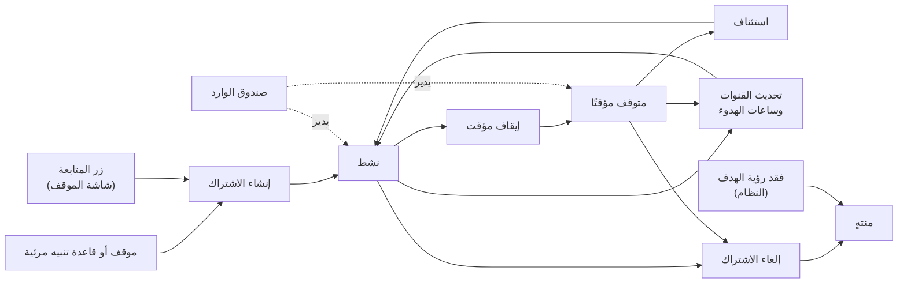
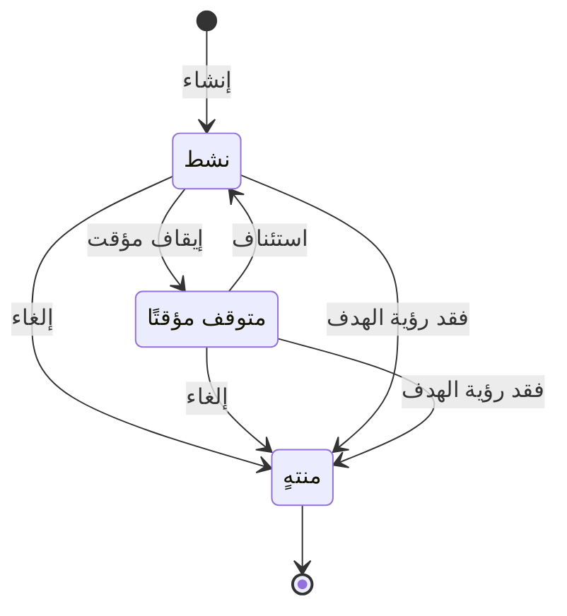

# اشتراكاتي ومتابعاتي

<!-- BEGIN GENERATED: doc -->
| البند | القيمة |
|---|---|
| المعرّف | FEAT-COM-SUBSCRIPTIONS |
| الإصدار | 0.1 |
| الحالة | مسودة |
| القدرة | CAP-10 الاتصال والمنتجات |
| القدرة الفرعية | CAP-10.01 الإشعارات والتوزيع (R1 (إشعارات)) |
| الأدوار | أي مستخدم مخوَّل؛ النظام |
| الشاشات | SCR-03 صندوق الوارد |
| حالات الاستخدام | UC-099 |
| القصص | 9: 6 من المواصفة، و3 جديدة |
<!-- END GENERATED: doc -->

## 1. نظرة عامة

### 1.1 القيمة

يختار المستخدم ما يتابعه وكيف يصله التنبيه، ويوقفه أو يلغيه متى شاء.

### 1.2 النطاق

| البند | القيمة |
|---|---|
| المستخدمون | أي مستخدم مخوَّل (يدير اشتراكاته)؛ مسؤول الإدارة (ينهي اشتراك غيره)؛ النظام (ينهي الاشتراك تلقائيًا عند فقد الرؤية) |
| الشاشات | شاشة صندوق الوارد (إدارة الاشتراكات)؛ شاشة الموقف وقواعد التنبيه (زر المتابعة) |
| حالات الاستخدام (بالكلام) | استقبال الإشعار: الاشتراك في موقف أو قاعدة تنبيه، وتحديث قنواته وساعات هدوئه، وإيقافه أو استئنافه أو إلغاؤه |
| المتطلبات (بالكلام) | عند وقوع حدث قابل للإشعار، يسلّم النظام إشعارًا داخل التطبيق وبالدفع للمستخدمين المخوَّلين المشتركين فيه |
| خارج النطاق | قنوات إشعار غير «داخل التطبيق» و«الدفع» (كالبريد أو الرسائل القصيرة)؛ محتوى الإشعار نفسه وصياغته (ميزة التنبيهات، لا هذه الميزة) |

### 1.3 خريطة الميزة

**الشكل 1: مسار الاشتراك من الإنشاء إلى الانتهاء**



**الشكل 2: دورة حالات الاشتراك**



## 2. القواعد المشتركة

تنطبق على كل قصص الميزة، فلا تتكرر داخل القصص. وكل قصة تذكر ما يخصها فقط.

### 2.1 السياق المشترك

كل قصة تبدأ من ثلاثة شروط: مستأجر نشط، وحزمة السياسات الأساسية مفعّلة، ومستخدم مسجّل الدخول ومخوَّل. وتشير إليها القصص بخطوة واحدة: «بفرض السياق المشترك للميزة».

### 2.2 الصلاحية وعدم الإفصاح

- من لا يحق له رؤية العنصر يتلقى ردًا بشكل «غير متاح» تمامًا، فلا يعرف أنه موجود.
- من يرى العنصر ولا يحق له الإجراء يتلقى «لا تملك صلاحية هذا الإجراء».

### 2.3 أوامر تغيير الحالة

- **منع التكرار:** يُرسل كل أمر بمفتاح فريد، فإعادة الطلب نفسه لا تُنفَّذ مرتين.
- **حماية التعديل المتزامن:** يُرسل كل أمر بإصدار البيانات الذي يراه المستخدم. فإن عدّلها غيره في الأثناء، يُرفض الأمر.
- **السجل:** إن نجح الأمر، يُكتب حدثه وسجل التدقيق في المعاملة نفسها.

### 2.4 الرفض المشترك

```gherkin
# language: ar
خاصية: الرفض المشترك لأوامر الميزة

  سيناريو مخطط: رفض مشترك لكل أمر في الميزة
    بفرض السياق المشترك للميزة
    و <الحالة>
    عندما يُرسل المستخدم أي أمر من أوامر الميزة
    اذاً يُرفض برمز <الرمز> ويرى "<الرسالة>"
    و لا يتغير شيء

    امثلة:
      | الحالة                                  | الرمز                  | الرسالة                                                 |
      | العنصر خارج صلاحياته                    | NOT_FOUND              | غير متاح                                                |
      | العنصر مرئي له ولا يحق له الإجراء       | AUTHZ_DENIED           | لا تملك صلاحية هذا الإجراء                              |
      | غيره عدّل العنصر بعد أن فتحه            | VERSION_CONFLICT       | تغيّرت البيانات منذ فتحتها. راجع التغييرات ثم أعد المحاولة |
      | أعاد مفتاح منع التكرار بمحتوى مختلف     | IDEMPOTENCY_KEY_REUSED | طلب مكرر بمحتوى مختلف                                   |
      | البيانات ناقصة أو غير صحيحة             | VALIDATION_FAILED      | بعض البيانات ناقصة أو غير صحيحة. راجع الحقول المعلَّمة      |

  سيناريو: إعادة الطلب نفسه لا تُنفَّذ مرتين
    بفرض السياق المشترك للميزة
    و أمر نجح بمفتاح منع تكرار
    عندما يُعاد الطلب نفسه بالمفتاح نفسه
    اذاً تُعاد النتيجة الأولى ولا يُكتب حدث ثانٍ
```

## 3. الجودة وتعريف الاكتمال

### 3.1 متطلبات الجودة

<!-- BEGIN GENERATED: quality -->
لا متطلبات جودة مرتبطة بمتطلبات هذه الميزة مباشرة. تنطبق متطلبات المنصة العامة (`FEAT-PLT-*`).
<!-- END GENERATED: quality -->

### 3.2 تعريف الاكتمال

القصة مكتملة حين تتحقق الشروط الخمسة:

1. سيناريوهاتها والقواعد المشتركة تمر في الاختبار الآلي.
2. فحوص البنية المعمارية تمر.
3. نصوص الواجهة والرسائل موجودة بالعربية والإنجليزية.
4. مراجعة الكود مكتملة.
5. ما تضيفه القصة نفسها في قسم «القواعد» تحقق.

## 4. فهرس القصص

<!-- BEGIN GENERATED: story-index -->
| المعرّف | القصة | النوع | الحالة |
|---|---|---|---|
| `US-BC04-SUB-PAUSE` | إيقاف الاشتراك مؤقتًا | أمر | مسودة |
| `US-BC04-SUB-RESUME` | استئناف الاشتراك | أمر | مسودة |
| `US-BC04-SUB-SUBSCRIBE` | إنشاء الاشتراك | أمر | مسودة |
| `US-BC04-SUB-UNSUBSCRIBE` | إلغاء الاشتراك | أمر | مسودة |
| `US-BC04-SUB-UPDATE-CHANNELS` | تحديث قنوات الاشتراك | أمر | مسودة |
| `US-DOM-SUB-LIST` | عرض قائمة اشتراكاتي | جلب | مسودة |
| `US-BC04-S-SUBSCRIPTION-01` | تلقائي: subscriber lost visibility of target (الاشتراك) | نظام | مسودة |
| `US-UI-SCR03-SUBSCRIPTIONS` | إدارة اشتراكاتي وقنواتها وساعات الهدوء | واجهة | مسودة |
| `US-UI-SCR12-FOLLOW` | زر متابعة الموقف أو قاعدة التنبيه | واجهة | مسودة |
<!-- END GENERATED: story-index -->

## 5. القصص

### 5.1 US-BC04-SUB-PAUSE — إيقاف الاشتراك مؤقتًا

| النوع | الإصدار | الأولوية | دون اتصال | الحالة |
|---|---|---|---|---|
| أمر | R1 | Must | لا | مسودة |

> **كـ** أي مستخدم مخوَّل، **أريد** إيقاف اشتراكي مؤقتًا، **حتى** أتوقف عن تلقي تنبيهاته دون أن أفقد إعداداته.

**باختصار:** يوقف المستخدم اشتراكه النشط مؤقتًا فيصبح «متوقفًا مؤقتًا» ويتوقف الإشعار عنه دون حذف إعداداته.

#### القواعد

- **متى يُسمح:** الاشتراك «نشط».
- **من يُسمح له:** المشترك نفسه.
- **الأثر:** تصبح حالة الاشتراك «متوقفًا مؤقتًا»، ويُسجَّل حدث «أُوقف الاشتراك» يصل إلى فهرس توزيع الإشعارات.

#### معايير القبول

```gherkin
# language: ar
خاصية: إيقاف الاشتراك مؤقتًا

  سيناريو: المستخدم يوقف اشتراكه
    بفرض السياق المشترك للميزة
    و اشتراك له في حالة "نشط"
    عندما يوقفه مؤقتًا
    اذاً تصبح حالته "متوقفًا مؤقتًا"
    و يُسجَّل حدث "أُوقف الاشتراك"

  سيناريو مخطط: رفض خاص بالإيقاف المؤقت
    بفرض السياق المشترك للميزة
    و <الحالة>
    عندما يحاول إيقافه مؤقتًا
    اذاً يُرفض برمز <الرمز> ويرى <الرسالة>
    و لا يتغير شيء

    امثلة:
      | الحالة                                      | الرمز                                  | الرسالة                                     |
      | الاشتراك "متوقف مؤقتًا" أو "منتهٍ"           | SUBSCRIPTION_INVALID_STATE_TRANSITION | الوضع الحالي للاشتراك لا يسمح بهذا الإجراء  |
```

<details><summary>المراجع التقنية والتتبع</summary>

<!-- BEGIN GENERATED: refs US-BC04-SUB-PAUSE -->
| البند | المعرّف | المعنى |
|---|---|---|
| الواجهة البرمجية | `POST /api/v1/operations/subscriptions/{id}/actions/pause` | — |
| الأمر | `CMD-SUB-PAUSE` | إيقاف الاشتراك مؤقتًا |
| السياسة | `POL-SUB-PAUSE` | any user (self) · Administrator (end)؛ tenant match; target visible to subject |
| الحدث | `EVT-SUB-PAUSED` | يصل إلى: Notification fan-out index |
| الكيان | `AGG-SUBSCRIPTION` | الاشتراك |
| الجدول | `operations.subscriptions` | الجدول الرئيسي للاشتراك |
| وحدة النشر | DU-08 | — |
| المتطلب | REQ-COM-001 | When a notifiable event occurs, the system shall deliver a notification in-app and by mobile push to authoriz… |
| حالة الاستخدام | UC-099 | Receive Notification |
| الاختبار | TST-SUBSCRIPTION-SM، TST-SLC06-INVARIANTS | دورة حالات الاشتراك، وثوابت الشريحة SLC-06 |
<!-- END GENERATED: refs US-BC04-SUB-PAUSE -->

</details>

### 5.2 US-BC04-SUB-RESUME — استئناف الاشتراك

| النوع | الإصدار | الأولوية | دون اتصال | الحالة |
|---|---|---|---|---|
| أمر | R1 | Must | لا | مسودة |

> **كـ** أي مستخدم مخوَّل، **أريد** استئناف اشتراكي المتوقف مؤقتًا، **حتى** أعود لتلقي تنبيهاته.

**باختصار:** يستأنف المستخدم اشتراكًا «متوقفًا مؤقتًا» إن كان هدفه ما زال مرئيًا له، فيعود «نشطًا».

#### القواعد

- **متى يُسمح:** الاشتراك «متوقف مؤقتًا»، والعنصر المتابَع ما زال مرئيًا للمشترك.
- **من يُسمح له:** المشترك نفسه.
- **الأثر:** تصبح حالته «نشطًا»، ويُسجَّل حدث «استُؤنف الاشتراك» يصل إلى فهرس توزيع الإشعارات.

#### معايير القبول

```gherkin
# language: ar
خاصية: استئناف الاشتراك

  سيناريو: المستخدم يستأنف اشتراكًا متوقفًا
    بفرض السياق المشترك للميزة
    و اشتراك له في حالة "متوقف مؤقتًا" وهدفه ما زال مرئيًا له
    عندما يستأنفه
    اذاً تصبح حالته "نشطًا"
    و يُسجَّل حدث "استُؤنف الاشتراك"

  سيناريو مخطط: رفض خاص بالاستئناف
    بفرض السياق المشترك للميزة
    و <الحالة>
    عندما يحاول استئنافه
    اذاً يُرفض برمز <الرمز> ويرى <الرسالة>
    و لا يتغير شيء

    امثلة:
      | الحالة                                | الرمز                                  | الرسالة                                     |
      | الاشتراك "نشط" أو "منتهٍ"              | SUBSCRIPTION_INVALID_STATE_TRANSITION | الوضع الحالي للاشتراك لا يسمح بهذا الإجراء  |
      | هدف الاشتراك لم يعد مرئيًا له          | TARGET_NOT_VISIBLE                    | العنصر المشترك فيه لم يعد متاحًا لك          |
```

<details><summary>المراجع التقنية والتتبع</summary>

<!-- BEGIN GENERATED: refs US-BC04-SUB-RESUME -->
| البند | المعرّف | المعنى |
|---|---|---|
| الواجهة البرمجية | `POST /api/v1/operations/subscriptions/{id}/actions/resume` | — |
| الأمر | `CMD-SUB-RESUME` | استئناف الاشتراك |
| السياسة | `POL-SUB-RESUME` | any user (self) · Administrator (end)؛ tenant match; target visible to subject |
| الحدث | `EVT-SUB-RESUMED` | يصل إلى: Notification fan-out index |
| الكيان | `AGG-SUBSCRIPTION` | الاشتراك |
| الجدول | `operations.subscriptions` | الجدول الرئيسي للاشتراك |
| وحدة النشر | DU-08 | — |
| المتطلب | REQ-COM-001 | When a notifiable event occurs, the system shall deliver a notification in-app and by mobile push to authoriz… |
| حالة الاستخدام | UC-099 | Receive Notification |
| الاختبار | TST-SUBSCRIPTION-SM، TST-SLC06-INVARIANTS | دورة حالات الاشتراك، وثوابت الشريحة SLC-06 |
<!-- END GENERATED: refs US-BC04-SUB-RESUME -->

</details>

### 5.3 US-BC04-SUB-SUBSCRIBE — إنشاء الاشتراك

| النوع | الإصدار | الأولوية | دون اتصال | الحالة |
|---|---|---|---|---|
| أمر | R1 | Must | لا | مسودة |

> **كـ** أي مستخدم مخوَّل، **أريد** الاشتراك في موقف أو قاعدة تنبيه أتابعها وأحدد قنواتها، **حتى** يصلني إشعارها بالطريقة التي أريد.

**باختصار:** يشترك المستخدم في موقف أو قاعدة تنبيه مرئية له بقناة أو أكثر من {داخل التطبيق، الدفع}، فيُنشأ اشتراك «نشط» واحد لكل عنصر.

#### القواعد

- **متى يُسمح:** العنصر المستهدف (موقف أو قاعدة تنبيه) مرئي للمشترك، ولا يوجد له اشتراك نشط سابق على العنصر نفسه.
- **من يُسمح له:** أي مستخدم مخوَّل، لنفسه.
- **البيانات:** العنصر المستهدف وقنوات الإشعار (إلزامية)، وساعات الهدوء (اختيارية).
- **الأثر:** يُنشأ الاشتراك بحالة «نشط»، ويُسجَّل حدث «أُنشئ الاشتراك» يصل إلى فهرس توزيع الإشعارات.

#### معايير القبول

```gherkin
# language: ar
خاصية: إنشاء الاشتراك

  سيناريو: المستخدم يشترك في عنصر مرئي له
    بفرض السياق المشترك للميزة
    و موقف أو قاعدة تنبيه مرئية له وليس له اشتراك نشط عليها
    عندما يشترك فيها بقناة إشعار واحدة على الأقل
    اذاً يُنشأ اشتراك بحالة "نشط"
    و يُسجَّل حدث "أُنشئ الاشتراك"

  سيناريو مخطط: رفض خاص بالإنشاء
    بفرض السياق المشترك للميزة
    و <الحالة>
    عندما يحاول الاشتراك
    اذاً يُرفض برمز <الرمز> ويرى <الرسالة>
    و لا يتغير شيء

    امثلة:
      | الحالة                                             | الرمز               | الرسالة                           |
      | له اشتراك نشط سابق على العنصر نفسه                | SUBSCRIPTION_EXISTS | أنت مشترك في هذا العنصر           |
      | العنصر المستهدف فارغ                               | VALIDATION_FAILED   | العنصر المستهدف مطلوب             |
      | قنوات الإشعار فارغة                                 | VALIDATION_FAILED   | قنوات الإشعار مطلوبة              |
```

<details><summary>المراجع التقنية والتتبع</summary>

<!-- BEGIN GENERATED: refs US-BC04-SUB-SUBSCRIBE -->
| البند | المعرّف | المعنى |
|---|---|---|
| الواجهة البرمجية | `POST /api/v1/operations/subscriptions` | — |
| الأمر | `CMD-SUB-SUBSCRIBE` | إنشاء الاشتراك |
| السياسة | `POL-SUB-SUBSCRIBE` | any user (self) · Administrator (end)؛ tenant match; target visible to subject |
| الحدث | `EVT-SUB-SUBSCRIBED` | يصل إلى: Notification fan-out index |
| الكيان | `AGG-SUBSCRIPTION` | الاشتراك |
| الجدول | `operations.subscriptions` | الجدول الرئيسي للاشتراك |
| وحدة النشر | DU-08 | — |
| المتطلب | REQ-COM-001 | When a notifiable event occurs, the system shall deliver a notification in-app and by mobile push to authoriz… |
| حالة الاستخدام | UC-099 | Receive Notification |
| الاختبار | TST-SUBSCRIPTION-SM، TST-SLC06-INVARIANTS | دورة حالات الاشتراك، وثوابت الشريحة SLC-06 |
<!-- END GENERATED: refs US-BC04-SUB-SUBSCRIBE -->

</details>

### 5.4 US-BC04-SUB-UNSUBSCRIBE — إلغاء الاشتراك

| النوع | الإصدار | الأولوية | دون اتصال | الحالة |
|---|---|---|---|---|
| أمر | R1 | Must | لا | مسودة |

> **كـ** أي مستخدم مخوَّل، **أريد** إلغاء اشتراكي، **حتى** أتوقف عن تلقي إشعاراته نهائيًا.

**باختصار:** يلغي المشترك اشتراكه «النشط» أو «المتوقف مؤقتًا» بذكر سبب اختياري، أو يلغيه مسؤول الإدارة عن غيره، فيصبح «منتهيًا» نهائيًا.

#### القواعد

- **متى يُسمح:** الاشتراك «نشط» أو «متوقف مؤقتًا».
- **من يُسمح له:** المشترك نفسه، أو مسؤول الإدارة.
- **البيانات:** السبب (اختياري).
- **الأثر:** يصبح الاشتراك «منتهيًا» (حالة نهائية)، ويُسجَّل حدث «أُنهي الاشتراك» يصل إلى فهرس توزيع الإشعارات.

#### معايير القبول

```gherkin
# language: ar
خاصية: إلغاء الاشتراك

  سيناريو: المشترك يلغي اشتراكه
    بفرض السياق المشترك للميزة
    و اشتراك له في حالة "نشط" أو "متوقف مؤقتًا"
    عندما يلغيه
    اذاً تصبح حالته "منتهٍ"
    و يُسجَّل حدث "أُنهي الاشتراك"

  سيناريو مخطط: رفض خاص بالإلغاء
    بفرض السياق المشترك للميزة
    و <الحالة>
    عندما يحاول إلغاءه
    اذاً يُرفض برمز <الرمز> ويرى <الرسالة>
    و لا يتغير شيء

    امثلة:
      | الحالة               | الرمز                                  | الرسالة                                     |
      | الاشتراك "منتهٍ"     | SUBSCRIPTION_INVALID_STATE_TRANSITION | الوضع الحالي للاشتراك لا يسمح بهذا الإجراء  |
```

<details><summary>المراجع التقنية والتتبع</summary>

<!-- BEGIN GENERATED: refs US-BC04-SUB-UNSUBSCRIBE -->
| البند | المعرّف | المعنى |
|---|---|---|
| الواجهة البرمجية | `POST /api/v1/operations/subscriptions/{id}/actions/unsubscribe` | — |
| الأمر | `CMD-SUB-UNSUBSCRIBE` | إلغاء الاشتراك |
| السياسة | `POL-SUB-UNSUBSCRIBE` | any user (self) · Administrator (end)؛ tenant match; target visible to subject |
| الحدث | `EVT-SUB-ENDED` | يصل إلى: Notification fan-out index |
| الكيان | `AGG-SUBSCRIPTION` | الاشتراك |
| الجدول | `operations.subscriptions` | الجدول الرئيسي للاشتراك |
| وحدة النشر | DU-08 | — |
| المتطلب | REQ-COM-001 | When a notifiable event occurs, the system shall deliver a notification in-app and by mobile push to authoriz… |
| حالة الاستخدام | UC-099 | Receive Notification |
| الاختبار | TST-SUBSCRIPTION-SM، TST-SLC06-INVARIANTS | دورة حالات الاشتراك، وثوابت الشريحة SLC-06 |
<!-- END GENERATED: refs US-BC04-SUB-UNSUBSCRIBE -->

</details>

### 5.5 US-BC04-SUB-UPDATE-CHANNELS — تحديث قنوات الاشتراك

| النوع | الإصدار | الأولوية | دون اتصال | الحالة |
|---|---|---|---|---|
| أمر | R1 | Must | لا | مسودة |

> **كـ** أي مستخدم مخوَّل، **أريد** تعديل قنوات اشتراكي وساعات هدوئه، **حتى** يصلني الإشعار بالطريقة والوقت المناسبين لي.

**باختصار:** يعدّل المستخدم قنوات اشتراكه «النشط» أو «المتوقف مؤقتًا» وساعات هدوئه، فتبقى حالته كما هي ويرتفع إصداره فقط. وتنبيهات الخطورة الحرجة تتجاوز ساعات الهدوء.

#### القواعد

- **متى يُسمح:** الاشتراك «نشط» أو «متوقف مؤقتًا».
- **من يُسمح له:** المشترك نفسه.
- **البيانات:** قنوات الإشعار (إلزامية)، وساعات الهدوء (اختيارية).
- **الأثر:** لا تتغير حالة الاشتراك، ويُسجَّل حدث «حُدِّثت قنوات الاشتراك». وتنبيهات الخطورة الحرجة تصل حتى خلال ساعات الهدوء.

#### معايير القبول

```gherkin
# language: ar
خاصية: تحديث قنوات الاشتراك

  سيناريو: المستخدم يعدّل قنواته وساعات هدوئه
    بفرض السياق المشترك للميزة
    و اشتراك له في حالة "نشط"
    عندما يعدّل قنواته وساعات هدوئه بقيم صحيحة
    اذاً تبقى حالته "نشط" ويرتفع إصداره
    و يُسجَّل حدث "حُدِّثت قنوات الاشتراك"

  سيناريو مخطط: رفض خاص بتحديث القنوات
    بفرض السياق المشترك للميزة
    و <الحالة>
    عندما يحاول تعديل القنوات أو ساعات الهدوء
    اذاً يُرفض برمز <الرمز> ويرى <الرسالة>
    و لا يتغير شيء

    امثلة:
      | الحالة                                        | الرمز                                  | الرسالة                                      |
      | القنوات أو ساعات الهدوء غير صحيحة             | SUBSCRIPTION_INVALID                  | إعداد الاشتراك غير صحيح                      |
      | الاشتراك "منتهٍ"                               | SUBSCRIPTION_INVALID_STATE_TRANSITION | الوضع الحالي للاشتراك لا يسمح بهذا الإجراء   |
      | قنوات الإشعار فارغة                            | VALIDATION_FAILED                     | قنوات الإشعار مطلوبة                          |
```

<details><summary>المراجع التقنية والتتبع</summary>

<!-- BEGIN GENERATED: refs US-BC04-SUB-UPDATE-CHANNELS -->
| البند | المعرّف | المعنى |
|---|---|---|
| الواجهة البرمجية | `POST /api/v1/operations/subscriptions/{id}/actions/update-channels` | — |
| الأمر | `CMD-SUB-UPDATE-CHANNELS` | تحديث قنوات الاشتراك |
| السياسة | `POL-SUB-UPDATE-CHANNELS` | any user (self) · Administrator (end)؛ tenant match; target visible to subject |
| الحدث | `EVT-SUB-CHANNELS-UPDATED` | يصل إلى: Notification fan-out index |
| الكيان | `AGG-SUBSCRIPTION` | الاشتراك |
| الجدول | `operations.subscriptions` | الجدول الرئيسي للاشتراك |
| وحدة النشر | DU-08 | — |
| المتطلب | REQ-COM-001 | When a notifiable event occurs, the system shall deliver a notification in-app and by mobile push to authoriz… |
| حالة الاستخدام | UC-099 | Receive Notification |
| الاختبار | TST-SUBSCRIPTION-SM، TST-SLC06-INVARIANTS | دورة حالات الاشتراك، وثوابت الشريحة SLC-06 |
<!-- END GENERATED: refs US-BC04-SUB-UPDATE-CHANNELS -->

</details>

### 5.6 US-DOM-SUB-LIST — عرض قائمة اشتراكاتي

| النوع | الإصدار | الأولوية | دون اتصال | الحالة |
|---|---|---|---|---|
| جلب | R1 | Should | لا | مسودة |

> **كـ** أي مستخدم مخوَّل، **أريد** قائمة اشتراكاتي وحالتها وقنواتها، **حتى** أعرف ما أتابعه الآن وأديره. **[Derived]**

**باختصار:** تُعاد اشتراكات المستخدم نفسه فقط، بحالتها وقنواتها، صفحةً بعد صفحة. **[Derived]**

#### القواعد

- **من يرى ماذا:** كل مستخدم يرى اشتراكاته هو فقط. **[Derived]**
- **البيانات (المرشحات):** الحالة، والمؤشر والحد. **[Derived]**

#### معايير القبول

```gherkin
# language: ar
خاصية: قائمة اشتراكاتي

  سيناريو: يرى المستخدم اشتراكاته فقط
    بفرض السياق المشترك للميزة
    و للمستخدم اشتراكات بحالات مختلفة
    عندما يطلب قائمة اشتراكاته
    اذاً تُعاد اشتراكاته فقط بحالتها وقنواتها

  سيناريو: الصفحة التالية
    بفرض السياق المشترك للميزة
    و اشتراكاته أكثر من صفحة
    عندما يطلب الصفحة التالية بالمؤشر
    اذاً تُعاد الاشتراكات التالية دون تكرار ولا فجوة
```

<details><summary>المراجع التقنية والتتبع</summary>

<!-- BEGIN GENERATED: refs US-DOM-SUB-LIST -->
| البند | المعرّف | المعنى |
|---|---|---|
| حالة الاستخدام | UC-099 | Receive Notification |
| المصدر | `00-open-questions.md §4` | — |
| المصدر | `[Derived]` | — |
<!-- END GENERATED: refs US-DOM-SUB-LIST -->

</details>

### 5.7 US-BC04-S-SUBSCRIPTION-01 — تلقائي: subscriber lost visibility of target (الاشتراك)

| النوع | الإصدار | الأولوية | دون اتصال | الحالة |
|---|---|---|---|---|
| نظام | R1 | Must | لا ينطبق | مسودة |

> **كـ** النظام، **أريد** إنهاء الاشتراك تلقائيًا حين يفقد المشترك رؤية هدفه، **حتى** لا يبقى اشتراك قائم على عنصر لا يحق له رؤيته.

**باختصار:** حين يتغير إصدار الأمان للعنصر المتابَع أو يُعاد تصنيفه فيصبح غير مرئي للمشترك، ينهي النظام اشتراكه «النشط» أو «المتوقف مؤقتًا» تلقائيًا.

#### القواعد

- **متى يحدث:** تغيّر إصدار الأمان للهدف أو إعادة تصنيفه، فيصبح غير مرئي لمشترك له اشتراك قائم عليه.
- **الأثر:** يصبح الاشتراك «منتهيًا» (حالة نهائية)، ويُسجَّل حدث «أُنهي الاشتراك» وسجل تدقيق بهوية النظام.

#### معايير القبول

```gherkin
# language: ar
خاصية: إنهاء الاشتراك عند فقد الرؤية

  سيناريو: تغيّر تصنيف العنصر المتابَع
    بفرض اشتراك "نشط" أو "متوقف مؤقتًا" أصبح هدفه غير مرئي للمشترك بعد تغيّر إصدار الأمان أو إعادة التصنيف
    عندما يفحص النظام رؤية أهداف الاشتراكات
    اذاً تصبح حالة الاشتراك "منتهٍ"
    و يُسجَّل حدث "أُنهي الاشتراك" وسجل تدقيق بهوية النظام

  سيناريو: الهدف ما زال مرئيًا
    بفرض اشتراك "نشط" وهدفه ما زال مرئيًا للمشترك
    عندما يفحص النظام رؤية أهداف الاشتراكات
    اذاً لا يتغير شيء
```

<details><summary>المراجع التقنية والتتبع</summary>

<!-- BEGIN GENERATED: refs US-BC04-S-SUBSCRIPTION-01 -->
| البند | المعرّف | المعنى |
|---|---|---|
| المحفِّز | `SYS:subscriber lost visibility of target` | security-version change or reclassification |
| الانتقال | ACTIVE, PAUSED ← ENDED | — |
| الحدث | `EVT-SUB-ENDED` | يصل إلى: Notification fan-out index |
| الكيان | `AGG-SUBSCRIPTION` | الاشتراك |
| الجدول | `operations.subscriptions` | الجدول الرئيسي للاشتراك |
| وحدة النشر | DU-08 | — |
| المتطلب | REQ-COM-001 | When a notifiable event occurs, the system shall deliver a notification in-app and by mobile push to authoriz… |
| حالة الاستخدام | UC-099 | Receive Notification |
| الاختبار | TST-SUBSCRIPTION-SM، TST-SLC06-INVARIANTS | دورة حالات الاشتراك، وثوابت الشريحة SLC-06 |
<!-- END GENERATED: refs US-BC04-S-SUBSCRIPTION-01 -->

</details>

### 5.8 US-UI-SCR03-SUBSCRIPTIONS — إدارة اشتراكاتي وقنواتها وساعات الهدوء

| النوع | الإصدار | الأولوية | دون اتصال | الحالة |
|---|---|---|---|---|
| واجهة | R1 | Should | لا | مسودة |

> **كـ** أي مستخدم مخوَّل، **أريد** إدارة اشتراكاتي وقنواتها وساعات هدوئها من شاشة واحدة، **حتى** أتحكم فيما يصلني ومتى دون البحث في كل عنصر على حدة. **[Derived]**

**باختصار:** تعرض شاشة صندوق الوارد قائمة اشتراكات المستخدم مع حالتها، وتتيح إيقافها أو استئنافها أو إلغاءها أو تعديل قنواتها وساعات هدوئها من مكان واحد. **[Derived]**

#### القواعد

- **ما يُعرض:** اشتراكات المستخدم نفسه فقط، بحالتها الحالية وقنواتها وساعات هدوئها. **[Derived]**
- **الإجراءات المتاحة:** حسب حالة كل اشتراك: إيقاف مؤقت، استئناف، إلغاء، أو تعديل القنوات، كما في القصص 5.1 إلى 5.5. **[Derived]**

#### معايير القبول

```gherkin
# language: ar
خاصية: إدارة الاشتراكات من صندوق الوارد

  سيناريو: عرض قائمة الاشتراكات وإجراءاتها
    بفرض السياق المشترك للميزة
    و للمستخدم اشتراكات بحالات مختلفة
    عندما يفتح شاشة صندوق الوارد
    اذاً تُعرض اشتراكاته بحالتها وقنواتها وساعات هدوئها
    و يرى إجراءات الحالة المتاحة لكل اشتراك فقط

  سيناريو: لا اشتراكات بعد
    بفرض السياق المشترك للميزة
    و لا اشتراك للمستخدم
    عندما يفتح شاشة صندوق الوارد
    اذاً تُعرض قائمة فارغة دون أي إجراء
```

<details><summary>المراجع التقنية والتتبع</summary>

<!-- BEGIN GENERATED: refs US-UI-SCR03-SUBSCRIPTIONS -->
| البند | المعرّف | المعنى |
|---|---|---|
| الشاشة | SCR-03 | شاشة صندوق الوارد |
| حالة الاستخدام | UC-099 | Receive Notification |
| المصدر | `00-open-questions.md §4` | — |
| المصدر | `[Derived]` | — |
<!-- END GENERATED: refs US-UI-SCR03-SUBSCRIPTIONS -->

</details>

### 5.9 US-UI-SCR12-FOLLOW — زر متابعة الموقف أو قاعدة التنبيه

| النوع | الإصدار | الأولوية | دون اتصال | الحالة |
|---|---|---|---|---|
| واجهة | R1 | Should | لا | مسودة |

> **كـ** أي مستخدم مخوَّل، **أريد** زر متابعة سريعًا على شاشة الموقف أو قاعدة التنبيه، **حتى** أشترك فيه دون الانتقال إلى شاشة أخرى. **[Derived]**

**باختصار:** يظهر زر «متابعة» على شاشة الموقف أو قاعدة التنبيه، فينشئ اشتراكًا بالقنوات الافتراضية بنقرة واحدة، ويتحول إلى «إلغاء المتابعة» إن كان له اشتراك نشط عليه. **[Derived]**

#### القواعد

- **ما يُعرض:** زر «متابعة» إن لم يكن للمستخدم اشتراك نشط على العنصر المعروض، و«إلغاء المتابعة» إن كان له اشتراك نشط عليه. **[Derived]**
- **الأثر:** الضغط على «متابعة» ينشئ الاشتراك بالقنوات الافتراضية (القصة 5.3)؛ والضغط على «إلغاء المتابعة» ينهيه (القصة 5.4). **[Derived]**

#### معايير القبول

```gherkin
# language: ar
خاصية: زر متابعة الموقف أو قاعدة التنبيه

  سيناريو: المتابعة بنقرة واحدة
    بفرض السياق المشترك للميزة
    و لا اشتراك نشط للمستخدم على الموقف المعروض
    عندما يضغط زر "متابعة"
    اذاً يُنشأ اشتراك نشط بالقنوات الافتراضية
    و يتحول الزر إلى "إلغاء المتابعة"

  سيناريو: إلغاء المتابعة من الزر نفسه
    بفرض السياق المشترك للميزة
    و للمستخدم اشتراك نشط على الموقف المعروض
    عندما يضغط زر "إلغاء المتابعة"
    اذاً ينتهي الاشتراك
    و يعود الزر إلى "متابعة"
```

<details><summary>المراجع التقنية والتتبع</summary>

<!-- BEGIN GENERATED: refs US-UI-SCR12-FOLLOW -->
| البند | المعرّف | المعنى |
|---|---|---|
| الشاشة | SCR-12 | شاشة إدارة الموقف وقواعد التنبيه |
| حالة الاستخدام | UC-099 | Receive Notification |
| المصدر | `[Derived]` | — |
<!-- END GENERATED: refs US-UI-SCR12-FOLLOW -->

</details>

## 6. التتبع

<!-- BEGIN GENERATED: trace -->
| المتطلب | المعنى | القصص | الاختبار |
|---|---|---|---|
| REQ-COM-001 | When a notifiable event occurs, the system shall deliver a notification in-app and by mobile push to authoriz… | كل قصص الميزة المأخوذة من المواصفة (6) | TST-NOTIFICATION-SM، TST-SLC06-INVARIANTS، TST-SUBSCRIPTION-SM |
<!-- END GENERATED: trace -->

## 7. سجل التغييرات

| الإصدار | التاريخ | التغيير |
|---|---|---|
| 0.1 | — | هيكل مولَّد من خريطة الميزات |
| 0.2 | 2026-10-13 | كتابة القصص كاملة بمعيار القصص |
