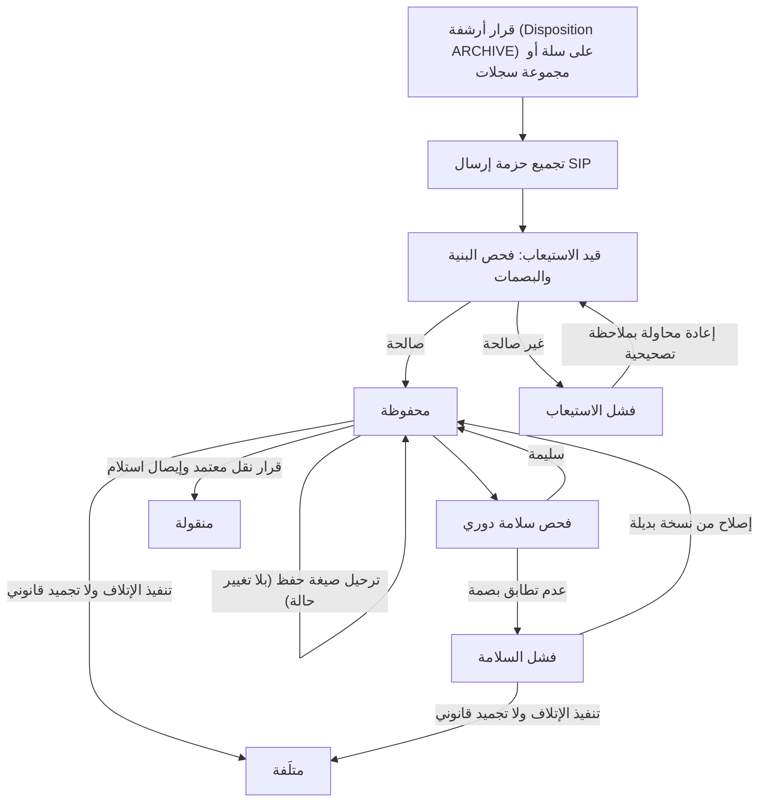
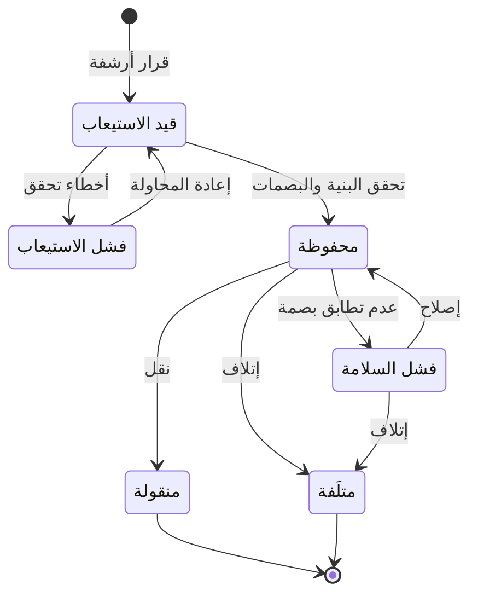

# حفظ الأرشيف وسلامته

<!-- BEGIN GENERATED: doc -->
| البند | القيمة |
|---|---|
| المعرّف | FEAT-KNW-ARCHIVE-PRESERVE |
| الإصدار | 0.1 |
| الحالة | مسودة |
| القدرة | CAP-11 المعرفة والذاكرة المؤسسية |
| القدرة الفرعية | CAP-11.03 الأرشيف وإعادة البناء التاريخي (R2) |
| الأدوار | أمين الأرشيف؛ الجهة المحيلة؛ النظام |
| الشاشات | SCR-44 المعرفة والأرشيف |
| حالات الاستخدام | UC-063 |
| القصص | 15: 9 من المواصفة، و6 جديدة |
<!-- END GENERATED: doc -->

## 1. نظرة عامة

### 1.1 القيمة

يضمن نقل السجلات المؤرشفة إلى حزم محفوظة بصيغ دائمة يُتحقق من سلامتها دوريًا وتُصلح أو تُرحَّل عند الحاجة.

### 1.2 النطاق

| البند | القيمة |
|---|---|
| المستخدمون | أمين الأرشيف (الاستيعاب والإصلاح وترحيل الصيغة)؛ الجهة المحيلة صاحبة سلطة النقل؛ النظام بهوية عبء عمل |
| الشاشات | المعرفة والأرشيف (SCR-44) |
| حالات الاستخدام | حفظ السجل المؤرشف (UC-063): تجميع الحزمة الأرشيفية وتحقق بنيتها وبصماتها، إصلاحها أو إعادة محاولة استيعابها، ترحيل صيغة حفظها، نقلها إلى أرشيف مستلم، أو إتلافها عند تنفيذ قرار الإتلاف |
| المتطلبات | نقل السجلات التي بلغت قرار الأرشفة إلى حزم أرشيفية بمعيار OAIS تحمل المحتوى والبيانات الوصفية والمنشأ وسجل الوصول؛ حفظ الحزم بصيغ دائمة والتحقق من سلامتها دوريًا؛ استرجاع السجل التاريخي خلال هدف الاسترجاع (ميزة أخرى) |
| خارج النطاق | استرجاع محتوى الحزمة وعرضه (`FEAT-KNW-ARCHIVE-RETRIEVE`)؛ قرار الإتلاف نفسه وجدول الاحتفاظ (`FEAT-KNW-DISPOSITION`)؛ التجميد القانوني الذي يوقف الإتلاف (`FEAT-KNW-LEGAL-HOLD`) |

### 1.3 خريطة الميزة

**الشكل 1: رحلة الحزمة الأرشيفية من قرار الأرشفة إلى النقل أو الإتلاف**



**الشكل 2: حالات الحزمة الأرشيفية**



## 2. القواعد المشتركة

تنطبق على كل قصص الميزة، فلا تتكرر داخل القصص. وكل قصة تذكر ما يخصها فقط.

### 2.1 السياق المشترك

كل قصة تبدأ من ثلاثة شروط: مستأجر نشط، وحزمة السياسات الأساسية مفعّلة، ومستخدم مسجّل الدخول ومخوَّل. وتشير إليها القصص بخطوة واحدة: «بفرض السياق المشترك للميزة».

### 2.2 الصلاحية وعدم الإفصاح

- من لا يحق له رؤية العنصر يتلقى ردًا بشكل «غير متاح» تمامًا، فلا يعرف أنه موجود.
- من يرى العنصر ولا يحق له الإجراء يتلقى «لا تملك صلاحية هذا الإجراء».

### 2.3 أوامر تغيير الحالة

- **منع التكرار:** يُرسل كل أمر بمفتاح فريد، فإعادة الطلب نفسه لا تُنفَّذ مرتين.
- **حماية التعديل المتزامن:** يُرسل كل أمر بإصدار البيانات الذي يراه المستخدم. فإن عدّلها غيره في الأثناء، يُرفض الأمر.
- **السجل:** إن نجح الأمر، يُكتب حدثه وسجل التدقيق في المعاملة نفسها.

> **ملاحظة:** الحزمة الأرشيفية لا تُحذف ولا تُلغى بإنهاء بشري مباشر: حالتاها النهائيتان «منقولة» و«متلَفة» ينتقل إليهما الكيان بأمر معتمَد أو بتنفيذ قرار الإتلاف فقط (القصص 5.4 و5.9)، والإتلاف يتوقف ما دام تجميد قانوني قائمًا (ميزة التجميد القانوني).

### 2.4 الرفض المشترك

```gherkin
# language: ar
خاصية: الرفض المشترك لأوامر الميزة

  سيناريو مخطط: رفض مشترك لكل أمر في الميزة
    بفرض السياق المشترك للميزة
    و <الحالة>
    عندما يُرسل المستخدم أي أمر من أوامر الميزة
    اذاً يُرفض برمز <الرمز> ويرى "<الرسالة>"
    و لا يتغير شيء

    امثلة:
      | الحالة                                  | الرمز                  | الرسالة                                                 |
      | العنصر خارج صلاحياته                    | NOT_FOUND              | غير متاح                                                |
      | العنصر مرئي له ولا يحق له الإجراء       | AUTHZ_DENIED           | لا تملك صلاحية هذا الإجراء                              |
      | غيره عدّل العنصر بعد أن فتحه            | VERSION_CONFLICT       | تغيّرت البيانات منذ فتحتها. راجع التغييرات ثم أعد المحاولة |
      | أعاد مفتاح منع التكرار بمحتوى مختلف     | IDEMPOTENCY_KEY_REUSED | طلب مكرر بمحتوى مختلف                                   |
      | البيانات ناقصة أو غير صحيحة             | VALIDATION_FAILED      | بعض البيانات ناقصة أو غير صحيحة. راجع الحقول المعلَّمة      |

  سيناريو: إعادة الطلب نفسه لا تُنفَّذ مرتين
    بفرض السياق المشترك للميزة
    و أمر نجح بمفتاح منع تكرار
    عندما يُعاد الطلب نفسه بالمفتاح نفسه
    اذاً تُعاد النتيجة الأولى ولا يُكتب حدث ثانٍ
```

## 3. الجودة وتعريف الاكتمال

### 3.1 متطلبات الجودة

<!-- BEGIN GENERATED: quality -->
| المرجع | الموقف | المطلوب |
|---|---|---|
| QAS-ARC-001 | retrieve an archived record | ≤ 1 min for warm, ≤ 24 h for cold/offline media |
| QAS-ARC-003 | yearly archive integrity verification | 0 unreported corruption; repair from replica |
<!-- END GENERATED: quality -->

### 3.2 تعريف الاكتمال

القصة مكتملة حين تتحقق الشروط الخمسة:

1. سيناريوهاتها والقواعد المشتركة تمر في الاختبار الآلي.
2. فحوص البنية المعمارية تمر.
3. نصوص الواجهة والرسائل موجودة بالعربية والإنجليزية.
4. مراجعة الكود مكتملة.
5. ما تضيفه القصة نفسها في قسم «القواعد» تحقق.

## 4. فهرس القصص

<!-- BEGIN GENERATED: story-index -->
| المعرّف | القصة | النوع | الحالة |
|---|---|---|---|
| `US-BC06-ARC-MIGRATE-FORMAT` | ترحيل صيغة الحزمة الأرشيفية | أمر | مسودة |
| `US-BC06-ARC-REPAIR` | إصلاح الحزمة الأرشيفية | أمر | مسودة |
| `US-BC06-ARC-RETRY-INGEST` | إعادة محاولة استيعاب الحزمة الأرشيفية | أمر | مسودة |
| `US-BC06-ARC-TRANSFER` | نقل الحزمة الأرشيفية | أمر | مسودة |
| `US-BC06-S-ARCHIVE-PACKAGE-01` | تلقائي: disposition action ARCHIVE for a bucket or record set (الحزمة الأرشيفية) | نظام | مسودة |
| `US-BC06-S-ARCHIVE-PACKAGE-02` | تلقائي: package validated (الحزمة الأرشيفية) | نظام | مسودة |
| `US-BC06-S-ARCHIVE-PACKAGE-03` | تلقائي: validation failed (الحزمة الأرشيفية) | نظام | مسودة |
| `US-BC06-S-ARCHIVE-PACKAGE-04` | تلقائي: integrity check failed (الحزمة الأرشيفية) | نظام | مسودة |
| `US-BC06-S-ARCHIVE-PACKAGE-05` | تلقائي: disposition DESTROY executed for the package bucket (الحزمة الأرشيفية) | نظام | مسودة |
| `US-UI-SCR44-ARCHIVE-PACKAGE` | متابعة حالة الحزمة الأرشيفية وأحداث حفظها | واجهة | مسودة |
| `US-PLT-ARCHIVE-FIXITY-SCHEDULE` | التحقق الدوري من سلامة كل الحزم | منصة | مسودة |
| `US-PLT-ARCHIVE-PACKAGE-BUILD` | بناء الحزمة الأرشيفية بصيغ الحفظ الدائمة | منصة | مسودة |
| `US-PLT-ARCHIVE-WORM-REPLICA` | تخزين الأرشيف مقفلًا مع نسخة في موقع التعافي | منصة | مسودة |
| `US-INT-ARCHIVE-TRANSFER-EXPORT` | تسليم الحزمة إلى أرشيف مستلم بإيصال | تكامل | مسودة |
| `US-OPS-ARCHIVE-FIXITY-ALERT` | التنبيه الفوري لأي خلل في سلامة الأرشيف | تشغيل | مسودة |
<!-- END GENERATED: story-index -->

## 5. القصص

### 5.1 US-BC06-ARC-MIGRATE-FORMAT — ترحيل صيغة الحزمة الأرشيفية

| النوع | الإصدار | الأولوية | دون اتصال | الحالة |
|---|---|---|---|---|
| أمر | R2 | Must | لا | مسودة |

> **كـ** أمين الأرشيف، **أريد** أن أضيف للحزمة المحفوظة تمثيلًا جديدًا بصيغة حفظ أحدث، **حتى** تبقى قابلة للقراءة مستقبلًا دون أن تفقد نسختها الأصلية.

**باختصار:** أمين الأرشيف يضيف تمثيلًا جديدًا بصيغة حفظ أحدث لحزمة محفوظة، دون أن تتغير حالتها أو تُمحى نسختها الأصلية، ويُسجَّل حدث الترحيل.

#### القواعد

- **متى يُسمح:** الحزمة في حالة «محفوظة»، ويُضاف تمثيل الحفظ الجديد دون حذف الأصل، ويُسجَّل حدث حفظ خاص به.
- **من يُسمح له:** أمين الأرشيف.
- **البيانات:** صيغة الحفظ المستهدفة (إلزامي)، وسبب الترحيل (إلزامي).
- **الأثر:** تبقى الحزمة «محفوظة»، ويُسجَّل حدث «تم ترحيل صيغة الحزمة» إلى فهرس الأرشيف ومتابعة قرار الإتلاف وسجل التدقيق.

#### معايير القبول

```gherkin
# language: ar
خاصية: ترحيل صيغة الحزمة الأرشيفية

  سيناريو: ترحيل صيغة حزمة محفوظة
    بفرض السياق المشترك للميزة
    و حزمة أرشيفية في حالة "محفوظة"
    عندما يرسل أمين الأرشيف صيغة حفظ مستهدفة وسببًا
    اذاً تبقى حالتها "محفوظة" ويزداد إصدارها
    و يُسجَّل حدث "تم ترحيل صيغة الحزمة"

  سيناريو مخطط: رفض خاص بترحيل الصيغة
    بفرض السياق المشترك للميزة
    و <الحالة>
    عندما يحاول ترحيل صيغة الحزمة
    اذاً يُرفض برمز <الرمز> ويرى <الرسالة>
    و لا يتغير شيء

    امثلة:
      | الحالة                                           | الرمز                                     | الرسالة                                            |
      | الحزمة ليست "محفوظة"                             | ARCHIVE_PACKAGE_INVALID_STATE_TRANSITION | الوضع الحالي للحزمة الأرشيفية لا يسمح بهذا الإجراء |
      | لم يُضَف تمثيل حفظ جديد أو لم يُسجَّل حدث الحفظ  | FORMAT_INVALID                            | تعذّر إضافة صيغة الحفظ الجديدة                      |
      | صيغة الحفظ المستهدفة مفقودة                      | VALIDATION_FAILED                         | صيغة الحفظ المستهدفة مطلوبة                         |
```

<details><summary>المراجع التقنية والتتبع</summary>

<!-- BEGIN GENERATED: refs US-BC06-ARC-MIGRATE-FORMAT -->
| البند | المعرّف | المعنى |
|---|---|---|
| الواجهة البرمجية | `POST /api/v1/knowledge/archive-packages/{id}/actions/migrate-format` | — |
| الأمر | `CMD-ARC-MIGRATE-FORMAT` | ترحيل صيغة الحزمة الأرشيفية |
| السياسة | `POL-ARC-MIGRATE-FORMAT` | Archivist (retry, repair, migrate) · transfer authority (transfer)؛ tenant match; object visible |
| الحدث | `EVT-ARC-FORMAT-MIGRATED` | يصل إلى: Archive catalogue; Disposition (SLC-12a); Audit |
| الكيان | `AGG-ARCHIVE-PACKAGE` | الحزمة الأرشيفية |
| الجدول | `knowledge.archive_packages` | الجدول الرئيسي للحزمة الأرشيفية |
| وحدة النشر | DU-15 | — |
| المتطلبات | REQ-ARC-001، REQ-ARC-002، REQ-ARC-003 | معانيها في القسم 6. التتبع |
| حالة الاستخدام | UC-063 | Archive Record |
| الاختبار | TST-ARCHIVE-PACKAGE-SM، TST-SLC12-INVARIANTS | دورة حالات الحزمة الأرشيفية، وثوابت الشريحة SLC-12 |
<!-- END GENERATED: refs US-BC06-ARC-MIGRATE-FORMAT -->

</details>

### 5.2 US-BC06-ARC-REPAIR — إصلاح الحزمة الأرشيفية

| النوع | الإصدار | الأولوية | دون اتصال | الحالة |
|---|---|---|---|---|
| أمر | R2 | Must | لا | مسودة |

> **كـ** أمين الأرشيف، **أريد** إصلاح الحزمة التي فشل فحص سلامتها من نسخة بديلة مطابقة، **حتى** تعود محفوظة بثقة.

**باختصار:** بعد استعادة محتوى الحزمة من نسخة بديلة وإعادة التحقق من بصماتها، يصلحها أمين الأرشيف فتعود «محفوظة».

#### القواعد

- **متى يُسمح:** الحزمة في حالة «فشل السلامة»، ومحتواها مُستعاد من نسخة بديلة وبصماته مُعاد التحقق منها.
- **من يُسمح له:** أمين الأرشيف.
- **البيانات:** مرجع النسخة البديلة (إلزامي).
- **الأثر:** تعود الحزمة إلى «محفوظة»، ويُسجَّل حدث «تم إصلاح الحزمة» إلى فهرس الأرشيف ومتابعة قرار الإتلاف وسجل التدقيق.

#### معايير القبول

```gherkin
# language: ar
خاصية: إصلاح الحزمة الأرشيفية

  سيناريو: إصلاح حزمة فشلت سلامتها
    بفرض السياق المشترك للميزة
    و حزمة أرشيفية في حالة "فشل السلامة"
    عندما يرسل أمين الأرشيف مرجع النسخة البديلة
    اذاً تصبح حالتها "محفوظة"
    و يُسجَّل حدث "تم إصلاح الحزمة"

  سيناريو مخطط: رفض خاص بالإصلاح
    بفرض السياق المشترك للميزة
    و <الحالة>
    عندما يحاول إصلاح الحزمة
    اذاً يُرفض برمز <الرمز> ويرى <الرسالة>
    و لا يتغير شيء

    امثلة:
      | الحالة                                       | الرمز                                     | الرسالة                                              |
      | الحزمة ليست "فشل السلامة"                    | ARCHIVE_PACKAGE_INVALID_STATE_TRANSITION | الوضع الحالي للحزمة الأرشيفية لا يسمح بهذا الإجراء   |
      | لم يُعَد التحقق من البصمات بعد الاستعادة     | FIXITY_MISMATCH                           | فشل التحقق من سلامة الملف بعد الاستعادة              |
      | مرجع النسخة البديلة مفقود                    | VALIDATION_FAILED                         | مرجع النسخة البديلة مطلوب                            |
```

<details><summary>المراجع التقنية والتتبع</summary>

<!-- BEGIN GENERATED: refs US-BC06-ARC-REPAIR -->
| البند | المعرّف | المعنى |
|---|---|---|
| الواجهة البرمجية | `POST /api/v1/knowledge/archive-packages/{id}/actions/repair` | — |
| الأمر | `CMD-ARC-REPAIR` | إصلاح الحزمة الأرشيفية |
| السياسة | `POL-ARC-REPAIR` | Archivist (retry, repair, migrate) · transfer authority (transfer)؛ tenant match; object visible |
| الحدث | `EVT-ARC-REPAIRED` | يصل إلى: Archive catalogue; Disposition (SLC-12a); Audit |
| الكيان | `AGG-ARCHIVE-PACKAGE` | الحزمة الأرشيفية |
| الجدول | `knowledge.archive_packages` | الجدول الرئيسي للحزمة الأرشيفية |
| وحدة النشر | DU-15 | — |
| المتطلبات | REQ-ARC-001، REQ-ARC-002، REQ-ARC-003 | معانيها في القسم 6. التتبع |
| حالة الاستخدام | UC-063 | Archive Record |
| الاختبار | TST-ARCHIVE-PACKAGE-SM، TST-SLC12-INVARIANTS | دورة حالات الحزمة الأرشيفية، وثوابت الشريحة SLC-12 |
<!-- END GENERATED: refs US-BC06-ARC-REPAIR -->

</details>

### 5.3 US-BC06-ARC-RETRY-INGEST — إعادة محاولة استيعاب الحزمة الأرشيفية

| النوع | الإصدار | الأولوية | دون اتصال | الحالة |
|---|---|---|---|---|
| أمر | R2 | Must | لا | مسودة |

> **كـ** أمين الأرشيف، **أريد** إعادة محاولة استيعاب الحزمة التي فشل استيعابها بعد تصحيح الخلل، **حتى** تُستكمل أرشفتها.

**باختصار:** بعد تسجيل ملاحظة تصحيحية، يعيد أمين الأرشيف محاولة استيعاب حزمة فشل استيعابها، فتعود إلى «قيد الاستيعاب».

#### القواعد

- **متى يُسمح:** الحزمة في حالة «فشل الاستيعاب»، وبملاحظة تصحيحية.
- **من يُسمح له:** أمين الأرشيف.
- **البيانات:** الملاحظة التصحيحية (إلزامي).
- **الأثر:** تعود الحزمة إلى «قيد الاستيعاب»، ويُسجَّل حدث «بدأ استيعاب الحزمة».

#### معايير القبول

```gherkin
# language: ar
خاصية: إعادة محاولة استيعاب الحزمة الأرشيفية

  سيناريو: إعادة محاولة الاستيعاب بملاحظة تصحيحية
    بفرض السياق المشترك للميزة
    و حزمة أرشيفية في حالة "فشل الاستيعاب"
    عندما يرسل أمين الأرشيف ملاحظة تصحيحية
    اذاً تعود حالتها "قيد الاستيعاب"
    و يُسجَّل حدث "بدأ استيعاب الحزمة"

  سيناريو مخطط: رفض خاص بإعادة المحاولة
    بفرض السياق المشترك للميزة
    و <الحالة>
    عندما يحاول إعادة محاولة الاستيعاب
    اذاً يُرفض برمز <الرمز> ويرى <الرسالة>
    و لا يتغير شيء

    امثلة:
      | الحالة                                 | الرمز                                     | الرسالة                                            |
      | الحزمة ليست "فشل الاستيعاب"            | ARCHIVE_PACKAGE_INVALID_STATE_TRANSITION | الوضع الحالي للحزمة الأرشيفية لا يسمح بهذا الإجراء |
      | الملاحظة التصحيحية فارغة أو غير كافية   | REASON_REQUIRED                           | اذكر السبب                                         |
      | الملاحظة التصحيحية مفقودة              | VALIDATION_FAILED                         | الملاحظة التصحيحية مطلوبة                          |
```

<details><summary>المراجع التقنية والتتبع</summary>

<!-- BEGIN GENERATED: refs US-BC06-ARC-RETRY-INGEST -->
| البند | المعرّف | المعنى |
|---|---|---|
| الواجهة البرمجية | `POST /api/v1/knowledge/archive-packages/{id}/actions/retry-ingest` | — |
| الأمر | `CMD-ARC-RETRY-INGEST` | إعادة محاولة استيعاب الحزمة الأرشيفية |
| السياسة | `POL-ARC-RETRY-INGEST` | Archivist (retry, repair, migrate) · transfer authority (transfer)؛ tenant match; object visible |
| الحدث | `EVT-ARC-INGEST-STARTED` | يصل إلى: Archive catalogue; Disposition (SLC-12a); Audit |
| الكيان | `AGG-ARCHIVE-PACKAGE` | الحزمة الأرشيفية |
| الجدول | `knowledge.archive_packages` | الجدول الرئيسي للحزمة الأرشيفية |
| وحدة النشر | DU-15 | — |
| المتطلبات | REQ-ARC-001، REQ-ARC-002، REQ-ARC-003 | معانيها في القسم 6. التتبع |
| حالة الاستخدام | UC-063 | Archive Record |
| الاختبار | TST-ARCHIVE-PACKAGE-SM، TST-SLC12-INVARIANTS | دورة حالات الحزمة الأرشيفية، وثوابت الشريحة SLC-12 |
<!-- END GENERATED: refs US-BC06-ARC-RETRY-INGEST -->

</details>

### 5.4 US-BC06-ARC-TRANSFER — نقل الحزمة الأرشيفية

| النوع | الإصدار | الأولوية | دون اتصال | الحالة |
|---|---|---|---|---|
| أمر | R2 | Must | لا | مسودة |

> **كـ** الجهة المحيلة، **أريد** نقل الحزمة المحفوظة إلى أرشيف مستلم بعد اعتماد قرار النقل واستلام إيصاله، **حتى** تنتقل حيازتها رسميًا.

**باختصار:** بعد اعتماد قرار النقل وتسجيل إيصال الاستلام من الأرشيف المستلم، تنتقل الحزمة المحفوظة إلى حالة «منقولة» نهائيًا.

#### القواعد

- **متى يُسمح:** الحزمة في حالة «محفوظة»، وقرار النقل معتمَد من صاحب سلطة النقل، وإيصال الاستلام من الأرشيف المستلم مسجَّل.
- **من يُسمح له:** الجهة المحيلة صاحبة سلطة النقل.
- **البيانات:** قرار النقل (إلزامي)، الأرشيف المستلم (إلزامي)، إيصال الاستلام (إلزامي).
- **الأثر:** تصبح الحزمة «منقولة» وهي حالة نهائية، ويُسجَّل حدث «تم نقل الحزمة» إلى فهرس الأرشيف ومتابعة قرار الإتلاف وسجل التدقيق.

#### معايير القبول

```gherkin
# language: ar
خاصية: نقل الحزمة الأرشيفية

  سيناريو: نقل حزمة محفوظة بقرار معتمد وإيصال
    بفرض السياق المشترك للميزة
    و حزمة أرشيفية في حالة "محفوظة"
    عندما ترسل الجهة المحيلة قرار النقل المعتمد والأرشيف المستلم وإيصال الاستلام
    اذاً تصبح حالتها "منقولة"
    و يُسجَّل حدث "تم نقل الحزمة"

  سيناريو مخطط: رفض خاص بالنقل
    بفرض السياق المشترك للميزة
    و <الحالة>
    عندما يحاول نقل الحزمة
    اذاً يُرفض برمز <الرمز> ويرى <الرسالة>
    و لا يتغير شيء

    امثلة:
      | الحالة                                    | الرمز                                     | الرسالة                                              |
      | الحزمة ليست "محفوظة"                      | ARCHIVE_PACKAGE_INVALID_STATE_TRANSITION | الوضع الحالي للحزمة الأرشيفية لا يسمح بهذا الإجراء   |
      | لم يُعتمد قرار النقل                       | AUTHORITY_REQUIRED                        | لا تملك السلطة اللازمة لهذا الإجراء                  |
      | إيصال الاستلام مفقود                       | VALIDATION_FAILED                         | إيصال الاستلام مطلوب                                 |
```

<details><summary>المراجع التقنية والتتبع</summary>

<!-- BEGIN GENERATED: refs US-BC06-ARC-TRANSFER -->
| البند | المعرّف | المعنى |
|---|---|---|
| الواجهة البرمجية | `POST /api/v1/knowledge/archive-packages/{id}/actions/transfer` | — |
| الأمر | `CMD-ARC-TRANSFER` | نقل الحزمة الأرشيفية |
| السياسة | `POL-ARC-TRANSFER` | Archivist (retry, repair, migrate) · transfer authority (transfer)؛ tenant match; object visible |
| الحدث | `EVT-ARC-TRANSFERRED` | يصل إلى: Archive catalogue; Disposition (SLC-12a); Audit |
| الكيان | `AGG-ARCHIVE-PACKAGE` | الحزمة الأرشيفية |
| الجدول | `knowledge.archive_packages` | الجدول الرئيسي للحزمة الأرشيفية |
| وحدة النشر | DU-15 | — |
| المتطلبات | REQ-ARC-001، REQ-ARC-002، REQ-ARC-003 | معانيها في القسم 6. التتبع |
| حالة الاستخدام | UC-063 | Archive Record |
| الاختبار | TST-ARCHIVE-PACKAGE-SM، TST-SLC12-INVARIANTS | دورة حالات الحزمة الأرشيفية، وثوابت الشريحة SLC-12 |
<!-- END GENERATED: refs US-BC06-ARC-TRANSFER -->

</details>

### 5.5 US-BC06-S-ARCHIVE-PACKAGE-01 — تلقائي: بدء استيعاب الحزمة عند قرار الأرشفة

| النوع | الإصدار | الأولوية | دون اتصال | الحالة |
|---|---|---|---|---|
| نظام | R2 | Must | لا ينطبق | مسودة |

> **كـ** النظام، **أريد** أن أبدأ استيعاب حزمة أرشيفية جديدة فور صدور قرار الأرشفة على سلة أو مجموعة سجلات، **حتى** تبدأ رحلة حفظها بمعيار OAIS.

**باختصار:** فور تجميع حزمة الإرسال (SIP) من مصادر السجل المالكة، بمحتواها وبياناتها الوصفية ومنشأها وسجل وصولها، ينشئ النظام حزمة أرشيفية جديدة في حالة «قيد الاستيعاب».

#### القواعد

- **متى يحدث:** عند صدور قرار أرشفة على سلة أو مجموعة سجلات، واكتمال تجميع حزمة الإرسال من مصادر السجل المالكة.
- **الأثر:** تُنشأ حزمة أرشيفية جديدة في حالة «قيد الاستيعاب»، ويُسجَّل حدث «بدأ استيعاب الحزمة» وسجل تدقيق بهوية النظام.

#### معايير القبول

```gherkin
# language: ar
خاصية: بدء استيعاب الحزمة الأرشيفية

  سيناريو: قرار الأرشفة ينشئ حزمة جديدة
    بفرض صدور قرار أرشفة على سلة أو مجموعة سجلات واكتمال تجميع حزمة الإرسال
    عندما يُشغَّل إنشاء الحزمة الأرشيفية
    اذاً تُنشأ حزمة جديدة في حالة "قيد الاستيعاب"
    و يُسجَّل حدث "بدأ استيعاب الحزمة" وسجل تدقيق بهوية النظام

  سيناريو: حزمة الإرسال غير مكتملة
    بفرض صدور قرار أرشفة دون اكتمال تجميع حزمة الإرسال
    عندما يُشغَّل إنشاء الحزمة الأرشيفية
    اذاً لا تُنشأ حزمة ولا يتغير شيء
```

<details><summary>المراجع التقنية والتتبع</summary>

<!-- BEGIN GENERATED: refs US-BC06-S-ARCHIVE-PACKAGE-01 -->
| البند | المعرّف | المعنى |
|---|---|---|
| المحفِّز | `SYS:disposition action ARCHIVE for a bucket or record set` | SIP assembled from owner exports: content, metadata, provenance, access history |
| الانتقال | ∅ ← INGESTING | — |
| الحدث | `EVT-ARC-INGEST-STARTED` | يصل إلى: Archive catalogue; Disposition (SLC-12a); Audit |
| الكيان | `AGG-ARCHIVE-PACKAGE` | الحزمة الأرشيفية |
| الجدول | `knowledge.archive_packages` | الجدول الرئيسي للحزمة الأرشيفية |
| وحدة النشر | DU-15 | — |
| المتطلبات | REQ-ARC-001، REQ-ARC-002، REQ-ARC-003 | معانيها في القسم 6. التتبع |
| حالة الاستخدام | UC-063 | Archive Record |
| الاختبار | TST-ARCHIVE-PACKAGE-SM، TST-SLC12-INVARIANTS | دورة حالات الحزمة الأرشيفية، وثوابت الشريحة SLC-12 |
<!-- END GENERATED: refs US-BC06-S-ARCHIVE-PACKAGE-01 -->

</details>

### 5.6 US-BC06-S-ARCHIVE-PACKAGE-02 — تلقائي: حفظ الحزمة بعد نجاح التحقق

| النوع | الإصدار | الأولوية | دون اتصال | الحالة |
|---|---|---|---|---|
| نظام | R2 | Must | لا ينطبق | مسودة |

> **كـ** النظام، **أريد** ترحيل الحزمة قيد الاستيعاب إلى «محفوظة» متى تحقق بناؤها وبصماتها، **حتى** تصبح سجلًا أرشيفيًا موثوقًا.

**باختصار:** عند اكتمال بنية الحزمة بمعيار BagIt وتسجيل بصمة كل ملف فيها وإضافة صيغ الحفظ الدائمة إلى جانب الأصول، يرحّل النظام الحزمة من «قيد الاستيعاب» إلى «محفوظة».

#### القواعد

- **متى يحدث:** عند اكتمال التحقق من بنية الحزمة، وتسجيل بصمة كل ملف، وإضافة صيغ الحفظ الدائمة إلى جانب الأصول.
- **الأثر:** تصبح حالة الحزمة «محفوظة»، ويُسجَّل حدث «تم حفظ الحزمة» وسجل تدقيق بهوية النظام.

#### معايير القبول

```gherkin
# language: ar
خاصية: حفظ الحزمة بعد نجاح التحقق

  سيناريو: التحقق ينجح
    بفرض حزمة في حالة "قيد الاستيعاب" واكتمل التحقق من بنيتها وبصمات كل ملفاتها وأُضيفت صيغ الحفظ الدائمة
    عندما يُشغَّل فحص صحة الحزمة
    اذاً تصبح حالتها "محفوظة"
    و يُسجَّل حدث "تم حفظ الحزمة" وسجل تدقيق بهوية النظام

  سيناريو: لم يكتمل التحقق
    بفرض حزمة في حالة "قيد الاستيعاب" ولم يكتمل التحقق من بنيتها أو بصماتها
    عندما يُشغَّل فحص صحة الحزمة
    اذاً تبقى حالتها "قيد الاستيعاب" ولا يتغير شيء
```

<details><summary>المراجع التقنية والتتبع</summary>

<!-- BEGIN GENERATED: refs US-BC06-S-ARCHIVE-PACKAGE-02 -->
| البند | المعرّف | المعنى |
|---|---|---|
| المحفِّز | `SYS:package validated` | BagIt structure valid; every file fixity (SHA-256) recorded; preservation formats (R2-Q6) produced alongside… |
| الانتقال | INGESTING ← ARCHIVED | — |
| الحدث | `EVT-ARC-ARCHIVED` | يصل إلى: Archive catalogue; Disposition (SLC-12a); Audit |
| الكيان | `AGG-ARCHIVE-PACKAGE` | الحزمة الأرشيفية |
| الجدول | `knowledge.archive_packages` | الجدول الرئيسي للحزمة الأرشيفية |
| وحدة النشر | DU-15 | — |
| المتطلبات | REQ-ARC-001، REQ-ARC-002، REQ-ARC-003 | معانيها في القسم 6. التتبع |
| حالة الاستخدام | UC-063 | Archive Record |
| الاختبار | TST-ARCHIVE-PACKAGE-SM، TST-SLC12-INVARIANTS | دورة حالات الحزمة الأرشيفية، وثوابت الشريحة SLC-12 |
<!-- END GENERATED: refs US-BC06-S-ARCHIVE-PACKAGE-02 -->

</details>

### 5.7 US-BC06-S-ARCHIVE-PACKAGE-03 — تلقائي: فشل استيعاب الحزمة

| النوع | الإصدار | الأولوية | دون اتصال | الحالة |
|---|---|---|---|---|
| نظام | R2 | Must | لا ينطبق | مسودة |

> **كـ** النظام، **أريد** ترحيل الحزمة قيد الاستيعاب إلى «فشل الاستيعاب» متى سُجِّلت أخطاء تحقق عليها، **حتى** يتدخّل أمين الأرشيف لتصحيحها.

**باختصار:** إن سُجِّلت أخطاء تحقق على حزمة «قيد الاستيعاب»، ينقلها النظام إلى «فشل الاستيعاب» بانتظار إعادة المحاولة.

#### القواعد

- **متى يحدث:** عند تسجيل أخطاء تحقق على حزمة قيد الاستيعاب.
- **الأثر:** تصبح حالة الحزمة «فشل الاستيعاب»، ويُسجَّل حدث «فشل استيعاب الحزمة» وسجل تدقيق بهوية النظام.

#### معايير القبول

```gherkin
# language: ar
خاصية: فشل استيعاب الحزمة الأرشيفية

  سيناريو: تسجيل أخطاء تحقق
    بفرض حزمة في حالة "قيد الاستيعاب" وسُجِّلت أخطاء تحقق عليها
    عندما يُشغَّل فحص صحة الحزمة
    اذاً تصبح حالتها "فشل الاستيعاب"
    و يُسجَّل حدث "فشل استيعاب الحزمة" وسجل تدقيق بهوية النظام

  سيناريو: لا أخطاء تحقق
    بفرض حزمة في حالة "قيد الاستيعاب" ولا أخطاء مسجَّلة عليها
    عندما يُشغَّل فحص صحة الحزمة
    اذاً لا تنتقل إلى "فشل الاستيعاب" ولا يتغير شيء
```

<details><summary>المراجع التقنية والتتبع</summary>

<!-- BEGIN GENERATED: refs US-BC06-S-ARCHIVE-PACKAGE-03 -->
| البند | المعرّف | المعنى |
|---|---|---|
| المحفِّز | `SYS:validation failed` | errors recorded |
| الانتقال | INGESTING ← INGEST_FAILED | — |
| الحدث | `EVT-ARC-INGEST-FAILED` | يصل إلى: Archive catalogue; Disposition (SLC-12a); Audit |
| الكيان | `AGG-ARCHIVE-PACKAGE` | الحزمة الأرشيفية |
| الجدول | `knowledge.archive_packages` | الجدول الرئيسي للحزمة الأرشيفية |
| وحدة النشر | DU-15 | — |
| المتطلبات | REQ-ARC-001، REQ-ARC-002، REQ-ARC-003 | معانيها في القسم 6. التتبع |
| حالة الاستخدام | UC-063 | Archive Record |
| الاختبار | TST-ARCHIVE-PACKAGE-SM، TST-SLC12-INVARIANTS | دورة حالات الحزمة الأرشيفية، وثوابت الشريحة SLC-12 |
<!-- END GENERATED: refs US-BC06-S-ARCHIVE-PACKAGE-03 -->

</details>

### 5.8 US-BC06-S-ARCHIVE-PACKAGE-04 — تلقائي: فشل الفحص الدوري لسلامة حزمة محفوظة

| النوع | الإصدار | الأولوية | دون اتصال | الحالة |
|---|---|---|---|---|
| نظام | R2 | Must | لا ينطبق | مسودة |

> **كـ** النظام، **أريد** ترحيل الحزمة المحفوظة إلى «فشل السلامة» متى اكتشف الفحص الدوري عدم تطابق بصمة أي ملف فيها، **حتى** يبادر أمين الأرشيف بإصلاحها.

**باختصار:** عند اكتشاف عدم تطابق بصمة ملف واحد على الأقل في حزمة «محفوظة» خلال الفحص الدوري، ينقلها النظام إلى «فشل السلامة».

#### القواعد

- **متى يحدث:** عند اكتشاف عدم تطابق بصمة أي ملف في حزمة محفوظة، سواء خلال الفحص الدوري (القصة 5.11) أو عند استرجاعها (INV-ARC-03).
- **الأثر:** تصبح حالة الحزمة «فشل السلامة»، ويُسجَّل حدث «فشل فحص سلامة الحزمة» وسجل تدقيق بهوية النظام.

#### معايير القبول

```gherkin
# language: ar
خاصية: فشل الفحص الدوري لسلامة الحزمة الأرشيفية

  سيناريو: اكتشاف عدم تطابق بصمة
    بفرض حزمة في حالة "محفوظة" وعدم تطابق بصمة ملف فيها
    عندما يُشغَّل فحص سلامتها
    اذاً تصبح حالتها "فشل السلامة"
    و يُسجَّل حدث "فشل فحص سلامة الحزمة" وسجل تدقيق بهوية النظام

  سيناريو: البصمات متطابقة
    بفرض حزمة في حالة "محفوظة" وكل بصماتها متطابقة
    عندما يُشغَّل فحص سلامتها
    اذاً تبقى حالتها "محفوظة" ولا يتغير شيء
```

<details><summary>المراجع التقنية والتتبع</summary>

<!-- BEGIN GENERATED: refs US-BC06-S-ARCHIVE-PACKAGE-04 -->
| البند | المعرّف | المعنى |
|---|---|---|
| المحفِّز | `SYS:integrity check failed` | fixity mismatch on any file |
| الانتقال | ARCHIVED ← INTEGRITY_FAILED | — |
| الحدث | `EVT-ARC-INTEGRITY-FAILED` | يصل إلى: Archive catalogue; Disposition (SLC-12a); Audit |
| الكيان | `AGG-ARCHIVE-PACKAGE` | الحزمة الأرشيفية |
| الجدول | `knowledge.archive_packages` | الجدول الرئيسي للحزمة الأرشيفية |
| وحدة النشر | DU-15 | — |
| المتطلبات | REQ-ARC-001، REQ-ARC-002، REQ-ARC-003 | معانيها في القسم 6. التتبع |
| حالة الاستخدام | UC-063 | Archive Record |
| الاختبار | TST-ARCHIVE-PACKAGE-SM، TST-SLC12-INVARIANTS | دورة حالات الحزمة الأرشيفية، وثوابت الشريحة SLC-12 |
<!-- END GENERATED: refs US-BC06-S-ARCHIVE-PACKAGE-04 -->

</details>

### 5.9 US-BC06-S-ARCHIVE-PACKAGE-05 — تلقائي: إتلاف الحزمة بعد تنفيذ قرار الإتلاف

| النوع | الإصدار | الأولوية | دون اتصال | الحالة |
|---|---|---|---|---|
| نظام | R2 | Must | لا ينطبق | مسودة |

> **كـ** النظام، **أريد** ترحيل الحزمة إلى «متلَفة» فور تنفيذ قرار الإتلاف على سلتها دون تجميد قانوني قائم، **حتى** تُزال دون أن يبقى لها محتوى.

**باختصار:** عند تنفيذ قرار الإتلاف (تدمير مفتاح التشفير بمعيار SLC-12a) على سلة الحزمة، ولا تجميد قانوني يحول دون ذلك، ينقل النظام الحزمة المحفوظة أو التي فشلت سلامتها إلى «متلَفة» نهائيًا.

#### القواعد

- **متى يحدث:** عند تنفيذ قرار الإتلاف على سلة الحزمة (ميزة جدول الاحتفاظ والإتلاف)، ولا تجميد قانوني قائم عليها (ميزة التجميد القانوني).
- **الأثر:** تصبح حالة الحزمة «متلَفة» وهي نهائية، ويُسجَّل حدث «تم إتلاف الحزمة» وسجل تدقيق بهوية النظام.

#### معايير القبول

```gherkin
# language: ar
خاصية: إتلاف الحزمة الأرشيفية بعد تنفيذ قرار الإتلاف

  سيناريو: تنفيذ الإتلاف دون تجميد قانوني
    بفرض حزمة في حالة "محفوظة" أو "فشل السلامة" وتنفيذ قرار الإتلاف على سلتها ولا تجميد قانوني قائم
    عندما يُنفَّذ تدمير مفتاح التشفير بمعيار SLC-12a
    اذاً تصبح حالتها "متلَفة"
    و يُسجَّل حدث "تم إتلاف الحزمة" وسجل تدقيق بهوية النظام

  سيناريو: تجميد قانوني قائم
    بفرض حزمة في حالة "محفوظة" ويوجد تجميد قانوني قائم عليها
    عندما يحاول تنفيذ قرار الإتلاف على سلتها
    اذاً لا يُنفَّذ الإتلاف ولا يتغير شيء
```

<details><summary>المراجع التقنية والتتبع</summary>

<!-- BEGIN GENERATED: refs US-BC06-S-ARCHIVE-PACKAGE-05 -->
| البند | المعرّف | المعنى |
|---|---|---|
| المحفِّز | `SYS:disposition DESTROY executed for the package bucket` | SLC-12a key destruction; no active hold |
| الانتقال | ARCHIVED, INTEGRITY_FAILED ← DISPOSED | — |
| الحدث | `EVT-ARC-DISPOSED` | يصل إلى: Archive catalogue; Disposition (SLC-12a); Audit |
| الكيان | `AGG-ARCHIVE-PACKAGE` | الحزمة الأرشيفية |
| الجدول | `knowledge.archive_packages` | الجدول الرئيسي للحزمة الأرشيفية |
| وحدة النشر | DU-15 | — |
| المتطلبات | REQ-ARC-001، REQ-ARC-002، REQ-ARC-003 | معانيها في القسم 6. التتبع |
| حالة الاستخدام | UC-063 | Archive Record |
| الاختبار | TST-ARCHIVE-PACKAGE-SM، TST-SLC12-INVARIANTS | دورة حالات الحزمة الأرشيفية، وثوابت الشريحة SLC-12 |
<!-- END GENERATED: refs US-BC06-S-ARCHIVE-PACKAGE-05 -->

</details>

### 5.10 US-UI-SCR44-ARCHIVE-PACKAGE — متابعة حالة الحزمة الأرشيفية وأحداث حفظها

| النوع | الإصدار | الأولوية | دون اتصال | الحالة |
|---|---|---|---|---|
| واجهة | R2 | Must | لا | مسودة |

> **كـ** أمين الأرشيف، **أريد** أن أرى حالة كل حزمة أرشيفية وأحداث حفظها في شاشة المعرفة والأرشيف، **حتى** أتابع ما يحتاج إصلاحًا أو ترحيلًا أو نقلًا دون الرجوع إلى سجلات منفصلة.

**باختصار:** تعرض شاشة المعرفة والأرشيف قائمة الحزم الأرشيفية بحالتها الحالية، وتفاصيل كل حزمة بأحداث حفظها، والأفعال المتاحة حسب حالتها وصلاحية المستخدم.

#### القواعد

- **من يُسمح له:** أمين الأرشيف يرى الحزم التي يحق له رؤيتها فقط؛ والأفعال (إصلاح، إعادة محاولة، ترحيل صيغة، نقل) تظهر حسب حالة الحزمة وصلاحيته، والخادم هو الحكم الفعلي عند التنفيذ. **[Derived]**
- **البيانات:** المرشحات: حالة الحزمة، ونوع السجل، وتاريخ الاستيعاب. **[Derived]**

#### معايير القبول

```gherkin
# language: ar
خاصية: متابعة حالة الحزمة الأرشيفية وأحداث حفظها

  سيناريو: عرض حالة الحزمة وأحداث حفظها
    بفرض السياق المشترك للميزة
    و حزمة أرشيفية مرئية لأمين الأرشيف
    عندما يفتح تفاصيلها في شاشة المعرفة والأرشيف
    اذاً تُعرض حالتها الحالية وأحداث حفظها بترتيب وقوعها
    و تظهر الأفعال المتاحة لحالتها وصلاحيته فقط

  سيناريو: فعل غير متاح للحالة الحالية لا يظهر
    بفرض السياق المشترك للميزة
    و حزمة في حالة لا تسمح بفعل معيّن
    عندما يفتح تفاصيلها
    اذاً لا يظهر ذلك الفعل في قائمة الأفعال المتاحة
```

<details><summary>المراجع التقنية والتتبع</summary>

<!-- BEGIN GENERATED: refs US-UI-SCR44-ARCHIVE-PACKAGE -->
| البند | المعرّف | المعنى |
|---|---|---|
| حالة الاستخدام | UC-063 | Archive Record |
| الشاشة | SCR-44 | شاشة المعرفة والأرشيف |
| المصدر | `[Derived]` | — |
| المتطلبات | REQ-ARC-001، REQ-ARC-002 | معانيها في القسم 6. التتبع |
| حالة الاستخدام | UC-063 | Archive Record |
<!-- END GENERATED: refs US-UI-SCR44-ARCHIVE-PACKAGE -->

</details>

### 5.11 US-PLT-ARCHIVE-FIXITY-SCHEDULE — التحقق الدوري من سلامة كل الحزم

| النوع | الإصدار | الأولوية | دون اتصال | الحالة |
|---|---|---|---|---|
| منصة | R2 | Must | لا ينطبق | مسودة |

> **كـ** فريق المنصة، **أريد** مهمة مجدولة تتحقق من بصمات كل الحزم الأرشيفية سنويًا على الأقل، **حتى** يُكتشف أي تلف دون أن يبلّغ عنه أحد.

**باختصار:** مهمة مجدولة تعيد حساب بصمة كل ملف في كل حزمة محفوظة مرة سنويًا على الأقل، فإن اختلفت فتحت تحويل الحزمة تلقائيًا إلى «فشل السلامة» (القصة 5.8)، وتُصلح من النسخة المطابقة عند الإمكان.

#### القواعد

- **متى يحدث:** تُشغَّل المهمة دوريًا بما لا يقل عن مرة سنويًا لكل حزمة محفوظة (QAS-ARC-003).
- **الأثر:** كل تلف غير مُبلَّغ عنه يُكتشف، ويُصلح من النسخة المطابقة دون تدخل بشري متى كانت متاحة.

#### معايير القبول

```gherkin
# language: ar
خاصية: التحقق الدوري من سلامة الحزم الأرشيفية

  سيناريو: التحقق الدوري يكتشف التلف
    بفرض حزمة محفوظة لم تُفحص منذ سنة
    عندما يحين وقت الفحص الدوري
    اذاً تُعاد حساب بصمة كل ملف فيها
    و كل اختلاف يفتح تحويل الحزمة إلى "فشل السلامة" تلقائيًا

  سيناريو: لا اختلاف
    بفرض حزمة محفوظة فُحصت خلال العام الأخير
    عندما يحين وقت الفحص الدوري
    اذاً تبقى حالتها "محفوظة" ولا يتغير شيء
```

<details><summary>المراجع التقنية والتتبع</summary>

<!-- BEGIN GENERATED: refs US-PLT-ARCHIVE-FIXITY-SCHEDULE -->
| البند | المعرّف | المعنى |
|---|---|---|
| الجودة | QAS-ARC-003 | yearly archive integrity verification → 0 unreported corruption; repair from replica |
| المصدر | `THR-S12-P4` | — |
| المصدر | `09-reliability/fmea-slc12.md FM-S12-P3` | — |
| المتطلب | REQ-ARC-002 | The system shall preserve archive packages in preservation formats and verify their integrity periodically. |
| حالة الاستخدام | UC-063 | Archive Record |
<!-- END GENERATED: refs US-PLT-ARCHIVE-FIXITY-SCHEDULE -->

</details>

### 5.12 US-PLT-ARCHIVE-PACKAGE-BUILD — بناء الحزمة الأرشيفية بصيغ الحفظ الدائمة

| النوع | الإصدار | الأولوية | دون اتصال | الحالة |
|---|---|---|---|---|
| منصة | R2 | Must | لا ينطبق | مسودة |

> **كـ** فريق المنصة، **أريد** أن تُبنى كل حزمة أرشيفية بصيغ حفظ دائمة إلى جانب الأصول عند الاستيعاب، **حتى** تبقى قابلة للقراءة بعد عقود دون الاعتماد على برامج تجارية مؤقتة.

**باختصار:** عند استيعاب الحزمة يبني النظام تمثيل حفظ دائم لكل ملف إلى جانب نسخته الأصلية، ضمن بنية حزمة معيارية (BagIt) مع بصمة كل ملف.

#### القواعد

- **متى يحدث:** عند كل استيعاب حزمة جديدة (القصة 5.6) أو ترحيل صيغة لحزمة قائمة (القصة 5.1).
- **الأثر:** تحتوي الحزمة على نسختها الأصلية وتمثيل الحفظ الدائم معًا، فلا يُفقد المحتوى الأصلي.

#### معايير القبول

```gherkin
# language: ar
خاصية: بناء الحزمة الأرشيفية بصيغ الحفظ الدائمة

  سيناريو: بناء تمثيل حفظ دائم عند الاستيعاب
    بفرض حزمة في حالة "قيد الاستيعاب"
    عندما يُبنى تمثيل الحفظ الدائم لكل ملف فيها
    اذاً تحتوي الحزمة على النسخة الأصلية وتمثيل الحفظ الدائم معًا
    و تُسجَّل بصمة كل ملف منها

  سيناريو: تعذّر بناء التمثيل
    بفرض حزمة في حالة "قيد الاستيعاب" وتعذّر بناء تمثيل الحفظ الدائم لأحد ملفاتها
    عندما يُشغَّل بناء الحزمة
    اذاً لا تنتقل إلى "محفوظة" ولا يتغير شيء
```

<details><summary>المراجع التقنية والتتبع</summary>

<!-- BEGIN GENERATED: refs US-PLT-ARCHIVE-PACKAGE-BUILD -->
| البند | المعرّف | المعنى |
|---|---|---|
| المصدر | `03-domain/contexts/BC06/products-knowledge-archive-spec.md §4` | — |
| المتطلب | REQ-ARC-001 | The system shall transfer records reaching the ARCHIVE disposition action into archive packages containing co… |
| حالة الاستخدام | UC-063 | Archive Record |
<!-- END GENERATED: refs US-PLT-ARCHIVE-PACKAGE-BUILD -->

</details>

### 5.13 US-PLT-ARCHIVE-WORM-REPLICA — تخزين الأرشيف مقفلًا مع نسخة في موقع التعافي

| النوع | الإصدار | الأولوية | دون اتصال | الحالة |
|---|---|---|---|---|
| منصة | R2 | Must | لا ينطبق | مسودة |

> **كـ** فريق المنصة، **أريد** تخزين كل حزمة أرشيفية بوضع القفل عن الكتابة (WORM) مع نسخة ثانية في موقع التعافي، **حتى** لا يُعدَّل الأرشيف أو يُفقد عند عطل موقع واحد.

**باختصار:** يُخزَّن محتوى كل حزمة محفوظة مقفلًا عن التعديل أو الحذف، مع نسخة مطابقة في موقع تعافٍ مستقل تُستخدم للإصلاح عند فشل السلامة.

#### القواعد

- **متى يحدث:** عند كل تخزين أو ترحيل لمحتوى حزمة أرشيفية.
- **الأثر:** لا يمكن تعديل أو حذف محتوى الحزمة المخزَّن، والنسخة في موقع التعافي متاحة للإصلاح (القصة 5.2) دون انتظار استرجاع من الحزمة نفسها.

#### معايير القبول

```gherkin
# language: ar
خاصية: تخزين الأرشيف مقفلًا مع نسخة في موقع التعافي

  سيناريو: التخزين المقفل مع النسخة الثانية
    بفرض حزمة جاهزة للتخزين
    عندما تُخزَّن
    اذاً يُقفل محتواها عن التعديل أو الحذف
    و تُحفظ نسخة مطابقة في موقع التعافي

  سيناريو: تعذّر إنشاء النسخة في موقع التعافي
    بفرض حزمة جاهزة للتخزين وتعذّر إنشاء نسختها في موقع التعافي
    عندما تُخزَّن
    اذاً لا تصبح الحزمة "محفوظة" ولا يتغير شيء
```

<details><summary>المراجع التقنية والتتبع</summary>

<!-- BEGIN GENERATED: refs US-PLT-ARCHIVE-WORM-REPLICA -->
| البند | المعرّف | المعنى |
|---|---|---|
| القرار التقني | TD-06 | S3-compatible API as the contract; default implementation Ceph RGW (sites with Ceph) or MinIO (smaller cells)… |
| المصدر | `03-domain/contexts/BC06/products-knowledge-archive-spec.md §4` | — |
| المتطلب | REQ-ARC-002 | The system shall preserve archive packages in preservation formats and verify their integrity periodically. |
| حالة الاستخدام | UC-063 | Archive Record |
<!-- END GENERATED: refs US-PLT-ARCHIVE-WORM-REPLICA -->

</details>

### 5.14 US-INT-ARCHIVE-TRANSFER-EXPORT — تسليم الحزمة إلى أرشيف مستلم بإيصال

| النوع | الإصدار | الأولوية | دون اتصال | الحالة |
|---|---|---|---|---|
| تكامل | R2 | Should | لا ينطبق | مسودة |

> **كـ** الأرشيف المستلم الخارجي، **أريد** أن أستلم محتوى الحزمة المنقولة إليّ وأصدر إيصالًا بذلك، **حتى** تثبت الجهة المحيلة تمام النقل.

**باختصار:** عند اعتماد قرار نقل حزمة محفوظة، يُصدَّر محتواها إلى الأرشيف المستلم المحدَّد، فإن استلمه أصدر إيصالًا يُسجَّل في أمر نقل الحزمة (القصة 5.4).

#### القواعد

- **متى يحدث:** بعد اعتماد قرار نقل الحزمة، وقبل إتمام أمر النقل الذي يحتاج الإيصال.
- **البيانات:** الرسالة المتبادلة: محتوى الحزمة وبياناتها الوصفية صادرًا، والإيصال واردًا. **[Derived]**
- **الأثر:** إيصال الاستلام يصل إلى أمر نقل الحزمة فيتيح إتمامه.

#### معايير القبول

```gherkin
# language: ar
خاصية: تسليم الحزمة إلى أرشيف مستلم بإيصال

  سيناريو: تصدير الحزمة واستلام الإيصال
    بفرض قرار نقل معتمد لحزمة محفوظة وأرشيف مستلم محدَّد
    عندما يُصدَّر محتوى الحزمة إليه
    اذاً يُصدر الأرشيف المستلم إيصالًا بالاستلام
    و يصل الإيصال إلى أمر نقل الحزمة

  سيناريو: الأرشيف المستلم غير متاح
    بفرض قرار نقل معتمد وأرشيف مستلم غير متاح وقت التصدير
    عندما يُحاول تصدير الحزمة إليه
    اذاً لا يكتمل التصدير ولا يتغير شيء
```

<details><summary>المراجع التقنية والتتبع</summary>

<!-- BEGIN GENERATED: refs US-INT-ARCHIVE-TRANSFER-EXPORT -->
| البند | المعرّف | المعنى |
|---|---|---|
| المصدر | `US-BC06-ARC-TRANSFER` | — |
| حالة الاستخدام | UC-063 | Archive Record |
| المصدر | `20-integration-design.md §8` | — |
| المصدر | `[Derived]` | — |
<!-- END GENERATED: refs US-INT-ARCHIVE-TRANSFER-EXPORT -->

</details>

### 5.15 US-OPS-ARCHIVE-FIXITY-ALERT — التنبيه الفوري لأي خلل في سلامة الأرشيف

| النوع | الإصدار | الأولوية | دون اتصال | الحالة |
|---|---|---|---|---|
| تشغيل | R2 | Should | لا ينطبق | مسودة |

> **كـ** فريق التشغيل أو الأمن، **أريد** تنبيهًا فوريًا عند فشل فحص سلامة أي حزمة أرشيفية، **حتى** يُعالَج العطل قبل أن يتراكم على حزم أخرى.

**باختصار:** فور فشل الفحص الدوري أو فحص الاستعادة لسلامة حزمة أرشيفية، يصل تنبيه فوري لفريق التشغيل أو الأمن بمرجع الحزمة المتأثرة.

#### القواعد

- **متى يحدث:** عند كل انتقال حزمة إلى «فشل السلامة» (القصة 5.8)، أو فشل إعادة التحقق بعد الإصلاح (القصة 5.2).
- **الأثر:** تنبيه فوري يصل لفريق التشغيل أو الأمن مع مرجع الحزمة المتأثرة.

#### معايير القبول

```gherkin
# language: ar
خاصية: التنبيه الفوري لخلل سلامة الأرشيف

  سيناريو: تنبيه عند فشل السلامة
    بفرض حزمة تنتقل إلى "فشل السلامة"
    عندما يُسجَّل حدث فشل فحص السلامة
    اذاً يصل تنبيه فوري لفريق التشغيل أو الأمن بمرجع الحزمة

  سيناريو: لا فشل سلامة
    بفرض حزمة تجاوزت فحصها الدوري دون فشل
    عندما يُسجَّل حدث نجاح الفحص
    اذاً لا يُرسل أي تنبيه
```

<details><summary>المراجع التقنية والتتبع</summary>

<!-- BEGIN GENERATED: refs US-OPS-ARCHIVE-FIXITY-ALERT -->
| البند | المعرّف | المعنى |
|---|---|---|
| الجودة | QAS-ARC-003 | yearly archive integrity verification → 0 unreported corruption; repair from replica |
| المصدر | `09-reliability/observability-slc12.md` | — |
<!-- END GENERATED: refs US-OPS-ARCHIVE-FIXITY-ALERT -->

</details>

## 6. التتبع

<!-- BEGIN GENERATED: trace -->
| المتطلب | المعنى | القصص | الاختبار |
|---|---|---|---|
| REQ-ARC-001 | The system shall transfer records reaching the ARCHIVE disposition action into archive packages containing co… | `US-BC06-ARC-MIGRATE-FORMAT`، `US-BC06-ARC-REPAIR`، `US-BC06-ARC-RETRY-INGEST`، `US-BC06-ARC-TRANSFER`، `US-BC06-S-ARCHIVE-PACKAGE-01`، `US-BC06-S-ARCHIVE-PACKAGE-02`، `US-BC06-S-ARCHIVE-PACKAGE-03`، `US-BC06-S-ARCHIVE-PACKAGE-04`، `US-BC06-S-ARCHIVE-PACKAGE-05`، `US-PLT-ARCHIVE-PACKAGE-BUILD`، `US-UI-SCR44-ARCHIVE-PACKAGE` | TST-ARCHIVE-PACKAGE-SM، TST-SLC12-INVARIANTS |
| REQ-ARC-002 | The system shall preserve archive packages in preservation formats and verify their integrity periodically. | `US-BC06-ARC-MIGRATE-FORMAT`، `US-BC06-ARC-REPAIR`، `US-BC06-ARC-RETRY-INGEST`، `US-BC06-ARC-TRANSFER`، `US-BC06-S-ARCHIVE-PACKAGE-01`، `US-BC06-S-ARCHIVE-PACKAGE-02`، `US-BC06-S-ARCHIVE-PACKAGE-03`، `US-BC06-S-ARCHIVE-PACKAGE-04`، `US-BC06-S-ARCHIVE-PACKAGE-05`، `US-PLT-ARCHIVE-FIXITY-SCHEDULE`، `US-PLT-ARCHIVE-WORM-REPLICA`، `US-UI-SCR44-ARCHIVE-PACKAGE` | TST-ARCHIVE-PACKAGE-SM، TST-SLC12-INVARIANTS |
| REQ-ARC-003 | When an authorized user requests a historical record, the system shall retrieve it within the archive retriev… | كل قصص الميزة المأخوذة من المواصفة (9) | TST-ARCHIVE-PACKAGE-SM، TST-SLC12-INVARIANTS |
<!-- END GENERATED: trace -->

## 7. سجل التغييرات

| الإصدار | التاريخ | التغيير |
|---|---|---|
| 0.1 | — | هيكل مولَّد من خريطة الميزات |
| 0.2 | 2026-10-13 | كتابة القصص كاملة بمعيار القصص |
