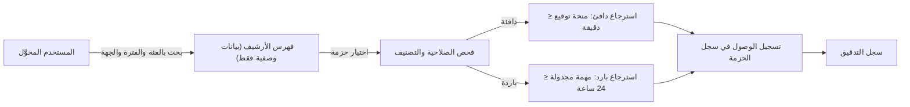
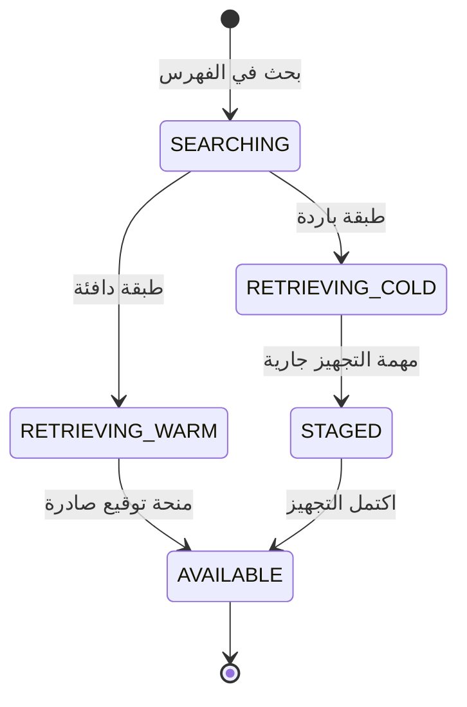

# استرجاع السجلات التاريخية

<!-- BEGIN GENERATED: doc -->
| البند | القيمة |
|---|---|
| المعرّف | FEAT-KNW-ARCHIVE-RETRIEVE |
| الإصدار | 0.2 |
| الحالة | مسودة |
| القدرة | CAP-11 المعرفة والذاكرة المؤسسية |
| القدرة الفرعية | CAP-11.03 الأرشيف وإعادة البناء التاريخي (R2) |
| الأدوار | أي مستخدم مخوَّل؛ أمين الأرشيف |
| الشاشات | SCR-44 المعرفة والأرشيف |
| حالات الاستخدام | UC-064 |
| القصص | 7: 2 من المواصفة، و5 جديدة |
<!-- END GENERATED: doc -->

## 1. نظرة عامة

### 1.1 القيمة

يمكّن المستخدم المخوَّل من البحث في فهرس الأرشيف واسترجاع سجل تاريخي ضمن الوقت المستهدف مع تسجيل كل وصول.

### 1.2 النطاق

| البند | القيمة |
|---|---|
| المستخدمون | أي مستخدم مخوَّل يبحث في فهرس الأرشيف ويسترجع ما يقع ضمن نطاقه وتصنيفه؛ أمين الأرشيف يرى الفهرس الكامل |
| الشاشات | شاشة المعرفة والأرشيف (SCR-44) |
| حالات الاستخدام | استرجاع سجل تاريخي (UC-064): البحث في فهرس الأرشيف، ثم الاسترجاع من الطبقة الدافئة أو الباردة مع تسجيل الوصول |
| المتطلبات | استرجاع المستخدم المخوَّل السجل التاريخي خلال هدف زمن الاسترجاع لطبقته، مع تدقيق كل وصول |
| خارج النطاق | إدخال الحزمة الأرشيفية إلى الأرشيف وتوليدها من بيانات الإتلاف (ميزة إتلاف السجلات المنتهية)؛ ترحيل صيغتها أو نقلها أو إصلاح عطبها |

### 1.3 خريطة الميزة

**الشكل 1: مسار البحث والاسترجاع من الأرشيف**



**الشكل 2: حالة طلب الاسترجاع على الشاشة**



## 2. القواعد المشتركة

تنطبق على كل قصص الميزة، فلا تتكرر داخل القصص. وكل قصة تذكر ما يخصها فقط.

### 2.1 السياق المشترك

كل قصة تبدأ من ثلاثة شروط: مستأجر نشط، وحزمة السياسات الأساسية مفعّلة، ومستخدم مسجّل الدخول ومخوَّل. وتشير إليها القصص بخطوة واحدة: «بفرض السياق المشترك للميزة».

### 2.2 الصلاحية وعدم الإفصاح

- من لا يحق له رؤية العنصر يتلقى ردًا بشكل «غير متاح» تمامًا، فلا يعرف أنه موجود.
- من يرى العنصر ولا يحق له الإجراء يتلقى «لا تملك صلاحية هذا الإجراء».

### 2.3 القراءة وعدم الإفصاح

> **ملاحظة:** هذه الميزة قراءة بالكامل: لا قصة فيها أمر يغيّر حالة، فلا تنطبق قواعد منع التكرار وحماية التعديل المتزامن. وتكتفي كل قصة بقاعدة الصلاحية وعدم الإفصاح في §2.2.

- كل استعلام يعيد ما يقع ضمن نطاق المستخدم وتصريحه الأمني فقط، وتُفحص صلاحية كل عنصر وتصنيفه قبل إعادته ضمن أي قائمة أو نتيجة بحث.
- كل استرجاع من الأرشيف، دافئًا كان أو باردًا، يُسجَّل في سجل وصول الحزمة نفسها وفي سجل التدقيق، بصرف النظر عن نجاحه.

### 2.4 الرفض المشترك

لا أوامر تغيير حالة في هذه الميزة، فلا رفض مشترك بجدول واحد. وكل قصة تذكر رفضها الخاص عند وجوده.

## 3. الجودة وتعريف الاكتمال

### 3.1 متطلبات الجودة

<!-- BEGIN GENERATED: quality -->
| المرجع | الموقف | المطلوب |
|---|---|---|
| QAS-ARC-001 | retrieve an archived record | ≤ 1 min for warm, ≤ 24 h for cold/offline media |
<!-- END GENERATED: quality -->

### 3.2 تعريف الاكتمال

القصة مكتملة حين تتحقق الشروط الخمسة:

1. سيناريوهاتها والقواعد المشتركة تمر في الاختبار الآلي.
2. فحوص البنية المعمارية تمر.
3. نصوص الواجهة والرسائل موجودة بالعربية والإنجليزية.
4. مراجعة الكود مكتملة.
5. ما تضيفه القصة نفسها في قسم «القواعد» تحقق.

## 4. فهرس القصص

<!-- BEGIN GENERATED: story-index -->
| المعرّف | القصة | النوع | الحالة |
|---|---|---|---|
| `US-BC06-Q-ARC-RETRIEVE` | جلب: Retrieve package content (warm: signed grant; cold: staged job) — access logged | جلب | مسودة |
| `US-BC06-Q-ARC-SEARCH` | جلب: Archive catalogue (metadata only) by class, period, org | جلب | مسودة |
| `US-UI-SCR44-ARCHIVE-SEARCH` | البحث في فهرس الأرشيف ومعرفة زمن الاسترجاع | واجهة | مسودة |
| `US-UI-SCR44-COLD-RETRIEVAL` | متابعة طلب استرجاع من الأرشيف البارد | واجهة | مسودة |
| `US-PLT-ARCHIVE-COLD-STAGE` | تجهيز السجل البارد خلال 24 ساعة | منصة | مسودة |
| `US-PLT-ARCHIVE-WARM-RETRIEVE` | استرجاع السجل الدافئ خلال دقيقة | منصة | مسودة |
| `US-OPS-ARCHIVE-RETRIEVAL-SLO` | مراقبة زمن استرجاع الأرشيف لكل طبقة | تشغيل | مسودة |
<!-- END GENERATED: story-index -->

## 5. القصص

### 5.1 US-BC06-Q-ARC-RETRIEVE — جلب: Retrieve package content (warm: signed grant; cold: staged job) — access logged

| النوع | الإصدار | الأولوية | دون اتصال | الحالة |
|---|---|---|---|---|
| جلب | R2 | Must | لا | مسودة |

> **كـ** أي مستخدم مخوَّل بتصنيف الحزمة الأرشيفية وبالغرض المصرَّح، **أريد** استرجاع محتوى حزمة أرشيفية، **حتى** أصل إلى السجل التاريخي الذي أحتاجه.

**باختصار:** يطلب المستخدم استرجاع حزمة أرشيفية، فتُصدر له منحة توقيع فورية إن كانت في الطبقة الدافئة، أو مهمة استرجاع مجدولة إن كانت في الطبقة الباردة، ويُسجَّل الطلب في سجل وصول الحزمة.

#### القواعد

- **من يرى ماذا:** من يسمح له تصنيف الحزمة وغرض طلبه بالوصول إليها، ضمن نطاقه. ومن لا يحق له يتلقى ردًا بشكل حزمة غير موجودة.
- **البيانات:** معرّف الحزمة الأرشيفية، وغرض الطلب (ترويسة الغرض).
- **الأثر:** يُسجَّل كل طلب استرجاع، نجح أو رُفض، في سجل وصول الحزمة نفسها وفي سجل التدقيق.

#### معايير القبول

```gherkin
# language: ar
خاصية: استرجاع محتوى الحزمة الأرشيفية

  سيناريو: استرجاع حزمة من الطبقة الدافئة
    بفرض السياق المشترك للميزة
    و حزمة أرشيفية في الطبقة الدافئة يسمح تصنيفها وغرض الطلب بالوصول إليها
    عندما يطلب المستخدم استرجاعها
    اذاً تُصدر له منحة توقيع للوصول إلى المحتوى
    و يُسجَّل الطلب في سجل وصول الحزمة وسجل التدقيق

  سيناريو: استرجاع حزمة من الطبقة الباردة
    بفرض السياق المشترك للميزة
    و حزمة أرشيفية في الطبقة الباردة يسمح تصنيفها وغرض الطلب بالوصول إليها
    عندما يطلب المستخدم استرجاعها
    اذاً تُجدول مهمة تجهيز للحزمة، ويُعرض وضعها "قيد التجهيز"
    و يُسجَّل الطلب في سجل وصول الحزمة وسجل التدقيق

  سيناريو: طلب استرجاع حزمة لا يحق له الوصول إليها
    بفرض السياق المشترك للميزة
    و حزمة أرشيفية لا يسمح تصنيفها أو غرض الطلب بوصول المستخدم إليها
    عندما يطلب استرجاعها
    اذاً يُرفض برمز NOT_FOUND ويرى "غير متاح"
    و يُسجَّل الرفض في سجل التدقيق
```

<details><summary>المراجع التقنية والتتبع</summary>

<!-- BEGIN GENERATED: refs US-BC06-Q-ARC-RETRIEVE -->
| البند | المعرّف | المعنى |
|---|---|---|
| الواجهة البرمجية | `POST /api/v1/knowledge/archive-packages/{package_id}/retrievals` | — |
| الاستعلام | `QRY-ARC-RETRIEVE` | Retrieve package content (warm: signed grant; cold: staged job) — access logged |
| السياسة | `POL-ARC-RETRIEVE` | authorized by package label and purpose |
| الكيان | `AGG-ARCHIVE-PACKAGE` | الحزمة الأرشيفية |
| الجدول | `knowledge.archive_packages` | الجدول الرئيسي للحزمة الأرشيفية |
| وحدة النشر | DU-15 | — |
| المتطلب | REQ-ARC-003 | When an authorized user requests a historical record, the system shall retrieve it within the archive retriev… |
| حالة الاستخدام | UC-064 | Retrieve Historical Record |
| الاختبار | TST-ARCHIVE-PACKAGE-SM، TST-SLC12-INVARIANTS | دورة حالات الحزمة الأرشيفية، وثوابت الشريحة SLC-12 |
<!-- END GENERATED: refs US-BC06-Q-ARC-RETRIEVE -->

</details>

### 5.2 US-BC06-Q-ARC-SEARCH — جلب: Archive catalogue (metadata only) by class, period, org

| النوع | الإصدار | الأولوية | دون اتصال | الحالة |
|---|---|---|---|---|
| جلب | R2 | Must | لا | مسودة |

> **كـ** أمين الأرشيف أو أي مستخدم مخوَّل ضمن نطاقه، **أريد** البحث في فهرس الأرشيف حسب فئة السجل وفترته وجهته، **حتى** أجد الحزمة الأرشيفية التي أحتاج استرجاعها.

**باختصار:** يبحث المستخدم في فهرس الأرشيف ببياناته الوصفية فقط دون محتواها، فتُعاد له صفحة بمؤشر من الحزم التي يحق له رؤيتها.

#### القواعد

- **المرشحات:** فئة السجل، الفترة، الجهة، المؤشر والحد.
- **من يرى ماذا:** أمين الأرشيف يرى فهرس كل الحزم، وأي مستخدم مخوَّل آخر يرى ما يقع ضمن نطاقه فقط، دون أن يكشف عدد النتائج أو وجود حزمة محجوبة عنه.

#### معايير القبول

```gherkin
# language: ar
خاصية: البحث في فهرس الأرشيف

  سيناريو: البحث يعيد ما يحق رؤيته فقط
    بفرض السياق المشترك للميزة
    و حزم أرشيفية داخل نطاق المستخدم وأخرى خارجه لفئة وفترة وجهة بعينها
    عندما يبحث بالفئة والفترة والجهة
    اذاً تُعاد الحزم داخل نطاقه فقط، ببياناتها الوصفية دون محتواها
    و لا يكشف أي عدد أو اقتراح وجود حزمة محجوبة

  سيناريو: الصفحة التالية من نتائج البحث
    بفرض السياق المشترك للميزة
    و نتائج بحث أكثر من صفحة
    عندما يطلب الصفحة التالية بالمؤشر
    اذاً تُعاد الحزم التالية دون تكرار ولا فجوة
```

<details><summary>المراجع التقنية والتتبع</summary>

<!-- BEGIN GENERATED: refs US-BC06-Q-ARC-SEARCH -->
| البند | المعرّف | المعنى |
|---|---|---|
| الواجهة البرمجية | `GET /api/v1/knowledge/archive-packages` | — |
| الاستعلام | `QRY-ARC-SEARCH` | Archive catalogue (metadata only) by class, period, org |
| السياسة | `POL-ARC-SEARCH` | Archivist; label rule |
| الكيان | `AGG-ARCHIVE-PACKAGE` | الحزمة الأرشيفية |
| الجدول | `knowledge.archive_packages` | الجدول الرئيسي للحزمة الأرشيفية |
| وحدة النشر | DU-15 | — |
| المتطلب | REQ-ARC-003 | When an authorized user requests a historical record, the system shall retrieve it within the archive retriev… |
| حالة الاستخدام | UC-064 | Retrieve Historical Record |
| الاختبار | TST-ARCHIVE-PACKAGE-SM، TST-SLC12-INVARIANTS | دورة حالات الحزمة الأرشيفية، وثوابت الشريحة SLC-12 |
<!-- END GENERATED: refs US-BC06-Q-ARC-SEARCH -->

</details>

### 5.3 US-UI-SCR44-ARCHIVE-SEARCH — البحث في فهرس الأرشيف ومعرفة زمن الاسترجاع

| النوع | الإصدار | الأولوية | دون اتصال | الحالة |
|---|---|---|---|---|
| واجهة | R2 | Must | لا | مسودة |

> **كـ** المستخدم، **أريد** البحث في فهرس الأرشيف على شاشة المعرفة والأرشيف ومعرفة زمن الاسترجاع المتوقع لكل نتيجة، **حتى** أختار ما أسترجعه وأعرف كم أنتظر.

**باختصار:** تعرض شاشة المعرفة والأرشيف نتائج البحث في الفهرس مع طبقة كل حزمة (دافئة أو باردة)، وتوضح أن الدافئة تُسترجع خلال دقيقة والباردة قد تستغرق حتى 24 ساعة (QAS-ARC-001).

#### القواعد

- تُعرض طبقة كل حزمة في نتائج البحث (دافئة أو باردة) بجانب بياناتها الوصفية، مع هدف الزمن المتوقع لاسترجاع تلك الطبقة **[Derived]**.
- زر الاسترجاع يبدأ طلب الاسترجاع المناسب للطبقة دون أن يطلب من المستخدم تحديدها بنفسه.

#### معايير القبول

```gherkin
# language: ar
خاصية: البحث في فهرس الأرشيف ومعرفة زمن الاسترجاع

  سيناريو: عرض نتائج البحث مع طبقة كل حزمة
    بفرض السياق المشترك للميزة
    و حزم أرشيفية في الطبقة الدافئة وأخرى في الباردة تقع ضمن نطاق المستخدم
    عندما يبحث بالفئة والفترة والجهة
    اذاً تُعرض كل نتيجة مع طبقتها وهدف زمن استرجاعها
    و يبدأ زر الاسترجاع طلب الاسترجاع المناسب لتلك الطبقة
```

<details><summary>المراجع التقنية والتتبع</summary>

<!-- BEGIN GENERATED: refs US-UI-SCR44-ARCHIVE-SEARCH -->
| البند | المعرّف | المعنى |
|---|---|---|
| حالة الاستخدام | UC-064 | Retrieve Historical Record |
| الشاشة | SCR-44 | شاشة المعرفة والأرشيف |
| الجودة | QAS-ARC-001 | retrieve an archived record → ≤ 1 min for warm, ≤ 24 h for cold/offline media |
| المصدر | `[Derived]` | — |
| المتطلب | REQ-ARC-003 | When an authorized user requests a historical record, the system shall retrieve it within the archive retriev… |
| حالة الاستخدام | UC-064 | Retrieve Historical Record |
<!-- END GENERATED: refs US-UI-SCR44-ARCHIVE-SEARCH -->

</details>

### 5.4 US-UI-SCR44-COLD-RETRIEVAL — متابعة طلب استرجاع من الأرشيف البارد

| النوع | الإصدار | الأولوية | دون اتصال | الحالة |
|---|---|---|---|---|
| واجهة | R2 | Must | لا | مسودة |

> **كـ** المستخدم، **أريد** متابعة طلب استرجاع من الأرشيف البارد حتى يكتمل تجهيزه، **حتى** أعرف متى يصبح متاحًا دون أن أعيد الطلب.

**باختصار:** تعرض الشاشة وضع طلب الاسترجاع البارد («قيد التجهيز» ثم «متاح») وتنبّه المستخدم عند اكتماله، ضمن الهدف الزمني حتى 24 ساعة (QAS-ARC-001).

#### القواعد

- يبقى طلب الاسترجاع البارد معروضًا بوضعه الحالي للمستخدم دون حاجة لإعادة الطلب، وتصل إليه إشارة عند اكتمال التجهيز **[Derived]**.
- إن تجاوز التجهيز الهدف الزمني يبقى الطلب معروضًا بوضعه دون أن يُعاد تلقائيًا، فالمتابعة الدورية من مهام التشغيل وليست من هذه الشاشة.

#### معايير القبول

```gherkin
# language: ar
خاصية: متابعة طلب استرجاع من الأرشيف البارد

  سيناريو: الطلب قيد التجهيز ثم يصبح متاحًا
    بفرض السياق المشترك للميزة
    و طلب استرجاع من الأرشيف البارد قيد التجهيز
    عندما يكتمل تجهيزه
    اذاً يتغير وضعه إلى "متاح" على الشاشة
    و يصل إشعار للمستخدم باكتماله
```

<details><summary>المراجع التقنية والتتبع</summary>

<!-- BEGIN GENERATED: refs US-UI-SCR44-COLD-RETRIEVAL -->
| البند | المعرّف | المعنى |
|---|---|---|
| الجودة | QAS-ARC-001 | retrieve an archived record → ≤ 1 min for warm, ≤ 24 h for cold/offline media |
| المصدر | `09-reliability/fmea-slc12.md FM-S12-P2` | — |
| الشاشة | SCR-44 | شاشة المعرفة والأرشيف |
| المصدر | `[Derived]` | — |
| المتطلب | REQ-ARC-003 | When an authorized user requests a historical record, the system shall retrieve it within the archive retriev… |
| حالة الاستخدام | UC-064 | Retrieve Historical Record |
<!-- END GENERATED: refs US-UI-SCR44-COLD-RETRIEVAL -->

</details>

### 5.5 US-PLT-ARCHIVE-COLD-STAGE — تجهيز السجل البارد خلال 24 ساعة

| النوع | الإصدار | الأولوية | دون اتصال | الحالة |
|---|---|---|---|---|
| منصة | R2 | Must | لا ينطبق | مسودة |

> **كـ** فريق المنصة، **أريد** تجهيز السجل البارد خلال 24 ساعة من طلب استرجاعه، **حتى** يصل المستخدم إلى محتواه ضمن الهدف المتفق عليه رغم بطء الوسيط البارد.

**باختصار:** يُجدَّل تجهيز كل طلب استرجاع من الأرشيف البارد كمهمة ضمن طابور تجهيز، على ألا يتجاوز وقت التجهيز 24 ساعة (QAS-ARC-001)، مع تفضيل الطبقة الدافئة للحزم الحديثة أو عالية الاستخدام لتقليل الاعتماد على الوسيط البارد.

#### القواعد

- **الأثر:** يكتمل تجهيز طلب الاسترجاع البارد خلال 24 ساعة من فتحه، فتتحول حالته إلى «متاح» ويُخطر المستخدم.

#### معايير القبول

```gherkin
# language: ar
خاصية: تجهيز السجل البارد خلال الهدف الزمني

  سيناريو: تجهيز طلب بارد ضمن الهدف
    بفرض طلب استرجاع من الأرشيف البارد دخل طابور التجهيز
    عندما يكتمل التجهيز
    اذاً يكون الزمن المنقضي من فتح الطلب 24 ساعة أو أقل
```

<details><summary>المراجع التقنية والتتبع</summary>

<!-- BEGIN GENERATED: refs US-PLT-ARCHIVE-COLD-STAGE -->
| البند | المعرّف | المعنى |
|---|---|---|
| الجودة | QAS-ARC-001 | retrieve an archived record → ≤ 1 min for warm, ≤ 24 h for cold/offline media |
| المصدر | `09-reliability/fmea-slc12.md FM-S12-P2` | — |
| المتطلب | REQ-ARC-003 | When an authorized user requests a historical record, the system shall retrieve it within the archive retriev… |
| حالة الاستخدام | UC-064 | Retrieve Historical Record |
<!-- END GENERATED: refs US-PLT-ARCHIVE-COLD-STAGE -->

</details>

### 5.6 US-PLT-ARCHIVE-WARM-RETRIEVE — استرجاع السجل الدافئ خلال دقيقة

| النوع | الإصدار | الأولوية | دون اتصال | الحالة |
|---|---|---|---|---|
| منصة | R2 | Must | لا ينطبق | مسودة |

> **كـ** فريق المنصة، **أريد** استرجاع السجل الدافئ خلال دقيقة من طلبه، **حتى** يصل إليه المستخدم بسرعة دون انتظار كمن يطلب من الوسيط البارد.

**باختصار:** يُصدر النظام منحة توقيع للوصول إلى محتوى الحزمة الدافئة خلال دقيقة واحدة أو أقل من الطلب (QAS-ARC-001)، مباشرةً من مخزن الطبقة الدافئة.

#### القواعد

- **الأثر:** تصدر منحة التوقيع للوصول إلى محتوى الحزمة الدافئة خلال دقيقة واحدة أو أقل من طلب الاسترجاع.

#### معايير القبول

```gherkin
# language: ar
خاصية: استرجاع السجل الدافئ خلال الهدف الزمني

  سيناريو: استرجاع حزمة دافئة ضمن الهدف
    بفرض طلب استرجاع لحزمة أرشيفية في الطبقة الدافئة
    عندما تُصدر منحة التوقيع للوصول إلى محتواها
    اذاً يكون الزمن المنقضي من الطلب دقيقة واحدة أو أقل
```

<details><summary>المراجع التقنية والتتبع</summary>

<!-- BEGIN GENERATED: refs US-PLT-ARCHIVE-WARM-RETRIEVE -->
| البند | المعرّف | المعنى |
|---|---|---|
| الجودة | QAS-ARC-001 | retrieve an archived record → ≤ 1 min for warm, ≤ 24 h for cold/offline media |
| المصدر | `US-BC06-Q-ARC-RETRIEVE` | — |
| المتطلب | REQ-ARC-003 | When an authorized user requests a historical record, the system shall retrieve it within the archive retriev… |
| حالة الاستخدام | UC-064 | Retrieve Historical Record |
<!-- END GENERATED: refs US-PLT-ARCHIVE-WARM-RETRIEVE -->

</details>

### 5.7 US-OPS-ARCHIVE-RETRIEVAL-SLO — مراقبة زمن استرجاع الأرشيف لكل طبقة

| النوع | الإصدار | الأولوية | دون اتصال | الحالة |
|---|---|---|---|---|
| تشغيل | R2 | Should | لا ينطبق | مسودة |

> **كـ** فريق التشغيل، **أريد** مراقبة زمن استرجاع الأرشيف لكل طبقة، **حتى** أعرف إن تجاوزت الطبقة الدافئة أو الباردة هدفها قبل أن يشكو المستخدمون.

**باختصار:** يُقاس زمن استرجاع كل طلب بحسب طبقته (دافئة أو باردة)، ويصدر تنبيه إذا تجاوزت الطبقة الدافئة المئين 95 من دقيقة واحدة، أو الطبقة الباردة 24 ساعة.

#### القواعد

- **الأثر:** يصدر تنبيه تشغيلي عند تجاوز زمن استرجاع الطبقة الدافئة هدفها عند المئين 95، ليتابعه فريق التشغيل قبل أن يتراكم التأخير.

#### معايير القبول

```gherkin
# language: ar
خاصية: مراقبة زمن استرجاع الأرشيف

  سيناريو: تجاوز الطبقة الدافئة هدفها
    بفرض طلبات استرجاع من الطبقة الدافئة في فترة قياس
    عندما يتجاوز زمن الاستجابة عند المئين 95 دقيقة واحدة
    اذاً يصدر تنبيه تشغيلي بتجاوز هدف الطبقة الدافئة

  سيناريو: الطبقة الدافئة ضمن هدفها
    بفرض طلبات استرجاع من الطبقة الدافئة في فترة قياس
    عندما يكون زمن الاستجابة عند المئين 95 دقيقة واحدة أو أقل
    اذاً لا يصدر تنبيه
```

<details><summary>المراجع التقنية والتتبع</summary>

<!-- BEGIN GENERATED: refs US-OPS-ARCHIVE-RETRIEVAL-SLO -->
| البند | المعرّف | المعنى |
|---|---|---|
| الجودة | QAS-ARC-001 | retrieve an archived record → ≤ 1 min for warm, ≤ 24 h for cold/offline media |
| المصدر | `09-reliability/observability-slc12.md` | — |
<!-- END GENERATED: refs US-OPS-ARCHIVE-RETRIEVAL-SLO -->

</details>

## 6. التتبع

<!-- BEGIN GENERATED: trace -->
| المتطلب | المعنى | القصص | الاختبار |
|---|---|---|---|
| REQ-ARC-003 | When an authorized user requests a historical record, the system shall retrieve it within the archive retriev… | `US-BC06-Q-ARC-RETRIEVE`، `US-BC06-Q-ARC-SEARCH`، `US-PLT-ARCHIVE-COLD-STAGE`، `US-PLT-ARCHIVE-WARM-RETRIEVE`، `US-UI-SCR44-ARCHIVE-SEARCH`، `US-UI-SCR44-COLD-RETRIEVAL` | TST-ARCHIVE-PACKAGE-SM، TST-SLC12-INVARIANTS |
<!-- END GENERATED: trace -->

## 7. سجل التغييرات

| الإصدار | التاريخ | التغيير |
|---|---|---|
| 0.1 | — | هيكل مولَّد من خريطة الميزات |
| 0.2 | 2026-10-13 | كتابة القصص كاملة بمعيار القصص؛ استبدال §2.3 و§2.4 بقاعدة قراءة وعدم إفصاح لأن الميزة قراءة بالكامل |
