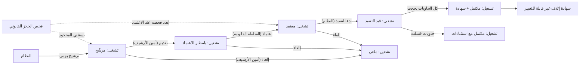
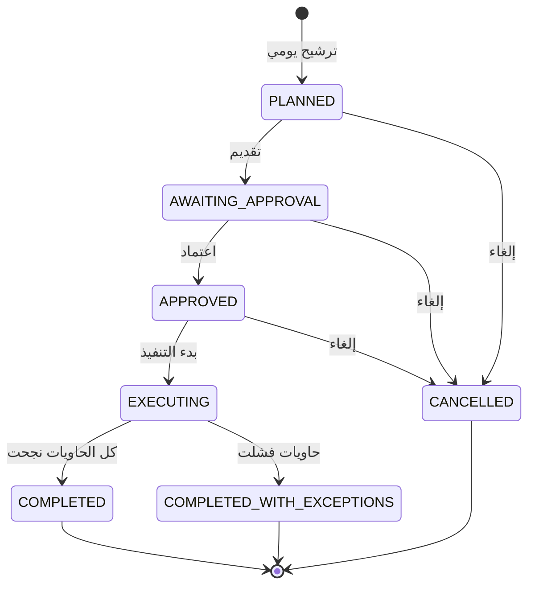

# إتلاف السجلات المنتهية

<!-- BEGIN GENERATED: doc -->
| البند | القيمة |
|---|---|
| المعرّف | FEAT-KNW-DISPOSITION |
| الإصدار | 0.2 |
| الحالة | مسودة |
| القدرة | CAP-11 المعرفة والذاكرة المؤسسية |
| القدرة الفرعية | CAP-11.02 السجلات والاحتفاظ (R1 (الاحتفاظ والتجميد)) |
| الأدوار | أمين الأرشيف؛ السلطة القانونية والامتثال؛ المدقِّق؛ النظام |
| الشاشات | SCR-70 الاحتفاظ والحجز القانوني والإتلاف والمحو |
| حالات الاستخدام | UC-103 |
| القصص | 13: 8 من المواصفة، و5 جديدة |
<!-- END GENERATED: doc -->

## 1. نظرة عامة

### 1.1 القيمة

ينفذ إتلاف أو أرشفة السجلات التي انتهت مدة حفظها بموافقة جهة مستقلة وبشهادة موثقة، مع استثناء المجمد منها.

### 1.2 النطاق

| البند | القيمة |
|---|---|
| المستخدمون | أمين الأرشيف يقدّم تشغيل الإتلاف ويلغيه؛ السلطة القانونية والامتثال تعتمده مستقلة عن المُقدِّم؛ المدقِّق يطّلع على تفاصيله؛ النظام يرشّح الحاويات وينفّذ الإتلاف وينهي التشغيل تلقائيًا |
| الشاشات | شاشة الاحتفاظ والحجز القانوني والإتلاف والمحو (SCR-70) |
| حالات الاستخدام | تطبيق جدول الاحتفاظ والحجز القانوني (UC-103): من ترشيح الحاويات المنتهية الاحتفاظ تلقائيًا، إلى التقديم والاعتماد، إلى الإتلاف بالمفتاح وإصدار الشهادة |
| المتطلبات | تطبيق جدول احتفاظ على كل فئة سجلات حتى يُتلف ما انتهت مدته فقط؛ منع إتلاف أو تعديل أي سجل محجوز قانونيًا طوال مدة الحجز |
| خارج النطاق | إعداد جدول الاحتفاظ نفسه أو تفعيله؛ إنشاء التجميد القانوني أو رفعه أو تمديده؛ تسجيل طلبات المحو (ميزات أخرى في القدرة الفرعية نفسها) |

### 1.3 خريطة الميزة

**الشكل 1: مسار تشغيل الإتلاف من الترشيح إلى الشهادة**



**الشكل 2: دورة حالات تشغيل الإتلاف**



## 2. القواعد المشتركة

تنطبق على كل قصص الميزة، فلا تتكرر داخل القصص. وكل قصة تذكر ما يخصها فقط.

### 2.1 السياق المشترك

كل قصة تبدأ من ثلاثة شروط: مستأجر نشط، وحزمة السياسات الأساسية مفعّلة، ومستخدم مسجّل الدخول ومخوَّل. وتشير إليها القصص بخطوة واحدة: «بفرض السياق المشترك للميزة».

### 2.2 الصلاحية وعدم الإفصاح

- من لا يحق له رؤية العنصر يتلقى ردًا بشكل «غير متاح» تمامًا، فلا يعرف أنه موجود.
- من يرى العنصر ولا يحق له الإجراء يتلقى «لا تملك صلاحية هذا الإجراء».

### 2.3 أوامر تغيير الحالة

- **منع التكرار:** يُرسل كل أمر بمفتاح فريد، فإعادة الطلب نفسه لا تُنفَّذ مرتين.
- **حماية التعديل المتزامن:** يُرسل كل أمر بإصدار البيانات الذي يراه المستخدم. فإن عدّلها غيره في الأثناء، يُرفض الأمر.
- **السجل:** إن نجح الأمر، يُكتب حدثه وسجل التدقيق في المعاملة نفسها.

### 2.4 الرفض المشترك

```gherkin
# language: ar
خاصية: الرفض المشترك لأوامر الميزة

  سيناريو مخطط: رفض مشترك لكل أمر في الميزة
    بفرض السياق المشترك للميزة
    و <الحالة>
    عندما يُرسل المستخدم أي أمر من أوامر الميزة
    اذاً يُرفض برمز <الرمز> ويرى "<الرسالة>"
    و لا يتغير شيء

    امثلة:
      | الحالة                                  | الرمز                  | الرسالة                                                 |
      | العنصر خارج صلاحياته                    | NOT_FOUND              | غير متاح                                                |
      | العنصر مرئي له ولا يحق له الإجراء       | AUTHZ_DENIED           | لا تملك صلاحية هذا الإجراء                              |
      | غيره عدّل العنصر بعد أن فتحه            | VERSION_CONFLICT       | تغيّرت البيانات منذ فتحتها. راجع التغييرات ثم أعد المحاولة |
      | أعاد مفتاح منع التكرار بمحتوى مختلف     | IDEMPOTENCY_KEY_REUSED | طلب مكرر بمحتوى مختلف                                   |
      | البيانات ناقصة أو غير صحيحة             | VALIDATION_FAILED      | بعض البيانات ناقصة أو غير صحيحة. راجع الحقول المعلَّمة      |

  سيناريو: إعادة الطلب نفسه لا تُنفَّذ مرتين
    بفرض السياق المشترك للميزة
    و أمر نجح بمفتاح منع تكرار
    عندما يُعاد الطلب نفسه بالمفتاح نفسه
    اذاً تُعاد النتيجة الأولى ولا يُكتب حدث ثانٍ
```

## 3. الجودة وتعريف الاكتمال

### 3.1 متطلبات الجودة

<!-- BEGIN GENERATED: quality -->
| المرجع | الموقف | المطلوب |
|---|---|---|
| QAS-GOV-001 | daily disposition evaluation | candidates computed ≤ 1 h; 0 held records destroyed |
<!-- END GENERATED: quality -->

### 3.2 تعريف الاكتمال

القصة مكتملة حين تتحقق الشروط الخمسة:

1. سيناريوهاتها والقواعد المشتركة تمر في الاختبار الآلي.
2. فحوص البنية المعمارية تمر.
3. نصوص الواجهة والرسائل موجودة بالعربية والإنجليزية.
4. مراجعة الكود مكتملة.
5. ما تضيفه القصة نفسها في قسم «القواعد» تحقق.

## 4. فهرس القصص

<!-- BEGIN GENERATED: story-index -->
| المعرّف | القصة | النوع | الحالة |
|---|---|---|---|
| `US-BC08-DSP-APPROVE` | اعتماد تشغيل الإتلاف | أمر | مسودة |
| `US-BC08-DSP-CANCEL` | إلغاء تشغيل الإتلاف | أمر | مسودة |
| `US-BC08-DSP-SUBMIT` | تقديم تشغيل الإتلاف | أمر | مسودة |
| `US-BC08-Q-DSP-GET` | جلب: Run with candidate summary, exceptions and certificate | جلب | مسودة |
| `US-BC08-S-DISPOSITION-RUN-01` | تلقائي: scheduled evaluation (daily) (تشغيل الإتلاف) | نظام | مسودة |
| `US-BC08-S-DISPOSITION-RUN-02` | تلقائي: execution started (تشغيل الإتلاف) | نظام | مسودة |
| `US-BC08-S-DISPOSITION-RUN-03` | تلقائي: all buckets processed (تشغيل الإتلاف) | نظام | مسودة |
| `US-BC08-S-DISPOSITION-RUN-04` | تلقائي: some buckets failed (تشغيل الإتلاف) | نظام | مسودة |
| `US-UI-SCR70-DISPOSITION-RUN` | مراجعة دورة الإتلاف قبل اعتمادها | واجهة | مسودة |
| `US-PLT-DISPOSITION-EVAL-1H` | حساب مرشحي الإتلاف اليومي خلال ساعة | منصة | مسودة |
| `US-PLT-DISPOSITION-PURGE-COPIES` | إزالة نسخ السجلات المتلفة من الفهارس والذاكرات | منصة | مسودة |
| `US-OPS-DISPOSITION-CERT-EVIDENCE` | حفظ شهادة الإتلاف دليلًا غير قابل للتغيير | تشغيل | مسودة |
| `US-OPS-DISPOSITION-FAILURE-ALERT` | التنبيه إلى فشل إتلاف بعض الحاويات | تشغيل | مسودة |
<!-- END GENERATED: story-index -->

## 5. القصص

### 5.1 US-BC08-DSP-APPROVE — اعتماد تشغيل الإتلاف

| النوع | الإصدار | الأولوية | دون اتصال | الحالة |
|---|---|---|---|---|
| أمر | R1 | Must | لا | مسودة |

> **كـ** السلطة القانونية والامتثال، **أريد** اعتماد تشغيل الإتلاف بعد تقديمه، **حتى** يُنفَّذ الإتلاف بعد تحقق مستقل عن من قدَّمه.

**باختصار:** تعتمد السلطة القانونية والامتثال تشغيل الإتلاف بعد تقديمه، فيصير «معتمدًا» ويُعاد فحص الحجز القانوني عند الاعتماد نفسه.

#### القواعد

- **متى يُسمح:** التشغيل في حالة «بانتظار الاعتماد»، ويُعاد فحص الحجز القانوني عند الاعتماد فلا يُعتمد إتلاف حاوية فيها عنصر محجوز.
- **من يُسمح له:** السلطة القانونية والامتثال، على ألا تكون الجهة نفسها التي قدَّمت التشغيل (فصل المهام).
- **الأثر:** يصير التشغيل «معتمدًا»، ويُسجَّل حدث «اعتُمد تشغيل الإتلاف» يصل إلى مدير المفاتيح لإتلاف مفاتيح الحاويات لاحقًا، وإلى الجهات المالكة لتهيئة إخلاء الذاكرات المؤقتة والإسقاطات.

#### معايير القبول

```gherkin
# language: ar
خاصية: اعتماد تشغيل الإتلاف

  سيناريو: اعتماد تشغيل بانتظار الموافقة
    بفرض السياق المشترك للميزة
    و تشغيل إتلاف في حالة "بانتظار الاعتماد" قدَّمه أمين الأرشيف
    عندما تعتمده السلطة القانونية والامتثال وهي غير من قدَّمه
    اذاً تصبح حالته "معتمد"
    و يُسجَّل حدث "اعتُمد تشغيل الإتلاف"

  سيناريو مخطط: رفض خاص باعتماد تشغيل الإتلاف
    بفرض السياق المشترك للميزة
    و <الحالة>
    عندما تحاول اعتماد التشغيل
    اذاً يُرفض برمز <الرمز> وترى "<الرسالة>"
    و لا يتغير شيء

    امثلة:
      | الحالة                                        | الرمز                                      | الرسالة                                                |
      | المعتمِد هو من قدَّم التشغيل نفسه            | SEGREGATION_OF_DUTIES                      | لا يجوز أن يعتمد الشخص نفسه ما قدّمه أو طلبه          |
      | التشغيل ليس في حالة "بانتظار الاعتماد"       | DISPOSITION_RUN_INVALID_STATE_TRANSITION   | الوضع الحالي لتشغيل الإتلاف لا يسمح بهذا الإجراء      |
      | قوة مصادقة الجلسة أقل من المطلوب للاعتماد    | MFA_STEP_UP_REQUIRED                       | هذا الإجراء يحتاج تأكيد هويتك مرة أخرى                |
```

<details><summary>المراجع التقنية والتتبع</summary>

<!-- BEGIN GENERATED: refs US-BC08-DSP-APPROVE -->
| البند | المعرّف | المعنى |
|---|---|---|
| الواجهة البرمجية | `POST /api/v1/governance/disposition-runs/{id}/actions/approve` | — |
| الأمر | `CMD-DSP-APPROVE` | اعتماد تشغيل الإتلاف |
| السياسة | `POL-DSP-APPROVE` | Archivist (submit, cancel) · Records/Legal authority ≠ submitter (approve)؛ tenant match |
| الحدث | `EVT-DSP-APPROVED` | يصل إلى: Key manager (bucket key destruction); Owner contexts (purge plaintext caches, projections); Audit |
| الكيان | `AGG-DISPOSITION-RUN` | تشغيل الإتلاف |
| الجدول | `governance.disposition_runs` | الجدول الرئيسي لتشغيل الإتلاف |
| وحدة النشر | DU-03 | — |
| المتطلبات | REQ-GOV-006، REQ-GOV-007 | معانيها في القسم 6. التتبع |
| حالة الاستخدام | UC-103 | Apply Retention & Legal Hold |
| الاختبار | TST-DISPOSITION-RUN-SM | دورة حالات تشغيل الإتلاف، وثوابت الشريحة SLC-12a |
<!-- END GENERATED: refs US-BC08-DSP-APPROVE -->

</details>

### 5.2 US-BC08-DSP-CANCEL — إلغاء تشغيل الإتلاف

| النوع | الإصدار | الأولوية | دون اتصال | الحالة |
|---|---|---|---|---|
| أمر | R1 | Must | لا | مسودة |

> **كـ** أمين الأرشيف، **أريد** إلغاء تشغيل الإتلاف قبل تنفيذه، **حتى** أوقف دورة لم تعد صحيحة أو تحتاج مراجعة من جديد.

**باختصار:** يلغي أمين الأرشيف تشغيل الإتلاف بذكر السبب، ما دام التنفيذ لم يبدأ، فيصير «ملغى» نهائيًا.

#### القواعد

- **متى يُسمح:** التشغيل في إحدى حالات «مرشَّح» أو «بانتظار الاعتماد» أو «معتمد»، أي قبل أن يبدأ تنفيذ الإتلاف.
- **من يُسمح له:** أمين الأرشيف.
- **البيانات:** السبب (إلزامي).
- **الأثر:** يصير التشغيل «ملغى»، ويُسجَّل حدث «أُلغي تشغيل الإتلاف»، ولا تُتلف أي مفاتيح لحاوياته.

#### معايير القبول

```gherkin
# language: ar
خاصية: إلغاء تشغيل الإتلاف

  سيناريو: إلغاء تشغيل لم يبدأ تنفيذه
    بفرض السياق المشترك للميزة
    و تشغيل إتلاف في حالة "معتمد" لم يبدأ تنفيذه
    عندما يلغيه أمين الأرشيف بسبب
    اذاً تصبح حالته "ملغى"
    و يُسجَّل حدث "أُلغي تشغيل الإتلاف"

  سيناريو مخطط: رفض خاص بإلغاء تشغيل الإتلاف
    بفرض السياق المشترك للميزة
    و <الحالة>
    عندما يحاول إلغاء التشغيل
    اذاً يُرفض برمز <الرمز> ويرى "<الرسالة>"
    و لا يتغير شيء

    امثلة:
      | الحالة                                        | الرمز                                      | الرسالة                                             |
      | لم يُذكر السبب                               | REASON_REQUIRED                            | اذكر السبب                                          |
      | التشغيل بدأ تنفيذه أو انتهى                  | DISPOSITION_RUN_INVALID_STATE_TRANSITION   | الوضع الحالي لتشغيل الإتلاف لا يسمح بهذا الإجراء    |
      | قوة مصادقة الجلسة أقل من المطلوب للإلغاء     | MFA_STEP_UP_REQUIRED                       | هذا الإجراء يحتاج تأكيد هويتك مرة أخرى              |
```

<details><summary>المراجع التقنية والتتبع</summary>

<!-- BEGIN GENERATED: refs US-BC08-DSP-CANCEL -->
| البند | المعرّف | المعنى |
|---|---|---|
| الواجهة البرمجية | `POST /api/v1/governance/disposition-runs/{id}/actions/cancel` | — |
| الأمر | `CMD-DSP-CANCEL` | إلغاء تشغيل الإتلاف |
| السياسة | `POL-DSP-CANCEL` | Archivist (submit, cancel) · Records/Legal authority ≠ submitter (approve)؛ tenant match |
| الحدث | `EVT-DSP-CANCELLED` | يصل إلى: Key manager (bucket key destruction); Owner contexts (purge plaintext caches, projections); Audit |
| الكيان | `AGG-DISPOSITION-RUN` | تشغيل الإتلاف |
| الجدول | `governance.disposition_runs` | الجدول الرئيسي لتشغيل الإتلاف |
| وحدة النشر | DU-03 | — |
| المتطلبات | REQ-GOV-006، REQ-GOV-007 | معانيها في القسم 6. التتبع |
| حالة الاستخدام | UC-103 | Apply Retention & Legal Hold |
| الاختبار | TST-DISPOSITION-RUN-SM | دورة حالات تشغيل الإتلاف، وثوابت الشريحة SLC-12a |
<!-- END GENERATED: refs US-BC08-DSP-CANCEL -->

</details>

### 5.3 US-BC08-DSP-SUBMIT — تقديم تشغيل الإتلاف

| النوع | الإصدار | الأولوية | دون اتصال | الحالة |
|---|---|---|---|---|
| أمر | R1 | Must | لا | مسودة |

> **كـ** أمين الأرشيف، **أريد** تقديم تشغيل الإتلاف بعد مراجعة ملخص مرشحيه، **حتى** تعتمده سلطة مستقلة قبل تنفيذ الإتلاف.

**باختصار:** بعد مراجعة أمين الأرشيف لملخص الحاويات المرشحة يقدّم التشغيل مع ملاحظة، فيصير «بانتظار الاعتماد».

#### القواعد

- **متى يُسمح:** التشغيل في حالة «مرشَّح»، وراجع أمين الأرشيف ملخص المرشحين: الأعداد لكل فئة وحاوية، والبنود التي تحتاج مراجعة.
- **من يُسمح له:** أمين الأرشيف.
- **البيانات:** ملاحظة (اختياري).
- **الأثر:** يصير التشغيل «بانتظار الاعتماد»، ويُسجَّل حدث «قُدِّم تشغيل الإتلاف» يصل إلى السلطة القانونية والامتثال.

#### معايير القبول

```gherkin
# language: ar
خاصية: تقديم تشغيل الإتلاف

  سيناريو: تقديم تشغيل مرشَّح بعد المراجعة
    بفرض السياق المشترك للميزة
    و تشغيل إتلاف في حالة "مرشَّح" راجع أمين الأرشيف ملخص مرشحيه
    عندما يقدّمه مع ملاحظة
    اذاً تصبح حالته "بانتظار الاعتماد"
    و يُسجَّل حدث "قُدِّم تشغيل الإتلاف"

  سيناريو مخطط: رفض خاص بتقديم تشغيل الإتلاف
    بفرض السياق المشترك للميزة
    و <الحالة>
    عندما يحاول تقديم التشغيل
    اذاً يُرفض برمز <الرمز> ويرى "<الرسالة>"
    و لا يتغير شيء

    امثلة:
      | الحالة                                        | الرمز                                      | الرسالة                                           |
      | التشغيل ليس في حالة "مرشَّح"                 | DISPOSITION_RUN_INVALID_STATE_TRANSITION   | الوضع الحالي لتشغيل الإتلاف لا يسمح بهذا الإجراء  |
      | قوة مصادقة الجلسة أقل من المطلوب للتقديم     | MFA_STEP_UP_REQUIRED                       | هذا الإجراء يحتاج تأكيد هويتك مرة أخرى            |
```

<details><summary>المراجع التقنية والتتبع</summary>

<!-- BEGIN GENERATED: refs US-BC08-DSP-SUBMIT -->
| البند | المعرّف | المعنى |
|---|---|---|
| الواجهة البرمجية | `POST /api/v1/governance/disposition-runs/{id}/actions/submit` | — |
| الأمر | `CMD-DSP-SUBMIT` | تقديم تشغيل الإتلاف |
| السياسة | `POL-DSP-SUBMIT` | Archivist (submit, cancel) · Records/Legal authority ≠ submitter (approve)؛ tenant match |
| الحدث | `EVT-DSP-SUBMITTED` | يصل إلى: Key manager (bucket key destruction); Owner contexts (purge plaintext caches, projections); Audit |
| الكيان | `AGG-DISPOSITION-RUN` | تشغيل الإتلاف |
| الجدول | `governance.disposition_runs` | الجدول الرئيسي لتشغيل الإتلاف |
| وحدة النشر | DU-03 | — |
| المتطلبات | REQ-GOV-006، REQ-GOV-007 | معانيها في القسم 6. التتبع |
| حالة الاستخدام | UC-103 | Apply Retention & Legal Hold |
| الاختبار | TST-DISPOSITION-RUN-SM | دورة حالات تشغيل الإتلاف، وثوابت الشريحة SLC-12a |
<!-- END GENERATED: refs US-BC08-DSP-SUBMIT -->

</details>

### 5.4 US-BC08-Q-DSP-GET — جلب: Run with candidate summary, exceptions and certificate

| النوع | الإصدار | الأولوية | دون اتصال | الحالة |
|---|---|---|---|---|
| جلب | R1 | Must | لا | مسودة |

> **كـ** أمين الأرشيف أو السلطة القانونية والامتثال أو المدقِّق، **أريد** جلب تفاصيل تشغيل الإتلاف مع ملخص مرشحيه واستثناءاته وشهادته، **حتى** أتابع حالته أو أدقق عليه.

**باختصار:** يُعاد تشغيل الإتلاف بحالته الحالية مع ملخص الحاويات المرشحة والاستثناءات بسبب الحجز، وشهادة الإتلاف إن اكتمل، لمن يحق له رؤيته فقط.

#### القواعد

- **من يرى ماذا:** أمين الأرشيف، والسلطة القانونية والامتثال، والمدقِّق — كلٌّ ضمن مستأجره، ودون كشف وجود تشغيل خارج صلاحيته.

#### معايير القبول

```gherkin
# language: ar
خاصية: جلب تفاصيل تشغيل الإتلاف

  سيناريو: جلب تشغيل مرئي لمن يطلبه
    بفرض السياق المشترك للميزة
    و تشغيل إتلاف يحق له رؤيته
    عندما يطلبه
    اذاً تُعاد حالته الحالية مع ملخص المرشحين والاستثناءات، وشهادته إن اكتمل

  سيناريو: طلب تشغيل خارج صلاحياته
    بفرض السياق المشترك للميزة
    و تشغيل إتلاف خارج صلاحياته
    عندما يطلبه
    اذاً يُرفض برمز NOT_FOUND ويرى "غير متاح"
```

<details><summary>المراجع التقنية والتتبع</summary>

<!-- BEGIN GENERATED: refs US-BC08-Q-DSP-GET -->
| البند | المعرّف | المعنى |
|---|---|---|
| الواجهة البرمجية | `GET /api/v1/governance/disposition-runs/{run_id}` | — |
| الاستعلام | `QRY-DSP-GET` | Run with candidate summary, exceptions and certificate |
| السياسة | `POL-DSP-GET` | Archivist, Legal, Auditor |
| الكيان | `AGG-DISPOSITION-RUN` | تشغيل الإتلاف |
| الجدول | `governance.disposition_runs` | الجدول الرئيسي لتشغيل الإتلاف |
| وحدة النشر | DU-03 | — |
| المتطلب | REQ-GOV-006 | The system shall apply a retention schedule to every record class. |
| حالة الاستخدام | UC-103 | Apply Retention & Legal Hold |
| الاختبار | TST-DISPOSITION-RUN-SM | دورة حالات تشغيل الإتلاف، وثوابت الشريحة SLC-12a |
<!-- END GENERATED: refs US-BC08-Q-DSP-GET -->

</details>

### 5.5 US-BC08-S-DISPOSITION-RUN-01 — تلقائي: scheduled evaluation (daily) (تشغيل الإتلاف)

| النوع | الإصدار | الأولوية | دون اتصال | الحالة |
|---|---|---|---|---|
| نظام | R1 | Must | لا ينطبق | مسودة |

> **كـ** النظام، **أريد** أن أرشّح الحاويات التي انتهت مدة احتفاظها لإتلاف مجدوَل يوميًا، **حتى** يبدأ مسار الاعتماد دون تدخل يدوي.

**باختصار:** يفحص المجدول يوميًا حاويات المفاتيح الزمنية، فيرشّح للإتلاف ما انتهت مدة احتفاظ كل سجلاته تحت الجدول النشط، ويستثني ما تحدد الحجز القانوني أن فيه عناصر محجوزة.

#### القواعد

- **الأثر:** يُنشأ تشغيل إتلاف جديد بحالة «مرشَّح» يضم الحاويات المرشحة، ويُسجَّل حدث «رُشِّح تشغيل الإتلاف» وسجل تدقيق بهوية النظام.

#### معايير القبول

```gherkin
# language: ar
خاصية: الترشيح اليومي لتشغيل الإتلاف

  سيناريو: توجد حاويات انتهت مدة احتفاظها
    بفرض حاويات مفاتيح انتهت مدة احتفاظ كل سجلاتها تحت الجدول النشط، وفحص الحجز استثنى المحجوز منها
    عندما يحين وقت الفحص اليومي للمجدول
    اذاً يُنشأ تشغيل إتلاف جديد بحالة "مرشَّح" يضم تلك الحاويات
    و يُسجَّل حدث "رُشِّح تشغيل الإتلاف" وسجل تدقيق بهوية النظام

  سيناريو: لا حاوية انتهت مدة احتفاظها
    بفرض أن كل حاويات المفاتيح لم تنتهِ مدة احتفاظها أو هي محجوزة بالكامل
    عندما يحين وقت الفحص اليومي للمجدول
    اذاً لا يُنشأ تشغيل إتلاف
    و لا يتغير شيء
```

<details><summary>المراجع التقنية والتتبع</summary>

<!-- BEGIN GENERATED: refs US-BC08-S-DISPOSITION-RUN-01 -->
| البند | المعرّف | المعنى |
|---|---|---|
| المحفِّز | `SYS:scheduled evaluation (daily)` | candidates = key buckets whose records are all past retention under the ACTIVE schedule; held items identifie… |
| الانتقال | ∅ ← PLANNED | — |
| الحدث | `EVT-DSP-PLANNED` | يصل إلى: Key manager (bucket key destruction); Owner contexts (purge plaintext caches, projections); Audit |
| الكيان | `AGG-DISPOSITION-RUN` | تشغيل الإتلاف |
| الجدول | `governance.disposition_runs` | الجدول الرئيسي لتشغيل الإتلاف |
| وحدة النشر | DU-03 | — |
| المتطلبات | REQ-GOV-006، REQ-GOV-007 | معانيها في القسم 6. التتبع |
| حالة الاستخدام | UC-103 | Apply Retention & Legal Hold |
| الاختبار | TST-DISPOSITION-RUN-SM | دورة حالات تشغيل الإتلاف، وثوابت الشريحة SLC-12a |
<!-- END GENERATED: refs US-BC08-S-DISPOSITION-RUN-01 -->

</details>

### 5.6 US-BC08-S-DISPOSITION-RUN-02 — تلقائي: execution started (تشغيل الإتلاف)

| النوع | الإصدار | الأولوية | دون اتصال | الحالة |
|---|---|---|---|---|
| نظام | R1 | Must | لا ينطبق | مسودة |

> **كـ** النظام، **أريد** بدء تنفيذ تشغيل الإتلاف المعتمد، **حتى** تُعاد تغليف العناصر المحجوزة أولًا ثم تُتلف مفاتيح الحاويات غير المحجوزة.

**باختصار:** فور اعتماد التشغيل يبدأ النظام تنفيذه: يعيد تغليف العناصر المحجوزة بمفاتيح حجز، ثم يتلف مفاتيح الحاويات، ويُنبّه الجهات المالكة لإخلاء ذاكراتها المؤقتة وإسقاطاتها.

#### القواعد

- **الأثر:** تصبح حالة التشغيل «قيد التنفيذ»، ويُسجَّل حدث «بدأ تنفيذ تشغيل الإتلاف» وسجل تدقيق بهوية النظام، ويُكتب شاهد إتلاف (tombstone) لكل حاوية تُتلف مفاتيحها.

#### معايير القبول

```gherkin
# language: ar
خاصية: بدء تنفيذ تشغيل الإتلاف

  سيناريو: بدء تنفيذ تشغيل معتمد
    بفرض تشغيل إتلاف في حالة "معتمد"
    عندما يبدأ النظام تنفيذه
    اذاً تصبح حالته "قيد التنفيذ"
    و تُعاد تغليف العناصر المحجوزة في حاوياته بمفاتيح حجز قبل أي إتلاف
    و يُسجَّل حدث "بدأ تنفيذ تشغيل الإتلاف" وسجل تدقيق بهوية النظام

  سيناريو: تشغيل لم يُعتمد بعد
    بفرض تشغيل إتلاف ليس في حالة "معتمد"
    عندما يفحص النظام التشغيلات لبدء التنفيذ
    اذاً لا يبدأ تنفيذه
    و لا يتغير شيء
```

<details><summary>المراجع التقنية والتتبع</summary>

<!-- BEGIN GENERATED: refs US-BC08-S-DISPOSITION-RUN-02 -->
| البند | المعرّف | المعنى |
|---|---|---|
| المحفِّز | `SYS:execution started` | held items in each bucket re-wrapped under hold keys first; then bucket keys destroyed; owners notified to pu… |
| الانتقال | APPROVED ← EXECUTING | — |
| الحدث | `EVT-DSP-EXECUTING` | يصل إلى: Key manager (bucket key destruction); Owner contexts (purge plaintext caches, projections); Audit |
| الكيان | `AGG-DISPOSITION-RUN` | تشغيل الإتلاف |
| الجدول | `governance.disposition_runs` | الجدول الرئيسي لتشغيل الإتلاف |
| وحدة النشر | DU-03 | — |
| المتطلبات | REQ-GOV-006، REQ-GOV-007 | معانيها في القسم 6. التتبع |
| حالة الاستخدام | UC-103 | Apply Retention & Legal Hold |
| الاختبار | TST-DISPOSITION-RUN-SM | دورة حالات تشغيل الإتلاف، وثوابت الشريحة SLC-12a |
<!-- END GENERATED: refs US-BC08-S-DISPOSITION-RUN-02 -->

</details>

### 5.7 US-BC08-S-DISPOSITION-RUN-03 — تلقائي: all buckets processed (تشغيل الإتلاف)

| النوع | الإصدار | الأولوية | دون اتصال | الحالة |
|---|---|---|---|---|
| نظام | R1 | Must | لا ينطبق | مسودة |

> **كـ** النظام، **أريد** إنهاء التشغيل بإصدار شهادة إتلاف حين تُعالَج كل حاوياته بنجاح، **حتى** يُوثَّق ما أُتلف وما استُثني بسبب الحجز.

**باختصار:** عند معالجة كل حاويات التشغيل بنجاح يُصدر النظام شهادة الإتلاف، وتصبح حالته «مكتمل».

#### القواعد

- **الأثر:** تصبح حالة التشغيل «مكتمل»، وتُصدر شهادة الإتلاف: الحاويات، ومعرّفات المفاتيح المتلفة، والأعداد، والحاويات المستثناة للحجز. ويُسجَّل حدث «اكتمل تشغيل الإتلاف».

#### معايير القبول

```gherkin
# language: ar
خاصية: اكتمال تشغيل الإتلاف

  سيناريو: كل حاويات التشغيل عُولجت بنجاح
    بفرض تشغيل إتلاف "قيد التنفيذ" أُتلفت مفاتيح كل حاوياته بنجاح
    عندما ينتهي النظام من معالجة آخر حاوية
    اذاً تصبح حالته "مكتمل"
    و تُصدر شهادة إتلاف تضم الحاويات ومعرّفات المفاتيح المتلفة والأعداد والحاويات المستثناة للحجز
    و يُسجَّل حدث "اكتمل تشغيل الإتلاف"

  سيناريو: التشغيل لم تنتهِ معالجة كل حاوياته
    بفرض تشغيل إتلاف "قيد التنفيذ" لا تزال فيه حاويات لم تُعالَج
    عندما يفحص النظام حالة التشغيل
    اذاً تبقى حالته "قيد التنفيذ"
    و لا تُصدر شهادة
```

<details><summary>المراجع التقنية والتتبع</summary>

<!-- BEGIN GENERATED: refs US-BC08-S-DISPOSITION-RUN-03 -->
| البند | المعرّف | المعنى |
|---|---|---|
| المحفِّز | `SYS:all buckets processed` | certificate issued (buckets, key ids destroyed, counts, holds excluded) |
| الانتقال | EXECUTING ← COMPLETED | — |
| الحدث | `EVT-DSP-COMPLETED` | يصل إلى: Key manager (bucket key destruction); Owner contexts (purge plaintext caches, projections); Audit |
| الكيان | `AGG-DISPOSITION-RUN` | تشغيل الإتلاف |
| الجدول | `governance.disposition_runs` | الجدول الرئيسي لتشغيل الإتلاف |
| وحدة النشر | DU-03 | — |
| المتطلبات | REQ-GOV-006، REQ-GOV-007 | معانيها في القسم 6. التتبع |
| حالة الاستخدام | UC-103 | Apply Retention & Legal Hold |
| الاختبار | TST-DISPOSITION-RUN-SM | دورة حالات تشغيل الإتلاف، وثوابت الشريحة SLC-12a |
<!-- END GENERATED: refs US-BC08-S-DISPOSITION-RUN-03 -->

</details>

### 5.8 US-BC08-S-DISPOSITION-RUN-04 — تلقائي: some buckets failed (تشغيل الإتلاف)

| النوع | الإصدار | الأولوية | دون اتصال | الحالة |
|---|---|---|---|---|
| نظام | R1 | Must | لا ينطبق | مسودة |

> **كـ** النظام، **أريد** إكمال التشغيل مع تسجيل الحاويات التي فشل إتلافها، **حتى** تُعاد محاولتها في التشغيل التالي دون إيقاف ما نجح.

**باختصار:** إن فشل إتلاف بعض حاويات التشغيل (كفشل مؤقت في نظام إدارة المفاتيح) يُكمل النظام التشغيل بحالة «مكتمل مع استثناءات»، ويسرد الحاويات الفاشلة لإعادة محاولتها في التشغيل التالي.

#### القواعد

- **الأثر:** تصبح حالة التشغيل «مكتمل مع استثناءات»، وتُسرد الحاويات الفاشلة في التشغيل نفسه لتُعاد محاولتها في التشغيل اليومي التالي. ويُسجَّل حدث «اكتمل تشغيل الإتلاف مع استثناءات».

#### معايير القبول

```gherkin
# language: ar
خاصية: اكتمال تشغيل الإتلاف مع استثناءات

  سيناريو: بعض حاويات التشغيل فشل إتلافها
    بفرض تشغيل إتلاف "قيد التنفيذ" فشل إتلاف بعض حاوياته وأُتلفت أخرى
    عندما ينتهي النظام من معالجة كل حاويات التشغيل
    اذاً تصبح حالته "مكتمل مع استثناءات"
    و تُسرد الحاويات الفاشلة لإعادة المحاولة في التشغيل التالي
    و يُسجَّل حدث "اكتمل تشغيل الإتلاف مع استثناءات"

  سيناريو: كل حاويات التشغيل نجحت
    بفرض تشغيل إتلاف "قيد التنفيذ" نجح إتلاف كل حاوياته
    عندما ينتهي النظام من معالجتها
    اذاً لا تُسجَّل أي استثناءات
    و لا تدخل حالة "مكتمل مع استثناءات"
```

<details><summary>المراجع التقنية والتتبع</summary>

<!-- BEGIN GENERATED: refs US-BC08-S-DISPOSITION-RUN-04 -->
| البند | المعرّف | المعنى |
|---|---|---|
| المحفِّز | `SYS:some buckets failed` | failed buckets listed; retried next run |
| الانتقال | EXECUTING ← COMPLETED_WITH_EXCEPTIONS | — |
| الحدث | `EVT-DSP-COMPLETED-WITH-EXCEPTIONS` | يصل إلى: Key manager (bucket key destruction); Owner contexts (purge plaintext caches, projections); Audit |
| الكيان | `AGG-DISPOSITION-RUN` | تشغيل الإتلاف |
| الجدول | `governance.disposition_runs` | الجدول الرئيسي لتشغيل الإتلاف |
| وحدة النشر | DU-03 | — |
| المتطلبات | REQ-GOV-006، REQ-GOV-007 | معانيها في القسم 6. التتبع |
| حالة الاستخدام | UC-103 | Apply Retention & Legal Hold |
| الاختبار | TST-DISPOSITION-RUN-SM | دورة حالات تشغيل الإتلاف، وثوابت الشريحة SLC-12a |
<!-- END GENERATED: refs US-BC08-S-DISPOSITION-RUN-04 -->

</details>

### 5.9 US-UI-SCR70-DISPOSITION-RUN — مراجعة دورة الإتلاف قبل اعتمادها

| النوع | الإصدار | الأولوية | دون اتصال | الحالة |
|---|---|---|---|---|
| واجهة | R1 | Should | لا | مسودة |

> **كـ** أمين الأرشيف أو السلطة القانونية والامتثال، **أريد** مراجعة تفاصيل دورة الإتلاف على شاشة الاحتفاظ قبل اعتمادها أو إلغائها، **حتى** أتحقق من الحاويات المرشحة واستثناءات الحجز قبل اتخاذ القرار.

**باختصار:** تعرض شاشة الاحتفاظ والحجز القانوني والإتلاف والمحو تفاصيل تشغيل الإتلاف: ملخص المرشحين حسب الفئة والحاوية، والاستثناءات بسبب الحجز، وأزرار التقديم والاعتماد والإلغاء بحسب صلاحية المستخدم وحالة التشغيل.

#### القواعد

- تُعرض أزرار التقديم والاعتماد والإلغاء فقط لمن يملك صلاحيتها، وتختفي الأزرار التي لا تسمح بها حالة التشغيل الحالية **[Derived]**.
- تُميَّز الحاويات المستثناة للحجز في الملخص بعلامة واضحة، فلا تظهر كأنها رُشِّحت للإتلاف دون تمييز.

#### معايير القبول

```gherkin
# language: ar
خاصية: مراجعة دورة الإتلاف قبل اعتمادها

  سيناريو: عرض تفاصيل تشغيل بانتظار الاعتماد
    بفرض السياق المشترك للميزة
    و تشغيل إتلاف في حالة "بانتظار الاعتماد" يحق للمستخدم رؤيته
    عندما يفتح شاشة الاحتفاظ والحجز القانوني والإتلاف والمحو
    اذاً يرى ملخص المرشحين حسب الفئة والحاوية، والحاويات المستثناة للحجز
    و يرى زر الاعتماد فقط إن كان من السلطة القانونية والامتثال وليس من قدَّم التشغيل

  سيناريو: لا يرى زر اعتماد لا يملك صلاحيته
    بفرض السياق المشترك للميزة
    و تشغيل إتلاف في حالة "بانتظار الاعتماد"
    عندما يفتحه مستخدم لا يملك صلاحية الاعتماد
    اذاً لا يُعرض له زر الاعتماد
```

<details><summary>المراجع التقنية والتتبع</summary>

<!-- BEGIN GENERATED: refs US-UI-SCR70-DISPOSITION-RUN -->
| البند | المعرّف | المعنى |
|---|---|---|
| حالة الاستخدام | UC-103 | Apply Retention & Legal Hold |
| الشاشة | SCR-70 | شاشة الاحتفاظ والحجز القانوني والإتلاف والمحو |
| المصدر | `US-BC08-Q-DSP-GET` | — |
| المصدر | `THR-S12-01` | — |
| المصدر | `[Derived]` | — |
<!-- END GENERATED: refs US-UI-SCR70-DISPOSITION-RUN -->

</details>

### 5.10 US-PLT-DISPOSITION-EVAL-1H — حساب مرشحي الإتلاف اليومي خلال ساعة

| النوع | الإصدار | الأولوية | دون اتصال | الحالة |
|---|---|---|---|---|
| منصة | R1 | Must | لا ينطبق | مسودة |

> **كـ** فريق المنصة، **أريد** أن يُحسب ترشيح حاويات الإتلاف اليومي خلال ساعة من بدء التقييم، **حتى** تصدر دورة الإتلاف في وقتها دون تأخير العمليات الأخرى.

**باختصار:** مهمة مجدولة يومية تحسب الحاويات التي انتهت مدة احتفاظ كل سجلاتها عبر كل فئات السجلات، على ألا يتجاوز وقت الحساب ساعة واحدة، وألا يُتلف أي سجل محجوز (QAS-GOV-001).

#### القواعد

- **الأثر:** يُحسب مرشحو الإتلاف خلال ساعة واحدة على الأكثر من بدء التقييم اليومي، بحجم بيانات التصميم، ودون أن يُتلف أي سجل محجوز قانونيًا.

#### معايير القبول

```gherkin
# language: ar
خاصية: أداء حساب مرشحي الإتلاف اليومي

  سيناريو: الحساب تحت حمل التصميم
    بفرض بيانات بحجم التصميم وتقييم إتلاف يومي يبدأ
    عندما يُحسب مرشحو الإتلاف
    اذاً يكتمل الحساب خلال ساعة واحدة أو أقل
    و لا يُتلف أي سجل محجوز من بين المرشحين
```

<details><summary>المراجع التقنية والتتبع</summary>

<!-- BEGIN GENERATED: refs US-PLT-DISPOSITION-EVAL-1H -->
| البند | المعرّف | المعنى |
|---|---|---|
| الجودة | QAS-GOV-001 | daily disposition evaluation → candidates computed ≤ 1 h; 0 held records destroyed |
| المصدر | `22-deployment-design.md §4` | — |
| المتطلب | REQ-GOV-006 | The system shall apply a retention schedule to every record class. |
| حالة الاستخدام | UC-103 | Apply Retention & Legal Hold |
<!-- END GENERATED: refs US-PLT-DISPOSITION-EVAL-1H -->

</details>

### 5.11 US-PLT-DISPOSITION-PURGE-COPIES — إزالة نسخ السجلات المتلفة من الفهارس والذاكرات

| النوع | الإصدار | الأولوية | دون اتصال | الحالة |
|---|---|---|---|---|
| منصة | R1 | Should | لا ينطبق | مسودة |

> **كـ** فريق المنصة، **أريد** إزالة كل نسخ السجلات المتلفة من الفهارس والذاكرات المؤقتة والإسقاطات، **حتى** لا يبقى أي أثر قابل للقراءة لما أُتلف.

**باختصار:** فور تنفيذ الإتلاف تُنبَّه الجهات المالكة لإخلاء ذاكراتها المؤقتة وإسقاطاتها المبنية من بيانات الحاوية المتلفة، وتتحقق إعادة بناء الإسقاطات من تطابق نتيجتها مع مرجع مستقل (FIT-11).

#### القواعد

- **الأثر:** لا يبقى بعد تنفيذ الإتلاف أي نسخة قابلة للقراءة للبيانات المتلفة في فهرس أو ذاكرة مؤقتة أو إسقاط، وإعادة بناء الإسقاط من جديد تعطي النتيجة نفسها دون البيانات المتلفة.

#### معايير القبول

```gherkin
# language: ar
خاصية: إزالة نسخ السجلات المتلفة

  سيناريو: إخلاء النسخ بعد الإتلاف
    بفرض تشغيل إتلاف أتلف مفاتيح حاوية ونبّه الجهات المالكة لإخلاء نسخها
    عندما تُعاد بناء إسقاطات تلك الجهات
    اذاً لا تظهر بيانات الحاوية المتلفة في الفهرس أو الذاكرة المؤقتة أو الإسقاط
    و يطابق ناتج إعادة البناء المرجع المستقل لما تبقى من بيانات
```

<details><summary>المراجع التقنية والتتبع</summary>

<!-- BEGIN GENERATED: refs US-PLT-DISPOSITION-PURGE-COPIES -->
| البند | المعرّف | المعنى |
|---|---|---|
| المصدر | `US-BC08-S-DISPOSITION-RUN-02` | — |
| المصدر | `THR-S12-04` | — |
| فحص البنية | FIT-11 | Projections rebuildable: rebuild yields identical results on reference set |
| المصدر | `[Derived]` | — |
<!-- END GENERATED: refs US-PLT-DISPOSITION-PURGE-COPIES -->

</details>

### 5.12 US-OPS-DISPOSITION-CERT-EVIDENCE — حفظ شهادة الإتلاف دليلًا غير قابل للتغيير

| النوع | الإصدار | الأولوية | دون اتصال | الحالة |
|---|---|---|---|---|
| تشغيل | R1 | Should | لا ينطبق | مسودة |

> **كـ** فريق التشغيل والأمن، **أريد** حفظ شهادة الإتلاف دليلًا غير قابل للتغيير بعد اكتمال التشغيل، **حتى** يُستند إليها في التدقيق دون إمكان العبث بها.

**باختصار:** تُخزَّن شهادة الإتلاف، وفيها الحاويات ومعرّفات المفاتيح المتلفة والأعداد والحاويات المستثناة للحجز، في مخزن أدلة غير قابل للتعديل، بتشفير غلافي تحمي مفاتيحه وحدة عتادية (TD-07).

#### القواعد

- **الأثر:** تُحفظ شهادة كل تشغيل اكتمل في مخزن أدلة لا يُعدَّل، بنسخة مشفرة غلافيًا، فيثبت محتواها دون تغيير عند أي مراجعة لاحقة.

#### معايير القبول

```gherkin
# language: ar
خاصية: حفظ شهادة الإتلاف دليلًا

  سيناريو: حفظ شهادة تشغيل اكتمل
    بفرض تشغيل إتلاف اكتمل وأصدر شهادته
    عندما تُحفظ الشهادة
    اذاً تُخزَّن في مخزن أدلة غير قابل للتعديل بتشفير غلافي
    و يثبت محتواها دون تغيير عند أي مراجعة لاحقة
```

<details><summary>المراجع التقنية والتتبع</summary>

<!-- BEGIN GENERATED: refs US-OPS-DISPOSITION-CERT-EVIDENCE -->
| البند | المعرّف | المعنى |
|---|---|---|
| القرار التقني | TD-07 | OpenBao (MPL, open fork of Vault) Transit engine for envelope encryption; KEKs in site HSM via PKCS#11; DEKs… |
| القرار التقني | TD-06 | S3-compatible API as the contract; default implementation Ceph RGW (sites with Ceph) or MinIO (smaller cells)… |
| المصدر | `17-security-design.md §6` | — |
| المصدر | `[Derived]` | — |
<!-- END GENERATED: refs US-OPS-DISPOSITION-CERT-EVIDENCE -->

</details>

### 5.13 US-OPS-DISPOSITION-FAILURE-ALERT — التنبيه إلى فشل إتلاف بعض الحاويات

| النوع | الإصدار | الأولوية | دون اتصال | الحالة |
|---|---|---|---|---|
| تشغيل | R1 | Should | لا ينطبق | مسودة |

> **كـ** فريق التشغيل، **أريد** تنبيهًا عند فشل إتلاف بعض حاويات تشغيل، **حتى** أتابع إعادة المحاولة قبل أن يتراكم الفشل.

**باختصار:** عند دخول تشغيل حالة «مكتمل مع استثناءات» يصدر تنبيه تشغيلي يسرد الحاويات الفاشلة، لتُتابع إعادة محاولتها في التشغيل التالي.

#### القواعد

- **الأثر:** يصدر تنبيه عند كل تشغيل يدخل حالة «مكتمل مع استثناءات»، يذكر الحاويات الفاشلة وسببها إن عُرف، ليعرف فريق التشغيل ما يحتاج تدخلًا أو انتظارًا للتشغيل التالي.

#### معايير القبول

```gherkin
# language: ar
خاصية: التنبيه إلى فشل إتلاف بعض الحاويات

  سيناريو: تشغيل يكتمل مع استثناءات
    بفرض تشغيل إتلاف دخل حالة "مكتمل مع استثناءات"
    عندما يُسجَّل اكتماله
    اذاً يصدر تنبيه يسرد الحاويات الفاشلة فيه

  سيناريو: تشغيل يكتمل دون استثناءات
    بفرض تشغيل إتلاف دخل حالة "مكتمل" دون أي حاوية فاشلة
    عندما يُسجَّل اكتماله
    اذاً لا يصدر تنبيه فشل
```

<details><summary>المراجع التقنية والتتبع</summary>

<!-- BEGIN GENERATED: refs US-OPS-DISPOSITION-FAILURE-ALERT -->
| البند | المعرّف | المعنى |
|---|---|---|
| المصدر | `09-reliability/fmea-slc12a.md FM-S12-01` | — |
| المصدر | `09-reliability/observability-slc12a.md` | — |
| المصدر | `US-BC08-S-DISPOSITION-RUN-04` | — |
<!-- END GENERATED: refs US-OPS-DISPOSITION-FAILURE-ALERT -->

</details>

## 6. التتبع

<!-- BEGIN GENERATED: trace -->
| المتطلب | المعنى | القصص | الاختبار |
|---|---|---|---|
| REQ-GOV-006 | The system shall apply a retention schedule to every record class. | `US-BC08-DSP-APPROVE`، `US-BC08-DSP-CANCEL`، `US-BC08-DSP-SUBMIT`، `US-BC08-Q-DSP-GET`، `US-BC08-S-DISPOSITION-RUN-01`، `US-BC08-S-DISPOSITION-RUN-02`، `US-BC08-S-DISPOSITION-RUN-03`، `US-BC08-S-DISPOSITION-RUN-04`، `US-PLT-DISPOSITION-EVAL-1H` | TST-DISPOSITION-RUN-SM، TST-RETENTION-SCHEDULE-SM، TST-SLC12A-INVARIANTS |
| REQ-GOV-007 | When a legal hold is placed on a set of records, the system shall prevent their disposition, erasure or modif… | كل قصص الأوامر والنظام في الميزة (7) | TST-DISPOSITION-RUN-SM، TST-LEGAL-HOLD-SM، TST-SLC12A-INVARIANTS |
<!-- END GENERATED: trace -->

## 7. سجل التغييرات

| الإصدار | التاريخ | التغيير |
|---|---|---|
| 0.1 | — | هيكل مولَّد من خريطة الميزات |
| 0.2 | 2026-10-13 | كتابة القصص كاملة بمعيار القصص |
