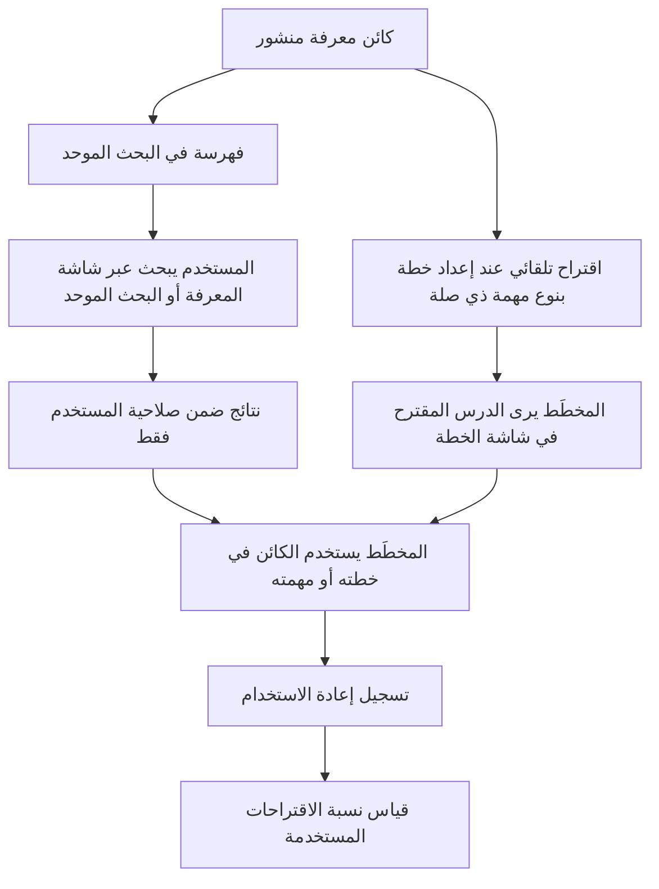

# البحث في المعرفة وإعادة استخدامها

<!-- BEGIN GENERATED: doc -->
| البند | القيمة |
|---|---|
| المعرّف | FEAT-KNW-KNOWLEDGE-REUSE |
| الإصدار | 0.1 |
| الحالة | مسودة |
| القدرة | CAP-11 المعرفة والذاكرة المؤسسية |
| القدرة الفرعية | CAP-11.01 الدروس والمعرفة (R2) |
| الأدوار | المخطِّط؛ أي مستخدم مخوَّل |
| الشاشات | SCR-44 المعرفة والأرشيف، SCR-20 البحث الموحد، SCR-34 الخطة ونسخها |
| حالات الاستخدام | UC-062 |
| القصص | 7: 3 من المواصفة، و4 جديدة |
<!-- END GENERATED: doc -->

## 1. نظرة عامة

### 1.1 القيمة

يساعد المخطط والمستخدمين على إيجاد المعرفة المنشورة ذات الصلة بعملهم وتلقي اقتراحات منها وتسجيل الاستفادة منها.

### 1.2 النطاق

| البند | القيمة |
|---|---|
| المستخدمون | المخطِّط يبحث في المعرفة المنشورة ويتلقى اقتراحاتها ويسجّل إعادة استخدامها؛ وأي مستخدم مخوَّل يبحث فيها عبر البحث الموحد |
| الشاشات | شاشة المعرفة والأرشيف (SCR-44): البحث والتصفية؛ شاشة البحث الموحد (SCR-20): ظهور نتائج المعرفة؛ شاشة الخطة ونسخها (SCR-34): اقتراح الدروس أثناء الإعداد |
| حالات الاستخدام | البحث في كائنات المعرفة المنشورة بالنوع والنص والعلاقات؛ اقتراح المعرفة ذات الصلة بنوع مهمة أو خطة أو نطاق؛ تسجيل إعادة استخدام كائن معرفة |
| المتطلبات | كل كائن معرفة منشور يظهر في البحث للمخوَّلين برؤيته فقط؛ المعرفة ذات الصلة بخطة أو نوع مهمة جديد تُقترح على المخطِّط؛ إعادة استخدام كل كائن معرفة تُعد وتُقاس |
| خارج النطاق | إعداد كائن المعرفة ومراجعته واعتماده ونشره ورفضه وإحالته للتقاعد؛ هذه الميزة تغطي البحث فيه وإعادة استخدامه بعد نشره فقط |

### 1.3 خريطة الميزة

**الشكل 1: البحث في المعرفة المنشورة وإعادة استخدامها**



## 2. القواعد المشتركة

تنطبق على كل قصص الميزة، فلا تتكرر داخل القصص. وكل قصة تذكر ما يخصها فقط.

### 2.1 السياق المشترك

كل قصة تبدأ من ثلاثة شروط: مستأجر نشط، وحزمة السياسات الأساسية مفعّلة، ومستخدم مسجّل الدخول ومخوَّل. وتشير إليها القصص بخطوة واحدة: «بفرض السياق المشترك للميزة».

### 2.2 الصلاحية وعدم الإفصاح

- من لا يحق له رؤية العنصر يتلقى ردًا بشكل «غير متاح» تمامًا، فلا يعرف أنه موجود.
- من يرى العنصر ولا يحق له الإجراء يتلقى «لا تملك صلاحية هذا الإجراء».

### 2.3 أوامر تغيير الحالة

- **منع التكرار:** يُرسل كل أمر بمفتاح فريد، فإعادة الطلب نفسه لا تُنفَّذ مرتين.
- **حماية التعديل المتزامن:** يُرسل كل أمر بإصدار البيانات الذي يراه المستخدم. فإن عدّلها غيره في الأثناء، يُرفض الأمر.
- **السجل:** إن نجح الأمر، يُكتب حدثه وسجل التدقيق في المعاملة نفسها.

### 2.4 الرفض المشترك

```gherkin
# language: ar
خاصية: الرفض المشترك لأوامر الميزة

  سيناريو مخطط: رفض مشترك لكل أمر في الميزة
    بفرض السياق المشترك للميزة
    و <الحالة>
    عندما يُرسل المستخدم أي أمر من أوامر الميزة
    اذاً يُرفض برمز <الرمز> ويرى "<الرسالة>"
    و لا يتغير شيء

    امثلة:
      | الحالة                                  | الرمز                  | الرسالة                                                 |
      | العنصر خارج صلاحياته                    | NOT_FOUND              | غير متاح                                                |
      | العنصر مرئي له ولا يحق له الإجراء       | AUTHZ_DENIED           | لا تملك صلاحية هذا الإجراء                              |
      | غيره عدّل العنصر بعد أن فتحه            | VERSION_CONFLICT       | تغيّرت البيانات منذ فتحتها. راجع التغييرات ثم أعد المحاولة |
      | أعاد مفتاح منع التكرار بمحتوى مختلف     | IDEMPOTENCY_KEY_REUSED | طلب مكرر بمحتوى مختلف                                   |
      | البيانات ناقصة أو غير صحيحة             | VALIDATION_FAILED      | بعض البيانات ناقصة أو غير صحيحة. راجع الحقول المعلَّمة      |

  سيناريو: إعادة الطلب نفسه لا تُنفَّذ مرتين
    بفرض السياق المشترك للميزة
    و أمر نجح بمفتاح منع تكرار
    عندما يُعاد الطلب نفسه بالمفتاح نفسه
    اذاً تُعاد النتيجة الأولى ولا يُكتب حدث ثانٍ
```

## 3. الجودة وتعريف الاكتمال

### 3.1 متطلبات الجودة

<!-- BEGIN GENERATED: quality -->
| المرجع | الموقف | المطلوب |
|---|---|---|
| QAS-KNW-001 | planner creates a plan for a known task type | relevant published lessons suggested in ≥ 80 % of cases in pilot |
<!-- END GENERATED: quality -->

### 3.2 تعريف الاكتمال

القصة مكتملة حين تتحقق الشروط الخمسة:

1. سيناريوهاتها والقواعد المشتركة تمر في الاختبار الآلي.
2. فحوص البنية المعمارية تمر.
3. نصوص الواجهة والرسائل موجودة بالعربية والإنجليزية.
4. مراجعة الكود مكتملة.
5. ما تضيفه القصة نفسها في قسم «القواعد» تحقق.

## 4. فهرس القصص

<!-- BEGIN GENERATED: story-index -->
| المعرّف | القصة | النوع | الحالة |
|---|---|---|---|
| `US-BC06-KNO-RECORD-REUSE` | تسجيل إعادة استخدام كائن المعرفة | أمر | مسودة |
| `US-BC06-Q-KNO-SEARCH` | جلب: Published knowledge by type, text, relationships | جلب | مسودة |
| `US-BC06-Q-KNO-SUGGEST` | جلب: Published knowledge relevant to a task type / plan / area (by relationships) | جلب | مسودة |
| `US-UI-SCR34-KNOWLEDGE-SUGGEST` | اقتراح الدروس للمخطط أثناء إعداد الخطة | واجهة | مسودة |
| `US-UI-SCR44-KNOWLEDGE-SEARCH` | البحث في المعرفة المنشورة وتصفيتها | واجهة | مسودة |
| `US-PLT-KNOWLEDGE-SEARCH-DOC` | ظهور المعرفة المنشورة في البحث الموحد | منصة | مسودة |
| `US-OPS-KNOWLEDGE-REUSE-METRIC` | قياس إعادة استخدام المعرفة ونجاح الاقتراحات | تشغيل | مسودة |
<!-- END GENERATED: story-index -->

## 5. القصص

### 5.1 US-BC06-KNO-RECORD-REUSE — تسجيل إعادة استخدام كائن المعرفة

| النوع | الإصدار | الأولوية | دون اتصال | الحالة |
|---|---|---|---|---|
| أمر | R2 | Must | لا | مسودة |

> **كـ** المخطِّط، **أريد** تسجيل إعادة استخدامي لكائن معرفة منشور في خطة أو مهمة أو منتج أراه، **حتى** يُحسب أثر المعرفة المنشورة وتظهر في مؤشرات إعادة الاستخدام.

**باختصار:** يسجّل المخطِّط أن كائن معرفة منشورًا طُبِّق على عنصر مستهدف يراه، فتزاد إعادة الاستخدام دون تغيير حالة الكائن.

#### القواعد

- **متى يُسمح:** الكائن في حالة «منشور»، والعنصر المستهدف (الخطة أو المهمة أو المنتج) مرئي للمخطِّط.
- **من يُسمح له:** المخطِّط.
- **البيانات:** العنصر المستهدف (إلزامي).
- **الأثر:** حدث «أُعيد استخدام المعرفة» يصل إلى فهرس اقتراحات المعرفة وإسقاط البحث والقياس التشغيلي.

#### معايير القبول

```gherkin
# language: ar
خاصية: تسجيل إعادة استخدام كائن المعرفة

  سيناريو: تسجيل إعادة استخدام كائن منشور
    بفرض السياق المشترك للميزة
    و كائن معرفة منشور وعنصر مستهدف مرئي للمخطِّط
    عندما يسجّل المخطِّط إعادة استخدامه لهذا العنصر
    اذاً يبقى الكائن "منشورًا"
    و يُسجَّل حدث "أُعيد استخدام المعرفة"

  سيناريو مخطط: رفض خاص بتسجيل إعادة الاستخدام
    بفرض السياق المشترك للميزة
    و <الحالة>
    عندما يحاول تسجيل إعادة الاستخدام
    اذاً يُرفض برمز <الرمز> ويرى <الرسالة>
    و لا يتغير شيء

    امثلة:
      | الحالة                                | الرمز                                     | الرسالة                                           |
      | العنصر المستهدف غير مرئي للمخطِّط    | TARGET_INVALID                            | العنصر المستهدف غير متاح                          |
      | الكائن ليس في حالة "منشور"           | KNOWLEDGE_OBJECT_INVALID_STATE_TRANSITION | الوضع الحالي لكائن المعرفة لا يسمح بهذا الإجراء  |
      | لم يُحدَّد العنصر المستهدف            | VALIDATION_FAILED                         | العنصر المستهدف مطلوب                             |
```

<details><summary>المراجع التقنية والتتبع</summary>

<!-- BEGIN GENERATED: refs US-BC06-KNO-RECORD-REUSE -->
| البند | المعرّف | المعنى |
|---|---|---|
| الواجهة البرمجية | `POST /api/v1/knowledge/knowledge-objects/{id}/actions/record-reuse` | — |
| الأمر | `CMD-KNO-RECORD-REUSE` | تسجيل إعادة استخدام كائن المعرفة |
| السياسة | `POL-KNO-RECORD-REUSE` | any user (draft lessons) · Knowledge Manager (review, publish, retire) · planner (record reuse)؛ tenant match… |
| الحدث | `EVT-KNO-REUSED` | يصل إلى: Knowledge suggestion index; Search projection (SLC-05); Business telemetry (OUT-06) |
| الكيان | `AGG-KNOWLEDGE-OBJECT` | كائن المعرفة |
| الجدول | `knowledge.knowledge_objects` | الجدول الرئيسي لكائن المعرفة |
| وحدة النشر | DU-15 | — |
| المتطلبات | REQ-KNW-001، REQ-KNW-002، REQ-KNW-003 | معانيها في القسم 6. التتبع |
| حالة الاستخدام | UC-062 | Publish Knowledge |
| الاختبار | TST-KNOWLEDGE-OBJECT-SM، TST-SLC12-INVARIANTS | دورة حالات كائن المعرفة، وثوابت الشريحة SLC-12 |
<!-- END GENERATED: refs US-BC06-KNO-RECORD-REUSE -->

</details>

### 5.2 US-BC06-Q-KNO-SEARCH — البحث في المعرفة المنشورة

| النوع | الإصدار | الأولوية | دون اتصال | الحالة |
|---|---|---|---|---|
| جلب | R2 | Must | لا | مسودة |

> **كـ** أي مستخدم مخوَّل، **أريد** البحث في كائنات المعرفة المنشورة بالنوع والنص والعلاقات، **حتى** أجد الإجراء أو الدرس أو الممارسة الفضلى أو المعرفة السياساتية ذات الصلة بعملي.

**باختصار:** تُعاد كائنات المعرفة المنشورة المطابقة للبحث ضمن صلاحية المستخدم فقط، صفحة بعد صفحة.

#### القواعد

- **من يرى ماذا:** أي مستخدم يرى كائنات المعرفة ضمن نطاقه المسموح فقط.
- **البيانات:** المرشحات: النوع، والنص، والعلاقات؛ المؤشر والحد.

#### معايير القبول

```gherkin
# language: ar
خاصية: البحث في المعرفة المنشورة وتصفيتها

  سيناريو: يرى المستخدم ما يحق له فقط
    بفرض السياق المشترك للميزة
    و كائنات معرفة منشورة داخل نطاقه وأخرى خارجه
    عندما يبحث بالنوع أو النص أو العلاقات
    اذاً تُعاد الكائنات داخل نطاقه فقط، وكل منها يُفحص من جديد
    و لا يكشف أي عدد أو اقتراح وجود كائن محجوب

  سيناريو: الصفحة التالية
    بفرض السياق المشترك للميزة
    و نتائج البحث أكثر من صفحة
    عندما يطلب الصفحة التالية بالمؤشر
    اذاً تُعاد النتائج التالية دون تكرار ولا فجوة
```

<details><summary>المراجع التقنية والتتبع</summary>

<!-- BEGIN GENERATED: refs US-BC06-Q-KNO-SEARCH -->
| البند | المعرّف | المعنى |
|---|---|---|
| الواجهة البرمجية | `GET /api/v1/knowledge/knowledge-objects` | — |
| الاستعلام | `QRY-KNO-SEARCH` | Published knowledge by type, text, relationships |
| السياسة | `POL-KNO-SEARCH` | any user; label rule |
| الكيان | `AGG-KNOWLEDGE-OBJECT` | كائن المعرفة |
| الجدول | `knowledge.knowledge_objects` | الجدول الرئيسي لكائن المعرفة |
| وحدة النشر | DU-15 | — |
| المتطلب | REQ-KNW-001 | The system shall manage knowledge objects (procedures, lessons, best practices, policy knowledge) as claims w… |
| حالة الاستخدام | UC-062 | Publish Knowledge |
| الاختبار | TST-KNOWLEDGE-OBJECT-SM، TST-SLC12-INVARIANTS | دورة حالات كائن المعرفة، وثوابت الشريحة SLC-12 |
<!-- END GENERATED: refs US-BC06-Q-KNO-SEARCH -->

</details>

### 5.3 US-BC06-Q-KNO-SUGGEST — اقتراح المعرفة ذات الصلة بالخطة

| النوع | الإصدار | الأولوية | دون اتصال | الحالة |
|---|---|---|---|---|
| جلب | R2 | Should | لا | مسودة |

> **كـ** المخطِّط، **أريد** جلب المعرفة المنشورة ذات الصلة بنوع مهمة أو خطة أو نطاق أحدده، **حتى** أستفيد من الدروس والممارسات السابقة عند إعداد خطة جديدة.

**باختصار:** تُعاد كائنات المعرفة المنشورة المرتبطة بنوع المهمة أو الخطة أو النطاق المحدد، ضمن ما يحق للمخطِّط رؤيته.

#### القواعد

- **من يرى ماذا:** المخطِّط فقط، وضمن نطاقه المسموح.
- **البيانات:** نوع المهمة، أو الخطة، أو النطاق.

#### معايير القبول

```gherkin
# language: ar
خاصية: اقتراح المعرفة ذات الصلة

  سيناريو: اقتراح معرفة مرتبطة
    بفرض السياق المشترك للميزة
    و كائنات معرفة منشورة مرتبطة بنوع مهمة أو خطة أو نطاق، بعضها خارج نطاق المخطِّط
    عندما يطلب المخطِّط المعرفة ذات الصلة بهذا النوع أو الخطة أو النطاق
    اذاً تُعاد الكائنات المرتبطة التي تقع ضمن نطاقه فقط
    و لا تُعاد ولا تُكشف أي بيانات خارج نطاقه
```

<details><summary>المراجع التقنية والتتبع</summary>

<!-- BEGIN GENERATED: refs US-BC06-Q-KNO-SUGGEST -->
| البند | المعرّف | المعنى |
|---|---|---|
| الواجهة البرمجية | `POST /api/v1/knowledge/knowledge-suggestions` | — |
| الاستعلام | `QRY-KNO-SUGGEST` | Published knowledge relevant to a task type / plan / area (by relationships) |
| السياسة | `POL-KNO-SUGGEST` | planner; label rule |
| الكيان | `AGG-KNOWLEDGE-OBJECT` | كائن المعرفة |
| الجدول | `knowledge.knowledge_objects` | الجدول الرئيسي لكائن المعرفة |
| وحدة النشر | DU-15 | — |
| المتطلب | REQ-KNW-003 | When a published knowledge object is relevant to a new plan or task type, the system shall suggest it to the… |
| حالة الاستخدام | UC-062 | Publish Knowledge |
| الاختبار | TST-KNOWLEDGE-OBJECT-SM، TST-SLC12-INVARIANTS | دورة حالات كائن المعرفة، وثوابت الشريحة SLC-12 |
<!-- END GENERATED: refs US-BC06-Q-KNO-SUGGEST -->

</details>

### 5.4 US-UI-SCR34-KNOWLEDGE-SUGGEST — اقتراح الدروس للمخطط أثناء إعداد الخطة

| النوع | الإصدار | الأولوية | دون اتصال | الحالة |
|---|---|---|---|---|
| واجهة | R2 | Should | لا | مسودة |

> **كـ** المخطِّط، **أريد** أن أرى الدروس المقترحة ذات الصلة بنوع مهمة أثناء إعداد خطتي دون أن أبحث عنها، **حتى** أستفيد منها دون مغادرة شاشة الخطة.

**باختصار:** عند إضافة نشاط من نوع مهمة معروف إلى الخطة، تعرض شاشة الخطة الدروس المنشورة ذات الصلة كاقتراح يمكن فتحه أو تجاهله.

#### القواعد

- **البيانات:** اقتراح واحد أو أكثر مرتبط بنوع المهمة المختار، مع رابط لفتح الكائن كاملاً.

#### معايير القبول

```gherkin
# language: ar
خاصية: اقتراح الدروس للمخطط أثناء إعداد الخطة

  سيناريو: اقتراح درس عند إضافة نشاط معروف النوع
    بفرض السياق المشترك للميزة
    و درس منشور مرتبط بنوع المهمة الذي يضيفه المخطِّط
    عندما يضيف المخطِّط نشاطًا من هذا النوع إلى الخطة
    اذاً يرى اقتراح الدرس إلى جانب النشاط
    و يستطيع فتحه أو تجاهله

  سيناريو: لا درس مرتبط بالنوع
    بفرض السياق المشترك للميزة
    و لا يوجد درس منشور مرتبط بنوع المهمة
    عندما يضيف المخطِّط نشاطًا من هذا النوع
    اذاً لا يظهر أي اقتراح
```

<details><summary>المراجع التقنية والتتبع</summary>

<!-- BEGIN GENERATED: refs US-UI-SCR34-KNOWLEDGE-SUGGEST -->
| البند | المعرّف | المعنى |
|---|---|---|
| الجودة | QAS-KNW-001 | planner creates a plan for a known task type → relevant published lessons suggested in ≥ 80 % of cases in pil… |
| الشاشة | SCR-34 | شاشة الخطة ونسخها |
| المصدر | `03-domain/contexts/BC06/products-knowledge-archive-spec.md §3` | — |
| المتطلب | REQ-KNW-003 | When a published knowledge object is relevant to a new plan or task type, the system shall suggest it to the… |
| حالة الاستخدام | UC-062 | Publish Knowledge |
<!-- END GENERATED: refs US-UI-SCR34-KNOWLEDGE-SUGGEST -->

</details>

### 5.5 US-UI-SCR44-KNOWLEDGE-SEARCH — البحث في المعرفة المنشورة وتصفيتها

| النوع | الإصدار | الأولوية | دون اتصال | الحالة |
|---|---|---|---|---|
| واجهة | R2 | Must | لا | مسودة |

> **كـ** المستخدم، **أريد** شاشة أبحث فيها عن المعرفة المنشورة وأصفّيها بالنوع والنص والعلاقات، **حتى** أجد ما يفيد عملي بسرعة دون معرفة رموز تقنية.

**باختصار:** تعرض شاشة المعرفة والأرشيف نتائج البحث مع مرشحات النوع والنص والعلاقات، وتفتح كل نتيجة في صفحة الكائن كاملة.

#### القواعد

- **البيانات:** حقل نص، ومرشح النوع، ومرشح العلاقات.

#### معايير القبول

```gherkin
# language: ar
خاصية: البحث في المعرفة المنشورة وتصفيتها

  سيناريو: بحث وتصفية
    بفرض السياق المشترك للميزة
    و كائنات معرفة منشورة من أنواع مختلفة
    عندما يكتب المستخدم نصًا ويحدد نوعًا
    اذاً تُعرض الكائنات المطابقة للنص والنوع فقط

  سيناريو: لا نتائج مطابقة
    بفرض السياق المشترك للميزة
    عندما يبحث المستخدم بنص لا يطابق أي كائن منشور
    اذاً تُعرض رسالة بعدم وجود نتائج
```

<details><summary>المراجع التقنية والتتبع</summary>

<!-- BEGIN GENERATED: refs US-UI-SCR44-KNOWLEDGE-SEARCH -->
| البند | المعرّف | المعنى |
|---|---|---|
| حالة الاستخدام | UC-062 | Publish Knowledge |
| الشاشة | SCR-44 | شاشة المعرفة والأرشيف |
| المصدر | `US-BC06-Q-KNO-SEARCH` | — |
| المصدر | `[Derived]` | — |
| المتطلب | REQ-KNW-001 | The system shall manage knowledge objects (procedures, lessons, best practices, policy knowledge) as claims w… |
| حالة الاستخدام | UC-062 | Publish Knowledge |
<!-- END GENERATED: refs US-UI-SCR44-KNOWLEDGE-SEARCH -->

</details>

### 5.6 US-PLT-KNOWLEDGE-SEARCH-DOC — ظهور المعرفة المنشورة في البحث الموحد

| النوع | الإصدار | الأولوية | دون اتصال | الحالة |
|---|---|---|---|---|
| منصة | R2 | Must | لا ينطبق | مسودة |

> **كـ** فريق المنصة، **أريد** فهرسة كل كائن معرفة منشور في إسقاط البحث الموحد عند نشره، وإزالته عند تقاعده أو استبداله، **حتى** يجده المستخدمون من شاشة البحث الموحد دون زيارة شاشة المعرفة.

**باختصار:** يحدّث إسقاط البحث الموحد كل كائن معرفة فور تغيّر حالته: يضيفه عند النشر، ويزيله عند التقاعد أو الاستبدال.

#### معايير القبول

```gherkin
# language: ar
خاصية: ظهور المعرفة المنشورة في البحث الموحد

  سيناريو: فهرسة كائن معرفة عند نشره
    بفرض كائن معرفة انتقل إلى حالة "منشور"
    عندما يُحدَّث إسقاط البحث الموحد
    اذاً يظهر الكائن في نتائج البحث الموحد

  سيناريو: إزالة كائن أُحيل إلى التقاعد أو استُبدل
    بفرض كائن معرفة منشور انتقل إلى حالة "متقاعد" أو "مستبدل"
    عندما يُحدَّث إسقاط البحث الموحد
    اذاً لا يظهر الكائن في نتائج البحث الموحد
```

<details><summary>المراجع التقنية والتتبع</summary>

<!-- BEGIN GENERATED: refs US-PLT-KNOWLEDGE-SEARCH-DOC -->
| البند | المعرّف | المعنى |
|---|---|---|
| الشاشة | SCR-20 | شاشة البحث الموحد |
| المصدر | `03-domain/contexts/BC07/discovery-architecture.md §3.1` | — |
| المصدر | `[Derived]` | — |
| المتطلب | REQ-KNW-001 | The system shall manage knowledge objects (procedures, lessons, best practices, policy knowledge) as claims w… |
| حالة الاستخدام | UC-062 | Publish Knowledge |
<!-- END GENERATED: refs US-PLT-KNOWLEDGE-SEARCH-DOC -->

</details>

### 5.7 US-OPS-KNOWLEDGE-REUSE-METRIC — قياس إعادة استخدام المعرفة ونجاح الاقتراحات

| النوع | الإصدار | الأولوية | دون اتصال | الحالة |
|---|---|---|---|---|
| تشغيل | R2 | Should | لا ينطبق | مسودة |

> **كـ** فريق التشغيل، **أريد** قياس نسبة الخطط التي اقتُرحت لها دروس ذات صلة ونسبة ما استُخدم منها فعليًا، **حتى** أتابع أن المعرفة المنشورة تُقترح وتُستخدم بالنسبة المستهدفة.

**باختصار:** يُجمع المقياس بانتظام من اقتراحات المعرفة وتسجيلات إعادة الاستخدام، ويُنبَّه فريق التشغيل عند انخفاض النسبة عن 80% من حالات التجربة (QAS-KNW-001).

#### معايير القبول

```gherkin
# language: ar
خاصية: قياس إعادة استخدام المعرفة ونجاح الاقتراحات

  سيناريو: النسبة عند الهدف أو أعلى
    بفرض خطط أُنشئت لأنواع مهام معروفة خلال الفترة المقيسة
    عندما يُحسب مقياس الاقتراحات المستخدمة
    اذاً تظهر النسبة في لوحة القياس دون تنبيه إن بلغت 80% أو أكثر

  سيناريو: النسبة دون الهدف
    بفرض خطط أُنشئت لأنواع مهام معروفة خلال الفترة المقيسة
    عندما يُحسب مقياس الاقتراحات المستخدمة ويقل عن 80%
    اذاً يُنبَّه فريق التشغيل
```

<details><summary>المراجع التقنية والتتبع</summary>

<!-- BEGIN GENERATED: refs US-OPS-KNOWLEDGE-REUSE-METRIC -->
| البند | المعرّف | المعنى |
|---|---|---|
| الجودة | QAS-KNW-001 | planner creates a plan for a known task type → relevant published lessons suggested in ≥ 80 % of cases in pil… |
| المصدر | `09-reliability/observability-slc12.md` | — |
| المتطلب | REQ-KNW-003 | When a published knowledge object is relevant to a new plan or task type, the system shall suggest it to the… |
| حالة الاستخدام | UC-062 | Publish Knowledge |
<!-- END GENERATED: refs US-OPS-KNOWLEDGE-REUSE-METRIC -->

</details>

## 6. التتبع

<!-- BEGIN GENERATED: trace -->
| المتطلب | المعنى | القصص | الاختبار |
|---|---|---|---|
| REQ-KNW-001 | The system shall manage knowledge objects (procedures, lessons, best practices, policy knowledge) as claims w… | `US-BC06-KNO-RECORD-REUSE`، `US-BC06-Q-KNO-SEARCH`، `US-PLT-KNOWLEDGE-SEARCH-DOC`، `US-UI-SCR44-KNOWLEDGE-SEARCH` | TST-KNOWLEDGE-OBJECT-SM، TST-SLC12-INVARIANTS |
| REQ-KNW-002 | When a task, plan, incident, or exercise simulation is closed or completed, the system shall allow capturing… | `US-BC06-KNO-RECORD-REUSE` | TST-KNOWLEDGE-OBJECT-SM، TST-SLC12-INVARIANTS |
| REQ-KNW-003 | When a published knowledge object is relevant to a new plan or task type, the system shall suggest it to the… | `US-BC06-KNO-RECORD-REUSE`، `US-BC06-Q-KNO-SUGGEST`، `US-OPS-KNOWLEDGE-REUSE-METRIC`، `US-UI-SCR34-KNOWLEDGE-SUGGEST` | TST-KNOWLEDGE-OBJECT-SM، TST-SLC12-INVARIANTS |
<!-- END GENERATED: trace -->

## 7. سجل التغييرات

| الإصدار | التاريخ | التغيير |
|---|---|---|
| 0.1 | — | هيكل مولَّد من خريطة الميزات |
| 0.2 | 2026-10-13 | كتابة القصص كاملة بمعيار القصص |
