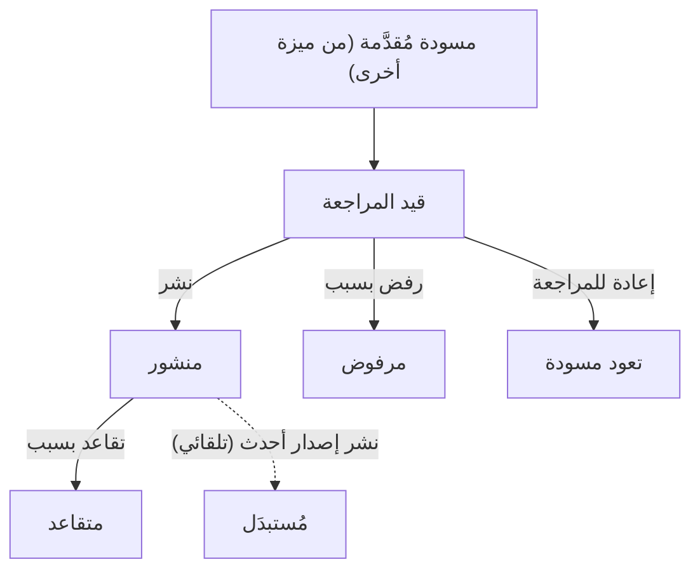
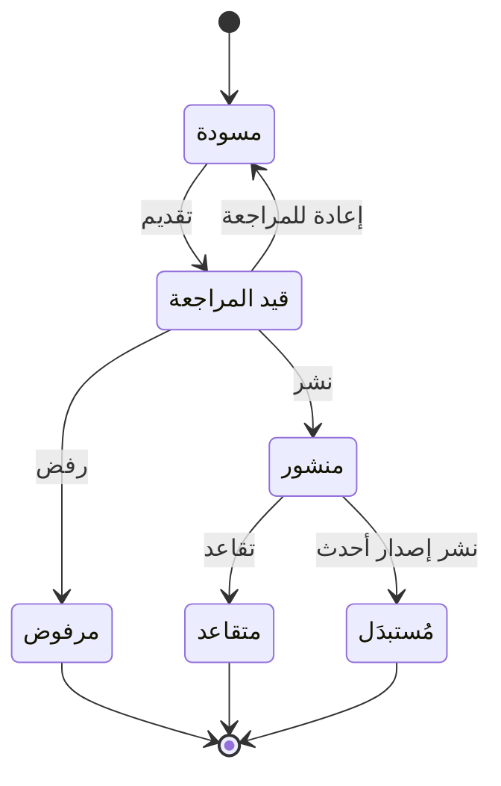

# مراجعة المعرفة ونشرها

<!-- BEGIN GENERATED: doc -->
| البند | القيمة |
|---|---|
| المعرّف | FEAT-KNW-KNOWLEDGE-REVIEW |
| الإصدار | 0.1 |
| الحالة | مسودة |
| القدرة | CAP-11 المعرفة والذاكرة المؤسسية |
| القدرة الفرعية | CAP-11.01 الدروس والمعرفة (R2) |
| الأدوار | مدير المعرفة؛ النظام |
| الشاشات | SCR-44 المعرفة والأرشيف، SCR-06 قوائم المراجعة |
| حالات الاستخدام | UC-061، UC-062 |
| القصص | 8: 5 من المواصفة، و3 جديدة |
<!-- END GENERATED: doc -->

## 1. نظرة عامة

### 1.1 القيمة

يضمن أن ما يُنشر من معرفة مؤسسية قد راجعه مدير المعرفة واعتمده، وأن القديم منه يُسحب أو يُستبدل بنسخة أحدث.

### 1.2 النطاق

| البند | القيمة |
|---|---|
| المستخدمون | مدير المعرفة (المراجعة والنشر والرفض والإعادة والتقاعد) · النظام (استبدال الإصدار القديم تلقائيًا) |
| الشاشات | شاشة قوائم المراجعة (SCR-06) · شاشة المعرفة والأرشيف (SCR-44) |
| حالات الاستخدام | التحقق من المعرفة (UC-061) · نشر المعرفة (UC-062) |
| المتطلبات | يدير النظام كائنات المعرفة (الإجراءات والدروس والممارسات الفضلى والمعرفة السياساتية) كعبارات بأدلة وعلاقات وإصدارات ومراجعة واعتماد ونشر (REQ-KNW-001) · عند إغلاق مهمة أو خطة أو حادثة أو محاكاة تمرين يتيح تسجيل درس مستفاد (REQ-KNW-002) · حين تكون معرفة منشورة ذات صلة بخطة أو نوع مهمة جديد تُقترح على المستخدم (REQ-KNW-003) |
| خارج النطاق | صياغة مسودة كائن المعرفة وتعديلها وتقديمها للمراجعة (ميزة أخرى) · تسجيل إعادة الاستخدام والبحث في المعرفة المنشورة (ميزة أخرى) |

### 1.3 خريطة الميزة

**الشكل 1: مسار كائن المعرفة من التقديم إلى النشر أو الرفض**



وتتبع حالات كائن المعرفة دورة الحالات الكاملة في **الشكل 2**، بما فيها ما تغطيه ميزات أخرى.



## 2. القواعد المشتركة

تنطبق على كل قصص الميزة، فلا تتكرر داخل القصص. وكل قصة تذكر ما يخصها فقط.

### 2.1 السياق المشترك

كل قصة تبدأ من ثلاثة شروط: مستأجر نشط، وحزمة السياسات الأساسية مفعّلة، ومستخدم مسجّل الدخول ومخوَّل. وتشير إليها القصص بخطوة واحدة: «بفرض السياق المشترك للميزة».

### 2.2 الصلاحية وعدم الإفصاح

- من لا يحق له رؤية العنصر يتلقى ردًا بشكل «غير متاح» تمامًا، فلا يعرف أنه موجود.
- من يرى العنصر ولا يحق له الإجراء يتلقى «لا تملك صلاحية هذا الإجراء».

### 2.3 أوامر تغيير الحالة

- **منع التكرار:** يُرسل كل أمر بمفتاح فريد، فإعادة الطلب نفسه لا تُنفَّذ مرتين.
- **حماية التعديل المتزامن:** يُرسل كل أمر بإصدار البيانات الذي يراه المستخدم. فإن عدّلها غيره في الأثناء، يُرفض الأمر.
- **السجل:** إن نجح الأمر، يُكتب حدثه وسجل التدقيق في المعاملة نفسها.

### 2.4 الرفض المشترك

```gherkin
# language: ar
خاصية: الرفض المشترك لأوامر الميزة

  سيناريو مخطط: رفض مشترك لكل أمر في الميزة
    بفرض السياق المشترك للميزة
    و <الحالة>
    عندما يُرسل المستخدم أي أمر من أوامر الميزة
    اذاً يُرفض برمز <الرمز> ويرى "<الرسالة>"
    و لا يتغير شيء

    امثلة:
      | الحالة                                  | الرمز                  | الرسالة                                                 |
      | العنصر خارج صلاحياته                    | NOT_FOUND              | غير متاح                                                |
      | العنصر مرئي له ولا يحق له الإجراء       | AUTHZ_DENIED           | لا تملك صلاحية هذا الإجراء                              |
      | غيره عدّل العنصر بعد أن فتحه            | VERSION_CONFLICT       | تغيّرت البيانات منذ فتحتها. راجع التغييرات ثم أعد المحاولة |
      | أعاد مفتاح منع التكرار بمحتوى مختلف     | IDEMPOTENCY_KEY_REUSED | طلب مكرر بمحتوى مختلف                                   |
      | البيانات ناقصة أو غير صحيحة             | VALIDATION_FAILED      | بعض البيانات ناقصة أو غير صحيحة. راجع الحقول المعلَّمة      |

  سيناريو: إعادة الطلب نفسه لا تُنفَّذ مرتين
    بفرض السياق المشترك للميزة
    و أمر نجح بمفتاح منع تكرار
    عندما يُعاد الطلب نفسه بالمفتاح نفسه
    اذاً تُعاد النتيجة الأولى ولا يُكتب حدث ثانٍ
```

## 3. الجودة وتعريف الاكتمال

### 3.1 متطلبات الجودة

<!-- BEGIN GENERATED: quality -->
لا متطلبات جودة مرتبطة بمتطلبات هذه الميزة مباشرة. تنطبق متطلبات المنصة العامة (`FEAT-PLT-*`).
<!-- END GENERATED: quality -->

### 3.2 تعريف الاكتمال

القصة مكتملة حين تتحقق الشروط الخمسة:

1. سيناريوهاتها والقواعد المشتركة تمر في الاختبار الآلي.
2. فحوص البنية المعمارية تمر.
3. نصوص الواجهة والرسائل موجودة بالعربية والإنجليزية.
4. مراجعة الكود مكتملة.
5. ما تضيفه القصة نفسها في قسم «القواعد» تحقق.

## 4. فهرس القصص

<!-- BEGIN GENERATED: story-index -->
| المعرّف | القصة | النوع | الحالة |
|---|---|---|---|
| `US-BC06-KNO-PUBLISH` | نشر كائن المعرفة | أمر | مسودة |
| `US-BC06-KNO-REJECT` | رفض كائن المعرفة | أمر | مسودة |
| `US-BC06-KNO-RETIRE` | إحالة كائن المعرفة إلى التقاعد | أمر | مسودة |
| `US-BC06-KNO-RETURN` | إعادة كائن المعرفة للمراجعة | أمر | مسودة |
| `US-DOM-KNO-REVIEW-QUEUE` | عرض المعرفة المنتظرة للمراجعة | جلب | مسودة |
| `US-BC06-S-KNOWLEDGE-OBJECT-01` | تلقائي: newer version published (كائن المعرفة) | نظام | مسودة |
| `US-UI-SCR06-KNOWLEDGE-QUEUE` | قائمة مراجعة المعرفة لمدير المعرفة | واجهة | مسودة |
| `US-UI-SCR44-KNOWLEDGE-REVIEW` | مراجعة كائن المعرفة ومقارنته بنسخته السابقة | واجهة | مسودة |
<!-- END GENERATED: story-index -->

## 5. القصص

### 5.1 US-BC06-KNO-PUBLISH — نشر كائن المعرفة

| النوع | الإصدار | الأولوية | دون اتصال | الحالة |
|---|---|---|---|---|
| أمر | R2 | Must | لا | مسودة |

> **كـ** مدير المعرفة، **أريد** نشر كائن معرفة قيد المراجعة، **حتى** يراه كل من يحتاج إليه ويُستبدل تلقائيًا أي إصدار منشور سابق منه.

**باختصار:** مدير المعرفة ينشر كائن معرفة «قيد المراجعة» لم يكتبه هو نفسه، فيصير «منشورًا»؛ وإن كان له إصدار منشور سابق يصير ذلك الإصدار «مُستبدَلًا» في المعاملة نفسها. والإجراءات والمعرفة السياساتية تحتاج أيضًا موافقة الجهة المختصة بمجالها.

#### القواعد

- **متى يُسمح:** الكائن في حالة «قيد المراجعة».
- **من يُسمح له:** مدير المعرفة، بشرط ألا يكون هو من كتب الكائن (فصل المهام)؛ وإن كان الكائن إجراءً أو معرفة سياساتية فلا بد أيضًا من موافقة الجهة المختصة بمجاله.
- **البيانات:** ملاحظة اختيارية.
- **الأثر:** حدث «نُشر كائن المعرفة» يصل إلى فهرس اقتراحات المعرفة وعرض البحث وقياس الاستخدام؛ وإن وُجد إصدار منشور سابق لهذا الكائن يصير «مُستبدَلًا» تلقائيًا في المعاملة نفسها.

#### معايير القبول

```gherkin
# language: ar
خاصية: نشر كائن المعرفة

  سيناريو: مدير المعرفة ينشر كائنًا راجعه
    بفرض السياق المشترك للميزة
    و كائن معرفة "قيد المراجعة" لم يكتبه مدير المعرفة نفسه
    عندما ينشره
    اذاً تصبح حالته "منشور"
    و يُسجَّل حدث "نُشر كائن المعرفة"

  سيناريو مخطط: رفض خاص بالنشر
    بفرض السياق المشترك للميزة
    و <الحالة>
    عندما يحاول مدير المعرفة نشر الكائن
    اذاً يُرفض برمز <الرمز> ويرى <الرسالة>
    و لا يتغير شيء

    امثلة:
      | الحالة                                                        | الرمز                                      | الرسالة                                         |
      | الكائن ليس "قيد المراجعة"                                     | KNOWLEDGE_OBJECT_INVALID_STATE_TRANSITION  | الوضع الحالي لكائن المعرفة لا يسمح بهذا الإجراء |
      | الناشر هو من كتب الكائن، أو إجراء بلا موافقة الجهة المختصة    | SEGREGATION_OF_DUTIES                      | لا يجوز أن يعتمد الشخص نفسه ما قدّمه أو طلبه    |
```

<details><summary>المراجع التقنية والتتبع</summary>

<!-- BEGIN GENERATED: refs US-BC06-KNO-PUBLISH -->
| البند | المعرّف | المعنى |
|---|---|---|
| الواجهة البرمجية | `POST /api/v1/knowledge/knowledge-objects/{id}/actions/publish` | — |
| الأمر | `CMD-KNO-PUBLISH` | نشر كائن المعرفة |
| السياسة | `POL-KNO-PUBLISH` | any user (draft lessons) · Knowledge Manager (review, publish, retire) · planner (record reuse)؛ tenant match… |
| الحدث | `EVT-KNO-PUBLISHED` | يصل إلى: Knowledge suggestion index; Search projection (SLC-05); Business telemetry (OUT-06) |
| الكيان | `AGG-KNOWLEDGE-OBJECT` | كائن المعرفة |
| الجدول | `knowledge.knowledge_objects` | الجدول الرئيسي لكائن المعرفة |
| وحدة النشر | DU-15 | — |
| المتطلبات | REQ-KNW-001، REQ-KNW-002، REQ-KNW-003 | معانيها في القسم 6. التتبع |
| حالات الاستخدام | UC-061، UC-062 | Validate Knowledge؛ Publish Knowledge |
| الاختبار | TST-KNOWLEDGE-OBJECT-SM، TST-SLC12-INVARIANTS | دورة حالات كائن المعرفة، وثوابت الشريحة SLC-12 |
<!-- END GENERATED: refs US-BC06-KNO-PUBLISH -->

</details>

### 5.2 US-BC06-KNO-REJECT — رفض كائن المعرفة

| النوع | الإصدار | الأولوية | دون اتصال | الحالة |
|---|---|---|---|---|
| أمر | R2 | Must | لا | مسودة |

> **كـ** مدير المعرفة، **أريد** رفض كائن معرفة قيد المراجعة بسبب، **حتى** لا يُنشر ما لا يصلح.

**باختصار:** يرفض مدير المعرفة كائن معرفة «قيد المراجعة» بذكر السبب، فيصير «مرفوضًا» بصفة نهائية.

#### القواعد

- **متى يُسمح:** الكائن في حالة «قيد المراجعة».
- **من يُسمح له:** مدير المعرفة.
- **البيانات:** السبب (إلزامي).
- **الأثر:** حدث «رُفض كائن المعرفة» يصل إلى فهرس اقتراحات المعرفة وعرض البحث وقياس الاستخدام.

#### معايير القبول

```gherkin
# language: ar
خاصية: رفض كائن المعرفة

  سيناريو: رفض كائن قيد المراجعة بسبب
    بفرض السياق المشترك للميزة
    و كائن معرفة "قيد المراجعة"
    عندما يرفضه مدير المعرفة بذكر السبب
    اذاً تصبح حالته "مرفوض"
    و يُسجَّل حدث "رُفض كائن المعرفة"

  سيناريو مخطط: رفض خاص بالرفض
    بفرض السياق المشترك للميزة
    و <الحالة>
    عندما يحاول مدير المعرفة رفض الكائن
    اذاً يُرفض برمز <الرمز> ويرى <الرسالة>
    و لا يتغير شيء

    امثلة:
      | الحالة                       | الرمز                                      | الرسالة                                         |
      | الكائن ليس "قيد المراجعة"    | KNOWLEDGE_OBJECT_INVALID_STATE_TRANSITION  | الوضع الحالي لكائن المعرفة لا يسمح بهذا الإجراء |
      | السبب فارغ                   | REASON_REQUIRED                            | اذكر السبب                                       |
```

<details><summary>المراجع التقنية والتتبع</summary>

<!-- BEGIN GENERATED: refs US-BC06-KNO-REJECT -->
| البند | المعرّف | المعنى |
|---|---|---|
| الواجهة البرمجية | `POST /api/v1/knowledge/knowledge-objects/{id}/actions/reject` | — |
| الأمر | `CMD-KNO-REJECT` | رفض كائن المعرفة |
| السياسة | `POL-KNO-REJECT` | any user (draft lessons) · Knowledge Manager (review, publish, retire) · planner (record reuse)؛ tenant match… |
| الحدث | `EVT-KNO-REJECTED` | يصل إلى: Knowledge suggestion index; Search projection (SLC-05); Business telemetry (OUT-06) |
| الكيان | `AGG-KNOWLEDGE-OBJECT` | كائن المعرفة |
| الجدول | `knowledge.knowledge_objects` | الجدول الرئيسي لكائن المعرفة |
| وحدة النشر | DU-15 | — |
| المتطلبات | REQ-KNW-001، REQ-KNW-002، REQ-KNW-003 | معانيها في القسم 6. التتبع |
| حالات الاستخدام | UC-061، UC-062 | Validate Knowledge؛ Publish Knowledge |
| الاختبار | TST-KNOWLEDGE-OBJECT-SM، TST-SLC12-INVARIANTS | دورة حالات كائن المعرفة، وثوابت الشريحة SLC-12 |
<!-- END GENERATED: refs US-BC06-KNO-REJECT -->

</details>

### 5.3 US-BC06-KNO-RETIRE — إحالة كائن المعرفة إلى التقاعد

| النوع | الإصدار | الأولوية | دون اتصال | الحالة |
|---|---|---|---|---|
| أمر | R2 | Must | لا | مسودة |

> **كـ** مدير المعرفة، **أريد** إحالة كائن معرفة منشور إلى التقاعد بسبب (تجاوزه الزمن أو ثبت خطؤه)، **حتى** لا يستمر أحد في الاعتماد عليه.

**باختصار:** يحيل مدير المعرفة كائنًا «منشورًا» إلى حالة «متقاعد» بذكر السبب، فتبقى نسخته محفوظة لكن لا تُقترح بعدها على مستخدم جديد.

#### القواعد

- **متى يُسمح:** الكائن في حالة «منشور».
- **من يُسمح له:** مدير المعرفة.
- **البيانات:** السبب، مثل تجاوز الزمن أو ثبوت الخطأ (إلزامي).
- **الأثر:** حدث «أُحيل كائن المعرفة إلى التقاعد» يصل إلى فهرس اقتراحات المعرفة وعرض البحث وقياس الاستخدام، فلا يُقترح الكائن بعده.

#### معايير القبول

```gherkin
# language: ar
خاصية: إحالة كائن المعرفة إلى التقاعد

  سيناريو: إحالة كائن منشور إلى التقاعد بسبب
    بفرض السياق المشترك للميزة
    و كائن معرفة "منشور"
    عندما يحيله مدير المعرفة إلى التقاعد بذكر السبب
    اذاً تصبح حالته "متقاعد"
    و يُسجَّل حدث "أُحيل كائن المعرفة إلى التقاعد"

  سيناريو مخطط: رفض خاص بالإحالة إلى التقاعد
    بفرض السياق المشترك للميزة
    و <الحالة>
    عندما يحاول مدير المعرفة إحالة الكائن إلى التقاعد
    اذاً يُرفض برمز <الرمز> ويرى <الرسالة>
    و لا يتغير شيء

    امثلة:
      | الحالة                    | الرمز                                      | الرسالة                                         |
      | الكائن ليس "منشورًا"      | KNOWLEDGE_OBJECT_INVALID_STATE_TRANSITION  | الوضع الحالي لكائن المعرفة لا يسمح بهذا الإجراء |
      | السبب فارغ                | REASON_REQUIRED                            | اذكر السبب                                       |
```

<details><summary>المراجع التقنية والتتبع</summary>

<!-- BEGIN GENERATED: refs US-BC06-KNO-RETIRE -->
| البند | المعرّف | المعنى |
|---|---|---|
| الواجهة البرمجية | `POST /api/v1/knowledge/knowledge-objects/{id}/actions/retire` | — |
| الأمر | `CMD-KNO-RETIRE` | إحالة كائن المعرفة إلى التقاعد |
| السياسة | `POL-KNO-RETIRE` | any user (draft lessons) · Knowledge Manager (review, publish, retire) · planner (record reuse)؛ tenant match… |
| الحدث | `EVT-KNO-RETIRED` | يصل إلى: Knowledge suggestion index; Search projection (SLC-05); Business telemetry (OUT-06) |
| الكيان | `AGG-KNOWLEDGE-OBJECT` | كائن المعرفة |
| الجدول | `knowledge.knowledge_objects` | الجدول الرئيسي لكائن المعرفة |
| وحدة النشر | DU-15 | — |
| المتطلبات | REQ-KNW-001، REQ-KNW-002، REQ-KNW-003 | معانيها في القسم 6. التتبع |
| حالات الاستخدام | UC-061، UC-062 | Validate Knowledge؛ Publish Knowledge |
| الاختبار | TST-KNOWLEDGE-OBJECT-SM، TST-SLC12-INVARIANTS | دورة حالات كائن المعرفة، وثوابت الشريحة SLC-12 |
<!-- END GENERATED: refs US-BC06-KNO-RETIRE -->

</details>

### 5.4 US-BC06-KNO-RETURN — إعادة كائن المعرفة للمراجعة

| النوع | الإصدار | الأولوية | دون اتصال | الحالة |
|---|---|---|---|---|
| أمر | R2 | Must | لا | مسودة |

> **كـ** مدير المعرفة، **أريد** إعادة كائن معرفة قيد المراجعة إلى كاتبه بسبب، **حتى** يعدّله قبل أن يُعاد تقديمه.

**باختصار:** يعيد مدير المعرفة كائن معرفة «قيد المراجعة» إلى حالة «مسودة» بذكر سبب الإعادة، فيعدّله كاتبه ويقدّمه من جديد.

#### القواعد

- **متى يُسمح:** الكائن في حالة «قيد المراجعة».
- **من يُسمح له:** مدير المعرفة.
- **البيانات:** السبب (إلزامي).
- **الأثر:** حدث «أُعيد كائن المعرفة للمراجعة» يصل إلى فهرس اقتراحات المعرفة وعرض البحث وقياس الاستخدام.

#### معايير القبول

```gherkin
# language: ar
خاصية: إعادة كائن المعرفة للمراجعة

  سيناريو: إعادة كائن قيد المراجعة إلى مسودة بسبب
    بفرض السياق المشترك للميزة
    و كائن معرفة "قيد المراجعة"
    عندما يعيده مدير المعرفة بذكر السبب
    اذاً تصبح حالته "مسودة"
    و يُسجَّل حدث "أُعيد كائن المعرفة للمراجعة"

  سيناريو مخطط: رفض خاص بالإعادة
    بفرض السياق المشترك للميزة
    و <الحالة>
    عندما يحاول مدير المعرفة إعادة الكائن
    اذاً يُرفض برمز <الرمز> ويرى <الرسالة>
    و لا يتغير شيء

    امثلة:
      | الحالة                       | الرمز                                      | الرسالة                                         |
      | الكائن ليس "قيد المراجعة"    | KNOWLEDGE_OBJECT_INVALID_STATE_TRANSITION  | الوضع الحالي لكائن المعرفة لا يسمح بهذا الإجراء |
      | السبب فارغ                   | REASON_REQUIRED                            | اذكر السبب                                       |
```

<details><summary>المراجع التقنية والتتبع</summary>

<!-- BEGIN GENERATED: refs US-BC06-KNO-RETURN -->
| البند | المعرّف | المعنى |
|---|---|---|
| الواجهة البرمجية | `POST /api/v1/knowledge/knowledge-objects/{id}/actions/return` | — |
| الأمر | `CMD-KNO-RETURN` | إعادة كائن المعرفة للمراجعة |
| السياسة | `POL-KNO-RETURN` | any user (draft lessons) · Knowledge Manager (review, publish, retire) · planner (record reuse)؛ tenant match… |
| الحدث | `EVT-KNO-RETURNED` | يصل إلى: Knowledge suggestion index; Search projection (SLC-05); Business telemetry (OUT-06) |
| الكيان | `AGG-KNOWLEDGE-OBJECT` | كائن المعرفة |
| الجدول | `knowledge.knowledge_objects` | الجدول الرئيسي لكائن المعرفة |
| وحدة النشر | DU-15 | — |
| المتطلبات | REQ-KNW-001، REQ-KNW-002، REQ-KNW-003 | معانيها في القسم 6. التتبع |
| حالات الاستخدام | UC-061، UC-062 | Validate Knowledge؛ Publish Knowledge |
| الاختبار | TST-KNOWLEDGE-OBJECT-SM، TST-SLC12-INVARIANTS | دورة حالات كائن المعرفة، وثوابت الشريحة SLC-12 |
<!-- END GENERATED: refs US-BC06-KNO-RETURN -->

</details>

### 5.5 US-DOM-KNO-REVIEW-QUEUE — عرض المعرفة المنتظرة للمراجعة

| النوع | الإصدار | الأولوية | دون اتصال | الحالة |
|---|---|---|---|---|
| جلب | R2 | Must | لا | مسودة |

> **كـ** مدير المعرفة، **أريد** قائمة كائنات المعرفة «قيد المراجعة» التي يحق لي مراجعتها، **حتى** أراجعها بالترتيب ولا يفوتني واحد منها. **[Derived]**

**باختصار:** تُعاد كائنات المعرفة «قيد المراجعة» التي يحق لمدير المعرفة رؤيتها فقط، صفحةً بعد صفحة، الأقدم أولًا. **[Derived]**: المصدر لا يذكر استعلامًا مخصصًا لهذا الطابور، بل شاشة قوائم المراجعة (SCR-06) التي تجمع طوابير قدرات عدة.

**المرشحات:** نوع كائن المعرفة (إجراء، درس، ممارسة فضلى، معرفة سياساتية) · المؤشر والحد.

#### معايير القبول

```gherkin
# language: ar
خاصية: عرض المعرفة المنتظرة للمراجعة

  سيناريو: يرى مدير المعرفة الطابور الذي يحق له مراجعته فقط
    بفرض السياق المشترك للميزة
    و كائنات معرفة "قيد المراجعة" داخل نطاق مدير المعرفة وأخرى خارجه
    عندما يطلب طابور المراجعة
    اذاً تُعاد الكائنات داخل نطاقه فقط، الأقدم أولًا
    و لا يكشف أي عدد أو اقتراح وجود كائن محجوب

  سيناريو: الصفحة التالية
    بفرض السياق المشترك للميزة
    و الطابور أكثر من صفحة
    عندما يطلب الصفحة التالية بالمؤشر
    اذاً تُعاد الكائنات التالية دون تكرار ولا فجوة
```

<details><summary>المراجع التقنية والتتبع</summary>

<!-- BEGIN GENERATED: refs US-DOM-KNO-REVIEW-QUEUE -->
| البند | المعرّف | المعنى |
|---|---|---|
| حالة الاستخدام | UC-061 | Validate Knowledge |
| الشاشة | SCR-06 | شاشة قوائم المراجعة |
| المصدر | `21-ui-design.md §4.1` | — |
| المصدر | `[Derived]` | — |
| المتطلب | REQ-KNW-001 | The system shall manage knowledge objects (procedures, lessons, best practices, policy knowledge) as claims w… |
| حالات الاستخدام | UC-061، UC-062 | Validate Knowledge؛ Publish Knowledge |
<!-- END GENERATED: refs US-DOM-KNO-REVIEW-QUEUE -->

</details>

### 5.6 US-BC06-S-KNOWLEDGE-OBJECT-01 — تلقائي: newer version published (كائن المعرفة)

| النوع | الإصدار | الأولوية | دون اتصال | الحالة |
|---|---|---|---|---|
| نظام | R2 | Must | لا ينطبق | مسودة |

> **كـ** النظام، **أريد** نقل كائن المعرفة المنشور سابقًا إلى «مُستبدَل» حين يُنشر إصدار أحدث منه، **حتى** يبقى إصدار منشور واحد فقط لكل كائن معرفة.

**باختصار:** عند نشر إصدار جديد من كائن معرفة له إصدار منشور قائم، يحوّل النظام الإصدار القديم فورًا إلى «مُستبدَل» في معاملة النشر نفسها.

#### القواعد

- **متى يحدث:** عند نشر إصدار جديد من كائن معرفة له إصدار منشور قائم.
- **الأثر:** الإصدار المنشور السابق يصير «مُستبدَل»، ويُسجَّل حدث «استُبدل كائن المعرفة» بهوية النظام، في معاملة نشر الإصدار الجديد نفسها.

#### معايير القبول

```gherkin
# language: ar
خاصية: استبدال كائن المعرفة بإصدار أحدث

  سيناريو: نشر إصدار جديد يستبدل القديم
    بفرض كائن معرفة "منشور" له إصدار سابق منشور لنفس الكائن
    عندما يُنشر الإصدار الجديد
    اذاً يصبح الإصدار السابق "مُستبدَل"
    و يُسجَّل حدث "استُبدل كائن المعرفة" بهوية النظام

  سيناريو: لا إصدار سابق منشور
    بفرض كائن معرفة يُنشر للمرة الأولى بلا إصدار منشور سابق له
    عندما يُنشر
    اذاً لا يُستبدل أي إصدار آخر
```

<details><summary>المراجع التقنية والتتبع</summary>

<!-- BEGIN GENERATED: refs US-BC06-S-KNOWLEDGE-OBJECT-01 -->
| البند | المعرّف | المعنى |
|---|---|---|
| المحفِّز | `SYS:newer version published` | system |
| الانتقال | PUBLISHED ← SUPERSEDED | — |
| الحدث | `EVT-KNO-SUPERSEDED` | يصل إلى: Knowledge suggestion index; Search projection (SLC-05); Business telemetry (OUT-06) |
| الكيان | `AGG-KNOWLEDGE-OBJECT` | كائن المعرفة |
| الجدول | `knowledge.knowledge_objects` | الجدول الرئيسي لكائن المعرفة |
| وحدة النشر | DU-15 | — |
| المتطلبات | REQ-KNW-001، REQ-KNW-002، REQ-KNW-003 | معانيها في القسم 6. التتبع |
| حالات الاستخدام | UC-061، UC-062 | Validate Knowledge؛ Publish Knowledge |
| الاختبار | TST-KNOWLEDGE-OBJECT-SM، TST-SLC12-INVARIANTS | دورة حالات كائن المعرفة، وثوابت الشريحة SLC-12 |
<!-- END GENERATED: refs US-BC06-S-KNOWLEDGE-OBJECT-01 -->

</details>

### 5.7 US-UI-SCR06-KNOWLEDGE-QUEUE — قائمة مراجعة المعرفة لمدير المعرفة

| النوع | الإصدار | الأولوية | دون اتصال | الحالة |
|---|---|---|---|---|
| واجهة | R2 | Should | لا | مسودة |

> **كـ** مدير المعرفة، **أريد** رؤية طابور كائنات المعرفة المنتظرة مراجعتي ضمن شاشة قوائم المراجعة المشتركة، **حتى** أراجعها من المكان نفسه الذي أراجع منه طوابير أخرى. **[Derived]**

**باختصار:** تضيف شاشة قوائم المراجعة (SCR-06) تبويبًا لكائنات المعرفة «قيد المراجعة»، يفتح كل عنصر منه شاشة مراجعة المعرفة (SCR-44).

#### القواعد

- التبويب يعرض الكائنات داخل نطاق مدير المعرفة فقط، الأقدم أولًا، بلا عدد إجمالي لما هو خارج نطاقه.
- فتح عنصر من التبويب ينقل مباشرة إلى شاشة مراجعته التفصيلية (SCR-44). **[Derived]**

#### معايير القبول

```gherkin
# language: ar
خاصية: قائمة مراجعة المعرفة لمدير المعرفة

  سيناريو: فتح تبويب المعرفة في شاشة قوائم المراجعة
    بفرض السياق المشترك للميزة
    و كائنات معرفة "قيد المراجعة" يحق لمدير المعرفة مراجعتها
    عندما يفتح تبويب المعرفة في شاشة قوائم المراجعة
    اذاً يرى الكائنات التي يحق له مراجعتها، الأقدم أولًا

  سيناريو: فتح عنصر من الطابور
    بفرض السياق المشترك للميزة
    و الطابور يعرض كائن معرفة
    عندما يفتحه مدير المعرفة
    اذاً تنتقل الشاشة إلى تفاصيل مراجعته
```

<details><summary>المراجع التقنية والتتبع</summary>

<!-- BEGIN GENERATED: refs US-UI-SCR06-KNOWLEDGE-QUEUE -->
| البند | المعرّف | المعنى |
|---|---|---|
| حالة الاستخدام | UC-061 | Validate Knowledge |
| الشاشة | SCR-06 | شاشة قوائم المراجعة |
| المصدر | `21-ui-design.md §6.1` | — |
| المصدر | `[Derived]` | — |
<!-- END GENERATED: refs US-UI-SCR06-KNOWLEDGE-QUEUE -->

</details>

### 5.8 US-UI-SCR44-KNOWLEDGE-REVIEW — مراجعة كائن المعرفة ومقارنته بنسخته السابقة

| النوع | الإصدار | الأولوية | دون اتصال | الحالة |
|---|---|---|---|---|
| واجهة | R2 | Must | لا | مسودة |

> **كـ** مدير المعرفة، **أريد** مراجعة كائن معرفة ومقارنته بنسخته السابقة المنشورة من شاشة واحدة، **حتى** أحكم على ما تغيّر قبل أن أنشره أو أرفضه أو أعيده.

**باختصار:** تعرض شاشة المعرفة والأرشيف (SCR-44) عبارات الكائن وأدلتها وعلاقاته جنبًا إلى جنب مع آخر إصدار منشور منه، وتُظهر أفعال النشر والرفض والإعادة فقط إن كان المستخدم غير من كتب الكائن.

#### القواعد

- أفعال النشر والرفض والإعادة تظهر فقط إن كان المراجع غير كاتب الكائن (فصل المهام، 17-security-design.md §12.4)؛ والحكم النهائي يبقى للخادم.
- الإجراء والمعرفة السياساتية يُشار إلى حاجتها لموافقة الجهة المختصة بمجالها قبل إتمام النشر. **[Derived]**
- الاستجابة لرفض الخادم بفصل المهام تعرض رسالة فصل المهام حرفيًا، وتخفي الزر المرفوض بعدها.

#### معايير القبول

```gherkin
# language: ar
خاصية: مراجعة كائن المعرفة ومقارنته بنسخته السابقة

  سيناريو: عرض الكائن إلى جانب نسخته السابقة
    بفرض السياق المشترك للميزة
    و كائن معرفة "قيد المراجعة" له إصدار منشور سابق
    عندما يفتح مدير المعرفة شاشة مراجعته
    اذاً يرى عبارات الكائن وأدلته وعلاقاته جنبًا إلى جنب مع إصداره المنشور السابق

  سيناريو: إخفاء النشر عن كاتب الكائن نفسه
    بفرض السياق المشترك للميزة
    و مدير المعرفة هو من كتب الكائن قيد المراجعة
    عندما يفتح شاشة مراجعته
    اذاً لا يرى فعل النشر متاحًا له

  سيناريو: الشاشة تستجيب لرفض فصل المهام
    بفرض السياق المشترك للميزة
    و رفض الخادم النشر بفصل المهام
    عندما يحاول مدير المعرفة النشر من الشاشة
    اذاً يرى رسالة "لا يجوز أن يعتمد الشخص نفسه ما قدّمه أو طلبه"
    و لا يُنفَّذ النشر
```

<details><summary>المراجع التقنية والتتبع</summary>

<!-- BEGIN GENERATED: refs US-UI-SCR44-KNOWLEDGE-REVIEW -->
| البند | المعرّف | المعنى |
|---|---|---|
| حالة الاستخدام | UC-061 | Validate Knowledge |
| حالة الاستخدام | UC-062 | Publish Knowledge |
| الشاشة | SCR-44 | شاشة المعرفة والأرشيف |
| المصدر | `17-security-design.md §12.4` | — |
| المصدر | `[Derived]` | — |
| المتطلب | REQ-KNW-001 | The system shall manage knowledge objects (procedures, lessons, best practices, policy knowledge) as claims w… |
| حالات الاستخدام | UC-061، UC-062 | Validate Knowledge؛ Publish Knowledge |
<!-- END GENERATED: refs US-UI-SCR44-KNOWLEDGE-REVIEW -->

</details>

## 6. التتبع

<!-- BEGIN GENERATED: trace -->
| المتطلب | المعنى | القصص | الاختبار |
|---|---|---|---|
| REQ-KNW-001 | The system shall manage knowledge objects (procedures, lessons, best practices, policy knowledge) as claims w… | `US-BC06-KNO-PUBLISH`، `US-BC06-KNO-REJECT`، `US-BC06-KNO-RETIRE`، `US-BC06-KNO-RETURN`، `US-BC06-S-KNOWLEDGE-OBJECT-01`، `US-DOM-KNO-REVIEW-QUEUE`، `US-UI-SCR44-KNOWLEDGE-REVIEW` | TST-KNOWLEDGE-OBJECT-SM، TST-SLC12-INVARIANTS |
| REQ-KNW-002 | When a task, plan, incident, or exercise simulation is closed or completed, the system shall allow capturing… | كل قصص الميزة المأخوذة من المواصفة (5) | TST-KNOWLEDGE-OBJECT-SM، TST-SLC12-INVARIANTS |
| REQ-KNW-003 | When a published knowledge object is relevant to a new plan or task type, the system shall suggest it to the… | كل قصص الميزة المأخوذة من المواصفة (5) | TST-KNOWLEDGE-OBJECT-SM، TST-SLC12-INVARIANTS |
<!-- END GENERATED: trace -->

## 7. سجل التغييرات

| الإصدار | التاريخ | التغيير |
|---|---|---|
| 0.1 | — | هيكل مولَّد من خريطة الميزات |
| 0.2 | 2026-10-13 | كتابة القصص كاملة بمعيار القصص |
