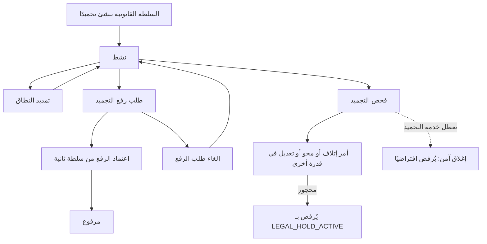
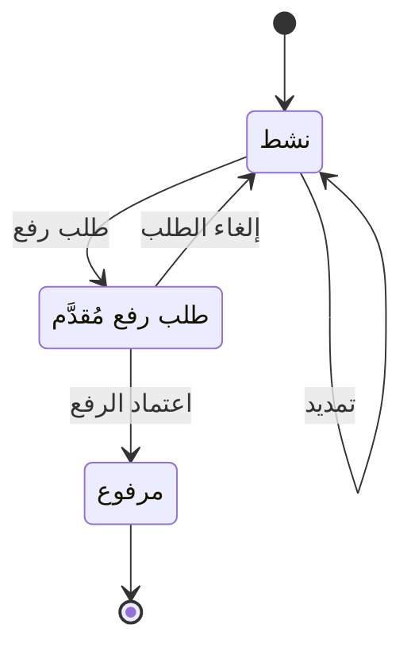

# التجميد القانوني

<!-- BEGIN GENERATED: doc -->
| البند | القيمة |
|---|---|
| المعرّف | FEAT-KNW-LEGAL-HOLD |
| الإصدار | 0.1 |
| الحالة | مسودة |
| القدرة | CAP-11 المعرفة والذاكرة المؤسسية |
| القدرة الفرعية | CAP-11.02 السجلات والاحتفاظ (R1 (الاحتفاظ والتجميد)) |
| الأدوار | السلطة القانونية والامتثال؛ أمين الأرشيف؛ المدقِّق؛ النظام |
| الشاشات | SCR-70 الاحتفاظ والحجز القانوني والإتلاف والمحو |
| حالات الاستخدام | UC-103 |
| القصص | 11: 7 من المواصفة، و4 جديدة |
<!-- END GENERATED: doc -->

## 1. نظرة عامة

### 1.1 القيمة

يمنع إتلاف أو محو أو تعديل السجلات المطلوبة لقضية أو تحقيق حتى ترفع الجهة القانونية التجميد.

### 1.2 النطاق

| البند | القيمة |
|---|---|
| المستخدمون | السلطة القانونية والامتثال (الإنشاء والتمديد وطلب الرفع واعتماده وإلغاؤه) · أمين الأرشيف والمدقِّق (المتابعة فقط) · هويات الخدمة الداخلية لدى كل جهة مالكة لسجلات (فحص التجميد قبل الإتلاف أو المحو) · أي مستخدم مخوَّل بإتلاف أو محو أو تعديل مباشر، في أي قدرة من قدرات النظام |
| الشاشات | شاشة الاحتفاظ والحجز القانوني والإتلاف والمحو (SCR-70) |
| حالات الاستخدام | تطبيق الاحتفاظ والتجميد القانوني (UC-103) |
| المتطلبات | حين يوضع تجميد قانوني على مجموعة سجلات، يمنع النظام إتلافها أو محوها أو تعديلها حتى يُرفع التجميد (REQ-GOV-007) |
| خارج النطاق | تعريف جدول الاحتفاظ وفتراته (ميزة أخرى في CAP-11.02) · تنفيذ تشغيلات الإتلاف وطلبات المحو نفسها (ميزتان أخريان)؛ هذه الميزة تغطي فرض التجميد ورفعه والتحقق منه فقط |

### 1.3 خريطة الميزة

**الشكل 1: دورة التجميد القانوني وأثره على أوامر الإتلاف والمحو**



وتتبع حالات التجميد نفسه دورة أبسط، في **الشكل 2**.



## 2. القواعد المشتركة

تنطبق على كل قصص الميزة، فلا تتكرر داخل القصص. وكل قصة تذكر ما يخصها فقط.

### 2.1 السياق المشترك

كل قصة تبدأ من ثلاثة شروط: مستأجر نشط، وحزمة السياسات الأساسية مفعّلة، ومستخدم مسجّل الدخول ومخوَّل. وتشير إليها القصص بخطوة واحدة: «بفرض السياق المشترك للميزة».

### 2.2 الصلاحية وعدم الإفصاح

- من لا يحق له رؤية العنصر يتلقى ردًا بشكل «غير متاح» تمامًا، فلا يعرف أنه موجود.
- من يرى العنصر ولا يحق له الإجراء يتلقى «لا تملك صلاحية هذا الإجراء».

### 2.3 أوامر تغيير الحالة

- **منع التكرار:** يُرسل كل أمر بمفتاح فريد، فإعادة الطلب نفسه لا تُنفَّذ مرتين.
- **حماية التعديل المتزامن:** يُرسل كل أمر بإصدار البيانات الذي يراه المستخدم. فإن عدّلها غيره في الأثناء، يُرفض الأمر.
- **السجل:** إن نجح الأمر، يُكتب حدثه وسجل التدقيق في المعاملة نفسها.

### 2.4 الرفض المشترك

```gherkin
# language: ar
خاصية: الرفض المشترك لأوامر الميزة

  سيناريو مخطط: رفض مشترك لكل أمر في الميزة
    بفرض السياق المشترك للميزة
    و <الحالة>
    عندما يُرسل المستخدم أي أمر من أوامر الميزة
    اذاً يُرفض برمز <الرمز> ويرى "<الرسالة>"
    و لا يتغير شيء

    امثلة:
      | الحالة                                  | الرمز                  | الرسالة                                                 |
      | العنصر خارج صلاحياته                    | NOT_FOUND              | غير متاح                                                |
      | العنصر مرئي له ولا يحق له الإجراء       | AUTHZ_DENIED           | لا تملك صلاحية هذا الإجراء                              |
      | غيره عدّل العنصر بعد أن فتحه            | VERSION_CONFLICT       | تغيّرت البيانات منذ فتحتها. راجع التغييرات ثم أعد المحاولة |
      | أعاد مفتاح منع التكرار بمحتوى مختلف     | IDEMPOTENCY_KEY_REUSED | طلب مكرر بمحتوى مختلف                                   |
      | البيانات ناقصة أو غير صحيحة             | VALIDATION_FAILED      | بعض البيانات ناقصة أو غير صحيحة. راجع الحقول المعلَّمة      |

  سيناريو: إعادة الطلب نفسه لا تُنفَّذ مرتين
    بفرض السياق المشترك للميزة
    و أمر نجح بمفتاح منع تكرار
    عندما يُعاد الطلب نفسه بالمفتاح نفسه
    اذاً تُعاد النتيجة الأولى ولا يُكتب حدث ثانٍ
```

### 2.5 الالتزام بالمصادقة المعززة

كل أمر من أوامر هذه الميزة (الإنشاء والتمديد وطلب الرفع واعتماده وإلغاؤه) يحتاج تأكيد هوية المستخدم مرة أخرى قبل التنفيذ. فإن كانت قوة مصادقة الجلسة أقل من المطلوب، يُرفض الأمر ويُطلب من المستخدم تأكيد هويته، ثم يُعاد الطلب بمفتاح منع التكرار نفسه فلا يُنفَّذ مرتين.

```gherkin
# language: ar
خاصية: الالتزام بالمصادقة المعززة لأوامر التجميد القانوني

  سيناريو مخطط: الأمر يحتاج مصادقة معززة
    بفرض السياق المشترك للميزة
    و قوة مصادقة الجلسة أقل من المطلوب
    عندما يُرسل المستخدم <الأمر>
    اذاً يُرفض برمز MFA_STEP_UP_REQUIRED ويرى "هذا الإجراء يحتاج تأكيد هويتك مرة أخرى"
    و لا يتغير شيء

    امثلة:
      | الأمر |
      | إنشاء التجميد القانوني |
      | تمديد التجميد القانوني |
      | طلب رفع التجميد القانوني |
      | اعتماد رفع التجميد القانوني |
      | إلغاء طلب رفع التجميد القانوني |
```

## 3. الجودة وتعريف الاكتمال

### 3.1 متطلبات الجودة

<!-- BEGIN GENERATED: quality -->
| المرجع | الموقف | المطلوب |
|---|---|---|
| QAS-GOV-001 | daily disposition evaluation | candidates computed ≤ 1 h; 0 held records destroyed |
<!-- END GENERATED: quality -->

### 3.2 تعريف الاكتمال

القصة مكتملة حين تتحقق الشروط الخمسة:

1. سيناريوهاتها والقواعد المشتركة تمر في الاختبار الآلي.
2. فحوص البنية المعمارية تمر.
3. نصوص الواجهة والرسائل موجودة بالعربية والإنجليزية.
4. مراجعة الكود مكتملة.
5. ما تضيفه القصة نفسها في قسم «القواعد» تحقق.

## 4. فهرس القصص

<!-- BEGIN GENERATED: story-index -->
| المعرّف | القصة | النوع | الحالة |
|---|---|---|---|
| `US-BC08-LHD-APPROVE-RELEASE` | اعتماد رفع التجميد القانوني | أمر | مسودة |
| `US-BC08-LHD-CANCEL-RELEASE` | إلغاء طلب رفع التجميد القانوني | أمر | مسودة |
| `US-BC08-LHD-EXTEND` | تمديد التجميد القانوني | أمر | مسودة |
| `US-BC08-LHD-PLACE` | إنشاء التجميد القانوني | أمر | مسودة |
| `US-BC08-LHD-REQUEST-RELEASE` | طلب رفع التجميد القانوني | أمر | مسودة |
| `US-DOM-LEGALHOLD-BLOCK-MODIFY` | منع تعديل السجلات المجمدة | أمر | مسودة |
| `US-BC08-Q-LHD-CHECK` | جلب: HoldCheck OHS: URNs / subjects / (class, bucket) → held? with hold ids | جلب | مسودة |
| `US-BC08-Q-LHD-LIST` | جلب: Holds by state and scope | جلب | مسودة |
| `US-UI-SCR70-LEGAL-HOLD` | متابعة التجميدات القانونية والتحقق من سجل | واجهة | مسودة |
| `US-PLT-LEGALHOLD-CHECK-CACHE` | فحص التجميد في كل سياق مع الإغلاق عند التعطل | منصة | مسودة |
| `US-OPS-LEGALHOLD-BLOCKED-REPORT` | إبلاغ الجهة القانونية بمحاولات المساس بالمجمد | تشغيل | مسودة |
<!-- END GENERATED: story-index -->

## 5. القصص

### 5.1 US-BC08-LHD-APPROVE-RELEASE — اعتماد رفع التجميد القانوني

| النوع | الإصدار | الأولوية | دون اتصال | الحالة |
|---|---|---|---|---|
| أمر | R1 | Must | لا | مسودة |

> **كـ** السلطة القانونية والامتثال (سلطة ثانية مستقلة)، **أريد** اعتماد رفع تجميد قانوني طلبته سلطة قانونية أخرى، **حتى** يُرفع التجميد بعد أن يتأكد اثنان مستقلان من استيفاء الشرط القانوني.

**باختصار:** سلطة قانونية مختلفة عن طالب الرفع تعتمد طلب رفع تجميد قائم، فتصير حالته «مرفوع» ولا يعود يمنع الإتلاف أو المحو أو التعديل.

#### القواعد

- **متى يُسمح:** التجميد في حالة «طلب رفع مُقدَّم».
- **من يُسمح له:** السلطة القانونية والامتثال، بشرط أن يكون المعتمِد سلطة مختلفة عن من طلب الرفع (فصل المهام).
- **البيانات:** ملاحظة اختيارية.
- **الأثر:** حدث «اعتُمد رفع التجميد» يصل إلى ذاكرة فحص التجميد لدى كل الجهات المالكة للسجلات، وإلى تخطيط الإتلاف ومنفّذ المحو، فتتوقف عن اعتبار نطاق هذا التجميد محجوزًا.

#### معايير القبول

```gherkin
# language: ar
خاصية: اعتماد رفع التجميد القانوني

  سيناريو: سلطة ثانية تعتمد طلب الرفع
    بفرض السياق المشترك للميزة
    و تجميد قانوني في حالة "طلب رفع مُقدَّم" طلبته سلطة قانونية
    عندما تعتمد سلطة قانونية أخرى رفعه
    اذاً تصبح حالته "مرفوع"
    و يُسجَّل حدث "اعتُمد رفع التجميد"

  سيناريو مخطط: رفض خاص باعتماد الرفع
    بفرض السياق المشترك للميزة
    و <الحالة>
    عندما تحاول السلطة القانونية اعتماد الرفع
    اذاً يُرفض برمز <الرمز> ويرى <الرسالة>
    و لا يتغير شيء

    امثلة:
      | الحالة                                | الرمز                                | الرسالة                                             |
      | التجميد ليس في حالة "طلب رفع مُقدَّم" | LEGAL_HOLD_INVALID_STATE_TRANSITION  | الوضع الحالي للتجميد القانوني لا يسمح بهذا الإجراء  |
      | المعتمِد هو من طلب الرفع نفسه         | SEGREGATION_OF_DUTIES                | لا يجوز أن يعتمد الشخص نفسه ما قدّمه أو طلبه        |
```

<details><summary>المراجع التقنية والتتبع</summary>

<!-- BEGIN GENERATED: refs US-BC08-LHD-APPROVE-RELEASE -->
| البند | المعرّف | المعنى |
|---|---|---|
| الواجهة البرمجية | `POST /api/v1/governance/legal-holds/{id}/actions/approve-release` | — |
| الأمر | `CMD-LHD-APPROVE-RELEASE` | اعتماد رفع التجميد القانوني |
| السياسة | `POL-LHD-APPROVE-RELEASE` | Legal/Compliance authority (place, extend, request/approve/cancel release)؛ tenant match |
| الحدث | `EVT-LHD-RELEASED` | يصل إلى: HoldCheck cache (all owners); Disposition planner; Erasure executor |
| الكيان | `AGG-LEGAL-HOLD` | التجميد القانوني |
| الجدول | `governance.legal_holds` | الجدول الرئيسي للتجميد القانوني |
| وحدة النشر | DU-03 | — |
| المتطلب | REQ-GOV-007 | When a legal hold is placed on a set of records, the system shall prevent their disposition, erasure or modif… |
| حالة الاستخدام | UC-103 | Apply Retention & Legal Hold |
| الاختبار | TST-LEGAL-HOLD-SM | دورة حالات التجميد القانوني، وثوابت الشريحة SLC-12a |
<!-- END GENERATED: refs US-BC08-LHD-APPROVE-RELEASE -->

</details>

### 5.2 US-BC08-LHD-CANCEL-RELEASE — إلغاء طلب رفع التجميد القانوني

| النوع | الإصدار | الأولوية | دون اتصال | الحالة |
|---|---|---|---|---|
| أمر | R1 | Must | لا | مسودة |

> **كـ** السلطة القانونية والامتثال، **أريد** إلغاء طلب رفع تجميد قانوني بسبب، **حتى** يبقى التجميد نافذًا إن تبيّن أن سبب الرفع لم يعد صحيحًا.

**باختصار:** سلطة قانونية تلغي طلب رفع تجميد «طلب رفع مُقدَّم» بذكر السبب، فيعود التجميد إلى حالة «نشط».

#### القواعد

- **متى يُسمح:** التجميد في حالة «طلب رفع مُقدَّم».
- **من يُسمح له:** السلطة القانونية والامتثال.
- **البيانات:** السبب (إلزامي).
- **الأثر:** حدث «أُلغي طلب رفع التجميد» يصل إلى ذاكرة فحص التجميد، وتخطيط الإتلاف، ومنفّذ المحو، فيبقى نطاق التجميد محجوزًا.

#### معايير القبول

```gherkin
# language: ar
خاصية: إلغاء طلب رفع التجميد القانوني

  سيناريو: إلغاء طلب رفع بسبب
    بفرض السياق المشترك للميزة
    و تجميد قانوني في حالة "طلب رفع مُقدَّم"
    عندما تُلغي السلطة القانونية الطلب بذكر السبب
    اذاً تعود حالته "نشط"
    و يُسجَّل حدث "أُلغي طلب رفع التجميد"

  سيناريو مخطط: رفض خاص بإلغاء الطلب
    بفرض السياق المشترك للميزة
    و <الحالة>
    عندما تحاول السلطة القانونية إلغاء طلب الرفع
    اذاً يُرفض برمز <الرمز> ويرى <الرسالة>
    و لا يتغير شيء

    امثلة:
      | الحالة                                | الرمز                                | الرسالة                                            |
      | التجميد ليس في حالة "طلب رفع مُقدَّم" | LEGAL_HOLD_INVALID_STATE_TRANSITION  | الوضع الحالي للتجميد القانوني لا يسمح بهذا الإجراء |
      | السبب فارغ                            | REASON_REQUIRED                      | اذكر السبب                                          |
```

<details><summary>المراجع التقنية والتتبع</summary>

<!-- BEGIN GENERATED: refs US-BC08-LHD-CANCEL-RELEASE -->
| البند | المعرّف | المعنى |
|---|---|---|
| الواجهة البرمجية | `POST /api/v1/governance/legal-holds/{id}/actions/cancel-release` | — |
| الأمر | `CMD-LHD-CANCEL-RELEASE` | إلغاء طلب رفع التجميد القانوني |
| السياسة | `POL-LHD-CANCEL-RELEASE` | Legal/Compliance authority (place, extend, request/approve/cancel release)؛ tenant match |
| الحدث | `EVT-LHD-RELEASE-CANCELLED` | يصل إلى: HoldCheck cache (all owners); Disposition planner; Erasure executor |
| الكيان | `AGG-LEGAL-HOLD` | التجميد القانوني |
| الجدول | `governance.legal_holds` | الجدول الرئيسي للتجميد القانوني |
| وحدة النشر | DU-03 | — |
| المتطلب | REQ-GOV-007 | When a legal hold is placed on a set of records, the system shall prevent their disposition, erasure or modif… |
| حالة الاستخدام | UC-103 | Apply Retention & Legal Hold |
| الاختبار | TST-LEGAL-HOLD-SM | دورة حالات التجميد القانوني، وثوابت الشريحة SLC-12a |
<!-- END GENERATED: refs US-BC08-LHD-CANCEL-RELEASE -->

</details>

### 5.3 US-BC08-LHD-EXTEND — تمديد التجميد القانوني

| النوع | الإصدار | الأولوية | دون اتصال | الحالة |
|---|---|---|---|---|
| أمر | R1 | Must | لا | مسودة |

> **كـ** السلطة القانونية والامتثال، **أريد** توسيع نطاق تجميد قانوني نشط بسبب، **حتى** يشمل سجلات أو أشخاصًا أو وحدات ظهرت أهميتها للقضية بعد الإنشاء الأول.

**باختصار:** تضيف السلطة القانونية بنودًا جديدة لنطاق تجميد «نشط» مع سبب الإضافة، فيبقى في حالته لكن يرتفع إصداره ويشمل النطاق الموسَّع.

#### القواعد

- **متى يُسمح:** التجميد في حالة «نشط». والنطاق يتسع فقط؛ تضييقه يكون برفع التجميد وإنشاء تجميد جديد.
- **من يُسمح له:** السلطة القانونية والامتثال.
- **البيانات:** بنود النطاق المضافة (إلزامي)، والسبب (إلزامي).
- **الأثر:** حدث «مُدِّد التجميد» يصل إلى ذاكرة فحص التجميد لدى كل الجهات المالكة للسجلات، وإلى تخطيط الإتلاف ومنفّذ المحو، فتحجز البنود الجديدة فورًا.

#### معايير القبول

```gherkin
# language: ar
خاصية: تمديد التجميد القانوني

  سيناريو: توسيع النطاق بسبب
    بفرض السياق المشترك للميزة
    و تجميد قانوني في حالة "نشط"
    عندما تضيف السلطة القانونية بنود نطاق جديدة مع سبب الإضافة
    اذاً يبقى في حالة "نشط" ويشمل النطاق الموسَّع
    و يُسجَّل حدث "مُدِّد التجميد"

  سيناريو مخطط: رفض خاص بالتمديد
    بفرض السياق المشترك للميزة
    و <الحالة>
    عندما تحاول السلطة القانونية تمديد التجميد
    اذاً يُرفض برمز <الرمز> ويرى <الرسالة>
    و لا يتغير شيء

    امثلة:
      | الحالة                          | الرمز                                | الرسالة                                             |
      | التجميد ليس في حالة "نشط"      | LEGAL_HOLD_INVALID_STATE_TRANSITION  | الوضع الحالي للتجميد القانوني لا يسمح بهذا الإجراء  |
      | لم تُضَف بنود نطاق جديدة        | HOLD_INVALID                         | بيانات التجميد القانوني غير مكتملة                  |
```

<details><summary>المراجع التقنية والتتبع</summary>

<!-- BEGIN GENERATED: refs US-BC08-LHD-EXTEND -->
| البند | المعرّف | المعنى |
|---|---|---|
| الواجهة البرمجية | `POST /api/v1/governance/legal-holds/{id}/actions/extend` | — |
| الأمر | `CMD-LHD-EXTEND` | تمديد التجميد القانوني |
| السياسة | `POL-LHD-EXTEND` | Legal/Compliance authority (place, extend, request/approve/cancel release)؛ tenant match |
| الحدث | `EVT-LHD-EXTENDED` | يصل إلى: HoldCheck cache (all owners); Disposition planner; Erasure executor |
| الكيان | `AGG-LEGAL-HOLD` | التجميد القانوني |
| الجدول | `governance.legal_holds` | الجدول الرئيسي للتجميد القانوني |
| وحدة النشر | DU-03 | — |
| المتطلب | REQ-GOV-007 | When a legal hold is placed on a set of records, the system shall prevent their disposition, erasure or modif… |
| حالة الاستخدام | UC-103 | Apply Retention & Legal Hold |
| الاختبار | TST-LEGAL-HOLD-SM | دورة حالات التجميد القانوني، وثوابت الشريحة SLC-12a |
<!-- END GENERATED: refs US-BC08-LHD-EXTEND -->

</details>

### 5.4 US-BC08-LHD-PLACE — إنشاء التجميد القانوني

| النوع | الإصدار | الأولوية | دون اتصال | الحالة |
|---|---|---|---|---|
| أمر | R1 | Must | لا | مسودة |

> **كـ** السلطة القانونية والامتثال، **أريد** إنشاء تجميد قانوني على نطاق من السجلات لمرجع قانوني محدد، **حتى** يُمنع إتلافها أو محوها أو تعديلها حتى تحسم القضية أو التحقيق.

**باختصار:** تنشئ السلطة القانونية تجميدًا باسم ومرجع قانوني ونطاق (فئة سجلات، أو معرّفات، أو أشخاص، أو وحدات، أو فترة زمنية)، فيصير «نشطًا» فورًا ويحجز كل ما يقع ضمن نطاقه.

#### القواعد

- **متى يحدث:** لا يوجد تجميد سابق بهذا المعرّف؛ يُنشأ من جديد كل مرة.
- **من يُسمح له:** السلطة القانونية والامتثال.
- **البيانات:** الاسم (إلزامي)، والمرجع القانوني (إلزامي)، والنطاق (إلزامي: فئة سجلات، أو معرّفات، أو أشخاص، أو وحدات، أو فترة زمنية).
- **الأثر:** حدث «أُنشئ التجميد» يصل إلى ذاكرة فحص التجميد لدى كل الجهات المالكة للسجلات، وإلى تخطيط الإتلاف ومنفّذ المحو، فيحجز نطاقه فورًا.

#### معايير القبول

```gherkin
# language: ar
خاصية: إنشاء التجميد القانوني

  سيناريو: إنشاء تجميد باسم ومرجع ونطاق
    بفرض السياق المشترك للميزة
    عندما تنشئ السلطة القانونية تجميدًا باسم ومرجع قانوني ونطاق صالح
    اذاً تصبح حالته "نشط"
    و يُسجَّل حدث "أُنشئ التجميد"

  سيناريو مخطط: رفض خاص بالإنشاء
    بفرض السياق المشترك للميزة
    و <الحالة>
    عندما تحاول السلطة القانونية إنشاء التجميد
    اذاً يُرفض برمز <الرمز> ويرى <الرسالة>
    و لا يتغير شيء

    امثلة:
      | الحالة                                         | الرمز              | الرسالة                                            |
      | النطاق فارغ أو المرجع القانوني غير مذكور        | HOLD_INVALID       | بيانات التجميد القانوني غير مكتملة                 |
      | الاسم غير مذكور                                | VALIDATION_FAILED  | الاسم مطلوب                                        |
```

<details><summary>المراجع التقنية والتتبع</summary>

<!-- BEGIN GENERATED: refs US-BC08-LHD-PLACE -->
| البند | المعرّف | المعنى |
|---|---|---|
| الواجهة البرمجية | `POST /api/v1/governance/legal-holds` | — |
| الأمر | `CMD-LHD-PLACE` | إنشاء التجميد القانوني |
| السياسة | `POL-LHD-PLACE` | Legal/Compliance authority (place, extend, request/approve/cancel release)؛ tenant match |
| الحدث | `EVT-LHD-PLACED` | يصل إلى: HoldCheck cache (all owners); Disposition planner; Erasure executor |
| الكيان | `AGG-LEGAL-HOLD` | التجميد القانوني |
| الجدول | `governance.legal_holds` | الجدول الرئيسي للتجميد القانوني |
| وحدة النشر | DU-03 | — |
| المتطلب | REQ-GOV-007 | When a legal hold is placed on a set of records, the system shall prevent their disposition, erasure or modif… |
| حالة الاستخدام | UC-103 | Apply Retention & Legal Hold |
| الاختبار | TST-LEGAL-HOLD-SM | دورة حالات التجميد القانوني، وثوابت الشريحة SLC-12a |
<!-- END GENERATED: refs US-BC08-LHD-PLACE -->

</details>

### 5.5 US-BC08-LHD-REQUEST-RELEASE — طلب رفع التجميد القانوني

| النوع | الإصدار | الأولوية | دون اتصال | الحالة |
|---|---|---|---|---|
| أمر | R1 | Must | لا | مسودة |

> **كـ** السلطة القانونية والامتثال، **أريد** طلب رفع تجميد قانوني نشط بسبب، **حتى** تحسمه سلطة ثانية مستقلة قبل أن يُرفع فعليًا.

**باختصار:** سلطة قانونية تطلب رفع تجميد «نشط» بذكر السبب، فيصير «طلب رفع مُقدَّم» بانتظار اعتماد سلطة ثانية.

#### القواعد

- **متى يُسمح:** التجميد في حالة «نشط».
- **من يُسمح له:** السلطة القانونية والامتثال.
- **البيانات:** السبب (إلزامي).
- **الأثر:** حدث «طُلب رفع التجميد» يصل إلى ذاكرة فحص التجميد، وتخطيط الإتلاف، ومنفّذ المحو؛ ويبقى النطاق محجوزًا حتى يُعتمد الرفع فعليًا.

#### معايير القبول

```gherkin
# language: ar
خاصية: طلب رفع التجميد القانوني

  سيناريو: طلب رفع تجميد نشط بسبب
    بفرض السياق المشترك للميزة
    و تجميد قانوني في حالة "نشط"
    عندما تطلب السلطة القانونية رفعه بذكر السبب
    اذاً تصبح حالته "طلب رفع مُقدَّم"
    و يُسجَّل حدث "طُلب رفع التجميد"

  سيناريو مخطط: رفض خاص بطلب الرفع
    بفرض السياق المشترك للميزة
    و <الحالة>
    عندما تحاول السلطة القانونية طلب الرفع
    اذاً يُرفض برمز <الرمز> ويرى <الرسالة>
    و لا يتغير شيء

    امثلة:
      | الحالة                     | الرمز                                | الرسالة                                            |
      | التجميد ليس في حالة "نشط" | LEGAL_HOLD_INVALID_STATE_TRANSITION  | الوضع الحالي للتجميد القانوني لا يسمح بهذا الإجراء |
      | السبب فارغ                 | REASON_REQUIRED                      | اذكر السبب                                          |
```

<details><summary>المراجع التقنية والتتبع</summary>

<!-- BEGIN GENERATED: refs US-BC08-LHD-REQUEST-RELEASE -->
| البند | المعرّف | المعنى |
|---|---|---|
| الواجهة البرمجية | `POST /api/v1/governance/legal-holds/{id}/actions/request-release` | — |
| الأمر | `CMD-LHD-REQUEST-RELEASE` | طلب رفع التجميد القانوني |
| السياسة | `POL-LHD-REQUEST-RELEASE` | Legal/Compliance authority (place, extend, request/approve/cancel release)؛ tenant match |
| الحدث | `EVT-LHD-RELEASE-REQUESTED` | يصل إلى: HoldCheck cache (all owners); Disposition planner; Erasure executor |
| الكيان | `AGG-LEGAL-HOLD` | التجميد القانوني |
| الجدول | `governance.legal_holds` | الجدول الرئيسي للتجميد القانوني |
| وحدة النشر | DU-03 | — |
| المتطلب | REQ-GOV-007 | When a legal hold is placed on a set of records, the system shall prevent their disposition, erasure or modif… |
| حالة الاستخدام | UC-103 | Apply Retention & Legal Hold |
| الاختبار | TST-LEGAL-HOLD-SM | دورة حالات التجميد القانوني، وثوابت الشريحة SLC-12a |
<!-- END GENERATED: refs US-BC08-LHD-REQUEST-RELEASE -->

</details>

### 5.6 US-DOM-LEGALHOLD-BLOCK-MODIFY — منع تعديل السجلات المجمدة

| النوع | الإصدار | الأولوية | دون اتصال | الحالة |
|---|---|---|---|---|
| أمر | R1 | Must | لا | مسودة |

> **كـ** أي مستخدم يملك صلاحية الإتلاف أو المحو أو التعديل المباشر على سجل، **أريد** أن يرفض النظام محاولتي إن كان السجل يقع ضمن نطاق تجميد قانوني نشط، **حتى** لا يُفقَد ما تحتاجه قضية أو تحقيق قانوني بالخطأ.

**باختصار:** قبل تنفيذ أي أمر إتلاف أو محو أو تعديل مباشر، في أي قدرة من قدرات النظام، يُفحص نطاق السجل المستهدف مقابل التجميدات القانونية النشطة؛ فإن كان محجوزًا يُرفض الأمر بالكامل ولا يُنفَّذ منه شيء. **[Derived]**: المصدر يوثّق هذا الشرط في أوامر محو الشخص ومحو المرفق وبدء إنهاء المستأجر (BC01، BC02)، لا في أمر واحد خاص بهذه الميزة.

#### القواعد

- **متى يُسمح:** الأمر المستهدف غير محجوز بتجميد قانوني نشط على نطاقه (الفئة، أو المعرّف، أو الشخص، أو الوحدة، أو الفترة الزمنية). **[Derived]**
- **من يُسمح له:** لا ينطبق؛ القاعدة تُطبَّق على كل من يملك صلاحية الإجراء المستهدف نفسه، في أي قدرة.
- **البيانات:** لا مدخلات خاصة بهذه القاعدة؛ تُستخدم مدخلات الأمر المستهدف نفسه.
- **الأثر:** لا يُنفَّذ أي جزء من الأمر المحجوز، ولا يتغيّر إصدار السجل المستهدف. **[Derived]**

#### معايير القبول

```gherkin
# language: ar
خاصية: منع تعديل السجلات المجمدة قانونيًا

  سيناريو: محاولة محو سجل يشمله تجميد نشط
    بفرض السياق المشترك للميزة
    و سجل يقع ضمن نطاق تجميد قانوني نشط
    عندما يحاول مستخدم مخوَّل محوه أو إتلافه أو تعديله مباشرة
    اذاً يُرفض الأمر برمز LEGAL_HOLD_ACTIVE ويرى "يوجد تجميد قانوني يمنع هذا الإجراء"
    و لا يتغير شيء

  سيناريو: السجل خارج نطاق كل التجميدات
    بفرض السياق المشترك للميزة
    و سجل لا يقع ضمن نطاق أي تجميد قانوني نشط
    عندما يحاول مستخدم مخوَّل محوه أو إتلافه أو تعديله مباشرة
    اذاً يمضي الأمر إلى بقية شروطه الخاصة دون رفض بسبب التجميد
```

<details><summary>المراجع التقنية والتتبع</summary>

<!-- BEGIN GENERATED: refs US-DOM-LEGALHOLD-BLOCK-MODIFY -->
| البند | المعرّف | المعنى |
|---|---|---|
| حالة الاستخدام | UC-103 | Apply Retention & Legal Hold |
| المصدر | `03-domain/contexts/BC01/aggregates/AGG-PERSON.md` | — |
| المصدر | `[Derived]` | — |
| المتطلب | REQ-GOV-007 | When a legal hold is placed on a set of records, the system shall prevent their disposition, erasure or modif… |
| حالة الاستخدام | UC-103 | Apply Retention & Legal Hold |
<!-- END GENERATED: refs US-DOM-LEGALHOLD-BLOCK-MODIFY -->

</details>

### 5.7 US-BC08-Q-LHD-CHECK — جلب: HoldCheck OHS: URNs / subjects / (class, bucket) → held? with hold ids

| النوع | الإصدار | الأولوية | دون اتصال | الحالة |
|---|---|---|---|---|
| جلب | R1 | Must | لا | مسودة |

> **كـ** هوية الخدمة الداخلية لدى جهة مالكة لسجلات، أو أمين الأرشيف، **أريد** التحقق إن كانت مجموعة من السجلات محجوزة بتجميد قانوني، **حتى** أرفض تنفيذ الإتلاف أو المحو عليها قبل أن يبدأ.

**باختصار:** يُرسل معرّفات سجلات، أو أصحاب بيانات، أو أزواج (فئة، دلو)، فيُعاد لكل واحد منها: محجوز أم لا، ومعرّفات التجميدات التي تشمله.

**المرشحات:** معرّفات السجلات (URNs) · أصحاب البيانات · أزواج (الفئة، الدلو الزمني).

#### معايير القبول

```gherkin
# language: ar
خاصية: فحص التجميد القانوني

  سيناريو: فحص مجموعة ضمن نطاق المستدعي
    بفرض السياق المشترك للميزة
    و معرّفات يراها المستدعي وأخرى خارج نطاقه
    عندما يطلب فحص التجميد عليها
    اذاً يُعاد لكل معرّف داخل نطاقه حالة "محجوز" أو "غير محجوز" ومعرّفات التجميدات إن وُجدت
    و لا يُعاد ولا يُكشف أي شيء عن المعرّفات خارج نطاقه
```

<details><summary>المراجع التقنية والتتبع</summary>

<!-- BEGIN GENERATED: refs US-BC08-Q-LHD-CHECK -->
| البند | المعرّف | المعنى |
|---|---|---|
| الواجهة البرمجية | `POST /api/v1/governance/hold-checks` | — |
| الاستعلام | `QRY-LHD-CHECK` | HoldCheck OHS: URNs / subjects / (class, bucket) → held? with hold ids |
| السياسة | `POL-LHD-CHECK` | owner contexts (workload identity); Archivist |
| الكيان | `AGG-LEGAL-HOLD` | التجميد القانوني |
| الجدول | `governance.legal_holds` | الجدول الرئيسي للتجميد القانوني |
| وحدة النشر | DU-03 | — |
| المتطلب | REQ-GOV-007 | When a legal hold is placed on a set of records, the system shall prevent their disposition, erasure or modif… |
| حالة الاستخدام | UC-103 | Apply Retention & Legal Hold |
| الاختبار | TST-LEGAL-HOLD-SM | دورة حالات التجميد القانوني، وثوابت الشريحة SLC-12a |
<!-- END GENERATED: refs US-BC08-Q-LHD-CHECK -->

</details>

### 5.8 US-BC08-Q-LHD-LIST — جلب: Holds by state and scope

| النوع | الإصدار | الأولوية | دون اتصال | الحالة |
|---|---|---|---|---|
| جلب | R1 | Must | لا | مسودة |

> **كـ** السلطة القانونية والامتثال، أو أمين الأرشيف، أو المدقِّق، **أريد** قائمة التجميدات القانونية حسب حالتها ونطاقها، **حتى** أتابع الالتزامات القانونية النشطة وأراجعها.

**باختصار:** تُعاد التجميدات التي يحق للمستخدم رؤيتها فقط، صفحةً بعد صفحة بالمؤشر، مع حالة كل تجميد ونطاقه.

**المرشحات:** الحالة (نشط، طلب رفع مُقدَّم، مرفوع) · المؤشر والحد.

#### معايير القبول

```gherkin
# language: ar
خاصية: قائمة التجميدات القانونية

  سيناريو: يرى المستخدم التجميدات داخل نطاقه فقط
    بفرض السياق المشترك للميزة
    و تجميدات داخل نطاق المستخدم وأخرى خارجه
    عندما يطلب القائمة بحالة معينة
    اذاً تُعاد التجميدات داخل نطاقه فقط، ويُعاد فحص صلاحية كل منها
    و لا يكشف أي عدد أو اقتراح وجود تجميد محجوب

  سيناريو: الصفحة التالية
    بفرض السياق المشترك للميزة
    و نتائج أكثر من صفحة
    عندما يطلب الصفحة التالية بالمؤشر
    اذاً تُعاد النتائج التالية دون تكرار ولا فجوة
```

<details><summary>المراجع التقنية والتتبع</summary>

<!-- BEGIN GENERATED: refs US-BC08-Q-LHD-LIST -->
| البند | المعرّف | المعنى |
|---|---|---|
| الواجهة البرمجية | `GET /api/v1/governance/legal-holds` | — |
| الاستعلام | `QRY-LHD-LIST` | Holds by state and scope |
| السياسة | `POL-LHD-LIST` | Legal, Archivist, Auditor |
| الكيان | `AGG-LEGAL-HOLD` | التجميد القانوني |
| الجدول | `governance.legal_holds` | الجدول الرئيسي للتجميد القانوني |
| وحدة النشر | DU-03 | — |
| المتطلب | REQ-GOV-007 | When a legal hold is placed on a set of records, the system shall prevent their disposition, erasure or modif… |
| حالة الاستخدام | UC-103 | Apply Retention & Legal Hold |
| الاختبار | TST-LEGAL-HOLD-SM | دورة حالات التجميد القانوني، وثوابت الشريحة SLC-12a |
<!-- END GENERATED: refs US-BC08-Q-LHD-LIST -->

</details>

### 5.9 US-UI-SCR70-LEGAL-HOLD — متابعة التجميدات القانونية والتحقق من سجل

| النوع | الإصدار | الأولوية | دون اتصال | الحالة |
|---|---|---|---|---|
| واجهة | R1 | Must | لا | مسودة |

> **كـ** السلطة القانونية والامتثال، أو أمين الأرشيف، أو المدقِّق، **أريد** متابعة التجميدات القانونية من شاشة واحدة والتحقق من أن كل رفع تم باعتماد سلطتين مختلفتين، **حتى** أثق أن لا تجميد رُفع بقرار فردي. **[Derived]**

**باختصار:** تعرض الشاشة (SCR-70) حالة كل تجميد ونطاقه وأفعاله المتاحة حسب حالته ودور المستخدم، وتُظهر لكل تجميد «مرفوع» من طلب الرفع ومن اعتمده، للتحقق من أنهما مختلفان.

#### القواعد

- الأفعال المتاحة (تمديد، طلب رفع، اعتماد، إلغاء) تظهر حسب حالة التجميد ودور المستخدم؛ والحكم النهائي يبقى للخادم.
- الاستجابة لرفض السياسة بفصل المهام تعرض رسالة فصل المهام حرفيًا، ولا تُنفِّذ الفعل.
- شاشة تفاصيل التجميد «المرفوع» تُظهر طالب الرفع ومعتمِده بوضوح، للتحقق البصري من استقلالهما. **[Derived]**

#### معايير القبول

```gherkin
# language: ar
خاصية: متابعة التجميدات القانونية والتحقق من سجل الرفع

  سيناريو: متابعة قائمة التجميدات بأفعالها المتاحة
    بفرض السياق المشترك للميزة
    و تجميدات بحالات مختلفة يحق للمستخدم رؤيتها
    عندما يفتح شاشة التجميدات القانونية
    اذاً يرى حالة كل تجميد ونطاقه، والأفعال المتاحة له حسب حالته ودوره فقط

  سيناريو: التحقق من استقلال طالب الرفع عن معتمِده
    بفرض السياق المشترك للميزة
    و تجميد في حالة "مرفوع"
    عندما يفتح المستخدم تفاصيله
    اذاً يرى هوية من طلب الرفع وهوية من اعتمده، وأنهما مختلفان

  سيناريو: الشاشة تستجيب لرفض فصل المهام
    بفرض السياق المشترك للميزة
    و المستخدم هو من طلب رفع التجميد نفسه
    عندما يحاول اعتماد الرفع من الشاشة
    اذاً يرى رسالة "لا يجوز أن يعتمد الشخص نفسه ما قدّمه أو طلبه"
    و لا يُنفَّذ الاعتماد
```

<details><summary>المراجع التقنية والتتبع</summary>

<!-- BEGIN GENERATED: refs US-UI-SCR70-LEGAL-HOLD -->
| البند | المعرّف | المعنى |
|---|---|---|
| حالة الاستخدام | UC-103 | Apply Retention & Legal Hold |
| الشاشة | SCR-70 | شاشة الاحتفاظ والحجز القانوني والإتلاف والمحو |
| المصدر | `THR-S12-02` | — |
| المصدر | `[Derived]` | — |
| المتطلب | REQ-GOV-007 | When a legal hold is placed on a set of records, the system shall prevent their disposition, erasure or modif… |
| حالة الاستخدام | UC-103 | Apply Retention & Legal Hold |
<!-- END GENERATED: refs US-UI-SCR70-LEGAL-HOLD -->

</details>

### 5.10 US-PLT-LEGALHOLD-CHECK-CACHE — فحص التجميد في كل سياق مع الإغلاق عند التعطل

| النوع | الإصدار | الأولوية | دون اتصال | الحالة |
|---|---|---|---|---|
| منصة | R1 | Must | لا ينطبق | مسودة |

> **كـ** فريق المنصة، **أريد** ذاكرة محلية مُحدَّثة بكل تجميد قانوني لدى كل جهة تملك سجلات، تُغلق آمنة عند تعطل خدمة التجميد القانوني، **حتى** يُرفض الإتلاف أو المحو افتراضيًا بدل أن يمضي دون فحص.

**باختصار:** تستهلك كل جهة مالكة لسجلات أحداث التجميد القانوني الخمسة (الإنشاء، التمديد، طلب الرفع، اعتماده، إلغاؤه) لتحديث ذاكرتها المحلية لفحص التجميد؛ وإن تعطلت خدمة التجميد القانوني تمامًا يُرفض الإتلاف أو المحو بدل المضي دون تحقق.

#### معايير القبول

```gherkin
# language: ar
خاصية: فحص التجميد في كل سياق مع الإغلاق عند التعطل

  سيناريو: الذاكرة المحلية تتحدث من حدث التجميد
    بفرض حدث تجميد قانوني جديد (إنشاء، تمديد، طلب رفع، اعتماد رفع، أو إلغاء طلب)
    عندما تستهلكه الجهة المالكة للسجلات
    اذاً تتحدث ذاكرتها المحلية لفحص التجميد بما يطابق حالة التجميد الحالية

  سيناريو: تعطل خدمة التجميد القانوني بالكامل
    بفرض أن خدمة التجميد القانوني غير متاحة
    عندما تحاول جهة مالكة للسجلات تنفيذ إتلاف أو محو
    اذاً يُرفض الإجراء افتراضيًا ولا يُنفَّذ دون فحص
```

<details><summary>المراجع التقنية والتتبع</summary>

<!-- BEGIN GENERATED: refs US-PLT-LEGALHOLD-CHECK-CACHE -->
| البند | المعرّف | المعنى |
|---|---|---|
| المصدر | `03-domain/contexts/BC08/events-slc12a.md` | — |
| المصدر | `09-reliability/fmea-slc12a.md FM-S12-02` | — |
| المتطلب | REQ-GOV-007 | When a legal hold is placed on a set of records, the system shall prevent their disposition, erasure or modif… |
| حالة الاستخدام | UC-103 | Apply Retention & Legal Hold |
<!-- END GENERATED: refs US-PLT-LEGALHOLD-CHECK-CACHE -->

</details>

### 5.11 US-OPS-LEGALHOLD-BLOCKED-REPORT — إبلاغ الجهة القانونية بمحاولات المساس بالمجمد

| النوع | الإصدار | الأولوية | دون اتصال | الحالة |
|---|---|---|---|---|
| تشغيل | R1 | Must | لا ينطبق | مسودة |

> **كـ** فريق التشغيل أو الأمن، **أريد** تقريرًا يوميًا بمحاولات الإتلاف أو المحو التي رفضها فحص التجميد القانوني، **حتى** تطّلع الجهة القانونية والامتثال على كل محاولة مساس بسجل محجوز.

**باختصار:** يُجمَّع يوميًا عدد محاولات الإتلاف والمحو المرفوضة بسبب تجميد قانوني نشط، ويصل التقرير إلى الجهة القانونية والامتثال، فتتأكد أن لا سجل محجوز أُتلف بالخطأ. **[Derived]**

#### القواعد

- **متى يحدث:** يوميًا، بعد تقييم مرشحي الإتلاف للدورة.
- **الأثر:** تقرير يصل إلى السلطة القانونية والامتثال بعدد المحاولات المرفوضة وتفاصيل كل تجميد منعها؛ والهدف صفر سجلات محجوزة أُتلفت.

#### معايير القبول

```gherkin
# language: ar
خاصية: إبلاغ الجهة القانونية بمحاولات المساس بالمجمد

  سيناريو: محاولات مرفوضة خلال اليوم
    بفرض محاولات إتلاف أو محو رفضها فحص التجميد القانوني خلال اليوم
    عندما يُعِدّ النظام تقرير اليوم
    اذاً يصل تقرير بعددها وبتفاصيل كل تجميد منعها إلى السلطة القانونية والامتثال

  سيناريو: لا محاولات مرفوضة
    بفرض عدم وجود أي محاولة مرفوضة بسبب التجميد خلال اليوم
    عندما يُعِدّ النظام تقرير اليوم
    اذاً يصل تقرير بصفر محاولات، فتتأكد السلطة القانونية أن لا سجل محجوز هُدِّد بالإتلاف
```

<details><summary>المراجع التقنية والتتبع</summary>

<!-- BEGIN GENERATED: refs US-OPS-LEGALHOLD-BLOCKED-REPORT -->
| البند | المعرّف | المعنى |
|---|---|---|
| الجودة | QAS-GOV-001 | daily disposition evaluation → candidates computed ≤ 1 h; 0 held records destroyed |
| المصدر | `THR-S12-01` | — |
| المصدر | `[Derived]` | — |
| المتطلب | REQ-GOV-007 | When a legal hold is placed on a set of records, the system shall prevent their disposition, erasure or modif… |
| حالة الاستخدام | UC-103 | Apply Retention & Legal Hold |
<!-- END GENERATED: refs US-OPS-LEGALHOLD-BLOCKED-REPORT -->

</details>

## 6. التتبع

<!-- BEGIN GENERATED: trace -->
| المتطلب | المعنى | القصص | الاختبار |
|---|---|---|---|
| REQ-GOV-007 | When a legal hold is placed on a set of records, the system shall prevent their disposition, erasure or modif… | `US-BC08-LHD-APPROVE-RELEASE`، `US-BC08-LHD-CANCEL-RELEASE`، `US-BC08-LHD-EXTEND`، `US-BC08-LHD-PLACE`، `US-BC08-LHD-REQUEST-RELEASE`، `US-BC08-Q-LHD-CHECK`، `US-BC08-Q-LHD-LIST`، `US-DOM-LEGALHOLD-BLOCK-MODIFY`، `US-OPS-LEGALHOLD-BLOCKED-REPORT`، `US-PLT-LEGALHOLD-CHECK-CACHE`، `US-UI-SCR70-LEGAL-HOLD` | TST-DISPOSITION-RUN-SM، TST-LEGAL-HOLD-SM، TST-SLC12A-INVARIANTS |
<!-- END GENERATED: trace -->

## 7. سجل التغييرات

| الإصدار | التاريخ | التغيير |
|---|---|---|
| 0.1 | — | هيكل مولَّد من خريطة الميزات |
| 0.2 | 2026-10-13 | كتابة القصص كاملة بمعيار القصص |
