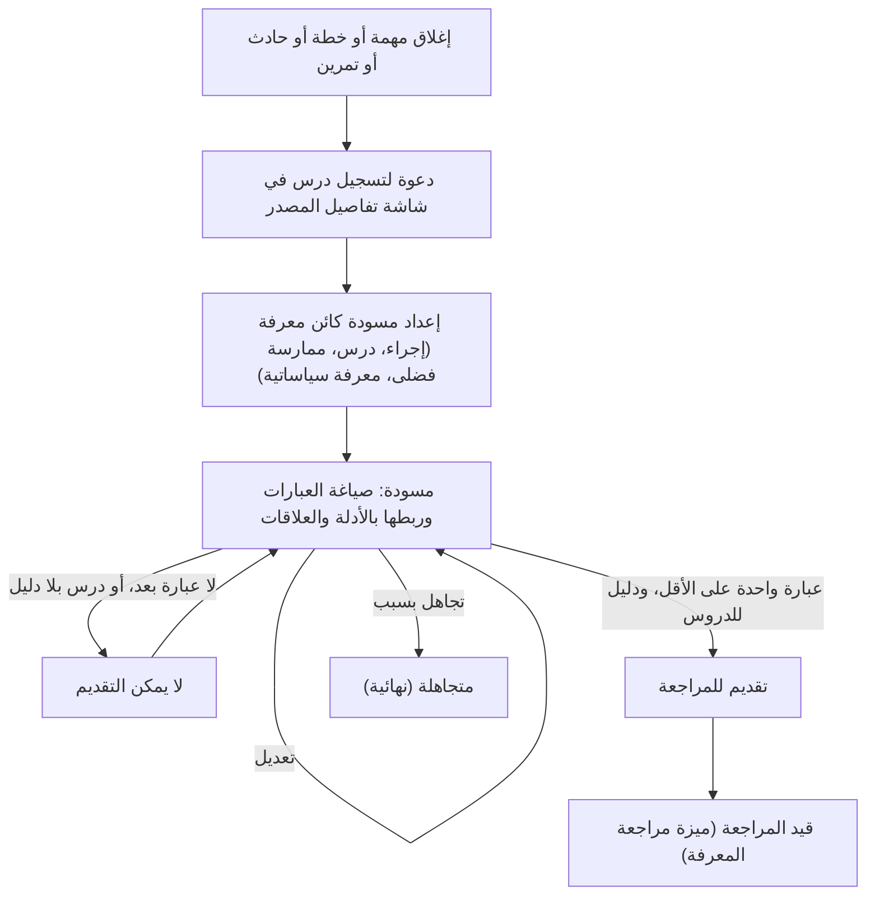
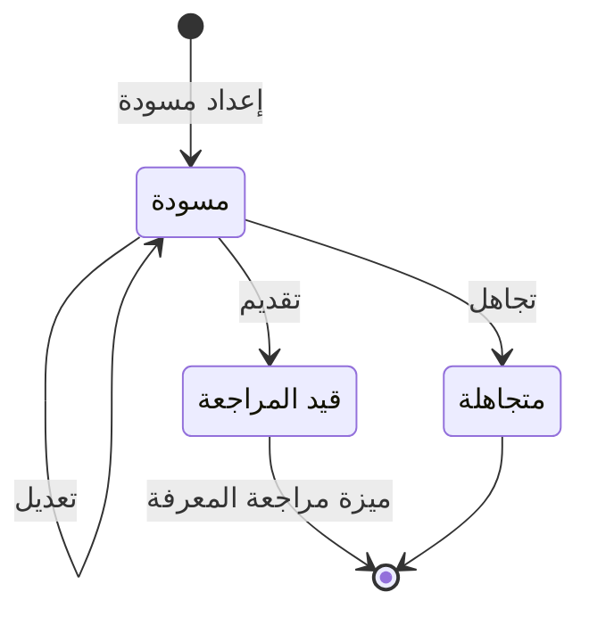

# تسجيل الدروس والمعرفة

<!-- BEGIN GENERATED: doc -->
| البند | القيمة |
|---|---|
| المعرّف | FEAT-KNW-LESSON-CAPTURE |
| الإصدار | 0.1 |
| الحالة | مسودة |
| القدرة | CAP-11 المعرفة والذاكرة المؤسسية |
| القدرة الفرعية | CAP-11.01 الدروس والمعرفة (R2) |
| الأدوار | أي مستخدم مخوَّل |
| الشاشات | SCR-44 المعرفة والأرشيف، SCR-02 تفاصيل المهمة وسجلها |
| حالات الاستخدام | UC-060 |
| القصص | 6: 4 من المواصفة، و2 جديدة |
<!-- END GENERATED: doc -->

## 1. نظرة عامة

### 1.1 القيمة

يتيح لأي مستخدم توثيق درس أو إجراء أو ممارسة فضلى مرتبطة بمهمة أو خطة أو حادث مع أدلته وتقديمه للمراجعة.

### 1.2 النطاق

| البند | القيمة |
|---|---|
| المستخدمون | أي مستخدم مخوَّل، لإعداد المسودة وتعديلها وتقديمها أو تجاهلها |
| الشاشات | تفاصيل المهمة وسجلها (SCR-02)؛ المعرفة والأرشيف (SCR-44) |
| حالات الاستخدام | تسجيل الدرس (UC-060): إعداد مسودة كائن معرفة من مهمة أو خطة أو حادث أو تمرين مغلق، صياغة عباراتها بأدلتها وعلاقاتها، تعديلها، تقديمها للمراجعة، أو تجاهلها |
| المتطلبات | إدارة كائنات المعرفة (إجراء، درس، ممارسة فضلى، معرفة سياساتية) كعبارات بأدلة وعلاقات؛ السماح بتسجيل الدرس عند إغلاق مهمة أو خطة أو حادث أو تمرين وربطه بمصدره ودليله |
| خارج النطاق | مراجعة كائن المعرفة ونشره أو رفضه أو إعادته أو إحالته للتقاعد (`FEAT-KNW-KNOWLEDGE-REVIEW`)؛ اقتراح المعرفة المنشورة لمهمة أو خطة جديدة وتسجيل إعادة استخدامها (`FEAT-KNW-KNOWLEDGE-REUSE`) |

### 1.3 خريطة الميزة

**الشكل 1: من إغلاق المصدر إلى تقديم مسودة المعرفة للمراجعة**



**الشكل 2: الحالات التي تغطيها هذه الميزة من دورة حياة كائن المعرفة**



## 2. القواعد المشتركة

تنطبق على كل قصص الميزة، فلا تتكرر داخل القصص. وكل قصة تذكر ما يخصها فقط.

### 2.1 السياق المشترك

كل قصة تبدأ من ثلاثة شروط: مستأجر نشط، وحزمة السياسات الأساسية مفعّلة، ومستخدم مسجّل الدخول ومخوَّل. وتشير إليها القصص بخطوة واحدة: «بفرض السياق المشترك للميزة».

### 2.2 الصلاحية وعدم الإفصاح

- من لا يحق له رؤية العنصر يتلقى ردًا بشكل «غير متاح» تمامًا، فلا يعرف أنه موجود.
- من يرى العنصر ولا يحق له الإجراء يتلقى «لا تملك صلاحية هذا الإجراء».

### 2.3 أوامر تغيير الحالة

- **منع التكرار:** يُرسل كل أمر بمفتاح فريد، فإعادة الطلب نفسه لا تُنفَّذ مرتين.
- **حماية التعديل المتزامن:** يُرسل كل أمر بإصدار البيانات الذي يراه المستخدم. فإن عدّلها غيره في الأثناء، يُرفض الأمر.
- **السجل:** إن نجح الأمر، يُكتب حدثه وسجل التدقيق في المعاملة نفسها.

> **ملاحظة:** هذه الميزة تغطي كائن المعرفة من إعداد مسودته حتى تقديمه أو تجاهله فقط. ومراجعته ونشره أو رفضه خطوة لاحقة تغطيها ميزة مراجعة المعرفة.

### 2.4 الرفض المشترك

```gherkin
# language: ar
خاصية: الرفض المشترك لأوامر الميزة

  سيناريو مخطط: رفض مشترك لكل أمر في الميزة
    بفرض السياق المشترك للميزة
    و <الحالة>
    عندما يُرسل المستخدم أي أمر من أوامر الميزة
    اذاً يُرفض برمز <الرمز> ويرى "<الرسالة>"
    و لا يتغير شيء

    امثلة:
      | الحالة                                  | الرمز                  | الرسالة                                                 |
      | العنصر خارج صلاحياته                    | NOT_FOUND              | غير متاح                                                |
      | العنصر مرئي له ولا يحق له الإجراء       | AUTHZ_DENIED           | لا تملك صلاحية هذا الإجراء                              |
      | غيره عدّل العنصر بعد أن فتحه            | VERSION_CONFLICT       | تغيّرت البيانات منذ فتحتها. راجع التغييرات ثم أعد المحاولة |
      | أعاد مفتاح منع التكرار بمحتوى مختلف     | IDEMPOTENCY_KEY_REUSED | طلب مكرر بمحتوى مختلف                                   |
      | البيانات ناقصة أو غير صحيحة             | VALIDATION_FAILED      | بعض البيانات ناقصة أو غير صحيحة. راجع الحقول المعلَّمة      |

  سيناريو: إعادة الطلب نفسه لا تُنفَّذ مرتين
    بفرض السياق المشترك للميزة
    و أمر نجح بمفتاح منع تكرار
    عندما يُعاد الطلب نفسه بالمفتاح نفسه
    اذاً تُعاد النتيجة الأولى ولا يُكتب حدث ثانٍ
```

## 3. الجودة وتعريف الاكتمال

### 3.1 متطلبات الجودة

<!-- BEGIN GENERATED: quality -->
لا متطلبات جودة مرتبطة بمتطلبات هذه الميزة مباشرة. تنطبق متطلبات المنصة العامة (`FEAT-PLT-*`).
<!-- END GENERATED: quality -->

### 3.2 تعريف الاكتمال

القصة مكتملة حين تتحقق الشروط الخمسة:

1. سيناريوهاتها والقواعد المشتركة تمر في الاختبار الآلي.
2. فحوص البنية المعمارية تمر.
3. نصوص الواجهة والرسائل موجودة بالعربية والإنجليزية.
4. مراجعة الكود مكتملة.
5. ما تضيفه القصة نفسها في قسم «القواعد» تحقق.

## 4. فهرس القصص

<!-- BEGIN GENERATED: story-index -->
| المعرّف | القصة | النوع | الحالة |
|---|---|---|---|
| `US-BC06-KNO-DISCARD` | تجاهل مسودة كائن المعرفة | أمر | مسودة |
| `US-BC06-KNO-DRAFT` | إعداد مسودة كائن المعرفة | أمر | مسودة |
| `US-BC06-KNO-EDIT` | تعديل كائن المعرفة | أمر | مسودة |
| `US-BC06-KNO-SUBMIT` | تقديم كائن المعرفة | أمر | مسودة |
| `US-UI-SCR02-LESSON-CAPTURE` | تسجيل درس من مهمة أو خطة مغلقة | واجهة | مسودة |
| `US-UI-SCR44-LESSON-EDITOR` | صياغة عبارات الدرس وربطها بالأدلة | واجهة | مسودة |
<!-- END GENERATED: story-index -->

## 5. القصص

### 5.1 US-BC06-KNO-DISCARD — تجاهل مسودة كائن المعرفة

| النوع | الإصدار | الأولوية | دون اتصال | الحالة |
|---|---|---|---|---|
| أمر | R2 | Must | لا | مسودة |

> **كـ** أي مستخدم مخوَّل، **أريد** أن أتجاهل مسودة كائن معرفة أنشأتها بذكر السبب، **حتى** أزيلها من قائمة المسودات المفتوحة دون أن أنشرها.

**باختصار:** يتجاهل مؤلف المسودة كائن معرفة لم يُقدَّم بعد بذكر السبب، فيصبح «متجاهلًا» نهائيًا.

#### القواعد

- **متى يُسمح:** الكائن في حالة «مسودة»، وبذكر سبب التجاهل.
- **من يُسمح له:** مؤلف المسودة.
- **البيانات:** سبب التجاهل (إلزامي).
- **الأثر:** تصبح حالته «متجاهلًا» وهي نهائية، ويُسجَّل حدث «تم تجاهل كائن المعرفة» إلى فهرس اقتراحات المعرفة وفهرسة البحث والمقاييس.

#### معايير القبول

```gherkin
# language: ar
خاصية: تجاهل مسودة كائن المعرفة

  سيناريو: تجاهل مسودة بسبب
    بفرض السياق المشترك للميزة
    و مسودة كائن معرفة لمؤلفها
    عندما يتجاهلها مع ذكر السبب
    اذاً تصبح حالتها "متجاهلًا"
    و يُسجَّل حدث "تم تجاهل كائن المعرفة"

  سيناريو مخطط: رفض خاص بالتجاهل
    بفرض السياق المشترك للميزة
    و <الحالة>
    عندما يحاول تجاهل الكائن
    اذاً يُرفض برمز <الرمز> ويرى <الرسالة>
    و لا يتغير شيء

    امثلة:
      | الحالة                   | الرمز                                       | الرسالة                                            |
      | الكائن ليس "مسودة"       | KNOWLEDGE_OBJECT_INVALID_STATE_TRANSITION | الوضع الحالي لكائن المعرفة لا يسمح بهذا الإجراء    |
      | سبب التجاهل فارغ         | REASON_REQUIRED                             | اذكر السبب                                          |
      | سبب التجاهل مفقود        | VALIDATION_FAILED                           | سبب التجاهل مطلوب                                   |
```

<details><summary>المراجع التقنية والتتبع</summary>

<!-- BEGIN GENERATED: refs US-BC06-KNO-DISCARD -->
| البند | المعرّف | المعنى |
|---|---|---|
| الواجهة البرمجية | `POST /api/v1/knowledge/knowledge-objects/{id}/actions/discard` | — |
| الأمر | `CMD-KNO-DISCARD` | تجاهل مسودة كائن المعرفة |
| السياسة | `POL-KNO-DISCARD` | any user (draft lessons) · Knowledge Manager (review, publish, retire) · planner (record reuse)؛ tenant match… |
| الحدث | `EVT-KNO-DISCARDED` | يصل إلى: Knowledge suggestion index; Search projection (SLC-05); Business telemetry (OUT-06) |
| الكيان | `AGG-KNOWLEDGE-OBJECT` | كائن المعرفة |
| الجدول | `knowledge.knowledge_objects` | الجدول الرئيسي لكائن المعرفة |
| وحدة النشر | DU-15 | — |
| المتطلبات | REQ-KNW-001، REQ-KNW-002، REQ-KNW-003 | معانيها في القسم 6. التتبع |
| حالة الاستخدام | UC-060 | Capture Lesson |
| الاختبار | TST-KNOWLEDGE-OBJECT-SM، TST-SLC12-INVARIANTS | دورة حالات كائن المعرفة، وثوابت الشريحة SLC-12 |
<!-- END GENERATED: refs US-BC06-KNO-DISCARD -->

</details>

### 5.2 US-BC06-KNO-DRAFT — إعداد مسودة كائن المعرفة

| النوع | الإصدار | الأولوية | دون اتصال | الحالة |
|---|---|---|---|---|
| أمر | R2 | Must | لا | مسودة |

> **كـ** أي مستخدم مخوَّل، **أريد** أن أعدّ مسودة كائن معرفة من نوع إجراء أو درس أو ممارسة فضلى أو معرفة سياساتية، **حتى** أبدأ توثيق ما تعلّمته أو ما يلزم اتباعه.

**باختصار:** ينشئ المستخدم مسودة كائن معرفة بنوع وعنوان وتصنيف، وإن كانت درسًا فلا بد أن يشير إلى مهمة أو خطة أو حادث أو تمرين مغلق كمصدره وإلى دليله.

#### القواعد

- **متى يُسمح:** نوع الكائن أحد الأربعة المعرَّفة (إجراء، درس، ممارسة فضلى، معرفة سياساتية)؛ ودرس يشير إلى مصدر مغلق نهائي (مهمة أو خطة أو حادث أو تمرين انتهى) وإلى دليله؛ وتصنيفه لا يقل عن تصنيف مصدره.
- **من يُسمح له:** أي مستخدم مخوَّل.
- **البيانات:** نوع المعرفة (إلزامي)، العنوان (إلزامي)، المصدر، الكائن الذي يستبدله، التصنيف (إلزامي).
- **الأثر:** تُنشأ مسودة جديدة في حالة «مسودة»، ويُسجَّل حدث «أُعِدَّت مسودة كائن معرفة» إلى فهرس اقتراحات المعرفة وفهرسة البحث والمقاييس.

#### معايير القبول

```gherkin
# language: ar
خاصية: إعداد مسودة كائن المعرفة

  سيناريو: إعداد مسودة درس من مهمة مغلقة
    بفرض السياق المشترك للميزة
    و مهمة مغلقة ودليلها متاح للمستخدم
    عندما يعد مسودة درس تشير إلى المهمة ودليلها بتصنيف لا يقل عن تصنيفها
    اذاً تُنشأ مسودة في حالة "مسودة"
    و يُسجَّل حدث "أُعِدَّت مسودة كائن معرفة"

  سيناريو مخطط: رفض خاص بإعداد المسودة
    بفرض السياق المشترك للميزة
    و <الحالة>
    عندما يحاول إعداد مسودة
    اذاً يُرفض برمز <الرمز> ويرى <الرسالة>
    و لا يتغير شيء

    امثلة:
      | الحالة                                                                  | الرمز              | الرسالة                        |
      | نوع المعرفة ليس أحد الأنواع المعرَّفة، أو الدرس بلا مصدر مغلق ودليله، أو تصنيفه أقل من تصنيف مصدره | KNOWLEDGE_INVALID  | بيانات المعرفة غير صحيحة       |
      | نوع المعرفة مفقود                                                       | VALIDATION_FAILED  | نوع المعرفة مطلوب              |
      | التصنيف مفقود                                                           | VALIDATION_FAILED  | التصنيف مطلوب                   |
```

<details><summary>المراجع التقنية والتتبع</summary>

<!-- BEGIN GENERATED: refs US-BC06-KNO-DRAFT -->
| البند | المعرّف | المعنى |
|---|---|---|
| الواجهة البرمجية | `POST /api/v1/knowledge/knowledge-objects` | — |
| الأمر | `CMD-KNO-DRAFT` | إعداد مسودة كائن المعرفة |
| السياسة | `POL-KNO-DRAFT` | any user (draft lessons) · Knowledge Manager (review, publish, retire) · planner (record reuse)؛ tenant match… |
| الحدث | `EVT-KNO-DRAFTED` | يصل إلى: Knowledge suggestion index; Search projection (SLC-05); Business telemetry (OUT-06) |
| الكيان | `AGG-KNOWLEDGE-OBJECT` | كائن المعرفة |
| الجدول | `knowledge.knowledge_objects` | الجدول الرئيسي لكائن المعرفة |
| وحدة النشر | DU-15 | — |
| المتطلبات | REQ-KNW-001، REQ-KNW-002، REQ-KNW-003 | معانيها في القسم 6. التتبع |
| حالة الاستخدام | UC-060 | Capture Lesson |
| الاختبار | TST-KNOWLEDGE-OBJECT-SM، TST-SLC12-INVARIANTS | دورة حالات كائن المعرفة، وثوابت الشريحة SLC-12 |
<!-- END GENERATED: refs US-BC06-KNO-DRAFT -->

</details>

### 5.3 US-BC06-KNO-EDIT — تعديل كائن المعرفة

| النوع | الإصدار | الأولوية | دون اتصال | الحالة |
|---|---|---|---|---|
| أمر | R2 | Must | لا | مسودة |

> **كـ** أي مستخدم مخوَّل، **أريد** تعديل عبارات مسودة كائن المعرفة وأدلتها وعلاقاتها بأنواع المهام والخطط والكيانات والمناطق، **حتى** أكمل صياغتها قبل تقديمها.

**باختصار:** يعدّل مؤلف المسودة عباراتها المرتبطة بالأدلة وعلاقاتها بأنواع المهام والخطط والكيانات والمناطق، دون أن تتغير حالتها.

#### القواعد

- **متى يُسمح:** الكائن في حالة «مسودة».
- **من يُسمح له:** مؤلف المسودة.
- **البيانات:** العبارات بأدلتها (إلزامي)، والعلاقات بأنواع المهام والخطط والكيانات والمناطق.
- **الأثر:** تبقى حالته «مسودة» ويزداد إصداره، ويُسجَّل حدث «تم تعديل كائن المعرفة» إلى فهرس اقتراحات المعرفة وفهرسة البحث والمقاييس.

#### معايير القبول

```gherkin
# language: ar
خاصية: تعديل كائن المعرفة

  سيناريو: تعديل عبارات مسودة
    بفرض السياق المشترك للميزة
    و مسودة كائن معرفة لمؤلفها
    عندما يعدّل عباراتها بأدلتها وعلاقاتها
    اذاً تبقى حالتها "مسودة" ويزداد إصدارها
    و يُسجَّل حدث "تم تعديل كائن المعرفة"

  سيناريو مخطط: رفض خاص بالتعديل
    بفرض السياق المشترك للميزة
    و <الحالة>
    عندما يحاول تعديل المسودة
    اذاً يُرفض برمز <الرمز> ويرى <الرسالة>
    و لا يتغير شيء

    امثلة:
      | الحالة                                       | الرمز                                       | الرسالة                                           |
      | الكائن ليس "مسودة"                           | KNOWLEDGE_OBJECT_INVALID_STATE_TRANSITION | الوضع الحالي لكائن المعرفة لا يسمح بهذا الإجراء   |
      | عبارة بلا دليل، أو علاقة غير صحيحة            | KNOWLEDGE_INVALID                           | بيانات المعرفة غير صحيحة                          |
      | العبارات مفقودة                              | VALIDATION_FAILED                           | العبارات مطلوبة                                    |
```

<details><summary>المراجع التقنية والتتبع</summary>

<!-- BEGIN GENERATED: refs US-BC06-KNO-EDIT -->
| البند | المعرّف | المعنى |
|---|---|---|
| الواجهة البرمجية | `POST /api/v1/knowledge/knowledge-objects/{id}/actions/edit` | — |
| الأمر | `CMD-KNO-EDIT` | تعديل كائن المعرفة |
| السياسة | `POL-KNO-EDIT` | any user (draft lessons) · Knowledge Manager (review, publish, retire) · planner (record reuse)؛ tenant match… |
| الحدث | `EVT-KNO-EDITED` | يصل إلى: Knowledge suggestion index; Search projection (SLC-05); Business telemetry (OUT-06) |
| الكيان | `AGG-KNOWLEDGE-OBJECT` | كائن المعرفة |
| الجدول | `knowledge.knowledge_objects` | الجدول الرئيسي لكائن المعرفة |
| وحدة النشر | DU-15 | — |
| المتطلبات | REQ-KNW-001، REQ-KNW-002، REQ-KNW-003 | معانيها في القسم 6. التتبع |
| حالة الاستخدام | UC-060 | Capture Lesson |
| الاختبار | TST-KNOWLEDGE-OBJECT-SM، TST-SLC12-INVARIANTS | دورة حالات كائن المعرفة، وثوابت الشريحة SLC-12 |
<!-- END GENERATED: refs US-BC06-KNO-EDIT -->

</details>

### 5.4 US-BC06-KNO-SUBMIT — تقديم كائن المعرفة

| النوع | الإصدار | الأولوية | دون اتصال | الحالة |
|---|---|---|---|---|
| أمر | R2 | Must | لا | مسودة |

> **كـ** أي مستخدم مخوَّل، **أريد** تقديم مسودة كائن المعرفة التي أكملتها للمراجعة، **حتى** يراجعها مدير المعرفة وينشرها إن كانت صالحة.

**باختصار:** بعد أن تحتوي المسودة عبارة واحدة على الأقل، ودليلًا واحدًا على الأقل إن كانت درسًا، يقدّمها مؤلفها فتصبح «قيد المراجعة».

#### القواعد

- **متى يُسمح:** الكائن في حالة «مسودة»، وفيه عبارة واحدة على الأقل، ودليل واحد على الأقل إن كان درسًا.
- **من يُسمح له:** مؤلف المسودة.
- **البيانات:** لا حمولة إضافية.
- **الأثر:** تصبح حالته «قيد المراجعة»، ويُسجَّل حدث «قُدِّم كائن المعرفة» إلى فهرس اقتراحات المعرفة وفهرسة البحث والمقاييس، ويصل إلى مدير المعرفة للمراجعة (ميزة مراجعة المعرفة).

#### معايير القبول

```gherkin
# language: ar
خاصية: تقديم كائن المعرفة

  سيناريو: تقديم مسودة مكتملة
    بفرض السياق المشترك للميزة
    و مسودة فيها عبارة واحدة على الأقل، ودليل واحد على الأقل إن كانت درسًا
    عندما يقدّمها مؤلفها
    اذاً تصبح حالتها "قيد المراجعة"
    و يُسجَّل حدث "قُدِّم كائن المعرفة"

  سيناريو مخطط: رفض خاص بالتقديم
    بفرض السياق المشترك للميزة
    و <الحالة>
    عندما يحاول تقديم المسودة
    اذاً يُرفض برمز <الرمز> ويرى <الرسالة>
    و لا يتغير شيء

    امثلة:
      | الحالة                                            | الرمز                                       | الرسالة                                                        |
      | الكائن ليس "مسودة"                                | KNOWLEDGE_OBJECT_INVALID_STATE_TRANSITION | الوضع الحالي لكائن المعرفة لا يسمح بهذا الإجراء               |
      | بلا أي عبارة، أو درس بلا دليل واحد على الأقل      | KNOWLEDGE_INCOMPLETE                        | أضف عبارة واحدة على الأقل، ودليلًا للدروس المستفادة          |
```

<details><summary>المراجع التقنية والتتبع</summary>

<!-- BEGIN GENERATED: refs US-BC06-KNO-SUBMIT -->
| البند | المعرّف | المعنى |
|---|---|---|
| الواجهة البرمجية | `POST /api/v1/knowledge/knowledge-objects/{id}/actions/submit` | — |
| الأمر | `CMD-KNO-SUBMIT` | تقديم كائن المعرفة |
| السياسة | `POL-KNO-SUBMIT` | any user (draft lessons) · Knowledge Manager (review, publish, retire) · planner (record reuse)؛ tenant match… |
| الحدث | `EVT-KNO-SUBMITTED` | يصل إلى: Knowledge suggestion index; Search projection (SLC-05); Business telemetry (OUT-06) |
| الكيان | `AGG-KNOWLEDGE-OBJECT` | كائن المعرفة |
| الجدول | `knowledge.knowledge_objects` | الجدول الرئيسي لكائن المعرفة |
| وحدة النشر | DU-15 | — |
| المتطلبات | REQ-KNW-001، REQ-KNW-002، REQ-KNW-003 | معانيها في القسم 6. التتبع |
| حالة الاستخدام | UC-060 | Capture Lesson |
| الاختبار | TST-KNOWLEDGE-OBJECT-SM، TST-SLC12-INVARIANTS | دورة حالات كائن المعرفة، وثوابت الشريحة SLC-12 |
<!-- END GENERATED: refs US-BC06-KNO-SUBMIT -->

</details>

### 5.5 US-UI-SCR02-LESSON-CAPTURE — تسجيل درس من مهمة أو خطة مغلقة

| النوع | الإصدار | الأولوية | دون اتصال | الحالة |
|---|---|---|---|---|
| واجهة | R2 | Must | لا | مسودة |

> **كـ** المستخدم، **أريد** أن أبدأ تسجيل درس من شاشة تفاصيل مهمتي أو خطتي المغلقة مباشرة، **حتى** أسجّل ما تعلّمته قبل أن أنساه ودون مغادرة سياق العمل.

**باختصار:** عند إغلاق المهمة أو الخطة أو الحادث أو التمرين، تظهر في شاشة تفاصيلها دعوة لتسجيل درس تفتح مسودة كائن معرفة جديدة تشير إليها كمصدر ودليلها جاهزًا تلقائيًا.

#### القواعد

- **من يُسمح له:** من يرى تفاصيل المهمة أو الخطة أو الحادث أو التمرين المغلق. **[Derived]**
- **البيانات:** المصدر (المهمة أو الخطة أو الحادث أو التمرين) ودليله يُمرَّران تلقائيًا إلى نموذج إعداد المسودة (القصة 5.2). **[Derived]**

#### معايير القبول

```gherkin
# language: ar
خاصية: تسجيل درس من مهمة أو خطة مغلقة

  سيناريو: دعوة تسجيل درس من مهمة مغلقة
    بفرض السياق المشترك للميزة
    و مهمة مغلقة يراها المستخدم
    عندما يفتح تفاصيلها
    اذاً يرى دعوة لتسجيل درس منها
    عندما يبدأ التسجيل
    اذاً يُفتح نموذج مسودة كائن معرفة والمهمة محددة مصدرًا له

  سيناريو: مهمة غير مغلقة
    بفرض السياق المشترك للميزة
    و مهمة لم تُغلق بعد
    عندما يفتح تفاصيلها
    اذاً لا تظهر دعوة تسجيل الدرس
```

<details><summary>المراجع التقنية والتتبع</summary>

<!-- BEGIN GENERATED: refs US-UI-SCR02-LESSON-CAPTURE -->
| البند | المعرّف | المعنى |
|---|---|---|
| حالة الاستخدام | UC-060 | Capture Lesson |
| الشاشة | SCR-02 | شاشة تفاصيل المهمة وسجلها |
| المصدر | `21-ui-design.md §6.3` | — |
| المصدر | `[Derived]` | — |
| المتطلب | REQ-KNW-002 | When a task, plan, incident, or exercise simulation is closed or completed, the system shall allow capturing… |
| حالة الاستخدام | UC-060 | Capture Lesson |
<!-- END GENERATED: refs US-UI-SCR02-LESSON-CAPTURE -->

</details>

### 5.6 US-UI-SCR44-LESSON-EDITOR — صياغة عبارات الدرس وربطها بالأدلة

| النوع | الإصدار | الأولوية | دون اتصال | الحالة |
|---|---|---|---|---|
| واجهة | R2 | Must | لا | مسودة |

> **كـ** أي مستخدم مخوَّل، **أريد** محررًا في شاشة المعرفة والأرشيف يتيح صياغة عبارات كائن المعرفة وربط كل عبارة بدليلها وبعلاقاتها، **حتى** أعدّ مسودة واضحة قبل تقديمها.

**باختصار:** يعرض محرر كائن المعرفة عباراته كقائمة، وكل عبارة تُربط بدليل واحد أو أكثر وبعلاقاتها بأنواع المهام أو الخطط أو الكيانات أو المناطق، وتُرسل التعديلات بأمر تعديل كائن المعرفة (القصة 5.3).

#### القواعد

- **من يُسمح له:** مؤلف المسودة. **[Derived]**
- **البيانات:** نص العبارة، وروابط الأدلة لكل عبارة، والعلاقات بأنواع المهام والخطط والكيانات والمناطق. **[Derived]**

#### معايير القبول

```gherkin
# language: ar
خاصية: صياغة عبارات الدرس وربطها بالأدلة

  سيناريو: إضافة عبارة بدليلها
    بفرض السياق المشترك للميزة
    و مسودة كائن معرفة لمؤلفها مفتوحة في المحرر
    عندما يضيف عبارة ويربطها بدليل واحد على الأقل
    اذاً تُحفظ العبارة مع رابط دليلها
    و تُرسل كأمر تعديل كائن المعرفة

  سيناريو: عبارة بلا دليل في درس
    بفرض السياق المشترك للميزة
    و مسودة درس مفتوحة في المحرر
    عندما يحاول حفظ عبارة بلا أي دليل
    اذاً تظهر رسالة أن العبارة تحتاج دليلًا قبل الحفظ
    و لا تُرسل حتى يُضاف الدليل
```

<details><summary>المراجع التقنية والتتبع</summary>

<!-- BEGIN GENERATED: refs US-UI-SCR44-LESSON-EDITOR -->
| البند | المعرّف | المعنى |
|---|---|---|
| الشاشة | SCR-44 | شاشة المعرفة والأرشيف |
| المصدر | `US-BC06-KNO-EDIT` | — |
| المصدر | `[Derived]` | — |
| المتطلبات | REQ-KNW-001، REQ-KNW-002 | معانيها في القسم 6. التتبع |
| حالة الاستخدام | UC-060 | Capture Lesson |
<!-- END GENERATED: refs US-UI-SCR44-LESSON-EDITOR -->

</details>

## 6. التتبع

<!-- BEGIN GENERATED: trace -->
| المتطلب | المعنى | القصص | الاختبار |
|---|---|---|---|
| REQ-KNW-001 | The system shall manage knowledge objects (procedures, lessons, best practices, policy knowledge) as claims w… | `US-BC06-KNO-DISCARD`، `US-BC06-KNO-DRAFT`، `US-BC06-KNO-EDIT`، `US-BC06-KNO-SUBMIT`، `US-UI-SCR44-LESSON-EDITOR` | TST-KNOWLEDGE-OBJECT-SM، TST-SLC12-INVARIANTS |
| REQ-KNW-002 | When a task, plan, incident, or exercise simulation is closed or completed, the system shall allow capturing… | `US-BC06-KNO-DISCARD`، `US-BC06-KNO-DRAFT`، `US-BC06-KNO-EDIT`، `US-BC06-KNO-SUBMIT`، `US-UI-SCR02-LESSON-CAPTURE`، `US-UI-SCR44-LESSON-EDITOR` | TST-KNOWLEDGE-OBJECT-SM، TST-SLC12-INVARIANTS |
| REQ-KNW-003 | When a published knowledge object is relevant to a new plan or task type, the system shall suggest it to the… | كل قصص الميزة المأخوذة من المواصفة (4) | TST-KNOWLEDGE-OBJECT-SM، TST-SLC12-INVARIANTS |
<!-- END GENERATED: trace -->

## 7. سجل التغييرات

| الإصدار | التاريخ | التغيير |
|---|---|---|
| 0.1 | — | هيكل مولَّد من خريطة الميزات |
| 0.2 | 2026-10-13 | كتابة القصص كاملة بمعيار القصص |
