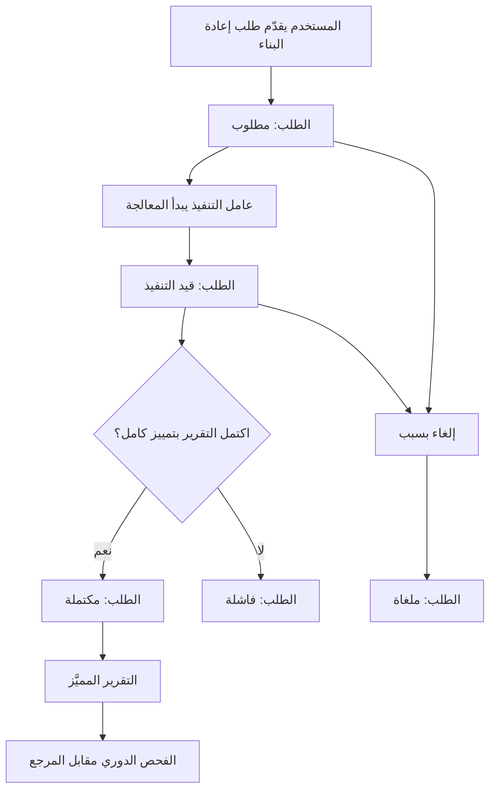
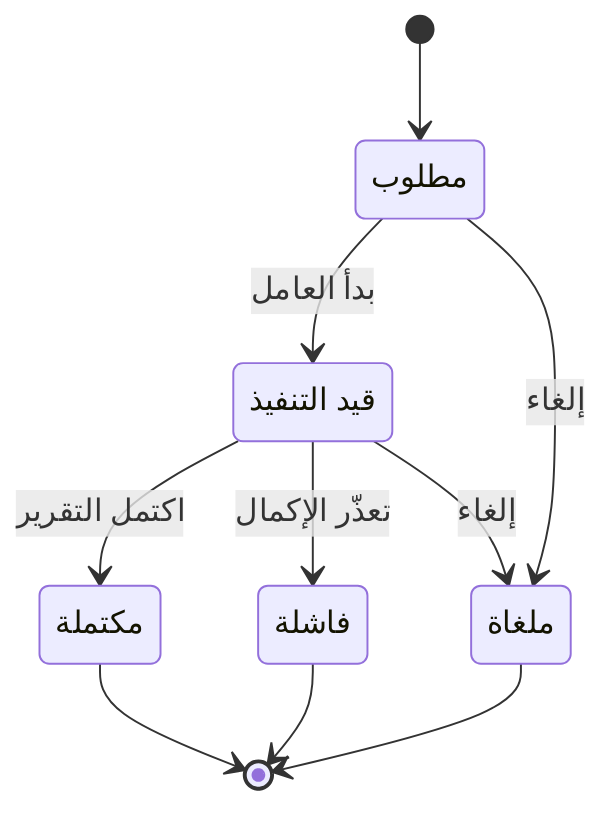

# إعادة البناء التاريخي

<!-- BEGIN GENERATED: doc -->
| البند | القيمة |
|---|---|
| المعرّف | FEAT-KNW-RECONSTRUCTION |
| الإصدار | 0.1 |
| الحالة | مسودة |
| القدرة | CAP-11 المعرفة والذاكرة المؤسسية |
| القدرة الفرعية | CAP-11.03 الأرشيف وإعادة البناء التاريخي (R2) |
| الأدوار | المدقِّق؛ السلطة القانونية والامتثال؛ المحلل؛ النظام |
| الشاشات | SCR-50 إعادة البناء التاريخي |
| حالات الاستخدام | UC-065 |
| القصص | 11: 6 من المواصفة، و5 جديدة |
<!-- END GENERATED: doc -->

## 1. نظرة عامة

### 1.1 القيمة

يجيب عن سؤال «ماذا كنا نعرف عن الوضع في وقت معيّن» بتقرير يميّز ما هو مسجل فعلًا عمّا أُعيد بناؤه.

### 1.2 النطاق

| البند | القيمة |
|---|---|
| المستخدمون | المدقِّق، والسلطة القانونية والامتثال، والمحلل يطلبون إعادة البناء ويلغونها ويقرؤون تقريرها؛ والنظام ينفّذها |
| الشاشات | شاشة إعادة البناء التاريخي (SCR-50): نموذج الطلب، والتقرير المميَّز |
| حالات الاستخدام | طلب إعادة بناء حالة نطاق كما كانت صحيحة في لحظة ماضية وكما كانت معروفة في لحظة أخرى؛ إلغاء الطلب قبل اكتماله؛ عرض تقرير يميّز كل عنصر بمصدره |
| المتطلبات | كل عنصر في التقرير يحمل تصنيفًا واحدًا: مسجل، أو معاد بناؤه، أو مستنتج بقاعدته، أو مجهول؛ والتقرير قابل لإعادة الإنتاج بالنتيجة نفسها عند تكرار الطلب بالنطاق واللحظتين نفسيهما؛ واسترجاع السجل المؤرشف اللازم خلال مهلة محددة حسب نوع الوسيط |
| خارج النطاق | لا تُعدَّل السجلات الأصلية ولا يُبنى بها موقف مستقبلي؛ تحليل أسباب الأحداث وتفسيرها خارج هذه الميزة |

### 1.3 خريطة الميزة

**الشكل 1: مسار طلب إعادة البناء التاريخي**



**الشكل 2: حالات طلب إعادة البناء**



## 2. القواعد المشتركة

تنطبق على كل قصص الميزة، فلا تتكرر داخل القصص. وكل قصة تذكر ما يخصها فقط.

### 2.1 السياق المشترك

كل قصة تبدأ من ثلاثة شروط: مستأجر نشط، وحزمة السياسات الأساسية مفعّلة، ومستخدم مسجّل الدخول ومخوَّل. وتشير إليها القصص بخطوة واحدة: «بفرض السياق المشترك للميزة».

### 2.2 الصلاحية وعدم الإفصاح

- من لا يحق له رؤية العنصر يتلقى ردًا بشكل «غير متاح» تمامًا، فلا يعرف أنه موجود.
- من يرى العنصر ولا يحق له الإجراء يتلقى «لا تملك صلاحية هذا الإجراء».

### 2.3 أوامر تغيير الحالة

- **منع التكرار:** يُرسل كل أمر بمفتاح فريد، فإعادة الطلب نفسه لا تُنفَّذ مرتين.
- **حماية التعديل المتزامن:** يُرسل كل أمر بإصدار البيانات الذي يراه المستخدم. فإن عدّلها غيره في الأثناء، يُرفض الأمر.
- **السجل:** إن نجح الأمر، يُكتب حدثه وسجل التدقيق في المعاملة نفسها.

### 2.4 الرفض المشترك

```gherkin
# language: ar
خاصية: الرفض المشترك لأوامر الميزة

  سيناريو مخطط: رفض مشترك لكل أمر في الميزة
    بفرض السياق المشترك للميزة
    و <الحالة>
    عندما يُرسل المستخدم أي أمر من أوامر الميزة
    اذاً يُرفض برمز <الرمز> ويرى "<الرسالة>"
    و لا يتغير شيء

    امثلة:
      | الحالة                                  | الرمز                  | الرسالة                                                 |
      | العنصر خارج صلاحياته                    | NOT_FOUND              | غير متاح                                                |
      | العنصر مرئي له ولا يحق له الإجراء       | AUTHZ_DENIED           | لا تملك صلاحية هذا الإجراء                              |
      | غيره عدّل العنصر بعد أن فتحه            | VERSION_CONFLICT       | تغيّرت البيانات منذ فتحتها. راجع التغييرات ثم أعد المحاولة |
      | أعاد مفتاح منع التكرار بمحتوى مختلف     | IDEMPOTENCY_KEY_REUSED | طلب مكرر بمحتوى مختلف                                   |
      | البيانات ناقصة أو غير صحيحة             | VALIDATION_FAILED      | بعض البيانات ناقصة أو غير صحيحة. راجع الحقول المعلَّمة      |

  سيناريو: إعادة الطلب نفسه لا تُنفَّذ مرتين
    بفرض السياق المشترك للميزة
    و أمر نجح بمفتاح منع تكرار
    عندما يُعاد الطلب نفسه بالمفتاح نفسه
    اذاً تُعاد النتيجة الأولى ولا يُكتب حدث ثانٍ
```

## 3. الجودة وتعريف الاكتمال

### 3.1 متطلبات الجودة

<!-- BEGIN GENERATED: quality -->
| المرجع | الموقف | المطلوب |
|---|---|---|
| QAS-ARC-001 | retrieve an archived record | ≤ 1 min for warm, ≤ 24 h for cold/offline media |
| QAS-ARC-002 | historical reconstruction scenarios | 100 % agreement with oracle; every element labelled |
<!-- END GENERATED: quality -->

### 3.2 تعريف الاكتمال

القصة مكتملة حين تتحقق الشروط الخمسة:

1. سيناريوهاتها والقواعد المشتركة تمر في الاختبار الآلي.
2. فحوص البنية المعمارية تمر.
3. نصوص الواجهة والرسائل موجودة بالعربية والإنجليزية.
4. مراجعة الكود مكتملة.
5. ما تضيفه القصة نفسها في قسم «القواعد» تحقق.

## 4. فهرس القصص

<!-- BEGIN GENERATED: story-index -->
| المعرّف | القصة | النوع | الحالة |
|---|---|---|---|
| `US-BC06-REC-CANCEL` | إلغاء إعادة البناء التاريخي | أمر | مسودة |
| `US-BC06-REC-REQUEST` | طلب إعادة البناء التاريخي | أمر | مسودة |
| `US-BC06-Q-REC-REPORT` | جلب: Labelled reconstruction report | جلب | مسودة |
| `US-BC06-S-RECONSTRUCTION-01` | تلقائي: worker started (إعادة البناء التاريخي) | نظام | مسودة |
| `US-BC06-S-RECONSTRUCTION-02` | تلقائي: completed (إعادة البناء التاريخي) | نظام | مسودة |
| `US-BC06-S-RECONSTRUCTION-03` | تلقائي: failed (إعادة البناء التاريخي) | نظام | مسودة |
| `US-UI-SCR50-LABELLED-REPORT` | تمييز المسجل عن المعاد بناؤه في التقرير | واجهة | مسودة |
| `US-UI-SCR50-REQUEST-FORM` | تحديد لحظة الموقف ولحظة المعرفة للطلب | واجهة | مسودة |
| `US-PLT-RECONSTRUCTION-ARCHIVE-READ` | إدخال السجلات المؤرشفة في إعادة البناء | منصة | مسودة |
| `US-PLT-RECONSTRUCTION-WORKER` | تنفيذ إعادة البناء مهمة غير متزامنة حتمية | منصة | مسودة |
| `US-OPS-RECONSTRUCTION-ORACLE-CHECK` | فحص دوري لمطابقة إعادة البناء للمرجع | تشغيل | مسودة |
<!-- END GENERATED: story-index -->

## 5. القصص

### 5.1 US-BC06-REC-CANCEL — إلغاء إعادة البناء التاريخي

| النوع | الإصدار | الأولوية | دون اتصال | الحالة |
|---|---|---|---|---|
| أمر | R2 | Must | لا | مسودة |

> **كـ** المدقِّق أو السلطة القانونية والامتثال أو المحلل، **أريد** إلغاء طلب إعادة البناء التاريخي الذي قدّمته، **حتى** لا يُكمل النظام طلبًا لم تعد له حاجة أو قُدِّم خطأ.

**باختصار:** يلغي صاحب الطلب إعادة بناء لم تكتمل بعد، بذكر السبب، فتصير حالتها «ملغاة» ولا يُنتج النظام تقريرها.

#### القواعد

- **متى يُسمح:** الطلب في حالة «مطلوب» أو «قيد التنفيذ»، وذُكر سبب الإلغاء.
- **من يُسمح له:** المدقِّق أو السلطة القانونية والامتثال أو المحلل، صاحب الطلب.
- **البيانات:** السبب (إلزامي).
- **الأثر:** حدث «أُلغيت إعادة البناء» يصل إلى إشعار الطالب وسجل التدقيق.

#### معايير القبول

```gherkin
# language: ar
خاصية: إلغاء إعادة البناء التاريخي

  سيناريو: إلغاء طلب لم يكتمل
    بفرض السياق المشترك للميزة
    و طلب إعادة بناء لصاحبه في حالة "مطلوب"
    عندما يلغيه بسبب
    اذاً تصبح حالته "ملغاة"
    و يُسجَّل حدث "أُلغيت إعادة البناء"

  سيناريو مخطط: رفض خاص بالإلغاء
    بفرض السياق المشترك للميزة
    و <الحالة>
    عندما يحاول إلغاء الطلب
    اذاً يُرفض برمز <الرمز> ويرى <الرسالة>
    و لا يتغير شيء

    امثلة:
      | الحالة                                     | الرمز                                    | الرسالة                                              |
      | لم يُذكر سبب الإلغاء                       | REASON_REQUIRED                          | اذكر السبب                                           |
      | الطلب مكتمل أو فاشل أو ملغى من قبل         | RECONSTRUCTION_INVALID_STATE_TRANSITION  | الوضع الحالي لإعادة البناء التاريخي لا يسمح بهذا الإجراء |
```

<details><summary>المراجع التقنية والتتبع</summary>

<!-- BEGIN GENERATED: refs US-BC06-REC-CANCEL -->
| البند | المعرّف | المعنى |
|---|---|---|
| الواجهة البرمجية | `POST /api/v1/knowledge/reconstructions/{id}/actions/cancel` | — |
| الأمر | `CMD-REC-CANCEL` | إلغاء إعادة البناء التاريخي |
| السياسة | `POL-REC-CANCEL` | Auditor / Legal / Analyst (request, cancel)؛ tenant match; object visible |
| الحدث | `EVT-REC-CANCELLED` | يصل إلى: Requester notification; Audit |
| الكيان | `AGG-RECONSTRUCTION` | إعادة البناء التاريخي |
| الجدول | `knowledge.reconstructions` | الجدول الرئيسي لإعادة البناء التاريخي |
| وحدة النشر | DU-15 | — |
| المتطلب | REQ-ARC-004 | When a historical reconstruction as of time T known at time K is requested, the system shall rebuild the stat… |
| حالة الاستخدام | UC-065 | Reconstruct Historical State |
| الاختبار | TST-RECONSTRUCTION-SM، TST-SLC12-INVARIANTS | دورة حالات إعادة البناء التاريخي، وثوابت الشريحة SLC-12 |
<!-- END GENERATED: refs US-BC06-REC-CANCEL -->

</details>

### 5.2 US-BC06-REC-REQUEST — طلب إعادة البناء التاريخي

| النوع | الإصدار | الأولوية | دون اتصال | الحالة |
|---|---|---|---|---|
| أمر | R2 | Must | لا | مسودة |

> **كـ** المدقِّق أو السلطة القانونية والامتثال أو المحلل، **أريد** طلب إعادة بناء حالة نطاق معيّن كما كانت صحيحة في لحظة ماضية وكما كانت معروفة في لحظة أخرى، **حتى** أحصل على تقرير موثّق لغرض التدقيق أو الشأن القانوني أو الدروس المستفادة أو التحليل.

**باختصار:** يحدد الطالب نطاق إعادة البناء (عناصر، أو موقف، أو خطة، أو أساس قرار) ولحظة الحالة المطلوبة ولحظة المعرفة والغرض، فيُفتح طلب في حالة «مطلوب» ينفّذه النظام لاحقًا.

#### القواعد

- **متى يُسمح:** تتحقق بيانات الطلب كاملة، ولحظة المعرفة لا تتجاوز الوقت الحالي.
- **من يُسمح له:** المدقِّق أو السلطة القانونية والامتثال أو المحلل المخوَّل.
- **البيانات:** النطاق (عناصر، أو موقف، أو خطة، أو أساس قرار)، ولحظة الحالة المطلوبة، ولحظة المعرفة، والغرض (تدقيق، شأن قانوني، دروس مستفادة، تحليل).
- **الأثر:** حدث «طُلبت إعادة البناء» يصل إلى إشعار الطالب وسجل التدقيق، وينتظر الطلب بدء النظام تنفيذه.

#### معايير القبول

```gherkin
# language: ar
خاصية: طلب إعادة البناء التاريخي

  سيناريو: طلب صحيح
    بفرض السياق المشترك للميزة
    عندما يطلب المستخدم إعادة بناء نطاق معيّن بلحظة حالة ولحظة معرفة وغرض
    اذاً يُفتح الطلب في حالة "مطلوب"
    و يُسجَّل حدث "طُلبت إعادة البناء"

  سيناريو مخطط: رفض خاص بالطلب
    بفرض السياق المشترك للميزة
    و <الحالة>
    عندما يحاول تقديم الطلب
    اذاً يُرفض برمز <الرمز> ويرى <الرسالة>
    و لا يتغير شيء

    امثلة:
      | الحالة                                                                          | الرمز                   | الرسالة                        |
      | النطاق غير محدد، أو لحظة المعرفة بعد الوقت الحالي، أو الطالب غير مخوَّل لهذا الغرض | RECONSTRUCTION_INVALID  | بيانات إعادة البناء غير مكتملة |
      | النطاق فارغ                                                                     | VALIDATION_FAILED       | النطاق مطلوب                   |
```

<details><summary>المراجع التقنية والتتبع</summary>

<!-- BEGIN GENERATED: refs US-BC06-REC-REQUEST -->
| البند | المعرّف | المعنى |
|---|---|---|
| الواجهة البرمجية | `POST /api/v1/knowledge/reconstructions` | — |
| الأمر | `CMD-REC-REQUEST` | طلب إعادة البناء التاريخي |
| السياسة | `POL-REC-REQUEST` | Auditor / Legal / Analyst (request, cancel)؛ tenant match; object visible |
| الحدث | `EVT-REC-REQUESTED` | يصل إلى: Requester notification; Audit |
| الكيان | `AGG-RECONSTRUCTION` | إعادة البناء التاريخي |
| الجدول | `knowledge.reconstructions` | الجدول الرئيسي لإعادة البناء التاريخي |
| وحدة النشر | DU-15 | — |
| المتطلب | REQ-ARC-004 | When a historical reconstruction as of time T known at time K is requested, the system shall rebuild the stat… |
| حالة الاستخدام | UC-065 | Reconstruct Historical State |
| الاختبار | TST-RECONSTRUCTION-SM، TST-SLC12-INVARIANTS | دورة حالات إعادة البناء التاريخي، وثوابت الشريحة SLC-12 |
<!-- END GENERATED: refs US-BC06-REC-REQUEST -->

</details>

### 5.3 US-BC06-Q-REC-REPORT — جلب تقرير إعادة البناء المميَّز

| النوع | الإصدار | الأولوية | دون اتصال | الحالة |
|---|---|---|---|---|
| جلب | R2 | Must | لا | مسودة |

> **كـ** صاحب طلب إعادة البناء أو المدقِّق، **أريد** جلب تقرير إعادة البناء بعد اكتماله، **حتى** أرى حالة النطاق كما كانت في اللحظة المطلوبة مع تمييز ما هو مسجل فعلًا عمّا استُنتج أو ظل مجهولًا.

**باختصار:** تُعاد عناصر التقرير صفحة بعد صفحة، ولكل عنصر تصنيف واحد: مسجل، أو معاد بناؤه، أو مستنتج بقاعدته، أو مجهول؛ ولا يتجاوز التقرير ما يحق لطالبه رؤيته.

#### القواعد

- **من يرى ماذا:** صاحب الطلب يرى تقرير طلبه، والمدقِّق يرى كل التقارير التي يحق له الاطلاع عليها.
- **المرشحات:** المؤشر والحد.

#### معايير القبول

```gherkin
# language: ar
خاصية: جلب تقرير إعادة البناء المميَّز

  سيناريو: يرى الطالب تقريره فقط
    بفرض السياق المشترك للميزة
    و طلب إعادة بناء مكتمل لصاحبه، وعناصر داخل صلاحيته وأخرى خارجها
    عندما يطلب التقرير
    اذاً تُعاد العناصر داخل صلاحيته فقط، كل عنصر مصنَّفًا بتصنيفه
    و لا يكشف أي عدد أو اقتراح وجود عنصر محجوب

  سيناريو: الصفحة التالية
    بفرض السياق المشترك للميزة
    و تقرير أكثر من صفحة
    عندما يطلب الصفحة التالية بالمؤشر
    اذاً تُعاد العناصر التالية دون تكرار ولا فجوة
```

<details><summary>المراجع التقنية والتتبع</summary>

<!-- BEGIN GENERATED: refs US-BC06-Q-REC-REPORT -->
| البند | المعرّف | المعنى |
|---|---|---|
| الواجهة البرمجية | `GET /api/v1/knowledge/reconstructions/{reconstruction_id}/report` | — |
| الاستعلام | `QRY-REC-REPORT` | Labelled reconstruction report |
| السياسة | `POL-REC-REPORT` | requester, Auditor |
| الكيان | `AGG-RECONSTRUCTION` | إعادة البناء التاريخي |
| الجدول | `knowledge.reconstructions` | الجدول الرئيسي لإعادة البناء التاريخي |
| وحدة النشر | DU-15 | — |
| المتطلب | REQ-ARC-004 | When a historical reconstruction as of time T known at time K is requested, the system shall rebuild the stat… |
| حالة الاستخدام | UC-065 | Reconstruct Historical State |
| الاختبار | TST-RECONSTRUCTION-SM، TST-SLC12-INVARIANTS | دورة حالات إعادة البناء التاريخي، وثوابت الشريحة SLC-12 |
<!-- END GENERATED: refs US-BC06-Q-REC-REPORT -->

</details>

### 5.4 US-BC06-S-RECONSTRUCTION-01 — تلقائي: بدء تنفيذ إعادة البناء

| النوع | الإصدار | الأولوية | دون اتصال | الحالة |
|---|---|---|---|---|
| نظام | R2 | Must | لا ينطبق | مسودة |

> **كـ** النظام، **أريد** بدء تنفيذ طلب إعادة بناء بعد فتحه، **حتى** تنتقل معالجته من الانتظار إلى التنفيذ الفعلي بصلاحية من طلبه.

**باختصار:** يأخذ عامل التنفيذ طلب إعادة بناء في حالة «مطلوب» فينفّذه بصلاحية صاحبه، وتصبح حالته «قيد التنفيذ».

#### القواعد

- **متى يحدث:** يوجد طلب إعادة بناء في حالة «مطلوب».
- **الأثر:** حدث «بدأ تنفيذ إعادة البناء» يُسجَّل في سجل التدقيق بهوية النظام.

#### معايير القبول

```gherkin
# language: ar
خاصية: بدء تنفيذ إعادة البناء

  سيناريو: طلب في الانتظار
    بفرض طلب إعادة بناء في حالة "مطلوب"
    عندما يبدأ عامل التنفيذ معالجته
    اذاً تصبح حالته "قيد التنفيذ"
    و يُسجَّل حدث "بدأ تنفيذ إعادة البناء" بهوية النظام

  سيناريو: لا طلبات في الانتظار
    بفرض لا يوجد طلب إعادة بناء في حالة "مطلوب"
    عندما يفحص عامل التنفيذ الطلبات
    اذاً لا يتغير شيء
```

<details><summary>المراجع التقنية والتتبع</summary>

<!-- BEGIN GENERATED: refs US-BC06-S-RECONSTRUCTION-01 -->
| البند | المعرّف | المعنى |
|---|---|---|
| المحفِّز | `SYS:worker started` | runs with the requester's authority |
| الانتقال | REQUESTED ← RUNNING | — |
| الحدث | `EVT-REC-STARTED` | يصل إلى: Requester notification; Audit |
| الكيان | `AGG-RECONSTRUCTION` | إعادة البناء التاريخي |
| الجدول | `knowledge.reconstructions` | الجدول الرئيسي لإعادة البناء التاريخي |
| وحدة النشر | DU-15 | — |
| المتطلب | REQ-ARC-004 | When a historical reconstruction as of time T known at time K is requested, the system shall rebuild the stat… |
| حالة الاستخدام | UC-065 | Reconstruct Historical State |
| الاختبار | TST-RECONSTRUCTION-SM، TST-SLC12-INVARIANTS | دورة حالات إعادة البناء التاريخي، وثوابت الشريحة SLC-12 |
<!-- END GENERATED: refs US-BC06-S-RECONSTRUCTION-01 -->

</details>

### 5.5 US-BC06-S-RECONSTRUCTION-02 — تلقائي: اكتمال إعادة البناء

| النوع | الإصدار | الأولوية | دون اتصال | الحالة |
|---|---|---|---|---|
| نظام | R2 | Must | لا ينطبق | مسودة |

> **كـ** النظام، **أريد** إكمال إعادة البناء بعد تمييز كل عنصر في تقريرها، **حتى** يحصل الطالب على تقرير كامل موسوم بمصدر كل عنصر فيه.

**باختصار:** حين ينتهي العامل من بناء التقرير بتمييز كل عنصر (مسجل، أو معاد بناؤه، أو مستنتج بقاعدته، أو مجهول)، مع استرجاع ما يلزم من الأرشيف، تصبح حالة الطلب «مكتملة».

#### القواعد

- **متى يحدث:** طلب في حالة «قيد التنفيذ» اكتمل تقريره وكل عنصر فيه مميَّز.
- **الأثر:** حدث «اكتملت إعادة البناء» يصل إلى إشعار الطالب وسجل التدقيق بهوية النظام.

#### معايير القبول

```gherkin
# language: ar
خاصية: اكتمال إعادة البناء

  سيناريو: التقرير اكتمل بتمييز كامل
    بفرض طلب إعادة بناء في حالة "قيد التنفيذ"
    عندما يُكمل العامل التقرير بتمييز كل عنصر، مع استرجاع ما يلزم من الأرشيف
    اذاً تصبح حالته "مكتملة"
    و يُسجَّل حدث "اكتملت إعادة البناء" بهوية النظام

  سيناريو: لا طلب جاهز للاكتمال
    بفرض لا يوجد طلب إعادة بناء "قيد التنفيذ" اكتمل تقريره
    عندما يفحص العامل الطلبات
    اذاً لا يتغير شيء
```

<details><summary>المراجع التقنية والتتبع</summary>

<!-- BEGIN GENERATED: refs US-BC06-S-RECONSTRUCTION-02 -->
| البند | المعرّف | المعنى |
|---|---|---|
| المحفِّز | `SYS:completed` | report: every element labelled RECORDED / RECONSTRUCTED / INFERRED (with rule) / UNKNOWN; archive retrievals… |
| الانتقال | RUNNING ← COMPLETED | — |
| الحدث | `EVT-REC-COMPLETED` | يصل إلى: Requester notification; Audit |
| الكيان | `AGG-RECONSTRUCTION` | إعادة البناء التاريخي |
| الجدول | `knowledge.reconstructions` | الجدول الرئيسي لإعادة البناء التاريخي |
| وحدة النشر | DU-15 | — |
| المتطلب | REQ-ARC-004 | When a historical reconstruction as of time T known at time K is requested, the system shall rebuild the stat… |
| حالة الاستخدام | UC-065 | Reconstruct Historical State |
| الاختبار | TST-RECONSTRUCTION-SM، TST-SLC12-INVARIANTS | دورة حالات إعادة البناء التاريخي، وثوابت الشريحة SLC-12 |
<!-- END GENERATED: refs US-BC06-S-RECONSTRUCTION-02 -->

</details>

### 5.6 US-BC06-S-RECONSTRUCTION-03 — تلقائي: فشل إعادة البناء

| النوع | الإصدار | الأولوية | دون اتصال | الحالة |
|---|---|---|---|---|
| نظام | R2 | Must | لا ينطبق | مسودة |

> **كـ** النظام، **أريد** تسجيل فشل تنفيذ إعادة البناء عند تعذّر إكمالها، **حتى** يعرف الطالب أن طلبه لم يُنجز وسبب ذلك موثّق.

**باختصار:** إذا تعذّر على العامل إكمال التقرير، يُسجَّل الخطأ وتصبح حالة الطلب «فاشلة».

#### القواعد

- **متى يحدث:** طلب في حالة «قيد التنفيذ» تعذّر على العامل إكماله.
- **الأثر:** حدث «فشلت إعادة البناء» يصل إلى إشعار الطالب وسجل التدقيق بهوية النظام.

#### معايير القبول

```gherkin
# language: ar
خاصية: فشل إعادة البناء

  سيناريو: تعذّر إكمال التقرير
    بفرض طلب إعادة بناء في حالة "قيد التنفيذ"
    عندما يتعذّر على العامل إكماله ويُسجَّل الخطأ
    اذاً تصبح حالته "فاشلة"
    و يُسجَّل حدث "فشلت إعادة البناء" بهوية النظام

  سيناريو: لا خطأ مسجَّل
    بفرض طلب إعادة بناء في حالة "قيد التنفيذ" دون خطأ مسجَّل
    عندما يفحص العامل الطلبات
    اذاً لا يتغير شيء
```

<details><summary>المراجع التقنية والتتبع</summary>

<!-- BEGIN GENERATED: refs US-BC06-S-RECONSTRUCTION-03 -->
| البند | المعرّف | المعنى |
|---|---|---|
| المحفِّز | `SYS:failed` | error recorded |
| الانتقال | RUNNING ← FAILED | — |
| الحدث | `EVT-REC-FAILED` | يصل إلى: Requester notification; Audit |
| الكيان | `AGG-RECONSTRUCTION` | إعادة البناء التاريخي |
| الجدول | `knowledge.reconstructions` | الجدول الرئيسي لإعادة البناء التاريخي |
| وحدة النشر | DU-15 | — |
| المتطلب | REQ-ARC-004 | When a historical reconstruction as of time T known at time K is requested, the system shall rebuild the stat… |
| حالة الاستخدام | UC-065 | Reconstruct Historical State |
| الاختبار | TST-RECONSTRUCTION-SM، TST-SLC12-INVARIANTS | دورة حالات إعادة البناء التاريخي، وثوابت الشريحة SLC-12 |
<!-- END GENERATED: refs US-BC06-S-RECONSTRUCTION-03 -->

</details>

### 5.7 US-UI-SCR50-LABELLED-REPORT — تمييز المسجل عن المعاد بناؤه في التقرير

| النوع | الإصدار | الأولوية | دون اتصال | الحالة |
|---|---|---|---|---|
| واجهة | R2 | Must | لا | مسودة |

> **كـ** المستخدم طالب التقرير، **أريد** أن أرى لكل عنصر في تقرير إعادة البناء تصنيفه (مسجل، أو معاد بناؤه، أو مستنتج بقاعدته، أو مجهول)، **حتى** أعرف درجة الثقة في كل جزء من التقرير ولا أخلط المسجل بالمستنتج.

**باختصار:** تعرض شاشة إعادة البناء التاريخي كل عنصر مع شارة تصنيفه، وتعرض قاعدة الاستنتاج حين يكون العنصر «مستنتج».

#### القواعد

- **البيانات:** شارة تصنيف واحدة لكل عنصر، وقاعدة الاستنتاج حين يكون التصنيف «مستنتج».

#### معايير القبول

```gherkin
# language: ar
خاصية: تمييز المسجل عن المعاد بناؤه في التقرير

  سيناريو: عرض تصنيف كل عنصر
    بفرض السياق المشترك للميزة
    و تقرير إعادة بناء مكتمل بعناصر من التصنيفات الأربعة
    عندما يفتح المستخدم التقرير
    اذاً يرى شارة التصنيف على كل عنصر
    و يرى قاعدة الاستنتاج لكل عنصر "مستنتج"

  سيناريو: التقرير لم يكتمل بعد
    بفرض السياق المشترك للميزة
    و طلب إعادة بناء لا يزال "قيد التنفيذ"
    عندما يفتح المستخدم الطلب
    اذاً يرى حالة الطلب دون عناصر التقرير
```

<details><summary>المراجع التقنية والتتبع</summary>

<!-- BEGIN GENERATED: refs US-UI-SCR50-LABELLED-REPORT -->
| البند | المعرّف | المعنى |
|---|---|---|
| المصدر | `21-ui-design.md §12` | — |
| المصدر | `21-ui-design.md §10` | — |
| الشاشة | SCR-50 | شاشة إعادة البناء التاريخي |
| المتطلب | REQ-ARC-004 | When a historical reconstruction as of time T known at time K is requested, the system shall rebuild the stat… |
| حالة الاستخدام | UC-065 | Reconstruct Historical State |
<!-- END GENERATED: refs US-UI-SCR50-LABELLED-REPORT -->

</details>

### 5.8 US-UI-SCR50-REQUEST-FORM — تحديد لحظة الموقف ولحظة المعرفة للطلب

| النوع | الإصدار | الأولوية | دون اتصال | الحالة |
|---|---|---|---|---|
| واجهة | R2 | Must | لا | مسودة |

> **كـ** المستخدم (المدقِّق أو السلطة القانونية والامتثال أو المحلل)، **أريد** نموذجًا يفصل بوضوح بين لحظة الحالة المطلوبة ولحظة المعرفة عند تقديم طلب إعادة بناء، **حتى** لا أخلط بين «ماذا كانت الحالة» و«ماذا كنا نعرفه عنها وقتها».

**باختصار:** يعرض النموذج حقلين منفصلين للحظتين مع النطاق والغرض، ويمنع المستخدم من إرسال الطلب حين تكون لحظة المعرفة بعد الوقت الحالي.

#### القواعد

- **البيانات:** لحظة الحالة المطلوبة، ولحظة المعرفة، والنطاق، والغرض، في حقول منفصلة وواضحة التسمية.
- **[Derived]** يمنع النموذج الإرسال محليًا حين تكون لحظة المعرفة بعد الوقت الحالي، قبل أن يصل الطلب إلى الخادم.

#### معايير القبول

```gherkin
# language: ar
خاصية: تحديد لحظة الموقف ولحظة المعرفة

  سيناريو: تعبئة النموذج وإرساله
    بفرض السياق المشترك للميزة
    عندما يحدد المستخدم لحظة الحالة ولحظة المعرفة والنطاق والغرض ويرسل النموذج
    اذاً يُفتح طلب إعادة بناء بهذه القيم

  سيناريو: لحظة معرفة في المستقبل
    بفرض السياق المشترك للميزة
    عندما يحدد المستخدم لحظة معرفة بعد الوقت الحالي
    اذاً يمنعه النموذج من الإرسال قبل تصحيح القيمة
```

<details><summary>المراجع التقنية والتتبع</summary>

<!-- BEGIN GENERATED: refs US-UI-SCR50-REQUEST-FORM -->
| البند | المعرّف | المعنى |
|---|---|---|
| حالة الاستخدام | UC-065 | Reconstruct Historical State |
| الشاشة | SCR-50 | شاشة إعادة البناء التاريخي |
| المصدر | `US-BC06-REC-REQUEST` | — |
| المصدر | `[Derived]` | — |
| المتطلب | REQ-ARC-004 | When a historical reconstruction as of time T known at time K is requested, the system shall rebuild the stat… |
| حالة الاستخدام | UC-065 | Reconstruct Historical State |
<!-- END GENERATED: refs US-UI-SCR50-REQUEST-FORM -->

</details>

### 5.9 US-PLT-RECONSTRUCTION-ARCHIVE-READ — إدخال السجلات المؤرشفة في إعادة البناء

| النوع | الإصدار | الأولوية | دون اتصال | الحالة |
|---|---|---|---|---|
| منصة | R2 | Must | لا ينطبق | مسودة |

> **كـ** فريق المنصة، **أريد** مسارًا يسترجع السجلات المؤرشفة اللازمة لإعادة البناء ضمن مهلة الاسترجاع المحددة، **حتى** يشمل التقرير كل سجل لازم حتى لو كان مؤرشفًا على وسيط بارد أو غير متصل.

**باختصار:** عند حاجة إعادة البناء لسجل مؤرشف، يُسترجع خلال دقيقة واحدة إن كان على وسيط ساخن، وخلال 24 ساعة إن كان على وسيط بارد أو غير متصل (QAS-ARC-001).

#### معايير القبول

```gherkin
# language: ar
خاصية: إدخال السجلات المؤرشفة في إعادة البناء

  سيناريو: استرجاع من وسيط ساخن
    بفرض سجل مؤرشف على وسيط ساخن لازم لإعادة البناء
    عندما يطلبه عامل إعادة البناء
    اذاً يُسترجع خلال دقيقة واحدة أو أقل

  سيناريو: استرجاع من وسيط بارد أو غير متصل
    بفرض سجل مؤرشف على وسيط بارد أو غير متصل لازم لإعادة البناء
    عندما يطلبه عامل إعادة البناء
    اذاً يُسترجع خلال 24 ساعة أو أقل
```

<details><summary>المراجع التقنية والتتبع</summary>

<!-- BEGIN GENERATED: refs US-PLT-RECONSTRUCTION-ARCHIVE-READ -->
| البند | المعرّف | المعنى |
|---|---|---|
| المصدر | `03-domain/contexts/BC06/products-knowledge-archive-spec.md §5` | — |
| المتطلبات | REQ-ARC-004، REQ-ARC-003 | معانيها في القسم 6. التتبع |
| حالة الاستخدام | UC-065 | Reconstruct Historical State |
<!-- END GENERATED: refs US-PLT-RECONSTRUCTION-ARCHIVE-READ -->

</details>

### 5.10 US-PLT-RECONSTRUCTION-WORKER — تنفيذ إعادة البناء مهمة غير متزامنة حتمية

| النوع | الإصدار | الأولوية | دون اتصال | الحالة |
|---|---|---|---|---|
| منصة | R2 | Must | لا ينطبق | مسودة |

> **كـ** فريق المنصة، **أريد** أن يُنفَّذ عامل إعادة البناء كمهمة غير متزامنة حتمية النتيجة، **حتى** يعيد نفس النطاق بنفس اللحظتين النتيجة نفسها دومًا، ولا يتجاوز التقرير صلاحية طالبه.

**باختصار:** يحسب عامل إعادة البناء التقرير من الإصدارات والأحداث وسلامة الوقت الفعلي والمعرفي والمصدرية، وينتج النتيجة نفسها عند تكرار الطلب بالنطاق واللحظتين نفسيهما، ولا يُدخل في التقرير عنصرًا يتجاوز صلاحية طالبه.

#### معايير القبول

```gherkin
# language: ar
خاصية: إعادة البناء مهمة حتمية

  سيناريو: تكرار الطلب بالنطاق واللحظتين نفسيهما
    بفرض طلبا إعادة بناء بالنطاق نفسه ولحظة الحالة ولحظة المعرفة نفسيهما
    عندما يكتمل كل منهما
    اذاً يكون تقريراهما متطابقين عنصرًا بعنصر

  سيناريو: التقرير لا يتجاوز صلاحية الطالب
    بفرض طلب إعادة بناء يشمل عناصر خارج صلاحية طالبه
    عندما يكتمل
    اذاً تغيب تلك العناصر من التقرير، ولا تظهر مميَّزة بأنها محجوبة
```

<details><summary>المراجع التقنية والتتبع</summary>

<!-- BEGIN GENERATED: refs US-PLT-RECONSTRUCTION-WORKER -->
| البند | المعرّف | المعنى |
|---|---|---|
| الجودة | QAS-ARC-002 | historical reconstruction scenarios → 100 % agreement with oracle; every element labelled |
| المصدر | `03-domain/contexts/BC06/products-knowledge-archive-spec.md §5` | — |
| المتطلب | REQ-ARC-004 | When a historical reconstruction as of time T known at time K is requested, the system shall rebuild the stat… |
| حالة الاستخدام | UC-065 | Reconstruct Historical State |
<!-- END GENERATED: refs US-PLT-RECONSTRUCTION-WORKER -->

</details>

### 5.11 US-OPS-RECONSTRUCTION-ORACLE-CHECK — فحص دوري لمطابقة إعادة البناء للمرجع

| النوع | الإصدار | الأولوية | دون اتصال | الحالة |
|---|---|---|---|---|
| تشغيل | R2 | Must | لا ينطبق | مسودة |

> **كـ** فريق التشغيل، **أريد** فحصًا دوريًا يقارن نتائج إعادة البناء بسيناريوهات مرجعية معروفة النتيجة، **حتى** أتأكد أن التقارير تطابق المرجع كاملةً وأن كل عنصر فيها مميَّز.

**باختصار:** يُشغَّل الفحص بسيناريوهات إعادة بناء مرجعية بانتظام، ويُنبَّه فريق التشغيل عند أي خروج عن التطابق الكامل مع المرجع أو عنصر غير مميَّز (QAS-ARC-002).

#### معايير القبول

```gherkin
# language: ar
خاصية: فحص دوري لمطابقة إعادة البناء للمرجع

  سيناريو: مطابقة كاملة
    بفرض سيناريوهات مرجعية معروفة النتيجة
    عندما يُشغَّل الفحص الدوري عليها
    اذاً تتطابق كل النتائج مع المرجع تمامًا، وكل عنصر فيها مميَّز

  سيناريو: خروج عن التطابق
    بفرض سيناريوهات مرجعية معروفة النتيجة
    عندما يُشغَّل الفحص الدوري عليها ويجد نتيجة غير مطابقة أو عنصرًا بلا تصنيف
    اذاً يُنبَّه فريق التشغيل بتفاصيل الاختلاف
```

<details><summary>المراجع التقنية والتتبع</summary>

<!-- BEGIN GENERATED: refs US-OPS-RECONSTRUCTION-ORACLE-CHECK -->
| البند | المعرّف | المعنى |
|---|---|---|
| الجودة | QAS-ARC-002 | historical reconstruction scenarios → 100 % agreement with oracle; every element labelled |
| المصدر | `[Derived]` | — |
| المتطلب | REQ-ARC-004 | When a historical reconstruction as of time T known at time K is requested, the system shall rebuild the stat… |
| حالة الاستخدام | UC-065 | Reconstruct Historical State |
<!-- END GENERATED: refs US-OPS-RECONSTRUCTION-ORACLE-CHECK -->

</details>

## 6. التتبع

<!-- BEGIN GENERATED: trace -->
| المتطلب | المعنى | القصص | الاختبار |
|---|---|---|---|
| REQ-ARC-003 | When an authorized user requests a historical record, the system shall retrieve it within the archive retriev… | `US-PLT-RECONSTRUCTION-ARCHIVE-READ` | TST-ARCHIVE-PACKAGE-SM، TST-SLC12-INVARIANTS |
| REQ-ARC-004 | When a historical reconstruction as of time T known at time K is requested, the system shall rebuild the stat… | `US-BC06-Q-REC-REPORT`، `US-BC06-REC-CANCEL`، `US-BC06-REC-REQUEST`، `US-BC06-S-RECONSTRUCTION-01`، `US-BC06-S-RECONSTRUCTION-02`، `US-BC06-S-RECONSTRUCTION-03`، `US-OPS-RECONSTRUCTION-ORACLE-CHECK`، `US-PLT-RECONSTRUCTION-ARCHIVE-READ`، `US-PLT-RECONSTRUCTION-WORKER`، `US-UI-SCR50-LABELLED-REPORT`، `US-UI-SCR50-REQUEST-FORM` | TST-RECONSTRUCTION-SM، TST-SLC12-INVARIANTS |
<!-- END GENERATED: trace -->

## 7. سجل التغييرات

| الإصدار | التاريخ | التغيير |
|---|---|---|
| 0.1 | — | هيكل مولَّد من خريطة الميزات |
| 0.2 | 2026-10-13 | كتابة القصص كاملة بمعيار القصص |
