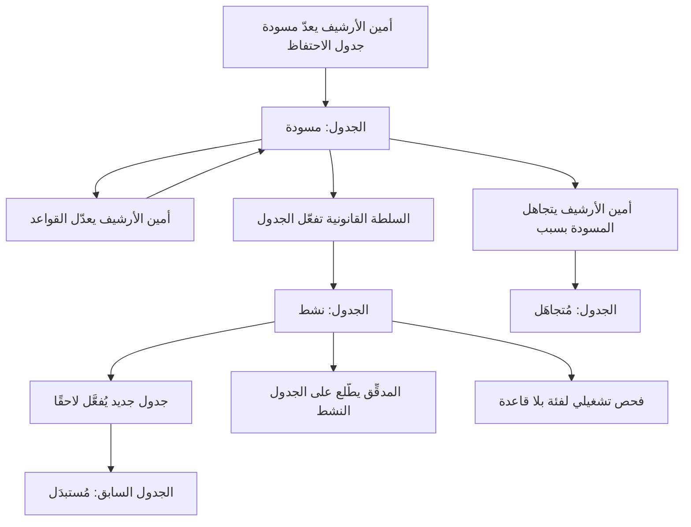
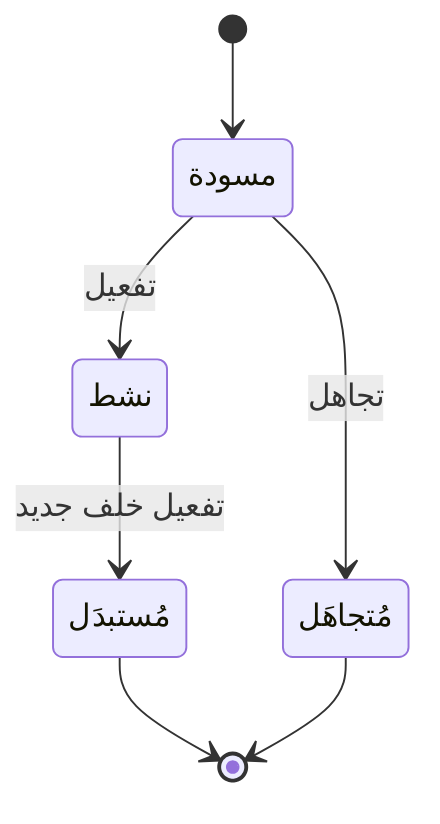

# جداول الاحتفاظ بالسجلات

<!-- BEGIN GENERATED: doc -->
| البند | القيمة |
|---|---|
| المعرّف | FEAT-KNW-RETENTION-SCHEDULE |
| الإصدار | 0.2 |
| الحالة | مسودة |
| القدرة | CAP-11 المعرفة والذاكرة المؤسسية |
| القدرة الفرعية | CAP-11.02 السجلات والاحتفاظ (R1 (الاحتفاظ والتجميد)) |
| الأدوار | أمين الأرشيف؛ السلطة القانونية والامتثال؛ المدقِّق؛ النظام |
| الشاشات | SCR-70 الاحتفاظ والحجز القانوني والإتلاف والمحو |
| حالات الاستخدام | UC-103 |
| القصص | 8: 6 من المواصفة، و2 جديدة |
<!-- END GENERATED: doc -->

## 1. نظرة عامة

### 1.1 القيمة

يحدد بوضوح كم تُحفظ كل فئة من السجلات وماذا يحدث لها بعد انتهاء المدة، بموافقة الجهة القانونية.

### 1.2 النطاق

| البند | القيمة |
|---|---|
| المستخدمون | أمين الأرشيف يعدّ مسودة جدول الاحتفاظ ويعدّلها أو يتجاهلها؛ والسلطة القانونية والامتثال تعتمدها فتصبح نشطة؛ والمدقِّق يطّلع على الجدول النشط؛ والنظام يستبدل الجدول السابق تلقائيًا |
| الشاشات | شاشة الاحتفاظ والحجز القانوني والإتلاف والمحو (SCR-70) |
| حالات الاستخدام | إعداد مسودة جدول احتفاظ وتعديلها وتجاهلها؛ تفعيل جدول احتفاظ بموافقة السلطة القانونية؛ عرض الجدول النشط بقواعده؛ التنبيه إلى فئة سجلات بلا قاعدة احتفاظ |
| المتطلبات | كل فئة سجلات لها قاعدة احتفاظ واحدة بالضبط: مدة، ومحفز، وإجراء إتلاف، وأساس قانوني؛ ولا يفعِّل الجدول من أعدّ مسودته؛ وجدول واحد نشط لكل مستأجر في أي وقت |
| خارج النطاق | تنفيذ إجراء الإتلاف نفسه وتتبّعه؛ الحجز القانوني والمحو تغطيهما ميزات أخرى من هذه القدرة |

### 1.3 خريطة الميزة

**الشكل 1: دورة إعداد جدول الاحتفاظ وتفعيله**



**الشكل 2: حالات جدول الاحتفاظ**



## 2. القواعد المشتركة

تنطبق على كل قصص الميزة، فلا تتكرر داخل القصص. وكل قصة تذكر ما يخصها فقط.

### 2.1 السياق المشترك

كل قصة تبدأ من ثلاثة شروط: مستأجر نشط، وحزمة السياسات الأساسية مفعّلة، ومستخدم مسجّل الدخول ومخوَّل. وتشير إليها القصص بخطوة واحدة: «بفرض السياق المشترك للميزة».

### 2.2 الصلاحية وعدم الإفصاح

- من لا يحق له رؤية العنصر يتلقى ردًا بشكل «غير متاح» تمامًا، فلا يعرف أنه موجود.
- من يرى العنصر ولا يحق له الإجراء يتلقى «لا تملك صلاحية هذا الإجراء».

### 2.3 أوامر تغيير الحالة

- **منع التكرار:** يُرسل كل أمر بمفتاح فريد، فإعادة الطلب نفسه لا تُنفَّذ مرتين.
- **حماية التعديل المتزامن:** يُرسل كل أمر بإصدار البيانات الذي يراه المستخدم. فإن عدّلها غيره في الأثناء، يُرفض الأمر.
- **السجل:** إن نجح الأمر، يُكتب حدثه وسجل التدقيق في المعاملة نفسها.

### 2.4 الرفض المشترك

```gherkin
# language: ar
خاصية: الرفض المشترك لأوامر الميزة

  سيناريو مخطط: رفض مشترك لكل أمر في الميزة
    بفرض السياق المشترك للميزة
    و <الحالة>
    عندما يُرسل المستخدم أي أمر من أوامر الميزة
    اذاً يُرفض برمز <الرمز> ويرى "<الرسالة>"
    و لا يتغير شيء

    امثلة:
      | الحالة                                  | الرمز                  | الرسالة                                                 |
      | العنصر خارج صلاحياته                    | NOT_FOUND              | غير متاح                                                |
      | العنصر مرئي له ولا يحق له الإجراء       | AUTHZ_DENIED           | لا تملك صلاحية هذا الإجراء                              |
      | غيره عدّل العنصر بعد أن فتحه            | VERSION_CONFLICT       | تغيّرت البيانات منذ فتحتها. راجع التغييرات ثم أعد المحاولة |
      | أعاد مفتاح منع التكرار بمحتوى مختلف     | IDEMPOTENCY_KEY_REUSED | طلب مكرر بمحتوى مختلف                                   |
      | البيانات ناقصة أو غير صحيحة             | VALIDATION_FAILED      | بعض البيانات ناقصة أو غير صحيحة. راجع الحقول المعلَّمة      |

  سيناريو: إعادة الطلب نفسه لا تُنفَّذ مرتين
    بفرض السياق المشترك للميزة
    و أمر نجح بمفتاح منع تكرار
    عندما يُعاد الطلب نفسه بالمفتاح نفسه
    اذاً تُعاد النتيجة الأولى ولا يُكتب حدث ثانٍ
```

### 2.5 المصادقة المعززة لأوامر جدول الاحتفاظ

كل أمر من أوامر هذه الميزة (إعداد المسودة، وتعديلها، وتفعيلها، وتجاهلها) يلتزم بمصادقة معززة. فإن كانت قوة مصادقة جلسة المستخدم أقل من المطلوب، يُرفض الأمر، ويُعاد بعد المصادقة المعززة بالمفتاح نفسه.

```gherkin
# language: ar
خاصية: المصادقة المعززة لأوامر جدول الاحتفاظ

  سيناريو مخطط: رفض لضعف قوة المصادقة
    بفرض السياق المشترك للميزة
    و قوة مصادقة جلسة المستخدم أقل من المطلوب لهذا الأمر
    عندما يُرسل أي أمر من أوامر هذه الميزة
    اذاً يُرفض برمز MFA_STEP_UP_REQUIRED ويرى "هذا الإجراء يحتاج تأكيد هويتك مرة أخرى"
    و لا يتغير شيء

  سيناريو: إعادة الأمر بعد المصادقة المعززة
    بفرض أن أمرًا رُفض لضعف قوة المصادقة
    عندما يُعاد الأمر بالمفتاح نفسه بعد مصادقة معززة
    اذاً يُنفَّذ الأمر
```

## 3. الجودة وتعريف الاكتمال

### 3.1 متطلبات الجودة

<!-- BEGIN GENERATED: quality -->
لا متطلبات جودة مرتبطة بمتطلبات هذه الميزة مباشرة. تنطبق متطلبات المنصة العامة (`FEAT-PLT-*`).
<!-- END GENERATED: quality -->

### 3.2 تعريف الاكتمال

القصة مكتملة حين تتحقق الشروط الخمسة:

1. سيناريوهاتها والقواعد المشتركة تمر في الاختبار الآلي.
2. فحوص البنية المعمارية تمر.
3. نصوص الواجهة والرسائل موجودة بالعربية والإنجليزية.
4. مراجعة الكود مكتملة.
5. ما تضيفه القصة نفسها في قسم «القواعد» تحقق.

## 4. فهرس القصص

<!-- BEGIN GENERATED: story-index -->
| المعرّف | القصة | النوع | الحالة |
|---|---|---|---|
| `US-BC08-RTS-ACTIVATE` | تفعيل جدول الاحتفاظ | أمر | مسودة |
| `US-BC08-RTS-DISCARD` | تجاهل مسودة جدول الاحتفاظ | أمر | مسودة |
| `US-BC08-RTS-DRAFT` | إعداد مسودة جدول الاحتفاظ | أمر | مسودة |
| `US-BC08-RTS-EDIT` | تعديل جدول الاحتفاظ | أمر | مسودة |
| `US-BC08-Q-RTS-ACTIVE` | جلب الجدول النشط بقواعده | جلب | مسودة |
| `US-BC08-S-RETENTION-SCHEDULE-01` | تلقائي: استبدال الجدول النشط السابق | نظام | مسودة |
| `US-UI-SCR70-RETENTION-RULES` | مراجعة قواعد الاحتفاظ لكل فئة سجلات | واجهة | مسودة |
| `US-OPS-RETENTION-CLASS-GAP` | التنبيه إلى فئة سجلات بلا قاعدة احتفاظ | تشغيل | مسودة |
<!-- END GENERATED: story-index -->

## 5. القصص

### 5.1 US-BC08-RTS-ACTIVATE — تفعيل جدول الاحتفاظ

| النوع | الإصدار | الأولوية | دون اتصال | الحالة |
|---|---|---|---|---|
| أمر | R1 | Must | لا | مسودة |

> **كـ** السلطة القانونية والامتثال، **أريد** تفعيل جدول احتفاظ مكتمل أعدّه أمين الأرشيف، **حتى** يصبح هذا الجدول المرجع الوحيد النشط لكل فئة سجلات.

**باختصار:** تفعّل السلطة القانونية مسودة جدول احتفاظ تغطي كل فئة سجلات بقاعدة واحدة بالضبط، فيصبح الجدول «نشطًا» ويُستبدَل الجدول النشط السابق تلقائيًا في المعاملة نفسها، على ألا تكون المفعِّلة هي من أعدّت المسودة.

#### القواعد

- **متى يُسمح:** الجدول في حالة «مسودة»، وكل فئة سجلات لها قاعدة واحدة بالضبط.
- **من يُسمح له:** السلطة القانونية والامتثال، على ألا تكون هي من أعدّت المسودة (فصل المهام).
- **البيانات:** تاريخ النفاذ (إلزامي)، وفئات الاحتفاظ الرجعي (اختياري).
- **الأثر:** حدث «فُعِّل جدول الاحتفاظ» يصل إلى مخطط الإتلاف وسياسة حجم فترات فئات المفاتيح، ويصبح الجدول النشط السابق «مُستبدَلًا» في المعاملة نفسها.

#### معايير القبول

```gherkin
# language: ar
خاصية: تفعيل جدول الاحتفاظ

  سيناريو: تفعيل مسودة مكتملة
    بفرض السياق المشترك للميزة
    و مسودة جدول احتفاظ تغطي كل فئات السجلات بقاعدة واحدة لكل منها
    عندما تفعّلها السلطة القانونية والامتثال بتاريخ نفاذ
    اذاً تصبح حالتها "نشط"
    و يُسجَّل حدث "فُعِّل جدول الاحتفاظ"
    و يصبح الجدول النشط السابق، إن وجد، "مُستبدَلًا" في المعاملة نفسها

  سيناريو مخطط: رفض خاص بالتفعيل
    بفرض السياق المشترك للميزة
    و <الحالة>
    عندما تحاول تفعيل المسودة
    اذاً يُرفض برمز <الرمز> ويرى <الرسالة>
    و لا يتغير شيء

    امثلة:
      | الحالة                                                 | الرمز                                        | الرسالة                                              |
      | فئة سجلات بلا قاعدة، أو فئة بأكثر من قاعدة             | SCHEDULE_INCOMPLETE                          | يجب أن يكون لكل فئة سجلات قاعدة واحدة                |
      | المفعِّل هو من أعدّ المسودة                            | SEGREGATION_OF_DUTIES                        | لا يجوز أن يعتمد الشخص نفسه ما قدّمه أو طلبه        |
      | الجدول ليس في حالة "مسودة"                             | RETENTION_SCHEDULE_INVALID_STATE_TRANSITION  | الوضع الحالي لجدول الاحتفاظ لا يسمح بهذا الإجراء    |
      | لم يُحدَّد تاريخ النفاذ                                 | VALIDATION_FAILED                            | تاريخ النفاذ مطلوب                                   |
```

<details><summary>المراجع التقنية والتتبع</summary>

<!-- BEGIN GENERATED: refs US-BC08-RTS-ACTIVATE -->
| البند | المعرّف | المعنى |
|---|---|---|
| الواجهة البرمجية | `POST /api/v1/governance/retention-schedules/{id}/actions/activate` | — |
| الأمر | `CMD-RTS-ACTIVATE` | تفعيل جدول الاحتفاظ |
| السياسة | `POL-RTS-ACTIVATE` | Archivist (draft, edit, discard) · Legal/Compliance authority (activate)؛ tenant match |
| الحدث | `EVT-RTS-ACTIVATED` | يصل إلى: Disposition planner; Key-bucket policy (class period sizing) |
| الكيان | `AGG-RETENTION-SCHEDULE` | جدول الاحتفاظ |
| الجدول | `governance.retention_schedules` | الجدول الرئيسي لجدول الاحتفاظ |
| وحدة النشر | DU-03 | — |
| المتطلب | REQ-GOV-006 | The system shall apply a retention schedule to every record class. |
| حالة الاستخدام | UC-103 | Apply Retention & Legal Hold |
| الاختبار | TST-RETENTION-SCHEDULE-SM | دورة حالات جدول الاحتفاظ، وثوابت الشريحة SLC-12a |
<!-- END GENERATED: refs US-BC08-RTS-ACTIVATE -->

</details>

### 5.2 US-BC08-RTS-DISCARD — تجاهل مسودة جدول الاحتفاظ

| النوع | الإصدار | الأولوية | دون اتصال | الحالة |
|---|---|---|---|---|
| أمر | R1 | Must | لا | مسودة |

> **كـ** أمين الأرشيف، **أريد** تجاهل مسودة جدول الاحتفاظ التي أعددتها بسبب، **حتى** أبدأ مسودة جديدة حين لا تصلح المسودة الحالية.

**باختصار:** يتجاهل أمين الأرشيف مسودة جدول احتفاظ لم تُفعَّل بعد، بذكر السبب، فتصير «مُتجاهَلة» ويمكن إعداد مسودة جديدة.

#### القواعد

- **متى يُسمح:** الجدول في حالة «مسودة»، وذُكر سبب التجاهل.
- **من يُسمح له:** أمين الأرشيف.
- **البيانات:** السبب (إلزامي).
- **الأثر:** حدث «تُجوهلت مسودة جدول الاحتفاظ» يُسجَّل في سجل التدقيق.

#### معايير القبول

```gherkin
# language: ar
خاصية: تجاهل مسودة جدول الاحتفاظ

  سيناريو: تجاهل مسودة
    بفرض السياق المشترك للميزة
    و مسودة جدول احتفاظ في حالة "مسودة"
    عندما يتجاهلها أمين الأرشيف بسبب
    اذاً تصبح حالتها "مُتجاهَل"
    و يُسجَّل حدث "تُجوهلت مسودة جدول الاحتفاظ"

  سيناريو مخطط: رفض خاص بالتجاهل
    بفرض السياق المشترك للميزة
    و <الحالة>
    عندما يحاول تجاهل المسودة
    اذاً يُرفض برمز <الرمز> ويرى <الرسالة>
    و لا يتغير شيء

    امثلة:
      | الحالة                        | الرمز                                        | الرسالة                                           |
      | لم يُذكر سبب التجاهل          | REASON_REQUIRED                              | اذكر السبب                                        |
      | الجدول ليس في حالة "مسودة"    | RETENTION_SCHEDULE_INVALID_STATE_TRANSITION  | الوضع الحالي لجدول الاحتفاظ لا يسمح بهذا الإجراء |
```

<details><summary>المراجع التقنية والتتبع</summary>

<!-- BEGIN GENERATED: refs US-BC08-RTS-DISCARD -->
| البند | المعرّف | المعنى |
|---|---|---|
| الواجهة البرمجية | `POST /api/v1/governance/retention-schedules/{id}/actions/discard` | — |
| الأمر | `CMD-RTS-DISCARD` | تجاهل مسودة جدول الاحتفاظ |
| السياسة | `POL-RTS-DISCARD` | Archivist (draft, edit, discard) · Legal/Compliance authority (activate)؛ tenant match |
| الحدث | `EVT-RTS-DISCARDED` | يصل إلى: Disposition planner; Key-bucket policy (class period sizing) |
| الكيان | `AGG-RETENTION-SCHEDULE` | جدول الاحتفاظ |
| الجدول | `governance.retention_schedules` | الجدول الرئيسي لجدول الاحتفاظ |
| وحدة النشر | DU-03 | — |
| المتطلب | REQ-GOV-006 | The system shall apply a retention schedule to every record class. |
| حالة الاستخدام | UC-103 | Apply Retention & Legal Hold |
| الاختبار | TST-RETENTION-SCHEDULE-SM | دورة حالات جدول الاحتفاظ، وثوابت الشريحة SLC-12a |
<!-- END GENERATED: refs US-BC08-RTS-DISCARD -->

</details>

### 5.3 US-BC08-RTS-DRAFT — إعداد مسودة جدول الاحتفاظ

| النوع | الإصدار | الأولوية | دون اتصال | الحالة |
|---|---|---|---|---|
| أمر | R1 | Must | لا | مسودة |

> **كـ** أمين الأرشيف، **أريد** إعداد مسودة جدول احتفاظ جديدة، اعتمادًا على جدول سابق إن وُجد، **حتى** أبدأ تحديد قواعد الاحتفاظ لكل فئة سجلات قبل اعتمادها.

**باختصار:** يُنشئ أمين الأرشيف مسودة جدول احتفاظ جديدة، ويجوز أن يبنيها على جدول سابق، على ألا توجد مسودة أخرى قائمة للمستأجر نفسه.

#### القواعد

- **متى يُسمح:** لا توجد مسودة أخرى قائمة للمستأجر.
- **من يُسمح له:** أمين الأرشيف.
- **البيانات:** الجدول الأساس (اختياري، للبناء على جدول سابق).
- **الأثر:** حدث «أُعدَّت مسودة جدول الاحتفاظ» يُسجَّل في سجل التدقيق.

#### معايير القبول

```gherkin
# language: ar
خاصية: إعداد مسودة جدول الاحتفاظ

  سيناريو: إعداد مسودة جديدة
    بفرض السياق المشترك للميزة
    و لا توجد مسودة قائمة للمستأجر
    عندما يُعدّ أمين الأرشيف مسودة جديدة
    اذاً تُفتح المسودة في حالة "مسودة"
    و يُسجَّل حدث "أُعدَّت مسودة جدول الاحتفاظ"

  سيناريو مخطط: رفض خاص بالإعداد
    بفرض السياق المشترك للميزة
    و <الحالة>
    عندما يحاول إعداد مسودة جديدة
    اذاً يُرفض برمز <الرمز> ويرى <الرسالة>
    و لا يتغير شيء

    امثلة:
      | الحالة                           | الرمز        | الرسالة                        |
      | توجد مسودة قائمة للمستأجر من قبل | DRAFT_EXISTS | توجد مسودة قائمة لم تُحسم بعد |
```

<details><summary>المراجع التقنية والتتبع</summary>

<!-- BEGIN GENERATED: refs US-BC08-RTS-DRAFT -->
| البند | المعرّف | المعنى |
|---|---|---|
| الواجهة البرمجية | `POST /api/v1/governance/retention-schedules` | — |
| الأمر | `CMD-RTS-DRAFT` | إعداد مسودة جدول الاحتفاظ |
| السياسة | `POL-RTS-DRAFT` | Archivist (draft, edit, discard) · Legal/Compliance authority (activate)؛ tenant match |
| الحدث | `EVT-RTS-DRAFTED` | يصل إلى: Disposition planner; Key-bucket policy (class period sizing) |
| الكيان | `AGG-RETENTION-SCHEDULE` | جدول الاحتفاظ |
| الجدول | `governance.retention_schedules` | الجدول الرئيسي لجدول الاحتفاظ |
| وحدة النشر | DU-03 | — |
| المتطلب | REQ-GOV-006 | The system shall apply a retention schedule to every record class. |
| حالة الاستخدام | UC-103 | Apply Retention & Legal Hold |
| الاختبار | TST-RETENTION-SCHEDULE-SM | دورة حالات جدول الاحتفاظ، وثوابت الشريحة SLC-12a |
<!-- END GENERATED: refs US-BC08-RTS-DRAFT -->

</details>

### 5.4 US-BC08-RTS-EDIT — تعديل جدول الاحتفاظ

| النوع | الإصدار | الأولوية | دون اتصال | الحالة |
|---|---|---|---|---|
| أمر | R1 | Must | لا | مسودة |

> **كـ** أمين الأرشيف، **أريد** تعديل قواعد مسودة جدول الاحتفاظ: فئة السجلات، ومدتها، ومحفزها، وإجراء إتلافها، وأساسها القانوني، **حتى** أكمل الجدول قبل تقديمه للتفعيل.

**باختصار:** يعدّل أمين الأرشيف قواعد مسودة جدول الاحتفاظ، وكل قاعدة تحدد فئة السجلات والمدة والمحفز وإجراء الإتلاف والأساس القانوني، دون أن تتغير حالة الجدول.

#### القواعد

- **متى يُسمح:** الجدول في حالة «مسودة».
- **من يُسمح له:** أمين الأرشيف.
- **البيانات:** مجموعة القواعد (إلزامية)، وكل قاعدة بفئة سجلات، ومدة بصيغة المدة الزمنية، ومحفز (عند التسجيل، أو الإغلاق، أو الاستبدال، أو حدث)، وإجراء (إتلاف، أو مراجعة، أو أرشفة)، وأساس قانوني.
- **الأثر:** حدث «عُدِّلت مسودة جدول الاحتفاظ» يُسجَّل في سجل التدقيق.

#### معايير القبول

```gherkin
# language: ar
خاصية: تعديل جدول الاحتفاظ

  سيناريو: تعديل قواعد المسودة
    بفرض السياق المشترك للميزة
    و مسودة جدول احتفاظ في حالة "مسودة"
    عندما يعدّل أمين الأرشيف قواعدها بفئة ومدة ومحفز وإجراء وأساس قانوني صحيح لكل قاعدة
    اذاً تبقى حالتها "مسودة"
    و يُسجَّل حدث "عُدِّلت مسودة جدول الاحتفاظ"

  سيناريو مخطط: رفض خاص بالتعديل
    بفرض السياق المشترك للميزة
    و <الحالة>
    عندما يحاول تعديل القواعد
    اذاً يُرفض برمز <الرمز> ويرى <الرسالة>
    و لا يتغير شيء

    امثلة:
      | الحالة                                                   | الرمز                                        | الرسالة                                           |
      | قاعدة ناقصة فئة أو مدة أو محفز أو إجراء أو أساس قانوني   | SCHEDULE_INVALID                             | قاعدة الاحتفاظ غير صحيحة                          |
      | الجدول ليس في حالة "مسودة"                               | RETENTION_SCHEDULE_INVALID_STATE_TRANSITION  | الوضع الحالي لجدول الاحتفاظ لا يسمح بهذا الإجراء |
      | القواعد غير مرسلة                                        | VALIDATION_FAILED                            | القواعد مطلوبة                                    |
```

<details><summary>المراجع التقنية والتتبع</summary>

<!-- BEGIN GENERATED: refs US-BC08-RTS-EDIT -->
| البند | المعرّف | المعنى |
|---|---|---|
| الواجهة البرمجية | `POST /api/v1/governance/retention-schedules/{id}/actions/edit` | — |
| الأمر | `CMD-RTS-EDIT` | تعديل جدول الاحتفاظ |
| السياسة | `POL-RTS-EDIT` | Archivist (draft, edit, discard) · Legal/Compliance authority (activate)؛ tenant match |
| الحدث | `EVT-RTS-EDITED` | يصل إلى: Disposition planner; Key-bucket policy (class period sizing) |
| الكيان | `AGG-RETENTION-SCHEDULE` | جدول الاحتفاظ |
| الجدول | `governance.retention_schedules` | الجدول الرئيسي لجدول الاحتفاظ |
| وحدة النشر | DU-03 | — |
| المتطلب | REQ-GOV-006 | The system shall apply a retention schedule to every record class. |
| حالة الاستخدام | UC-103 | Apply Retention & Legal Hold |
| الاختبار | TST-RETENTION-SCHEDULE-SM | دورة حالات جدول الاحتفاظ، وثوابت الشريحة SLC-12a |
<!-- END GENERATED: refs US-BC08-RTS-EDIT -->

</details>

### 5.5 US-BC08-Q-RTS-ACTIVE — جلب الجدول النشط بقواعده

| النوع | الإصدار | الأولوية | دون اتصال | الحالة |
|---|---|---|---|---|
| جلب | R1 | Must | لا | مسودة |

> **كـ** أمين الأرشيف أو السلطة القانونية والامتثال أو المدقِّق، **أريد** جلب جدول الاحتفاظ النشط بكل قواعده، **حتى** أعرف مدة الاحتفاظ ومحفزها وإجراءها وأساسها القانوني لكل فئة سجلات.

**باختصار:** يُعاد الجدول النشط الواحد للمستأجر بكل قواعده، صفحة بعد صفحة.

#### القواعد

- **من يرى ماذا:** أمين الأرشيف، والسلطة القانونية والامتثال، والمدقِّق.
- **البيانات:** المؤشر والحد.

#### معايير القبول

```gherkin
# language: ar
خاصية: جلب الجدول النشط بقواعده

  سيناريو: جلب الجدول النشط
    بفرض السياق المشترك للميزة
    و جدول احتفاظ نشط للمستأجر بقواعده
    عندما يطلب المستخدم المخوَّل الجدول النشط
    اذاً تُعاد قواعده كاملة

  سيناريو: الصفحة التالية
    بفرض السياق المشترك للميزة
    و قواعد الجدول النشط أكثر من صفحة
    عندما يطلب الصفحة التالية بالمؤشر
    اذاً تُعاد القواعد التالية دون تكرار ولا فجوة
```

<details><summary>المراجع التقنية والتتبع</summary>

<!-- BEGIN GENERATED: refs US-BC08-Q-RTS-ACTIVE -->
| البند | المعرّف | المعنى |
|---|---|---|
| الواجهة البرمجية | `GET /api/v1/governance/retention-schedule` | — |
| الاستعلام | `QRY-RTS-ACTIVE` | Active schedule version with rules |
| السياسة | `POL-RTS-ACTIVE` | Archivist, Legal, Auditor |
| الكيان | `AGG-RETENTION-SCHEDULE` | جدول الاحتفاظ |
| الجدول | `governance.retention_schedules` | الجدول الرئيسي لجدول الاحتفاظ |
| وحدة النشر | DU-03 | — |
| المتطلب | REQ-GOV-006 | The system shall apply a retention schedule to every record class. |
| حالة الاستخدام | UC-103 | Apply Retention & Legal Hold |
| الاختبار | TST-RETENTION-SCHEDULE-SM | دورة حالات جدول الاحتفاظ، وثوابت الشريحة SLC-12a |
<!-- END GENERATED: refs US-BC08-Q-RTS-ACTIVE -->

</details>

### 5.6 US-BC08-S-RETENTION-SCHEDULE-01 — تلقائي: استبدال الجدول النشط السابق

| النوع | الإصدار | الأولوية | دون اتصال | الحالة |
|---|---|---|---|---|
| نظام | R1 | Must | لا ينطبق | مسودة |

> **كـ** النظام، **أريد** استبدال الجدول النشط السابق تلقائيًا حين يُفعَّل جدول خلفه، **حتى** يبقى جدول واحد نشط لكل مستأجر دومًا.

**باختصار:** عند تفعيل جدول احتفاظ جديد لمستأجر له جدول نشط، ينتقل الجدول النشط السابق إلى حالة «مُستبدَل» في المعاملة نفسها.

#### القواعد

- **متى يحدث:** تفعيل جدول احتفاظ جديد للمستأجر نفسه الذي له جدول «نشط».
- **الأثر:** حدث «استُبدل جدول الاحتفاظ» يُسجَّل في سجل التدقيق بهوية النظام.

#### معايير القبول

```gherkin
# language: ar
خاصية: استبدال جدول الاحتفاظ النشط السابق

  سيناريو: تفعيل جدول خلف
    بفرض جدول احتفاظ "نشط" لمستأجر
    عندما يُفعَّل جدول احتفاظ جديد لذلك المستأجر
    اذاً تصبح حالة الجدول السابق "مُستبدَل"
    و يُسجَّل حدث "استُبدل جدول الاحتفاظ" بهوية النظام

  سيناريو: لا جدول خلف يُفعَّل
    بفرض جدول احتفاظ "نشط" لمستأجر
    عندما لا يُفعَّل أي جدول جديد لذلك المستأجر
    اذاً تبقى حالته "نشط"
```

<details><summary>المراجع التقنية والتتبع</summary>

<!-- BEGIN GENERATED: refs US-BC08-S-RETENTION-SCHEDULE-01 -->
| البند | المعرّف | المعنى |
|---|---|---|
| المحفِّز | `SYS:successor activated` | system |
| الانتقال | ACTIVE ← SUPERSEDED | — |
| الحدث | `EVT-RTS-SUPERSEDED` | يصل إلى: Disposition planner; Key-bucket policy (class period sizing) |
| الكيان | `AGG-RETENTION-SCHEDULE` | جدول الاحتفاظ |
| الجدول | `governance.retention_schedules` | الجدول الرئيسي لجدول الاحتفاظ |
| وحدة النشر | DU-03 | — |
| المتطلب | REQ-GOV-006 | The system shall apply a retention schedule to every record class. |
| حالة الاستخدام | UC-103 | Apply Retention & Legal Hold |
| الاختبار | TST-RETENTION-SCHEDULE-SM | دورة حالات جدول الاحتفاظ، وثوابت الشريحة SLC-12a |
<!-- END GENERATED: refs US-BC08-S-RETENTION-SCHEDULE-01 -->

</details>

### 5.7 US-UI-SCR70-RETENTION-RULES — مراجعة قواعد الاحتفاظ لكل فئة سجلات

| النوع | الإصدار | الأولوية | دون اتصال | الحالة |
|---|---|---|---|---|
| واجهة | R1 | Must | لا | مسودة |

> **كـ** المستخدم (أمين الأرشيف أو السلطة القانونية والامتثال أو المدقِّق)، **أريد** مراجعة قواعد الاحتفاظ لكل فئة سجلات في شاشة واحدة، **حتى** أتأكد أن كل فئة مغطاة بقاعدة واضحة قبل التفعيل أو عند التدقيق.

**باختصار:** تعرض شاشة الاحتفاظ والحجز القانوني والإتلاف والمحو قواعد الجدول (المسودة أو النشط) في جدول واحد، وتميّز أي فئة سجلات بلا قاعدة أو بأكثر من قاعدة.

#### القواعد

- **البيانات:** فئة السجلات، والمدة، والمحفز، والإجراء، والأساس القانوني لكل قاعدة.

#### معايير القبول

```gherkin
# language: ar
خاصية: مراجعة قواعد الاحتفاظ لكل فئة سجلات

  سيناريو: عرض قواعد مسودة أو جدول نشط
    بفرض السياق المشترك للميزة
    و جدول احتفاظ بقواعد لبعض فئات السجلات
    عندما يفتح المستخدم شاشة الاحتفاظ
    اذاً يرى قاعدة كل فئة مغطاة: المدة والمحفز والإجراء والأساس القانوني

  سيناريو: فئة بلا قاعدة
    بفرض السياق المشترك للميزة
    و جدول احتفاظ لا يغطي إحدى فئات السجلات
    عندما يفتح المستخدم شاشة الاحتفاظ
    اذاً يرى تلك الفئة مميَّزة بأنها بلا قاعدة
```

<details><summary>المراجع التقنية والتتبع</summary>

<!-- BEGIN GENERATED: refs US-UI-SCR70-RETENTION-RULES -->
| البند | المعرّف | المعنى |
|---|---|---|
| حالة الاستخدام | UC-103 | Apply Retention & Legal Hold |
| الشاشة | SCR-70 | شاشة الاحتفاظ والحجز القانوني والإتلاف والمحو |
| المصدر | `THR-S12-05` | — |
| المصدر | `[Derived]` | — |
| المتطلب | REQ-GOV-006 | The system shall apply a retention schedule to every record class. |
| حالة الاستخدام | UC-103 | Apply Retention & Legal Hold |
<!-- END GENERATED: refs US-UI-SCR70-RETENTION-RULES -->

</details>

### 5.8 US-OPS-RETENTION-CLASS-GAP — التنبيه إلى فئة سجلات بلا قاعدة احتفاظ

| النوع | الإصدار | الأولوية | دون اتصال | الحالة |
|---|---|---|---|---|
| تشغيل | R1 | Must | لا ينطبق | مسودة |

> **كـ** فريق التشغيل، **أريد** تنبيهًا دوريًا إلى أي فئة سجلات مرجعية لا تملك قاعدة احتفاظ في الجدول النشط، **حتى** تُستدرك الفجوة قبل أن تتراكم سجلات تلك الفئة بلا قاعدة احتفاظ تحكمها.

**باختصار:** يفحص النظام الجدول النشط لكل مستأجر بانتظام مقابل فئات السجلات المرجعية، ويُنبَّه فريق التشغيل عند وجود فئة بلا قاعدة أو بأكثر من قاعدة.

#### معايير القبول

```gherkin
# language: ar
خاصية: التنبيه إلى فئة سجلات بلا قاعدة احتفاظ

  سيناريو: كل الفئات مغطاة
    بفرض جدول احتفاظ نشط يغطي كل فئات السجلات المرجعية بقاعدة واحدة لكل منها
    عندما يُشغَّل الفحص الدوري
    اذاً لا يُسجَّل أي تنبيه

  سيناريو: فئة بلا قاعدة أو بأكثر من قاعدة
    بفرض جدول احتفاظ نشط لا يغطي فئة من فئات السجلات المرجعية، أو يغطيها بأكثر من قاعدة
    عندما يُشغَّل الفحص الدوري
    اذاً يُنبَّه فريق التشغيل بتلك الفئة
```

<details><summary>المراجع التقنية والتتبع</summary>

<!-- BEGIN GENERATED: refs US-OPS-RETENTION-CLASS-GAP -->
| البند | المعرّف | المعنى |
|---|---|---|
| القرار المعماري | ADR-P14 | Reference Data Governance |
| المصدر | `US-BC08-RTS-ACTIVATE` | — |
| المصدر | `[Derived]` | — |
| المتطلب | REQ-GOV-006 | The system shall apply a retention schedule to every record class. |
| حالة الاستخدام | UC-103 | Apply Retention & Legal Hold |
<!-- END GENERATED: refs US-OPS-RETENTION-CLASS-GAP -->

</details>

## 6. التتبع

<!-- BEGIN GENERATED: trace -->
| المتطلب | المعنى | القصص | الاختبار |
|---|---|---|---|
| REQ-GOV-006 | The system shall apply a retention schedule to every record class. | `US-BC08-Q-RTS-ACTIVE`، `US-BC08-RTS-ACTIVATE`، `US-BC08-RTS-DISCARD`، `US-BC08-RTS-DRAFT`، `US-BC08-RTS-EDIT`، `US-BC08-S-RETENTION-SCHEDULE-01`، `US-OPS-RETENTION-CLASS-GAP`، `US-UI-SCR70-RETENTION-RULES` | TST-DISPOSITION-RUN-SM، TST-RETENTION-SCHEDULE-SM، TST-SLC12A-INVARIANTS |
<!-- END GENERATED: trace -->

## 7. سجل التغييرات

| الإصدار | التاريخ | التغيير |
|---|---|---|
| 0.1 | — | هيكل مولَّد من خريطة الميزات |
| 0.2 | 2026-10-13 | كتابة القصص كاملة بمعيار القصص |
