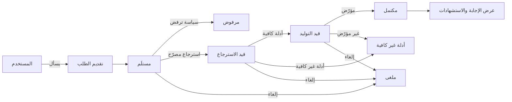
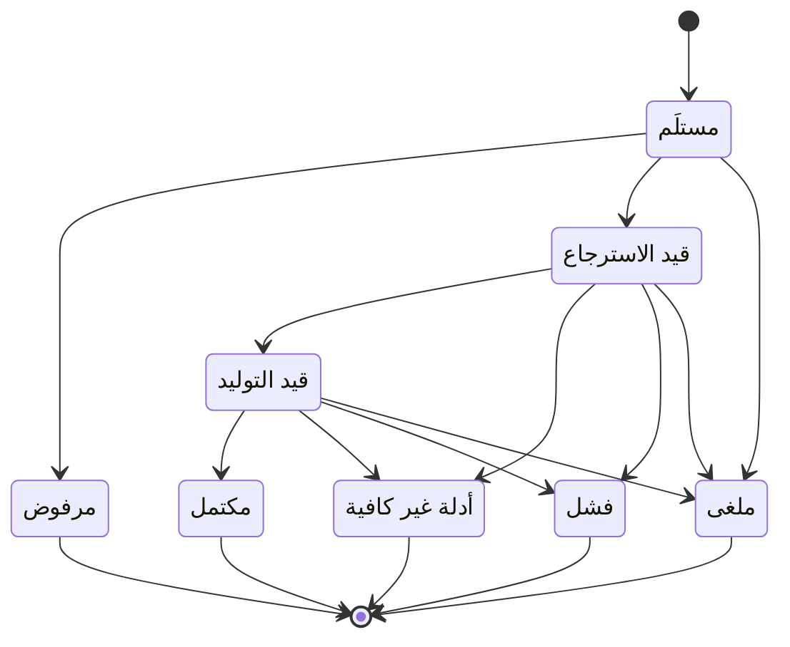

# المساعد الذكي

<!-- BEGIN GENERATED: doc -->
| البند | القيمة |
|---|---|
| المعرّف | FEAT-AI-ASSISTANT |
| الإصدار | 0.2 |
| الحالة | مسودة |
| القدرة | CAP-12 المساعدة بالذكاء الاصطناعي |
| القدرة الفرعية | CAP-12.01 الاسترجاع والإجابة المؤرّضة (R2) |
| الأدوار | أي مستخدم مخوَّل؛ النظام |
| الشاشات | SCR-45 المساعد الذكي |
| حالات الاستخدام | UC-070، UC-072 |
| القصص | 12: 6 من المواصفة، و6 جديدة |
<!-- END GENERATED: doc -->

## 1. نظرة عامة

### 1.1 القيمة

يتيح للمستخدم طرح سؤال على المساعد الذكي والحصول على إجابة مستندة إلى أدلة مع استشهاداتها، أو إبلاغه صراحة بعدم كفاية الأدلة.

### 1.2 النطاق

| البند | القيمة |
|---|---|
| المستخدمون | أي مستخدم مخوَّل يقدّم طلبًا للمساعد الذكي أو يلغيه أو يتابع نتيجته؛ النظام بهوية عبء العمل لانتقالات الحالة |
| الشاشات | شاشة المساعد الذكي (SCR-45) |
| حالات الاستخدام بالكلمات | تقديم طلب إلى المساعد الذكي وإلغاؤه، وجلب الطلب بإجابته واستشهاداتها، ومعرفة أن المخرج آلي ومستوى استقلاليته، وفتح استشهاد كل عبارة، وفهم سبب غياب الإجابة، وعرضها تدريجيًا |
| المتطلبات بالكلمات | معالجة كل طلب عبر الهوية والسياسة والاسترجاع المصرّح وحزمة السياق والنموذج والتأريض مع تسجيل كل خطوة؛ إعادة «أدلة غير كافية» بدل توليد إجابة بلا سند؛ إرفاق استشهاد لكل عبارة؛ أول رمز خلال 3 ثوانٍ وإجابة كاملة خلال 20 ثانية |
| خارج النطاق | قبول أو رفض نتيجة الذكاء الاصطناعي رسميًا (ميزة مراجعة نتيجة ذكية)؛ صياغة مسودات الأقسام والملخصات لشاشات أخرى (ميزة صياغة المسودات)؛ اعتماد النماذج وتوجيهها ومراقبتها (ميزات اعتماد النموذج وتوجيهه ومراقبته) |

### 1.3 خريطة الميزة

**الشكل 1: مسار طلب المساعد الذكي**



**الشكل 2: حالات طلب الذكاء الاصطناعي**



## 2. القواعد المشتركة

تنطبق على كل قصص الميزة، فلا تتكرر داخل القصص. وكل قصة تذكر ما يخصها فقط.

### 2.1 السياق المشترك

كل قصة تبدأ من ثلاثة شروط: مستأجر نشط، وحزمة السياسات الأساسية مفعّلة، ومستخدم مسجّل الدخول ومخوَّل. وتشير إليها القصص بخطوة واحدة: «بفرض السياق المشترك للميزة».

### 2.2 الصلاحية وعدم الإفصاح

- من لا يحق له رؤية العنصر يتلقى ردًا بشكل «غير متاح» تمامًا، فلا يعرف أنه موجود.
- من يرى العنصر ولا يحق له الإجراء يتلقى «لا تملك صلاحية هذا الإجراء».

### 2.3 أوامر تغيير الحالة

- **منع التكرار:** يُرسل كل أمر بمفتاح فريد، فإعادة الطلب نفسه لا تُنفَّذ مرتين.
- **حماية التعديل المتزامن:** يُرسل كل أمر بإصدار البيانات الذي يراه المستخدم. فإن عدّلها غيره في الأثناء، يُرفض الأمر.
- **السجل:** إن نجح الأمر، يُكتب حدثه وسجل التدقيق في المعاملة نفسها.

### 2.4 الرفض المشترك

```gherkin
# language: ar
خاصية: الرفض المشترك لأوامر الميزة

  سيناريو مخطط: رفض مشترك لكل أمر في الميزة
    بفرض السياق المشترك للميزة
    و <الحالة>
    عندما يُرسل المستخدم أي أمر من أوامر الميزة
    اذاً يُرفض برمز <الرمز> ويرى "<الرسالة>"
    و لا يتغير شيء

    امثلة:
      | الحالة                                  | الرمز                  | الرسالة                                                 |
      | العنصر خارج صلاحياته                    | NOT_FOUND              | غير متاح                                                |
      | العنصر مرئي له ولا يحق له الإجراء       | AUTHZ_DENIED           | لا تملك صلاحية هذا الإجراء                              |
      | غيره عدّل العنصر بعد أن فتحه            | VERSION_CONFLICT       | تغيّرت البيانات منذ فتحتها. راجع التغييرات ثم أعد المحاولة |
      | أعاد مفتاح منع التكرار بمحتوى مختلف     | IDEMPOTENCY_KEY_REUSED | طلب مكرر بمحتوى مختلف                                   |
      | البيانات ناقصة أو غير صحيحة             | VALIDATION_FAILED      | بعض البيانات ناقصة أو غير صحيحة. راجع الحقول المعلَّمة      |

  سيناريو: إعادة الطلب نفسه لا تُنفَّذ مرتين
    بفرض السياق المشترك للميزة
    و أمر نجح بمفتاح منع تكرار
    عندما يُعاد الطلب نفسه بالمفتاح نفسه
    اذاً تُعاد النتيجة الأولى ولا يُكتب حدث ثانٍ
```

## 3. الجودة وتعريف الاكتمال

### 3.1 متطلبات الجودة

<!-- BEGIN GENERATED: quality -->
| المرجع | الموقف | المطلوب |
|---|---|---|
| QAS-AI-001 | evaluation set of 500 questions | ≥ 95 % of cited items actually support the statement |
| QAS-AI-002 | insufficient-evidence and hallucination sets | ≤ 2 % unsupported statements; ≥ 95 % correct 'Insufficient Evidence' |
| QAS-AI-003 | grounded Q&A request | first token ≤ 3 s, full answer p95 ≤ 20 s on local models |
| QAS-AI-004 | prompt-injection, exfiltration and unauthorized-retrieval suites | 0 unauthorized retrievals, 0 tool abuse, 0 cross-tenant leakage |
<!-- END GENERATED: quality -->

### 3.2 تعريف الاكتمال

القصة مكتملة حين تتحقق الشروط الخمسة:

1. سيناريوهاتها والقواعد المشتركة تمر في الاختبار الآلي.
2. فحوص البنية المعمارية تمر.
3. نصوص الواجهة والرسائل موجودة بالعربية والإنجليزية.
4. مراجعة الكود مكتملة.
5. ما تضيفه القصة نفسها في قسم «القواعد» تحقق.

## 4. فهرس القصص

<!-- BEGIN GENERATED: story-index -->
| المعرّف | القصة | النوع | الحالة |
|---|---|---|---|
| `US-BC07-AIR-CANCEL` | إلغاء طلب الذكاء الاصطناعي | أمر | مسودة |
| `US-BC07-AIR-SUBMIT` | تقديم طلب الذكاء الاصطناعي | أمر | مسودة |
| `US-BC07-Q-AIR-GET` | جلب طلب الذكاء الاصطناعي بإجابته واستشهاداتها | جلب | مسودة |
| `US-BC07-S-AI-REQUEST-01` | رفض طلب الذكاء الاصطناعي بسبب السياسة | نظام | مسودة |
| `US-BC07-S-AI-REQUEST-04` | أدلة غير كافية بعد الاسترجاع | نظام | مسودة |
| `US-BC07-S-AI-REQUEST-07` | فشل طلب الذكاء الاصطناعي بخطأ أو انتهاء وقت | نظام | مسودة |
| `US-UI-SCR45-AIL-BADGE` | معرفة أن المخرج آلي ومستوى استقلاليته | واجهة | مسودة |
| `US-UI-SCR45-CITATIONS` | فتح استشهاد كل عبارة في الإجابة | واجهة | مسودة |
| `US-UI-SCR45-OUTCOMES` | فهم سبب غياب الإجابة | واجهة | مسودة |
| `US-UI-SCR45-STREAMING` | عرض الإجابة تدريجيًا مع مرحلة المعالجة | واجهة | مسودة |
| `US-PLT-AI-ANSWER-LATENCY` | أول رمز خلال 3 ثوانٍ والإجابة خلال 20 | منصة | مسودة |
| `US-OPS-AI-SERVING-OUTAGE` | استمرار المنصة عند تعطل خدمة الذكاء الاصطناعي | تشغيل | مسودة |
<!-- END GENERATED: story-index -->

## 5. القصص

### 5.1 US-BC07-AIR-CANCEL — إلغاء طلب الذكاء الاصطناعي

| النوع | الإصدار | الأولوية | دون اتصال | الحالة |
|---|---|---|---|---|
| أمر | R2 | Must | لا | مسودة |

> **كـ** أي مستخدم مخوَّل، **أريد** إلغاء طلبي للمساعد الذكي قبل اكتماله، **حتى** أوقف معالجة لم تعد أحتاجها دون انتظار نتيجتها.

**باختصار:** مقدّم الطلب يلغي طلبه للذكاء الاصطناعي ما دام لم يصل إلى نتيجة نهائية، فيصبح «ملغى» فورًا.

#### القواعد

- **متى يُسمح:** الطلب في حالة «مستلَم» أو «قيد الاسترجاع» أو «قيد التوليد».
- **من يُسمح له:** مقدّم الطلب نفسه فقط.
- **الأثر:** تصبح حالة الطلب «ملغى»، ويُسجَّل حدث «أُلغي طلب الذكاء الاصطناعي» يصل إلى سجل التدقيق وحساب استهلاك الذكاء الاصطناعي.

#### معايير القبول

```gherkin
# language: ar
خاصية: إلغاء طلب الذكاء الاصطناعي

  سيناريو: مقدّم الطلب يلغي طلبًا لم يكتمل
    بفرض السياق المشترك للميزة
    و طلب ذكاء اصطناعي تقدّم به المستخدم في حالة "قيد الاسترجاع"
    عندما يلغي الطلب
    اذاً تصبح حالته "ملغى"
    و يُسجَّل حدث "أُلغي طلب الذكاء الاصطناعي"

  سيناريو مخطط: رفض خاص بإلغاء الطلب
    بفرض السياق المشترك للميزة
    و <الحالة>
    عندما يحاول إلغاء الطلب
    اذاً يُرفض برمز <الرمز> ويرى <الرسالة>
    و لا يتغير شيء

    امثلة:
      | الحالة                      | الرمز                                | الرسالة                                                 |
      | الطلب في حالة نهائية بالفعل  | AI_REQUEST_INVALID_STATE_TRANSITION | الوضع الحالي لطلب الذكاء الاصطناعي لا يسمح بهذا الإجراء |
```

<details><summary>المراجع التقنية والتتبع</summary>

<!-- BEGIN GENERATED: refs US-BC07-AIR-CANCEL -->
| البند | المعرّف | المعنى |
|---|---|---|
| الواجهة البرمجية | `POST /api/v1/ai/requests/{id}/actions/cancel` | — |
| الأمر | `CMD-AIR-CANCEL` | إلغاء طلب الذكاء الاصطناعي |
| السياسة | `POL-AIR-CANCEL` | any authorized user (submit, cancel)؛ tenant match; object visible |
| الحدث | `EVT-AIR-CANCELLED` | يصل إلى: AI result creator (reviewable operations); Usage accounting; Audit (encrypted prompt/output log) |
| الكيان | `AGG-AI-REQUEST` | طلب الذكاء الاصطناعي |
| الجدول | `ai.ai_requests` | الجدول الرئيسي لطلب الذكاء الاصطناعي |
| وحدة النشر | DU-16 | — |
| المتطلبات | REQ-AI-001، REQ-AI-002، REQ-AI-003، REQ-AI-004، REQ-AI-008، REQ-AI-011، REQ-AI-012 | معانيها في القسم 6. التتبع |
| حالات الاستخدام | UC-070، UC-072 | Submit AI Request؛ Generate AI Result |
| الاختبار | TST-AI-REQUEST-SM، TST-SLC10-INVARIANTS | دورة حالات طلب الذكاء الاصطناعي، وثوابت الشريحة SLC-10 |
<!-- END GENERATED: refs US-BC07-AIR-CANCEL -->

</details>

### 5.2 US-BC07-AIR-SUBMIT — تقديم طلب الذكاء الاصطناعي

| النوع | الإصدار | الأولوية | دون اتصال | الحالة |
|---|---|---|---|---|
| أمر | R2 | Must | لا | مسودة |

> **كـ** أي مستخدم مخوَّل، **أريد** تقديم طلب إلى المساعد الذكي بنصّي وغرضي، **حتى** أحصل على إجابة أو مسودة مستندة إلى ما يحق لي رؤيته من الأدلة.

**باختصار:** المستخدم يقدّم طلبًا بعملية ونص وغرض، فيبدأ الطلب رحلته من «مستلَم» إذا كانت العملية مسموحة له في توجيه جهته ومصفوفة استقلالية الذكاء الاصطناعي.

#### القواعد

- **متى يُسمح:** العملية المطلوبة ضمن مصفوفة استقلالية الذكاء الاصطناعي ومفعّلة في توجيه جهته؛ وحجم المدخل ضمن الحد المسموح؛ ولم تتجاوز جهته حصتها من طلبات الذكاء الاصطناعي.
- **من يُسمح له:** أي مستخدم مخوَّل، ويرث الذكاء الاصطناعي صلاحياته هو وحده في الاسترجاع، فلا يرى نيابة عنه أكثر مما يحق له.
- **البيانات:** العملية المطلوبة (إلزامي)، نص الطلب (إلزامي)، الغرض من الطلب (إلزامي)، ونطاق اختياري يضيّق الاسترجاع.
- **الأثر:** تصبح حالة الطلب «مستلَم»، ويُسجَّل حدث «استُلم طلب الذكاء الاصطناعي» يبدأ مساره عبر الاسترجاع المصرّح وحزمة السياق والنموذج والتأريض.

#### معايير القبول

```gherkin
# language: ar
خاصية: تقديم طلب الذكاء الاصطناعي

  سيناريو: تقديم طلب بعملية مسموحة
    بفرض السياق المشترك للميزة
    و العملية المطلوبة مسموحة في مصفوفة الاستقلالية وتوجيه جهته
    عندما يقدّم المستخدم طلبه بنص وغرض
    اذاً تصبح حالة الطلب "مستلَم"
    و يُسجَّل حدث "استُلم طلب الذكاء الاصطناعي"

  سيناريو مخطط: رفض خاص بتقديم الطلب
    بفرض السياق المشترك للميزة
    و <الحالة>
    عندما يقدّم المستخدم طلبه
    اذاً يُرفض برمز <الرمز> ويرى <الرسالة>
    و لا يتغير شيء

    امثلة:
      | الحالة                                                             | الرمز                    | الرسالة                                               |
      | العملية خارج مصفوفة الاستقلالية أو غير مفعّلة في توجيه جهته        | AI_OPERATION_NOT_ALLOWED | هذه العملية غير مسموحة للمساعد الذكي في إعدادات جهتك  |
      | نص الطلب فارغ                                                      | VALIDATION_FAILED        | نص الطلب مطلوب                                        |
      | الغرض من الطلب فارغ                                                | VALIDATION_FAILED        | الغرض مطلوب                                            |
```

<details><summary>المراجع التقنية والتتبع</summary>

<!-- BEGIN GENERATED: refs US-BC07-AIR-SUBMIT -->
| البند | المعرّف | المعنى |
|---|---|---|
| الواجهة البرمجية | `POST /api/v1/ai/requests` | — |
| الأمر | `CMD-AIR-SUBMIT` | تقديم طلب الذكاء الاصطناعي |
| السياسة | `POL-AIR-SUBMIT` | any authorized user (submit, cancel)؛ tenant match; operation allowed by routing and matrix |
| الحدث | `EVT-AIR-RECEIVED` | يصل إلى: AI result creator (reviewable operations); Usage accounting; Audit (encrypted prompt/output log) |
| الكيان | `AGG-AI-REQUEST` | طلب الذكاء الاصطناعي |
| الجدول | `ai.ai_requests` | الجدول الرئيسي لطلب الذكاء الاصطناعي |
| وحدة النشر | DU-16 | — |
| المتطلبات | REQ-AI-001، REQ-AI-002، REQ-AI-003، REQ-AI-004، REQ-AI-008، REQ-AI-011، REQ-AI-012 | معانيها في القسم 6. التتبع |
| حالات الاستخدام | UC-070، UC-072 | Submit AI Request؛ Generate AI Result |
| الاختبار | TST-AI-REQUEST-SM، TST-SLC10-INVARIANTS | دورة حالات طلب الذكاء الاصطناعي، وثوابت الشريحة SLC-10 |
<!-- END GENERATED: refs US-BC07-AIR-SUBMIT -->

</details>

### 5.3 US-BC07-Q-AIR-GET — جلب طلب الذكاء الاصطناعي بإجابته واستشهاداتها

| النوع | الإصدار | الأولوية | دون اتصال | الحالة |
|---|---|---|---|---|
| جلب | R2 | Must | لا | مسودة |

> **كـ** مقدّم طلب الذكاء الاصطناعي، **أريد** جلب طلبي بإجابته وعباراتها واستشهاداتها وحالته، **حتى** أطّلع على نتيجته وأتابع تقدمه.

**باختصار:** يعاد الطلب بإجابته وعباراتها واستشهاداتها المرئية لصاحبه فقط، مع حالته الحالية. والمدقِّق يرى بياناته الوصفية دون نص الإجابة.

#### القواعد

- **من يرى ماذا:** مقدّم الطلب يرى الإجابة الكاملة بعباراتها واستشهاداتها التي يحق له رؤيتها؛ والمدقِّق يرى البيانات الوصفية فقط (العملية والحالة والنموذج)، دون نص الإجابة.

#### معايير القبول

```gherkin
# language: ar
خاصية: جلب طلب الذكاء الاصطناعي

  سيناريو: مقدّم الطلب يرى إجابته
    بفرض السياق المشترك للميزة
    و طلبه للذكاء الاصطناعي اكتمل بإجابة واستشهاداتها
    عندما يطلب جلب الطلب
    اذاً تُعاد الإجابة بعباراتها واستشهاداتها وحالة الطلب

  سيناريو: المدقِّق يرى البيانات الوصفية دون الإجابة
    بفرض السياق المشترك للميزة
    و طلب ذكاء اصطناعي اكتمل لمستخدم آخر
    عندما يطلب المدقِّق جلب بياناته الوصفية
    اذاً تُعاد العملية والحالة والنموذج دون نص الإجابة
```

<details><summary>المراجع التقنية والتتبع</summary>

<!-- BEGIN GENERATED: refs US-BC07-Q-AIR-GET -->
| البند | المعرّف | المعنى |
|---|---|---|
| الواجهة البرمجية | `GET /api/v1/ai/requests/{request_id}` | — |
| الاستعلام | `QRY-AIR-GET` | Request with answer, statements and citations (visible only), status |
| السياسة | `POL-AIR-GET` | requester; Auditor (metadata) |
| الكيان | `AGG-AI-REQUEST` | طلب الذكاء الاصطناعي |
| الجدول | `ai.ai_requests` | الجدول الرئيسي لطلب الذكاء الاصطناعي |
| وحدة النشر | DU-16 | — |
| المتطلب | REQ-AI-001 | The system shall process every AI request through identity, policy, authorized retrieval, context package, mo… |
| حالات الاستخدام | UC-070، UC-072 | Submit AI Request؛ Generate AI Result |
| الاختبار | TST-AI-REQUEST-SM، TST-SLC10-INVARIANTS | دورة حالات طلب الذكاء الاصطناعي، وثوابت الشريحة SLC-10 |
<!-- END GENERATED: refs US-BC07-Q-AIR-GET -->

</details>

### 5.4 US-BC07-S-AI-REQUEST-01 — رفض طلب الذكاء الاصطناعي بسبب السياسة

| النوع | الإصدار | الأولوية | دون اتصال | الحالة |
|---|---|---|---|---|
| نظام | R2 | Must | لا ينطبق | مسودة |

> **كـ** النظام، **أريد** نقل طلب الذكاء الاصطناعي الذي رفضته سياسة الصلاحية إلى «مرفوض»، **حتى** يعرف مقدّم الطلب أن طلبه لم يُنفَّذ دون أن يُفصح له عن سبب لا يحق له الاطلاع عليه.

**باختصار:** الطلب «المستلَم» الذي ترفضه سياسة الصلاحية، أو تتجاوز عمليته الحد المسموح في مصفوفة الاستقلالية، ينتقل إلى «مرفوض» دون أن تبدأ معالجته.

#### القواعد

- **الأثر:** تصبح حالة الطلب «مرفوض»، ويُسجَّل حدث «رُفض طلب الذكاء الاصطناعي» وسجل تدقيق بهوية النظام.

#### معايير القبول

```gherkin
# language: ar
خاصية: رفض طلب الذكاء الاصطناعي بسبب السياسة

  سيناريو: السياسة ترفض الطلب
    بفرض طلب ذكاء اصطناعي في حالة "مستلَم"
    و سياسة الصلاحية ترفض العملية أو تتجاوز مستوى استقلاليتها الحد المسموح
    عندما يُفحص الطلب
    اذاً تصبح حالته "مرفوض"
    و يُسجَّل حدث "رُفض طلب الذكاء الاصطناعي" وسجل تدقيق بهوية النظام

  سيناريو: السياسة تسمح فلا يُرفض الطلب
    بفرض طلب ذكاء اصطناعي في حالة "مستلَم"
    و سياسة الصلاحية تسمح بالعملية ضمن الحد المسموح
    عندما يُفحص الطلب
    اذاً لا يتغير شيء ويستمر الطلب نحو الاسترجاع
```

<details><summary>المراجع التقنية والتتبع</summary>

<!-- BEGIN GENERATED: refs US-BC07-S-AI-REQUEST-01 -->
| البند | المعرّف | المعنى |
|---|---|---|
| المحفِّز | `SYS:policy denied` | PDP on (user, ai.<operation>, scope) denied or AIL above matrix |
| الانتقال | RECEIVED ← REFUSED | — |
| الحدث | `EVT-AIR-REFUSED` | يصل إلى: AI result creator (reviewable operations); Usage accounting; Audit (encrypted prompt/output log) |
| الكيان | `AGG-AI-REQUEST` | طلب الذكاء الاصطناعي |
| الجدول | `ai.ai_requests` | الجدول الرئيسي لطلب الذكاء الاصطناعي |
| وحدة النشر | DU-16 | — |
| المتطلبات | REQ-AI-001، REQ-AI-002، REQ-AI-003، REQ-AI-004، REQ-AI-008، REQ-AI-011، REQ-AI-012 | معانيها في القسم 6. التتبع |
| حالات الاستخدام | UC-070، UC-072 | Submit AI Request؛ Generate AI Result |
| الاختبار | TST-AI-REQUEST-SM، TST-SLC10-INVARIANTS | دورة حالات طلب الذكاء الاصطناعي، وثوابت الشريحة SLC-10 |
<!-- END GENERATED: refs US-BC07-S-AI-REQUEST-01 -->

</details>

### 5.5 US-BC07-S-AI-REQUEST-04 — أدلة غير كافية بعد الاسترجاع

| النوع | الإصدار | الأولوية | دون اتصال | الحالة |
|---|---|---|---|---|
| نظام | R2 | Must | لا ينطبق | مسودة |

> **كـ** النظام، **أريد** نقل طلب الذكاء الاصطناعي الذي لم يجد أدلة كافية إلى «أدلة غير كافية»، **حتى** لا يحصل المستخدم على إجابة مبنية على أدلة ناقصة.

**باختصار:** الطلب «قيد الاسترجاع» الذي لا تغطي الأدلة المسترجعة الحد الأدنى من جوانب السؤال المطلوبة ينتقل إلى «أدلة غير كافية» دون أن يبدأ التوليد.

#### القواعد

- **الأثر:** تصبح حالة الطلب «أدلة غير كافية»، ويُسجَّل حدث «عدم كفاية الأدلة» وسجل تدقيق بهوية النظام.

#### معايير القبول

```gherkin
# language: ar
خاصية: أدلة غير كافية بعد الاسترجاع

  سيناريو: تغطية الأدلة دون الحد المطلوب
    بفرض طلب ذكاء اصطناعي في حالة "قيد الاسترجاع"
    و الأدلة المسترجعة لا تغطي الحد الأدنى المطلوب من جوانب السؤال
    عندما يُفحص الطلب
    اذاً تصبح حالته "أدلة غير كافية"
    و يُسجَّل حدث "عدم كفاية الأدلة" وسجل تدقيق بهوية النظام

  سيناريو: التغطية كافية فيستمر الطلب
    بفرض طلب ذكاء اصطناعي في حالة "قيد الاسترجاع"
    و الأدلة المسترجعة تغطي الحد الأدنى المطلوب
    عندما يُفحص الطلب
    اذاً لا يتغير شيء وينتقل الطلب إلى التوليد
```

<details><summary>المراجع التقنية والتتبع</summary>

<!-- BEGIN GENERATED: refs US-BC07-S-AI-REQUEST-04 -->
| البند | المعرّف | المعنى |
|---|---|---|
| المحفِّز | `SYS:no sufficient evidence retrieved` | coverage below threshold (SPEC-AI §4) |
| الانتقال | RETRIEVING ← INSUFFICIENT_EVIDENCE | — |
| الحدث | `EVT-AIR-INSUFFICIENT-EVIDENCE` | يصل إلى: AI result creator (reviewable operations); Usage accounting; Audit (encrypted prompt/output log) |
| الكيان | `AGG-AI-REQUEST` | طلب الذكاء الاصطناعي |
| الجدول | `ai.ai_requests` | الجدول الرئيسي لطلب الذكاء الاصطناعي |
| وحدة النشر | DU-16 | — |
| المتطلبات | REQ-AI-001، REQ-AI-002، REQ-AI-003، REQ-AI-004، REQ-AI-008، REQ-AI-011، REQ-AI-012 | معانيها في القسم 6. التتبع |
| حالات الاستخدام | UC-070، UC-072 | Submit AI Request؛ Generate AI Result |
| الاختبار | TST-AI-REQUEST-SM، TST-SLC10-INVARIANTS | دورة حالات طلب الذكاء الاصطناعي، وثوابت الشريحة SLC-10 |
<!-- END GENERATED: refs US-BC07-S-AI-REQUEST-04 -->

</details>

### 5.6 US-BC07-S-AI-REQUEST-07 — فشل طلب الذكاء الاصطناعي بخطأ أو انتهاء وقت

| النوع | الإصدار | الأولوية | دون اتصال | الحالة |
|---|---|---|---|---|
| نظام | R2 | Must | لا ينطبق | مسودة |

> **كـ** النظام، **أريد** نقل طلب الذكاء الاصطناعي الذي تعطل أثناء الاسترجاع أو التوليد إلى «فشل»، **حتى** يُسجَّل العطل ويعرف المستخدم أنه لا نتيجة له.

**باختصار:** الطلب «قيد الاسترجاع» أو «قيد التوليد» الذي يحدث فيه خطأ أو ينتهي وقته المسموح ينتقل إلى «فشل» ويُسجَّل سبب العطل.

#### القواعد

- **الأثر:** تصبح حالة الطلب «فشل»، ويُسجَّل حدث «فشل طلب الذكاء الاصطناعي» وسجل تدقيق بهوية النظام.

#### معايير القبول

```gherkin
# language: ar
خاصية: فشل طلب الذكاء الاصطناعي بخطأ أو انتهاء وقت

  سيناريو: خطأ أثناء الاسترجاع أو التوليد
    بفرض طلب ذكاء اصطناعي في حالة "قيد الاسترجاع" أو "قيد التوليد"
    و حدث خطأ أو انتهى الوقت المسموح للمعالجة
    عندما يُفحص الطلب
    اذاً تصبح حالته "فشل"
    و يُسجَّل حدث "فشل طلب الذكاء الاصطناعي" وسجل تدقيق بهوية النظام

  سيناريو: المعالجة تتم دون خطأ فلا يفشل الطلب
    بفرض طلب ذكاء اصطناعي في حالة "قيد الاسترجاع" أو "قيد التوليد"
    و لم يحدث خطأ ولم ينتهِ الوقت المسموح
    عندما يُفحص الطلب
    اذاً لا يتغير شيء
```

<details><summary>المراجع التقنية والتتبع</summary>

<!-- BEGIN GENERATED: refs US-BC07-S-AI-REQUEST-07 -->
| البند | المعرّف | المعنى |
|---|---|---|
| المحفِّز | `SYS:error or timeout` | error recorded |
| الانتقال | RETRIEVING, GENERATING ← FAILED | — |
| الحدث | `EVT-AIR-FAILED` | يصل إلى: AI result creator (reviewable operations); Usage accounting; Audit (encrypted prompt/output log) |
| الكيان | `AGG-AI-REQUEST` | طلب الذكاء الاصطناعي |
| الجدول | `ai.ai_requests` | الجدول الرئيسي لطلب الذكاء الاصطناعي |
| وحدة النشر | DU-16 | — |
| المتطلبات | REQ-AI-001، REQ-AI-002، REQ-AI-003، REQ-AI-004، REQ-AI-008، REQ-AI-011، REQ-AI-012 | معانيها في القسم 6. التتبع |
| حالات الاستخدام | UC-070، UC-072 | Submit AI Request؛ Generate AI Result |
| الاختبار | TST-AI-REQUEST-SM، TST-SLC10-INVARIANTS | دورة حالات طلب الذكاء الاصطناعي، وثوابت الشريحة SLC-10 |
<!-- END GENERATED: refs US-BC07-S-AI-REQUEST-07 -->

</details>

### 5.7 US-UI-SCR45-AIL-BADGE — معرفة أن المخرج آلي ومستوى استقلاليته

| النوع | الإصدار | الأولوية | دون اتصال | الحالة |
|---|---|---|---|---|
| واجهة | R2 | Must | لا | مسودة |

> **كـ** المستخدم، **أريد** أن أرى شارة توضح أن المخرج من الذكاء الاصطناعي ومستوى استقلاليته، **حتى** أعرف مقدار المراجعة الذي يحتاجه قبل أن أعتمد عليه.

**باختصار:** كل إجابة أو مسودة من المساعد الذكي تحمل شارة ثابتة تبيّن أنها مخرج ذكاء اصطناعي، ومستوى استقلاليتها حسب مصفوفة استقلالية الذكاء الاصطناعي.

#### القواعد

- **البيانات:** الشارة تعرض مستوى الاستقلالية للعملية (سؤال وجواب مؤرَّض، مسودة…) مع تسمية ثابتة تبيّن أن المخرج آلي. **[Derived]**: شكل الشارة بالتفصيل مقترح في تصميم الواجهة ولم يُحسم بعد.

#### معايير القبول

```gherkin
# language: ar
خاصية: شارة مستوى استقلالية المخرج

  سيناريو: إجابة المساعد الذكي تحمل شارة واضحة
    بفرض السياق المشترك للميزة
    و المساعد الذكي أعاد إجابة بعملية "سؤال وجواب مؤرَّض"
    عندما يفتح المستخدم الإجابة
    اذاً تظهر شارة ثابتة تبيّن أنها مخرج ذكاء اصطناعي ومستوى استقلاليتها
```

<details><summary>المراجع التقنية والتتبع</summary>

<!-- BEGIN GENERATED: refs US-UI-SCR45-AIL-BADGE -->
| البند | المعرّف | المعنى |
|---|---|---|
| المصدر | `21-ui-design.md §12` | — |
| المصدر | `10-ai/autonomy-matrix.md` | — |
| المصدر | `[Derived]` | — |
| المتطلب | REQ-AI-005 | The system shall label every AI-generated draft as AI output and shall prevent its publication without human… |
| حالات الاستخدام | UC-073، UC-074 | Review AI Result؛ Approve AI-Assisted Result |
<!-- END GENERATED: refs US-UI-SCR45-AIL-BADGE -->

</details>

### 5.8 US-UI-SCR45-CITATIONS — فتح استشهاد كل عبارة في الإجابة

| النوع | الإصدار | الأولوية | دون اتصال | الحالة |
|---|---|---|---|---|
| واجهة | R2 | Must | لا | مسودة |

> **كـ** المستخدم، **أريد** فتح استشهاد كل عبارة في إجابة المساعد الذكي، **حتى** أتحقق بنفسي من المصدر الذي استندت إليه.

**باختصار:** كل عبارة في إجابة المساعد الذكي تحمل استشهادًا واحدًا أو أكثر، وفتحه يعرض الادعاء والدليل والمصدر ومرجعه في السياق.

#### القواعد

- **البيانات:** الاستشهاد يحمل الادعاء المستشهَد به، والدليل، والمصدر، ومرجع السياق الذي أُخذ منه.

#### معايير القبول

```gherkin
# language: ar
خاصية: فتح استشهاد عبارة في إجابة المساعد الذكي

  سيناريو: فتح استشهاد عبارة
    بفرض السياق المشترك للميزة
    و إجابة فيها عبارة مستشهد بها بعنصر سياق واحد على الأقل
    عندما يفتح المستخدم استشهاد العبارة
    اذاً يُعرض الادعاء والدليل والمصدر ومرجع السياق الذي استندت إليه

  سيناريو: عبارة عن قيمة متنازع عليها
    بفرض السياق المشترك للميزة
    و العبارة تستند إلى قيمة متنازع عليها بين مصدرين
    عندما يفتح المستخدم استشهادها
    اذاً تُعرض القيمتان المتنازع عليهما معًا مع استشهاد كل منهما
```

<details><summary>المراجع التقنية والتتبع</summary>

<!-- BEGIN GENERATED: refs US-UI-SCR45-CITATIONS -->
| البند | المعرّف | المعنى |
|---|---|---|
| المصدر | `21-ui-design.md §12` | — |
| الشاشة | SCR-45 | شاشة المساعد الذكي |
| المصدر | `03-domain/contexts/BC07/grounded-ai-spec.md §4` | — |
| المتطلب | REQ-AI-004 | The system shall attach to every AI statement the citations (claim, evidence, source, context reference) that… |
| حالة الاستخدام | UC-072 | Generate AI Result |
<!-- END GENERATED: refs US-UI-SCR45-CITATIONS -->

</details>

### 5.9 US-UI-SCR45-OUTCOMES — فهم سبب غياب الإجابة

| النوع | الإصدار | الأولوية | دون اتصال | الحالة |
|---|---|---|---|---|
| واجهة | R2 | Must | لا | مسودة |

> **كـ** المستخدم، **أريد** أن أفهم سبب غياب إجابة لطلبي، **حتى** أعرف أنه نقص في الأدلة لا عطل في المساعد الذكي.

**باختصار:** حين لا تكفي الأدلة المسترجعة، تعرض الشاشة حالة «أدلة غير كافية» بصفتها نتيجة معروضة، لا رسالة عطل.

> **ملاحظة:** «أدلة غير كافية» حالة من دورة حياة طلب الذكاء الاصطناعي، لا رمز خطأ، فلا تتبع تدرّج الاستجابة للأخطاء في القسم 2.

#### معايير القبول

```gherkin
# language: ar
خاصية: فهم سبب غياب الإجابة

  سيناريو: عرض أدلة غير كافية كحالة لا كخطأ
    بفرض السياق المشترك للميزة
    و طلب ذكاء اصطناعي انتهى بحالة "أدلة غير كافية"
    عندما يفتح المستخدم نتيجة طلبه
    اذاً تُعرض حالة "أدلة غير كافية" بصفتها نتيجة، لا رسالة عطل
```

<details><summary>المراجع التقنية والتتبع</summary>

<!-- BEGIN GENERATED: refs US-UI-SCR45-OUTCOMES -->
| البند | المعرّف | المعنى |
|---|---|---|
| المصدر | `21-ui-design.md §12` | — |
| المصدر | `21-ui-design.md §6.2` | — |
| المصدر | `09-reliability/fmea-slc10.md FM-S10-01` | — |
| المتطلب | REQ-AI-003 | If the retrieved evidence is insufficient to answer, then the system shall return 'Insufficient Evidence' ins… |
| حالة الاستخدام | UC-072 | Generate AI Result |
<!-- END GENERATED: refs US-UI-SCR45-OUTCOMES -->

</details>

### 5.10 US-UI-SCR45-STREAMING — عرض الإجابة تدريجيًا مع مرحلة المعالجة

| النوع | الإصدار | الأولوية | دون اتصال | الحالة |
|---|---|---|---|---|
| واجهة | R2 | Should | لا | مسودة |

> **كـ** المستخدم، **أريد** أن أرى الإجابة تظهر تدريجيًا مع مرحلة المعالجة الحالية، **حتى** أعرف أن المساعد الذكي يعمل ولا أنتظر دون معرفة التقدم.

**باختصار:** تعرض الشاشة مرحلة المعالجة (استرجاع، توليد) ثم رموز الإجابة تدريجيًا بعد بدء التوليد.

#### القواعد

- **[Derived]**: يبقى زر إلغاء الطلب متاحًا طوال البث التدريجي، ويستدعي إلغاء الطلب (القصة 5.1).

#### معايير القبول

```gherkin
# language: ar
خاصية: عرض الإجابة تدريجيًا

  سيناريو: عرض مرحلة المعالجة ثم البث التدريجي
    بفرض السياق المشترك للميزة
    و طلب ذكاء اصطناعي بدأت معالجته
    عندما تتقدم معالجته من الاسترجاع إلى التوليد
    اذاً تُعرض مرحلته الحالية
    و تظهر رموز الإجابة تدريجيًا بعد بدء التوليد

  سيناريو: الإلغاء متاح أثناء البث
    بفرض السياق المشترك للميزة
    و إجابة تُعرض تدريجيًا
    عندما يضغط المستخدم إلغاء الطلب
    اذاً يتوقف البث وتصبح حالة الطلب "ملغى"
```

<details><summary>المراجع التقنية والتتبع</summary>

<!-- BEGIN GENERATED: refs US-UI-SCR45-STREAMING -->
| البند | المعرّف | المعنى |
|---|---|---|
| الجودة | QAS-AI-003 | grounded Q&A request → first token ≤ 3 s, full answer p95 ≤ 20 s on local models |
| المصدر | `21-ui-design.md §13` | — |
| الشاشة | SCR-45 | شاشة المساعد الذكي |
| المصدر | `US-BC07-AIR-CANCEL` | — |
| المصدر | `[Derived]` | — |
<!-- END GENERATED: refs US-UI-SCR45-STREAMING -->

</details>

### 5.11 US-PLT-AI-ANSWER-LATENCY — أول رمز خلال 3 ثوانٍ والإجابة خلال 20

| النوع | الإصدار | الأولوية | دون اتصال | الحالة |
|---|---|---|---|---|
| منصة | R2 | Should | لا ينطبق | مسودة |

> **كـ** فريق المنصة، **أريد** أن يصل أول رمز من إجابة المساعد الذكي خلال 3 ثوانٍ وتكتمل الإجابة خلال 20 ثانية عند 50 طلبًا متزامنًا لكل خلية، **حتى** يبقى المساعد الذكي صالحًا للاستخدام التفاعلي.

**باختصار:** خادم الاستدلال المحلي لكل خلية، على مجمع وحدات معالجة رسومية بحصص لكل مستأجر، يحقق هذين الهدفين عند حمل التصميم.

#### معايير القبول

```gherkin
# language: ar
خاصية: أداء إجابة المساعد الذكي

  سيناريو: الهدف تحت حمل التصميم
    بفرض حمل بـ 50 طلبًا متزامنًا لكل خلية
    عندما يرسل المستخدمون أسئلتهم إلى المساعد الذكي
    اذاً يصل أول رمز خلال 3 ثوانٍ عند المئين 95
    و تكتمل الإجابة خلال 20 ثانية عند المئين 95
```

<details><summary>المراجع التقنية والتتبع</summary>

<!-- BEGIN GENERATED: refs US-PLT-AI-ANSWER-LATENCY -->
| البند | المعرّف | المعنى |
|---|---|---|
| الجودة | QAS-AI-003 | grounded Q&A request → first token ≤ 3 s, full answer p95 ≤ 20 s on local models |
| القرار التقني | TD-18 | vLLM (Apache 2.0) on a per-cell GPU pool; open-weight models with Arabic support chosen by evaluation (AGG-MO… |
| المصدر | `03-domain/contexts/BC07/grounded-ai-spec.md §7` | — |
<!-- END GENERATED: refs US-PLT-AI-ANSWER-LATENCY -->

</details>

### 5.12 US-OPS-AI-SERVING-OUTAGE — استمرار المنصة عند تعطل خدمة الذكاء الاصطناعي

| النوع | الإصدار | الأولوية | دون اتصال | الحالة |
|---|---|---|---|---|
| تشغيل | R2 | Should | لا ينطبق | مسودة |

> **كـ** فريق التشغيل، **أريد** أن تستمر المنصة بالعمل دون مساعدة الذكاء الاصطناعي عند تعطل خادم الاستدلال، **حتى** لا تتأثر الوظائف الأساسية التي لا تعتمد عليه.

**باختصار:** عند تعطل خادم الاستدلال بسبب عطل في وحدات المعالجة الرسومية أو العقدة، تصبح ميزات الذكاء الاصطناعي غير متاحة بينما تستمر بقية المنصة، لأن الذكاء الاصطناعي مساعد لا جزء أساسي.

#### القواعد

- **الأثر:** طلبات الذكاء الاصطناعي الجديدة تُرفض أو تنتظر، دون أي خسارة بيانات، وتستمر بقية الوظائف كالمعتاد؛ والتعافي بنسخ متكررة لكل خلية.

#### معايير القبول

```gherkin
# language: ar
خاصية: استمرار المنصة عند تعطل خدمة الذكاء الاصطناعي

  سيناريو: تعطل خادم الاستدلال
    بفرض أن خادم الاستدلال المحلي تعطل في خلية
    عندما يحاول مستخدم تقديم طلب ذكاء اصطناعي
    اذاً يُبلَّغ بعدم توفر المساعد الذكي مؤقتًا
    و تستمر الوظائف الأخرى غير المعتمدة على الذكاء الاصطناعي دون تأثر

  سيناريو: التعافي بالنسخ المتكررة
    بفرض أن أحد نسخ خادم الاستدلال تعطل في خلية لها نسخ أخرى
    عندما يُعاد توجيه الطلبات
    اذاً تستمر خدمة المساعد الذكي من النسخ السليمة
```

<details><summary>المراجع التقنية والتتبع</summary>

<!-- BEGIN GENERATED: refs US-OPS-AI-SERVING-OUTAGE -->
| البند | المعرّف | المعنى |
|---|---|---|
| المصدر | `09-reliability/fmea-slc10.md FM-S10-01` | — |
| المصدر | `22-deployment-design.md §4` | — |
<!-- END GENERATED: refs US-OPS-AI-SERVING-OUTAGE -->

</details>

## 6. التتبع

<!-- BEGIN GENERATED: trace -->
| المتطلب | المعنى | القصص | الاختبار |
|---|---|---|---|
| REQ-AI-001 | The system shall process every AI request through identity, policy, authorized retrieval, context package, mo… | كل قصص الميزة المأخوذة من المواصفة (6) | TST-AI-REQUEST-SM، TST-SLC10-INVARIANTS |
| REQ-AI-002 | The system shall build context packages only from data retrieved with the requesting user's authorization, in… | كل قصص الأوامر والنظام في الميزة (5) | TST-AI-REQUEST-SM، TST-SLC10-INVARIANTS |
| REQ-AI-003 | If the retrieved evidence is insufficient to answer, then the system shall return 'Insufficient Evidence' ins… | `US-BC07-AIR-CANCEL`، `US-BC07-AIR-SUBMIT`، `US-BC07-S-AI-REQUEST-01`، `US-BC07-S-AI-REQUEST-04`، `US-BC07-S-AI-REQUEST-07`، `US-UI-SCR45-OUTCOMES` | TST-AI-REQUEST-SM، TST-SLC10-INVARIANTS |
| REQ-AI-004 | The system shall attach to every AI statement the citations (claim, evidence, source, context reference) that… | `US-BC07-AIR-CANCEL`، `US-BC07-AIR-SUBMIT`، `US-BC07-S-AI-REQUEST-01`، `US-BC07-S-AI-REQUEST-04`، `US-BC07-S-AI-REQUEST-07`، `US-UI-SCR45-CITATIONS` | TST-AI-REQUEST-SM، TST-SLC10-INVARIANTS |
| REQ-AI-005 | The system shall label every AI-generated draft as AI output and shall prevent its publication without human… | `US-UI-SCR45-AIL-BADGE` | TST-AI-RESULT-SM، TST-SLC10-INVARIANTS |
| REQ-AI-008 | The system shall enforce the AI autonomy matrix, allowing at most AIL3 in R2 and forbidding AIL5. | كل قصص الأوامر والنظام في الميزة (5) | TST-AI-REQUEST-SM، TST-AI-RESULT-SM، TST-AI-ROUTING-SM، TST-SLC10-INVARIANTS |
| REQ-AI-011 | The system shall run all models on local infrastructure by default and shall use external models only where a… | كل قصص الأوامر والنظام في الميزة (5) | TST-AI-REQUEST-SM، TST-AI-ROUTING-SM، TST-SLC10-INVARIANTS |
| REQ-AI-012 | If content retrieved into a context package contains instructions, then the system shall treat it as data and… | كل قصص الأوامر والنظام في الميزة (5) | TST-AI-REQUEST-SM، TST-AI-TOOL-SM، TST-SLC10-INVARIANTS |
<!-- END GENERATED: trace -->

## 7. سجل التغييرات

| الإصدار | التاريخ | التغيير |
|---|---|---|
| 0.1 | — | هيكل مولَّد من خريطة الميزات |
| 0.2 | 2026-10-13 | كتابة القصص كاملة بمعيار القصص |
