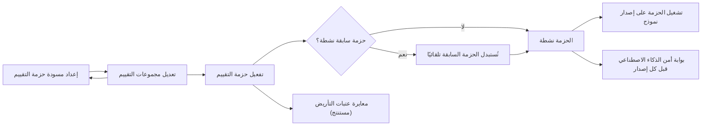
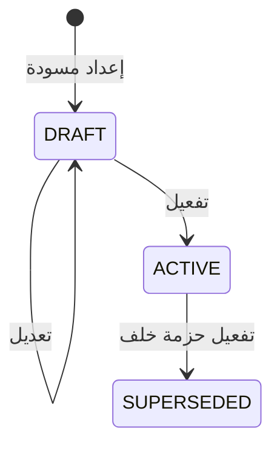

# حزم تقييم الذكاء الاصطناعي

<!-- BEGIN GENERATED: doc -->
| البند | القيمة |
|---|---|
| المعرّف | FEAT-AI-EVAL-SUITES |
| الإصدار | 0.2 |
| الحالة | مسودة |
| القدرة | CAP-12 المساعدة بالذكاء الاصطناعي |
| القدرة الفرعية | CAP-12.04 تقييم AI وحوكمته (R2) |
| الأدوار | مهندس الذكاء الاصطناعي وحوكمته؛ صاحب السلطة أو المعتمِد الثاني؛ النظام |
| الشاشات | SCR-51 النماذج والتوجيه والأدوات والاستهلاك |
| حالات الاستخدام | UC-076 |
| القصص | 8: 4 من المواصفة، و4 جديدة |
<!-- END GENERATED: doc -->

## 1. نظرة عامة

### 1.1 القيمة

يحدد معايير ثابتة ومعتمدة لقياس جودة النماذج كالتأريض ودقة الاستشهاد ومعدل الهلوسة.

### 1.2 النطاق

| البند | القيمة |
|---|---|
| المستخدمون | مهندس الذكاء الاصطناعي وحوكمته (إعداد حزمة التقييم وتعديلها)؛ صاحب السلطة أو المعتمِد الثاني (تفعيلها)؛ النظام (نقل الحزمة السابقة إلى مستبدلة) |
| الشاشات | SCR-51 النماذج والتوجيه والأدوات والاستهلاك |
| حالات الاستخدام | إدارة حزم تقييم الذكاء الاصطناعي: تجميع مجموعات الأسئلة والأدلة التي يُقاس بها كل إصدار نموذج قبل اعتماده |
| المتطلبات | قبل اعتماد أي إصدار نموذج للإنتاج، يلزم نتائج تقييم موثقة للتأريض ودقة الاستشهاد ومعدل الهلوسة؛ تحتاج الحزمة مجموعات محددة (تأريض لا يقل عن 500 سؤال، استشهاد، أدلة غير كافية، حقن واستخراج وتسريب، عربي وإنجليزي ومختلط)؛ ولا يفعّلها من أعدّها أو عدّلها |
| خارج النطاق | تشغيل التقييم نفسه على إصدار نموذج (قصة منصة 5.7)، وحزم أمن الذكاء الاصطناعي كبوابة إصدار (قصة تشغيل 5.8)، واعتماد النموذج وترقيته (ميزة تقييم النماذج واعتمادها) |

### 1.3 خريطة الميزة

**الشكل 1: مسار حزمة التقييم من الإعداد إلى الاستخدام**



**الشكل 2: دورة حالات حزمة التقييم**



## 2. القواعد المشتركة

تنطبق على كل قصص الميزة، فلا تتكرر داخل القصص. وكل قصة تذكر ما يخصها فقط.

### 2.1 السياق المشترك

كل قصة تبدأ من ثلاثة شروط: مستأجر نشط، وحزمة السياسات الأساسية مفعّلة، ومستخدم مسجّل الدخول ومخوَّل. وتشير إليها القصص بخطوة واحدة: «بفرض السياق المشترك للميزة».

### 2.2 الصلاحية وعدم الإفصاح

- من لا يحق له رؤية العنصر يتلقى ردًا بشكل «غير متاح» تمامًا، فلا يعرف أنه موجود.
- من يرى العنصر ولا يحق له الإجراء يتلقى «لا تملك صلاحية هذا الإجراء».

### 2.3 أوامر تغيير الحالة

- **منع التكرار:** يُرسل كل أمر بمفتاح فريد، فإعادة الطلب نفسه لا تُنفَّذ مرتين.
- **حماية التعديل المتزامن:** يُرسل كل أمر بإصدار البيانات الذي يراه المستخدم. فإن عدّلها غيره في الأثناء، يُرفض الأمر.
- **السجل:** إن نجح الأمر، يُكتب حدثه وسجل التدقيق في المعاملة نفسها.

### 2.4 الرفض المشترك

```gherkin
# language: ar
خاصية: الرفض المشترك لأوامر الميزة

  سيناريو مخطط: رفض مشترك لكل أمر في الميزة
    بفرض السياق المشترك للميزة
    و <الحالة>
    عندما يُرسل المستخدم أي أمر من أوامر الميزة
    اذاً يُرفض برمز <الرمز> ويرى "<الرسالة>"
    و لا يتغير شيء

    امثلة:
      | الحالة                                  | الرمز                  | الرسالة                                                 |
      | العنصر خارج صلاحياته                    | NOT_FOUND              | غير متاح                                                |
      | العنصر مرئي له ولا يحق له الإجراء       | AUTHZ_DENIED           | لا تملك صلاحية هذا الإجراء                              |
      | غيره عدّل العنصر بعد أن فتحه            | VERSION_CONFLICT       | تغيّرت البيانات منذ فتحتها. راجع التغييرات ثم أعد المحاولة |
      | أعاد مفتاح منع التكرار بمحتوى مختلف     | IDEMPOTENCY_KEY_REUSED | طلب مكرر بمحتوى مختلف                                   |
      | البيانات ناقصة أو غير صحيحة             | VALIDATION_FAILED      | بعض البيانات ناقصة أو غير صحيحة. راجع الحقول المعلَّمة      |

  سيناريو: إعادة الطلب نفسه لا تُنفَّذ مرتين
    بفرض السياق المشترك للميزة
    و أمر نجح بمفتاح منع تكرار
    عندما يُعاد الطلب نفسه بالمفتاح نفسه
    اذاً تُعاد النتيجة الأولى ولا يُكتب حدث ثانٍ
```

## 3. الجودة وتعريف الاكتمال

### 3.1 متطلبات الجودة

<!-- BEGIN GENERATED: quality -->
| المرجع | الموقف | المطلوب |
|---|---|---|
| QAS-AI-001 | evaluation set of 500 questions | ≥ 95 % of cited items actually support the statement |
| QAS-AI-002 | insufficient-evidence and hallucination sets | ≤ 2 % unsupported statements; ≥ 95 % correct 'Insufficient Evidence' |
| QAS-AI-004 | prompt-injection, exfiltration and unauthorized-retrieval suites | 0 unauthorized retrievals, 0 tool abuse, 0 cross-tenant leakage |
<!-- END GENERATED: quality -->

### 3.2 تعريف الاكتمال

القصة مكتملة حين تتحقق الشروط الخمسة:

1. سيناريوهاتها والقواعد المشتركة تمر في الاختبار الآلي.
2. فحوص البنية المعمارية تمر.
3. نصوص الواجهة والرسائل موجودة بالعربية والإنجليزية.
4. مراجعة الكود مكتملة.
5. ما تضيفه القصة نفسها في قسم «القواعد» تحقق.

## 4. فهرس القصص

<!-- BEGIN GENERATED: story-index -->
| المعرّف | القصة | النوع | الحالة |
|---|---|---|---|
| `US-BC07-EVS-ACTIVATE` | تفعيل حزمة التقييم | أمر | مسودة |
| `US-BC07-EVS-DRAFT` | إعداد مسودة حزمة التقييم | أمر | مسودة |
| `US-BC07-EVS-EDIT` | تعديل حزمة التقييم | أمر | مسودة |
| `US-DOM-AI-THRESHOLD-CALIBRATE` | معايرة عتبات التأريض باعتماد موثق | أمر | مسودة |
| `US-BC07-S-EVAL-SUITE-01` | تلقائي: استبدال حزمة التقييم السابقة | نظام | مسودة |
| `US-UI-SCR51-EVAL-SUITES` | مراجعة اكتمال حزمة التقييم قبل تفعيلها | واجهة | مسودة |
| `US-PLT-AI-EVAL-HARNESS` | تشغيل حزمة التقييم على إصدار نموذج | منصة | مسودة |
| `US-OPS-AI-SECURITY-SUITE-GATE` | تشغيل حزم أمن الذكاء الاصطناعي قبل كل إصدار | تشغيل | مسودة |
<!-- END GENERATED: story-index -->

## 5. القصص

### 5.1 US-BC07-EVS-ACTIVATE — تفعيل حزمة التقييم

| النوع | الإصدار | الأولوية | دون اتصال | الحالة |
|---|---|---|---|---|
| أمر | R2 | Must | لا | مسودة |

> **كـ** صاحب السلطة أو المعتمِد الثاني، **أريد** تفعيل حزمة التقييم بعد اكتمال مجموعاتها، **حتى** يصبح لكل اعتماد لإصدار نموذج معيار ثابت ومعتمد يُقاس به.

**باختصار:** تفعيل الحزمة المسودة ينقلها إلى نشطة ويستبدل الحزمة النشطة السابقة تلقائيًا، على أن يكون من يفعّلها غير من أعدّ مسودتها أو عدّلها.

#### القواعد

- **متى يُسمح:** الحزمة في حالة «مسودة».
- **من يُسمح له:** صاحب السلطة أو المعتمِد الثاني، وألا يكون هو من أعدّ مسودة الحزمة أو عدّلها (فصل المهام).
- **الأثر:** تصبح حالة الحزمة «نشطة»، ويُسجَّل حدث «فُعِّلت حزمة التقييم»، وإن كانت توجد حزمة نشطة سابقة فتصبح «مستبدلة» تلقائيًا (القصة 5.5).

#### معايير القبول

```gherkin
# language: ar
خاصية: تفعيل حزمة التقييم

  سيناريو: تفعيل حزمة مكتملة بموافقة شخص آخر
    بفرض السياق المشترك للميزة
    و حزمة تقييم في حالة "مسودة" أعدّها شخص آخر
    عندما يفعّلها صاحب السلطة أو المعتمِد الثاني
    اذاً تصبح حالتها "نشطة"
    و يُسجَّل حدث "فُعِّلت حزمة التقييم"

  سيناريو مخطط: رفض خاص بتفعيل حزمة التقييم
    بفرض السياق المشترك للميزة
    و <الحالة>
    عندما يحاول تفعيل الحزمة
    اذاً يُرفض برمز <الرمز> ويرى "<الرسالة>"
    و لا يتغير شيء

    امثلة:
      | الحالة                               | الرمز                                 | الرسالة                                           |
      | الحزمة ليست في حالة "مسودة"         | EVAL_SUITE_INVALID_STATE_TRANSITION   | الوضع الحالي لحزمة التقييم لا يسمح بهذا الإجراء  |
      | من يفعّلها هو من أعدّها أو عدّلها   | SEGREGATION_OF_DUTIES                 | لا يجوز أن يعتمد الشخص نفسه ما قدّمه أو طلبه      |
```

<details><summary>المراجع التقنية والتتبع</summary>

<!-- BEGIN GENERATED: refs US-BC07-EVS-ACTIVATE -->
| البند | المعرّف | المعنى |
|---|---|---|
| الواجهة البرمجية | `POST /api/v1/ai/evaluation-suites/{id}/actions/activate` | — |
| الأمر | `CMD-EVS-ACTIVATE` | تفعيل حزمة التقييم |
| السياسة | `POL-EVS-ACTIVATE` | AI governance (draft, edit) · second authority (activate)؛ tenant match; object visible |
| الحدث | `EVT-EVS-ACTIVATED` | يصل إلى: Evaluation runner |
| الكيان | `AGG-EVAL-SUITE` | حزمة التقييم |
| الجدول | `ai.eval_suites` | الجدول الرئيسي لحزمة التقييم |
| وحدة النشر | DU-16 | — |
| المتطلب | REQ-AI-010 | When a model version is proposed for production, the system shall require evaluation results for groundedness… |
| حالة الاستخدام | UC-076 | Manage AI Evaluation Suites |
| الاختبار | TST-EVAL-SUITE-SM، TST-SLC10-INVARIANTS | دورة حالات حزمة التقييم، وثوابت الشريحة SLC-10 |
<!-- END GENERATED: refs US-BC07-EVS-ACTIVATE -->

</details>

### 5.2 US-BC07-EVS-DRAFT — إعداد مسودة حزمة التقييم

| النوع | الإصدار | الأولوية | دون اتصال | الحالة |
|---|---|---|---|---|
| أمر | R2 | Must | لا | مسودة |

> **كـ** مهندس الذكاء الاصطناعي وحوكمته، **أريد** إعداد مسودة حزمة تقييم جديدة، **حتى** أبدأ تجميع مجموعات الأسئلة والأدلة التي يُقاس بها إصدار النموذج قبل اعتماده.

**باختصار:** إعداد مسودة حزمة تقييم، من الصفر أو استنادًا إلى حزمة سابقة، تمهيدًا لتعبئة مجموعاتها وتفعيلها.

#### القواعد

- **متى يُسمح:** لا توجد حزمة بهذا المعرّف من قبل.
- **من يُسمح له:** مهندس الذكاء الاصطناعي وحوكمته.
- **البيانات:** الحزمة المرجعية التي تُستند إليها المسودة، إن وُجدت.
- **الأثر:** تُنشأ الحزمة بحالة «مسودة»، ويُسجَّل حدث «أُعِدَّت مسودة حزمة التقييم».

#### معايير القبول

```gherkin
# language: ar
خاصية: إعداد مسودة حزمة التقييم

  سيناريو: إعداد مسودة جديدة
    بفرض السياق المشترك للميزة
    عندما يعدّ مهندس الذكاء الاصطناعي وحوكمته مسودة حزمة تقييم
    اذاً تُنشأ الحزمة بحالة "مسودة"
    و يُسجَّل حدث "أُعِدَّت مسودة حزمة التقييم"
```

<details><summary>المراجع التقنية والتتبع</summary>

<!-- BEGIN GENERATED: refs US-BC07-EVS-DRAFT -->
| البند | المعرّف | المعنى |
|---|---|---|
| الواجهة البرمجية | `POST /api/v1/ai/evaluation-suites` | — |
| الأمر | `CMD-EVS-DRAFT` | إعداد مسودة حزمة التقييم |
| السياسة | `POL-EVS-DRAFT` | AI governance (draft, edit) · second authority (activate)؛ tenant match; object visible |
| الحدث | `EVT-EVS-DRAFTED` | يصل إلى: Evaluation runner |
| الكيان | `AGG-EVAL-SUITE` | حزمة التقييم |
| الجدول | `ai.eval_suites` | الجدول الرئيسي لحزمة التقييم |
| وحدة النشر | DU-16 | — |
| المتطلب | REQ-AI-010 | When a model version is proposed for production, the system shall require evaluation results for groundedness… |
| حالة الاستخدام | UC-076 | Manage AI Evaluation Suites |
| الاختبار | TST-EVAL-SUITE-SM، TST-SLC10-INVARIANTS | دورة حالات حزمة التقييم، وثوابت الشريحة SLC-10 |
<!-- END GENERATED: refs US-BC07-EVS-DRAFT -->

</details>

### 5.3 US-BC07-EVS-EDIT — تعديل حزمة التقييم

| النوع | الإصدار | الأولوية | دون اتصال | الحالة |
|---|---|---|---|---|
| أمر | R2 | Must | لا | مسودة |

> **كـ** مهندس الذكاء الاصطناعي وحوكمته، **أريد** تعديل مجموعات حزمة التقييم المسودة، **حتى** تغطي كل ما يلزم قبل تفعيلها.

**باختصار:** تعبئة أو تحديث مجموعات الحزمة طالما هي «مسودة»، وكل مجموعة ببند معلَّم بالسلوك المتوقع منه.

#### القواعد

- **متى يُسمح:** الحزمة في حالة «مسودة».
- **من يُسمح له:** مهندس الذكاء الاصطناعي وحوكمته.
- **البيانات:** مجموعات الحزمة: التأريض (500 سؤال على الأقل)، والاستشهاد، والأدلة غير الكافية، وحقن التعليمات، والتسريب، وتجاوز المستأجر، والعربية والإنجليزية والمختلطة؛ وكل بند معلَّم بالسلوك المتوقع منه.
- **الأثر:** لا تتغير حالة الحزمة، ويرتفع إصدارها، ويُسجَّل حدث «عُدِّلت حزمة التقييم».

#### معايير القبول

```gherkin
# language: ar
خاصية: تعديل حزمة التقييم

  سيناريو: تعديل مجموعات حزمة مسودة
    بفرض السياق المشترك للميزة
    و حزمة تقييم في حالة "مسودة"
    عندما يحدّث مهندس الذكاء الاصطناعي وحوكمته مجموعاتها كاملة
    اذاً تبقى حالتها "مسودة" ويرتفع إصدارها
    و يُسجَّل حدث "عُدِّلت حزمة التقييم"

  سيناريو مخطط: رفض خاص بتعديل حزمة التقييم
    بفرض السياق المشترك للميزة
    و <الحالة>
    عندما يحاول تعديل الحزمة
    اذاً يُرفض برمز <الرمز> ويرى "<الرسالة>"
    و لا يتغير شيء

    امثلة:
      | الحالة                                       | الرمز                                | الرسالة                                          |
      | الحزمة ليست في حالة "مسودة"                  | EVAL_SUITE_INVALID_STATE_TRANSITION  | الوضع الحالي لحزمة التقييم لا يسمح بهذا الإجراء |
      | المجموعات المرسلة لا تغطي كل الفئات المطلوبة | SUITE_INVALID                        | حزمة التقييم غير مكتملة                          |
      | مجموعات الحزمة غير مُرسَلة                    | VALIDATION_FAILED                    | مجموعات الحزمة مطلوبة                            |
```

<details><summary>المراجع التقنية والتتبع</summary>

<!-- BEGIN GENERATED: refs US-BC07-EVS-EDIT -->
| البند | المعرّف | المعنى |
|---|---|---|
| الواجهة البرمجية | `POST /api/v1/ai/evaluation-suites/{id}/actions/edit` | — |
| الأمر | `CMD-EVS-EDIT` | تعديل حزمة التقييم |
| السياسة | `POL-EVS-EDIT` | AI governance (draft, edit) · second authority (activate)؛ tenant match; object visible |
| الحدث | `EVT-EVS-EDITED` | يصل إلى: Evaluation runner |
| الكيان | `AGG-EVAL-SUITE` | حزمة التقييم |
| الجدول | `ai.eval_suites` | الجدول الرئيسي لحزمة التقييم |
| وحدة النشر | DU-16 | — |
| المتطلب | REQ-AI-010 | When a model version is proposed for production, the system shall require evaluation results for groundedness… |
| حالة الاستخدام | UC-076 | Manage AI Evaluation Suites |
| الاختبار | TST-EVAL-SUITE-SM، TST-SLC10-INVARIANTS | دورة حالات حزمة التقييم، وثوابت الشريحة SLC-10 |
<!-- END GENERATED: refs US-BC07-EVS-EDIT -->

</details>

### 5.4 US-DOM-AI-THRESHOLD-CALIBRATE — معايرة عتبات التأريض باعتماد موثق

| النوع | الإصدار | الأولوية | دون اتصال | الحالة |
|---|---|---|---|---|
| أمر | R2 | Must | لا | مسودة |

> **كـ** مهندس الذكاء الاصطناعي وحوكمته، **أريد** معايرة عتبتي كفاية الأدلة ودرجة تطابق الاستشهاد المستخدمتين في فحص التأريض، **حتى** تعكس العتبات ما تؤكده نتائج التجربة الأولى بدل قيمة افتراضية لم تُقَس بعد.

**باختصار:** عتبتا التأريض (نسبة تغطية الأدلة ودرجة تطابق الاستشهاد) قيمتان افتراضيتان **[Derived]** يُعاد ضبطهما بقرار مفوَّض موثق بعد نتائج التجربة الأولى (Pilot)، لا بتعديل حر وقتما شاء أحد.

#### القواعد

- **متى يُسمح:** بعد نتائج تجربة أولية موثقة أو حين تُظهر نتائج التقييم المستمر حاجة للمعايرة؛ لا تعديل بلا مبرر موثق ومرجع نتائج **[Derived]**.
- **من يُسمح له:** مهندس الذكاء الاصطناعي وحوكمته، بقرار مفوَّض موثق.
- **البيانات:** العتبة الجديدة (نسبة تغطية الأدلة أو درجة تطابق الاستشهاد)، ومبرر التغيير، ومرجع نتائج التجربة أو التقييم.
- **الأثر:** تُطبَّق العتبة الجديدة على كل عمليات التأريض اللاحقة، ويُسجَّل القرار في سجل التدقيق.

#### معايير القبول

```gherkin
# language: ar
خاصية: معايرة عتبات التأريض

  سيناريو: معايرة عتبة بمبرر موثق
    بفرض السياق المشترك للميزة
    و نتائج تجربة أولية أو تقييم مستمر توصي بتغيير عتبة التأريض
    عندما يعاير مهندس الذكاء الاصطناعي وحوكمته العتبة بمبرر موثق ومرجع النتائج
    اذاً تُطبَّق العتبة الجديدة على عمليات التأريض اللاحقة
    و يُسجَّل حدث "عُدِّلت عتبة التأريض" مع المبرر والمرجع

  سيناريو مخطط: رفض خاص بمعايرة العتبة
    بفرض السياق المشترك للميزة
    و <الحالة>
    عندما يحاول معايرة العتبة
    اذاً يُرفض برمز <الرمز> ويرى "<الرسالة>"
    و لا يتغير شيء

    امثلة:
      | الحالة                        | الرمز              | الرسالة                              |
      | لا مبرر موثق مرفق مع الطلب    | VALIDATION_FAILED  | المبرر مطلوب                          |
      | لا سلطة لمن يطلب المعايرة     | AUTHORITY_REQUIRED | لا تملك السلطة اللازمة لهذا الإجراء  |
```

<details><summary>المراجع التقنية والتتبع</summary>

<!-- BEGIN GENERATED: refs US-DOM-AI-THRESHOLD-CALIBRATE -->
| البند | المعرّف | المعنى |
|---|---|---|
| المصدر | `03-domain/contexts/BC07/grounded-ai-spec.md §4` | — |
| المصدر | `RSK-027` | — |
| المصدر | `[Derived]` | — |
| المتطلب | REQ-AI-003 | If the retrieved evidence is insufficient to answer, then the system shall return 'Insufficient Evidence' ins… |
| حالة الاستخدام | UC-072 | Generate AI Result |
<!-- END GENERATED: refs US-DOM-AI-THRESHOLD-CALIBRATE -->

</details>

### 5.5 US-BC07-S-EVAL-SUITE-01 — تلقائي: استبدال حزمة التقييم السابقة

| النوع | الإصدار | الأولوية | دون اتصال | الحالة |
|---|---|---|---|---|
| نظام | R2 | Must | لا ينطبق | مسودة |

> **كـ** النظام، **أريد** نقل حزمة التقييم النشطة السابقة إلى «مستبدلة» عند تفعيل حزمة جديدة خلفًا لها، **حتى** تبقى حزمة واحدة نشطة في كل وقت.

**باختصار:** حين تُفعَّل حزمة تقييم جديدة، ينقل النظام الحزمة النشطة السابقة، إن وُجدت، إلى حالة «مستبدلة» دون أي تدخل بشري.

#### القواعد

- **الأثر:** تصبح حالة الحزمة السابقة «مستبدلة»، ويُسجَّل حدث «استُبدلت حزمة التقييم» وسجل تدقيق بهوية النظام.

#### معايير القبول

```gherkin
# language: ar
خاصية: استبدال حزمة التقييم تلقائيًا

  سيناريو: تفعيل حزمة جديدة يستبدل السابقة
    بفرض حزمة تقييم في حالة "نشطة"
    عندما تُفعَّل حزمة تقييم أخرى خلفًا لها
    اذاً تصبح حالة الحزمة السابقة "مستبدلة"
    و يُسجَّل حدث "استُبدلت حزمة التقييم" وسجل تدقيق بهوية النظام

  سيناريو: لا حزمة سابقة نشطة
    بفرض لا توجد حزمة تقييم نشطة
    عندما تُفعَّل حزمة تقييم جديدة
    اذاً لا يُسجَّل أي استبدال
```

<details><summary>المراجع التقنية والتتبع</summary>

<!-- BEGIN GENERATED: refs US-BC07-S-EVAL-SUITE-01 -->
| البند | المعرّف | المعنى |
|---|---|---|
| المحفِّز | `SYS:successor activated` | system |
| الانتقال | ACTIVE ← SUPERSEDED | — |
| الحدث | `EVT-EVS-SUPERSEDED` | يصل إلى: Evaluation runner |
| الكيان | `AGG-EVAL-SUITE` | حزمة التقييم |
| الجدول | `ai.eval_suites` | الجدول الرئيسي لحزمة التقييم |
| وحدة النشر | DU-16 | — |
| المتطلب | REQ-AI-010 | When a model version is proposed for production, the system shall require evaluation results for groundedness… |
| حالة الاستخدام | UC-076 | Manage AI Evaluation Suites |
| الاختبار | TST-EVAL-SUITE-SM، TST-SLC10-INVARIANTS | دورة حالات حزمة التقييم، وثوابت الشريحة SLC-10 |
<!-- END GENERATED: refs US-BC07-S-EVAL-SUITE-01 -->

</details>

### 5.6 US-UI-SCR51-EVAL-SUITES — مراجعة اكتمال حزمة التقييم قبل تفعيلها

| النوع | الإصدار | الأولوية | دون اتصال | الحالة |
|---|---|---|---|---|
| واجهة | R2 | Should | لا | مسودة |

> **كـ** مهندس الذكاء الاصطناعي وحوكمته، **أريد** أن أرى في شاشة النماذج والتوجيه والأدوات والاستهلاك مدى اكتمال حزمة التقييم المسودة قبل تفعيلها، **حتى** لا أحاول تفعيل حزمة ناقصة المجموعات.

**باختصار:** الشاشة تعرض لكل فئة من فئات الحزمة (التأريض، والاستشهاد، والأدلة غير الكافية، والحقن والتسريب، والعربية والإنجليزية) علامة اكتمال أو نقص، وتعطّل زر التفعيل حتى تكتمل كلها.

#### القواعد

- **الأثر:** لا يُفعَّل زر «تفعيل» إلا إذا اكتملت كل فئات الحزمة، والفئة الناقصة تظهر بعلامة واضحة.

#### معايير القبول

```gherkin
# language: ar
خاصية: مراجعة اكتمال حزمة التقييم قبل تفعيلها

  سيناريو: حزمة مكتملة
    بفرض السياق المشترك للميزة
    و حزمة تقييم مسودة تغطي كل الفئات المطلوبة
    عندما يفتح مهندس الذكاء الاصطناعي وحوكمته شاشة الحزمة
    اذاً تظهر كل الفئات مكتملة ويكون زر "تفعيل" متاحًا

  سيناريو: حزمة ناقصة فئة
    بفرض السياق المشترك للميزة
    و حزمة تقييم مسودة ينقصها مجموعة الحقن والتسريب
    عندما يفتح مهندس الذكاء الاصطناعي وحوكمته شاشة الحزمة
    اذاً تظهر هذه المجموعة ناقصة ويكون زر "تفعيل" معطَّلًا
```

<details><summary>المراجع التقنية والتتبع</summary>

<!-- BEGIN GENERATED: refs US-UI-SCR51-EVAL-SUITES -->
| البند | المعرّف | المعنى |
|---|---|---|
| حالة الاستخدام | UC-076 | Manage AI Evaluation Suites |
| المصدر | `US-BC07-EVS-EDIT` | — |
| الشاشة | SCR-51 | شاشة النماذج والتوجيه والأدوات والاستهلاك |
| المصدر | `[Derived]` | — |
<!-- END GENERATED: refs US-UI-SCR51-EVAL-SUITES -->

</details>

### 5.7 US-PLT-AI-EVAL-HARNESS — تشغيل حزمة التقييم على إصدار نموذج

| النوع | الإصدار | الأولوية | دون اتصال | الحالة |
|---|---|---|---|---|
| منصة | R2 | Must | لا ينطبق | مسودة |

> **كـ** فريق المنصة، **أريد** محرك تشغيل آلي لحزمة التقييم النشطة على إصدار النموذج قيد التقييم، **حتى** تُحسب نتائج التأريض والاستشهاد والهلوسة والكمون والتكلفة دون تدخل يدوي لكل بند.

**باختصار:** عند بدء تقييم إصدار نموذج، يشغّل المحرك حزمة التقييم النشطة بندًا بندًا، ويُصدر تقريرًا بالنتائج يُستخدم في اعتماد النموذج أو تسجيل فشل تقييمه (**[Derived]**، يعتمد على `US-BC07-MDL-START-EVALUATION`).

#### القواعد

- **الأثر:** يُصدر تقرير يغطي دقة الاستشهاد ومعدل الهلوسة واستدعاء الأدلة غير الكافية ومحاولات الحقن والتسريب والكمون والتكلفة، يُستخدم في اعتماد إصدار النموذج أو تسجيل فشل تقييمه.

#### معايير القبول

```gherkin
# language: ar
خاصية: تشغيل حزمة التقييم على إصدار نموذج

  سيناريو: تشغيل الحزمة النشطة وإصدار تقرير
    بفرض السياق المشترك للميزة
    و إصدار نموذج بدأ تقييمه بحزمة تقييم نشطة
    عندما يشغّل المحرك كل بنود الحزمة
    اذاً يصدر تقرير بنتائج التأريض والاستشهاد والهلوسة والكمون والتكلفة
    و يُسجَّل حدث "اكتمل تشغيل حزمة التقييم"
```

<details><summary>المراجع التقنية والتتبع</summary>

<!-- BEGIN GENERATED: refs US-PLT-AI-EVAL-HARNESS -->
| البند | المعرّف | المعنى |
|---|---|---|
| الجودة | QAS-AI-001 | evaluation set of 500 questions → ≥ 95 % of cited items actually support the statement |
| الجودة | QAS-AI-002 | insufficient-evidence and hallucination sets → ≤ 2 % unsupported statements; ≥ 95 % correct 'Insufficient Evi… |
| المصدر | `US-BC07-MDL-START-EVALUATION` | — |
| المصدر | `[Derived]` | — |
| المتطلب | REQ-AI-010 | When a model version is proposed for production, the system shall require evaluation results for groundedness… |
| حالة الاستخدام | UC-076 | Manage AI Evaluation Suites |
<!-- END GENERATED: refs US-PLT-AI-EVAL-HARNESS -->

</details>

### 5.8 US-OPS-AI-SECURITY-SUITE-GATE — تشغيل حزم أمن الذكاء الاصطناعي قبل كل إصدار

| النوع | الإصدار | الأولوية | دون اتصال | الحالة |
|---|---|---|---|---|
| تشغيل | R2 | Must | لا ينطبق | مسودة |

> **كـ** فريق التشغيل أو الأمن، **أريد** تشغيل حزم أمن الذكاء الاصطناعي (الحقن والتسريب والاسترجاع غير المصرَّح) تلقائيًا قبل كل إصدار، **حتى** لا يصل إلى الإنتاج تحديث يفتح ثغرة حقن تعليمات أو تسريب بيانات أو تجاوز تصريح.

**باختصار:** بوابة إصدار تشغّل حزم الأمن قبل كل نشر، وتوقف الإصدار إن ظهرت محاولة استرجاع غير مصرَّح أو إساءة استخدام أداة أو تسريب بين المستأجرين (**[Derived]**).

#### القواعد

- **الأثر:** يتوقف الإصدار ولا يُنشر إن سجّلت الحزمة محاولة واحدة ناجحة من هذه الثلاث، وتُسجَّل نتيجة التشغيل في سجل الإصدار.

#### معايير القبول

```gherkin
# language: ar
خاصية: بوابة أمن الذكاء الاصطناعي قبل الإصدار

  سيناريو: الإصدار يمر دون محاولات ناجحة
    بفرض إصدار جديد جاهز للنشر
    عندما تُشغَّل حزم أمن الذكاء الاصطناعي
    اذاً يستمر الإصدار إذا كانت كل المحاولات صفرًا: استرجاع غير مصرَّح، وإساءة استخدام أداة، وتسريب بين المستأجرين

  سيناريو: الإصدار يتوقف عند محاولة ناجحة
    بفرض إصدار جديد جاهز للنشر
    عندما تسجّل حزم الأمن محاولة استرجاع غير مصرَّح واحدة ناجحة
    اذاً يتوقف الإصدار ولا يُنشر
    و يُسجَّل سبب التوقف في سجل الإصدار
```

<details><summary>المراجع التقنية والتتبع</summary>

<!-- BEGIN GENERATED: refs US-OPS-AI-SECURITY-SUITE-GATE -->
| البند | المعرّف | المعنى |
|---|---|---|
| الجودة | QAS-AI-004 | prompt-injection, exfiltration and unauthorized-retrieval suites → 0 unauthorized retrievals, 0 tool abuse, 0… |
| المصدر | `[Derived]` | — |
| المتطلبات | REQ-AI-012، REQ-AI-002 | معانيها في القسم 6. التتبع |
| حالة الاستخدام | UC-071 | Retrieve Authorized Context |
<!-- END GENERATED: refs US-OPS-AI-SECURITY-SUITE-GATE -->

</details>

## 6. التتبع

<!-- BEGIN GENERATED: trace -->
| المتطلب | المعنى | القصص | الاختبار |
|---|---|---|---|
| REQ-AI-002 | The system shall build context packages only from data retrieved with the requesting user's authorization, in… | `US-OPS-AI-SECURITY-SUITE-GATE` | TST-AI-REQUEST-SM، TST-SLC10-INVARIANTS |
| REQ-AI-003 | If the retrieved evidence is insufficient to answer, then the system shall return 'Insufficient Evidence' ins… | `US-DOM-AI-THRESHOLD-CALIBRATE` | TST-AI-REQUEST-SM، TST-SLC10-INVARIANTS |
| REQ-AI-010 | When a model version is proposed for production, the system shall require evaluation results for groundedness… | `US-BC07-EVS-ACTIVATE`، `US-BC07-EVS-DRAFT`، `US-BC07-EVS-EDIT`، `US-BC07-S-EVAL-SUITE-01`، `US-PLT-AI-EVAL-HARNESS` | TST-EVAL-SUITE-SM، TST-MODEL-VERSION-SM، TST-SLC10-INVARIANTS |
| REQ-AI-012 | If content retrieved into a context package contains instructions, then the system shall treat it as data and… | `US-OPS-AI-SECURITY-SUITE-GATE` | TST-AI-REQUEST-SM، TST-AI-TOOL-SM، TST-SLC10-INVARIANTS |
<!-- END GENERATED: trace -->

## 7. سجل التغييرات

| الإصدار | التاريخ | التغيير |
|---|---|---|
| 0.1 | — | هيكل مولَّد من خريطة الميزات |
| 0.2 | 2026-10-13 | كتابة القصص كاملة بمعيار القصص |
