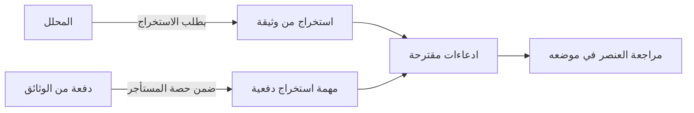

# استخراج المعلومات من الوثائق

<!-- BEGIN GENERATED: doc -->
| البند | القيمة |
|---|---|
| المعرّف | FEAT-AI-EXTRACTION |
| الإصدار | 0.2 |
| الحالة | مسودة |
| القدرة | CAP-12 المساعدة بالذكاء الاصطناعي |
| القدرة الفرعية | CAP-12.03 الاستخراج والترجمة (R2) |
| الأدوار | المحلل؛ المراجع |
| الشاشات | SCR-22 الادعاء والدليل والمصدر، SCR-46 مراجعة نتيجة ذكية |
| حالات الاستخدام | UC-072، UC-073 |
| القصص | 3: 0 من المواصفة، و3 جديدة |
<!-- END GENERATED: doc -->

## 1. نظرة عامة

### 1.1 القيمة

يوفر على المحلل الجهد باستخراج الكيانات والأماكن والتواريخ من الوثائق كادعاءات مقترحة تنتظر قبوله.

### 1.2 النطاق

| البند | القيمة |
|---|---|
| المستخدمون | المحلل يطلب الاستخراج من وثيقة؛ المراجع يراجع العناصر المستخرجة؛ فريق المنصة يشغّل الدفعات |
| الشاشات | شاشة الادعاء والدليل والمصدر (SCR-22)، شاشة مراجعة نتيجة ذكية (SCR-46) |
| حالات الاستخدام بالكلمات | طلب استخراج الكيانات والأماكن والتواريخ من وثيقة، ومراجعة كل عنصر مستخرج في موضعه من الوثيقة، وتشغيل الاستخراج دفعيًا بحصص المستأجر |
| المتطلبات بالكلمات | كل استخراج ينشئ ادعاءات مقترحة مصدرها الوثيقة وعاملها النموذج، تنتظر مراجعة بشرية قبل أن تصبح ادعاءات مثبّتة |
| خارج النطاق | قبول الادعاءات المقترحة أو رفضها رسميًا (ميزة مراجعة نتيجة ذكية)؛ ترجمة النصوص المستخرجة (ميزة الترجمة) |

### 1.3 خريطة الميزة

**الشكل 1: مسار استخراج المعلومات من الوثائق**



## 2. القواعد المشتركة

تنطبق على كل قصص الميزة، فلا تتكرر داخل القصص. وكل قصة تذكر ما يخصها فقط.

### 2.1 السياق المشترك

كل قصة تبدأ من ثلاثة شروط: مستأجر نشط، وحزمة السياسات الأساسية مفعّلة، ومستخدم مسجّل الدخول ومخوَّل. وتشير إليها القصص بخطوة واحدة: «بفرض السياق المشترك للميزة».

### 2.2 الصلاحية وعدم الإفصاح

- من لا يحق له رؤية العنصر يتلقى ردًا بشكل «غير متاح» تمامًا، فلا يعرف أنه موجود.
- من يرى العنصر ولا يحق له الإجراء يتلقى «لا تملك صلاحية هذا الإجراء».

### 2.3 أوامر تغيير الحالة

- **منع التكرار:** يُرسل كل أمر بمفتاح فريد، فإعادة الطلب نفسه لا تُنفَّذ مرتين.
- **حماية التعديل المتزامن:** يُرسل كل أمر بإصدار البيانات الذي يراه المستخدم. فإن عدّلها غيره في الأثناء، يُرفض الأمر.
- **السجل:** إن نجح الأمر، يُكتب حدثه وسجل التدقيق في المعاملة نفسها.

### 2.4 الرفض المشترك

```gherkin
# language: ar
خاصية: الرفض المشترك لأوامر الميزة

  سيناريو مخطط: رفض مشترك لكل أمر في الميزة
    بفرض السياق المشترك للميزة
    و <الحالة>
    عندما يُرسل المستخدم أي أمر من أوامر الميزة
    اذاً يُرفض برمز <الرمز> ويرى "<الرسالة>"
    و لا يتغير شيء

    امثلة:
      | الحالة                                  | الرمز                  | الرسالة                                                 |
      | العنصر خارج صلاحياته                    | NOT_FOUND              | غير متاح                                                |
      | العنصر مرئي له ولا يحق له الإجراء       | AUTHZ_DENIED           | لا تملك صلاحية هذا الإجراء                              |
      | غيره عدّل العنصر بعد أن فتحه            | VERSION_CONFLICT       | تغيّرت البيانات منذ فتحتها. راجع التغييرات ثم أعد المحاولة |
      | أعاد مفتاح منع التكرار بمحتوى مختلف     | IDEMPOTENCY_KEY_REUSED | طلب مكرر بمحتوى مختلف                                   |
      | البيانات ناقصة أو غير صحيحة             | VALIDATION_FAILED      | بعض البيانات ناقصة أو غير صحيحة. راجع الحقول المعلَّمة      |

  سيناريو: إعادة الطلب نفسه لا تُنفَّذ مرتين
    بفرض السياق المشترك للميزة
    و أمر نجح بمفتاح منع تكرار
    عندما يُعاد الطلب نفسه بالمفتاح نفسه
    اذاً تُعاد النتيجة الأولى ولا يُكتب حدث ثانٍ
```

## 3. الجودة وتعريف الاكتمال

### 3.1 متطلبات الجودة

<!-- BEGIN GENERATED: quality -->
لا متطلبات جودة مرتبطة بمتطلبات هذه الميزة مباشرة. تنطبق متطلبات المنصة العامة (`FEAT-PLT-*`).
<!-- END GENERATED: quality -->

### 3.2 تعريف الاكتمال

القصة مكتملة حين تتحقق الشروط الخمسة:

1. سيناريوهاتها والقواعد المشتركة تمر في الاختبار الآلي.
2. فحوص البنية المعمارية تمر.
3. نصوص الواجهة والرسائل موجودة بالعربية والإنجليزية.
4. مراجعة الكود مكتملة.
5. ما تضيفه القصة نفسها في قسم «القواعد» تحقق.

## 4. فهرس القصص

<!-- BEGIN GENERATED: story-index -->
| المعرّف | القصة | النوع | الحالة |
|---|---|---|---|
| `US-UI-SCR22-AI-EXTRACT` | طلب استخراج الكيانات من وثيقة | واجهة | مسودة |
| `US-UI-SCR46-EXTRACT-ITEMS` | مراجعة المستخرج مقابل موضعه في الوثيقة | واجهة | مسودة |
| `US-PLT-AI-EXTRACTION-BATCH` | استخراج دفعي من الوثائق بحصص المستأجر | منصة | مسودة |
<!-- END GENERATED: story-index -->

## 5. القصص

### 5.1 US-UI-SCR22-AI-EXTRACT — طلب استخراج الكيانات من وثيقة

| النوع | الإصدار | الأولوية | دون اتصال | الحالة |
|---|---|---|---|---|
| واجهة | R2 | Must | لا | مسودة |

> **كـ** المحلل، **أريد** طلب استخراج الكيانات والأماكن والتواريخ من وثيقة، **حتى** أوفر وقت التسجيل اليدوي وأحصل على ادعاءات مقترحة أراجعها.

**باختصار:** يطلب المحلل استخراجًا من وثيقة مرئية له، فيستخرج الذكاء الاصطناعي الكيانات والأماكن والتواريخ كادعاءات مقترحة مصدرها الوثيقة وعاملها نموذج الذكاء الاصطناعي، تنتظر مراجعة بشرية.

#### القواعد

- **متى يحدث:** الوثيقة مرئية للمحلل ومصنّفة ضمن تصريحه.
- **من يُسمح له:** المحلل المخوَّل على الوثيقة.
- **الأثر:** تُنشأ ادعاءات مقترحة مصدرها الوثيقة وعاملها النموذج، بانتظار مراجعة بشرية قبل أن تُثبَّت.

#### معايير القبول

```gherkin
# language: ar
خاصية: طلب استخراج الكيانات من وثيقة

  سيناريو: استخراج من وثيقة مرئية
    بفرض السياق المشترك للميزة
    و وثيقة يحق للمحلل رؤيتها فيها كيانات وأماكن وتواريخ
    عندما يطلب المحلل استخراجها
    اذاً تُنشأ ادعاءات مقترحة مصدرها الوثيقة وعاملها النموذج
    و تنتظر الادعاءات مراجعة بشرية قبل أن تُثبَّت
```

<details><summary>المراجع التقنية والتتبع</summary>

<!-- BEGIN GENERATED: refs US-UI-SCR22-AI-EXTRACT -->
| البند | المعرّف | المعنى |
|---|---|---|
| المصدر | `10-ai/autonomy-matrix.md AI-OP-04` | — |
| الشاشة | SCR-22 | شاشة الادعاء والدليل والمصدر |
| المتطلب | REQ-AI-006 | When AI extracts entities, locations or dates from a document, the system shall create proposed claims whose… |
| حالات الاستخدام | UC-072، UC-073 | Generate AI Result؛ Review AI Result |
<!-- END GENERATED: refs US-UI-SCR22-AI-EXTRACT -->

</details>

### 5.2 US-UI-SCR46-EXTRACT-ITEMS — مراجعة المستخرج مقابل موضعه في الوثيقة

| النوع | الإصدار | الأولوية | دون اتصال | الحالة |
|---|---|---|---|---|
| واجهة | R2 | Must | لا | مسودة |

> **كـ** المراجع، **أريد** أن أرى كل عنصر مستخرج في موضعه من الوثيقة الأصلية، **حتى** أتحقق من صحته قبل أن أقبله كادعاء مثبّت.

**باختصار:** شاشة مراجعة نتيجة ذكية تعرض كل عنصر مستخرج إلى جانب موضعه في نص الوثيقة، فيقبل المراجع العناصر الصحيحة كلها أو بعضها أو يرفضها.

#### القواعد

- **الأثر:** عرض فقط؛ قبول العناصر أو رفضها فعليًا قصة أخرى في نتيجة الذكاء الاصطناعي.

#### معايير القبول

```gherkin
# language: ar
خاصية: مراجعة المستخرج مقابل موضعه في الوثيقة

  سيناريو: عرض العنصر المستخرج مع موضعه
    بفرض السياق المشترك للميزة
    و نتيجة استخراج مقترحة فيها عناصر لها مواضع في الوثيقة
    عندما يفتح المراجع عنصرًا مستخرجًا
    اذاً يُعرض موضعه داخل نص الوثيقة الأصلية بجانب قيمته المستخرجة

  سيناريو: عنصر بلا موضع محدد
    بفرض السياق المشترك للميزة
    و عنصر مستخرج بلا موضع محدد في الوثيقة
    عندما يفتحه المراجع
    اذاً تُعرض قيمته دون تمييز موضع، ويبقى قابلًا للمراجعة
```

<details><summary>المراجع التقنية والتتبع</summary>

<!-- BEGIN GENERATED: refs US-UI-SCR46-EXTRACT-ITEMS -->
| البند | المعرّف | المعنى |
|---|---|---|
| المصدر | `13-verification/acceptance/SLC-10/invariants-slc10.md` | — |
| الشاشة | SCR-46 | شاشة مراجعة نتيجة ذكية |
| المصدر | `[Derived]` | — |
| المتطلب | REQ-AI-006 | When AI extracts entities, locations or dates from a document, the system shall create proposed claims whose… |
| حالات الاستخدام | UC-072، UC-073 | Generate AI Result؛ Review AI Result |
<!-- END GENERATED: refs US-UI-SCR46-EXTRACT-ITEMS -->

</details>

### 5.3 US-PLT-AI-EXTRACTION-BATCH — استخراج دفعي من الوثائق بحصص المستأجر

| النوع | الإصدار | الأولوية | دون اتصال | الحالة |
|---|---|---|---|---|
| منصة | R2 | Must | لا ينطبق | مسودة |

> **كـ** فريق المنصة، **أريد** تشغيل استخراج الكيانات دفعيًا على الوثائق عبر مهام مجدولة بحصص لكل مستأجر، **حتى** يعالج الاستخراج كميات كبيرة من الوثائق دون أن يستهلك مستأجر واحد كل سعة الذكاء الاصطناعي.

**باختصار:** مهام الاستخراج الدفعية تُشغَّل كمهام غير متزامنة على مجمع موحّد، تحاسب وتحد كل مستأجر بحصته من العتاد، فلا يحجب مستأجر غيره.

#### معايير القبول

```gherkin
# language: ar
خاصية: استخراج دفعي بحصص المستأجر

  سيناريو: دفعة استخراج ضمن حصة المستأجر
    بفرض دفعة استخراج من وثائق مستأجر لم يبلغ حصته من موارد الذكاء الاصطناعي
    عندما تُشغَّل الدفعة
    اذاً تُعالج الوثائق وتُحتسب الموارد المستهلكة على حصة ذلك المستأجر وحده

  سيناريو: دفعة تتجاوز حصة المستأجر
    بفرض دفعة استخراج تطلب موارد تتجاوز حصة مستأجرها
    عندما تُشغَّل الدفعة
    اذاً تنتظر دورها دون أن تستهلك حصة مستأجر آخر
```

<details><summary>المراجع التقنية والتتبع</summary>

<!-- BEGIN GENERATED: refs US-PLT-AI-EXTRACTION-BATCH -->
| البند | المعرّف | المعنى |
|---|---|---|
| القرار التقني | TD-12 | Kubernetes Jobs with Kueue (fair sharing, per-tenant quotas); images from internal Harbor registry, signed (c… |
| القرار التقني | TD-18 | vLLM (Apache 2.0) on a per-cell GPU pool; open-weight models with Arabic support chosen by evaluation (AGG-MO… |
| المصدر | `03-domain/contexts/BC07/grounded-ai-spec.md §7` | — |
| المتطلب | REQ-AI-006 | When AI extracts entities, locations or dates from a document, the system shall create proposed claims whose… |
| حالات الاستخدام | UC-072، UC-073 | Generate AI Result؛ Review AI Result |
<!-- END GENERATED: refs US-PLT-AI-EXTRACTION-BATCH -->

</details>

## 6. التتبع

<!-- BEGIN GENERATED: trace -->
| المتطلب | المعنى | القصص | الاختبار |
|---|---|---|---|
| REQ-AI-006 | When AI extracts entities, locations or dates from a document, the system shall create proposed claims whose… | `US-PLT-AI-EXTRACTION-BATCH`، `US-UI-SCR22-AI-EXTRACT`، `US-UI-SCR46-EXTRACT-ITEMS` | TST-AI-RESULT-SM، TST-SLC10-INVARIANTS |
<!-- END GENERATED: trace -->

## 7. سجل التغييرات

| الإصدار | التاريخ | التغيير |
|---|---|---|
| 0.1 | — | هيكل مولَّد من خريطة الميزات |
| 0.2 | 2026-10-13 | كتابة القصص كاملة بمعيار القصص |
