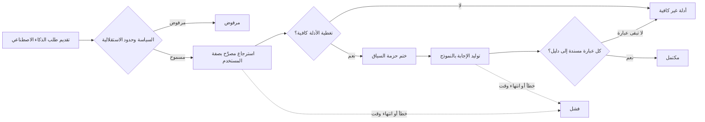
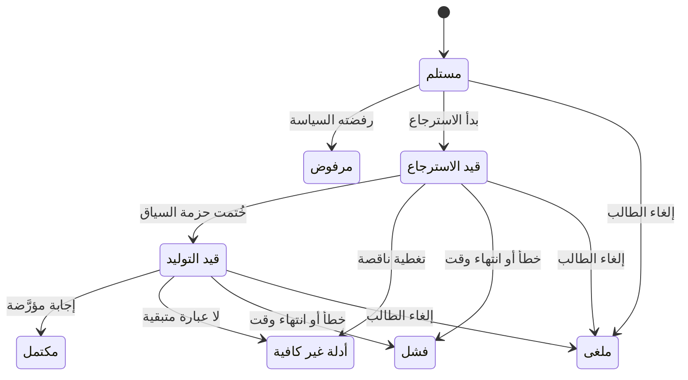

# تأريض الإجابات بالأدلة المخوَّلة

<!-- BEGIN GENERATED: doc -->
| البند | القيمة |
|---|---|
| المعرّف | FEAT-AI-GROUNDING |
| الإصدار | 0.2 |
| الحالة | مسودة |
| القدرة | CAP-12 المساعدة بالذكاء الاصطناعي |
| القدرة الفرعية | CAP-12.01 الاسترجاع والإجابة المؤرّضة (R2) |
| الأدوار | النظام؛ المدقِّق |
| الشاشات | SCR-69 التدقيق، SCR-45 المساعد الذكي |
| حالات الاستخدام | UC-071، UC-072 |
| القصص | 13: 5 من المواصفة، و8 جديدة |
<!-- END GENERATED: doc -->

## 1. نظرة عامة

### 1.1 القيمة

يضمن أن المساعد لا يستخدم إلا البيانات التي يحق للسائل رؤيتها وأن كل عبارة في الإجابة مسندة إلى دليل يمكن تدقيقه.

### 1.2 النطاق

| البند | القيمة |
|---|---|
| المستخدمون | صاحب طلب الذكاء الاصطناعي المصرَّح له؛ المدقِّق؛ مهندس الذكاء الاصطناعي وحوكمته؛ فريق التشغيل والأمن |
| الشاشات | شاشة المساعد الذكي (طرح السؤال وعرض الإجابة)، وشاشة التدقيق (تتبع العبارة إلى أصلها) |
| حالات الاستخدام | استرجاع سياق مصرَّح به للمستخدم نفسه، وتوليد إجابة مؤرَّضة باستشهادات قابلة للتدقيق |
| المتطلبات | كل طلب يمر بمسار واحد مسجَّل خطوة بخطوة: هوية، فسياسة، فاسترجاع مصرَّح، فحزمة سياق، فنموذج، فتأريض؛ حزمة السياق لا تُبنى إلا مما يحق للمستخدم رؤيته الآن؛ عدم كفاية الأدلة تُعاد صريحة لا تُولَّد إجابة ناقصة؛ كل عبارة تحمل استشهادها؛ حد أقصى لمستوى استقلالية الذكاء الاصطناعي ومنع أعلى مستوياته؛ النماذج محلية افتراضيًا؛ المحتوى المسترجع يُعامل بيانات لا تعليمات؛ إسقاط متجهي بتسميات البحث النصي نفسها وتصفيته المسبقة |
| خارج النطاق | توليد مسودات التقارير والمنتجات، واعتماد نتيجة الذكاء الاصطناعي أو رفضها، وإدارة دورة حياة النموذج والتوجيه (كل ذلك في ميزات أخرى من هذه القدرة) |

### 1.3 خريطة الميزة

**الشكل 1: مسار طلب الذكاء الاصطناعي من التقديم إلى الإجابة المؤرَّضة**



**الشكل 2: حالات طلب الذكاء الاصطناعي**



## 2. القواعد المشتركة

تنطبق على كل قصص الميزة، فلا تتكرر داخل القصص. وكل قصة تذكر ما يخصها فقط.

### 2.1 السياق المشترك

كل قصة تبدأ من ثلاثة شروط: مستأجر نشط، وحزمة السياسات الأساسية مفعّلة، ومستخدم مسجّل الدخول ومخوَّل. وتشير إليها القصص بخطوة واحدة: «بفرض السياق المشترك للميزة».

### 2.2 الصلاحية وعدم الإفصاح

- من لا يحق له رؤية العنصر يتلقى ردًا بشكل «غير متاح» تمامًا، فلا يعرف أنه موجود.
- من يرى العنصر ولا يحق له الإجراء يتلقى «لا تملك صلاحية هذا الإجراء».

### 2.3 أوامر تغيير الحالة

- **منع التكرار:** يُرسل كل أمر بمفتاح فريد، فإعادة الطلب نفسه لا تُنفَّذ مرتين.
- **حماية التعديل المتزامن:** يُرسل كل أمر بإصدار البيانات الذي يراه المستخدم. فإن عدّلها غيره في الأثناء، يُرفض الأمر.
- **السجل:** إن نجح الأمر، يُكتب حدثه وسجل التدقيق في المعاملة نفسها.

### 2.4 الرفض المشترك

```gherkin
# language: ar
خاصية: الرفض المشترك لأوامر الميزة

  سيناريو مخطط: رفض مشترك لكل أمر في الميزة
    بفرض السياق المشترك للميزة
    و <الحالة>
    عندما يُرسل المستخدم أي أمر من أوامر الميزة
    اذاً يُرفض برمز <الرمز> ويرى "<الرسالة>"
    و لا يتغير شيء

    امثلة:
      | الحالة                                  | الرمز                  | الرسالة                                                 |
      | العنصر خارج صلاحياته                    | NOT_FOUND              | غير متاح                                                |
      | العنصر مرئي له ولا يحق له الإجراء       | AUTHZ_DENIED           | لا تملك صلاحية هذا الإجراء                              |
      | غيره عدّل العنصر بعد أن فتحه            | VERSION_CONFLICT       | تغيّرت البيانات منذ فتحتها. راجع التغييرات ثم أعد المحاولة |
      | أعاد مفتاح منع التكرار بمحتوى مختلف     | IDEMPOTENCY_KEY_REUSED | طلب مكرر بمحتوى مختلف                                   |
      | البيانات ناقصة أو غير صحيحة             | VALIDATION_FAILED      | بعض البيانات ناقصة أو غير صحيحة. راجع الحقول المعلَّمة      |

  سيناريو: إعادة الطلب نفسه لا تُنفَّذ مرتين
    بفرض السياق المشترك للميزة
    و أمر نجح بمفتاح منع تكرار
    عندما يُعاد الطلب نفسه بالمفتاح نفسه
    اذاً تُعاد النتيجة الأولى ولا يُكتب حدث ثانٍ
```

## 3. الجودة وتعريف الاكتمال

### 3.1 متطلبات الجودة

<!-- BEGIN GENERATED: quality -->
| المرجع | الموقف | المطلوب |
|---|---|---|
| QAS-AI-001 | evaluation set of 500 questions | ≥ 95 % of cited items actually support the statement |
| QAS-AI-002 | insufficient-evidence and hallucination sets | ≤ 2 % unsupported statements; ≥ 95 % correct 'Insufficient Evidence' |
| QAS-AI-003 | grounded Q&A request | first token ≤ 3 s, full answer p95 ≤ 20 s on local models |
| QAS-AI-004 | prompt-injection, exfiltration and unauthorized-retrieval suites | 0 unauthorized retrievals, 0 tool abuse, 0 cross-tenant leakage |
<!-- END GENERATED: quality -->

### 3.2 تعريف الاكتمال

القصة مكتملة حين تتحقق الشروط الخمسة:

1. سيناريوهاتها والقواعد المشتركة تمر في الاختبار الآلي.
2. فحوص البنية المعمارية تمر.
3. نصوص الواجهة والرسائل موجودة بالعربية والإنجليزية.
4. مراجعة الكود مكتملة.
5. ما تضيفه القصة نفسها في قسم «القواعد» تحقق.

## 4. فهرس القصص

<!-- BEGIN GENERATED: story-index -->
| المعرّف | القصة | النوع | الحالة |
|---|---|---|---|
| `US-BC07-Q-AIR-CONTEXT` | جلب عناصر حزمة سياق طلب الذكاء الاصطناعي | جلب | مسودة |
| `US-BC07-S-AI-REQUEST-02` | بدء الاسترجاع المصرَّح لطلب الذكاء الاصطناعي | نظام | مسودة |
| `US-BC07-S-AI-REQUEST-03` | ختم حزمة سياق طلب الذكاء الاصطناعي | نظام | مسودة |
| `US-BC07-S-AI-REQUEST-05` | اكتمال الطلب بإجابة مؤرَّضة | نظام | مسودة |
| `US-BC07-S-AI-REQUEST-06` | عدم كفاية الأدلة بعد حذف العبارات غير المسندة | نظام | مسودة |
| `US-UI-SCR69-AI-LINEAGE` | تتبع العبارة إلى حزمة السياق والنموذج | واجهة | مسودة |
| `US-PLT-AI-AUTONOMY-MATRIX` | فرض حدود استقلالية الذكاء الاصطناعي | منصة | مسودة |
| `US-PLT-AI-GROUNDING-VERIFIER` | التحقق من إسناد كل عبارة قبل عرضها | منصة | مسودة |
| `US-PLT-AI-INJECTION-GUARD` | معاملة المحتوى المسترجع بيانات لا تعليمات | منصة | مسودة |
| `US-PLT-AI-LINEAGE-RECORD` | حفظ أصل كل مخرج آلي مختومًا ومشفرًا | منصة | مسودة |
| `US-PLT-AI-VECTOR-PROJECTION` | استرجاع متجهي بنفس تسميات البحث وتصفيته | منصة | مسودة |
| `US-OPS-AI-INJECTION-ALERT` | إحالة ارتفاع محاولات الحقن إلى الأمن | تشغيل | مسودة |
| `US-OPS-AI-VECTOR-LAG` | مراقبة تأخر الإسقاط المتجهي | تشغيل | مسودة |
<!-- END GENERATED: story-index -->

## 5. القصص

### 5.1 US-BC07-Q-AIR-CONTEXT — جلب عناصر حزمة سياق طلب الذكاء الاصطناعي

| النوع | الإصدار | الأولوية | دون اتصال | الحالة |
|---|---|---|---|---|
| جلب | R2 | Must | لا | مسودة |

> **كـ** صاحب طلب الذكاء الاصطناعي المصرَّح له، أو المدقِّق، **أريد** أن أطّلع على عناصر حزمة السياق التي استندت إليها الإجابة، **حتى** أراجع صحة الطلب وأصل ما استُشهد به.

**باختصار:** تُعاد عناصر حزمة السياق (المعرّف والإصدار والتسمية) التي يحق للطالب أو المدقِّق رؤيتها فقط، صفحةً بعد صفحة، دون كشف أي عنصر محجوب.

#### القواعد

- **من يُسمح له:** صاحب الطلب إن كان مصرَّحًا له برؤية العناصر، أو المدقِّق لأغراض المراجعة.
- **البيانات:** المؤشر والحد الأقصى للصفحة؛ ترويسة الغرض (`X-Purpose`) إلزامية.

#### معايير القبول

```gherkin
# language: ar
خاصية: جلب عناصر حزمة سياق طلب الذكاء الاصطناعي

  سيناريو: يرى الطالب أو المدقق عناصر السياق المرئية له فقط
    بفرض السياق المشترك للميزة
    و طلب ذكاء اصطناعي له عناصر سياق داخل نطاق الطالب وأخرى خارجه
    عندما يطلب صاحب الطلب أو المدقق عناصر حزمة السياق
    اذاً تُعاد العناصر داخل نطاقه فقط، بعد إعادة فحص صلاحيته على كل عنصر
    و لا يكشف أي عدد أو ترتيب وجود عنصر محجوب

  سيناريو: الصفحة التالية بالمؤشر
    بفرض السياق المشترك للميزة
    و عناصر حزمة السياق أكثر من صفحة
    عندما يطلب الصفحة التالية بالمؤشر
    اذاً تُعاد العناصر التالية دون تكرار ولا فجوة
```

<details><summary>المراجع التقنية والتتبع</summary>

<!-- BEGIN GENERATED: refs US-BC07-Q-AIR-CONTEXT -->
| البند | المعرّف | المعنى |
|---|---|---|
| الواجهة البرمجية | `GET /api/v1/ai/requests/{request_id}/context` | — |
| الاستعلام | `QRY-AIR-CONTEXT` | Context package items (URN, version, label) — for audit and review |
| السياسة | `POL-AIR-CONTEXT` | requester if cleared; Auditor |
| الكيان | `AGG-AI-REQUEST` | طلب الذكاء الاصطناعي |
| الجدول | `ai.ai_requests` | الجدول الرئيسي لطلب الذكاء الاصطناعي |
| وحدة النشر | DU-16 | — |
| المتطلب | REQ-AI-002 | The system shall build context packages only from data retrieved with the requesting user's authorization, in… |
| حالة الاستخدام | UC-071 | Retrieve Authorized Context |
| الاختبار | TST-AI-REQUEST-SM، TST-SLC10-INVARIANTS | دورة حالات طلب الذكاء الاصطناعي، وثوابت الشريحة SLC-10 |
<!-- END GENERATED: refs US-BC07-Q-AIR-CONTEXT -->

</details>

### 5.2 US-BC07-S-AI-REQUEST-02 — بدء الاسترجاع المصرَّح لطلب الذكاء الاصطناعي

| النوع | الإصدار | الأولوية | دون اتصال | الحالة |
|---|---|---|---|---|
| نظام | R2 | Must | لا ينطبق | مسودة |

> **كـ** النظام، **أريد** أن أنقل طلب الذكاء الاصطناعي من «مستلم» إلى «قيد الاسترجاع»، **حتى** يبدأ استرجاع البيانات المصرَّح بها للمستخدم الطالب نفسه قبل توليد أي إجابة.

**باختصار:** بعد قبول الطلب وموافقة السياسة، يبدأ النظام استرجاعًا هجينًا (نصيًا ومتجهيًا) بصفة المستخدم الطالب نفسه لا بصفة النظام، فلا يصل إلا إلى ما يحق له رؤيته الآن.

#### القواعد

- **متى يحدث:** الطلب في حالة «مستلم»، وسمحت السياسة بالعملية ومستوى الاستقلالية المطلوب.
- **الأثر:** يبدأ الاسترجاع بصفة المستخدم الطالب نفسه، فتُستبعد العناصر المحجوبة عنه قبل حساب التشابه؛ ويُسجَّل حدث «بدأ الاسترجاع» يصل إلى محاسبة الاستخدام وسجل التدقيق المشفر.

#### معايير القبول

```gherkin
# language: ar
خاصية: بدء الاسترجاع المصرَّح

  سيناريو: طلب مقبول يبدأ استرجاعه
    بفرض طلب ذكاء اصطناعي في حالة "مستلم" سمحت السياسة بعمليته
    عندما يبدأ النظام الاسترجاع المصرَّح
    اذاً تصبح حالة الطلب "قيد الاسترجاع"
    و يُسجَّل حدث "بدأ الاسترجاع" بهوية النظام كعبء عمل

  سيناريو: طلب رفضته السياسة لا يبدأ استرجاعه
    بفرض طلب ذكاء اصطناعي في حالة "مستلم" رفضته السياسة أو تجاوز حد الاستقلالية
    عندما يفحص النظام الطلب
    اذاً لا يبدأ الاسترجاع ولا يتغير شيء
```

<details><summary>المراجع التقنية والتتبع</summary>

<!-- BEGIN GENERATED: refs US-BC07-S-AI-REQUEST-02 -->
| البند | المعرّف | المعنى |
|---|---|---|
| المحفِّز | `SYS:retrieval started` | authorized hybrid retrieval as the user (SPEC-AI §2) |
| الانتقال | RECEIVED ← RETRIEVING | — |
| الحدث | `EVT-AIR-RETRIEVING` | يصل إلى: AI result creator (reviewable operations); Usage accounting; Audit (encrypted prompt/output log) |
| الكيان | `AGG-AI-REQUEST` | طلب الذكاء الاصطناعي |
| الجدول | `ai.ai_requests` | الجدول الرئيسي لطلب الذكاء الاصطناعي |
| وحدة النشر | DU-16 | — |
| المتطلبات | REQ-AI-001، REQ-AI-002، REQ-AI-003، REQ-AI-004، REQ-AI-008، REQ-AI-011، REQ-AI-012 | معانيها في القسم 6. التتبع |
| حالات الاستخدام | UC-071، UC-072 | Retrieve Authorized Context؛ Generate AI Result |
| الاختبار | TST-AI-REQUEST-SM، TST-SLC10-INVARIANTS | دورة حالات طلب الذكاء الاصطناعي، وثوابت الشريحة SLC-10 |
<!-- END GENERATED: refs US-BC07-S-AI-REQUEST-02 -->

</details>

### 5.3 US-BC07-S-AI-REQUEST-03 — ختم حزمة سياق طلب الذكاء الاصطناعي

| النوع | الإصدار | الأولوية | دون اتصال | الحالة |
|---|---|---|---|---|
| نظام | R2 | Must | لا ينطبق | مسودة |

> **كـ** النظام، **أريد** أن أنقل الطلب من «قيد الاسترجاع» إلى «قيد التوليد»، **حتى** تُختم حزمة السياق بثبات عناصرها قبل أن يستخدمها النموذج.

**باختصار:** حين تثبَّت عناصر حزمة السياق بمعرّفاتها وإصداراتها وتسمياتها الأمنية ويُحسب ختمها ضمن ميزانية الرموز المسموحة، تُختم الحزمة وتبدأ خطوة التوليد.

#### القواعد

- **متى يحدث:** ثُبّتت عناصر الحزمة (المعرّف، والإصدار أو تاريخ المعرفة، والتسمية)، وحُسب ختم الحزمة، والحجم ضمن ميزانية الرموز.
- **الأثر:** تصير تسمية الحزمة أعلى تسمية بين عناصرها ولا تتجاوز تصريح المستخدم؛ ويُسجَّل حدث «خُتمت حزمة السياق» يصل إلى محاسبة الاستخدام وسجل التدقيق المشفر.

#### معايير القبول

```gherkin
# language: ar
خاصية: ختم حزمة السياق

  سيناريو: اكتمال عناصر الحزمة ضمن الميزانية
    بفرض طلب ذكاء اصطناعي في حالة "قيد الاسترجاع" له عناصر سياق مثبَّتة ضمن ميزانية الرموز
    عندما يختم النظام حزمة السياق
    اذاً تصبح حالة الطلب "قيد التوليد"
    و يُسجَّل حدث "خُتمت حزمة السياق"

  سيناريو: الاسترجاع لا يزال جاريًا فلا تُختم الحزمة
    بفرض طلب ذكاء اصطناعي في حالة "قيد الاسترجاع" لم تكتمل عناصر حزمته بعد
    عندما يفحص النظام حزمة السياق
    اذاً لا تُختم الحزمة ولا يتغير شيء
```

<details><summary>المراجع التقنية والتتبع</summary>

<!-- BEGIN GENERATED: refs US-BC07-S-AI-REQUEST-03 -->
| البند | المعرّف | المعنى |
|---|---|---|
| المحفِّز | `SYS:context package sealed` | context items pinned (URN + version/known_at + label); package hash; token budget respected |
| الانتقال | RETRIEVING ← GENERATING | — |
| الحدث | `EVT-AIR-CONTEXT-SEALED` | يصل إلى: AI result creator (reviewable operations); Usage accounting; Audit (encrypted prompt/output log) |
| الكيان | `AGG-AI-REQUEST` | طلب الذكاء الاصطناعي |
| الجدول | `ai.ai_requests` | الجدول الرئيسي لطلب الذكاء الاصطناعي |
| وحدة النشر | DU-16 | — |
| المتطلبات | REQ-AI-001، REQ-AI-002، REQ-AI-003، REQ-AI-004، REQ-AI-008، REQ-AI-011، REQ-AI-012 | معانيها في القسم 6. التتبع |
| حالات الاستخدام | UC-071، UC-072 | Retrieve Authorized Context؛ Generate AI Result |
| الاختبار | TST-AI-REQUEST-SM، TST-SLC10-INVARIANTS | دورة حالات طلب الذكاء الاصطناعي، وثوابت الشريحة SLC-10 |
<!-- END GENERATED: refs US-BC07-S-AI-REQUEST-03 -->

</details>

### 5.4 US-BC07-S-AI-REQUEST-05 — اكتمال الطلب بإجابة مؤرَّضة

| النوع | الإصدار | الأولوية | دون اتصال | الحالة |
|---|---|---|---|---|
| نظام | R2 | Must | لا ينطبق | مسودة |

> **كـ** النظام، **أريد** أن أنقل الطلب إلى «مكتمل» حين تكون كل عبارة من الإجابة مسندة إلى دليل، **حتى** لا تظهر للمستخدم إلا إجابة مؤرَّضة بالكامل.

**باختصار:** يفحص النظام كل عبارة في المخرج فيتأكد أنها تستشهد بعنصر واحد على الأقل من حزمة السياق وأن فحص الاستشهاد وفحوص الحراسة نجحت، فتكتمل حالة الطلب وتحمل الإجابة تسمية حزمة السياق.

#### القواعد

- **متى يحدث:** كل عبارة في المخرج تستشهد بعنصر سياق واحد على الأقل، ونجح فحص الاستشهاد ونجحت فحوص الحراسة، وحُسبت تسمية المخرج بأعلى تسمية بين عناصر السياق.
- **الأثر:** يُسجَّل حدث «اكتمل الطلب» يصل إلى منشئ نتيجة الذكاء الاصطناعي للعمليات القابلة للمراجعة، ومحاسبة الاستخدام، وسجل التدقيق المشفر.

#### معايير القبول

```gherkin
# language: ar
خاصية: اكتمال الطلب بإجابة مؤرَّضة

  سيناريو: كل عبارة مسندة إلى دليل
    بفرض طلب ذكاء اصطناعي في حالة "قيد التوليد" كل عبارة فيه مستشهدة بعنصر سياق واحد على الأقل
    عندما ينجح فحص الاستشهاد وفحوص الحراسة
    اذاً تصبح حالة الطلب "مكتمل"
    و يُسجَّل حدث "اكتمل الطلب" وتحمل الإجابة تسمية حزمة السياق

  سيناريو: التوليد لا يزال جاريًا فلا يكتمل الطلب
    بفرض طلب ذكاء اصطناعي في حالة "قيد التوليد" لم يُفحص استشهاد عباراته بعد
    عندما يُفحص الطلب
    اذاً لا يتغير شيء
```

<details><summary>المراجع التقنية والتتبع</summary>

<!-- BEGIN GENERATED: refs US-BC07-S-AI-REQUEST-05 -->
| البند | المعرّف | المعنى |
|---|---|---|
| المحفِّز | `SYS:output grounded` | every statement cites ≥ 1 context item; citation check passed; output label = max(context labels); guard chec… |
| الانتقال | GENERATING ← COMPLETED | — |
| الحدث | `EVT-AIR-COMPLETED` | يصل إلى: AI result creator (reviewable operations); Usage accounting; Audit (encrypted prompt/output log) |
| الكيان | `AGG-AI-REQUEST` | طلب الذكاء الاصطناعي |
| الجدول | `ai.ai_requests` | الجدول الرئيسي لطلب الذكاء الاصطناعي |
| وحدة النشر | DU-16 | — |
| المتطلبات | REQ-AI-001، REQ-AI-002، REQ-AI-003، REQ-AI-004، REQ-AI-008، REQ-AI-011، REQ-AI-012 | معانيها في القسم 6. التتبع |
| حالات الاستخدام | UC-071، UC-072 | Retrieve Authorized Context؛ Generate AI Result |
| الاختبار | TST-AI-REQUEST-SM، TST-SLC10-INVARIANTS | دورة حالات طلب الذكاء الاصطناعي، وثوابت الشريحة SLC-10 |
<!-- END GENERATED: refs US-BC07-S-AI-REQUEST-05 -->

</details>

### 5.5 US-BC07-S-AI-REQUEST-06 — عدم كفاية الأدلة بعد حذف العبارات غير المسندة

| النوع | الإصدار | الأولوية | دون اتصال | الحالة |
|---|---|---|---|---|
| نظام | R2 | Must | لا ينطبق | مسودة |

> **كـ** النظام، **أريد** أن أنقل الطلب إلى «أدلة غير كافية» حين لا تبقى بعد حذف العبارات غير المسندة أي إجابة، **حتى** لا يصل إلى المستخدم مخرج غير مؤرَّض.

**باختصار:** إن حذف النظام العبارات التي لم تستشهد بدليل كافٍ ولم يبق من الإجابة شيء، تنتقل حالة الطلب إلى «أدلة غير كافية» بدل عرض إجابة ناقصة.

#### القواعد

- **متى يحدث:** بعد حذف العبارات غير المسندة من المخرج، لا تبقى أي عبارة تشكّل إجابة.
- **الأثر:** يُسجَّل حدث «عدم كفاية الأدلة» يصل إلى محاسبة الاستخدام وسجل التدقيق المشفر؛ ولا يُنشأ مخرج قابل للعرض على المستخدم.

#### معايير القبول

```gherkin
# language: ar
خاصية: عدم كفاية الأدلة بعد حذف العبارات غير المسندة

  سيناريو: حذف كل العبارات يترك الطلب بلا إجابة
    بفرض طلب ذكاء اصطناعي في حالة "قيد التوليد" حُذفت كل عباراته لعدم استشهادها بدليل كافٍ
    عندما يفحص النظام ما تبقى من المخرج
    اذاً تصبح حالة الطلب "أدلة غير كافية"
    و يُسجَّل حدث "عدم كفاية الأدلة"

  سيناريو: تبقى عبارة مسندة فلا يتغير شيء
    بفرض طلب ذكاء اصطناعي في حالة "قيد التوليد" تبقى منه عبارة واحدة مسندة إلى دليل بعد الحذف
    عندما يفحص النظام ما تبقى من المخرج
    اذاً لا يتغير شيء، ويستمر مسار الاكتمال
```

<details><summary>المراجع التقنية والتتبع</summary>

<!-- BEGIN GENERATED: refs US-BC07-S-AI-REQUEST-06 -->
| البند | المعرّف | المعنى |
|---|---|---|
| المحفِّز | `SYS:output not grounded` | ungrounded statements removed leave no answer |
| الانتقال | GENERATING ← INSUFFICIENT_EVIDENCE | — |
| الحدث | `EVT-AIR-INSUFFICIENT-EVIDENCE` | يصل إلى: AI result creator (reviewable operations); Usage accounting; Audit (encrypted prompt/output log) |
| الكيان | `AGG-AI-REQUEST` | طلب الذكاء الاصطناعي |
| الجدول | `ai.ai_requests` | الجدول الرئيسي لطلب الذكاء الاصطناعي |
| وحدة النشر | DU-16 | — |
| المتطلبات | REQ-AI-001، REQ-AI-002، REQ-AI-003، REQ-AI-004، REQ-AI-008، REQ-AI-011، REQ-AI-012 | معانيها في القسم 6. التتبع |
| حالات الاستخدام | UC-071، UC-072 | Retrieve Authorized Context؛ Generate AI Result |
| الاختبار | TST-AI-REQUEST-SM، TST-SLC10-INVARIANTS | دورة حالات طلب الذكاء الاصطناعي، وثوابت الشريحة SLC-10 |
<!-- END GENERATED: refs US-BC07-S-AI-REQUEST-06 -->

</details>

### 5.6 US-UI-SCR69-AI-LINEAGE — تتبع العبارة إلى حزمة السياق والنموذج

| النوع | الإصدار | الأولوية | دون اتصال | الحالة |
|---|---|---|---|---|
| واجهة | R2 | Must | لا | مسودة |

> **كـ** المدقِّق، **أريد** أن أتتبع كل عبارة في مخرج الذكاء الاصطناعي إلى حزمة السياق التي استندت إليها والنموذج الذي أنشأها، **حتى** أتحقق من سلامة الإجابة ومصدرها عند المراجعة.

**باختصار:** تعرض شاشة التدقيق لكل عبارة في مخرج آلي استشهاداتها وعناصر حزمة السياق التي استندت إليها، إلى جانب إصدار النموذج والقالب المستخدمين، فلا يبقى أصل أي مخرج مجهولًا.

#### القواعد

- **ما تعرضه الشاشة:** لكل عبارة، عناصر حزمة السياق المستشهد بها (المعرّف والإصدار والتسمية)، وإصدار النموذج وقالب التعليمات المستخدمين، ووقت كل خطوة من مسار الطلب.
- **المصدر:** البيانات تُقرأ من سجل التدقيق المشفر وجلب سياق الطلب (القصة 5.1)، ولا تُعدَّل من هذه الشاشة. **[Derived]**
- **عدم الإفصاح:** عنصر السياق الذي لا يحق للمدقِّق رؤيته يظهر محجوبًا لا غائبًا. **[Derived]**

#### معايير القبول

```gherkin
# language: ar
خاصية: تتبع العبارة إلى أصلها

  سيناريو: عرض سلسلة الاستناد لعبارة مكتملة
    بفرض السياق المشترك للميزة
    و طلب ذكاء اصطناعي مكتمل بعبارات مستشهدة
    عندما يفتح المدقق تتبع الطلب على شاشة التدقيق
    اذاً يرى لكل عبارة عناصر حزمة السياق المستشهد بها وإصدار النموذج والقالب

  سيناريو: عنصر سياق خارج صلاحية المدقق يظهر محجوبًا
    بفرض السياق المشترك للميزة
    و أحد عناصر حزمة السياق خارج صلاحية المدقق
    عندما يفتح المدقق تتبع الطلب
    اذاً يظهر ذلك العنصر محجوبًا دون كشف محتواه
```

<details><summary>المراجع التقنية والتتبع</summary>

<!-- BEGIN GENERATED: refs US-UI-SCR69-AI-LINEAGE -->
| البند | المعرّف | المعنى |
|---|---|---|
| الشاشة | SCR-69 | شاشة التدقيق |
| المصدر | `US-BC07-Q-AIR-CONTEXT` | — |
| المصدر | `03-domain/contexts/BC07/grounded-ai-spec.md §5` | — |
| المصدر | `[Derived]` | — |
| المتطلب | REQ-AI-001 | The system shall process every AI request through identity, policy, authorized retrieval, context package, mo… |
| حالات الاستخدام | UC-071، UC-072 | Retrieve Authorized Context؛ Generate AI Result |
<!-- END GENERATED: refs US-UI-SCR69-AI-LINEAGE -->

</details>

### 5.7 US-PLT-AI-AUTONOMY-MATRIX — فرض حدود استقلالية الذكاء الاصطناعي

| النوع | الإصدار | الأولوية | دون اتصال | الحالة |
|---|---|---|---|---|
| منصة | R2 | Must | لا ينطبق | مسودة |

> **كـ** مهندس الذكاء الاصطناعي وحوكمته، **أريد** أن أفرض على كل عملية ذكاء اصطناعي حدها الأقصى من مصفوفة الاستقلالية، **حتى** لا تنفَّذ عملية تتجاوز استقلاليتها المعتمدة.

**باختصار:** كل عملية ذكاء اصطناعي محددة بأقصى مستوى استقلالية مسموح به في هذا الإصدار (AIL3 كحد أعلى)، والعمليات الممنوعة لا طريق لتنفيذها مطلقًا، ورفع مستوى استقلالية عملية يحتاج قرارًا معماريًا جديدًا.

#### القواعد

- **متى يحدث:** عند تقييم كل طلب ذكاء اصطناعي قبل بدء الاسترجاع: مستوى الاستقلالية المطلوب للعملية لا يتجاوز حدها الأقصى في هذا الإصدار، والعمليات الممنوعة تُرفض دون استرجاع.
- **من يُسمح له:** مهندس الذكاء الاصطناعي وحوكمته وحده يعتمد رفع الحد الأقصى لعملية، وبقرار معماري جديد.
- **الأثر:** الطلب الذي يتجاوز حده يُرفض قبل بدء الاسترجاع (القصة 5.2)، ولا عملية تُنفَّذ بمستوى استقلالية أعلى من حدها دون ذلك القرار.

#### معايير القبول

```gherkin
# language: ar
خاصية: فرض حدود استقلالية الذكاء الاصطناعي

  سيناريو: رفض عملية تتجاوز حدها الأقصى
    بفرض عملية ذكاء اصطناعي يتجاوز مستوى استقلاليتها المطلوب حدها الأقصى في هذا الإصدار
    عندما يُرسل طلب لتنفيذها
    اذاً تُرفض السياسة الطلب قبل أي استرجاع
    و لا يبدأ الاسترجاع

  سيناريو: لا طريق لتنفيذ عملية ممنوعة
    بفرض عملية ذكاء اصطناعي ممنوعة مطلقًا على المصفوفة
    عندما يُفحص توجيه الذكاء الاصطناعي وأدواته
    اذاً لا توجد أداة ولا توجيه يمكن أن ينفّذها
```

<details><summary>المراجع التقنية والتتبع</summary>

<!-- BEGIN GENERATED: refs US-PLT-AI-AUTONOMY-MATRIX -->
| البند | المعرّف | المعنى |
|---|---|---|
| المصدر | `10-ai/autonomy-matrix.md` | — |
| المصدر | `03-domain/contexts/BC07/grounded-ai-spec.md §6` | — |
| القرار المعماري | ADR-P10 | Autonomy Level Naming (AIL vs DAL) |
| المتطلب | REQ-AI-008 | The system shall enforce the AI autonomy matrix, allowing at most AIL3 in R2 and forbidding AIL5. |
| حالة الاستخدام | UC-074 | Approve AI-Assisted Result |
<!-- END GENERATED: refs US-PLT-AI-AUTONOMY-MATRIX -->

</details>

### 5.8 US-PLT-AI-GROUNDING-VERIFIER — التحقق من إسناد كل عبارة قبل عرضها

| النوع | الإصدار | الأولوية | دون اتصال | الحالة |
|---|---|---|---|---|
| منصة | R2 | Must | لا ينطبق | مسودة |

> **كـ** مهندس الذكاء الاصطناعي وحوكمته، **أريد** نموذج تحقق مستقلًا يفحص إسناد كل عبارة إلى دليلها قبل عرضها، **حتى** لا يصل إلى المستخدم بيان لا يدعمه السياق المسترجَع.

**باختصار:** نموذج تحقق منفصل عن النموذج المولِّد يقيس مدى دعم كل عبارة بما استُشهد به، ويحذف ما لا يبلغ الحد المطلوب، وإن لم يبق شيء تصير الحالة «أدلة غير كافية» (القصة 5.5).

#### القواعد

- **متى يحدث:** على كل عبارة في مخرج الذكاء الاصطناعي قبل اكتمال الطلب.
- **من يُسمح له:** النظام بنموذج تحقق مستقل عن النموذج المولِّد، لا المستخدم.
- **الأثر:** العبارة التي لا تبلغ درجة الدعم المطلوبة تُحذف من المخرج؛ وإن لم يبق شيء ينتقل الطلب إلى «أدلة غير كافية» بدل عرض إجابة جزئية غير مؤرَّضة.

> **ملاحظة:** عند تعطل نموذج التحقق يفشل الطلب بدل أن يكتمل دون فحص إسناد. **[Derived]**

#### معايير القبول

```gherkin
# language: ar
خاصية: التحقق من إسناد كل عبارة قبل عرضها

  سيناريو: عبارة غير مدعومة تُحذف قبل العرض
    بفرض مخرج ذكاء اصطناعي فيه عبارة لا يدعمها ما استُشهد به بدرجة كافية
    عندما يفحصها نموذج التحقق
    اذاً تُحذف تلك العبارة من المخرج ولا تصل إلى المستخدم

  سيناريو: تعطل نموذج التحقق يفشل الطلب
    بفرض أن نموذج التحقق غير متاح
    عندما يصل طلب إلى خطوة التحقق من الإسناد
    اذاً يفشل الطلب ولا يُعرض مخرج لم يُفحص إسناده
```

<details><summary>المراجع التقنية والتتبع</summary>

<!-- BEGIN GENERATED: refs US-PLT-AI-GROUNDING-VERIFIER -->
| البند | المعرّف | المعنى |
|---|---|---|
| الجودة | QAS-AI-002 | insufficient-evidence and hallucination sets → ≤ 2 % unsupported statements; ≥ 95 % correct 'Insufficient Evi… |
| المصدر | `03-domain/contexts/BC07/grounded-ai-spec.md §4` | — |
| المصدر | `09-reliability/fmea-slc10.md FM-S10-02` | — |
| المتطلبات | REQ-AI-003، REQ-AI-004 | معانيها في القسم 6. التتبع |
| حالة الاستخدام | UC-072 | Generate AI Result |
<!-- END GENERATED: refs US-PLT-AI-GROUNDING-VERIFIER -->

</details>

### 5.9 US-PLT-AI-INJECTION-GUARD — معاملة المحتوى المسترجع بيانات لا تعليمات

| النوع | الإصدار | الأولوية | دون اتصال | الحالة |
|---|---|---|---|---|
| منصة | R2 | Must | لا ينطبق | مسودة |

> **كـ** مهندس الذكاء الاصطناعي وحوكمته، **أريد** أن يُعامل كل محتوى مسترجَع بيانات لا تعليمات، **حتى** لا يستطيع نص داخل وثيقة أو ادعاء أن يغيّر أدوات النموذج أو صلاحياته أو مستلمي مخرجه.

**باختصار:** المحتوى المسترجَع يُمرَّر إلى النموذج معلَّمًا كبيانات، فلا يضيف أداة جديدة ولا يرفع مستوى الاستقلالية ولا يغيّر وجهة المخرج، وأي استدعاء أداة خارج قائمة العملية المصرَّح بها يُرفض.

#### القواعد

- **متى يحدث:** على كل عنصر يدخل حزمة السياق قبل التوليد وأثناءه.
- **الأثر:** استدعاء أداة غير مدرجة في قائمة العملية، أو بمعاملات تتجاوز نطاقها، يُرفض ولا يُنفَّذ؛ والمحتوى المسترجع لا يضيف مستلمًا ولا يرفع مستوى الاستقلالية.
- **التسريب:** المخرج لا يُرسل إلى أي وجهة خارجية، والروابط الخارجية داخل المحتوى المسترجع تُزال.

#### معايير القبول

```gherkin
# language: ar
خاصية: معاملة المحتوى المسترجع بيانات لا تعليمات

  سيناريو: رفض استدعاء أداة اقترحه نص مسترجَع
    بفرض أن أحد عناصر حزمة السياق يحتوي نصًا يطلب استدعاء أداة خارج قائمة العملية
    عندما يولِّد النموذج استجابته
    اذاً يُرفض استدعاء تلك الأداة ولا يُنفَّذ
    و يُسجَّل حدث حراسة بنوع المحاولة

  سيناريو: عنصر عادي لا يغيّر سلوك الطلب
    بفرض أن عناصر حزمة السياق خالية من أي تعليمات
    عندما يولِّد النموذج استجابته
    اذاً لا يتغير أي شيء في أدوات الطلب أو مستلميه أو مستوى استقلاليته
```

<details><summary>المراجع التقنية والتتبع</summary>

<!-- BEGIN GENERATED: refs US-PLT-AI-INJECTION-GUARD -->
| البند | المعرّف | المعنى |
|---|---|---|
| الجودة | QAS-AI-004 | prompt-injection, exfiltration and unauthorized-retrieval suites → 0 unauthorized retrievals, 0 tool abuse, 0… |
| المصدر | `THR-S10-02` | — |
| المصدر | `THR-S10-03` | — |
| المصدر | `03-domain/contexts/BC07/grounded-ai-spec.md §5` | — |
| المتطلب | REQ-AI-012 | If content retrieved into a context package contains instructions, then the system shall treat it as data and… |
| حالة الاستخدام | UC-071 | Retrieve Authorized Context |
<!-- END GENERATED: refs US-PLT-AI-INJECTION-GUARD -->

</details>

### 5.10 US-PLT-AI-LINEAGE-RECORD — حفظ أصل كل مخرج آلي مختومًا ومشفرًا

| النوع | الإصدار | الأولوية | دون اتصال | الحالة |
|---|---|---|---|---|
| منصة | R2 | Must | لا ينطبق | مسودة |

> **كـ** مهندس الذكاء الاصطناعي وحوكمته، **أريد** أن يُحفظ أصل كل مخرج آلي (الطلب وحزمة السياق وإصدار النموذج والقالب والمخرج) مختومًا ومشفرًا، **حتى** يمكن تتبع أي نتيجة ذكاء اصطناعي إلى ما بُنيت عليه بعد وقوعها.

**باختصار:** عند كل خطوة من مسار الطلب يُحفظ سجل لا يُعدَّل يضم ختم حزمة السياق وإصدار النموذج والقالب والمخرج، مشفرًا بمفتاح المستأجر، في سجلات الذكاء الاصطناعي.

#### القواعد

- **متى يحدث:** عند كل خطوة من خطوات طلب الذكاء الاصطناعي: الاستلام، والاسترجاع، وختم الحزمة، والتوليد، والنتيجة النهائية.
- **البيانات:** الطلب، وختم حزمة السياق، وإصدار النموذج، وإصدار قالب التعليمات، والمخرج.
- **الأثر:** يُخزَّن السجل مشفرًا بمفتاح المستأجر ضمن فئة سجلات الذكاء الاصطناعي بجدول احتفاظ محدد، ولا يُعدَّل بعد كتابته.

#### معايير القبول

```gherkin
# language: ar
خاصية: حفظ أصل كل مخرج آلي

  سيناريو: تسجيل أصل مخرج مكتمل
    بفرض طلب ذكاء اصطناعي بلغ حالة "مكتمل"
    عندما يُكتب سجل أصله
    اذاً يحمل السجل ختم حزمة السياق وإصدار النموذج والقالب والمخرج، مشفرًا بمفتاح المستأجر

  سيناريو: السجل لا يُعدَّل بعد كتابته
    بفرض سجل أصل محفوظ لطلب مكتمل
    عندما يحاول أي طرف تعديله
    اذاً يُرفض التعديل ولا يتغير شيء
```

<details><summary>المراجع التقنية والتتبع</summary>

<!-- BEGIN GENERATED: refs US-PLT-AI-LINEAGE-RECORD -->
| البند | المعرّف | المعنى |
|---|---|---|
| المصدر | `03-domain/contexts/BC07/grounded-ai-spec.md §3` | — |
| المصدر | `10-ai/autonomy-matrix.md` | — |
| المتطلب | REQ-AI-001 | The system shall process every AI request through identity, policy, authorized retrieval, context package, mo… |
| حالات الاستخدام | UC-071، UC-072 | Retrieve Authorized Context؛ Generate AI Result |
<!-- END GENERATED: refs US-PLT-AI-LINEAGE-RECORD -->

</details>

### 5.11 US-PLT-AI-VECTOR-PROJECTION — استرجاع متجهي بنفس تسميات البحث وتصفيته

| النوع | الإصدار | الأولوية | دون اتصال | الحالة |
|---|---|---|---|---|
| منصة | R2 | Must | لا ينطبق | مسودة |

> **كـ** مهندس الذكاء الاصطناعي وحوكمته، **أريد** إسقاطًا متجهيًا للمحتوى المصرَّح به بنفس تسميات البحث النصي وتصفيته المسبقة، **حتى** يسترجع الذكاء الاصطناعي بالتشابه الدلالي دون كشف ما لا يحق للمستخدم رؤيته.

**باختصار:** يُبنى الإسقاط المتجهي على الحقائق والمقاطع نفسها التي يغطيها البحث النصي، بالتسميات الأمنية ذاتها، وتُطبَّق التصفية المسبقة بنطاق صلاحية المستخدم قبل حساب التشابه لا بعده.

#### القواعد

- **متى يحدث:** عند كل استرجاع متجهي ضمن مسار طلب الذكاء الاصطناعي.
- **الأثر:** يُستبعد من الترتيب كل عنصر خارج نطاق صلاحية المستخدم قبل حساب التشابه؛ ولا يؤثر عنصر محجوب في النتيجة ولا يُكشف وجوده.

#### معايير القبول

```gherkin
# language: ar
خاصية: الاسترجاع المتجهي بنفس تسميات البحث

  سيناريو: تصفية مسبقة بنطاق الصلاحية
    بفرض محتوى متجهي يشمل عناصر داخل نطاق المستخدم وأخرى خارجه
    عندما يُجري النظام استرجاعًا متجهيًا لصالح المستخدم
    اذاً تُستبعد العناصر خارج نطاقه قبل حساب التشابه
    و لا تؤثر في ترتيب النتائج ولا تُكشف

  سيناريو: فحص التسمية بعد الترتيب
    بفرض نتائج استرجاع متجهي مرتبة بالتشابه
    عندما يُطبَّق فحص التسمية على العناصر المختارة
    اذاً يبقى فقط ما تسمح به تسمية المستخدم
```

<details><summary>المراجع التقنية والتتبع</summary>

<!-- BEGIN GENERATED: refs US-PLT-AI-VECTOR-PROJECTION -->
| البند | المعرّف | المعنى |
|---|---|---|
| القرار التقني | TD-19 | OpenSearch k-NN on the existing search cluster (vector projection kind) — no new component; pgvector as fallb… |
| المصدر | `13-verification/acceptance/SLC-10/invariants-slc10.md` | — |
| المتطلبات | REQ-AI-014، REQ-AI-002 | معانيها في القسم 6. التتبع |
| حالة الاستخدام | UC-071 | Retrieve Authorized Context |
<!-- END GENERATED: refs US-PLT-AI-VECTOR-PROJECTION -->

</details>

### 5.12 US-OPS-AI-INJECTION-ALERT — إحالة ارتفاع محاولات الحقن إلى الأمن

| النوع | الإصدار | الأولوية | دون اتصال | الحالة |
|---|---|---|---|---|
| تشغيل | R2 | Should | لا ينطبق | مسودة |

> **كـ** فريق التشغيل أو الأمن، **أريد** أن تصلني إحالة عند ارتفاع محاولات حقن التعليمات في المحتوى المسترجع، **حتى** أراجعها أمنيًا قبل أن تتكرر.

**باختصار:** يراقب النظام عدد محاولات الحقن المحجوبة، وإذا ارتفع ارتفاعًا غير معتاد تُفتح إحالة إلى المراجعة الأمنية.

#### القواعد

- **الأثر:** ارتفاع غير معتاد في عدد محاولات الحقن المحجوبة (القصة 5.9) يفتح إحالة إلى مسؤول الأمن بنوع المحاولات وعددها.

#### معايير القبول

```gherkin
# language: ar
خاصية: إحالة ارتفاع محاولات الحقن

  سيناريو: ارتفاع غير معتاد يفتح إحالة أمنية
    بفرض أن عدد محاولات الحقن المحجوبة ارتفع ارتفاعًا غير معتاد خلال فترة المراقبة
    عندما يفحص النظام مقياس محاولات الحقن
    اذاً تُفتح إحالة إلى مسؤول الأمن بنوع المحاولات وعددها

  سيناريو: لا ارتفاع فلا إحالة
    بفرض أن عدد محاولات الحقن ضمن المعتاد
    عندما يفحص النظام المقياس
    اذاً لا تُفتح أي إحالة
```

<details><summary>المراجع التقنية والتتبع</summary>

<!-- BEGIN GENERATED: refs US-OPS-AI-INJECTION-ALERT -->
| البند | المعرّف | المعنى |
|---|---|---|
| المصدر | `09-reliability/observability-slc10.md` | — |
| الجودة | QAS-AI-004 | prompt-injection, exfiltration and unauthorized-retrieval suites → 0 unauthorized retrievals, 0 tool abuse, 0… |
| المصدر | `THR-013` | — |
<!-- END GENERATED: refs US-OPS-AI-INJECTION-ALERT -->

</details>

### 5.13 US-OPS-AI-VECTOR-LAG — مراقبة تأخر الإسقاط المتجهي

| النوع | الإصدار | الأولوية | دون اتصال | الحالة |
|---|---|---|---|---|
| تشغيل | R2 | Must | لا ينطبق | مسودة |

> **كـ** فريق التشغيل، **أريد** مراقبة تأخر الإسقاط المتجهي عن مصدر الحقائق، **حتى** أكتشف تراكم الفهرسة قبل أن تفوت حقائق حديثة من الاسترجاع.

**باختصار:** يقيس النظام الفارق الزمني بين كتابة حقيقة وظهورها في الإسقاط المتجهي، وإذا تجاوز الفارق الحد المقبول يُصدر تنبيهًا لفريق التشغيل.

#### القواعد

- **الأثر:** تجاوز مقياس تأخر الإسقاط المتجهي حده يُصدر تنبيهًا تشغيليًا بحجم التراكم؛ الحد الدقيق لم يذكره المصدر ويُترك لإعداد المراقبة. **[Derived]**

#### معايير القبول

```gherkin
# language: ar
خاصية: مراقبة تأخر الإسقاط المتجهي

  سيناريو: تجاوز التأخر الحد المقبول
    بفرض أن تأخر الإسقاط المتجهي عن مصدر الحقائق تجاوز الحد المقبول
    عندما يفحص النظام مقياس التأخر
    اذاً يُصدر تنبيه تشغيلي بحجم التراكم

  سيناريو: التأخر ضمن الحد فلا تنبيه
    بفرض أن تأخر الإسقاط المتجهي ضمن الحد المقبول
    عندما يفحص النظام المقياس
    اذاً لا يُصدر أي تنبيه
```

<details><summary>المراجع التقنية والتتبع</summary>

<!-- BEGIN GENERATED: refs US-OPS-AI-VECTOR-LAG -->
| البند | المعرّف | المعنى |
|---|---|---|
| المصدر | `09-reliability/fmea-slc10.md FM-S10-03` | — |
| المتطلب | REQ-AI-014 | The system shall maintain a vector projection of authorized content with the same security labels and pre-fil… |
| حالة الاستخدام | UC-071 | Retrieve Authorized Context |
<!-- END GENERATED: refs US-OPS-AI-VECTOR-LAG -->

</details>

## 6. التتبع

<!-- BEGIN GENERATED: trace -->
| المتطلب | المعنى | القصص | الاختبار |
|---|---|---|---|
| REQ-AI-001 | The system shall process every AI request through identity, policy, authorized retrieval, context package, mo… | `US-BC07-S-AI-REQUEST-02`، `US-BC07-S-AI-REQUEST-03`، `US-BC07-S-AI-REQUEST-05`، `US-BC07-S-AI-REQUEST-06`، `US-PLT-AI-LINEAGE-RECORD`، `US-UI-SCR69-AI-LINEAGE` | TST-AI-REQUEST-SM، TST-SLC10-INVARIANTS |
| REQ-AI-002 | The system shall build context packages only from data retrieved with the requesting user's authorization, in… | `US-BC07-Q-AIR-CONTEXT`، `US-BC07-S-AI-REQUEST-02`، `US-BC07-S-AI-REQUEST-03`، `US-BC07-S-AI-REQUEST-05`، `US-BC07-S-AI-REQUEST-06`، `US-PLT-AI-VECTOR-PROJECTION` | TST-AI-REQUEST-SM، TST-SLC10-INVARIANTS |
| REQ-AI-003 | If the retrieved evidence is insufficient to answer, then the system shall return 'Insufficient Evidence' ins… | `US-BC07-S-AI-REQUEST-02`، `US-BC07-S-AI-REQUEST-03`، `US-BC07-S-AI-REQUEST-05`، `US-BC07-S-AI-REQUEST-06`، `US-PLT-AI-GROUNDING-VERIFIER` | TST-AI-REQUEST-SM، TST-SLC10-INVARIANTS |
| REQ-AI-004 | The system shall attach to every AI statement the citations (claim, evidence, source, context reference) that… | `US-BC07-S-AI-REQUEST-02`، `US-BC07-S-AI-REQUEST-03`، `US-BC07-S-AI-REQUEST-05`، `US-BC07-S-AI-REQUEST-06`، `US-PLT-AI-GROUNDING-VERIFIER` | TST-AI-REQUEST-SM، TST-SLC10-INVARIANTS |
| REQ-AI-008 | The system shall enforce the AI autonomy matrix, allowing at most AIL3 in R2 and forbidding AIL5. | `US-BC07-S-AI-REQUEST-02`، `US-BC07-S-AI-REQUEST-03`، `US-BC07-S-AI-REQUEST-05`، `US-BC07-S-AI-REQUEST-06`، `US-PLT-AI-AUTONOMY-MATRIX` | TST-AI-REQUEST-SM، TST-AI-RESULT-SM، TST-AI-ROUTING-SM، TST-SLC10-INVARIANTS |
| REQ-AI-011 | The system shall run all models on local infrastructure by default and shall use external models only where a… | كل قصص الأوامر والنظام في الميزة (4) | TST-AI-REQUEST-SM، TST-AI-ROUTING-SM، TST-SLC10-INVARIANTS |
| REQ-AI-012 | If content retrieved into a context package contains instructions, then the system shall treat it as data and… | `US-BC07-S-AI-REQUEST-02`، `US-BC07-S-AI-REQUEST-03`، `US-BC07-S-AI-REQUEST-05`، `US-BC07-S-AI-REQUEST-06`، `US-PLT-AI-INJECTION-GUARD` | TST-AI-REQUEST-SM، TST-AI-TOOL-SM، TST-SLC10-INVARIANTS |
| REQ-AI-014 | The system shall maintain a vector projection of authorized content with the same security labels and pre-fil… | `US-OPS-AI-VECTOR-LAG`، `US-PLT-AI-VECTOR-PROJECTION` | TST-SLC10-INVARIANTS |
<!-- END GENERATED: trace -->

## 7. سجل التغييرات

| الإصدار | التاريخ | التغيير |
|---|---|---|
| 0.1 | — | هيكل مولَّد من خريطة الميزات |
| 0.2 | 2026-10-13 | كتابة القصص كاملة بمعيار القصص |
