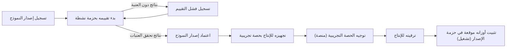
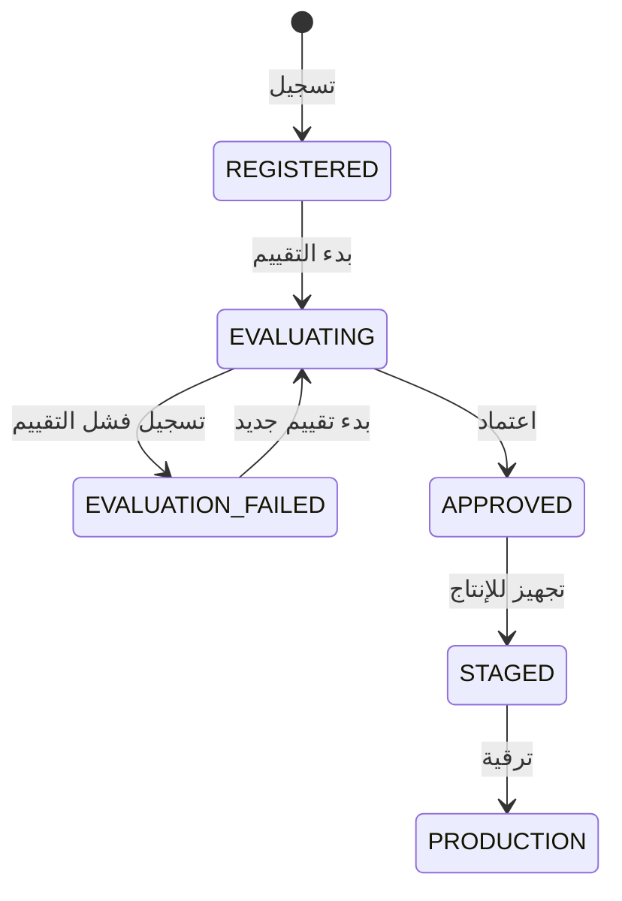

# تقييم النماذج واعتمادها

<!-- BEGIN GENERATED: doc -->
| البند | القيمة |
|---|---|
| المعرّف | FEAT-AI-MODEL-APPROVAL |
| الإصدار | 0.1 |
| الحالة | مسودة |
| القدرة | CAP-12 المساعدة بالذكاء الاصطناعي |
| القدرة الفرعية | CAP-12.04 تقييم AI وحوكمته (R2) |
| الأدوار | مهندس الذكاء الاصطناعي وحوكمته؛ المدقِّق |
| الشاشات | SCR-51 النماذج والتوجيه والأدوات والاستهلاك |
| حالات الاستخدام | UC-075 |
| القصص | 10: 7 من المواصفة، و3 جديدة |
<!-- END GENERATED: doc -->

## 1. نظرة عامة

### 1.1 القيمة

يضمن ألا يدخل أي نموذج ذكاء اصطناعي إلى الاستخدام الفعلي إلا بعد تقييم موثق لدقته وتكلفته وموافقة بشرية.

### 1.2 النطاق

| البند | القيمة |
|---|---|
| المستخدمون | مهندس الذكاء الاصطناعي وحوكمته (تسجيل إصدار النموذج وتقييمه وتجهيزه للإنتاج واعتماده وترقيته)؛ المدقِّق (قراءة فقط) |
| الشاشات | SCR-51 النماذج والتوجيه والأدوات والاستهلاك |
| حالات الاستخدام | حوكمة دورة حياة نموذج الذكاء الاصطناعي: من التسجيل حتى الإنتاج، بموافقة بشرية موثقة في كل خطوة حاسمة |
| المتطلبات | يدير النظام النماذج بثماني حالات (مسجَّل، قيد التقييم، معتمد، مجهَّز، في الإنتاج، تحت الرصد، مُهمَل، متقاعد)؛ ولا يدخل نموذج الإنتاج دون نتائج تقييم موثقة للتأريض والاستشهاد والهلوسة والكمون والتكلفة واعتماد بشري؛ ومن يسجّل النموذج أو يجهّزه لا يعتمده أو يرقّيه |
| خارج النطاق | إهمال النموذج وإعادته للسريان وتقاعده، ومتابعة انحرافه بعد الإنتاج (ميزة مراقبة النماذج)، وإعداد حزمة التقييم نفسها (ميزة حزم التقييم) |

### 1.3 خريطة الميزة

**الشكل 1: دورة اعتماد إصدار النموذج**



**الشكل 2: دورة حالات إصدار النموذج**



## 2. القواعد المشتركة

تنطبق على كل قصص الميزة، فلا تتكرر داخل القصص. وكل قصة تذكر ما يخصها فقط.

### 2.1 السياق المشترك

كل قصة تبدأ من ثلاثة شروط: مستأجر نشط، وحزمة السياسات الأساسية مفعّلة، ومستخدم مسجّل الدخول ومخوَّل. وتشير إليها القصص بخطوة واحدة: «بفرض السياق المشترك للميزة».

### 2.2 الصلاحية وعدم الإفصاح

- من لا يحق له رؤية العنصر يتلقى ردًا بشكل «غير متاح» تمامًا، فلا يعرف أنه موجود.
- من يرى العنصر ولا يحق له الإجراء يتلقى «لا تملك صلاحية هذا الإجراء».

### 2.3 أوامر تغيير الحالة

- **منع التكرار:** يُرسل كل أمر بمفتاح فريد، فإعادة الطلب نفسه لا تُنفَّذ مرتين.
- **حماية التعديل المتزامن:** يُرسل كل أمر بإصدار البيانات الذي يراه المستخدم. فإن عدّلها غيره في الأثناء، يُرفض الأمر.
- **السجل:** إن نجح الأمر، يُكتب حدثه وسجل التدقيق في المعاملة نفسها.

### 2.4 الرفض المشترك

```gherkin
# language: ar
خاصية: الرفض المشترك لأوامر الميزة

  سيناريو مخطط: رفض مشترك لكل أمر في الميزة
    بفرض السياق المشترك للميزة
    و <الحالة>
    عندما يُرسل المستخدم أي أمر من أوامر الميزة
    اذاً يُرفض برمز <الرمز> ويرى "<الرسالة>"
    و لا يتغير شيء

    امثلة:
      | الحالة                                  | الرمز                  | الرسالة                                                 |
      | العنصر خارج صلاحياته                    | NOT_FOUND              | غير متاح                                                |
      | العنصر مرئي له ولا يحق له الإجراء       | AUTHZ_DENIED           | لا تملك صلاحية هذا الإجراء                              |
      | غيره عدّل العنصر بعد أن فتحه            | VERSION_CONFLICT       | تغيّرت البيانات منذ فتحتها. راجع التغييرات ثم أعد المحاولة |
      | أعاد مفتاح منع التكرار بمحتوى مختلف     | IDEMPOTENCY_KEY_REUSED | طلب مكرر بمحتوى مختلف                                   |
      | البيانات ناقصة أو غير صحيحة             | VALIDATION_FAILED      | بعض البيانات ناقصة أو غير صحيحة. راجع الحقول المعلَّمة      |

  سيناريو: إعادة الطلب نفسه لا تُنفَّذ مرتين
    بفرض السياق المشترك للميزة
    و أمر نجح بمفتاح منع تكرار
    عندما يُعاد الطلب نفسه بالمفتاح نفسه
    اذاً تُعاد النتيجة الأولى ولا يُكتب حدث ثانٍ
```

## 3. الجودة وتعريف الاكتمال

### 3.1 متطلبات الجودة

<!-- BEGIN GENERATED: quality -->
| المرجع | الموقف | المطلوب |
|---|---|---|
| QAS-AI-001 | evaluation set of 500 questions | ≥ 95 % of cited items actually support the statement |
| QAS-AI-002 | insufficient-evidence and hallucination sets | ≤ 2 % unsupported statements; ≥ 95 % correct 'Insufficient Evidence' |
<!-- END GENERATED: quality -->

### 3.2 تعريف الاكتمال

القصة مكتملة حين تتحقق الشروط الخمسة:

1. سيناريوهاتها والقواعد المشتركة تمر في الاختبار الآلي.
2. فحوص البنية المعمارية تمر.
3. نصوص الواجهة والرسائل موجودة بالعربية والإنجليزية.
4. مراجعة الكود مكتملة.
5. ما تضيفه القصة نفسها في قسم «القواعد» تحقق.

## 4. فهرس القصص

<!-- BEGIN GENERATED: story-index -->
| المعرّف | القصة | النوع | الحالة |
|---|---|---|---|
| `US-BC07-MDL-APPROVE` | اعتماد إصدار النموذج | أمر | مسودة |
| `US-BC07-MDL-FAIL-EVALUATION` | تسجيل فشل تقييم إصدار النموذج | أمر | مسودة |
| `US-BC07-MDL-PROMOTE` | ترقية إصدار النموذج | أمر | مسودة |
| `US-BC07-MDL-REGISTER` | تسجيل إصدار النموذج | أمر | مسودة |
| `US-BC07-MDL-STAGE` | تجهيز إصدار النموذج للإنتاج | أمر | مسودة |
| `US-BC07-MDL-START-EVALUATION` | بدء تقييم إصدار النموذج | أمر | مسودة |
| `US-BC07-Q-MDL-LIST` | جلب: Model versions with state, evaluation summary, hosting | جلب | مسودة |
| `US-UI-SCR51-MODEL-LIFECYCLE` | متابعة إصدارات النماذج وتقييمها | واجهة | مسودة |
| `US-PLT-AI-CANARY-SPLIT` | توجيه حصة تجريبية إلى النموذج المجهز | منصة | مسودة |
| `US-OPS-AI-MODEL-BUNDLE` | تثبيت أوزان النموذج موقعة في حزمة الإصدار | تشغيل | مسودة |
<!-- END GENERATED: story-index -->

## 5. القصص

### 5.1 US-BC07-MDL-APPROVE — اعتماد إصدار النموذج

| النوع | الإصدار | الأولوية | دون اتصال | الحالة |
|---|---|---|---|---|
| أمر | R2 | Must | لا | مسودة |

> **كـ** مهندس الذكاء الاصطناعي وحوكمته بصفته معتمِدًا، **أريد** اعتماد إصدار النموذج الذي أنهى تقييمه، **حتى** لا يدخل الإنتاج إلا ما حقق تقريره عتبات الدقة والسلامة.

**باختصار:** اعتماد إصدار «قيد التقييم» يتطلب تقرير تقييم يحقق كل العتبات، وألا يكون المعتمِد هو من سجَّل النموذج.

#### القواعد

- **متى يُسمح:** الإصدار في حالة «قيد التقييم»، وتقرير التقييم يحقق: دقة استشهاد 95% فأكثر، ومعدل هلوسة 2% فأقل، واستدعاء أدلة غير كافية 95% فأكثر، وصفر محاولات حقن أو تسريب ناجحة، وتسجيل الكمون والتكلفة.
- **من يُسمح له:** مهندس الذكاء الاصطناعي وحوكمته بصفته معتمِدًا، وألا يكون هو من سجَّل الإصدار.
- **البيانات:** مرجع تقرير التقييم.
- **الأثر:** تصبح حالة الإصدار «معتمد»، ويُسجَّل حدث «اعتُمد إصدار النموذج».

#### معايير القبول

```gherkin
# language: ar
خاصية: اعتماد إصدار النموذج

  سيناريو: اعتماد إصدار حقق كل العتبات
    بفرض السياق المشترك للميزة
    و إصدار نموذج "قيد التقييم" بتقرير يحقق كل العتبات
    عندما يعتمده شخص غير من سجَّله
    اذاً تصبح حالته "معتمد"
    و يُسجَّل حدث "اعتُمد إصدار النموذج"

  سيناريو مخطط: رفض خاص باعتماد إصدار النموذج
    بفرض السياق المشترك للميزة
    و <الحالة>
    عندما يحاول اعتماد الإصدار
    اذاً يُرفض برمز <الرمز> ويرى "<الرسالة>"
    و لا يتغير شيء

    امثلة:
      | الحالة                                   | الرمز                                  | الرسالة                                           |
      | الإصدار ليس "قيد التقييم"                | MODEL_VERSION_INVALID_STATE_TRANSITION | الوضع الحالي لإصدار النموذج لا يسمح بهذا الإجراء |
      | تقرير التقييم لا يحقق عتبة واحدة فأكثر   | EVALUATION_BELOW_THRESHOLD             | نتائج تقييم النموذج دون الحد المطلوب              |
      | المعتمِد هو من سجَّل الإصدار              | SEGREGATION_OF_DUTIES                  | لا يجوز أن يعتمد الشخص نفسه ما قدّمه أو طلبه      |
      | مرجع التقرير غير مُرسَل                   | VALIDATION_FAILED                      | تقرير التقييم مطلوب                               |
```

<details><summary>المراجع التقنية والتتبع</summary>

<!-- BEGIN GENERATED: refs US-BC07-MDL-APPROVE -->
| البند | المعرّف | المعنى |
|---|---|---|
| الواجهة البرمجية | `POST /api/v1/ai/models/{id}/actions/approve` | — |
| الأمر | `CMD-MDL-APPROVE` | اعتماد إصدار النموذج |
| السياسة | `POL-MDL-APPROVE` | AI platform engineer (register, evaluate, stage, deprecate) · AI governance authority (approve, promote, rein… |
| الحدث | `EVT-MDL-APPROVED` | يصل إلى: Inference servers (load/unload); Routing validation |
| الكيان | `AGG-MODEL-VERSION` | إصدار النموذج |
| الجدول | `ai.model_versions` | الجدول الرئيسي لإصدار النموذج |
| وحدة النشر | DU-16 | — |
| المتطلبات | REQ-AI-009، REQ-AI-010 | معانيها في القسم 6. التتبع |
| حالة الاستخدام | UC-075 | Govern AI Model Lifecycle |
| الاختبار | TST-MODEL-VERSION-SM، TST-SLC10-INVARIANTS | دورة حالات إصدار النموذج، وثوابت الشريحة SLC-10 |
<!-- END GENERATED: refs US-BC07-MDL-APPROVE -->

</details>

### 5.2 US-BC07-MDL-FAIL-EVALUATION — تسجيل فشل تقييم إصدار النموذج

| النوع | الإصدار | الأولوية | دون اتصال | الحالة |
|---|---|---|---|---|
| أمر | R2 | Must | لا | مسودة |

> **كـ** مهندس الذكاء الاصطناعي وحوكمته، **أريد** تسجيل فشل تقييم إصدار النموذج مع تقرير النتائج، **حتى** يبقى الإصدار خارج الاعتماد ويُعرف سبب الفشل لمن يحاول تقييمه مجددًا.

**باختصار:** تسجيل فشل التقييم ينقل الإصدار من «قيد التقييم» إلى «فشل التقييم» مع تقرير يوضح أين قصرت النتائج.

#### القواعد

- **متى يُسمح:** الإصدار في حالة «قيد التقييم».
- **من يُسمح له:** مهندس الذكاء الاصطناعي وحوكمته.
- **البيانات:** مرجع تقرير التقييم الذي يوضح سبب الفشل.
- **الأثر:** تصبح حالة الإصدار «فشل التقييم»، ويُسجَّل حدث «فشل تقييم إصدار النموذج».

#### معايير القبول

```gherkin
# language: ar
خاصية: تسجيل فشل تقييم إصدار النموذج

  سيناريو: تسجيل فشل بتقرير
    بفرض السياق المشترك للميزة
    و إصدار نموذج "قيد التقييم"
    عندما يسجّل مهندس الذكاء الاصطناعي وحوكمته فشل التقييم مع تقريره
    اذاً تصبح حالته "فشل التقييم"
    و يُسجَّل حدث "فشل تقييم إصدار النموذج"

  سيناريو مخطط: رفض خاص بتسجيل فشل التقييم
    بفرض السياق المشترك للميزة
    و <الحالة>
    عندما يحاول تسجيل فشل التقييم
    اذاً يُرفض برمز <الرمز> ويرى "<الرسالة>"
    و لا يتغير شيء

    امثلة:
      | الحالة                         | الرمز                                  | الرسالة                                           |
      | الإصدار ليس "قيد التقييم"      | MODEL_VERSION_INVALID_STATE_TRANSITION | الوضع الحالي لإصدار النموذج لا يسمح بهذا الإجراء |
      | مرجع التقرير غير مُرسَل         | VALIDATION_FAILED                      | تقرير التقييم مطلوب                               |
```

<details><summary>المراجع التقنية والتتبع</summary>

<!-- BEGIN GENERATED: refs US-BC07-MDL-FAIL-EVALUATION -->
| البند | المعرّف | المعنى |
|---|---|---|
| الواجهة البرمجية | `POST /api/v1/ai/models/{id}/actions/fail-evaluation` | — |
| الأمر | `CMD-MDL-FAIL-EVALUATION` | تسجيل فشل تقييم إصدار النموذج |
| السياسة | `POL-MDL-FAIL-EVALUATION` | AI platform engineer (register, evaluate, stage, deprecate) · AI governance authority (approve, promote, rein… |
| الحدث | `EVT-MDL-EVALUATION-FAILED` | يصل إلى: Inference servers (load/unload); Routing validation |
| الكيان | `AGG-MODEL-VERSION` | إصدار النموذج |
| الجدول | `ai.model_versions` | الجدول الرئيسي لإصدار النموذج |
| وحدة النشر | DU-16 | — |
| المتطلبات | REQ-AI-009، REQ-AI-010 | معانيها في القسم 6. التتبع |
| حالة الاستخدام | UC-075 | Govern AI Model Lifecycle |
| الاختبار | TST-MODEL-VERSION-SM، TST-SLC10-INVARIANTS | دورة حالات إصدار النموذج، وثوابت الشريحة SLC-10 |
<!-- END GENERATED: refs US-BC07-MDL-FAIL-EVALUATION -->

</details>

### 5.3 US-BC07-MDL-PROMOTE — ترقية إصدار النموذج

| النوع | الإصدار | الأولوية | دون اتصال | الحالة |
|---|---|---|---|---|
| أمر | R2 | Must | لا | مسودة |

> **كـ** مهندس الذكاء الاصطناعي وحوكمته بصفته معتمِدًا، **أريد** ترقية إصدار النموذج المجهَّز إلى الإنتاج بعد نجاح حصته التجريبية، **حتى** يخدم كل العمليات بدل حصة محدودة منها.

**باختصار:** ترقية إصدار «مجهَّز» إلى «في الإنتاج» تتطلب تقرير حصة تجريبية ضمن العتبات لسبعة أيام فأكثر، وألا يكون المرقِّي هو من جهَّزه.

#### القواعد

- **متى يُسمح:** الإصدار في حالة «مجهَّز»، ونتائج حصته التجريبية ضمن العتبات المطلوبة لسبعة أيام متتالية فأكثر.
- **من يُسمح له:** مهندس الذكاء الاصطناعي وحوكمته بصفته معتمِدًا، وألا يكون هو من جهَّز الإصدار.
- **البيانات:** مرجع تقرير الحصة التجريبية.
- **الأثر:** تصبح حالة الإصدار «في الإنتاج»، ويُسجَّل حدث «رُقِّي إصدار النموذج»، وتصبح التوجيهات حرة في استخدامه لكل العمليات.

#### معايير القبول

```gherkin
# language: ar
خاصية: ترقية إصدار النموذج

  سيناريو: ترقية إصدار نجحت حصته التجريبية
    بفرض السياق المشترك للميزة
    و إصدار نموذج "مجهَّز" وحصته التجريبية ضمن العتبات منذ سبعة أيام
    عندما يرقّيه شخص غير من جهَّزه
    اذاً تصبح حالته "في الإنتاج"
    و يُسجَّل حدث "رُقِّي إصدار النموذج"

  سيناريو مخطط: رفض خاص بترقية إصدار النموذج
    بفرض السياق المشترك للميزة
    و <الحالة>
    عندما يحاول ترقية الإصدار
    اذاً يُرفض برمز <الرمز> ويرى "<الرسالة>"
    و لا يتغير شيء

    امثلة:
      | الحالة                                                 | الرمز                                  | الرسالة                                           |
      | الإصدار ليس "مجهَّز"                                    | MODEL_VERSION_INVALID_STATE_TRANSITION | الوضع الحالي لإصدار النموذج لا يسمح بهذا الإجراء |
      | نتائج الحصة التجريبية دون العتبة أو أقل من سبعة أيام   | CANARY_BELOW_THRESHOLD                 | نتائج التجربة المحدودة للنموذج دون الحد المطلوب   |
      | المرقِّي هو من جهَّز الإصدار                             | SEGREGATION_OF_DUTIES                  | لا يجوز أن يعتمد الشخص نفسه ما قدّمه أو طلبه      |
      | مرجع تقرير الحصة التجريبية غير مُرسَل                   | VALIDATION_FAILED                      | تقرير التجربة المحدودة مطلوب                       |
```

<details><summary>المراجع التقنية والتتبع</summary>

<!-- BEGIN GENERATED: refs US-BC07-MDL-PROMOTE -->
| البند | المعرّف | المعنى |
|---|---|---|
| الواجهة البرمجية | `POST /api/v1/ai/models/{id}/actions/promote` | — |
| الأمر | `CMD-MDL-PROMOTE` | ترقية إصدار النموذج |
| السياسة | `POL-MDL-PROMOTE` | AI platform engineer (register, evaluate, stage, deprecate) · AI governance authority (approve, promote, rein… |
| الحدث | `EVT-MDL-PROMOTED` | يصل إلى: Inference servers (load/unload); Routing validation |
| الكيان | `AGG-MODEL-VERSION` | إصدار النموذج |
| الجدول | `ai.model_versions` | الجدول الرئيسي لإصدار النموذج |
| وحدة النشر | DU-16 | — |
| المتطلبات | REQ-AI-009، REQ-AI-010 | معانيها في القسم 6. التتبع |
| حالة الاستخدام | UC-075 | Govern AI Model Lifecycle |
| الاختبار | TST-MODEL-VERSION-SM، TST-SLC10-INVARIANTS | دورة حالات إصدار النموذج، وثوابت الشريحة SLC-10 |
<!-- END GENERATED: refs US-BC07-MDL-PROMOTE -->

</details>

### 5.4 US-BC07-MDL-REGISTER — تسجيل إصدار النموذج

| النوع | الإصدار | الأولوية | دون اتصال | الحالة |
|---|---|---|---|---|
| أمر | R2 | Must | لا | مسودة |

> **كـ** مهندس الذكاء الاصطناعي وحوكمته، **أريد** تسجيل إصدار جديد من نموذج ببياناته الأساسية، **حتى** يدخل دورة التقييم والاعتماد قبل أي استخدام فعلي.

**باختصار:** تسجيل إصدار نموذج جديد ببصمة أوزانه ولغاته وسعة سياقه واستضافته وأدواره يضعه في حالة «مسجَّل»، بداية دورة حياته.

#### القواعد

- **متى يُسمح:** لا يوجد إصدار مسجَّل بهذه البيانات من قبل.
- **من يُسمح له:** مهندس الذكاء الاصطناعي وحوكمته.
- **البيانات:** العائلة والإصدار وبصمة الأوزان والترخيص واللغات (تشمل العربية والإنجليزية للأدوار التوليدية) وسعة السياق والاستضافة (محلية أو خارجية مسموحة) والأدوار المرشَّحة لها.
- **الأثر:** يُنشأ الإصدار بحالة «مسجَّل»، ويُسجَّل حدث «سُجِّل إصدار النموذج».

#### معايير القبول

```gherkin
# language: ar
خاصية: تسجيل إصدار النموذج

  سيناريو: تسجيل إصدار جديد ببيانات كاملة
    بفرض السياق المشترك للميزة
    عندما يسجّل مهندس الذكاء الاصطناعي وحوكمته إصدارًا جديدًا ببياناته كاملة
    اذاً يُنشأ الإصدار بحالة "مسجَّل"
    و يُسجَّل حدث "سُجِّل إصدار النموذج"

  سيناريو مخطط: رفض خاص بتسجيل إصدار النموذج
    بفرض السياق المشترك للميزة
    و <الحالة>
    عندما يحاول تسجيل الإصدار
    اذاً يُرفض برمز <الرمز> ويرى "<الرسالة>"
    و لا يتغير شيء

    امثلة:
      | الحالة                                                                                          | الرمز             | الرسالة            |
      | شرط من شروط التسجيل غير متحقق (بصمة الأوزان أو الترخيص أو اللغات أو سعة السياق أو الاستضافة)   | MODEL_INVALID     | بيانات النموذج غير مكتملة |
      | بصمة الأوزان غير مُرسَلة                                                                         | VALIDATION_FAILED | بصمة الأوزان مطلوبة |
```

<details><summary>المراجع التقنية والتتبع</summary>

<!-- BEGIN GENERATED: refs US-BC07-MDL-REGISTER -->
| البند | المعرّف | المعنى |
|---|---|---|
| الواجهة البرمجية | `POST /api/v1/ai/models` | — |
| الأمر | `CMD-MDL-REGISTER` | تسجيل إصدار النموذج |
| السياسة | `POL-MDL-REGISTER` | AI platform engineer (register, evaluate, stage, deprecate) · AI governance authority (approve, promote, rein… |
| الحدث | `EVT-MDL-REGISTERED` | يصل إلى: Inference servers (load/unload); Routing validation |
| الكيان | `AGG-MODEL-VERSION` | إصدار النموذج |
| الجدول | `ai.model_versions` | الجدول الرئيسي لإصدار النموذج |
| وحدة النشر | DU-16 | — |
| المتطلبات | REQ-AI-009، REQ-AI-010 | معانيها في القسم 6. التتبع |
| حالة الاستخدام | UC-075 | Govern AI Model Lifecycle |
| الاختبار | TST-MODEL-VERSION-SM، TST-SLC10-INVARIANTS | دورة حالات إصدار النموذج، وثوابت الشريحة SLC-10 |
<!-- END GENERATED: refs US-BC07-MDL-REGISTER -->

</details>

### 5.5 US-BC07-MDL-STAGE — تجهيز إصدار النموذج للإنتاج

| النوع | الإصدار | الأولوية | دون اتصال | الحالة |
|---|---|---|---|---|
| أمر | R2 | Must | لا | مسودة |

> **كـ** مهندس الذكاء الاصطناعي وحوكمته، **أريد** تجهيز إصدار النموذج المعتمد للإنتاج بحصة تجريبية محدودة، **حتى** تُقاس نتائجه على عمليات فعلية قبل تعميمه.

**باختصار:** تجهيز إصدار «معتمد» يحدد حصة تجريبية لا تتجاوز 10% من العمليات المستهدفة، فتصبح حالته «مجهَّز».

#### القواعد

- **متى يُسمح:** الإصدار في حالة «معتمد».
- **من يُسمح له:** مهندس الذكاء الاصطناعي وحوكمته.
- **البيانات:** نسبة الحصة التجريبية (لا تتجاوز 10%)، والعمليات المستهدفة بها.
- **الأثر:** تصبح حالة الإصدار «مجهَّز»، ويُسجَّل حدث «جُهِّز إصدار النموذج»، ويبدأ توجيه الحصة التجريبية (القصة 5.9).

#### معايير القبول

```gherkin
# language: ar
خاصية: تجهيز إصدار النموذج للإنتاج

  سيناريو: تجهيز إصدار معتمد بحصة تجريبية
    بفرض السياق المشترك للميزة
    و إصدار نموذج "معتمد"
    عندما يجهّزه مهندس الذكاء الاصطناعي وحوكمته بحصة 10% من عمليات محددة
    اذاً تصبح حالته "مجهَّز"
    و يُسجَّل حدث "جُهِّز إصدار النموذج"

  سيناريو مخطط: رفض خاص بتجهيز إصدار النموذج
    بفرض السياق المشترك للميزة
    و <الحالة>
    عندما يحاول تجهيزه
    اذاً يُرفض برمز <الرمز> ويرى "<الرسالة>"
    و لا يتغير شيء

    امثلة:
      | الحالة                            | الرمز                                  | الرسالة                                           |
      | الإصدار ليس "معتمد"               | MODEL_VERSION_INVALID_STATE_TRANSITION | الوضع الحالي لإصدار النموذج لا يسمح بهذا الإجراء |
      | نسبة الحصة أو العمليات غير مُرسَلة | VALIDATION_FAILED                      | نسبة الحصة التجريبية مطلوبة                        |
```

<details><summary>المراجع التقنية والتتبع</summary>

<!-- BEGIN GENERATED: refs US-BC07-MDL-STAGE -->
| البند | المعرّف | المعنى |
|---|---|---|
| الواجهة البرمجية | `POST /api/v1/ai/models/{id}/actions/stage` | — |
| الأمر | `CMD-MDL-STAGE` | تجهيز إصدار النموذج للإنتاج |
| السياسة | `POL-MDL-STAGE` | AI platform engineer (register, evaluate, stage, deprecate) · AI governance authority (approve, promote, rein… |
| الحدث | `EVT-MDL-STAGED` | يصل إلى: Inference servers (load/unload); Routing validation |
| الكيان | `AGG-MODEL-VERSION` | إصدار النموذج |
| الجدول | `ai.model_versions` | الجدول الرئيسي لإصدار النموذج |
| وحدة النشر | DU-16 | — |
| المتطلبات | REQ-AI-009، REQ-AI-010 | معانيها في القسم 6. التتبع |
| حالة الاستخدام | UC-075 | Govern AI Model Lifecycle |
| الاختبار | TST-MODEL-VERSION-SM، TST-SLC10-INVARIANTS | دورة حالات إصدار النموذج، وثوابت الشريحة SLC-10 |
<!-- END GENERATED: refs US-BC07-MDL-STAGE -->

</details>

### 5.6 US-BC07-MDL-START-EVALUATION — بدء تقييم إصدار النموذج

| النوع | الإصدار | الأولوية | دون اتصال | الحالة |
|---|---|---|---|---|
| أمر | R2 | Must | لا | مسودة |

> **كـ** مهندس الذكاء الاصطناعي وحوكمته، **أريد** بدء تقييم إصدار النموذج المسجَّل بحزمة تقييم نشطة، **حتى** تُقاس دقته وتأريضه وسلامته قبل اعتماده.

**باختصار:** بدء التقييم ينقل الإصدار «المسجَّل» إلى «قيد التقييم» بربطه بحزمة تقييم نشطة، فيشغّلها محرك التقييم (ميزة حزم التقييم).

#### القواعد

- **متى يُسمح:** الإصدار في حالة «مسجَّل»، وحزمة التقييم المحدَّدة «نشطة».
- **من يُسمح له:** مهندس الذكاء الاصطناعي وحوكمته.
- **البيانات:** مرجع حزمة التقييم.
- **الأثر:** تصبح حالة الإصدار «قيد التقييم»، ويُسجَّل حدث «بدأ تقييم إصدار النموذج».

#### معايير القبول

```gherkin
# language: ar
خاصية: بدء تقييم إصدار النموذج

  سيناريو: بدء التقييم بحزمة نشطة
    بفرض السياق المشترك للميزة
    و إصدار نموذج "مسجَّل" وحزمة تقييم "نشطة"
    عندما يبدأ مهندس الذكاء الاصطناعي وحوكمته تقييمه بهذه الحزمة
    اذاً تصبح حالته "قيد التقييم"
    و يُسجَّل حدث "بدأ تقييم إصدار النموذج"

  سيناريو مخطط: رفض خاص ببدء تقييم إصدار النموذج
    بفرض السياق المشترك للميزة
    و <الحالة>
    عندما يحاول بدء التقييم
    اذاً يُرفض برمز <الرمز> ويرى "<الرسالة>"
    و لا يتغير شيء

    امثلة:
      | الحالة                          | الرمز                                  | الرسالة                                           |
      | الإصدار ليس "مسجَّل"             | MODEL_VERSION_INVALID_STATE_TRANSITION | الوضع الحالي لإصدار النموذج لا يسمح بهذا الإجراء |
      | حزمة التقييم المحدَّدة غير نشطة  | SUITE_NOT_ACTIVE                       | حزمة التقييم غير نشطة                              |
      | حزمة التقييم غير مُرسَلة         | VALIDATION_FAILED                      | حزمة التقييم مطلوبة                                |
```

<details><summary>المراجع التقنية والتتبع</summary>

<!-- BEGIN GENERATED: refs US-BC07-MDL-START-EVALUATION -->
| البند | المعرّف | المعنى |
|---|---|---|
| الواجهة البرمجية | `POST /api/v1/ai/models/{id}/actions/start-evaluation` | — |
| الأمر | `CMD-MDL-START-EVALUATION` | بدء تقييم إصدار النموذج |
| السياسة | `POL-MDL-START-EVALUATION` | AI platform engineer (register, evaluate, stage, deprecate) · AI governance authority (approve, promote, rein… |
| الحدث | `EVT-MDL-EVALUATION-STARTED` | يصل إلى: Inference servers (load/unload); Routing validation |
| الكيان | `AGG-MODEL-VERSION` | إصدار النموذج |
| الجدول | `ai.model_versions` | الجدول الرئيسي لإصدار النموذج |
| وحدة النشر | DU-16 | — |
| المتطلبات | REQ-AI-009، REQ-AI-010 | معانيها في القسم 6. التتبع |
| حالة الاستخدام | UC-075 | Govern AI Model Lifecycle |
| الاختبار | TST-MODEL-VERSION-SM، TST-SLC10-INVARIANTS | دورة حالات إصدار النموذج، وثوابت الشريحة SLC-10 |
<!-- END GENERATED: refs US-BC07-MDL-START-EVALUATION -->

</details>

### 5.7 US-BC07-Q-MDL-LIST — قائمة إصدارات النماذج

| النوع | الإصدار | الأولوية | دون اتصال | الحالة |
|---|---|---|---|---|
| جلب | R2 | Must | لا | مسودة |

> **كـ** مهندس الذكاء الاصطناعي وحوكمته أو المدقِّق، **أريد** قائمة بإصدارات النماذج وحالتها وملخص تقييمها واستضافتها، **حتى** أتابع دورة حياة كل إصدار دون الرجوع إلى مصادر متفرقة.

**باختصار:** تُعاد إصدارات النماذج المرئية للمستخدم فقط، صفحةً بعد صفحة، بحالتها وملخص تقييمها واستضافتها.

#### القواعد

- **من يرى ماذا:** مهندس الذكاء الاصطناعي وحوكمته والمدقِّق يريان إصدارات مستأجرهم فقط؛ لا إفصاح عن إصدار خارج الصلاحية.
- **البيانات:** المؤشر والحد للترقيم بالصفحات.

#### معايير القبول

```gherkin
# language: ar
خاصية: قائمة إصدارات النماذج

  سيناريو: يرى المستخدم إصدارات مستأجره فقط
    بفرض السياق المشترك للميزة
    عندما يطلب قائمة إصدارات النماذج
    اذاً تُعاد الإصدارات المرئية له فقط، كل منها بحالتها وملخص تقييمها واستضافتها
    و لا يكشف أي عدد أو اقتراح وجود إصدار محجوب

  سيناريو: الصفحة التالية
    بفرض السياق المشترك للميزة
    و إصدارات أكثر من صفحة
    عندما يطلب الصفحة التالية بالمؤشر
    اذاً تُعاد الإصدارات التالية دون تكرار ولا فجوة
```

<details><summary>المراجع التقنية والتتبع</summary>

<!-- BEGIN GENERATED: refs US-BC07-Q-MDL-LIST -->
| البند | المعرّف | المعنى |
|---|---|---|
| الواجهة البرمجية | `GET /api/v1/ai/models` | — |
| الاستعلام | `QRY-MDL-LIST` | Model versions with state, evaluation summary, hosting |
| السياسة | `POL-MDL-LIST` | AI governance, Auditor |
| الكيان | `AGG-MODEL-VERSION` | إصدار النموذج |
| الجدول | `ai.model_versions` | الجدول الرئيسي لإصدار النموذج |
| وحدة النشر | DU-16 | — |
| المتطلب | REQ-AI-009 | The system shall manage models through the lifecycle REGISTERED, EVALUATING, APPROVED, STAGED, PRODUCTION, MO… |
| حالة الاستخدام | UC-075 | Govern AI Model Lifecycle |
| الاختبار | TST-MODEL-VERSION-SM، TST-SLC10-INVARIANTS | دورة حالات إصدار النموذج، وثوابت الشريحة SLC-10 |
<!-- END GENERATED: refs US-BC07-Q-MDL-LIST -->

</details>

### 5.8 US-UI-SCR51-MODEL-LIFECYCLE — متابعة إصدارات النماذج وتقييمها

| النوع | الإصدار | الأولوية | دون اتصال | الحالة |
|---|---|---|---|---|
| واجهة | R2 | Must | لا | مسودة |

> **كـ** مهندس الذكاء الاصطناعي وحوكمته، **أريد** متابعة كل إصدارات النماذج وحالاتها وتقييماتها من شاشة واحدة، **حتى** أعرف أين يقف كل إصدار في دورة حياته وما الإجراء المتاح له الآن.

**باختصار:** الشاشة تعرض إصدارات النماذج مجمَّعة حسب الحالة، ولكل إصدار الإجراءات المتاحة فقط لحالته الحالية وصلاحية المستخدم.

#### القواعد

- **الأثر:** لا يظهر للمستخدم إجراء لا تسمح به حالة الإصدار الحالية أو صلاحيته.

#### معايير القبول

```gherkin
# language: ar
خاصية: متابعة إصدارات النماذج وتقييمها

  سيناريو: الإجراءات المتاحة تتبع الحالة
    بفرض السياق المشترك للميزة
    و إصدار نموذج "قيد التقييم"
    عندما يفتح مهندس الذكاء الاصطناعي وحوكمته شاشة الإصدار
    اذاً يرى إجراءي "اعتماد" و"تسجيل فشل التقييم" فقط دون إجراءات حالات أخرى

  سيناريو: لا إجراء بلا صلاحية
    بفرض السياق المشترك للميزة
    و إصدار نموذج "معتمد" والمستخدم لا يملك صلاحية الاعتماد
    عندما يفتح شاشة الإصدار
    اذاً لا يرى إجراء "ترقية" أو "تجهيز للإنتاج"
```

<details><summary>المراجع التقنية والتتبع</summary>

<!-- BEGIN GENERATED: refs US-UI-SCR51-MODEL-LIFECYCLE -->
| البند | المعرّف | المعنى |
|---|---|---|
| حالة الاستخدام | UC-075 | Govern AI Model Lifecycle |
| الشاشة | SCR-51 | شاشة النماذج والتوجيه والأدوات والاستهلاك |
| المصدر | `[Derived]` | — |
| المتطلبات | REQ-AI-009، REQ-AI-010 | معانيها في القسم 6. التتبع |
| حالة الاستخدام | UC-075 | Govern AI Model Lifecycle |
<!-- END GENERATED: refs US-UI-SCR51-MODEL-LIFECYCLE -->

</details>

### 5.9 US-PLT-AI-CANARY-SPLIT — توجيه حصة تجريبية إلى النموذج المجهز

| النوع | الإصدار | الأولوية | دون اتصال | الحالة |
|---|---|---|---|---|
| منصة | R2 | Should | لا ينطبق | مسودة |

> **كـ** فريق المنصة، **أريد** توجيه الحصة التجريبية المحددة من العمليات إلى الإصدار المجهَّز بدل الإصدار الحالي في الإنتاج، **حتى** تُقاس نتائجه الحقيقية دون المساس بباقي العمليات.

**باختصار:** بعد تجهيز إصدار بحصة تجريبية، يوجّه التوجيه هذه النسبة فقط من العمليات المستهدفة إليه، وتستمر بقية العمليات على إصدار الإنتاج الحالي، لسبعة أيام على الأقل قبل الترقية (**[Derived]**، يعتمد على `US-BC07-MDL-STAGE` و`US-BC07-MDL-PROMOTE`).

#### القواعد

- **الأثر:** تُحسب نتائج الحصة التجريبية بمعزل عن بقية الحركة، وتُغذّي تقرير الترقية (القصة 5.3).

#### معايير القبول

```gherkin
# language: ar
خاصية: توجيه الحصة التجريبية

  سيناريو: توجيه النسبة المحددة فقط
    بفرض السياق المشترك للميزة
    و إصدار نموذج "مجهَّز" بحصة تجريبية 10% من عملية محددة
    عندما تصل طلبات هذه العملية
    اذاً يوجَّه 10% منها إلى الإصدار المجهَّز وباقيها إلى إصدار الإنتاج الحالي
    و تُحسب نتائج الحصة التجريبية بمعزل عن بقية الحركة
```

<details><summary>المراجع التقنية والتتبع</summary>

<!-- BEGIN GENERATED: refs US-PLT-AI-CANARY-SPLIT -->
| البند | المعرّف | المعنى |
|---|---|---|
| المصدر | `US-BC07-MDL-STAGE` | — |
| المصدر | `US-BC07-MDL-PROMOTE` | — |
| المصدر | `13-verification/acceptance/SLC-10/invariants-slc10.md` | — |
<!-- END GENERATED: refs US-PLT-AI-CANARY-SPLIT -->

</details>

### 5.10 US-OPS-AI-MODEL-BUNDLE — تثبيت أوزان النموذج موقعة في حزمة الإصدار

| النوع | الإصدار | الأولوية | دون اتصال | الحالة |
|---|---|---|---|---|
| تشغيل | R2 | Should | لا ينطبق | مسودة |

> **كـ** فريق التشغيل أو الأمن، **أريد** تثبيت أوزان إصدار النموذج موقَّعة ومرفقة بسجل مكوناتها داخل حزمة الإصدار، **حتى** لا تدخل الإنتاج أوزان مُتلاعَب بها أو بلا مصدر موثَّق.

**باختصار:** كل إصدار نموذج يدخل حزمة النشر يحمل أوزانًا موقَّعة ببصمتها المسجَّلة، مع سجل مكوناتها، ويُثبَّت عبر حزم تعمل في المواقع المنقطعة عن الشبكة (**[Derived]**).

#### القواعد

- **الأثر:** لا تُقبل حزمة نشر تحمل أوزانًا لا تطابق بصمتها المسجَّلة عند التسجيل، ويُسجَّل التحقق في سجل النشر.

#### معايير القبول

```gherkin
# language: ar
خاصية: تثبيت أوزان النموذج الموقَّعة

  سيناريو: حزمة بأوزان موقَّعة ومطابقة
    بفرض إصدار نموذج مسجَّل ببصمة أوزان معروفة
    عندما تُبنى حزمة النشر
    اذاً تحمل الحزمة الأوزان موقَّعة مع سجل مكوناتها
    و يتحقق النشر من مطابقة البصمة قبل التثبيت

  سيناريو: رفض حزمة ببصمة غير مطابقة
    بفرض حزمة نشر تحمل أوزانًا ببصمة لا تطابق المسجَّلة
    عندما يُحاول تثبيتها
    اذاً يتوقف التثبيت ولا تُستخدم الأوزان
```

<details><summary>المراجع التقنية والتتبع</summary>

<!-- BEGIN GENERATED: refs US-OPS-AI-MODEL-BUNDLE -->
| البند | المعرّف | المعنى |
|---|---|---|
| المصدر | `THR-S10-05` | — |
| القرار التقني | TD-17 | Signed images (cosign) + SBOM (Syft); offline bundles with Zarf (air-gapped install/upgrade/rollback); GitOps… |
| المصدر | `22-deployment-design.md §7` | — |
| المصدر | `[Derived]` | — |
<!-- END GENERATED: refs US-OPS-AI-MODEL-BUNDLE -->

</details>

## 6. التتبع

<!-- BEGIN GENERATED: trace -->
| المتطلب | المعنى | القصص | الاختبار |
|---|---|---|---|
| REQ-AI-009 | The system shall manage models through the lifecycle REGISTERED, EVALUATING, APPROVED, STAGED, PRODUCTION, MO… | `US-BC07-MDL-APPROVE`، `US-BC07-MDL-FAIL-EVALUATION`، `US-BC07-MDL-PROMOTE`، `US-BC07-MDL-REGISTER`، `US-BC07-MDL-STAGE`، `US-BC07-MDL-START-EVALUATION`، `US-BC07-Q-MDL-LIST`، `US-UI-SCR51-MODEL-LIFECYCLE` | TST-MODEL-VERSION-SM، TST-SLC10-INVARIANTS |
| REQ-AI-010 | When a model version is proposed for production, the system shall require evaluation results for groundedness… | `US-BC07-MDL-APPROVE`، `US-BC07-MDL-FAIL-EVALUATION`، `US-BC07-MDL-PROMOTE`، `US-BC07-MDL-REGISTER`، `US-BC07-MDL-STAGE`، `US-BC07-MDL-START-EVALUATION`، `US-UI-SCR51-MODEL-LIFECYCLE` | TST-EVAL-SUITE-SM، TST-MODEL-VERSION-SM، TST-SLC10-INVARIANTS |
<!-- END GENERATED: trace -->

## 7. سجل التغييرات

| الإصدار | التاريخ | التغيير |
|---|---|---|
| 0.1 | — | هيكل مولَّد من خريطة الميزات |
| 0.2 | 2026-10-13 | كتابة القصص كاملة بمعيار القصص |
