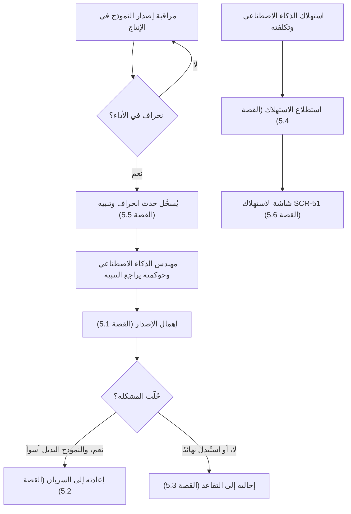
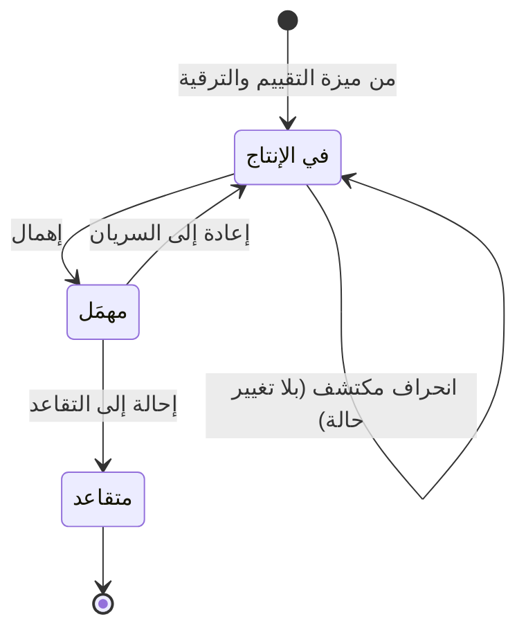

# مراقبة النماذج وإيقافها

<!-- BEGIN GENERATED: doc -->
| البند | القيمة |
|---|---|
| المعرّف | FEAT-AI-MODEL-MONITOR |
| الإصدار | 0.2 |
| الحالة | مسودة |
| القدرة | CAP-12 المساعدة بالذكاء الاصطناعي |
| القدرة الفرعية | CAP-12.04 تقييم AI وحوكمته (R2) |
| الأدوار | مهندس الذكاء الاصطناعي وحوكمته؛ النظام |
| الشاشات | SCR-51 النماذج والتوجيه والأدوات والاستهلاك |
| حالات الاستخدام | UC-075 |
| القصص | 9: 5 من المواصفة، و4 جديدة |
<!-- END GENERATED: doc -->

## 1. نظرة عامة

### 1.1 القيمة

ينبه إلى تراجع أداء النموذج أثناء التشغيل ويتيح إيقاف استخدامه أو إعادته أو إحالته إلى التقاعد.

### 1.2 النطاق

| البند | القيمة |
|---|---|
| المستخدمون | مهندس الذكاء الاصطناعي وحوكمته؛ مسؤول الإدارة؛ مسؤول الأمن؛ المدقِّق؛ النظام (المجدول) |
| الشاشات | شاشة النماذج والتوجيه والأدوات والاستهلاك (SCR-51) |
| حالات الاستخدام | حوكمة دورة حياة النموذج: إيقاف استخدامه أو إعادته أو إحالته إلى التقاعد، ومتابعة استهلاكه وتكلفته |
| المتطلبات | إدارة إصدار النموذج بدورة حالات محددة؛ عدم ترقية نموذج للإنتاج دون تقييم مُثبت؛ قياس استهلاك الذكاء الاصطناعي وتكلفته لكل مستأجر |
| خارج النطاق | تسجيل النموذج وتقييمه وتجهيزه وترقيته للإنتاج (ميزة أخرى)؛ ضبط التوجيه نفسه (ميزة التوجيه)؛ عرض تفاصيل العينة التقنية داخل نموذج التقييم |

### 1.3 خريطة الميزة

**الشكل 1: مراقبة إصدار النموذج والتدخل فيه**



**الشكل 2: دورة حالات إصدار النموذج (الجزء الذي تغطيه هذه الميزة)**



## 2. القواعد المشتركة

تنطبق على كل قصص الميزة، فلا تتكرر داخل القصص. وكل قصة تذكر ما يخصها فقط.

### 2.1 السياق المشترك

كل قصة تبدأ من ثلاثة شروط: مستأجر نشط، وحزمة السياسات الأساسية مفعّلة، ومستخدم مسجّل الدخول ومخوَّل. وتشير إليها القصص بخطوة واحدة: «بفرض السياق المشترك للميزة».

### 2.2 الصلاحية وعدم الإفصاح

- من لا يحق له رؤية العنصر يتلقى ردًا بشكل «غير متاح» تمامًا، فلا يعرف أنه موجود.
- من يرى العنصر ولا يحق له الإجراء يتلقى «لا تملك صلاحية هذا الإجراء».

### 2.3 أوامر تغيير الحالة

- **منع التكرار:** يُرسل كل أمر بمفتاح فريد، فإعادة الطلب نفسه لا تُنفَّذ مرتين.
- **حماية التعديل المتزامن:** يُرسل كل أمر بإصدار البيانات الذي يراه المستخدم. فإن عدّلها غيره في الأثناء، يُرفض الأمر.
- **السجل:** إن نجح الأمر، يُكتب حدثه وسجل التدقيق في المعاملة نفسها.

### 2.4 الرفض المشترك

```gherkin
# language: ar
خاصية: الرفض المشترك لأوامر الميزة

  سيناريو مخطط: رفض مشترك لكل أمر في الميزة
    بفرض السياق المشترك للميزة
    و <الحالة>
    عندما يُرسل المستخدم أي أمر من أوامر الميزة
    اذاً يُرفض برمز <الرمز> ويرى "<الرسالة>"
    و لا يتغير شيء

    امثلة:
      | الحالة                                  | الرمز                  | الرسالة                                                 |
      | العنصر خارج صلاحياته                    | NOT_FOUND              | غير متاح                                                |
      | العنصر مرئي له ولا يحق له الإجراء       | AUTHZ_DENIED           | لا تملك صلاحية هذا الإجراء                              |
      | غيره عدّل العنصر بعد أن فتحه            | VERSION_CONFLICT       | تغيّرت البيانات منذ فتحتها. راجع التغييرات ثم أعد المحاولة |
      | أعاد مفتاح منع التكرار بمحتوى مختلف     | IDEMPOTENCY_KEY_REUSED | طلب مكرر بمحتوى مختلف                                   |
      | البيانات ناقصة أو غير صحيحة             | VALIDATION_FAILED      | بعض البيانات ناقصة أو غير صحيحة. راجع الحقول المعلَّمة      |

  سيناريو: إعادة الطلب نفسه لا تُنفَّذ مرتين
    بفرض السياق المشترك للميزة
    و أمر نجح بمفتاح منع تكرار
    عندما يُعاد الطلب نفسه بالمفتاح نفسه
    اذاً تُعاد النتيجة الأولى ولا يُكتب حدث ثانٍ
```

## 3. الجودة وتعريف الاكتمال

### 3.1 متطلبات الجودة

<!-- BEGIN GENERATED: quality -->
| المرجع | الموقف | المطلوب |
|---|---|---|
| QAS-AI-001 | evaluation set of 500 questions | ≥ 95 % of cited items actually support the statement |
| QAS-AI-002 | insufficient-evidence and hallucination sets | ≤ 2 % unsupported statements; ≥ 95 % correct 'Insufficient Evidence' |
| QAS-AI-003 | grounded Q&A request | first token ≤ 3 s, full answer p95 ≤ 20 s on local models |
| QAS-AI-005 | AI usage per tenant | GPU-hours and cost per request reported per tenant |
<!-- END GENERATED: quality -->

### 3.2 تعريف الاكتمال

القصة مكتملة حين تتحقق الشروط الخمسة:

1. سيناريوهاتها والقواعد المشتركة تمر في الاختبار الآلي.
2. فحوص البنية المعمارية تمر.
3. نصوص الواجهة والرسائل موجودة بالعربية والإنجليزية.
4. مراجعة الكود مكتملة.
5. ما تضيفه القصة نفسها في قسم «القواعد» تحقق.

## 4. فهرس القصص

<!-- BEGIN GENERATED: story-index -->
| المعرّف | القصة | النوع | الحالة |
|---|---|---|---|
| `US-BC07-MDL-DEPRECATE` | إهمال إصدار النموذج (إيقاف الاستخدام الجديد) | أمر | مسودة |
| `US-BC07-MDL-REINSTATE` | إعادة إصدار النموذج إلى السريان | أمر | مسودة |
| `US-BC07-MDL-RETIRE` | إحالة إصدار النموذج إلى التقاعد | أمر | مسودة |
| `US-BC07-Q-AI-USAGE` | جلب: GPU-hours, requests, cost indicators per tenant and operation | جلب | مسودة |
| `US-BC07-S-MODEL-VERSION-01` | تلقائي: monitoring drift detected (إصدار النموذج) | نظام | مسودة |
| `US-UI-SCR51-USAGE` | متابعة استهلاك الذكاء الاصطناعي وتكلفته | واجهة | مسودة |
| `US-PLT-AI-USAGE-METERING` | قياس ساعات GPU والطلبات لكل مستأجر | منصة | مسودة |
| `US-OPS-AI-DRIFT-SAMPLE` | عينة تقييم أسبوعية للنموذج في الإنتاج | تشغيل | مسودة |
| `US-OPS-AI-QUALITY-ALERTS` | التنبيه إلى تراجع جودة النموذج أو سرعته | تشغيل | مسودة |
<!-- END GENERATED: story-index -->

## 5. القصص

### 5.1 US-BC07-MDL-DEPRECATE — إهمال إصدار النموذج (إيقاف الاستخدام الجديد)

| النوع | الإصدار | الأولوية | دون اتصال | الحالة |
|---|---|---|---|---|
| أمر | R2 | Must | لا | مسودة |

> **كـ** مهندس الذكاء الاصطناعي وحوكمته، **أريد** أن أهمل إصدار نموذج مستخدم حاليًا بذكر السبب، **حتى** يتوقف استخدامه في طلبات جديدة دون أن يفقد النظام سجل ما أنتجه سابقًا.

**باختصار:** يُهمَل إصدار النموذج المعتمَد أو المجهَّز أو العامل في الإنتاج بسبب مذكور، بشرط ألا يكون مستخدَمًا في توجيه نشط، فيصبح «مهمَل» ولا يدخل في طلبات جديدة.

#### القواعد

- **متى يُسمح:** الحالة الحالية واحدة من: معتمد، مجهَّز للتجربة المحدودة، في الإنتاج.
- **من يُسمح له:** مهندس الذكاء الاصطناعي وحوكمته.
- **البيانات:** السبب (إلزامي).
- **الأثر:** يصل حدث «أُهمل إصدار النموذج» إلى خوادم الاستدلال لإلغاء تحميله، وإلى فحص توجيه الذكاء الاصطناعي الذي قد يستخدمه.

#### معايير القبول

```gherkin
# language: ar
خاصية: إهمال إصدار النموذج

  سيناريو: إهمال نموذج في الإنتاج
    بفرض السياق المشترك للميزة
    و إصدار نموذج في حالة "في الإنتاج" وغير مستخدَم في أي توجيه نشط
    عندما يهمله مهندس الذكاء الاصطناعي وحوكمته بسبب
    اذاً تصبح حالته "مهمَل"
    و يُسجَّل حدث "أُهمل إصدار النموذج"

  سيناريو مخطط: رفض خاص بالإهمال
    بفرض السياق المشترك للميزة
    و <الحالة>
    عندما يحاول إهمال إصدار النموذج
    اذاً يُرفض برمز <الرمز> ويرى <الرسالة>
    و لا يتغير شيء

    امثلة:
      | الحالة                                        | الرمز                              | الرسالة                                           |
      | النموذج مستخدَم في توجيه نشط                 | MODEL_IN_ACTIVE_ROUTE              | النموذج مستخدم في توجيه نشط. غيّر التوجيه أولًا  |
      | الحالة الحالية ليست معتمدًا أو مجهَّزًا أو في الإنتاج | MODEL_VERSION_INVALID_STATE_TRANSITION | الوضع الحالي لإصدار النموذج لا يسمح بهذا الإجراء |
      | السبب فارغ                                    | VALIDATION_FAILED                  | السبب مطلوب                                       |
```

<details><summary>المراجع التقنية والتتبع</summary>

<!-- BEGIN GENERATED: refs US-BC07-MDL-DEPRECATE -->
| البند | المعرّف | المعنى |
|---|---|---|
| الواجهة البرمجية | `POST /api/v1/ai/models/{id}/actions/deprecate` | — |
| الأمر | `CMD-MDL-DEPRECATE` | إهمال إصدار النموذج (إيقاف الاستخدام الجديد) |
| السياسة | `POL-MDL-DEPRECATE` | AI platform engineer (register, evaluate, stage, deprecate) · AI governance authority (approve, promote, rein… |
| الحدث | `EVT-MDL-DEPRECATED` | يصل إلى: Inference servers (load/unload); Routing validation |
| الكيان | `AGG-MODEL-VERSION` | إصدار النموذج |
| الجدول | `ai.model_versions` | الجدول الرئيسي لإصدار النموذج |
| وحدة النشر | DU-16 | — |
| المتطلبات | REQ-AI-009، REQ-AI-010 | معانيها في القسم 6. التتبع |
| حالة الاستخدام | UC-075 | Govern AI Model Lifecycle |
| الاختبار | TST-MODEL-VERSION-SM، TST-SLC10-INVARIANTS | دورة حالات إصدار النموذج، وثوابت الشريحة SLC-10 |
<!-- END GENERATED: refs US-BC07-MDL-DEPRECATE -->

</details>

### 5.2 US-BC07-MDL-REINSTATE — إعادة إصدار النموذج إلى السريان

| النوع | الإصدار | الأولوية | دون اتصال | الحالة |
|---|---|---|---|---|
| أمر | R2 | Must | لا | مسودة |

> **كـ** مهندس الذكاء الاصطناعي وحوكمته، **أريد** أن أعيد إصدار نموذج مهمَل إلى الإنتاج بذكر السبب، **حتى** أتدارك مشكلة ظهرت في ما حلّ محله.

**باختصار:** إصدار النموذج «المهمَل» يُعاد إلى الإنتاج مباشرة بسبب مذكور، بشرط أن يكون تقييمه الأخير قائمًا لم يتجاوز عمره 90 يومًا.

#### القواعد

- **متى يُسمح:** الحالة الحالية «مهمَل»، وآخر تقييم للنموذج لا يتجاوز عمره 90 يومًا.
- **من يُسمح له:** مهندس الذكاء الاصطناعي وحوكمته.
- **البيانات:** السبب (إلزامي).
- **الأثر:** يصل حدث «أُعيد إصدار النموذج إلى السريان» إلى خوادم الاستدلال لإعادة تحميله، وإلى فحص توجيه الذكاء الاصطناعي.

#### معايير القبول

```gherkin
# language: ar
خاصية: إعادة إصدار النموذج إلى السريان

  سيناريو: إعادة نموذج مهمَل إلى الإنتاج
    بفرض السياق المشترك للميزة
    و إصدار نموذج في حالة "مهمَل" وآخر تقييم له عمره 90 يومًا أو أقل
    عندما يعيده مهندس الذكاء الاصطناعي وحوكمته بسبب
    اذاً تصبح حالته "في الإنتاج"
    و يُسجَّل حدث "أُعيد إصدار النموذج إلى السريان"

  سيناريو مخطط: رفض خاص بالإعادة إلى السريان
    بفرض السياق المشترك للميزة
    و <الحالة>
    عندما يحاول إعادة إصدار النموذج إلى السريان
    اذاً يُرفض برمز <الرمز> ويرى <الرسالة>
    و لا يتغير شيء

    امثلة:
      | الحالة                                | الرمز                              | الرسالة                                           |
      | آخر تقييم للنموذج أقدم من 90 يومًا    | EVALUATION_TOO_OLD                 | آخر تقييم أقدم من 90 يومًا                        |
      | الحالة الحالية ليست "مهمَل"           | MODEL_VERSION_INVALID_STATE_TRANSITION | الوضع الحالي لإصدار النموذج لا يسمح بهذا الإجراء |
      | السبب فارغ                            | VALIDATION_FAILED                  | السبب مطلوب                                       |
```

<details><summary>المراجع التقنية والتتبع</summary>

<!-- BEGIN GENERATED: refs US-BC07-MDL-REINSTATE -->
| البند | المعرّف | المعنى |
|---|---|---|
| الواجهة البرمجية | `POST /api/v1/ai/models/{id}/actions/reinstate` | — |
| الأمر | `CMD-MDL-REINSTATE` | إعادة إصدار النموذج إلى السريان |
| السياسة | `POL-MDL-REINSTATE` | AI platform engineer (register, evaluate, stage, deprecate) · AI governance authority (approve, promote, rein… |
| الحدث | `EVT-MDL-REINSTATED` | يصل إلى: Inference servers (load/unload); Routing validation |
| الكيان | `AGG-MODEL-VERSION` | إصدار النموذج |
| الجدول | `ai.model_versions` | الجدول الرئيسي لإصدار النموذج |
| وحدة النشر | DU-16 | — |
| المتطلبات | REQ-AI-009، REQ-AI-010 | معانيها في القسم 6. التتبع |
| حالة الاستخدام | UC-075 | Govern AI Model Lifecycle |
| الاختبار | TST-MODEL-VERSION-SM، TST-SLC10-INVARIANTS | دورة حالات إصدار النموذج، وثوابت الشريحة SLC-10 |
<!-- END GENERATED: refs US-BC07-MDL-REINSTATE -->

</details>

### 5.3 US-BC07-MDL-RETIRE — إحالة إصدار النموذج إلى التقاعد

| النوع | الإصدار | الأولوية | دون اتصال | الحالة |
|---|---|---|---|---|
| أمر | R2 | Must | لا | مسودة |

> **كـ** مهندس الذكاء الاصطناعي وحوكمته، **أريد** أن أحيل إصدار نموذج مهمَل إلى التقاعد النهائي بذكر السبب، **حتى** يُستبعد نهائيًا بعد أن تُؤرشف أوزانه إن استُند إليها في نتائج معتمدة.

**باختصار:** إصدار النموذج «المهمَل» يُحال إلى «التقاعد»، حالة نهائية لا رجوع عنها، بسبب مذكور؛ وتُؤرشف أوزانه إن استُند إليها في نتائج ذكاء اصطناعي مقبولة، ويبقى سجلها.

#### القواعد

- **متى يُسمح:** الحالة الحالية «مهمَل» فقط.
- **من يُسمح له:** صلاحية حوكمة الذكاء الاصطناعي وحدها، دون مهندس المنصة (`17-security-design.md` §5).
- **البيانات:** السبب (إلزامي).
- **الأثر:** يصل حدث «أُحيل إصدار النموذج إلى التقاعد» إلى خوادم الاستدلال وفحص التوجيه؛ لا يُقبل عليه أي تغيير بعد ذلك.

#### معايير القبول

```gherkin
# language: ar
خاصية: إحالة إصدار النموذج إلى التقاعد

  سيناريو: إحالة نموذج مهمَل إلى التقاعد
    بفرض السياق المشترك للميزة
    و إصدار نموذج في حالة "مهمَل"
    عندما تحيله حوكمة الذكاء الاصطناعي إلى التقاعد بسبب
    اذاً تصبح حالته "متقاعد"
    و يُسجَّل حدث "أُحيل إصدار النموذج إلى التقاعد"

  سيناريو مخطط: رفض خاص بالإحالة إلى التقاعد
    بفرض السياق المشترك للميزة
    و <الحالة>
    عندما يحاول إحالة إصدار النموذج إلى التقاعد
    اذاً يُرفض برمز <الرمز> ويرى <الرسالة>
    و لا يتغير شيء

    امثلة:
      | الحالة                          | الرمز                              | الرسالة                                           |
      | الحالة الحالية ليست "مهمَل"     | MODEL_VERSION_INVALID_STATE_TRANSITION | الوضع الحالي لإصدار النموذج لا يسمح بهذا الإجراء |
      | السبب فارغ                      | VALIDATION_FAILED                  | السبب مطلوب                                       |
```

<details><summary>المراجع التقنية والتتبع</summary>

<!-- BEGIN GENERATED: refs US-BC07-MDL-RETIRE -->
| البند | المعرّف | المعنى |
|---|---|---|
| الواجهة البرمجية | `POST /api/v1/ai/models/{id}/actions/retire` | — |
| الأمر | `CMD-MDL-RETIRE` | إحالة إصدار النموذج إلى التقاعد |
| السياسة | `POL-MDL-RETIRE` | AI governance authority (retire)؛ tenant match; object visible |
| الحدث | `EVT-MDL-RETIRED` | يصل إلى: Inference servers (load/unload); Routing validation |
| الكيان | `AGG-MODEL-VERSION` | إصدار النموذج |
| الجدول | `ai.model_versions` | الجدول الرئيسي لإصدار النموذج |
| وحدة النشر | DU-16 | — |
| المتطلبات | REQ-AI-009، REQ-AI-010 | معانيها في القسم 6. التتبع |
| حالة الاستخدام | UC-075 | Govern AI Model Lifecycle |
| الاختبار | TST-MODEL-VERSION-SM، TST-SLC10-INVARIANTS | دورة حالات إصدار النموذج، وثوابت الشريحة SLC-10 |
<!-- END GENERATED: refs US-BC07-MDL-RETIRE -->

</details>

### 5.4 US-BC07-Q-AI-USAGE — جلب: GPU-hours, requests, cost indicators per tenant and operation

| النوع | الإصدار | الأولوية | دون اتصال | الحالة |
|---|---|---|---|---|
| جلب | R2 | Must | لا | مسودة |

> **كـ** مسؤول الإدارة، **أريد** استطلاع ساعات معالج الرسوميات (GPU) وعدد الطلبات ومؤشرات التكلفة لكل مستأجر وعملية، **حتى** أتابع استهلاك الذكاء الاصطناعي وأحاسب عليه.

**باختصار:** تُعاد مؤشرات الاستهلاك والتكلفة لكل مستأجر وعملية، صفحةً بعد صفحة، لمن يحق له رؤيتها فقط.

#### القواعد

- **من يُسمح له:** مسؤول الإدارة (ويشمل مسؤول المالية ضمن صلاحيات المستأجر نفسها) **[Derived]**.
- **البيانات (المرشحات):** المؤشر والحد (الترقيم بالمؤشر، لا بعدد الصفحة).

#### معايير القبول

```gherkin
# language: ar
خاصية: استطلاع استهلاك الذكاء الاصطناعي

  سيناريو: يرى المسؤول استهلاك مستأجره فقط
    بفرض السياق المشترك للميزة
    و استهلاكًا لمستأجره وآخر خارج نطاقه
    عندما يطلب مؤشرات الاستهلاك
    اذاً تُعاد ساعات GPU وعدد الطلبات ومؤشرات التكلفة لمستأجره فقط
    و لا يكشف أي عدد أو اقتراح وجود استهلاك محجوب

  سيناريو: الصفحة التالية
    بفرض السياق المشترك للميزة
    و سجلات الاستهلاك أكثر من صفحة
    عندما يطلب الصفحة التالية بالمؤشر
    اذاً تُعاد السجلات التالية دون تكرار ولا فجوة
```

<details><summary>المراجع التقنية والتتبع</summary>

<!-- BEGIN GENERATED: refs US-BC07-Q-AI-USAGE -->
| البند | المعرّف | المعنى |
|---|---|---|
| الواجهة البرمجية | `GET /api/v1/ai/usage` | — |
| الاستعلام | `QRY-AI-USAGE` | GPU-hours, requests, cost indicators per tenant and operation |
| السياسة | `POL-AI-USAGE` | Administrator, finance |
| المتطلب | REQ-AI-001 | The system shall process every AI request through identity, policy, authorized retrieval, context package, mo… |
| حالات الاستخدام | UC-070، UC-071، UC-072 | Submit AI Request؛ Retrieve Authorized Context؛ Generate AI Result |
<!-- END GENERATED: refs US-BC07-Q-AI-USAGE -->

</details>

### 5.5 US-BC07-S-MODEL-VERSION-01 — تلقائي: monitoring drift detected (إصدار النموذج)

| النوع | الإصدار | الأولوية | دون اتصال | الحالة |
|---|---|---|---|---|
| نظام | R2 | Must | لا ينطبق | مسودة |

> **كـ** النظام، **أريد** اكتشاف انحراف أداء إصدار النموذج في الإنتاج دون تغيير حالته، **حتى** يراجع المسؤولون الأمر قبل أن يتفاقم.

**باختصار:** عينة التقييم الأسبوعية تفحص إصدار النموذج في الإنتاج (القصة 5.8)، فإن جاءت نتيجتها دون الحد المطلوب يُسجَّل حدث انحراف وتنبيه، دون تغيير حالة النموذج.

#### القواعد

- **متى يحدث:** عند انتهاء عينة التقييم الأسبوعية لإصدار نموذج في حالة «في الإنتاج»، إن جاءت نتيجتها دون الحد المطلوب.
- **الأثر:** يُسجَّل حدث «اكتُشف انحراف في أداء النموذج» وتنبيه إلى مهندس الذكاء الاصطناعي وحوكمته (القصة 5.9)، مع سجل تدقيق بهوية النظام، دون أن تتغير حالة النموذج.

#### معايير القبول

```gherkin
# language: ar
خاصية: اكتشاف انحراف أداء النموذج

  سيناريو: نتيجة العينة دون الحد المطلوب
    بفرض إصدار نموذج في حالة "في الإنتاج" خضع لعينة التقييم الأسبوعية
    و نتيجة العينة دون الحد المطلوب
    عندما تُحسب نتيجة العينة
    اذاً تبقى حالته "في الإنتاج" دون تغيير
    و يُسجَّل حدث "اكتُشف انحراف في أداء النموذج" وتنبيه، وسجل تدقيق بهوية النظام

  سيناريو: نتيجة العينة عند الحد المطلوب أو أعلى
    بفرض إصدار نموذج في حالة "في الإنتاج" خضع لعينة التقييم الأسبوعية
    و نتيجة العينة عند الحد المطلوب أو أعلى
    عندما تُحسب نتيجة العينة
    اذاً لا يُسجَّل أي انحراف ولا يتغير شيء
```

<details><summary>المراجع التقنية والتتبع</summary>

<!-- BEGIN GENERATED: refs US-BC07-S-MODEL-VERSION-01 -->
| البند | المعرّف | المعنى |
|---|---|---|
| المحفِّز | `SYS:monitoring drift detected` | weekly evaluation sample below threshold → alert, route review |
| الانتقال | PRODUCTION ← (بلا تغيير) | — |
| الحدث | `EVT-MDL-DRIFT-DETECTED` | يصل إلى: Inference servers (load/unload); Routing validation |
| الكيان | `AGG-MODEL-VERSION` | إصدار النموذج |
| الجدول | `ai.model_versions` | الجدول الرئيسي لإصدار النموذج |
| وحدة النشر | DU-16 | — |
| المتطلبات | REQ-AI-009، REQ-AI-010 | معانيها في القسم 6. التتبع |
| حالة الاستخدام | UC-075 | Govern AI Model Lifecycle |
| الاختبار | TST-MODEL-VERSION-SM، TST-SLC10-INVARIANTS | دورة حالات إصدار النموذج، وثوابت الشريحة SLC-10 |
<!-- END GENERATED: refs US-BC07-S-MODEL-VERSION-01 -->

</details>

### 5.6 US-UI-SCR51-USAGE — متابعة استهلاك الذكاء الاصطناعي وتكلفته

| النوع | الإصدار | الأولوية | دون اتصال | الحالة |
|---|---|---|---|---|
| واجهة | R2 | Should | لا | مسودة |

> **كـ** المستخدم المخوَّل (حوكمة الذكاء الاصطناعي، مسؤول الأمن، المدقِّق، أو مسؤول الإدارة للاستهلاك)، **أريد** أن أرى النماذج وتوجيهها وأدواتها واستهلاكها وتكلفتها في شاشة واحدة، **حتى** أتابع الاستخدام والتكلفة لكل مستأجر دون الرجوع إلى أدوات أخرى.

**باختصار:** شاشة النماذج والتوجيه والأدوات والاستهلاك (SCR-51) تعرض قائمة إصدارات النماذج بحالتها، والتوجيه النشط، وساعات GPU وعدد الطلبات ومؤشرات التكلفة لكل مستأجر وعملية (القصة 5.4)، مع إعادة فحص صلاحية كل عنصر.

#### القواعد

- الأفعال المتاحة على كل إصدار نموذج (إهمال، إعادة إلى السريان، تقاعد) تُعرض حسب صلاحيات المستخدم وحالة النموذج المعروضة فقط؛ الحكم الفعلي عند التنفيذ يبقى للخادم (`21-ui-design.md` §6.3).
- مؤشرات الاستهلاك تُجمَّع لكل مستأجر وعملية، ولا تكشف استهلاك مستأجر آخر.

#### معايير القبول

```gherkin
# language: ar
خاصية: متابعة استهلاك الذكاء الاصطناعي وتكلفته

  سيناريو: فتح شاشة الاستهلاك
    بفرض السياق المشترك للميزة
    و استهلاكًا مسجَّلًا لمستأجر المستخدم
    عندما يفتح المستخدم شاشة النماذج والتوجيه والأدوات والاستهلاك
    اذاً تُعرض قائمة إصدارات النماذج بحالتها، ومؤشرات الاستهلاك والتكلفة لمستأجره فقط

  سيناريو: زر إجراء يخفى حين لا تسمح الحالة
    بفرض السياق المشترك للميزة
    و إصدار نموذج ليس في حالة تسمح بالإهمال
    عندما يعرض المستخدم تفاصيله
    اذاً لا يظهر زر الإهمال
```

<details><summary>المراجع التقنية والتتبع</summary>

<!-- BEGIN GENERATED: refs US-UI-SCR51-USAGE -->
| البند | المعرّف | المعنى |
|---|---|---|
| الجودة | QAS-AI-005 | AI usage per tenant → GPU-hours and cost per request reported per tenant |
| المصدر | `US-BC07-Q-AI-USAGE` | — |
| الشاشة | SCR-51 | شاشة النماذج والتوجيه والأدوات والاستهلاك |
| المصدر | `[Derived]` | — |
<!-- END GENERATED: refs US-UI-SCR51-USAGE -->

</details>

### 5.7 US-PLT-AI-USAGE-METERING — قياس ساعات GPU والطلبات لكل مستأجر

| النوع | الإصدار | الأولوية | دون اتصال | الحالة |
|---|---|---|---|---|
| منصة | R2 | Should | لا ينطبق | مسودة |

> **كـ** فريق المنصة، **أريد** أن أسمّي كل حمل عمل ذكاء اصطناعي بمعرّف المستأجر والعملية، **حتى** تُحسب ساعات GPU وعدد الطلبات والتكلفة لكل مستأجر بدقة ودون خلط بين المستأجرين.

**باختصار:** كل طلب استدلال أو تضمين يحمل تسمية المستأجر والعملية، فتُحصى ساعات GPU وتُوزَّع التكلفة على مستأجرها وحده عبر أداة توزيع الكلفة، وتُقاس أهداف أول رمز والإجابة الكاملة تحت الحمل المستهدف.

#### معايير القبول

```gherkin
# language: ar
خاصية: قياس استهلاك الذكاء الاصطناعي

  سيناريو: القياس تحت الحمل المستهدف
    بفرض حمل عمل بمزيج العمليات وبيانات بحجم التصميم
    عندما تُشغَّل طلبات الذكاء الاصطناعي على الخلية
    اذاً تُسجَّل ساعات GPU والطلبات والتكلفة بتسمية المستأجر والعملية
    و يكون زمن أول رمز 3 ث أو أقل، وزمن الإجابة الكاملة 20 ث أو أقل عند المئين 95

  سيناريو: التكلفة تُنسب إلى مستأجرها فقط
    عندما تُفحص تسميات حمل العمل والتخزين
    اذاً تُوزَّع الكلفة على المستأجر الذي أنشأ الحمل دون غيره
```

<details><summary>المراجع التقنية والتتبع</summary>

<!-- BEGIN GENERATED: refs US-PLT-AI-USAGE-METERING -->
| البند | المعرّف | المعنى |
|---|---|---|
| الجودة | QAS-AI-005 | AI usage per tenant → GPU-hours and cost per request reported per tenant |
| المصدر | `03-domain/contexts/BC07/grounded-ai-spec.md §7` | — |
| المصدر | `22-deployment-design.md §12` | — |
<!-- END GENERATED: refs US-PLT-AI-USAGE-METERING -->

</details>

### 5.8 US-OPS-AI-DRIFT-SAMPLE — عينة تقييم أسبوعية للنموذج في الإنتاج

| النوع | الإصدار | الأولوية | دون اتصال | الحالة |
|---|---|---|---|---|
| تشغيل | R2 | Should | لا ينطبق | مسودة |

> **كـ** فريق التشغيل أو الأمن، **أريد** عينة تقييم أسبوعية لكل إصدار نموذج في الإنتاج، **حتى** نكتشف تراجع جودته قبل أن يتفاقم إلى مزيد من الهلوسة (FM-S10-04).

**باختصار:** عينة تقييم أسبوعية تفحص كل إصدار نموذج في الإنتاج؛ نتيجتها تغذي اكتشاف الانحراف (القصة 5.5) وتُحفظ في سجل تقييمه.

#### القواعد

- **متى يحدث:** أسبوعيًا، لكل إصدار نموذج في حالة «في الإنتاج».
- **الأثر:** نتيجة العينة تُحفظ في سجل تقييم إصدار النموذج، وتُغذي اكتشاف الانحراف (القصة 5.5) إن جاءت دون الحد المطلوب.

#### معايير القبول

```gherkin
# language: ar
خاصية: عينة التقييم الأسبوعية للنموذج في الإنتاج

  سيناريو: العينة الأسبوعية تعمل لكل نموذج في الإنتاج
    بفرض إصدارات نماذج في حالة "في الإنتاج"
    عندما يحين موعد العينة الأسبوعية
    اذاً تُشغَّل عينة تقييم على كل إصدار منها
    و تُحفظ نتيجتها في سجل تقييم النموذج

  سيناريو: لا عينة لنموذج متقاعد أو مهمَل
    بفرض إصدار نموذج في حالة "متقاعد" أو "مهمَل"
    عندما يحين موعد العينة الأسبوعية
    اذاً لا تُشغَّل له عينة
```

<details><summary>المراجع التقنية والتتبع</summary>

<!-- BEGIN GENERATED: refs US-OPS-AI-DRIFT-SAMPLE -->
| البند | المعرّف | المعنى |
|---|---|---|
| المصدر | `09-reliability/fmea-slc10.md FM-S10-04` | — |
| المصدر | `US-BC07-S-MODEL-VERSION-01` | — |
<!-- END GENERATED: refs US-OPS-AI-DRIFT-SAMPLE -->

</details>

### 5.9 US-OPS-AI-QUALITY-ALERTS — التنبيه إلى تراجع جودة النموذج أو سرعته

| النوع | الإصدار | الأولوية | دون اتصال | الحالة |
|---|---|---|---|---|
| تشغيل | R2 | Should | لا ينطبق | مسودة |

> **كـ** فريق التشغيل أو الأمن، **أريد** تنبيهًا حين تتراجع جودة النموذج أو سرعته عن الحد المطلوب، **حتى** نتدخل قبل أن يتأثر المستخدمون.

**باختصار:** يُرصَد تغيّر نسبة الأدلة غير الكافية، ونسبة النتائج المرفوضة، وزمن أول رمز؛ فإن تجاوز أحدها حده يصدر تنبيه، ونسبة رفض تتجاوز 30% تستوجب مراجعة النموذج.

#### القواعد

- **متى يحدث:** عند تغيّر مفاجئ في نسبة الأدلة غير الكافية، أو تجاوز نسبة النتائج المرفوضة 30%، أو تجاوز زمن أول رمز 3 ث عند المئين 95 (`observability-slc10.md`).
- **الأثر:** يصدر تنبيه إلى مهندس الذكاء الاصطناعي وحوكمته؛ وتجاوز نسبة الرفض 30% يستوجب مراجعة النموذج نفسه.

#### معايير القبول

```gherkin
# language: ar
خاصية: التنبيه إلى تراجع جودة النموذج أو سرعته

  سيناريو: نسبة الرفض تتجاوز الحد
    بفرض عملية ذكاء اصطناعي تُسجَّل نسبة نتائجها المرفوضة
    و تجاوزت هذه النسبة 30%
    عندما يُحسب المؤشر عند الفترة التالية
    اذاً يصدر تنبيه يطلب مراجعة النموذج

  سيناريو: المؤشرات ضمن حدودها
    بفرض أن كل مؤشرات الجودة والسرعة ضمن حدودها
    عندما يُحسب المؤشر عند الفترة التالية
    اذاً لا يصدر أي تنبيه
```

<details><summary>المراجع التقنية والتتبع</summary>

<!-- BEGIN GENERATED: refs US-OPS-AI-QUALITY-ALERTS -->
| البند | المعرّف | المعنى |
|---|---|---|
| المصدر | `09-reliability/observability-slc10.md` | — |
| الجودة | QAS-AI-003 | grounded Q&A request → first token ≤ 3 s, full answer p95 ≤ 20 s on local models |
<!-- END GENERATED: refs US-OPS-AI-QUALITY-ALERTS -->

</details>

## 6. التتبع

<!-- BEGIN GENERATED: trace -->
| المتطلب | المعنى | القصص | الاختبار |
|---|---|---|---|
| REQ-AI-001 | The system shall process every AI request through identity, policy, authorized retrieval, context package, mo… | `US-BC07-Q-AI-USAGE` | TST-AI-REQUEST-SM، TST-SLC10-INVARIANTS |
| REQ-AI-009 | The system shall manage models through the lifecycle REGISTERED, EVALUATING, APPROVED, STAGED, PRODUCTION, MO… | كل قصص الأوامر والنظام في الميزة (4) | TST-MODEL-VERSION-SM، TST-SLC10-INVARIANTS |
| REQ-AI-010 | When a model version is proposed for production, the system shall require evaluation results for groundedness… | كل قصص الأوامر والنظام في الميزة (4) | TST-EVAL-SUITE-SM، TST-MODEL-VERSION-SM، TST-SLC10-INVARIANTS |
<!-- END GENERATED: trace -->

## 7. سجل التغييرات

| الإصدار | التاريخ | التغيير |
|---|---|---|
| 0.1 | — | هيكل مولَّد من خريطة الميزات |
| 0.2 | 2026-10-13 | كتابة القصص كاملة بمعيار القصص |
