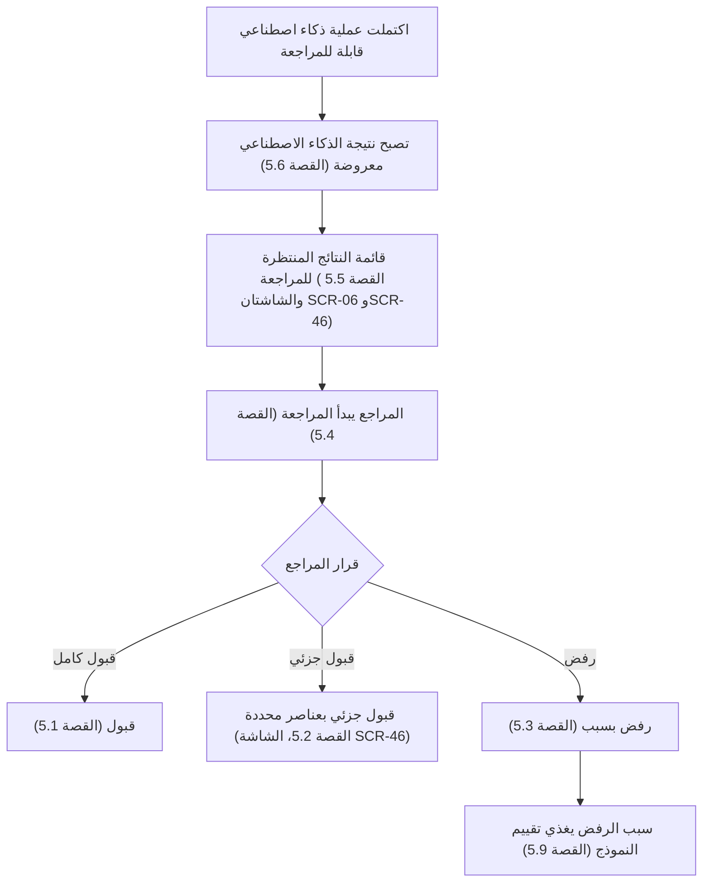
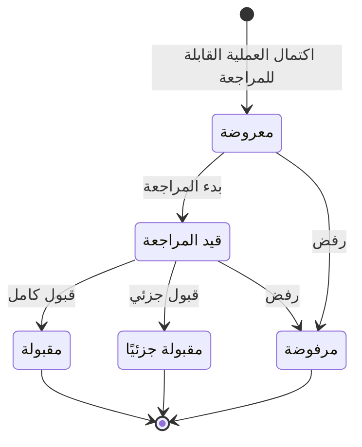

# مراجعة نتائج الذكاء الاصطناعي

<!-- BEGIN GENERATED: doc -->
| البند | القيمة |
|---|---|
| المعرّف | FEAT-AI-RESULT-REVIEW |
| الإصدار | 0.2 |
| الحالة | مسودة |
| القدرة | CAP-12 المساعدة بالذكاء الاصطناعي |
| القدرة الفرعية | CAP-12.02 الصياغة والتلخيص (R2) |
| الأدوار | المراجع؛ النظام |
| الشاشات | SCR-46 مراجعة نتيجة ذكية، SCR-06 قوائم المراجعة |
| حالات الاستخدام | UC-073، UC-074 |
| القصص | 9: 6 من المواصفة، و3 جديدة |
<!-- END GENERATED: doc -->

## 1. نظرة عامة

### 1.1 القيمة

يضمن ألا تُعتمد أو تُنشر أي نتيجة من الذكاء الاصطناعي إلا بعد أن يراجعها إنسان ويقبلها كليًا أو جزئيًا أو يرفضها بسبب.

### 1.2 النطاق

| البند | القيمة |
|---|---|
| المستخدمون | المراجع (كل مستخدم مخوَّل على العنصر المستهدف)؛ النظام |
| الشاشات | قوائم المراجعة (SCR-06)؛ مراجعة نتيجة ذكية (SCR-46) |
| حالات الاستخدام | مراجعة نتيجة الذكاء الاصطناعي؛ اعتماد نتيجة بمساعدة الذكاء الاصطناعي |
| المتطلبات | كل مسودة من الذكاء الاصطناعي توسم مخرج ذكاء اصطناعي، ولا تُنشر أو تؤثر في العمل دون مراجعة بشرية تقبلها كليًا أو جزئيًا أو ترفضها |
| خارج النطاق | إنشاء طلب الذكاء الاصطناعي وتوليد النتيجة نفسها (ميزة أخرى)؛ الأثر الذي يطبّقه أمر المالك بعد القبول (سياق المالك) |

### 1.3 خريطة الميزة

**الشكل 1: مسار مراجعة نتيجة الذكاء الاصطناعي**



**الشكل 2: دورة حالات نتيجة الذكاء الاصطناعي**



## 2. القواعد المشتركة

تنطبق على كل قصص الميزة، فلا تتكرر داخل القصص. وكل قصة تذكر ما يخصها فقط.

### 2.1 السياق المشترك

كل قصة تبدأ من ثلاثة شروط: مستأجر نشط، وحزمة السياسات الأساسية مفعّلة، ومستخدم مسجّل الدخول ومخوَّل. وتشير إليها القصص بخطوة واحدة: «بفرض السياق المشترك للميزة».

### 2.2 الصلاحية وعدم الإفصاح

- من لا يحق له رؤية العنصر يتلقى ردًا بشكل «غير متاح» تمامًا، فلا يعرف أنه موجود.
- من يرى العنصر ولا يحق له الإجراء يتلقى «لا تملك صلاحية هذا الإجراء».

### 2.3 أوامر تغيير الحالة

- **منع التكرار:** يُرسل كل أمر بمفتاح فريد، فإعادة الطلب نفسه لا تُنفَّذ مرتين.
- **حماية التعديل المتزامن:** يُرسل كل أمر بإصدار البيانات الذي يراه المستخدم. فإن عدّلها غيره في الأثناء، يُرفض الأمر.
- **السجل:** إن نجح الأمر، يُكتب حدثه وسجل التدقيق في المعاملة نفسها.

### 2.4 الرفض المشترك

```gherkin
# language: ar
خاصية: الرفض المشترك لأوامر الميزة

  سيناريو مخطط: رفض مشترك لكل أمر في الميزة
    بفرض السياق المشترك للميزة
    و <الحالة>
    عندما يُرسل المستخدم أي أمر من أوامر الميزة
    اذاً يُرفض برمز <الرمز> ويرى "<الرسالة>"
    و لا يتغير شيء

    امثلة:
      | الحالة                                  | الرمز                  | الرسالة                                                 |
      | العنصر خارج صلاحياته                    | NOT_FOUND              | غير متاح                                                |
      | العنصر مرئي له ولا يحق له الإجراء       | AUTHZ_DENIED           | لا تملك صلاحية هذا الإجراء                              |
      | غيره عدّل العنصر بعد أن فتحه            | VERSION_CONFLICT       | تغيّرت البيانات منذ فتحتها. راجع التغييرات ثم أعد المحاولة |
      | أعاد مفتاح منع التكرار بمحتوى مختلف     | IDEMPOTENCY_KEY_REUSED | طلب مكرر بمحتوى مختلف                                   |
      | البيانات ناقصة أو غير صحيحة             | VALIDATION_FAILED      | بعض البيانات ناقصة أو غير صحيحة. راجع الحقول المعلَّمة      |

  سيناريو: إعادة الطلب نفسه لا تُنفَّذ مرتين
    بفرض السياق المشترك للميزة
    و أمر نجح بمفتاح منع تكرار
    عندما يُعاد الطلب نفسه بالمفتاح نفسه
    اذاً تُعاد النتيجة الأولى ولا يُكتب حدث ثانٍ
```

## 3. الجودة وتعريف الاكتمال

### 3.1 متطلبات الجودة

<!-- BEGIN GENERATED: quality -->
لا متطلبات جودة مرتبطة بمتطلبات هذه الميزة مباشرة. تنطبق متطلبات المنصة العامة (`FEAT-PLT-*`).
<!-- END GENERATED: quality -->

### 3.2 تعريف الاكتمال

القصة مكتملة حين تتحقق الشروط الخمسة:

1. سيناريوهاتها والقواعد المشتركة تمر في الاختبار الآلي.
2. فحوص البنية المعمارية تمر.
3. نصوص الواجهة والرسائل موجودة بالعربية والإنجليزية.
4. مراجعة الكود مكتملة.
5. ما تضيفه القصة نفسها في قسم «القواعد» تحقق.

## 4. فهرس القصص

<!-- BEGIN GENERATED: story-index -->
| المعرّف | القصة | النوع | الحالة |
|---|---|---|---|
| `US-BC07-AIRS-ACCEPT` | قبول نتيجة الذكاء الاصطناعي | أمر | مسودة |
| `US-BC07-AIRS-ACCEPT-PARTIALLY` | قبول نتيجة الذكاء الاصطناعي جزئيًا | أمر | مسودة |
| `US-BC07-AIRS-REJECT` | رفض نتيجة الذكاء الاصطناعي | أمر | مسودة |
| `US-BC07-AIRS-START-REVIEW` | بدء مراجعة نتيجة الذكاء الاصطناعي | أمر | مسودة |
| `US-BC07-Q-AIRS-QUEUE` | جلب: Reviewable AI results by state, operation, target | جلب | مسودة |
| `US-BC07-S-AI-RESULT-01` | تلقائي: request COMPLETED for a reviewable operation (نتيجة الذكاء الاصطناعي) | نظام | مسودة |
| `US-UI-SCR06-AI-QUEUE` | قائمة نتائج الذكاء الاصطناعي المنتظرة للمراجعة | واجهة | مسودة |
| `US-UI-SCR46-ITEM-SELECT` | قبول عناصر محددة من النتيجة ورفض الباقي | واجهة | مسودة |
| `US-OPS-AI-REJECTION-FEEDBACK` | تغذية أسباب الرفض إلى تقييم النماذج | تشغيل | مسودة |
<!-- END GENERATED: story-index -->

## 5. القصص

### 5.1 US-BC07-AIRS-ACCEPT — قبول نتيجة الذكاء الاصطناعي

| النوع | الإصدار | الأولوية | دون اتصال | الحالة |
|---|---|---|---|---|
| أمر | R2 | Must | لا | مسودة |

> **كـ** المراجع المخوَّل على العنصر المستهدف، **أريد** أن أقبل نتيجة الذكاء الاصطناعي كاملة، **حتى** تُطبَّق على سياق مالكها بوصفي صاحب القرار.

**باختصار:** المراجع يقبل نتيجة قيد المراجعة، فتصبح «مقبولة» وتُطبَّق آثارها عبر أوامر سياق المالك باسم المراجع، وتصل الملاحظة إلى تقييم النموذج.

#### القواعد

- **متى يُسمح:** الحالة الحالية «قيد المراجعة».
- **من يُسمح له:** المراجع المخوَّل على العنصر المستهدف دون غيره، ولا تتغير حالة الأعمال دون قبوله.
- **البيانات:** ملاحظة (اختيارية).
- **الأثر:** حدث «قُبلت نتيجة الذكاء الاصطناعي» يصل إلى سياق المالك لتطبيق الأثر عبر أمره، وإلى سجل تغذية التقييم بالرأي البشري.

#### معايير القبول

```gherkin
# language: ar
خاصية: قبول نتيجة الذكاء الاصطناعي

  سيناريو: قبول نتيجة قيد المراجعة
    بفرض السياق المشترك للميزة
    و نتيجة ذكاء اصطناعي في حالة "قيد المراجعة" مسنَدة إلى المراجع
    عندما يقبلها المراجع
    اذاً تصبح حالتها "مقبولة"
    و يُسجَّل حدث "قُبلت نتيجة الذكاء الاصطناعي"

  سيناريو مخطط: رفض خاص بالقبول
    بفرض السياق المشترك للميزة
    و <الحالة>
    عندما يحاول المراجع قبول النتيجة
    اذاً يُرفض برمز <الرمز> ويرى <الرسالة>
    و لا يتغير شيء

    امثلة:
      | الحالة                                          | الرمز                               | الرسالة                                          |
      | الحالة الحالية ليست "قيد المراجعة"              | AI_RESULT_INVALID_STATE_TRANSITION  | الوضع الحالي لنتيجة الذكاء الاصطناعي لا يسمح بهذا الإجراء |
      | أمر سياق المالك المطبِّق للأثر رفض تطبيق النتيجة | OWNER_REJECTED                      | رُفض تطبيق التغيير لأن العنصر المستهدف لا يستوفي شروطه |
```

<details><summary>المراجع التقنية والتتبع</summary>

<!-- BEGIN GENERATED: refs US-BC07-AIRS-ACCEPT -->
| البند | المعرّف | المعنى |
|---|---|---|
| الواجهة البرمجية | `POST /api/v1/ai/results/{id}/actions/accept` | — |
| الأمر | `CMD-AIRS-ACCEPT` | قبول نتيجة الذكاء الاصطناعي |
| السياسة | `POL-AIRS-ACCEPT` | reviewer authorized on the target (review, accept, reject)؛ tenant match; object visible |
| الحدث | `EVT-AIRS-ACCEPTED` | يصل إلى: Owner contexts (effects on acceptance); Evaluation feedback store |
| الكيان | `AGG-AI-RESULT` | نتيجة الذكاء الاصطناعي |
| الجدول | `ai.ai_results` | الجدول الرئيسي لنتيجة الذكاء الاصطناعي |
| وحدة النشر | DU-16 | — |
| المتطلب | REQ-AI-005 | The system shall label every AI-generated draft as AI output and shall prevent its publication without human… |
| حالات الاستخدام | UC-073، UC-074 | Review AI Result؛ Approve AI-Assisted Result |
| الاختبار | TST-AI-RESULT-SM، TST-SLC10-INVARIANTS | دورة حالات نتيجة الذكاء الاصطناعي، وثوابت الشريحة SLC-10 |
<!-- END GENERATED: refs US-BC07-AIRS-ACCEPT -->

</details>

### 5.2 US-BC07-AIRS-ACCEPT-PARTIALLY — قبول نتيجة الذكاء الاصطناعي جزئيًا

| النوع | الإصدار | الأولوية | دون اتصال | الحالة |
|---|---|---|---|---|
| أمر | R2 | Must | لا | مسودة |

> **كـ** المراجع المخوَّل على العنصر المستهدف، **أريد** أن أقبل عناصر محددة من نتيجة الذكاء الاصطناعي وأرفض باقيها بسبب، **حتى** يُطبَّق ما هو صحيح فقط دون انتظار تصحيح النتيجة كاملة.

**باختصار:** المراجع يختار العناصر المقبولة والعناصر المرفوضة من النتيجة مع سبب لكل عنصر مرفوض، فتصبح «مقبولة جزئيًا»، وتُطبَّق العناصر المقبولة وحدها.

#### القواعد

- **متى يُسمح:** الحالة الحالية «قيد المراجعة».
- **من يُسمح له:** المراجع المخوَّل على العنصر المستهدف دون غيره.
- **البيانات:** العناصر المقبولة (إلزامي)، والعناصر المرفوضة مع سببها (إلزامي).
- **الأثر:** حدث «قُبلت نتيجة الذكاء الاصطناعي جزئيًا» يصل إلى سياق المالك لتطبيق العناصر المقبولة فقط، وإلى سجل تغذية التقييم بسبب كل عنصر مرفوض.

#### معايير القبول

```gherkin
# language: ar
خاصية: قبول نتيجة الذكاء الاصطناعي جزئيًا

  سيناريو: قبول بعض العناصر ورفض الباقي بسبب
    بفرض السياق المشترك للميزة
    و نتيجة ذكاء اصطناعي في حالة "قيد المراجعة" فيها أكثر من عنصر
    عندما يحدد المراجع العناصر المقبولة ويذكر سببًا لكل عنصر مرفوض
    اذاً تصبح حالتها "مقبولة جزئيًا"
    و يُسجَّل حدث "قُبلت نتيجة الذكاء الاصطناعي جزئيًا"

  سيناريو مخطط: رفض خاص بالقبول الجزئي
    بفرض السياق المشترك للميزة
    و <الحالة>
    عندما يحاول المراجع قبول النتيجة جزئيًا
    اذاً يُرفض برمز <الرمز> ويرى <الرسالة>
    و لا يتغير شيء

    امثلة:
      | الحالة                                      | الرمز                               | الرسالة                                          |
      | الحالة الحالية ليست "قيد المراجعة"          | AI_RESULT_INVALID_STATE_TRANSITION  | الوضع الحالي لنتيجة الذكاء الاصطناعي لا يسمح بهذا الإجراء |
      | عنصر مرفوض بلا سبب                          | OWNER_REJECTED                      | رُفض تطبيق التغيير لأن العنصر المستهدف لا يستوفي شروطه |
      | العناصر المقبولة غير مذكورة                 | VALIDATION_FAILED                   | العناصر المقبولة مطلوبة                           |
      | العناصر المرفوضة غير مذكورة                 | VALIDATION_FAILED                   | العناصر المرفوضة مطلوبة                           |
```

<details><summary>المراجع التقنية والتتبع</summary>

<!-- BEGIN GENERATED: refs US-BC07-AIRS-ACCEPT-PARTIALLY -->
| البند | المعرّف | المعنى |
|---|---|---|
| الواجهة البرمجية | `POST /api/v1/ai/results/{id}/actions/accept-partially` | — |
| الأمر | `CMD-AIRS-ACCEPT-PARTIALLY` | قبول نتيجة الذكاء الاصطناعي جزئيًا |
| السياسة | `POL-AIRS-ACCEPT-PARTIALLY` | reviewer authorized on the target (review, accept, reject)؛ tenant match; object visible |
| الحدث | `EVT-AIRS-PARTIALLY-ACCEPTED` | يصل إلى: Owner contexts (effects on acceptance); Evaluation feedback store |
| الكيان | `AGG-AI-RESULT` | نتيجة الذكاء الاصطناعي |
| الجدول | `ai.ai_results` | الجدول الرئيسي لنتيجة الذكاء الاصطناعي |
| وحدة النشر | DU-16 | — |
| المتطلب | REQ-AI-005 | The system shall label every AI-generated draft as AI output and shall prevent its publication without human… |
| حالات الاستخدام | UC-073، UC-074 | Review AI Result؛ Approve AI-Assisted Result |
| الاختبار | TST-AI-RESULT-SM، TST-SLC10-INVARIANTS | دورة حالات نتيجة الذكاء الاصطناعي، وثوابت الشريحة SLC-10 |
<!-- END GENERATED: refs US-BC07-AIRS-ACCEPT-PARTIALLY -->

</details>

### 5.3 US-BC07-AIRS-REJECT — رفض نتيجة الذكاء الاصطناعي

| النوع | الإصدار | الأولوية | دون اتصال | الحالة |
|---|---|---|---|---|
| أمر | R2 | Must | لا | مسودة |

> **كـ** المراجع المخوَّل على العنصر المستهدف، **أريد** أن أرفض نتيجة الذكاء الاصطناعي بسبب، **حتى** لا تؤثر على العمل وتتعلم عملية التقييم من سبب الرفض.

**باختصار:** المراجع يرفض نتيجة معروضة أو قيد المراجعة بذكر السبب، فتصبح «مرفوضة» ولا تطبَّق أي من آثارها، ويصل السبب إلى تغذية التقييم.

#### القواعد

- **متى يُسمح:** الحالة الحالية «معروضة» أو «قيد المراجعة».
- **من يُسمح له:** المراجع المخوَّل على العنصر المستهدف دون غيره.
- **البيانات:** السبب (إلزامي).
- **الأثر:** حدث «رُفضت نتيجة الذكاء الاصطناعي» يصل إلى سجل تغذية التقييم بسبب الرفض (القصة 5.9)؛ لا يُطبَّق أي أثر على سياق المالك.

#### معايير القبول

```gherkin
# language: ar
خاصية: رفض نتيجة الذكاء الاصطناعي

  سيناريو: رفض نتيجة بسبب
    بفرض السياق المشترك للميزة
    و نتيجة ذكاء اصطناعي في حالة "معروضة" أو "قيد المراجعة"
    عندما يرفضها المراجع بسبب
    اذاً تصبح حالتها "مرفوضة"
    و يُسجَّل حدث "رُفضت نتيجة الذكاء الاصطناعي"

  سيناريو مخطط: رفض خاص برفض النتيجة
    بفرض السياق المشترك للميزة
    و <الحالة>
    عندما يحاول المراجع رفض النتيجة
    اذاً يُرفض برمز <الرمز> ويرى <الرسالة>
    و لا يتغير شيء

    امثلة:
      | الحالة                                           | الرمز                               | الرسالة                                          |
      | الحالة الحالية ليست "معروضة" أو "قيد المراجعة"   | AI_RESULT_INVALID_STATE_TRANSITION  | الوضع الحالي لنتيجة الذكاء الاصطناعي لا يسمح بهذا الإجراء |
      | السبب فارغ                                       | REASON_REQUIRED                     | اذكر السبب                                        |
```

<details><summary>المراجع التقنية والتتبع</summary>

<!-- BEGIN GENERATED: refs US-BC07-AIRS-REJECT -->
| البند | المعرّف | المعنى |
|---|---|---|
| الواجهة البرمجية | `POST /api/v1/ai/results/{id}/actions/reject` | — |
| الأمر | `CMD-AIRS-REJECT` | رفض نتيجة الذكاء الاصطناعي |
| السياسة | `POL-AIRS-REJECT` | reviewer authorized on the target (review, accept, reject)؛ tenant match; object visible |
| الحدث | `EVT-AIRS-REJECTED` | يصل إلى: Owner contexts (effects on acceptance); Evaluation feedback store |
| الكيان | `AGG-AI-RESULT` | نتيجة الذكاء الاصطناعي |
| الجدول | `ai.ai_results` | الجدول الرئيسي لنتيجة الذكاء الاصطناعي |
| وحدة النشر | DU-16 | — |
| المتطلب | REQ-AI-005 | The system shall label every AI-generated draft as AI output and shall prevent its publication without human… |
| حالات الاستخدام | UC-073، UC-074 | Review AI Result؛ Approve AI-Assisted Result |
| الاختبار | TST-AI-RESULT-SM، TST-SLC10-INVARIANTS | دورة حالات نتيجة الذكاء الاصطناعي، وثوابت الشريحة SLC-10 |
<!-- END GENERATED: refs US-BC07-AIRS-REJECT -->

</details>

### 5.4 US-BC07-AIRS-START-REVIEW — بدء مراجعة نتيجة الذكاء الاصطناعي

| النوع | الإصدار | الأولوية | دون اتصال | الحالة |
|---|---|---|---|---|
| أمر | R2 | Must | لا | مسودة |

> **كـ** المراجع المخوَّل على العنصر المستهدف، **أريد** أن أبدأ مراجعة نتيجة الذكاء الاصطناعي، **حتى** يعرف غيري أنها قيد المراجعة ولا يبدأها أحد آخر معي.

**باختصار:** المراجع يبدأ مراجعة نتيجة معروضة بعد أن يكون مخوَّلًا على عنصرها ومصرَّحًا له بتصنيفها، فتصبح «قيد المراجعة».

#### القواعد

- **متى يُسمح:** الحالة الحالية «معروضة».
- **من يُسمح له:** المراجع المخوَّل على العنصر المستهدف والمصرَّح له بمستوى تصنيف نتيجته.
- **الأثر:** حدث «بدأت مراجعة نتيجة الذكاء الاصطناعي» يسجَّل، فلا يبدؤها مراجع آخر إلى جانبه.

#### معايير القبول

```gherkin
# language: ar
خاصية: بدء مراجعة نتيجة الذكاء الاصطناعي

  سيناريو: بدء مراجعة نتيجة معروضة
    بفرض السياق المشترك للميزة
    و نتيجة ذكاء اصطناعي في حالة "معروضة" والمراجع مصرَّح له بمستوى تصنيفها
    عندما يبدأ المراجع مراجعتها
    اذاً تصبح حالتها "قيد المراجعة"
    و يُسجَّل حدث "بدأت مراجعة نتيجة الذكاء الاصطناعي"

  سيناريو مخطط: رفض خاص ببدء المراجعة
    بفرض السياق المشترك للميزة
    و <الحالة>
    عندما يحاول المراجع بدء المراجعة
    اذاً يُرفض برمز <الرمز> ويرى <الرسالة>
    و لا يتغير شيء

    امثلة:
      | الحالة                                    | الرمز                               | الرسالة                                              |
      | الحالة الحالية ليست "معروضة"              | AI_RESULT_INVALID_STATE_TRANSITION  | الوضع الحالي لنتيجة الذكاء الاصطناعي لا يسمح بهذا الإجراء |
      | المراجع غير مصرَّح له بمستوى تصنيف النتيجة | REVIEWER_NOT_CLEARED                | المراجع غير مصرَّح له بمستوى تصنيف هذه المواد         |
```

<details><summary>المراجع التقنية والتتبع</summary>

<!-- BEGIN GENERATED: refs US-BC07-AIRS-START-REVIEW -->
| البند | المعرّف | المعنى |
|---|---|---|
| الواجهة البرمجية | `POST /api/v1/ai/results/{id}/actions/start-review` | — |
| الأمر | `CMD-AIRS-START-REVIEW` | بدء مراجعة نتيجة الذكاء الاصطناعي |
| السياسة | `POL-AIRS-START-REVIEW` | reviewer authorized on the target (review, accept, reject)؛ tenant match; object visible |
| الحدث | `EVT-AIRS-REVIEW-STARTED` | يصل إلى: Owner contexts (effects on acceptance); Evaluation feedback store |
| الكيان | `AGG-AI-RESULT` | نتيجة الذكاء الاصطناعي |
| الجدول | `ai.ai_results` | الجدول الرئيسي لنتيجة الذكاء الاصطناعي |
| وحدة النشر | DU-16 | — |
| المتطلب | REQ-AI-005 | The system shall label every AI-generated draft as AI output and shall prevent its publication without human… |
| حالات الاستخدام | UC-073، UC-074 | Review AI Result؛ Approve AI-Assisted Result |
| الاختبار | TST-AI-RESULT-SM، TST-SLC10-INVARIANTS | دورة حالات نتيجة الذكاء الاصطناعي، وثوابت الشريحة SLC-10 |
<!-- END GENERATED: refs US-BC07-AIRS-START-REVIEW -->

</details>

### 5.5 US-BC07-Q-AIRS-QUEUE — جلب: Reviewable AI results by state, operation, target

| النوع | الإصدار | الأولوية | دون اتصال | الحالة |
|---|---|---|---|---|
| جلب | R2 | Must | لا | مسودة |

> **كـ** المراجع المخوَّل على عناصر مستهدفة، **أريد** قائمة بنتائج الذكاء الاصطناعي القابلة للمراجعة حسب حالتها وعمليتها وعنصرها المستهدف، **حتى** أعرف ما عليّ مراجعته الآن.

**باختصار:** تُعاد نتائج الذكاء الاصطناعي التي يحق للمراجع رؤيتها فقط، صفحةً بعد صفحة، ولا يكشف عددها وجود نتائج محجوبة.

#### القواعد

- **من يُسمح له:** المراجع المخوَّل على العنصر المستهدف لكل نتيجة.
- **البيانات (المرشحات):** الحالة، والعملية، والعنصر المستهدف، والمؤشر والحد.

#### معايير القبول

```gherkin
# language: ar
خاصية: قائمة نتائج الذكاء الاصطناعي المنتظرة للمراجعة

  سيناريو: يرى المراجع ما يحق له فقط
    بفرض السياق المشترك للميزة
    و نتائج ذكاء اصطناعي داخل نطاق المراجع وأخرى خارجه
    عندما يطلب المراجع قائمة النتائج القابلة للمراجعة
    اذاً تُعاد النتائج داخل نطاقه فقط، ويُعاد فحص صلاحية كل منها
    و لا يكشف أي عدد أو اقتراح وجود نتيجة محجوبة

  سيناريو: الصفحة التالية
    بفرض السياق المشترك للميزة
    و نتائج أكثر من صفحة
    عندما يطلب المراجع الصفحة التالية بالمؤشر
    اذاً تُعاد النتائج التالية دون تكرار ولا فجوة
```

<details><summary>المراجع التقنية والتتبع</summary>

<!-- BEGIN GENERATED: refs US-BC07-Q-AIRS-QUEUE -->
| البند | المعرّف | المعنى |
|---|---|---|
| الواجهة البرمجية | `GET /api/v1/ai/results` | — |
| الاستعلام | `QRY-AIRS-QUEUE` | Reviewable AI results by state, operation, target |
| السياسة | `POL-AIRS-QUEUE` | reviewers authorized on targets |
| الكيان | `AGG-AI-RESULT` | نتيجة الذكاء الاصطناعي |
| الجدول | `ai.ai_results` | الجدول الرئيسي لنتيجة الذكاء الاصطناعي |
| وحدة النشر | DU-16 | — |
| المتطلب | REQ-AI-005 | The system shall label every AI-generated draft as AI output and shall prevent its publication without human… |
| حالات الاستخدام | UC-073، UC-074 | Review AI Result؛ Approve AI-Assisted Result |
| الاختبار | TST-AI-RESULT-SM، TST-SLC10-INVARIANTS | دورة حالات نتيجة الذكاء الاصطناعي، وثوابت الشريحة SLC-10 |
<!-- END GENERATED: refs US-BC07-Q-AIRS-QUEUE -->

</details>

### 5.6 US-BC07-S-AI-RESULT-01 — تلقائي: request COMPLETED for a reviewable operation (نتيجة الذكاء الاصطناعي)

| النوع | الإصدار | الأولوية | دون اتصال | الحالة |
|---|---|---|---|---|
| نظام | R2 | Must | لا ينطبق | مسودة |

> **كـ** النظام، **أريد** أن أعرض نتيجة الذكاء الاصطناعي للمراجعة حين تكتمل عملية قابلة للمراجعة، **حتى** لا يؤثر مخرج الذكاء الاصطناعي على العمل قبل أن يقبله إنسان.

**باختصار:** عند اكتمال طلب ذكاء اصطناعي لعملية من العمليات القابلة للمراجعة (مسودة، استخراج، ترجمة كدليل، اقتراح مطابقة)، تُنشأ نتيجة ذكاء اصطناعي جديدة في حالة «معروضة».

#### القواعد

- **متى يحدث:** اكتمال طلب ذكاء اصطناعي لعملية من العمليات القابلة للمراجعة.
- **الأثر:** تُنشأ نتيجة ذكاء اصطناعي في حالة «معروضة»، ويُسجَّل حدث «عُرضت نتيجة الذكاء الاصطناعي» وسجل تدقيق بهوية النظام، فتظهر في قائمة المراجعة (القصة 5.5).

#### معايير القبول

```gherkin
# language: ar
خاصية: عرض نتيجة الذكاء الاصطناعي للمراجعة

  سيناريو: اكتمال عملية قابلة للمراجعة
    بفرض طلب ذكاء اصطناعي لعملية مسودة أو استخراج أو ترجمة كدليل أو اقتراح مطابقة
    عندما يكتمل الطلب
    اذاً تُنشأ نتيجة ذكاء اصطناعي في حالة "معروضة"
    و يُسجَّل حدث "عُرضت نتيجة الذكاء الاصطناعي" وسجل تدقيق بهوية النظام

  سيناريو: اكتمال عملية لا تحتاج مراجعة
    بفرض طلب ذكاء اصطناعي لعملية ليست من العمليات القابلة للمراجعة
    عندما يكتمل الطلب
    اذاً لا تُنشأ نتيجة ذكاء اصطناعي للمراجعة
```

<details><summary>المراجع التقنية والتتبع</summary>

<!-- BEGIN GENERATED: refs US-BC07-S-AI-RESULT-01 -->
| البند | المعرّف | المعنى |
|---|---|---|
| المحفِّز | `SYS:request COMPLETED for a reviewable operation` | operation ∈ {AI-OP-03 draft, AI-OP-04 extract, AI-OP-05 translation used as evidence, AI-OP-06 match suggesti… |
| الانتقال | ∅ ← PROPOSED | — |
| الحدث | `EVT-AIRS-PROPOSED` | يصل إلى: Owner contexts (effects on acceptance); Evaluation feedback store |
| الكيان | `AGG-AI-RESULT` | نتيجة الذكاء الاصطناعي |
| الجدول | `ai.ai_results` | الجدول الرئيسي لنتيجة الذكاء الاصطناعي |
| وحدة النشر | DU-16 | — |
| المتطلب | REQ-AI-005 | The system shall label every AI-generated draft as AI output and shall prevent its publication without human… |
| حالات الاستخدام | UC-073، UC-074 | Review AI Result؛ Approve AI-Assisted Result |
| الاختبار | TST-AI-RESULT-SM، TST-SLC10-INVARIANTS | دورة حالات نتيجة الذكاء الاصطناعي، وثوابت الشريحة SLC-10 |
<!-- END GENERATED: refs US-BC07-S-AI-RESULT-01 -->

</details>

### 5.7 US-UI-SCR06-AI-QUEUE — قائمة نتائج الذكاء الاصطناعي المنتظرة للمراجعة

| النوع | الإصدار | الأولوية | دون اتصال | الحالة |
|---|---|---|---|---|
| واجهة | R2 | Should | لا | مسودة |

> **كـ** المراجع، **أريد** قائمة واحدة لكل نتائج الذكاء الاصطناعي المنتظرة للمراجعة إلى جانب قوائم المراجعة الأخرى، **حتى** أجد عملي دون أن أبحث عنه بين شاشات متفرقة.

**باختصار:** شاشة قوائم المراجعة (SCR-06) تعرض نتائج الذكاء الاصطناعي المنتظرة للمراجعة (القصة 5.5) مع قوائم المراجعة الأخرى، وفتح عنصر منها يفتح شاشة مراجعة نتيجة ذكية (SCR-46).

#### القواعد

- النتائج تُجمَّع في القائمة نفسها التي تضم عناصر المراجعة الأخرى (مطابقة الكيانات، التعارضات، مزامنة الموارد البشرية)، كل عنصر بنوعه **[Derived]**.
- فتح عنصر نتيجة ذكاء اصطناعي من القائمة ينقل المراجع إلى شاشة مراجعة نتيجة ذكية (القصة 5.8).

#### معايير القبول

```gherkin
# language: ar
خاصية: قائمة نتائج الذكاء الاصطناعي المنتظرة للمراجعة

  سيناريو: فتح قائمة المراجعة
    بفرض السياق المشترك للميزة
    و نتائج ذكاء اصطناعي منتظرة ضمن نطاق المراجع
    عندما يفتح المراجع شاشة قوائم المراجعة
    اذاً تظهر نتائج الذكاء الاصطناعي المنتظرة ضمن القائمة
    و يفتح اختيار عنصر منها شاشة مراجعة نتيجة ذكية
```

<details><summary>المراجع التقنية والتتبع</summary>

<!-- BEGIN GENERATED: refs US-UI-SCR06-AI-QUEUE -->
| البند | المعرّف | المعنى |
|---|---|---|
| الشاشة | SCR-06 | شاشة قوائم المراجعة |
| المصدر | `US-BC07-Q-AIRS-QUEUE` | — |
| المصدر | `21-ui-design.md §6.1` | — |
| المصدر | `[Derived]` | — |
<!-- END GENERATED: refs US-UI-SCR06-AI-QUEUE -->

</details>

### 5.8 US-UI-SCR46-ITEM-SELECT — قبول عناصر محددة من النتيجة ورفض الباقي

| النوع | الإصدار | الأولوية | دون اتصال | الحالة |
|---|---|---|---|---|
| واجهة | R2 | Must | لا | مسودة |

> **كـ** المراجع، **أريد** أن أختار عناصر نتيجة الذكاء الاصطناعي واحدًا واحدًا، فأقبل بعضها وأرفض باقيها بسبب، **حتى** أقبل الصحيح دون انتظار تصحيح النتيجة كاملة.

**باختصار:** شاشة مراجعة نتيجة ذكية (SCR-46) تعرض عناصر النتيجة واستشهاداتها، فيحدد المراجع كل عنصر بقبول أو رفض بسبب، وترسل الاختيار كأمر قبول كامل أو جزئي أو رفض (القصص 5.1–5.3).

#### القواعد

- كل عنصر من النتيجة يوسم «مسودة ذكاء اصطناعي» ويعرض استشهاده؛ لا تغيير في حالة الأعمال دون أن يقبله المراجع.
- اختيار بعض العناصر فقط دون غيرها يرسل أمر القبول الجزئي (القصة 5.2) بسبب لكل عنصر مرفوض.
- اختيار كل العناصر يرسل أمر القبول الكامل (القصة 5.1)، ورفض كل العناصر يرسل أمر الرفض (القصة 5.3).

#### معايير القبول

```gherkin
# language: ar
خاصية: قبول عناصر محددة من النتيجة ورفض الباقي

  سيناريو: قبول بعض العناصر ورفض باقيها
    بفرض السياق المشترك للميزة
    و نتيجة ذكاء اصطناعي قيد المراجعة فيها أكثر من عنصر
    عندما يحدد المراجع العناصر المقبولة ويذكر سببًا لكل عنصر مرفوض ويرسل اختياره
    اذاً يُرسل أمر القبول الجزئي بالعناصر المحددة وأسباب الرفض

  سيناريو: قبول كل العناصر
    بفرض السياق المشترك للميزة
    و نتيجة ذكاء اصطناعي قيد المراجعة
    عندما يحدد المراجع كل العناصر مقبولة ويرسل اختياره
    اذاً يُرسل أمر القبول الكامل
```

<details><summary>المراجع التقنية والتتبع</summary>

<!-- BEGIN GENERATED: refs US-UI-SCR46-ITEM-SELECT -->
| البند | المعرّف | المعنى |
|---|---|---|
| المصدر | `21-ui-design.md §12` | — |
| الشاشة | SCR-46 | شاشة مراجعة نتيجة ذكية |
| المصدر | `US-BC07-AIRS-ACCEPT-PARTIALLY` | — |
| المتطلب | REQ-AI-005 | The system shall label every AI-generated draft as AI output and shall prevent its publication without human… |
| حالات الاستخدام | UC-073، UC-074 | Review AI Result؛ Approve AI-Assisted Result |
<!-- END GENERATED: refs US-UI-SCR46-ITEM-SELECT -->

</details>

### 5.9 US-OPS-AI-REJECTION-FEEDBACK — تغذية أسباب الرفض إلى تقييم النماذج

| النوع | الإصدار | الأولوية | دون اتصال | الحالة |
|---|---|---|---|---|
| تشغيل | R2 | Should | لا ينطبق | مسودة |

> **كـ** فريق التشغيل أو الأمن، **أريد** أن تغذّي أسباب رفض المراجعين نتائج الذكاء الاصطناعي سجل تقييم النماذج، **حتى** يُكتشف تراجع نموذج معيَّن من كثرة رفض مخرجاته.

**باختصار:** كل رفض لنتيجة ذكاء اصطناعي (القصة 5.3) يُسجَّل في سجل تغذية التقييم بسببه ونسبة الرفض لعمليته، ليُستخدم في تنبيهات تراجع الجودة.

#### القواعد

- **متى يحدث:** عند كل رفض لنتيجة ذكاء اصطناعي.
- **الأثر:** يُسجَّل سبب الرفض في سجل تغذية التقييم مرتبطًا بإصدار النموذج والعملية؛ ونسبة الرفض لكل عملية تُحسب منه وتغذي التنبيه إلى تراجع الجودة.

#### معايير القبول

```gherkin
# language: ar
خاصية: تغذية أسباب الرفض إلى تقييم النماذج

  سيناريو: رفض نتيجة يُسجَّل في سجل التقييم
    بفرض نتيجة ذكاء اصطناعي رُفضت بسبب
    عندما تُسجَّل عملية الرفض
    اذاً يُضاف السبب إلى سجل تغذية التقييم مرتبطًا بإصدار النموذج والعملية
    و تُحدَّث نسبة النتائج المرفوضة لتلك العملية

  سيناريو: القبول لا يغذي سجل الرفض
    بفرض نتيجة ذكاء اصطناعي قُبلت كليًا أو جزئيًا
    عندما تُسجَّل عملية القبول
    اذاً لا يُضاف أي سبب إلى سجل تغذية الرفض
```

<details><summary>المراجع التقنية والتتبع</summary>

<!-- BEGIN GENERATED: refs US-OPS-AI-REJECTION-FEEDBACK -->
| البند | المعرّف | المعنى |
|---|---|---|
| المصدر | `US-BC07-AIRS-REJECT` | — |
| المصدر | `09-reliability/observability-slc10.md` | — |
| المصدر | `[Derived]` | — |
<!-- END GENERATED: refs US-OPS-AI-REJECTION-FEEDBACK -->

</details>

## 6. التتبع

<!-- BEGIN GENERATED: trace -->
| المتطلب | المعنى | القصص | الاختبار |
|---|---|---|---|
| REQ-AI-005 | The system shall label every AI-generated draft as AI output and shall prevent its publication without human… | `US-BC07-AIRS-ACCEPT`، `US-BC07-AIRS-ACCEPT-PARTIALLY`، `US-BC07-AIRS-REJECT`، `US-BC07-AIRS-START-REVIEW`، `US-BC07-Q-AIRS-QUEUE`، `US-BC07-S-AI-RESULT-01`، `US-UI-SCR46-ITEM-SELECT` | TST-AI-RESULT-SM، TST-SLC10-INVARIANTS |
<!-- END GENERATED: trace -->

## 7. سجل التغييرات

| الإصدار | التاريخ | التغيير |
|---|---|---|
| 0.1 | — | هيكل مولَّد من خريطة الميزات |
| 0.2 | 2026-10-13 | كتابة القصص كاملة بمعيار القصص |
