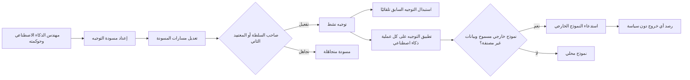
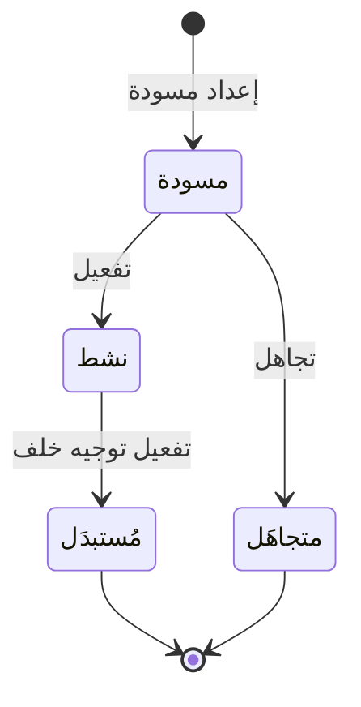

# توجيه نماذج الذكاء الاصطناعي

<!-- BEGIN GENERATED: doc -->
| البند | القيمة |
|---|---|
| المعرّف | FEAT-AI-ROUTING |
| الإصدار | 0.1 |
| الحالة | مسودة |
| القدرة | CAP-12 المساعدة بالذكاء الاصطناعي |
| القدرة الفرعية | CAP-12.01 الاسترجاع والإجابة المؤرّضة (R2) |
| الأدوار | مهندس الذكاء الاصطناعي وحوكمته؛ صاحب السلطة أو المعتمِد الثاني؛ مسؤول الأمن؛ النظام |
| الشاشات | SCR-51 النماذج والتوجيه والأدوات والاستهلاك |
| حالات الاستخدام | UC-077 |
| القصص | 10: 6 من المواصفة، و4 جديدة |
<!-- END GENERATED: doc -->

## 1. نظرة عامة

### 1.1 القيمة

يحدد لكل مستأجر أي نموذج يخدم أي نوع من الطلبات، محليًا افتراضيًا، ولا يُسمح بنموذج خارجي إلا بسياسة صريحة وبيانات غير مصنفة.

### 1.2 النطاق

| البند | القيمة |
|---|---|
| المستخدمون | مهندس الذكاء الاصطناعي وحوكمته (يعدّ المسودة ويعدّلها ويتجاهلها) · صاحب السلطة أو المعتمِد الثاني (يفعّل المسودة) · مسؤول الأمن (يراجع التوجيه النشط) · النظام (يستبدل التوجيه القديم تلقائيًا) |
| الشاشات | SCR-51 النماذج والتوجيه والأدوات والاستهلاك |
| حالات الاستخدام (بالكلمات) | إعداد مسودة توجيه الذكاء الاصطناعي وتعديلها وتفعيلها وتجاهلها؛ جلب التوجيه النشط للمستأجر؛ استبدال التوجيه السابق تلقائيًا عند تفعيل خلف جديد؛ مراجعة مسار كل عملية على الشاشة قبل التفعيل؛ استدعاء نموذج خارجي بسياسة مستأجر وبيانات غير مصنفة فقط؛ رصد أي خروج لنموذج خارجي لا تغطيه سياسة |
| المتطلبات (بالكلمات) | ضبط مصفوفة الاستقلالية بحد أقصى AIL3 في R2 ومنع AIL5 (REQ-AI-008)؛ تشغيل كل النماذج محليًا افتراضيًا ومنع النموذج الخارجي إلا بسياسة مستأجر صريحة وبيانات غير مصنفة (REQ-AI-011)؛ حفظ بيانات كل جهة ضمن نطاقها القضائي المعتمد (REQ-GOV-005) |
| خارج النطاق | سجل النماذج ودورة حياته؛ سجل أدوات الذكاء الاصطناعي (ميزة «سجل أدوات الذكاء الاصطناعي»)؛ تنفيذ طلب الذكاء الاصطناعي وإصدار نتيجته |

### 1.3 خريطة الميزة

**الشكل 1: مسار توجيه الذكاء الاصطناعي من الإعداد إلى تطبيقه على كل طلب**



**الشكل 2: رحلة توجيه الذكاء الاصطناعي بين حالاته**



## 2. القواعد المشتركة

تنطبق على كل قصص الميزة، فلا تتكرر داخل القصص. وكل قصة تذكر ما يخصها فقط.

### 2.1 السياق المشترك

كل قصة تبدأ من ثلاثة شروط: مستأجر نشط، وحزمة السياسات الأساسية مفعّلة، ومستخدم مسجّل الدخول ومخوَّل. وتشير إليها القصص بخطوة واحدة: «بفرض السياق المشترك للميزة».

### 2.2 الصلاحية وعدم الإفصاح

- من لا يحق له رؤية العنصر يتلقى ردًا بشكل «غير متاح» تمامًا، فلا يعرف أنه موجود.
- من يرى العنصر ولا يحق له الإجراء يتلقى «لا تملك صلاحية هذا الإجراء».

### 2.3 أوامر تغيير الحالة

- **منع التكرار:** يُرسل كل أمر بمفتاح فريد، فإعادة الطلب نفسه لا تُنفَّذ مرتين.
- **حماية التعديل المتزامن:** يُرسل كل أمر بإصدار البيانات الذي يراه المستخدم. فإن عدّلها غيره في الأثناء، يُرفض الأمر.
- **السجل:** إن نجح الأمر، يُكتب حدثه وسجل التدقيق في المعاملة نفسها.

### 2.4 الرفض المشترك

```gherkin
# language: ar
خاصية: الرفض المشترك لأوامر الميزة

  سيناريو مخطط: رفض مشترك لكل أمر في الميزة
    بفرض السياق المشترك للميزة
    و <الحالة>
    عندما يُرسل المستخدم أي أمر من أوامر الميزة
    اذاً يُرفض برمز <الرمز> ويرى "<الرسالة>"
    و لا يتغير شيء

    امثلة:
      | الحالة                                  | الرمز                  | الرسالة                                                 |
      | العنصر خارج صلاحياته                    | NOT_FOUND              | غير متاح                                                |
      | العنصر مرئي له ولا يحق له الإجراء       | AUTHZ_DENIED           | لا تملك صلاحية هذا الإجراء                              |
      | غيره عدّل العنصر بعد أن فتحه            | VERSION_CONFLICT       | تغيّرت البيانات منذ فتحتها. راجع التغييرات ثم أعد المحاولة |
      | أعاد مفتاح منع التكرار بمحتوى مختلف     | IDEMPOTENCY_KEY_REUSED | طلب مكرر بمحتوى مختلف                                   |
      | البيانات ناقصة أو غير صحيحة             | VALIDATION_FAILED      | بعض البيانات ناقصة أو غير صحيحة. راجع الحقول المعلَّمة      |

  سيناريو: إعادة الطلب نفسه لا تُنفَّذ مرتين
    بفرض السياق المشترك للميزة
    و أمر نجح بمفتاح منع تكرار
    عندما يُعاد الطلب نفسه بالمفتاح نفسه
    اذاً تُعاد النتيجة الأولى ولا يُكتب حدث ثانٍ
```

## 3. الجودة وتعريف الاكتمال

### 3.1 متطلبات الجودة

<!-- BEGIN GENERATED: quality -->
| المرجع | الموقف | المطلوب |
|---|---|---|
| QAS-AI-003 | grounded Q&A request | first token ≤ 3 s, full answer p95 ≤ 20 s on local models |
<!-- END GENERATED: quality -->

### 3.2 تعريف الاكتمال

القصة مكتملة حين تتحقق الشروط الخمسة:

1. سيناريوهاتها والقواعد المشتركة تمر في الاختبار الآلي.
2. فحوص البنية المعمارية تمر.
3. نصوص الواجهة والرسائل موجودة بالعربية والإنجليزية.
4. مراجعة الكود مكتملة.
5. ما تضيفه القصة نفسها في قسم «القواعد» تحقق.

## 4. فهرس القصص

<!-- BEGIN GENERATED: story-index -->
| المعرّف | القصة | النوع | الحالة |
|---|---|---|---|
| `US-BC07-RTG-ACTIVATE` | تفعيل توجيه الذكاء الاصطناعي | أمر | مسودة |
| `US-BC07-RTG-DISCARD` | تجاهل مسودة توجيه الذكاء الاصطناعي | أمر | مسودة |
| `US-BC07-RTG-DRAFT` | إعداد مسودة توجيه الذكاء الاصطناعي | أمر | مسودة |
| `US-BC07-RTG-EDIT` | تعديل توجيه الذكاء الاصطناعي | أمر | مسودة |
| `US-DOM-AI-PROMPT-TEMPLATE` | إدارة نسخ قوالب التعليمات | أمر | مسودة |
| `US-BC07-Q-RTG-ACTIVE` | جلب: Active routing for the tenant | جلب | مسودة |
| `US-BC07-S-AI-ROUTING-01` | تلقائي: successor activated (توجيه الذكاء الاصطناعي) | نظام | مسودة |
| `US-UI-SCR51-ROUTING` | مراجعة توجيه كل عملية قبل تفعيله | واجهة | مسودة |
| `US-INT-AI-EXTERNAL-MODEL` | استدعاء نموذج خارجي بسياسة وبيانات غير مصنفة فقط | تكامل | مسودة |
| `US-OPS-AI-EGRESS-MONITOR` | رصد أي خروج إلى نموذج خارجي دون سياسة | تشغيل | مسودة |
<!-- END GENERATED: story-index -->

## 5. القصص

### 5.1 US-BC07-RTG-ACTIVATE — تفعيل توجيه الذكاء الاصطناعي

| النوع | الإصدار | الأولوية | دون اتصال | الحالة |
|---|---|---|---|---|
| أمر | R2 | Must | لا | مسودة |

> **كـ** صاحب السلطة أو المعتمِد الثاني، **أريد** تفعيل مسودة توجيه الذكاء الاصطناعي، **حتى** يصير التوجيه الساري لكل عملية ذكاء اصطناعي في جهتي.

**باختصار:** يفعّل صاحب السلطة أو المعتمِد الثاني مسودة أعدّها غيره فتصير «نشطة»، ويُستبدل تلقائيًا التوجيه النشط السابق.

#### القواعد

- **متى يُسمح:** التوجيه في حالة «مسودة».
- **من يُسمح له:** صاحب السلطة أو المعتمِد الثاني، على ألا يكون هو من أعدّ المسودة (فصل المهام).
- **الأثر:** الحالة تصير «نشطة»، ويُسجَّل حدث «فُعِّل توجيه الذكاء الاصطناعي»، ويصل إلى خدمة إصدار الأمان فتُحدَّث ذاكرات قرار الصلاحية فورًا.

#### معايير القبول

```gherkin
# language: ar
خاصية: تفعيل توجيه الذكاء الاصطناعي

  سيناريو: المعتمِد الثاني يفعّل مسودة أعدّها غيره
    بفرض السياق المشترك للميزة
    و توجيه ذكاء اصطناعي في حالة "مسودة" أعدّه مهندس الذكاء الاصطناعي وحوكمته
    عندما يفعّله صاحب السلطة أو المعتمِد الثاني، وهو غير من أعدّه
    اذاً تصبح حالته "نشطة"
    و يُسجَّل حدث "فُعِّل توجيه الذكاء الاصطناعي"

  سيناريو مخطط: رفض خاص بتفعيل التوجيه
    بفرض السياق المشترك للميزة
    و <الحالة>
    عندما يحاول تفعيل التوجيه
    اذاً يُرفض برمز <الرمز> ويرى <الرسالة>
    و لا يتغير شيء

    امثلة:
      | الحالة                           | الرمز                                | الرسالة                                                    |
      | التوجيه ليس في حالة "مسودة"      | AI_ROUTING_INVALID_STATE_TRANSITION  | الوضع الحالي لتوجيه الذكاء الاصطناعي لا يسمح بهذا الإجراء |
      | المفعِّل نفسه من أعدّ المسودة     | SEGREGATION_OF_DUTIES                | لا يجوز أن يعتمد الشخص نفسه ما قدّمه أو طلبه               |
```

<details><summary>المراجع التقنية والتتبع</summary>

<!-- BEGIN GENERATED: refs US-BC07-RTG-ACTIVATE -->
| البند | المعرّف | المعنى |
|---|---|---|
| الواجهة البرمجية | `POST /api/v1/ai/routings/{id}/actions/activate` | — |
| الأمر | `CMD-RTG-ACTIVATE` | تفعيل توجيه الذكاء الاصطناعي |
| السياسة | `POL-RTG-ACTIVATE` | AI governance authority (draft, edit) · second authority (activate)؛ tenant match; object visible |
| الحدث | `EVT-RTG-ACTIVATED` | يصل إلى: Security-version service (EVT-SEC-VERSION-INCREMENTED); PEP decision caches; Projection security-ver… |
| الكيان | `AGG-AI-ROUTING` | توجيه الذكاء الاصطناعي |
| الجدول | `ai.ai_routings` | الجدول الرئيسي لتوجيه الذكاء الاصطناعي |
| وحدة النشر | DU-16 | — |
| المتطلبات | REQ-AI-008، REQ-AI-011 | معانيها في القسم 6. التتبع |
| حالة الاستخدام | UC-077 | Configure AI Routing & Tool Registry |
| الاختبار | TST-AI-ROUTING-SM، TST-SLC10-INVARIANTS | دورة حالات توجيه الذكاء الاصطناعي، وثوابت الشريحة SLC-10 |
<!-- END GENERATED: refs US-BC07-RTG-ACTIVATE -->

</details>

### 5.2 US-BC07-RTG-DISCARD — تجاهل مسودة توجيه الذكاء الاصطناعي

| النوع | الإصدار | الأولوية | دون اتصال | الحالة |
|---|---|---|---|---|
| أمر | R2 | Must | لا | مسودة |

> **كـ** مهندس الذكاء الاصطناعي وحوكمته، **أريد** تجاهل مسودة توجيه لم تعد صالحة، **حتى** لا تُفعَّل مسودة غير مناسبة وأبدأ إعداد مسودة جديدة.

**باختصار:** يتجاهل مهندس الذكاء الاصطناعي وحوكمته مسودة توجيه بذكر سبب، فتصير «متجاهَلة» نهائيًا.

#### القواعد

- **متى يُسمح:** التوجيه في حالة «مسودة».
- **من يُسمح له:** مهندس الذكاء الاصطناعي وحوكمته.
- **البيانات:** سبب التجاهل (إلزامي).
- **الأثر:** الحالة تصير «متجاهَلة» نهائيًا، ويُسجَّل حدث «تُجوهلت مسودة توجيه الذكاء الاصطناعي»، ويصل إلى موجّه النماذج وذاكرة قرار الصلاحية.

#### معايير القبول

```gherkin
# language: ar
خاصية: تجاهل مسودة توجيه الذكاء الاصطناعي

  سيناريو: تجاهل مسودة بسبب
    بفرض السياق المشترك للميزة
    و توجيه ذكاء اصطناعي في حالة "مسودة"
    عندما يتجاهله مهندس الذكاء الاصطناعي وحوكمته بسبب
    اذاً تصبح حالته "متجاهَلة"
    و يُسجَّل حدث "تُجوهلت مسودة توجيه الذكاء الاصطناعي"

  سيناريو مخطط: رفض خاص بالتجاهل
    بفرض السياق المشترك للميزة
    و <الحالة>
    عندما يحاول تجاهل التوجيه
    اذاً يُرفض برمز <الرمز> ويرى <الرسالة>
    و لا يتغير شيء

    امثلة:
      | الحالة                           | الرمز                               | الرسالة                                                    |
      | التوجيه ليس في حالة "مسودة"      | AI_ROUTING_INVALID_STATE_TRANSITION | الوضع الحالي لتوجيه الذكاء الاصطناعي لا يسمح بهذا الإجراء |
      | حقل السبب غير مرسل في الطلب      | VALIDATION_FAILED                   | السبب مطلوب                                                |
      | السبب فارغ فعليًا                | REASON_REQUIRED                     | اذكر السبب                                                 |
```

<details><summary>المراجع التقنية والتتبع</summary>

<!-- BEGIN GENERATED: refs US-BC07-RTG-DISCARD -->
| البند | المعرّف | المعنى |
|---|---|---|
| الواجهة البرمجية | `POST /api/v1/ai/routings/{id}/actions/discard` | — |
| الأمر | `CMD-RTG-DISCARD` | تجاهل مسودة توجيه الذكاء الاصطناعي |
| السياسة | `POL-RTG-DISCARD` | AI governance authority (draft, edit) · second authority (activate)؛ tenant match; object visible |
| الحدث | `EVT-RTG-DISCARDED` | يصل إلى: Model router; PEP cache |
| الكيان | `AGG-AI-ROUTING` | توجيه الذكاء الاصطناعي |
| الجدول | `ai.ai_routings` | الجدول الرئيسي لتوجيه الذكاء الاصطناعي |
| وحدة النشر | DU-16 | — |
| المتطلبات | REQ-AI-008، REQ-AI-011 | معانيها في القسم 6. التتبع |
| حالة الاستخدام | UC-077 | Configure AI Routing & Tool Registry |
| الاختبار | TST-AI-ROUTING-SM، TST-SLC10-INVARIANTS | دورة حالات توجيه الذكاء الاصطناعي، وثوابت الشريحة SLC-10 |
<!-- END GENERATED: refs US-BC07-RTG-DISCARD -->

</details>

### 5.3 US-BC07-RTG-DRAFT — إعداد مسودة توجيه الذكاء الاصطناعي

| النوع | الإصدار | الأولوية | دون اتصال | الحالة |
|---|---|---|---|---|
| أمر | R2 | Must | لا | مسودة |

> **كـ** مهندس الذكاء الاصطناعي وحوكمته، **أريد** إعداد مسودة جديدة لتوجيه الذكاء الاصطناعي، **حتى** أبدأ تعديل قواعد توجيه العمليات دون التأثير على ما هو نشط حاليًا.

**باختصار:** يعدّ مهندس الذكاء الاصطناعي وحوكمته مسودة توجيه واحدة لكل مستأجر، فتصير نقطة انطلاق التعديل والتفعيل.

#### القواعد

- **متى يُسمح:** لا توجد مسودة أخرى قائمة لنفس المستأجر؛ مسودة واحدة على الأكثر لكل مستأجر.
- **من يُسمح له:** مهندس الذكاء الاصطناعي وحوكمته.
- **البيانات:** مرجع التوجيه الذي تُبنى عليه المسودة (اختياري).
- **الأثر:** تُنشأ مسودة جديدة بحالة «مسودة»، ويُسجَّل حدث «أُعدَّت مسودة توجيه الذكاء الاصطناعي».

#### معايير القبول

```gherkin
# language: ar
خاصية: إعداد مسودة توجيه الذكاء الاصطناعي

  سيناريو: إعداد مسودة لجهة بلا مسودة قائمة
    بفرض السياق المشترك للميزة
    و لا توجد مسودة توجيه قائمة لجهته
    عندما يعدّ مهندس الذكاء الاصطناعي وحوكمته مسودة جديدة
    اذاً تُنشأ بحالة "مسودة"
    و يُسجَّل حدث "أُعدَّت مسودة توجيه الذكاء الاصطناعي"

  سيناريو مخطط: رفض خاص بإعداد المسودة
    بفرض السياق المشترك للميزة
    و <الحالة>
    عندما يحاول إعداد مسودة جديدة
    اذاً يُرفض برمز <الرمز> ويرى <الرسالة>
    و لا يتغير شيء

    امثلة:
      | الحالة                           | الرمز        | الرسالة                        |
      | توجد مسودة قائمة لجهته من قبل    | DRAFT_EXISTS | توجد مسودة قائمة لم تُحسم بعد  |
```

<details><summary>المراجع التقنية والتتبع</summary>

<!-- BEGIN GENERATED: refs US-BC07-RTG-DRAFT -->
| البند | المعرّف | المعنى |
|---|---|---|
| الواجهة البرمجية | `POST /api/v1/ai/routings` | — |
| الأمر | `CMD-RTG-DRAFT` | إعداد مسودة توجيه الذكاء الاصطناعي |
| السياسة | `POL-RTG-DRAFT` | AI governance authority (draft, edit) · second authority (activate)؛ tenant match; object visible |
| الحدث | `EVT-RTG-DRAFTED` | يصل إلى: Model router; PEP cache |
| الكيان | `AGG-AI-ROUTING` | توجيه الذكاء الاصطناعي |
| الجدول | `ai.ai_routings` | الجدول الرئيسي لتوجيه الذكاء الاصطناعي |
| وحدة النشر | DU-16 | — |
| المتطلبات | REQ-AI-008، REQ-AI-011 | معانيها في القسم 6. التتبع |
| حالة الاستخدام | UC-077 | Configure AI Routing & Tool Registry |
| الاختبار | TST-AI-ROUTING-SM، TST-SLC10-INVARIANTS | دورة حالات توجيه الذكاء الاصطناعي، وثوابت الشريحة SLC-10 |
<!-- END GENERATED: refs US-BC07-RTG-DRAFT -->

</details>

### 5.4 US-BC07-RTG-EDIT — تعديل توجيه الذكاء الاصطناعي

| النوع | الإصدار | الأولوية | دون اتصال | الحالة |
|---|---|---|---|---|
| أمر | R2 | Must | لا | مسودة |

> **كـ** مهندس الذكاء الاصطناعي وحوكمته، **أريد** تعديل مسارات المسودة: النموذج وقالب التعليمات والأدوات المسموحة وحد الاستقلالية لكل عملية، **حتى** يصير التوجيه جاهزًا للتفعيل بقواعد صحيحة لكل عملية.

**باختصار:** يعدّل مهندس الذكاء الاصطناعي وحوكمته مسارات المسودة، فيرتفع إصدارها دون تغيير حالتها، وتُفحص كل القواعد قبل القبول.

#### القواعد

- **متى يُسمح:** التوجيه في حالة «مسودة»؛ ولكل عملية: إصدار النموذج في «إنتاج» (أو «مُجرَّب» بحصة تجربة محدودة)، وإصدار قالب التعليمات محدَّد، والأدوات المسموحة ضمن ما هو مسجل، وحد الاستقلالية لا يتجاوز مصفوفة الاستقلالية، ولا نموذج خارجي إلا لبيانات غير مصنفة وبسياسة مستأجر فعّالة (REQ-AI-008، REQ-AI-011).
- **من يُسمح له:** مهندس الذكاء الاصطناعي وحوكمته.
- **البيانات:** مسارات التوجيه، عملية بعملية (إلزامي).
- **الأثر:** الحالة لا تتغير، ويرتفع إصدار التوجيه، ويُسجَّل حدث «عُدِّل توجيه الذكاء الاصطناعي».

#### معايير القبول

```gherkin
# language: ar
خاصية: تعديل توجيه الذكاء الاصطناعي

  سيناريو: تعديل مسارات مسودة صحيحة
    بفرض السياق المشترك للميزة
    و توجيه ذكاء اصطناعي في حالة "مسودة"
    عندما يعدّل مهندس الذكاء الاصطناعي وحوكمته مساراته بما يستوفي حد الاستقلالية والنموذج والقالب
    اذاً تبقى حالته "مسودة" ويرتفع إصداره
    و يُسجَّل حدث "عُدِّل توجيه الذكاء الاصطناعي"

  سيناريو مخطط: رفض خاص بتعديل التوجيه
    بفرض السياق المشترك للميزة
    و <الحالة>
    عندما يحاول تعديل التوجيه
    اذاً يُرفض برمز <الرمز> ويرى <الرسالة>
    و لا يتغير شيء

    امثلة:
      | الحالة                                                              | الرمز                                | الرسالة                                                    |
      | التوجيه ليس في حالة "مسودة"                                        | AI_ROUTING_INVALID_STATE_TRANSITION  | الوضع الحالي لتوجيه الذكاء الاصطناعي لا يسمح بهذا الإجراء |
      | حقل مسارات التوجيه غير مرسل                                        | VALIDATION_FAILED                    | المسارات مطلوبة                                            |
      | مسار فيه حد استقلالية يتجاوز المصفوفة، أو نموذج خارجي لبيانات مصنفة | ROUTING_INVALID                      | إعداد التوجيه غير صحيح                                     |
```

<details><summary>المراجع التقنية والتتبع</summary>

<!-- BEGIN GENERATED: refs US-BC07-RTG-EDIT -->
| البند | المعرّف | المعنى |
|---|---|---|
| الواجهة البرمجية | `POST /api/v1/ai/routings/{id}/actions/edit` | — |
| الأمر | `CMD-RTG-EDIT` | تعديل توجيه الذكاء الاصطناعي |
| السياسة | `POL-RTG-EDIT` | AI governance authority (draft, edit) · second authority (activate)؛ tenant match; object visible |
| الحدث | `EVT-RTG-EDITED` | يصل إلى: Model router; PEP cache |
| الكيان | `AGG-AI-ROUTING` | توجيه الذكاء الاصطناعي |
| الجدول | `ai.ai_routings` | الجدول الرئيسي لتوجيه الذكاء الاصطناعي |
| وحدة النشر | DU-16 | — |
| المتطلبات | REQ-AI-008، REQ-AI-011 | معانيها في القسم 6. التتبع |
| حالة الاستخدام | UC-077 | Configure AI Routing & Tool Registry |
| الاختبار | TST-AI-ROUTING-SM، TST-SLC10-INVARIANTS | دورة حالات توجيه الذكاء الاصطناعي، وثوابت الشريحة SLC-10 |
<!-- END GENERATED: refs US-BC07-RTG-EDIT -->

</details>

### 5.5 US-DOM-AI-PROMPT-TEMPLATE — إدارة نسخ قوالب التعليمات

| النوع | الإصدار | الأولوية | دون اتصال | الحالة |
|---|---|---|---|---|
| أمر | R2 | Must | لا | مسودة |

> **كـ** مهندس الذكاء الاصطناعي وحوكمته، **أريد** أن أُنشئ نسخة جديدة من قالب التعليمات حين أعدّله، دون الكتابة فوق نسخة مرجوع إليها من توجيه نشط، **حتى** لا ينكسر تاريخ أي عملية ذكاء اصطناعي استخدمت تلك النسخة سابقًا. **[Derived]**

**باختصار:** كل تعديل في نص قالب التعليمات يُنشئ نسخة جديدة، وتبقى النسخة المرجوع إليها من توجيه نشط كما هي دون تغيير. **[Derived]**

#### القواعد

- **متى يُسمح:** القالب غير مرجوع إليه من توجيه نشط، أو التعديل ينشئ نسخة جديدة بدل الكتابة فوق نسخة مرجوعة؛ ثابت «قوالب التعليمات مُرقَّمة وغير قابلة للتعديل متى أُشير إليها» (INV-RTG-02). **[Derived]**
- **من يُسمح له:** مهندس الذكاء الاصطناعي وحوكمته.
- **البيانات:** نص القالب الجديد.
- **الأثر:** تُحفظ نسخة جديدة من القالب برقم إصدار جديد، والنسخة المرجوع إليها تبقى بلا تغيير. **[Derived]**

#### معايير القبول

```gherkin
# language: ar
خاصية: إدارة نسخ قوالب التعليمات

  سيناريو: إنشاء نسخة جديدة من قالب مرجوع إليه
    بفرض السياق المشترك للميزة
    و قالب تعليمات مرجوع إليه من توجيه نشط
    عندما يعدّل مهندس الذكاء الاصطناعي وحوكمته نصه
    اذاً تُحفظ نسخة جديدة من القالب برقم إصدار جديد
    و تبقى النسخة المرجوع إليها بلا تغيير

  سيناريو مخطط: رفض خاص بتعديل القالب
    بفرض السياق المشترك للميزة
    و <الحالة>
    عندما يحاول الكتابة فوق نسخة قائمة من القالب
    اذاً يُرفض برمز <الرمز> ويرى <الرسالة>
    و لا يتغير شيء

    امثلة:
      | الحالة                           | الرمز              | الرسالة           |
      | النسخة مرجوع إليها من توجيه نشط  | VALIDATION_FAILED  | النسخة غير صحيحة  |
```

<details><summary>المراجع التقنية والتتبع</summary>

<!-- BEGIN GENERATED: refs US-DOM-AI-PROMPT-TEMPLATE -->
| البند | المعرّف | المعنى |
|---|---|---|
| المصدر | `03-domain/contexts/BC07/aggregates/AGG-AI-ROUTING.md INV-RTG-02` | — |
| حالة الاستخدام | UC-077 | Configure AI Routing & Tool Registry |
| المصدر | `[Derived]` | — |
| المتطلب | REQ-AI-001 | The system shall process every AI request through identity, policy, authorized retrieval, context package, mo… |
| حالات الاستخدام | UC-070، UC-071، UC-072 | Submit AI Request؛ Retrieve Authorized Context؛ Generate AI Result |
<!-- END GENERATED: refs US-DOM-AI-PROMPT-TEMPLATE -->

</details>

### 5.6 US-BC07-Q-RTG-ACTIVE — جلب التوجيه النشط للمستأجر

| النوع | الإصدار | الأولوية | دون اتصال | الحالة |
|---|---|---|---|---|
| جلب | R2 | Must | لا | مسودة |

> **كـ** مهندس الذكاء الاصطناعي وحوكمته أو مسؤول الأمن، **أريد** جلب توجيه الذكاء الاصطناعي النشط حاليًا لجهتي، **حتى** أتحقق من النموذج والقالب وحدود الاستقلالية المطبّقة على كل عملية الآن.

**باختصار:** يُعاد التوجيه النشط الحالي فقط لمن يحق له رؤيته، ولا يكشف الرد عن وجود توجيه محجوب عنه.

#### القواعد

- **من يُسمح له:** مهندس الذكاء الاصطناعي وحوكمته، ومسؤول الأمن.
- **البيانات:** المؤشر والحد (الترقيم بالمؤشر، لا بالإزاحة).

#### معايير القبول

```gherkin
# language: ar
خاصية: جلب التوجيه النشط للمستأجر

  سيناريو: يرى المخوَّل التوجيه النشط فقط
    بفرض السياق المشترك للميزة
    عندما يطلب مهندس الذكاء الاصطناعي وحوكمته التوجيه النشط لجهته
    اذاً يُعاد التوجيه النشط الحالي بعد التحقق من صلاحيته مجددًا
    و لا يكشف الرد عن أي توجيه محجوب عنه
```

<details><summary>المراجع التقنية والتتبع</summary>

<!-- BEGIN GENERATED: refs US-BC07-Q-RTG-ACTIVE -->
| البند | المعرّف | المعنى |
|---|---|---|
| الواجهة البرمجية | `GET /api/v1/ai/routing` | — |
| الاستعلام | `QRY-RTG-ACTIVE` | Active routing for the tenant |
| السياسة | `POL-RTG-ACTIVE` | AI governance, Security Officer |
| الكيان | `AGG-AI-ROUTING` | توجيه الذكاء الاصطناعي |
| الجدول | `ai.ai_routings` | الجدول الرئيسي لتوجيه الذكاء الاصطناعي |
| وحدة النشر | DU-16 | — |
| المتطلب | REQ-AI-008 | The system shall enforce the AI autonomy matrix, allowing at most AIL3 in R2 and forbidding AIL5. |
| حالة الاستخدام | UC-074 | Approve AI-Assisted Result |
| الاختبار | TST-AI-ROUTING-SM، TST-SLC10-INVARIANTS | دورة حالات توجيه الذكاء الاصطناعي، وثوابت الشريحة SLC-10 |
<!-- END GENERATED: refs US-BC07-Q-RTG-ACTIVE -->

</details>

### 5.7 US-BC07-S-AI-ROUTING-01 — استبدال التوجيه السابق تلقائيًا

| النوع | الإصدار | الأولوية | دون اتصال | الحالة |
|---|---|---|---|---|
| نظام | R2 | Must | لا ينطبق | مسودة |

> **كـ** النظام، **أريد** أن أنقل التوجيه النشط السابق إلى حالة «مُستبدَل» تلقائيًا عند تفعيل خلف جديد له، **حتى** يبقى توجيه نشط واحد فقط لكل مستأجر في أي وقت (INV-RTG-03).

**باختصار:** عند تفعيل توجيه جديد، ينقل النظام التوجيه النشط السابق لنفس المستأجر إلى «مُستبدَل» في المعاملة نفسها.

#### القواعد

- **متى يحدث:** تفعيل توجيه جديد لمستأجر له توجيه نشط سابق.
- **الأثر:** حالة التوجيه السابق تصير «مُستبدَل»، ويُسجَّل حدث «استُبدل توجيه الذكاء الاصطناعي» وسجل تدقيق بهوية النظام.

#### معايير القبول

```gherkin
# language: ar
خاصية: استبدال التوجيه السابق تلقائيًا

  سيناريو: تفعيل خلف جديد يستبدل التوجيه النشط
    بفرض توجيه ذكاء اصطناعي في حالة "نشطة" لمستأجر
    عندما يُفعَّل توجيه جديد خلفًا له لنفس المستأجر
    اذاً تصبح حالة التوجيه السابق "مُستبدَلة"
    و يُسجَّل حدث "استُبدل توجيه الذكاء الاصطناعي" وسجل تدقيق بهوية النظام

  سيناريو: لا توجيه نشط سابق فلا شيء يُستبدل
    بفرض لا يوجد توجيه نشط سابق لمستأجر عند تفعيل توجيهه الأول
    عندما يُفعَّل التوجيه
    اذاً لا يُسجَّل أي حدث استبدال
```

<details><summary>المراجع التقنية والتتبع</summary>

<!-- BEGIN GENERATED: refs US-BC07-S-AI-ROUTING-01 -->
| البند | المعرّف | المعنى |
|---|---|---|
| المحفِّز | `SYS:successor activated` | system |
| الانتقال | ACTIVE ← SUPERSEDED | — |
| الحدث | `EVT-RTG-SUPERSEDED` | يصل إلى: Model router; PEP cache |
| الكيان | `AGG-AI-ROUTING` | توجيه الذكاء الاصطناعي |
| الجدول | `ai.ai_routings` | الجدول الرئيسي لتوجيه الذكاء الاصطناعي |
| وحدة النشر | DU-16 | — |
| المتطلبات | REQ-AI-008، REQ-AI-011 | معانيها في القسم 6. التتبع |
| حالة الاستخدام | UC-077 | Configure AI Routing & Tool Registry |
| الاختبار | TST-AI-ROUTING-SM، TST-SLC10-INVARIANTS | دورة حالات توجيه الذكاء الاصطناعي، وثوابت الشريحة SLC-10 |
<!-- END GENERATED: refs US-BC07-S-AI-ROUTING-01 -->

</details>

### 5.8 US-UI-SCR51-ROUTING — مراجعة توجيه كل عملية قبل تفعيله

| النوع | الإصدار | الأولوية | دون اتصال | الحالة |
|---|---|---|---|---|
| واجهة | R2 | Must | لا | مسودة |

> **كـ** مهندس الذكاء الاصطناعي وحوكمته، **أريد** أن أراجع مسار كل عملية في شاشة واحدة، النموذج والقالب والأدوات وحد الاستقلالية والسماح بنموذج خارجي، قبل تفعيل التوجيه، **حتى** لا يُفعَّل مسار يخالف مصفوفة الاستقلالية أو يفتح نموذجًا خارجيًا لبيانات مصنفة دون أن يُنتبه إليه. **[Derived]**

**باختصار:** تعرض شاشة النماذج والتوجيه والأدوات والاستهلاك (SCR-51) مسارات المسودة عملية بعملية، وتميّز بوضوح أي مسار يسمح بنموذج خارجي قبل أن يفعّله المعتمِد. **[Derived]**

#### القواعد

- **متى يُسمح:** العرض متاح لمن يملك صلاحية القراءة على التوجيه؛ التفعيل يتبع قواعد القصة 5.1. **[Derived]**
- **من يُسمح له:** مهندس الذكاء الاصطناعي وحوكمته للعرض والتعديل، وصاحب السلطة أو المعتمِد الثاني للتفعيل.
- **البيانات:** مسار كل عملية، مع تمييز بصري لمسار النموذج الخارجي. **[Derived]**
- **الأثر:** لا تغيّر الشاشة نفسها حالة التوجيه؛ التفعيل يمر عبر القصة 5.1. **[Derived]**

#### معايير القبول

```gherkin
# language: ar
خاصية: مراجعة توجيه كل عملية قبل تفعيله

  سيناريو: عرض مسارات المسودة قبل التفعيل
    بفرض السياق المشترك للميزة
    و توجيه ذكاء اصطناعي في حالة "مسودة" فيه مسار يسمح بنموذج خارجي
    عندما يفتح المعتمِد شاشة النماذج والتوجيه والأدوات والاستهلاك
    اذاً يرى مسار كل عملية، ومسار النموذج الخارجي مميَّز بوضوح
    لكن لا تتغير حالة التوجيه بمجرد العرض

  سيناريو: لا عرض لمن لا يملك صلاحية القراءة
    بفرض السياق المشترك للميزة
    و مستخدم لا يحق له رؤية توجيه جهته
    عندما يفتح شاشة النماذج والتوجيه والأدوات والاستهلاك
    اذاً لا تُعرض له بيانات التوجيه
```

<details><summary>المراجع التقنية والتتبع</summary>

<!-- BEGIN GENERATED: refs US-UI-SCR51-ROUTING -->
| البند | المعرّف | المعنى |
|---|---|---|
| حالة الاستخدام | UC-077 | Configure AI Routing & Tool Registry |
| الشاشة | SCR-51 | شاشة النماذج والتوجيه والأدوات والاستهلاك |
| المصدر | `US-BC07-RTG-EDIT` | — |
| المصدر | `[Derived]` | — |
| المتطلب | REQ-AI-011 | The system shall run all models on local infrastructure by default and shall use external models only where a… |
| حالة الاستخدام | UC-077 | Configure AI Routing & Tool Registry |
<!-- END GENERATED: refs US-UI-SCR51-ROUTING -->

</details>

### 5.9 US-INT-AI-EXTERNAL-MODEL — استدعاء نموذج خارجي بسياسة وبيانات غير مصنفة فقط

| النوع | الإصدار | الأولوية | دون اتصال | الحالة |
|---|---|---|---|---|
| تكامل | R2 | Must | لا ينطبق | مسودة |

> **كـ** النظام الخارجي لمزوّد النموذج، **أريد** أن أتلقى طلب الاستدلال فقط حين تسمح سياسة المستأجر بنموذج خارجي وكان السياق كله غير مصنَّف، **حتى** لا يخرج أي سياق مصنَّف من حدود المنصة.

**باختصار:** لا يُوجَّه أي طلب إلى نموذج خارج المنصة إلا إذا سمحت سياسة المستأجر الفعّالة بذلك وكانت كل عناصر حزمة السياق غير مصنفة؛ وإن وُجد عنصر واحد مصنَّف يُوجَّه الطلب كله إلى نموذج محلي.

#### القواعد

- **متى يحدث:** التوجيه النشط يسمح بنموذج خارجي لهذه العملية، وسياسة المستأجر فعّالة، وكل عناصر حزمة السياق غير مصنفة (REQ-AI-011).
- **البيانات:** حزمة السياق المتبادلة مع النموذج الخارجي؛ لا رابط خارجي ولا وجهة أخرى يُرسل إليها المخرج.
- **الأثر:** يُستدعى النموذج الخارجي بحزمة السياق فقط؛ وجود عنصر واحد مصنَّف يحوّل الطلب كاملًا إلى نموذج محلي، ولا يُقسَّم الطلب بين نموذجين.

#### معايير القبول

```gherkin
# language: ar
خاصية: استدعاء نموذج خارجي بسياسة وبيانات غير مصنفة فقط

  سيناريو: استدعاء نموذج خارجي لسياق غير مصنف وبسياسة فعّالة
    بفرض السياق المشترك للميزة
    و سياسة المستأجر تسمح بنموذج خارجي لهذه العملية، وكل عناصر حزمة السياق غير مصنفة
    عندما يُرسل طلب الذكاء الاصطناعي
    اذاً يُستدعى النموذج الخارجي بحزمة السياق
    و يُسجَّل الطلب والنموذج في سجل التدقيق

  سيناريو مخطط: رفض خاص باستدعاء النموذج الخارجي
    بفرض السياق المشترك للميزة
    و <الحالة>
    عندما يُرسل طلب الذكاء الاصطناعي
    اذاً <النتيجة>

    امثلة:
      | الحالة                                                    | النتيجة                                                  |
      | حزمة السياق فيها عنصر مصنَّف واحد على الأقل                | يُوجَّه الطلب كاملًا إلى نموذج محلي، ولا يخرج أي جزء من السياق |
      | سياسة المستأجر لا تسمح بنموذج خارجي لهذه العملية           | يُوجَّه الطلب إلى نموذج محلي                             |
```

<details><summary>المراجع التقنية والتتبع</summary>

<!-- BEGIN GENERATED: refs US-INT-AI-EXTERNAL-MODEL -->
| البند | المعرّف | المعنى |
|---|---|---|
| المصدر | `PB-13` | — |
| المصدر | `13-verification/acceptance/SLC-10/invariants-slc10.md` | — |
| فحص البنية | FIT-12 | No external network dependency at runtime or build (air-gapped) |
| المتطلب | REQ-AI-011 | The system shall run all models on local infrastructure by default and shall use external models only where a… |
| حالة الاستخدام | UC-077 | Configure AI Routing & Tool Registry |
<!-- END GENERATED: refs US-INT-AI-EXTERNAL-MODEL -->

</details>

### 5.10 US-OPS-AI-EGRESS-MONITOR — رصد أي خروج إلى نموذج خارجي دون سياسة

| النوع | الإصدار | الأولوية | دون اتصال | الحالة |
|---|---|---|---|---|
| تشغيل | R2 | Must | لا ينطبق | مسودة |

> **كـ** فريق التشغيل أو الأمن، **أريد** أن أُنبَّه فورًا عن أي اتصال خارج لنموذج ذكاء اصطناعي خارجي لا تغطيه سياسة مستأجر فعّالة، **حتى** يُوقَف الخرق قبل أن يخرج سياق مصنَّف أو بيانات الجهة من نطاقها القضائي المعتمد (REQ-GOV-005).

**باختصار:** يرصد التشغيل كل اتصال خارجي صادر من بيئة الذكاء الاصطناعي، فإن لم تغطّه سياسة مستأجر فعّالة يُسجَّل تنبيهًا أمنيًا فوريًا دون انتظار الدورة الدورية.

#### القواعد

- **متى يحدث:** كل محاولة اتصال خارجي من بيئة تشغيل الذكاء الاصطناعي.
- **الأثر:** الاتصال المغطّى بسياسة مستأجر فعّالة وبيانات غير مصنفة يمر دون تنبيه؛ وأي اتصال آخر يُرصد ويُسجَّل تنبيهًا أمنيًا فوريًا ويُمنع استكماله (REQ-AI-011، REQ-GOV-005).

#### معايير القبول

```gherkin
# language: ar
خاصية: رصد أي خروج إلى نموذج خارجي دون سياسة

  سيناريو: اتصال خارجي دون سياسة فعّالة
    بفرض بيئة تشغيل الذكاء الاصطناعي، ولا سياسة مستأجر فعّالة تسمح بنموذج خارجي لهذه العملية
    عندما يحاول التشغيل الاتصال بنموذج خارجي
    اذاً يُرصد الاتصال ويُسجَّل تنبيه أمني فوري
    و لا يُستكمل الطلب نحو النموذج الخارجي

  سيناريو: اتصال خارجي مغطّى بسياسة فعّالة لا يولّد تنبيهًا
    بفرض سياسة مستأجر فعّالة تسمح بنموذج خارجي لهذه العملية وبيانات غير مصنفة
    عندما يتصل التشغيل بالنموذج الخارجي
    اذاً لا يُرصد أي تنبيه أمني
```

<details><summary>المراجع التقنية والتتبع</summary>

<!-- BEGIN GENERATED: refs US-OPS-AI-EGRESS-MONITOR -->
| البند | المعرّف | المعنى |
|---|---|---|
| المصدر | `THR-S10-03` | — |
| المتطلبات | REQ-AI-011، REQ-GOV-005 | معانيها في القسم 6. التتبع |
| حالة الاستخدام | UC-077 | Configure AI Routing & Tool Registry |
<!-- END GENERATED: refs US-OPS-AI-EGRESS-MONITOR -->

</details>

## 6. التتبع

<!-- BEGIN GENERATED: trace -->
| المتطلب | المعنى | القصص | الاختبار |
|---|---|---|---|
| REQ-AI-001 | The system shall process every AI request through identity, policy, authorized retrieval, context package, mo… | `US-DOM-AI-PROMPT-TEMPLATE` | TST-AI-REQUEST-SM، TST-SLC10-INVARIANTS |
| REQ-AI-008 | The system shall enforce the AI autonomy matrix, allowing at most AIL3 in R2 and forbidding AIL5. | كل قصص الميزة المأخوذة من المواصفة (6) | TST-AI-REQUEST-SM، TST-AI-RESULT-SM، TST-AI-ROUTING-SM، TST-SLC10-INVARIANTS |
| REQ-AI-011 | The system shall run all models on local infrastructure by default and shall use external models only where a… | `US-BC07-RTG-ACTIVATE`، `US-BC07-RTG-DISCARD`، `US-BC07-RTG-DRAFT`، `US-BC07-RTG-EDIT`، `US-BC07-S-AI-ROUTING-01`، `US-INT-AI-EXTERNAL-MODEL`، `US-OPS-AI-EGRESS-MONITOR`، `US-UI-SCR51-ROUTING` | TST-AI-REQUEST-SM، TST-AI-ROUTING-SM، TST-SLC10-INVARIANTS |
| REQ-GOV-005 | The system shall keep all data of a deployment within its configured jurisdiction and shall not transfer data… | `US-OPS-AI-EGRESS-MONITOR` | — |
<!-- END GENERATED: trace -->

## 7. سجل التغييرات

| الإصدار | التاريخ | التغيير |
|---|---|---|
| 0.1 | — | هيكل مولَّد من خريطة الميزات |
| 0.2 | 2026-10-13 | كتابة القصص كاملة بمعيار القصص |
