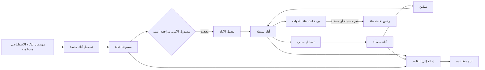
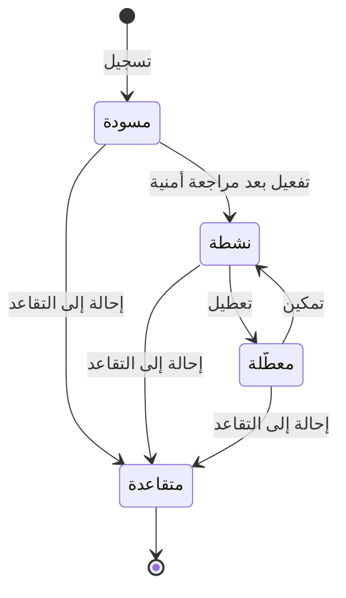

# سجل أدوات الذكاء الاصطناعي

<!-- BEGIN GENERATED: doc -->
| البند | القيمة |
|---|---|
| المعرّف | FEAT-AI-TOOLS |
| الإصدار | 0.1 |
| الحالة | مسودة |
| القدرة | CAP-12 المساعدة بالذكاء الاصطناعي |
| القدرة الفرعية | CAP-12.01 الاسترجاع والإجابة المؤرّضة (R2) |
| الأدوار | مهندس الذكاء الاصطناعي وحوكمته؛ مسؤول الأمن |
| الشاشات | SCR-51 النماذج والتوجيه والأدوات والاستهلاك |
| حالات الاستخدام | UC-071، UC-077 |
| القصص | 9: 6 من المواصفة، و3 جديدة |
<!-- END GENERATED: doc -->

## 1. نظرة عامة

### 1.1 القيمة

يضمن أن كل أداة يستخدمها الذكاء الاصطناعي مسجلة بصلاحيتها ومستوى استقلاليتها، ويمكن لمسؤول الأمن تفعيلها أو تعطيلها.

### 1.2 النطاق

| البند | القيمة |
|---|---|
| المستخدمون | مهندس الذكاء الاصطناعي وحوكمته (يسجّل الأداة) · مسؤول الأمن (يراجع ويفعّل ويعطّل ويمكّن ويحيل إلى التقاعد) · النظام (بوابة استدعاء الأدوات) |
| الشاشات | SCR-51 النماذج والتوجيه والأدوات والاستهلاك |
| حالات الاستخدام (بالكلمات) | تسجيل أداة الذكاء الاصطناعي وتفعيلها وتعطيلها وتمكينها وإحالتها إلى التقاعد؛ جلب سجل الأدوات؛ منع استدعاء أداة غير مسجلة أو معطَّلة؛ توثيق المراجعة الأمنية قبل التفعيل؛ إدارة السجل حسب الحالة على الشاشة |
| المتطلبات (بالكلمات) | تسجيل كل أداة متاحة لتشغيلات الذكاء الاصطناعي بصلاحيتها ومستوى استقلاليتها، ومنع استدعاء أداة غير مسجلة (REQ-AI-013)؛ معاملة محتوى مسترجَع يحوي تعليمات كبيانات لا تغيّر الأدوات أو الصلاحيات أو المستلمين (REQ-AI-012) |
| خارج النطاق | توجيه الذكاء الاصطناعي ونماذجه (ميزة «توجيه نماذج الذكاء الاصطناعي»)؛ تنفيذ طلب الذكاء الاصطناعي وإصدار نتيجته |

### 1.3 خريطة الميزة

**الشكل 1: دورة حياة أداة الذكاء الاصطناعي من التسجيل إلى الاستدعاء**



**الشكل 2: رحلة أداة الذكاء الاصطناعي بين حالاتها**



## 2. القواعد المشتركة

تنطبق على كل قصص الميزة، فلا تتكرر داخل القصص. وكل قصة تذكر ما يخصها فقط.

### 2.1 السياق المشترك

كل قصة تبدأ من ثلاثة شروط: مستأجر نشط، وحزمة السياسات الأساسية مفعّلة، ومستخدم مسجّل الدخول ومخوَّل. وتشير إليها القصص بخطوة واحدة: «بفرض السياق المشترك للميزة».

### 2.2 الصلاحية وعدم الإفصاح

- من لا يحق له رؤية العنصر يتلقى ردًا بشكل «غير متاح» تمامًا، فلا يعرف أنه موجود.
- من يرى العنصر ولا يحق له الإجراء يتلقى «لا تملك صلاحية هذا الإجراء».

### 2.3 أوامر تغيير الحالة

- **منع التكرار:** يُرسل كل أمر بمفتاح فريد، فإعادة الطلب نفسه لا تُنفَّذ مرتين.
- **حماية التعديل المتزامن:** يُرسل كل أمر بإصدار البيانات الذي يراه المستخدم. فإن عدّلها غيره في الأثناء، يُرفض الأمر.
- **السجل:** إن نجح الأمر، يُكتب حدثه وسجل التدقيق في المعاملة نفسها.

### 2.4 الرفض المشترك

```gherkin
# language: ar
خاصية: الرفض المشترك لأوامر الميزة

  سيناريو مخطط: رفض مشترك لكل أمر في الميزة
    بفرض السياق المشترك للميزة
    و <الحالة>
    عندما يُرسل المستخدم أي أمر من أوامر الميزة
    اذاً يُرفض برمز <الرمز> ويرى "<الرسالة>"
    و لا يتغير شيء

    امثلة:
      | الحالة                                  | الرمز                  | الرسالة                                                 |
      | العنصر خارج صلاحياته                    | NOT_FOUND              | غير متاح                                                |
      | العنصر مرئي له ولا يحق له الإجراء       | AUTHZ_DENIED           | لا تملك صلاحية هذا الإجراء                              |
      | غيره عدّل العنصر بعد أن فتحه            | VERSION_CONFLICT       | تغيّرت البيانات منذ فتحتها. راجع التغييرات ثم أعد المحاولة |
      | أعاد مفتاح منع التكرار بمحتوى مختلف     | IDEMPOTENCY_KEY_REUSED | طلب مكرر بمحتوى مختلف                                   |
      | البيانات ناقصة أو غير صحيحة             | VALIDATION_FAILED      | بعض البيانات ناقصة أو غير صحيحة. راجع الحقول المعلَّمة      |

  سيناريو: إعادة الطلب نفسه لا تُنفَّذ مرتين
    بفرض السياق المشترك للميزة
    و أمر نجح بمفتاح منع تكرار
    عندما يُعاد الطلب نفسه بالمفتاح نفسه
    اذاً تُعاد النتيجة الأولى ولا يُكتب حدث ثانٍ
```

## 3. الجودة وتعريف الاكتمال

### 3.1 متطلبات الجودة

<!-- BEGIN GENERATED: quality -->
| المرجع | الموقف | المطلوب |
|---|---|---|
| QAS-AI-004 | prompt-injection, exfiltration and unauthorized-retrieval suites | 0 unauthorized retrievals, 0 tool abuse, 0 cross-tenant leakage |
<!-- END GENERATED: quality -->

### 3.2 تعريف الاكتمال

القصة مكتملة حين تتحقق الشروط الخمسة:

1. سيناريوهاتها والقواعد المشتركة تمر في الاختبار الآلي.
2. فحوص البنية المعمارية تمر.
3. نصوص الواجهة والرسائل موجودة بالعربية والإنجليزية.
4. مراجعة الكود مكتملة.
5. ما تضيفه القصة نفسها في قسم «القواعد» تحقق.

## 4. فهرس القصص

<!-- BEGIN GENERATED: story-index -->
| المعرّف | القصة | النوع | الحالة |
|---|---|---|---|
| `US-BC07-TOL-ACTIVATE` | تفعيل أداة الذكاء الاصطناعي | أمر | مسودة |
| `US-BC07-TOL-DISABLE` | تعطيل أداة الذكاء الاصطناعي | أمر | مسودة |
| `US-BC07-TOL-ENABLE` | تمكين أداة الذكاء الاصطناعي | أمر | مسودة |
| `US-BC07-TOL-REGISTER` | تسجيل أداة الذكاء الاصطناعي | أمر | مسودة |
| `US-BC07-TOL-RETIRE` | إحالة أداة الذكاء الاصطناعي إلى التقاعد | أمر | مسودة |
| `US-BC07-Q-TOL-LIST` | جلب: Tool registry | جلب | مسودة |
| `US-UI-SCR51-TOOLS` | إدارة سجل الأدوات حسب الحالة | واجهة | مسودة |
| `US-PLT-AI-TOOL-GATE` | منع استدعاء أداة غير مسجلة أو معطلة | منصة | مسودة |
| `US-OPS-AI-TOOL-REVIEW-EVIDENCE` | توثيق المراجعة الأمنية قبل تفعيل الأداة | تشغيل | مسودة |
<!-- END GENERATED: story-index -->

## 5. القصص

### 5.1 US-BC07-TOL-ACTIVATE — تفعيل أداة الذكاء الاصطناعي

| النوع | الإصدار | الأولوية | دون اتصال | الحالة |
|---|---|---|---|---|
| أمر | R2 | Must | لا | مسودة |

> **كـ** مسؤول الأمن، **أريد** تفعيل أداة الذكاء الاصطناعي بعد مراجعة أمنية ناجحة، **حتى** يستطيع تشغيل الذكاء الاصطناعي استدعاءها بأمان.

**باختصار:** بعد مراجعة أمنية تغطي الحقن والتسريب والنطاق، يفعّل مسؤول الأمن الأداة بمرجع المراجعة، فتصير «نشطة».

#### القواعد

- **متى يُسمح:** الأداة في حالة «مسودة»، ومرجع مراجعة أمنية ناجحة يغطي الحقن والتسريب والنطاق.
- **من يُسمح له:** مسؤول الأمن فقط، لا من سجّل الأداة (فصل المهام).
- **البيانات:** مرجع المراجعة الأمنية (إلزامي).
- **الأثر:** الحالة تصير «نشطة»، ويُسجَّل حدث «فُعِّلت أداة الذكاء الاصطناعي»، ويصل إلى خدمة إصدار الأمان فتُحدَّث ذاكرات قرار الصلاحية.

#### معايير القبول

```gherkin
# language: ar
خاصية: تفعيل أداة الذكاء الاصطناعي

  سيناريو: تفعيل أداة بمرجع مراجعة أمنية ناجحة
    بفرض السياق المشترك للميزة
    و أداة ذكاء اصطناعي في حالة "مسودة"
    عندما يفعّلها مسؤول الأمن بمرجع مراجعة أمنية ناجحة
    اذاً تصبح حالتها "نشطة"
    و يُسجَّل حدث "فُعِّلت أداة الذكاء الاصطناعي"

  سيناريو مخطط: رفض خاص بتفعيل الأداة
    بفرض السياق المشترك للميزة
    و <الحالة>
    عندما يحاول تفعيل الأداة
    اذاً يُرفض برمز <الرمز> ويرى <الرسالة>
    و لا يتغير شيء

    امثلة:
      | الحالة                                                   | الرمز                             | الرسالة                                                   |
      | الأداة ليست في حالة "مسودة"                              | AI_TOOL_INVALID_STATE_TRANSITION  | الوضع الحالي لأداة الذكاء الاصطناعي لا يسمح بهذا الإجراء |
      | لا مرجع مراجعة أمنية ناجحة، أو المفعِّل ليس مسؤول الأمن  | SECURITY_REVIEW_REQUIRED          | الأداة تحتاج مراجعة أمنية معتمدة                          |
```

<details><summary>المراجع التقنية والتتبع</summary>

<!-- BEGIN GENERATED: refs US-BC07-TOL-ACTIVATE -->
| البند | المعرّف | المعنى |
|---|---|---|
| الواجهة البرمجية | `POST /api/v1/ai/tools/{id}/actions/activate` | — |
| الأمر | `CMD-TOL-ACTIVATE` | تفعيل أداة الذكاء الاصطناعي |
| السياسة | `POL-TOL-ACTIVATE` | AI platform engineer (register) · Security Officer (activate, disable)؛ tenant match; object visible |
| الحدث | `EVT-TOL-ACTIVATED` | يصل إلى: Security-version service (EVT-SEC-VERSION-INCREMENTED); PEP decision caches; Projection security-ver… |
| الكيان | `AGG-AI-TOOL` | أداة الذكاء الاصطناعي |
| الجدول | `ai.ai_tools` | الجدول الرئيسي لأداة الذكاء الاصطناعي |
| وحدة النشر | DU-16 | — |
| المتطلبات | REQ-AI-013، REQ-AI-012 | معانيها في القسم 6. التتبع |
| حالات الاستخدام | UC-071، UC-077 | Retrieve Authorized Context؛ Configure AI Routing & Tool Registry |
| الاختبار | TST-AI-TOOL-SM، TST-SLC10-INVARIANTS | دورة حالات أداة الذكاء الاصطناعي، وثوابت الشريحة SLC-10 |
<!-- END GENERATED: refs US-BC07-TOL-ACTIVATE -->

</details>

### 5.2 US-BC07-TOL-DISABLE — تعطيل أداة الذكاء الاصطناعي

| النوع | الإصدار | الأولوية | دون اتصال | الحالة |
|---|---|---|---|---|
| أمر | R2 | Must | لا | مسودة |

> **كـ** مسؤول الأمن، **أريد** تعطيل أداة نشطة بذكر سبب، **حتى** يتوقف استدعاؤها فورًا حين يظهر خطر أو سوء استخدام.

**باختصار:** يعطّل مسؤول الأمن أداة «نشطة» بذكر السبب، فتصير «معطَّلة» ويُرفض استدعاؤها.

#### القواعد

- **متى يُسمح:** الأداة في حالة «نشطة».
- **من يُسمح له:** مسؤول الأمن.
- **البيانات:** سبب التعطيل (إلزامي).
- **الأثر:** الحالة تصير «معطَّلة»، ويُسجَّل حدث «عُطِّلت أداة الذكاء الاصطناعي»، ويصل إلى بوابة استدعاء الأدوات فترفض أي نداء لها.

#### معايير القبول

```gherkin
# language: ar
خاصية: تعطيل أداة الذكاء الاصطناعي

  سيناريو: تعطيل أداة نشطة بسبب
    بفرض السياق المشترك للميزة
    و أداة ذكاء اصطناعي في حالة "نشطة"
    عندما يعطّلها مسؤول الأمن بسبب
    اذاً تصبح حالتها "معطَّلة"
    و يُسجَّل حدث "عُطِّلت أداة الذكاء الاصطناعي"

  سيناريو مخطط: رفض خاص بالتعطيل
    بفرض السياق المشترك للميزة
    و <الحالة>
    عندما يحاول تعطيل الأداة
    اذاً يُرفض برمز <الرمز> ويرى <الرسالة>
    و لا يتغير شيء

    امثلة:
      | الحالة                          | الرمز                             | الرسالة                                                   |
      | الأداة ليست في حالة "نشطة"      | AI_TOOL_INVALID_STATE_TRANSITION  | الوضع الحالي لأداة الذكاء الاصطناعي لا يسمح بهذا الإجراء |
      | حقل السبب غير مرسل في الطلب     | VALIDATION_FAILED                 | السبب مطلوب                                                |
      | السبب فارغ فعليًا               | REASON_REQUIRED                   | اذكر السبب                                                 |
```

<details><summary>المراجع التقنية والتتبع</summary>

<!-- BEGIN GENERATED: refs US-BC07-TOL-DISABLE -->
| البند | المعرّف | المعنى |
|---|---|---|
| الواجهة البرمجية | `POST /api/v1/ai/tools/{id}/actions/disable` | — |
| الأمر | `CMD-TOL-DISABLE` | تعطيل أداة الذكاء الاصطناعي |
| السياسة | `POL-TOL-DISABLE` | AI platform engineer (register) · Security Officer (activate, disable)؛ tenant match; object visible |
| الحدث | `EVT-TOL-DISABLED` | يصل إلى: Security-version service (EVT-SEC-VERSION-INCREMENTED); PEP decision caches; Projection security-ver… |
| الكيان | `AGG-AI-TOOL` | أداة الذكاء الاصطناعي |
| الجدول | `ai.ai_tools` | الجدول الرئيسي لأداة الذكاء الاصطناعي |
| وحدة النشر | DU-16 | — |
| المتطلبات | REQ-AI-013، REQ-AI-012 | معانيها في القسم 6. التتبع |
| حالات الاستخدام | UC-071، UC-077 | Retrieve Authorized Context؛ Configure AI Routing & Tool Registry |
| الاختبار | TST-AI-TOOL-SM، TST-SLC10-INVARIANTS | دورة حالات أداة الذكاء الاصطناعي، وثوابت الشريحة SLC-10 |
<!-- END GENERATED: refs US-BC07-TOL-DISABLE -->

</details>

### 5.3 US-BC07-TOL-ENABLE — تمكين أداة الذكاء الاصطناعي

| النوع | الإصدار | الأولوية | دون اتصال | الحالة |
|---|---|---|---|---|
| أمر | R2 | Must | لا | مسودة |

> **كـ** مسؤول الأمن، **أريد** تمكين أداة معطَّلة بعد التأكد من أمانها، **حتى** يستطيع تشغيل الذكاء الاصطناعي استدعاءها مرة أخرى.

**باختصار:** يمكّن مسؤول الأمن أداة «معطَّلة» دون شروط إضافية، فتعود «نشطة».

#### القواعد

- **متى يُسمح:** الأداة في حالة «معطَّلة».
- **من يُسمح له:** مسؤول الأمن.
- **الأثر:** الحالة تعود «نشطة»، ويُسجَّل حدث «مُكِّنت أداة الذكاء الاصطناعي».

#### معايير القبول

```gherkin
# language: ar
خاصية: تمكين أداة الذكاء الاصطناعي

  سيناريو: تمكين أداة معطَّلة
    بفرض السياق المشترك للميزة
    و أداة ذكاء اصطناعي في حالة "معطَّلة"
    عندما يمكّنها مسؤول الأمن
    اذاً تصبح حالتها "نشطة"
    و يُسجَّل حدث "مُكِّنت أداة الذكاء الاصطناعي"

  سيناريو مخطط: رفض خاص بالتمكين
    بفرض السياق المشترك للميزة
    و <الحالة>
    عندما يحاول تمكين الأداة
    اذاً يُرفض برمز <الرمز> ويرى <الرسالة>
    و لا يتغير شيء

    امثلة:
      | الحالة                         | الرمز                             | الرسالة                                                   |
      | الأداة ليست في حالة "معطَّلة"  | AI_TOOL_INVALID_STATE_TRANSITION  | الوضع الحالي لأداة الذكاء الاصطناعي لا يسمح بهذا الإجراء |
```

<details><summary>المراجع التقنية والتتبع</summary>

<!-- BEGIN GENERATED: refs US-BC07-TOL-ENABLE -->
| البند | المعرّف | المعنى |
|---|---|---|
| الواجهة البرمجية | `POST /api/v1/ai/tools/{id}/actions/enable` | — |
| الأمر | `CMD-TOL-ENABLE` | تمكين أداة الذكاء الاصطناعي |
| السياسة | `POL-TOL-ENABLE` | Security Officer (enable)؛ tenant match; object visible |
| الحدث | `EVT-TOL-ENABLED` | يصل إلى: Tool gateway |
| الكيان | `AGG-AI-TOOL` | أداة الذكاء الاصطناعي |
| الجدول | `ai.ai_tools` | الجدول الرئيسي لأداة الذكاء الاصطناعي |
| وحدة النشر | DU-16 | — |
| المتطلبات | REQ-AI-013، REQ-AI-012 | معانيها في القسم 6. التتبع |
| حالات الاستخدام | UC-071، UC-077 | Retrieve Authorized Context؛ Configure AI Routing & Tool Registry |
| الاختبار | TST-AI-TOOL-SM، TST-SLC10-INVARIANTS | دورة حالات أداة الذكاء الاصطناعي، وثوابت الشريحة SLC-10 |
<!-- END GENERATED: refs US-BC07-TOL-ENABLE -->

</details>

### 5.4 US-BC07-TOL-REGISTER — تسجيل أداة الذكاء الاصطناعي

| النوع | الإصدار | الأولوية | دون اتصال | الحالة |
|---|---|---|---|---|
| أمر | R2 | Must | لا | مسودة |

> **كـ** مهندس الذكاء الاصطناعي وحوكمته، **أريد** تسجيل أداة جديدة باسمها ووصفها ومخطط مدخلاتها وأثرها والصلاحية التي تحتاجها وحد استقلاليتها، **حتى** تصبح متاحة للمراجعة الأمنية قبل أن يستدعيها أي تشغيل ذكاء اصطناعي.

**باختصار:** يسجّل مهندس الذكاء الاصطناعي وحوكمته أداة جديدة ببياناتها كاملة، فتبدأ «مسودة» بانتظار المراجعة الأمنية.

#### القواعد

- **من يُسمح له:** مهندس الذكاء الاصطناعي وحوكمته.
- **البيانات:** الاسم، الوصف، مخطط مدخلات الأداة، الاستعلام أو الأمر الأساسي الذي تستدعيه، الأثر («قراءة» أو «اقتراح» فقط؛ لا أداة بأثر «كتابة» في هذا الإصدار)، الصلاحية المطلوبة، وحد الاستقلالية الأقصى — كلها إلزامية.
- **الأثر:** تُنشأ الأداة بحالة «مسودة»، ويُسجَّل حدث «سُجِّلت أداة الذكاء الاصطناعي».

#### معايير القبول

```gherkin
# language: ar
خاصية: تسجيل أداة الذكاء الاصطناعي

  سيناريو: تسجيل أداة جديدة ببيانات كاملة
    بفرض السياق المشترك للميزة
    عندما يسجّل مهندس الذكاء الاصطناعي وحوكمته أداة باسمها ووصفها ومخطط مدخلاتها وأثرها وصلاحيتها وحد استقلاليتها
    اذاً تُنشأ الأداة بحالة "مسودة"
    و يُسجَّل حدث "سُجِّلت أداة الذكاء الاصطناعي"

  سيناريو مخطط: رفض خاص بالتسجيل
    بفرض السياق المشترك للميزة
    و <الحالة>
    عندما يحاول تسجيل الأداة
    اذاً يُرفض برمز <الرمز> ويرى <الرسالة>
    و لا يتغير شيء

    امثلة:
      | الحالة                                                                                  | الرمز        | الرسالة                     |
      | أحد الحقول الأساسية غير مكتمل: الاسم أو مخطط المدخلات أو الاستعلام الأساسي أو الأثر أو الصلاحية أو حد الاستقلالية | TOOL_INVALID | تعريف الأداة غير صحيح |
```

<details><summary>المراجع التقنية والتتبع</summary>

<!-- BEGIN GENERATED: refs US-BC07-TOL-REGISTER -->
| البند | المعرّف | المعنى |
|---|---|---|
| الواجهة البرمجية | `POST /api/v1/ai/tools` | — |
| الأمر | `CMD-TOL-REGISTER` | تسجيل أداة الذكاء الاصطناعي |
| السياسة | `POL-TOL-REGISTER` | AI platform engineer (register) · Security Officer (activate, disable)؛ tenant match; object visible |
| الحدث | `EVT-TOL-REGISTERED` | يصل إلى: Tool gateway |
| الكيان | `AGG-AI-TOOL` | أداة الذكاء الاصطناعي |
| الجدول | `ai.ai_tools` | الجدول الرئيسي لأداة الذكاء الاصطناعي |
| وحدة النشر | DU-16 | — |
| المتطلبات | REQ-AI-013، REQ-AI-012 | معانيها في القسم 6. التتبع |
| حالات الاستخدام | UC-071، UC-077 | Retrieve Authorized Context؛ Configure AI Routing & Tool Registry |
| الاختبار | TST-AI-TOOL-SM، TST-SLC10-INVARIANTS | دورة حالات أداة الذكاء الاصطناعي، وثوابت الشريحة SLC-10 |
<!-- END GENERATED: refs US-BC07-TOL-REGISTER -->

</details>

### 5.5 US-BC07-TOL-RETIRE — إحالة أداة الذكاء الاصطناعي إلى التقاعد

| النوع | الإصدار | الأولوية | دون اتصال | الحالة |
|---|---|---|---|---|
| أمر | R2 | Must | لا | مسودة |

> **كـ** مسؤول الأمن، **أريد** إحالة أداة إلى التقاعد نهائيًا بذكر سبب، من أي حالة غير نهائية، **حتى** تُستبعد الأداة كليًا حين لا تعود مطلوبة أو ثبت خطرها.

**باختصار:** من حالة «مسودة» أو «نشطة» أو «معطَّلة»، يحيل مسؤول الأمن الأداة إلى التقاعد بسبب، فتصير «متقاعدة» نهائيًا.

#### القواعد

- **متى يُسمح:** الأداة في حالة «مسودة» أو «نشطة» أو «معطَّلة».
- **من يُسمح له:** مسؤول الأمن.
- **البيانات:** سبب التقاعد (إلزامي).
- **الأثر:** الحالة تصير «متقاعدة» نهائيًا، ويُسجَّل حدث «أُحيلت أداة الذكاء الاصطناعي إلى التقاعد»، ويصل إلى بوابة استدعاء الأدوات فتمنع أي نداء لها نهائيًا.

#### معايير القبول

```gherkin
# language: ar
خاصية: إحالة أداة الذكاء الاصطناعي إلى التقاعد

  سيناريو: إحالة أداة نشطة إلى التقاعد بسبب
    بفرض السياق المشترك للميزة
    و أداة ذكاء اصطناعي في حالة "نشطة"
    عندما يحيلها مسؤول الأمن إلى التقاعد بسبب
    اذاً تصبح حالتها "متقاعدة"
    و يُسجَّل حدث "أُحيلت أداة الذكاء الاصطناعي إلى التقاعد"

  سيناريو مخطط: رفض خاص بالتقاعد
    بفرض السياق المشترك للميزة
    و <الحالة>
    عندما يحاول إحالة الأداة إلى التقاعد
    اذاً يُرفض برمز <الرمز> ويرى <الرسالة>
    و لا يتغير شيء

    امثلة:
      | الحالة                           | الرمز                             | الرسالة                                                   |
      | الأداة في حالة "متقاعدة" من قبل  | AI_TOOL_INVALID_STATE_TRANSITION  | الوضع الحالي لأداة الذكاء الاصطناعي لا يسمح بهذا الإجراء |
      | حقل السبب غير مرسل في الطلب      | VALIDATION_FAILED                 | السبب مطلوب                                                |
      | السبب فارغ فعليًا                | REASON_REQUIRED                   | اذكر السبب                                                 |
```

<details><summary>المراجع التقنية والتتبع</summary>

<!-- BEGIN GENERATED: refs US-BC07-TOL-RETIRE -->
| البند | المعرّف | المعنى |
|---|---|---|
| الواجهة البرمجية | `POST /api/v1/ai/tools/{id}/actions/retire` | — |
| الأمر | `CMD-TOL-RETIRE` | إحالة أداة الذكاء الاصطناعي إلى التقاعد |
| السياسة | `POL-TOL-RETIRE` | Security Officer (retire)؛ tenant match; object visible |
| الحدث | `EVT-TOL-RETIRED` | يصل إلى: Tool gateway |
| الكيان | `AGG-AI-TOOL` | أداة الذكاء الاصطناعي |
| الجدول | `ai.ai_tools` | الجدول الرئيسي لأداة الذكاء الاصطناعي |
| وحدة النشر | DU-16 | — |
| المتطلبات | REQ-AI-013، REQ-AI-012 | معانيها في القسم 6. التتبع |
| حالات الاستخدام | UC-071، UC-077 | Retrieve Authorized Context؛ Configure AI Routing & Tool Registry |
| الاختبار | TST-AI-TOOL-SM، TST-SLC10-INVARIANTS | دورة حالات أداة الذكاء الاصطناعي، وثوابت الشريحة SLC-10 |
<!-- END GENERATED: refs US-BC07-TOL-RETIRE -->

</details>

### 5.6 US-BC07-Q-TOL-LIST — جلب سجل الأدوات

| النوع | الإصدار | الأولوية | دون اتصال | الحالة |
|---|---|---|---|---|
| جلب | R2 | Must | لا | مسودة |

> **كـ** مهندس الذكاء الاصطناعي وحوكمته أو مسؤول الأمن، **أريد** جلب سجل أدوات الذكاء الاصطناعي بحالاتها، **حتى** أعرف أي أداة نشطة أو معطَّلة أو بانتظار المراجعة.

**باختصار:** تُعاد الأدوات التي يحق لطالب القائمة رؤيتها فقط، صفحةً بعد صفحة، ولا يكشف الرد عن أداة محجوبة.

#### القواعد

- **من يُسمح له:** مهندس الذكاء الاصطناعي وحوكمته، ومسؤول الأمن.
- **البيانات:** المؤشر والحد (الترقيم بالمؤشر، لا بالإزاحة).

#### معايير القبول

```gherkin
# language: ar
خاصية: جلب سجل الأدوات

  سيناريو: يرى المخوَّل سجل الأدوات لجهته
    بفرض السياق المشترك للميزة
    عندما يطلب مهندس الذكاء الاصطناعي وحوكمته سجل أدوات جهته
    اذاً تُعاد الأدوات بعد التحقق من صلاحية كل منها مجددًا
    و لا يكشف الرد عن عدد أو وجود أداة محجوبة

  سيناريو: الصفحة التالية
    بفرض السياق المشترك للميزة
    و سجل الأدوات أكثر من صفحة
    عندما يطلب المخوَّل الصفحة التالية بالمؤشر
    اذاً تُعاد الأدوات التالية دون تكرار ولا فجوة
```

<details><summary>المراجع التقنية والتتبع</summary>

<!-- BEGIN GENERATED: refs US-BC07-Q-TOL-LIST -->
| البند | المعرّف | المعنى |
|---|---|---|
| الواجهة البرمجية | `GET /api/v1/ai/tools` | — |
| الاستعلام | `QRY-TOL-LIST` | Tool registry |
| السياسة | `POL-TOL-LIST` | AI governance, Security Officer |
| الكيان | `AGG-AI-TOOL` | أداة الذكاء الاصطناعي |
| الجدول | `ai.ai_tools` | الجدول الرئيسي لأداة الذكاء الاصطناعي |
| وحدة النشر | DU-16 | — |
| المتطلب | REQ-AI-013 | The system shall register every tool available to AI runs, with the permission it requires and its autonomy l… |
| حالة الاستخدام | UC-077 | Configure AI Routing & Tool Registry |
| الاختبار | TST-AI-TOOL-SM، TST-SLC10-INVARIANTS | دورة حالات أداة الذكاء الاصطناعي، وثوابت الشريحة SLC-10 |
<!-- END GENERATED: refs US-BC07-Q-TOL-LIST -->

</details>

### 5.7 US-UI-SCR51-TOOLS — إدارة سجل الأدوات حسب الحالة

| النوع | الإصدار | الأولوية | دون اتصال | الحالة |
|---|---|---|---|---|
| واجهة | R2 | Must | لا | مسودة |

> **كـ** **[للكتابة]**، **أريد** **[للكتابة]**، **حتى** **[للكتابة]**.

**باختصار:** **[للكتابة]**

#### القواعد

**[للكتابة]**

#### معايير القبول

**[للكتابة]**

<details><summary>المراجع التقنية والتتبع</summary>

<!-- BEGIN GENERATED: refs US-UI-SCR51-TOOLS -->
| البند | المعرّف | المعنى |
|---|---|---|
| حالة الاستخدام | UC-077 | Configure AI Routing & Tool Registry |
| الشاشة | SCR-51 | شاشة النماذج والتوجيه والأدوات والاستهلاك |
| المصدر | `US-BC07-Q-TOL-LIST` | — |
| المصدر | `[Derived]` | — |
| المتطلب | REQ-AI-013 | The system shall register every tool available to AI runs, with the permission it requires and its autonomy l… |
| حالة الاستخدام | UC-077 | Configure AI Routing & Tool Registry |
<!-- END GENERATED: refs US-UI-SCR51-TOOLS -->

</details>

### 5.8 US-PLT-AI-TOOL-GATE — منع استدعاء أداة غير مسجلة أو معطلة

| النوع | الإصدار | الأولوية | دون اتصال | الحالة |
|---|---|---|---|---|
| منصة | R2 | Must | لا ينطبق | مسودة |

> **كـ** **[للكتابة]**، **أريد** **[للكتابة]**، **حتى** **[للكتابة]**.

**باختصار:** **[للكتابة]**

#### القواعد

**[للكتابة]**

#### معايير القبول

**[للكتابة]**

<details><summary>المراجع التقنية والتتبع</summary>

<!-- BEGIN GENERATED: refs US-PLT-AI-TOOL-GATE -->
| البند | المعرّف | المعنى |
|---|---|---|
| المصدر | `THR-S10-02` | — |
| المصدر | `03-domain/contexts/BC07/grounded-ai-spec.md §5` | — |
| المتطلب | REQ-AI-013 | The system shall register every tool available to AI runs, with the permission it requires and its autonomy l… |
| حالة الاستخدام | UC-077 | Configure AI Routing & Tool Registry |
<!-- END GENERATED: refs US-PLT-AI-TOOL-GATE -->

</details>

### 5.9 US-OPS-AI-TOOL-REVIEW-EVIDENCE — توثيق المراجعة الأمنية قبل تفعيل الأداة

| النوع | الإصدار | الأولوية | دون اتصال | الحالة |
|---|---|---|---|---|
| تشغيل | R2 | Must | لا ينطبق | مسودة |

> **كـ** **[للكتابة]**، **أريد** **[للكتابة]**، **حتى** **[للكتابة]**.

**باختصار:** **[للكتابة]**

#### القواعد

**[للكتابة]**

#### معايير القبول

**[للكتابة]**

<details><summary>المراجع التقنية والتتبع</summary>

<!-- BEGIN GENERATED: refs US-OPS-AI-TOOL-REVIEW-EVIDENCE -->
| البند | المعرّف | المعنى |
|---|---|---|
| المصدر | `US-BC07-TOL-ACTIVATE` | — |
| الجودة | QAS-AI-004 | prompt-injection, exfiltration and unauthorized-retrieval suites → 0 unauthorized retrievals, 0 tool abuse, 0… |
| المصدر | `[Derived]` | — |
| المتطلب | REQ-AI-013 | The system shall register every tool available to AI runs, with the permission it requires and its autonomy l… |
| حالة الاستخدام | UC-077 | Configure AI Routing & Tool Registry |
<!-- END GENERATED: refs US-OPS-AI-TOOL-REVIEW-EVIDENCE -->

</details>

## 6. التتبع

<!-- BEGIN GENERATED: trace -->
| المتطلب | المعنى | القصص | الاختبار |
|---|---|---|---|
| REQ-AI-012 | If content retrieved into a context package contains instructions, then the system shall treat it as data and… | كل قصص الأوامر والنظام في الميزة (5) | TST-AI-REQUEST-SM، TST-AI-TOOL-SM، TST-SLC10-INVARIANTS |
| REQ-AI-013 | The system shall register every tool available to AI runs, with the permission it requires and its autonomy l… | `US-BC07-Q-TOL-LIST`، `US-BC07-TOL-ACTIVATE`، `US-BC07-TOL-DISABLE`، `US-BC07-TOL-ENABLE`، `US-BC07-TOL-REGISTER`، `US-BC07-TOL-RETIRE`، `US-OPS-AI-TOOL-REVIEW-EVIDENCE`، `US-PLT-AI-TOOL-GATE`، `US-UI-SCR51-TOOLS` | TST-AI-TOOL-SM، TST-SLC10-INVARIANTS |
<!-- END GENERATED: trace -->

## 7. سجل التغييرات

| الإصدار | التاريخ | التغيير |
|---|---|---|
| 0.1 | — | هيكل مولَّد من خريطة الميزات |
